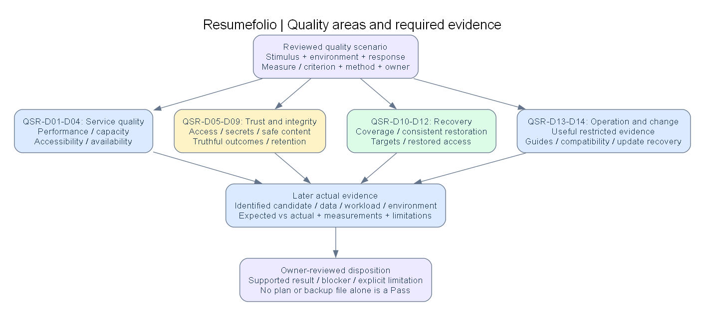
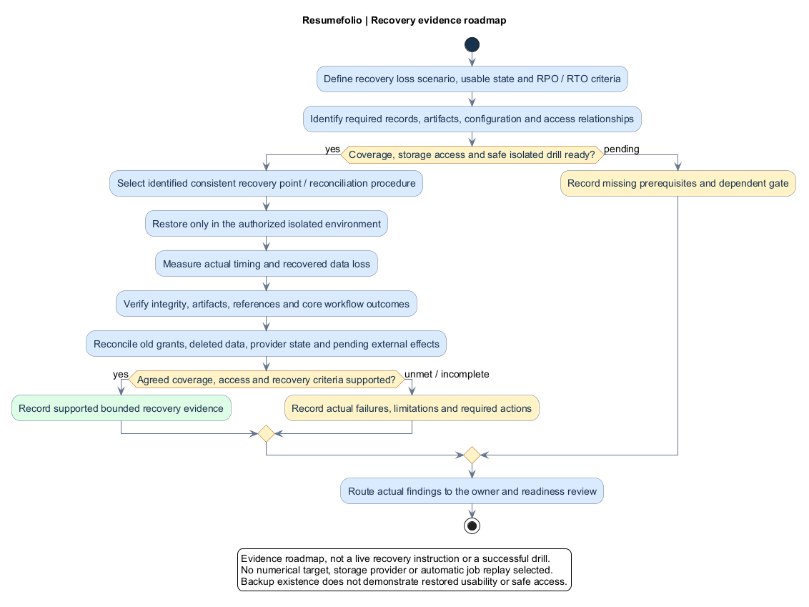

# Resumefolio — Quality, Security and Recovery Requirements

Current implementation choices and scope: [Baseline](../../../baseline/README.md). Runtime verification remains subject to its gates.

| Item | Current position |
| --- | --- |
| Owner | Farhad; sole delivery and operations owner |
| Status | Proposed quality specification — numerical targets, detailed controls and acceptance pending |
| Basis | Accepted scope/resource constraints; DEC-017/018/019/024/025/028 and planning follow-up |
| Candidate references | QSR-D01–QSR-D14 are provisional document-local references, not allocated global requirement IDs |
| Priority | Unassigned; order does not establish delivery priority or an accepted risk rating |
| Revision | October 31, 2026 |

**At a glance:** Evaluate quality against explicit conditions and observable
criteria. Protect resource boundaries, preserve truthful and consistent outcomes,
and demonstrate recovery of the required data and access state. Targets and
controls need decisions and evidence; a document, backup file or successful page
load is not a verified quality, security or recovery result.

[Basis](#1-purpose-and-boundaries) · [Measurement](#2-quality-scenario-and-measurement-contract)
· [Requirements](#3-proposed-requirements) · [Recovery](#4-recovery-coverage-and-consistency)
· [Roadmap](#5-evidence-and-recovery-roadmap) · [Gates](#7-open-targets-and-decision-gates)
· [Review](#8-traceability-and-review-readiness)

## 1. Purpose and Boundaries

Specify cross-cutting quality, security, operational and recovery obligations for
the full [Version 1 Scope](../../01-project-planning/02-scope.md), including
professional presentation, controlled sharing, manual applications, Gmail/calendar,
Kanban, real Git and conditional workflow execution. Domain documents retain
their detailed behavior; these requirements add evaluation conditions and evidence needs.

| Authority / reference | Boundary to retain |
| --- | --- |
| [Resources and Constraints](../../01-project-planning/05-resources-and-constraints.md) | Existing resources/budget, solo operation and Laravel/OOP; actual capacity unverified |
| [Risks](../../01-project-planning/07-risks.md) | Existing resource, access, execution, data-loss and operational risks; no new rating assigned |
| [Planning Gates](../../01-project-planning/10-planning-completion-criteria.md) | Planning-only acceptance; relevant GAP-D investigations remain open |
| [Roadmap and Milestones](../../01-project-planning/08-roadmap-and-milestones.md) | Design evidence in M-03; controls before execution/M-08; integrated quality/restoration before M-09; live deployment evidence for M-10 |
| [Accounts](accounts-authentication-and-permissions.md) / [PDF and Sharing](pdf-and-controlled-sharing.md) | Resource-specific authority and direct-file protection; detailed session/revocation policy pending |
| [Business Lifecycle](business-rules-and-data-lifecycle.md) / [Data Dictionary](../05-data-definitions/data-dictionary.md) | Source/history separation, references, retention and restored access |
| [External Interfaces](external-interface-requirements.md) / [Files and Operations](administration-files-and-operational-behavior.md) | Supported clients, truthful boundaries, effective quotas and failed-operation handling |
| [Google Integration](email-calendar-and-google-integration.md) / [Git Hosting](git-hosting-and-collaboration.md) / [YAML and CI/CD](yaml-workflows-and-cicd.md) | Actual provider/client evidence and distinct execution/deployment authority |

The initial target is 10 users, not 10 simultaneous active sessions or an agreed
load model. Approximately 1,000 users is a growth direction, not demonstrated
capacity. The requested November 8, 2026 date is not a validated delivery forecast.
No target below invents an availability percentage, response-time limit,
retention period, RPO/RTO, browser support list or security certification.

## 2. Quality Scenario and Measurement Contract

Each measurable quality record needs the following before acceptance. Qualitative
security/integrity invariants can be tested with explicit allowed/denied examples;
they need no invented numerical threshold. Quantitative criteria remain incomplete
until values, workload and methods are agreed.

| Field | Definition to record |
| --- | --- |
| Source and rationale | Objective/scope/risk, affected workflow, owner, status and priority |
| Stimulus and source | Who/what initiates a request, load, fault, change or recovery event |
| Environment and data | Candidate/version, hosting/client/provider configuration, representative data volume and state |
| Workload / interval | Concurrent actors/jobs, request mix, payloads, duration, background/competing services and sampling window |
| Expected response | Observable correct result, denied action, degraded state or recovery condition |
| Measure and threshold | Units, timing boundaries, aggregation/percentiles if chosen, target and allowed exceptions |
| Method and evidence | Planned check, instrumentation, repeat conditions, actual result and evidence limits |
| Decision and gate | Applicability, unresolved blockers, accepted/deferred outcome, reviewed revision and responsible owner |

Example **template, not a decided target**: for an agreed resume-view scenario,
under the recorded concurrent request mix/data/environment, measure the chosen
response interval and error outcome against owner-reviewed thresholds. The test
definition must state whether client rendering, network and backend work are
included. A measured average alone does not establish a tail-latency criterion.



[Scalable SVG](../diagrams/quality-evidence-map.svg) ·
[Editable Graphviz](../diagrams/quality-evidence-map.dot)

Branches group evaluation areas, not independent services, scores or Pass results.
Colors supplement labels. All areas require bounded evidence for their own criteria.

## 3. Proposed Requirements

All candidates are **Proposed**, owner **Farhad**, priority **Unassigned**.
Conditions below identify scenario contexts, not newly approved operational actions.
Conditional criteria remain acceptance-blocked until the relevant policies are decided.

### QSR-D01: Response Performance Under Defined Workloads

**Release allocation (owner decision, November 4):** MVP foundation where used by core/basic ProjectForge; future-domain clauses deferred.

**Source / rationale:** Initial deployment scope and resource follow-up; assess
user-visible response with real workload assumptions rather than account count.

**Conditions / proposed obligation:** For agreed core interactive/transfer workflows,
the product shall meet reviewed response and error criteria under defined workload,
data and environment conditions.

**Acceptance criteria**
- Each selected workflow has explicit timing boundaries, measurement/aggregation, threshold and workload definition before performance acceptance.
- Later results record actual durations/errors and compare them with that exact criterion, including relevant warm/cold or processing states if selected.
- A failed/partial operation is not counted as a successful fast response merely because it returned quickly.

**Planned verification:** Later bounded representative load and content/transfer
measurements. **Open detail:** Workflow list, latency/throughput/error values,
percentiles, duration, devices/network and concurrent/background mix; no seconds or TPS target set.

### QSR-D02: Combined Capacity and Bounded Resource Use

**Release allocation (owner decision, November 4):** MVP foundation where used by core/basic ProjectForge; future-domain clauses deferred.

**Source / rationale:** DEC-013/018/019 and GAP-D01/D10; media, Git and jobs share existing resources.

**Conditions / proposed obligation:** Under the reviewed combined workload, resource
admission and effective limits shall respect actual infrastructure while preserving
defined outcomes for other required workflows.

**Acceptance criteria**
- The capacity model identifies data/file/repository volumes, concurrent activity, processing/jobs and competing services rather than equating users with concurrency.
- Defined quota/limit/saturation cases produce the reviewed admission, warning or failure outcome without falsely completing work.
- Larger-growth claims are supported only for the evaluated configuration/workload; initial results are not extrapolated as proven 1,000-user capacity.

**Planned verification:** Later server findings, bounded combined-load and effective
limit checks. **Open detail:** CPU/memory/disk/network budgets, queue/concurrency
limits, warning thresholds, accounting and workload targets; no resource purchase assumed.

### QSR-D03: Operable, Accessible and Compatible Interaction

**Release allocation (owner decision, November 4):** MVP foundation where used by core/basic ProjectForge; future-domain clauses deferred.

**Source / rationale:** Proposed quality refinement of core user/employer workflows;
users must understand and operate permitted actions in supported clients.

**Conditions / proposed obligation:** Agreed workflows shall satisfy reviewed usability,
accessibility and client/layout criteria with clear input and outcome feedback.

**Acceptance criteria**
- Representative tasks can be completed under the agreed client/viewport/input matrix with required labels, keyboard/focus and error behavior.
- Loading, empty, invalid, denied, incomplete and successful states are distinguishable without relying on color alone.
- English/German content and long/media-rich examples follow defined layout/language rules rather than hiding required actions or silently fabricating translations.

**Planned verification:** Later task walkthrough, selected assistive/keyboard and
client/layout checks. **Open detail:** Supported clients, accessibility standard/level,
task metrics, screen sizes and interface languages; no conformance claim or native app requirement.

### QSR-D04: Observable Availability and Controlled Degradation

**Release allocation (owner decision, November 4):** MVP foundation where used by core/basic ProjectForge; future-domain clauses deferred.

**Source / rationale:** DEC-017 and proposed reliability refinement; service or provider
failure must not be mistaken for usable current functionality.

**Conditions / proposed obligation:** Required service paths shall meet agreed availability
criteria and expose defined unavailable/degraded behavior when dependencies fail.

**Acceptance criteria**
- Availability evaluation defines covered paths, observation interval, success/degradation criteria and maintenance treatment before setting a target.
- Controlled local/provider outages produce reviewed bounded feedback rather than false current data, send success or recovery completion.
- Recovery from interruption reconciles pending/unknown work under operation-specific policy without assuming safe blind repetition.

**Planned verification:** Later permitted outage/dependency cases and observation
review. **Open detail:** Percentage/window, planned maintenance, detection and
restoration thresholds, local/provider boundaries and fallback behavior; no SLA assumed.

### QSR-D05: Identity, Resource Isolation and Changed Access

**Release allocation (owner decision, November 4):** MVP foundation where used by core/basic ProjectForge; future-domain clauses deferred.

**Source / rationale:** DEC-028/024/025; valid sign-in and shared links do not grant unrelated authority.

**Conditions / proposed obligation:** Protected UI, file, provider, Git and execution
operations shall enforce the reviewed identity/resource/action/state rules across entry paths.

**Acceptance criteria**
- Allowed/denied cross-user and altered-reference cases preserve private resources, including direct files/PDFs and non-browser clients.
- Board collaboration grants no unrelated private mail/resume/repository access; employer viewing remains selected-content only.
- Membership/password/link/credential changes produce the explicit new-request and existing-session outcomes required by their reviewed policies.

**Planned verification:** Later actor/action/path matrix, cross-user and changed-grant
checks. **Open detail:** Signup, authentication factors, MFA if chosen, sessions,
credential lifetime, abuse controls, in-flight/cached revocation and admin powers;
these are not silently established by a generic security statement.

### QSR-D06: Sensitive Information and Secret Protection

**Release allocation (owner decision, November 4):** MVP foundation where used by core/basic ProjectForge; future-domain clauses deferred.

**Source / rationale:** Accepted credential-handling resource constraints and proposed
security/privacy refinement for provider, repository and operational access.

**Conditions / proposed obligation:** Sensitive content and secrets shall be handled
only through reviewed access, transport, persistence, diagnostic and lifecycle controls.

**Acceptance criteria**
- Ordinary logs/errors/repository examples expose no passwords, tokens, private keys or authentication codes.
- Defined private content and backup/configuration access cases are restricted to explicitly permitted actors/operations.
- Later selected transport/storage/credential mechanisms have documented protection, renewal/revocation and recovery behavior with actual configuration evidence.

**Planned verification:** Later secret-safe output/configuration inspection and
access/transport cases without disclosing real values. **Open detail:** Exact
classification, TLS coverage, at-rest protection/key handling, password/token
mechanisms, retention and notices/applicability; no cipher/version or legal compliance claim.

### QSR-D07: Safe Content and Untrusted Execution Boundaries

**Release allocation (owner decision, November 4):** Split — MVP safe content; untrusted workflow execution deferred.

**Source / rationale:** DEC-026/018/019; uploaded content, repository code and workflow
definitions are not trusted merely because an authorized user supplied them.

**Conditions / proposed obligation:** Content validation/serving and conditional execution
shall enforce reviewed isolation, authority, secret, network and resource boundaries.

**Acceptance criteria**
- Selected malformed/unsupported/unsafe content cases follow reviewed rejection or safe-display rules without unauthorized disclosure/action.
- Before enabling jobs, controlled execution checks verify required isolation, permissions, secret/output access, limits and cleanup in the selected environment.
- A Push/merge/workflow result does not inherently authorize production deployment; target actions require defined approval/authority.

**Planned verification:** Later controlled content/security examples and isolated
execution checks after feasibility gates. **Open detail:** Validation depth,
safe rendering/embeds, runner, network permissions, package/dependency controls,
security criteria and limits; no scanner, sandbox product or universal workflow compatibility selected.

### QSR-D08: Data Integrity and Truthful Completion

**Release allocation (owner decision, November 4):** MVP foundation where used by core/basic ProjectForge; future-domain clauses deferred.

**Source / rationale:** DEC-023/027/022 and proposed cross-module integrity refinement;
partial, concurrent and repeated work must preserve business meaning.

**Conditions / proposed obligation:** Save, transfer, capture, synchronization and state
changes shall preserve reviewed invariants and distinguish actual completion from
failure, partial work, conflict and unknown external outcomes.

**Acceptance criteria**
- Later source edits do not overwrite actual submitted resume/cover-letter material or independent resume overrides contrary to agreed propagation rules.
- Concurrent/interrupted/repeated operations follow defined conflict/reconciliation policies without false completed state or unrelated damage.
- Provider acceptance is not misrepresented as recipient delivery/read confirmation, and unknown outbound effects are not blindly repeated contrary to policy.

**Planned verification:** Later invariant comparisons, interruption/concurrency,
capture and ambiguous-provider cases. **Open detail:** Transaction/retry/deduplication
semantics, source-of-truth rules and correction; no exactly-once or zero-data-loss promise.

### QSR-D09: Deliberate Retention and Reference-aware Removal

**Release allocation (owner decision, November 4):** MVP foundation where used by core/basic ProjectForge; future-domain clauses deferred.

**Source / rationale:** Proposed lifecycle/privacy refinement of accepted data/file/history scope.

**Conditions / proposed obligation:** Archive, unlink, deletion, cleanup and retention
shall have reviewed consequences for references, historical material, provider data,
accounting and recoverability.

**Acceptance criteria**
- An eligible removal follows its explicit authority/reference policy; a missing policy does not trigger an assumed cascade.
- Source replacement/unlink does not silently destroy required submitted copies or unrelated referenced content.
- Retention/reclamation and restored-deleted-data cases follow explicit category-specific rules with partial outcomes identifiable.

**Planned verification:** Later eligible/ineligible/reference and cleanup/restore
cases. **Open detail:** Per-category durations/triggers, account closure, backup
expiry, quota release, provider deletion and applicable external obligations;
preservation does not mean retention forever, and no period is invented.

### QSR-D10: Defined, Protected and Observable Backups

**Release allocation (owner decision, November 4):** MVP foundation where used by core/basic ProjectForge; future-domain clauses deferred.

**Source / rationale:** DEC-017, ASM-04/DEP-05/GAP-D04; recoverability requires covered,
accessible and protected recovery material, not an assumed provider facility.

**Conditions / proposed obligation:** The backup approach shall define coverage,
consistency, storage separation/access, scheduling/retention and failure evidence
for all information required by the selected recovery scenarios.

**Acceptance criteria**
- The coverage record includes or explicitly disposes of each subject in section 4 with dependencies and known exclusions.
- Later backup evidence identifies candidate/environment, included recovery point/material, actual outcome and access without exposing secrets.
- Missed/failed/incomplete backup work is distinguishable from successful covered backup creation under the reviewed operational policy.

**Planned verification:** Later coverage/configuration and controlled backup-failure
inspection. **Open detail:** Actual storage/capacity/location/separation, credentials/
keys, schedule, retention, integrity checks and alerts; no additional backup service
or successful job is assumed. Backup verification does not replace restoration.

### QSR-D11: Demonstrated Restoration and Recovery Targets

**Release allocation (owner decision, November 4):** MVP foundation where used by core/basic ProjectForge; future-domain clauses deferred.

**Source / rationale:** DEC-017 and M-09; actual restoration and integrity evidence
are required before integrated readiness acceptance.

**Conditions / proposed obligation:** Required recovery scenarios shall have agreed
RPO/RTO and coverage/acceptance rules, followed by demonstrated restoration in an
authorized isolated environment with actual integrity and timing results.

**Acceptance criteria**
- Before target acceptance, each scenario defines loss event, chosen recovery point, tolerable data loss, timing start/end boundaries and usable-state criteria.
- Later restoration verifies required records/artifacts/references and actual core workflow outcomes, not only extraction or process startup.
- Measured loss/time and incomplete coverage are compared with the agreed RPO/RTO and limitations; unavailable evidence is not labeled Pass.

**Planned verification:** Later isolated version/environment-specific restore drill
and workflow/integrity comparisons. **Open detail:** RPO/RTO values, scenarios,
storage/access findings, operator steps, recovery-point consistency and provider
reconciliation; no minutes/hours target or proven recovery result exists here.

### QSR-D12: Safe Restored Access and External-state Reconciliation

**Release allocation (owner decision, November 4):** MVP foundation where used by core/basic ProjectForge; future-domain clauses deferred.

**Source / rationale:** DEC-028/024/022 and proposed recovery refinement; older backups
may contain obsolete grants, connections or pending external actions.

**Conditions / proposed obligation:** Restoration shall reconcile access and external
state under explicit policies before protected or externally consequential work is resumed.

**Acceptance criteria**
- Restored sharing links/password contexts, memberships and credentials follow the agreed treatment of later revocation rather than being blindly reactivated.
- Provider/Git/run mappings and pending send/deployment/reminder work are reconciled under defined authority/outcome rules before automatic continuation, if any.
- Known deleted-data reappearance or missing newer external changes is handled and disclosed as the reviewed recovery limitation, not silently accepted as current truth.

**Planned verification:** Later controlled old-grant, disconnect, pending-side-effect
and local/provider-divergence restoration examples. **Open detail:** Current versus
recovery-point authority, credential invalidation, deleted-data reconciliation and
resume approvals; no automatic job replay or global revocation guarantee is selected.

### QSR-D13: Useful, Restricted Operational Evidence

**Release allocation (owner decision, November 4):** MVP foundation where used by core/basic ProjectForge; future-domain clauses deferred.

**Source / rationale:** Proposed operational refinement of DEC-017/018/028; solo operation
needs distinguishable failures and selected sensitive-change evidence.

**Conditions / proposed obligation:** Selected health, error, capacity and audit events
shall provide reviewed actor/context/time/outcome evidence and actionable feedback
only to authorized recipients, with privacy/secret protection.

**Acceptance criteria**
- Defined successful/failed/pending operations and selected thresholds produce the specified observable evidence or feedback.
- Selected sensitive operations are attributable under the reviewed audit policy without leaking secrets/private content into ordinary output.
- Unauthorized viewers cannot read/change protected diagnostics/audit evidence through a direct path.

**Planned verification:** Later selected event/threshold, output and access cases.
**Open detail:** Event list, integrity/mutation, sampling/time semantics, recipients,
channels, alert tolerance, retention and operator response; no immutable log,
paid monitoring tool or unattended notification job is configured here.

### QSR-D14: Maintainable, Verifiable and Recoverable Changes

**Release allocation (owner decision, November 4):** MVP foundation where used by core/basic ProjectForge; future-domain clauses deferred.

**Source / rationale:** DEC-017, resource constraints and proposed maintainability
refinement; one owner must be able to operate the identified release.

**Conditions / proposed obligation:** Delivery/update guidance shall identify supported
configuration/dependencies, versioned procedures, verification and failure/recovery
paths with a feasible solo operational workload.

**Acceptance criteria**
- Setup/update/maintenance guidance identifies the candidate/environment, compatibility assumptions, non-secret configuration and operator responsibility.
- Later authorized procedure checks record actual results and limitations; unperformed steps are marked as such.
- Failed update/data-change scenarios have a reviewed recovery approach, including compatibility and irreversible-change limits, rather than an untested universal rollback claim.

**Planned verification:** Later guide/procedure walkthrough, selected compatibility
checks and isolated update/recovery examples. **Open detail:** Package/runtime
versions/licenses, maintenance windows, migration recovery, release checks and
operational effort; Laravel/OOP is mandated, final architecture remains unselected.

## 4. Recovery Coverage and Consistency

The table is a **coverage checklist**, not proof that all subjects are independently
stored or that a backup facility exists. For each selected scenario, decide include,
reconstruct or explicitly exclude, with impact/rationale and evidence.

| Subject | Recovery relationship / check |
| --- | --- |
| Accounts, grants and shares | Identity/resource permissions, disabled links and later revocation reconciliation |
| Profiles/resumes/evidence/PDFs | Required records, selected associations, actual artifacts and represented revisions |
| Applications/submitted materials | Actual preserved resume/cover-letter set and application/provenance relationships |
| Projects/backlogs/boards/Sprints | Work records, order/state, item/task/Sprint relationships and memberships |
| Git hosting | Repository objects/refs plus required PR/review/issue/release metadata and access |
| Workflow execution | Required definitions/run context/output; secrets, pending jobs and replay restrictions |
| Gmail/calendar connections/data | Required local state/mappings; current provider truth and revoked connections; not an assumed full Gmail backup |
| Configuration/required keys | Versioned non-secret configuration and protected recovery of genuinely required secret material |
| Operational/audit evidence | Selected history/retention and access/integrity requirements |

Define a consistent recovery point across interdependent records/files/repositories,
or document a safe reconciliation procedure. A submitted copy supports historical
accuracy; a backup supports recovery. Neither substitutes for the other. A locally
restored database does not restore Google state, revoke downloaded employer copies
or prove a deployment target matches the recovered release.

**RPO** specifies the permitted loss of recoverable data relative to the chosen
event/point; **RTO** specifies the permitted time to the defined usable recovered
state. Both require scenario-specific measurement boundaries and owner-reviewed
values. Schedules, job duration and file timestamps alone do not prove either target.

## 5. Evidence and Recovery Roadmap



[Scalable SVG](../diagrams/recovery-evidence-roadmap.svg) ·
[Editable PlantUML](../diagrams/recovery-evidence-roadmap.puml)

This is an evidence roadmap, not a production recovery instruction or dated
schedule. Verify targets/coverage and protect existing data before later drills.
Do not blindly replay sends, deployments or reminders after restoring old state.
If evidence is missing or a target is missed, record a blocker/limitation and
owner disposition; do not convert a planned drill into a Pass.

## 6. Planned Verification and Evidence Record

| Family | Candidates | Planned coverage |
| --- | --- | --- |
| Load/capacity | QSR-D01/D02 | Core request mix, competing media/Git/jobs, saturation and actual resource envelope |
| Usability/availability | QSR-D03/D04 | Selected clients/input/languages, dependency loss and observable degradation |
| Trust boundaries | QSR-D05–D07 | Actor/action/direct paths, changed grants, secret-safe output, content and isolated execution |
| Integrity/lifecycle | QSR-D08/D09 | Concurrent/failed/repeated changes, actual submission independence and reference-aware removal |
| Backup/restoration | QSR-D10–D12 | Coverage/failure, isolated data+artifact restore, timing/loss, old grants and external reconciliation |
| Operation/change | QSR-D13/D14 | Defined events/warnings/audit, procedure checks, compatibility and update failure/recovery |

Each evidence record needs the exact requirement/criterion revision, candidate,
environment/configuration, actor/grants, data/workload, fault/stimulus, expected
and actual results, measured values, timestamps/boundaries, evidence locator,
limitations and disposition. Distinguish source inspection, configuration review,
simulation and executed product checks. A single positive case does not prove
exhaustive security or reliability. No actual product checks are recorded here.

## 7. Open Targets and Decision Gates

| Decision topic | Definition/evidence needed | Dependent gate |
| --- | --- | --- |
| Response/capacity | Workflow/load/data model, thresholds, limits, timing/aggregation and actual resources | M-02 target review; GAP-D01/D10 before dependent M-03 design; later capability evidence |
| Client/accessibility | Supported matrix, criteria/standard if chosen and task examples | Affected requirements/design and later compatibility assessment |
| Availability/degradation | Covered paths, interval/percentage if chosen, maintenance, outage and recovery behavior | Requirements/design; actual M-09/M-10 readiness evidence |
| Identity/secrets/content | Permission/state matrix, auth/session policy, transport/storage/credential controls and safe content | Security design before dependent implementation; actual controls before acceptance |
| Execution/deployment | Isolation, grants, secrets/network/output/limits and target approvals | GAP-D09; before enabling execution and M-08 acceptance |
| Retention/diagnostics | Per-category eligibility/duration, audit/events, privacy/applicability and recipients | Lifecycle/security/operations acceptance |
| Backups/recovery | Storage/coverage/consistency, RPO/RTO and isolated drill plan | ASM-04/DEP-05/GAP-D04; M-03 design and actual restoration before M-09 |
| Delivery/dependencies | Actual notification/provider conditions, runtime/license compatibility and solo workload | GAP-D02/D03/D08; dependent design and release checks |
| Upgrade/reconciliation | Failed-change recovery, old grants/deleted data, pending external effects and data compatibility | Before affected maintenance/recovery acceptance |

Farhad coordinates all rows. These are local review topics, not newly allocated
shared decisions. Use [Questions and Decisions](../07-change-and-baseline/open-questions-and-decisions.md),
[Feasibility](../01-process-and-approach/02-feasibility-study.md) and
[Change Control](../07-change-and-baseline/change-control.md). Material resource,
scope, cost or schedule conflicts need an explicit owner disposition; no reduced
scope or extra paid service is silently assumed.

## 8. Traceability and Review Readiness

| Group | Basis / related records |
| --- | --- |
| QSR-D01–D04 | Initial deployment/resource direction, proposed measurable quality; EIF-D interaction contracts |
| QSR-D05–D07 | DEC-028/024/025/026/019, credential constraints; ACC-D/PDF-D/AFO-D and conditional execution rules |
| QSR-D08/D09 | DEC-023/027/022 and proposed integrity/retention detail; BRL-D/APP-D/PRP-D/EGC-D invariants |
| QSR-D10–D12 | DEC-017/GAP-D04 plus proposed restored-access refinement; required data/operation recovery coverage |
| QSR-D13/D14 | DEC-017/018/028 and proposed operational/change refinements; AFO-D09–D12 and actual guides |

Use the [requirement template](requirements-specification.md), maintain
allocated links in [Traceability](../06-validation-and-traceability/requirements-traceability.md)
and real inspection outcomes in [Review Findings](../06-validation-and-traceability/review-plan-and-findings.md).

- [ ] Reconcile provisional IDs, risk-based priorities and exact source references.
- [ ] Review scope-derived invariants separately from proposed quality/control detail.
- [ ] Decide quantitative targets with workload/method/boundaries and realistic evidence.
- [ ] Complete permission, failure, lifecycle, backup and restored-access policies.
- [ ] Reconcile all domain criteria and actual provider/resource findings.
- [ ] Retain actual controlled verification and restoration evidence before dependent readiness acceptance.
- [ ] Record reviewed revision, owner decisions and release blockers; no planned result becomes Pass.

**Current outcome:** Proposed quality specification. No QSR candidate, numerical
target, security certification, legal compliance claim or recovery result is accepted
by this revision. M-02 and later readiness milestones remain pending. No load,
security, backup, restoration, cleanup or production change is executed here.

## 9. Diagram Maintenance

| Diagram | Source | SVG | PNG |
| --- | --- | --- | --- |
| Quality evidence areas | [Graphviz](../diagrams/quality-evidence-map.dot) | [SVG](../diagrams/quality-evidence-map.svg) | [PNG](../diagrams/quality-evidence-map.png) |
| Recovery evidence roadmap | [PlantUML](../diagrams/recovery-evidence-roadmap.puml) | [SVG](../diagrams/recovery-evidence-roadmap.svg) | [PNG](../diagrams/recovery-evidence-roadmap.png) |

Keep sources, captions and renders synchronized. Follow the
[diagram guide](../diagrams/README.md); inspect readable labels/arrows and verify
file/section links after changes. Run from the repository root:

```powershell
$diagramFolder = 'docs\MVP\SDLC\02-requirements-engineering\diagrams'
$graphvizExe = 'C:\Program Files\Graphviz\bin\dot.exe'
$plantUmlJar = 'C:\Users\fvali\AppData\Local\Resumefolio\DiagramTools\plantuml.jar'
foreach ($format in 'svg', 'png') {
    & $graphvizExe "-T$format" -Gdpi=140 "$diagramFolder\quality-evidence-map.dot" -o "$diagramFolder\quality-evidence-map.$format"
    if ($LASTEXITCODE -ne 0) { throw "Graphviz failed: $format" }
    java '-Djava.awt.headless=true' -jar $plantUmlJar -charset UTF-8 "-t$format" "$diagramFolder\recovery-evidence-roadmap.puml"
    if ($LASTEXITCODE -ne 0) { throw "PlantUML failed: $format" }
}
```

Use actual installed paths on other machines; save UTF-8 without BOM.

[Specification index](README.md) · [SRS entry point](requirements-specification.md)
· [Requirements index](../README.md)

## Target Decision Contracts — Quantitative Acceptance Blockers

**Actual owner input, November 1, 2026:** In this conversation the owner confirmed that no previous numerical response/recovery targets are available. This supplies provenance for the open status; it does not authorize arbitrary values. Q-D25/Q-D26 remain open. Missing numerical targets block affected quantitative acceptance, not all conceptual analysis.

| Subject / record | Operation and measurement contract to complete | Evidence needed before choosing a value | Decision gate |
| --- | --- | --- | --- |
| Response / QSR-D01 | Select core journeys; define start/end events, latency unit, percentile/aggregation, failure treatment, cold/warm state and sampling interval. | Representative payload/data size, client/network conditions, concurrent mix and inspected shared server constraints. No latency/throughput value accepted. | Owner target review under Q-D25 before performance requirement acceptance. |
| Capacity / QSR-D02 | Define user activity, concurrent requests/jobs, data/file/repository volumes, growth interval and saturation outcome separately. | Actual CPU/memory/disk/network capacity and competing workloads; initial 10 users is not 10 concurrent jobs or verified capacity. | Q-D24/Q-D25 and GAP-D01/D10 before dependent capacity commitments. |
| Usability/accessibility / QSR-D03 | Select tasks, supported clients/viewports/input modes and applicable accessibility checks; define task success/error measurement. | Actual target-user/client needs and a justified standard/level selection; no conformance claim made. | Q-D25 before affected quality acceptance. |
| Availability / QSR-D04 | Define covered paths, observation interval, usable/unavailable/degraded states and maintenance treatment before choosing a ratio. | Dependency/outage assumptions and actual operating capacity/coverage. | Q-D25 before availability acceptance. |
| Data loss / QSR-D11 | Define loss event, business-consistent recovery point, tolerable lost information and RPO unit/boundary. | Backup coverage/storage findings and business loss tolerance; backup existence alone is insufficient. | Q-D26/GAP-D04 before recovery-target acceptance. |
| Recovery time / QSR-D11/D12 | Define timing start/end and usable core workflows, restored access and external-state reconciliation required at completion. | Solo restoration work, actual storage/access and later isolated restore measurements. No duration promised. | Q-D26 before target acceptance; actual restore evidence before readiness. |

Farhad coordinates each decision. Record the actual agreed value, unit, environment/workload, rationale, source/date and affected criteria in the primary record when established. Do not replace TBD with an unverified industry default or mark these contracts as satisfied criteria.

## November 1, 2026 — Infrastructure Inputs to Target Decisions

Use the [recorded server snapshot](../01-process-and-approach/02-feasibility-study.md#server-observation-2026-11-01) when refining QSR-D01/D02 and QSR-D10–D12. Allocation is 2 vCPU / 4 GB RAM / 40 GB local disk; the supplied low-load guest output showed about 2.8 GiB available RAM and 30 G available on `/`, with Nginx/MySQL/PHP and an existing Laravel deployment. These observations replace unknown inventory inputs, not missing workload/threshold decisions.

Do not convert these quantities into concurrency, request latency, upload quota, availability percentage or recovery promises. Account for existing and proposed workloads, storage growth and temporary processing demand. Backup destination and actual restoration remain unverified. Q-D24–Q-D27 retain the remaining actions; target decision contracts and owner acceptance gates above still apply.

## Selected Policies and Future Proposals

Current MVP answers are selected in the Baseline. Only explicitly deferred details below remain proposals; product tests and operational evidence are still required.

<a id="resolution-q-d25"></a>
### Q-D25: Selected policy

[Selected answer and remaining evidence](../../../baseline/policy-decisions.md#q-d25). Apply this policy to the MVP slice; the original criteria above remain subject to their [current dispositions](../../../baseline/criterion-dispositions.csv).

<a id="resolution-q-d26"></a>
### Q-D26: Selected policy

[Selected answer and remaining evidence](../../../baseline/policy-decisions.md#q-d26). Apply this policy to the MVP slice; the original criteria above remain subject to their [current dispositions](../../../baseline/criterion-dispositions.csv).

## November 1, 2026 — Q-D26 Backup Setup Clarification

The owner confirmed backups have not been set up. Treat recovery as an unfulfilled prerequisite, not a merely unreported successful arrangement. Proposed coverage/retention/RPO/RTO remain proposals; independent destination, key access, schedule and consistent usable restoration still need actual setup/evidence at their gates. Neither free server disk nor the observed dpkg backup timer satisfies application recovery. This clarification makes no purchase, configures nothing and does not claim provider-account backup settings were inspected.
