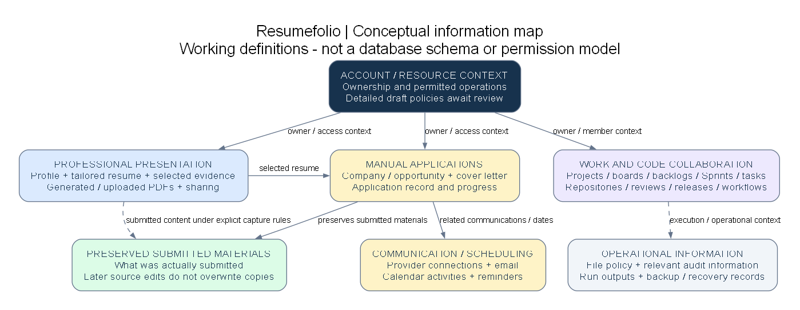
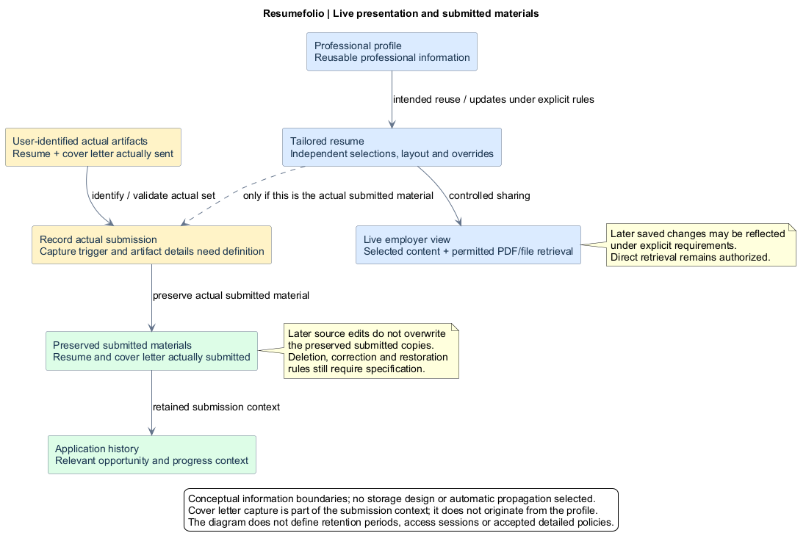
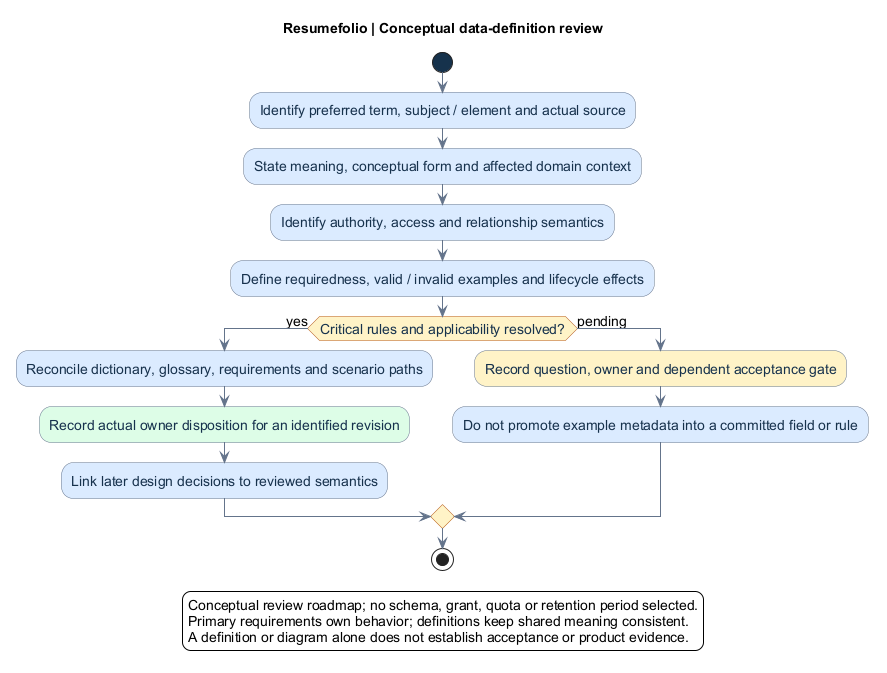

# Resumefolio — Data Definitions Guide

Current implementation choices and scope: [Baseline](../../../baseline/README.md). Runtime verification remains subject to its gates.

| Item | Current position |
| --- | --- |
| Purpose | Coordinate terminology, conceptual information meaning, authority and lifecycle questions |
| Owner | Farhad; sole delivery and operations owner |
| Status | Proposed definitions — detailed constraints, policy and owner acceptance pending |
| Inventory | Two primary documents; 34 conceptual subject groups, 24 proposed semantic elements and four diagrams |
| Design boundary | No database schema, mandatory field set, physical representation, endpoint or implementation cardinality selected |
| Revision | October 31, 2026 |

**Start with the [Glossary](glossary.md)** for preferred terms, then the
[Data Dictionary](data-dictionary.md) for information meaning, conceptual forms,
authority/access, lifecycle questions and requirement/scenario links. A proposed
definition is not an accepted product rule or proof that storage exists.

[Reading routes](#1-reading-routes) · [Documents](#documents)
· [Models](#3-conceptual-models-and-boundaries) · [Open definitions](#4-review-gates-and-evidence)
· [Diagrams](#5-diagram-catalog-and-regeneration) · [Maintenance](#6-maintenance)

## 1. Reading Routes
<a id="1-documents-and-reading-route"></a>

| Your question | Suggested route |
| --- | --- |
| What does a term mean? | [Glossary](glossary.md) → relevant domain source; qualify overloaded terms rather than inventing synonyms |
| What information does this feature use? | [Dictionary subjects](data-dictionary.md#2-accounts-and-access) → [semantic elements](data-dictionary.md#10-cross-cutting-element-definitions) → primary requirement |
| Who controls it and what happens when it changes? | Subject's authority/open questions → [Lifecycle](../03-requirements-specification/business-rules-and-data-lifecycle.md) → exact domain grant/state policy |
| Which requirement/path uses this concept? | [Dictionary trace links](data-dictionary.md#11-requirement-and-scenario-cross-references) → [specification guide](../03-requirements-specification/README.md) → [scenario catalog](../04-scenarios-and-models/user-stories-and-scenarios.md#2-use-case-and-story-catalog) |
| Is it ready to become a committed data rule? | [Review roadmap](#4-review-gates-and-evidence) → resolve validation/authority/lifecycle questions → record actual owner decision |

## Documents

| Document | Primary responsibility | Current content / limitation |
| --- | --- | --- |
| [Glossary](glossary.md) | Preferred terminology and context distinctions | Actors/access, professional content, applications/providers, work/Git/execution and engineering/recovery; no universal grants or compliance finding |
| [Data Dictionary](data-dictionary.md) | Conceptual subjects, semantic elements, responsibility and unresolved constraints | All 34 existing subject keys retained with stable anchors; 24 proposed element definitions; exact fields/requiredness/cardinalities/policies pending |

The subject keys and E01–E24 references are local navigation, not final FR/NFR/SCN
identifiers or implementation names. Subject groups may combine concepts for
review; they do not prescribe one table/object per row. The dictionary retains
its existing section anchors, and the glossary retains its original sections/terms.

## 3. Conceptual Models and Boundaries
<a id="2-conceptual-information-map"></a>



[Scalable SVG](../diagrams/data-definitions-map.svg) ·
[Editable Graphviz](../diagrams/data-definitions-map.dot)

The map groups information, not physical stores, foreign keys, counts, automatic
propagation or access grants. Product data differs from the development GitHub
board/repository. Colors supplement labels.



[Scalable SVG](../diagrams/data-submission-boundaries.svg) ·
[Editable PlantUML](../diagrams/data-submission-boundaries.puml)

Keep editable sources, live employer views, generated/uploaded artifacts, actual
submitted copies and backups distinct. The capture policy must identify what was
actually submitted; the current live source is not proof it was the material sent.
Later source edits do not overwrite required preserved actual materials.

Other distinctions that must remain explicit:

- Authentication versus resource/action authorization; membership versus unrelated private access.
- Resume-specific override/selection versus shared source and its propagation policy.
- Portfolio project versus work-management project versus repository.
- Backlog Item versus task; board position versus completion/acceptance; Sprint Goal/items/plan as a composite Sprint Backlog.
- Provider/local authority and accepted send versus delivery/read confirmation; unknown external outcome requires safe reconciliation.
- Code/ref/review/run attempt versus separate target approval; Git hosting does not establish execution safety.
- Archive/unlink/deletion/reclamation versus retention/reference policy; quota does not prove resource capacity.
- Backup/recovery point versus actual usable restoration and safe restored access; no target is assigned by a term alone.

## 4. Review Gates and Evidence
<a id="3-how-to-use-and-maintain-definitions"></a>
<a id="4-current-coverage-and-review"></a>



[Scalable SVG](../diagrams/data-definition-review-flow.svg) ·
[Editable PlantUML](../diagrams/data-definition-review-flow.puml)

| Definition group | Decisions/evidence still needed | Dependent gate |
| --- | --- | --- |
| Identity/requiredness | Exact fields, conditions, values/formats, uniqueness, examples/counterexamples and invalid/missing input | Affected M-02 requirements; GAP-D06 where applicable |
| Authority/relationships | Source of truth per property/action, grants/state, counts, overrides and reference consequences | Before dependent data/security design acceptance |
| Representations | Language/time/revision/units, provider mappings and interface compatibility | Domain/interface requirements then justified design |
| Resource quantities | Limits/accounting pools/concurrency and actual capacity | AFO/QSR policies; GAP-D01/D10 findings |
| Retirement/recovery | Per-category retention/eligibility, consistent coverage, old grants/deleted data and provider effects | BRL/QSR policy; GAP-D04 design and later actual restoration |
| Applicability | Current relevant provider/licensing/privacy obligations and operating facts | DOM/EGC review before dependent commitments; no compliance conclusion assumed |

Farhad coordinates [Questions and Decisions](../07-change-and-baseline/open-questions-and-decisions.md).
Link actual records in [Traceability](../06-validation-and-traceability/requirements-traceability.md)
and real inspection results in [Review Findings](../06-validation-and-traceability/review-plan-and-findings.md).
Local open topics do not claim new shared IDs or resolved decisions. Material
meaning/scope changes follow [Change Control](../07-change-and-baseline/change-control.md).

- [ ] Review shared terms/elements against the current primary requirement revision.
- [ ] Resolve acceptance-blocking validation, authority, relationship and lifecycle questions.
- [ ] Keep requirement/scenario links and worked examples semantically consistent.
- [ ] Confirm diagrams explain conceptual meaning without implying schema or grants.
- [ ] Record actual owner review and identified revision before changing definition/baseline status.

**Current outcome:** Proposed working definitions, not an accepted dictionary or
schema baseline. No product storage, integration, access control or recovery result
is demonstrated. M-02 and the wider pre-implementation agreement remain pending.

## 5. Diagram Catalog and Regeneration
<a id="5-diagram-catalog-and-regeneration"></a>

| Diagram | Purpose | Source | SVG | PNG |
| --- | --- | --- | --- | --- |
| Conceptual information map | Information groups and scoped relationships | [DOT](../diagrams/data-definitions-map.dot) | [SVG](../diagrams/data-definitions-map.svg) | [PNG](../diagrams/data-definitions-map.png) |
| Live/submitted boundaries | Editable/live versus actual historical material | [PlantUML](../diagrams/data-submission-boundaries.puml) | [SVG](../diagrams/data-submission-boundaries.svg) | [PNG](../diagrams/data-submission-boundaries.png) |
| Terminology boundaries | Similar terms with different context/authority | [DOT](../diagrams/data-terminology-boundaries.dot) | [SVG](../diagrams/data-terminology-boundaries.svg) | [PNG](../diagrams/data-terminology-boundaries.png) |
| Definition review | Meaning, validation, authority and lifecycle refinement | [PlantUML](../diagrams/data-definition-review-flow.puml) | [SVG](../diagrams/data-definition-review-flow.svg) | [PNG](../diagrams/data-definition-review-flow.png) |

Keep sources/captions/renders synchronized; inspect labels/arrows and file/section
links. Follow the [shared diagram guide](../diagrams/README.md). From repository root:

```powershell
$diagramFolder = 'docs\SDLC\02-requirements-engineering\diagrams'
$graphvizExe = 'C:\Program Files\Graphviz\bin\dot.exe'
$plantUmlJar = 'C:\Users\fvali\AppData\Local\Resumefolio\DiagramTools\plantuml.jar'
foreach ($format in 'svg', 'png') {
    foreach ($stem in 'data-definitions-map', 'data-terminology-boundaries') {
        & $graphvizExe "-T$format" -Gdpi=140 "$diagramFolder\$stem.dot" -o "$diagramFolder\$stem.$format"
        if ($LASTEXITCODE -ne 0) { throw "Graphviz failed: $stem / $format" }
    }
    foreach ($stem in 'data-submission-boundaries', 'data-definition-review-flow') {
        java '-Djava.awt.headless=true' -jar $plantUmlJar -charset UTF-8 "-t$format" "$diagramFolder\$stem.puml"
        if ($LASTEXITCODE -ne 0) { throw "PlantUML failed: $stem / $format" }
    }
}
```

## 6. Maintenance

Use fictional/sanitized examples. Keep real application documents, private emails,
passwords/tokens/keys and confidential operational values out of repository examples.
Refine semantic rules here and link primary behavior; do not copy competing policy
wording across files. Add schema/types/indexes/storage choices only in later design
with traceability to reviewed requirements.

Preserve stable keys/section anchors when reorganizing. Update subject/element
counts, preferred terms, examples, models, requirement/scenario links and actual
review status together. Use installed tool paths applicable to the machine and
save UTF-8 without BOM; retain editable source and SVG/PNG outputs in version control.

[Requirements index](../README.md) · [Specification guide](../03-requirements-specification/README.md)
· [Scenarios guide](../04-scenarios-and-models/README.md)
