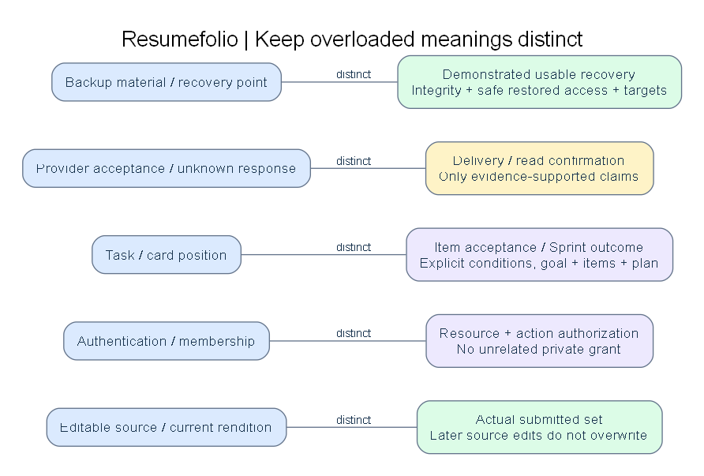

# Resumefolio — Requirements Glossary

| Item | Current position |
| --- | --- |
| Purpose | Give recurring terms one clear working meaning across requirements |
| Status | Proposed terminology for review; planning sources retain their accepted scope |
| Owner | Farhad |
| Revision | October 31, 2026 |

Definitions explain meaning, not implementation or complete permission rules.
Use the preferred term in specifications, scenarios and diagrams. Where everyday
words have several meanings, retain the context shown below. Detailed data and
open rules are in the [Data Dictionary](data-dictionary.md).

[Roles](#1-people-and-access) · [Presentation](#2-professional-presentation)
· [Applications](#3-applications-and-communication) · [Work](#4-work-and-code-collaboration)
· [Engineering](#5-requirements-and-evidence) · [Usage](#6-usage-and-change-rules) · [Sources](#7-primary-terminology-sources-and-review-route)

Current MVP scope and selected mechanisms: [Baseline](../../../baseline/README.md). Deferred provider, advanced collaboration and workflow-execution designs are not MVP prerequisites.

## 1. People and Access

Source basis: [Stakeholders](../../01-project-planning/03-stakeholders-and-responsibilities.md)
and Scope DEC-028/DEC-024. Detailed permissions remain subject to requirements.

| Preferred term | Working meaning | Distinction |
| --- | --- | --- |
| Project owner | Person responsible for product direction, scope, budget and release decisions; currently Farhad | Project ownership is distinct from an application role |
| Platform owner | Product role responsible for defined platform administration | Exact powers must be specified; the role does not imply unrestricted private-data access |
| Administrator | Product role permitted to perform specified account/content administration | Only explicitly authorized operations are included |
| Registered user | Person using an individual product account | Successful sign-in does not authorize every resource |
| Resource owner | User or explicitly defined ownership context responsible for a particular record/resource | Detailed ownership, transfer and collaboration rules remain to be defined |
| Invited collaborator | Participant granted defined access to a project, board or repository | An invitation does not expose unrelated email, resumes or resources |
| Employer viewer | Person using the protected sharing path to view selected content | A viewer account is not required; a link/password does not establish real-world identity |
| Authentication | Establishing the claimed account/access identity through the specified mechanism | Distinct from checking permission for an operation |
| Authorization | Deciding whether the actor may perform an operation on the requested resource in its current context | Applies to direct file/PDF requests as well as pages |
| Unified sign-in | A consistent sign-in experience across authorized product sections | Does not remove resource-specific permission checks |
| Grant / membership | Explicit permission relationship scoped to a resource/action/context | An invitation, assignment or successful sign-in is not universal permission |
| Revocation | A change that removes or restricts a grant/access context under an explicit policy | Fresh requests, existing sessions, caches and in-flight work may need different rules |
| Credential / secret | Protected material used to authenticate or authorize an operation | Not ordinary example data; no specific mechanism or storage is selected |

## 2. Professional Presentation

Source basis: [Scope](../../01-project-planning/02-scope.md), DEC-027–DEC-024
and DEC-015. These meanings preserve reusable information, tailored presentation
and manually entered language content without choosing a storage model.

| Preferred term | Working meaning | Distinction |
| --- | --- | --- |
| Professional profile | Reusable professional information owned by a user | Source information, not an opportunity-specific resume presentation |
| Tailored resume | Selected and customized professional presentation for an opportunity | Resume-specific selections, layout and content overrides remain independent |
| Resume override | Resume-specific replacement or adjustment to shared information | Propagation and precedence details need explicit rules |
| Portfolio | Presentation of selected professional work and supporting material | Exact standalone/page organization remains a requirements question |
| Supporting evidence | Text, media, files, diagrams or links used to support a skill/project claim | Distinct from verification evidence produced when testing the product |
| Media / file | Uploaded or referenced supporting material | Sharing a parent record does not automatically make all associated files public |
| Generated PDF | Resume PDF produced from authored content | Distinct from an independently prepared uploaded PDF |
| Uploaded PDF | Externally prepared resume PDF added by the owner | English/German PDFs can be provided separately |
| Download availability | Per-resume choice of generated PDF, uploaded PDF, both or neither, subject to language and access rules | Describes product retrieval, not revocation of copies already downloaded |
| Employer link | Password-protected access path to the intended resume and selected content | Excludes the private workspace and unrelated resources |
| Live employer view | Shared presentation that may reflect subsequent saved changes under explicit rules | Distinct from preserved submitted materials |
| Language-specific content | Manually entered and reviewed English/German professional content | Does not imply automatic translation or an accepted language-fallback policy |
| Source revision / rendition | Identified authored content state / representation of it, such as a generated PDF | An independently uploaded PDF need not match the current authored source |
| Publication | Making a defined content revision available in an intended context under explicit rules | A source save does not inherently select an automatic live publication workflow |
| Portfolio project / work project | Description/evidence of professional work / context organizing product work management | They are not automatically one record or the same object as a Git repository |

## 3. Applications and Communication

Source basis: Scope DEC-023/DEC-022 and the application-history distinction.
Detailed workflows have proposed [APP-D](../03-requirements-specification/manual-application-management.md)
and [EGC-D](../03-requirements-specification/email-calendar-and-google-integration.md)
records; final states and synchronization policies still require decisions.

| Preferred term | Working meaning | Distinction |
| --- | --- | --- |
| Manual job application management | User-directed preparation and tracking of job applications | Version 1 has no product AI analysis or drafting |
| Company | Organization associated with a job opportunity/application | Required fields and reuse rules remain open |
| Job opportunity | Position or opening the user considers applying for | Recording it does not automatically submit an application |
| Application record | Record linking an opportunity, relevant materials and application progress | Distinct from a live resume or provider email |
| Cover letter | User-authored application text for an opportunity | Submitted content must be distinguishable from later editable content |
| Submitted copy | Preserved record of resume/cover-letter material actually submitted | Later source edits must not overwrite it; capture/deletion/access details still need rules |
| Application status | Recorded stage of application progress | The final allowed states and transition rules remain open |
| Provider connection | User-authorized association with an external service/account | Consent, scope, disconnection and local-data consequences need specification |
| Email message | Communication accessed through the agreed Gmail functionality | Provider state and local representation must be distinguished |
| Calendar event | Scheduled activity within the agreed calendar workflows | Data ownership, synchronization, conflicts and deletion rules remain open |
| Reminder | Scheduled notification associated with an activity | Delivery channel/timing and cancellation behavior require requirements |
| Synchronization | Coordinating related internal/provider information under explicit rules | Does not imply automatic overwrite, conflict resolution or a particular direction |
| Actual submitted set | Resume and cover-letter material identified as actually submitted for a particular application context | Current live content, a provider message or a status alone does not prove the exact set |
| Submission recording / capture | User-directed recording and preservation of actual material under reviewed rules | Not automatic external submission, proof of receipt or an indefinite-retention obligation |
| Provenance | Source/context describing where information or a recorded claim came from | Attribution or user assertion is not automatically independent verification |
| Provider acceptance / delivery / read confirmation | Acceptance by the provider / evidence of delivery / evidence of reading are different claims | Report only the specific outcome supported by available evidence |
| Unknown external outcome | A consequential request may have taken effect but available evidence does not establish its result | Not safe to label success/failure or blindly repeat without reviewed reconciliation |
| Reconciliation | Resolving divergent/partial/uncertain states under a reviewed authority policy | Does not imply automatic overwrite or last-write-wins |
| Time zone / all-day / event time | Distinct scheduling or event-time semantics requiring domain-specific rules | Recorded time and displayed time need not have the same meaning |

## 4. Work and Code Collaboration

Source basis: Scope DEC-021/DEC-020/DEC-019 and the
[Working Method](../../01-project-planning/09-working-method-and-change-control.md).

| Preferred term | Working meaning | Distinction |
| --- | --- | --- |
| Product | Resumefolio as an evolving offering for its users | Distinct from an individual project or delivery increment |
| Project | Bounded body of work with an intended outcome | A project inside the product is distinct from developing Resumefolio itself |
| Kanban board | View organizing work into defined workflow columns | Board/project hierarchy and movement rules need explicit requirements |
| Product Backlog | Ordered collection of product work items | Not identical to a user story, board column or Sprint Backlog |
| Backlog item | Unit of planned work, such as a feature, defect, investigation or improvement | May be refined into tasks; not necessarily one small task |
| Task | Specific activity contributing to completion of work | Distinct from the user outcome expressed by a story/use case |
| Sprint | Defined work period with a goal and selected work | A time period, not a milestone or feature |
| Sprint Goal | Coherent intended outcome for a Sprint | Distinct from the full list of selected work |
| Sprint Backlog | Sprint Goal, selected backlog items and delivery plan | One combined plan for the relevant Sprint context |
| Milestone | Reviewable outcome checkpoint | Not a fixed-duration work period or proof of completion from reaching a date |
| Git repository | Hosted version-controlled project content and history | Real Git hosting is distinct from displaying an external repository link |
| Branch / tag | Named Git development line / reference to a chosen Git state | Exact supported operations and protections need specification |
| Fork | Repository derived for an independent collaboration context | Fork permissions, lineage and cross-repository operations need requirements |
| Pull request | Proposal to integrate changes with review/comment context | Not the same as Git Pull; merge behavior must follow explicit rules |
| Issue | Repository work/discussion record | Distinct from an actual operational problem unless used to track one |
| Release | Identified version presented with scope, evidence, limitations and release decision | Distinct from a tag, successful build or deployment |
| YAML workflow | Definition of agreed repeatable checks/build or controlled deployment activities | Syntax, triggers and compatibility are not assumed to match every external workflow system |
| Workflow run | One execution instance of a workflow with state and results | Actual execution needs the agreed isolation/security/resource conditions |
| Artifact / run log | Output / recorded execution information from a workflow run | Contents, retention, access and secret handling remain to be defined |
| Board column / work state | Visual workflow grouping / domain condition with explicit transition semantics | A column is not automatically a universal state or proof of acceptance |
| Completion / acceptance | Meeting defined work conditions / a defined actor or criterion-based disposition | Task completion, item acceptance and Sprint Goal outcome are not interchangeable |
| Git Pull / pull request | Client integration of fetched changes / proposal for reviewed integration | Similar wording does not make the operations equivalent |
| Ref / evaluated revision | Named repository pointer / exact code state evaluated by an operation or run | A later ref change does not relabel an existing run or stale review |
| Review context / merge | Assessment of defined source-target revisions / authorized integration under a policy | An old review does not silently approve new code; merge does not approve deployment |
| Run attempt / rerun | A particular execution attempt / another explicitly related attempt | Separate attempt identity and side-effect rules are needed; no exactly-once guarantee |
| Runner / isolation boundary | Selected execution facility / controls limiting untrusted-code effects | No container, VM, host access or runner product is chosen by the term |
| Deployment target / approval | Environment changed by deployment / explicit authority for a defined operation/revision | A Push, merge, tag or successful check alone is not target approval |

## 5. Requirements and Evidence

These working terms follow the existing approach and planning records. They do
not allocate requirement identifiers or change accepted status conventions.

| Term | Working meaning | Distinction |
| --- | --- | --- |
| Requirement | Stated behavior, quality condition or imposed constraint to be reviewed | A raw request or solution suggestion is not automatically accepted |
| Business rule | Domain/product policy governing behavior or information | Implementation preference is not automatically a business rule |
| Use case | Actor interaction with the system toward a goal | Contains multiple possible scenarios |
| Scenario | One path through an interaction with conditions and results | Not merely a task or screen list |
| User story | Concise expression of role, desired capability and value | Does not replace detailed rules and acceptance criteria |
| Acceptance criterion | Observable condition for assessing a requirement | Distinct from an executed result or a full test case |
| Verification evidence | Contextual record supporting an actual inspection, analysis, demonstration or test result | Distinct from portfolio evidence and planned checks |
| Assumption | Provisional expectation requiring validation | Accepted investigation method does not confirm it |
| Dependency | Prerequisite or external capability relied upon | Available access/suitability needs evidence |
| Baseline | Identified, accepted revision subject to controlled change | A file or Git commit alone is not acceptance |
| Traceability | Maintained links between sources, requirements and related work/evidence | A populated link is not necessarily proof of adequate coverage |
| Data dictionary | Definitions of information meaning and applicable rules | Not the physical database schema |
| Source of truth | Authoritative record for a particular piece of information | It must be identified per context; do not infer one global owner for all data |
| Audit record | Record of a defined sensitive or administrative operation | Events, visibility, retention and integrity behavior require explicit rules |
| Backup / recovery | Protected copy / process of restoring usable service and information | Backup existence does not demonstrate recovery |
| RPO / RTO | Recovery-point / recovery-time objectives for an evaluated scenario | No numerical target or achieved recovery performance is assigned here |
| Conceptual subject / element | Information group / a particular semantic property or relationship used in requirements | Neither necessarily maps one-to-one to a table or mandatory stored field |
| Requiredness / validation | Conditions requiring a value / conditions defining its validity and rejected/incomplete outcome | Examples and placeholder metadata do not establish required fields or constraints |
| Cardinality / ownership | Permitted relationship counts / authority-responsibility context | Both need explicit requirements; arrows do not establish a schema or grant |
| Sensitivity / legal classification | Working handling concern / classification supported by applicable external authority | Calling a context private does not establish a complete legal compliance assessment |
| Archive / unlink / logical deletion / reclamation | Different retirement actions affecting visibility, relationships or physical retained material | Do not assume soft deletion, cascade, indefinite retention or automatic quota release |
| Quota / capacity | Configured permitted consumption / actual sustainable resource envelope under a workload | A configured limit does not prove capacity; units/accounting and concurrent work matter |
| Recovery coverage / recovery point | Subjects/material needed for a scenario / selected recoverable state | A database copy alone may omit required files, Git metadata, keys or current provider state |
| Restored access | Authority available after recovery and reconciliation | Old backups may contain obsolete memberships, enabled shares or pending side effects |
| RPO | Permitted data-loss objective for a defined recovery scenario | Requires agreed event/point/measurement boundaries; no value or achieved result assigned |
| RTO | Permitted time to a defined usable recovered state for a recovery scenario | Not merely process startup, file extraction or backup-job duration |
| Quality scenario / workload | Stimulus-environment-response-measure contract / specified concurrent activity and data mix | Ten user accounts do not define concurrent load or a performance threshold |
| Provisional reference / accepted baseline | Local draft navigation / actual reviewed owner disposition for an identified revision | A prefix, link, file count or commit alone establishes no acceptance |
| Scenario path / execution evidence | Proposed normal/alternative/denied/failure/recovery example / actual later observed result | The SCN-D paths are unexecuted; a diagram or planned check is not a Pass |

## 6. Usage and Change Rules

- Prefer **supporting evidence** for portfolio material and **verification evidence** for engineering results.
- Qualify owner, project, issue, release and status with their resource/context when ambiguous.
- Keep **live resume**, **submitted copy** and **generated/uploaded PDF** distinct in text and models.
- Resolve conflicting definitions through [analysis](../01-process-and-approach/04-analysis-and-negotiation.md), recording material changes in [change control](../07-change-and-baseline/change-control.md).
- Preserve earlier meaning and affected references when an accepted definition changes; update dictionary, scenarios and traceability together.
- Record review results against an actual revision; these working definitions remain proposed until reviewed.

**Revision note — October 31, 2026:** Retained existing terms and section anchors;
added current source/revision, provider-outcome, execution, retirement and recovery
distinctions. No new policy, feature inclusion or baseline approval is established.

## 7. Primary Terminology Sources and Review Route

| Vocabulary | Primary working reference |
| --- | --- |
| Actors and access | [Actors](../02-stakeholders-and-elicitation/actors-and-system-context.md) / [Accounts](../03-requirements-specification/accounts-authentication-and-permissions.md) |
| Professional content, actual materials and sharing | [Profiles](../03-requirements-specification/profiles-resumes-and-portfolio.md), [PDF](../03-requirements-specification/pdf-and-controlled-sharing.md), [Applications](../03-requirements-specification/manual-application-management.md) |
| Provider state and outcomes | [Google Integration](../03-requirements-specification/email-calendar-and-google-integration.md) |
| Work, Git and execution | [Kanban/Sprints](../03-requirements-specification/projects-kanban-and-sprints.md), [Git](../03-requirements-specification/git-hosting-and-collaboration.md), [YAML/CI/CD](../03-requirements-specification/yaml-workflows-and-cicd.md) |
| Retirement, quantities and recovery | [Lifecycle](../03-requirements-specification/business-rules-and-data-lifecycle.md), [Administration](../03-requirements-specification/administration-files-and-operational-behavior.md), [Quality/Recovery](../03-requirements-specification/quality-security-and-recovery-requirements.md) |
| Stories, use cases and paths | [Scenario conventions](../04-scenarios-and-models/user-stories-and-scenarios.md#1-purpose-and-record-conventions) |

Definitions coordinate meaning; they do not override primary behavior or accept
its open policies. Review ambiguous synonyms and actual owner decisions through
[Questions](../07-change-and-baseline/open-questions-and-decisions.md) and keep
[Traceability](../06-validation-and-traceability/requirements-traceability.md) current.
No terminology review outcome or product test is claimed by this source table.

[Scalable SVG](../diagrams/data-terminology-boundaries.svg) ·
[Editable Graphviz](../diagrams/data-terminology-boundaries.dot)

The pairs group distinct meanings, not a data model or conversion rules. Colors
supplement labels; use the qualifying term/context in specifications and scenarios.

[Data Definitions index](README.md) · [Data Dictionary](data-dictionary.md)
· [Requirements index](../README.md)
