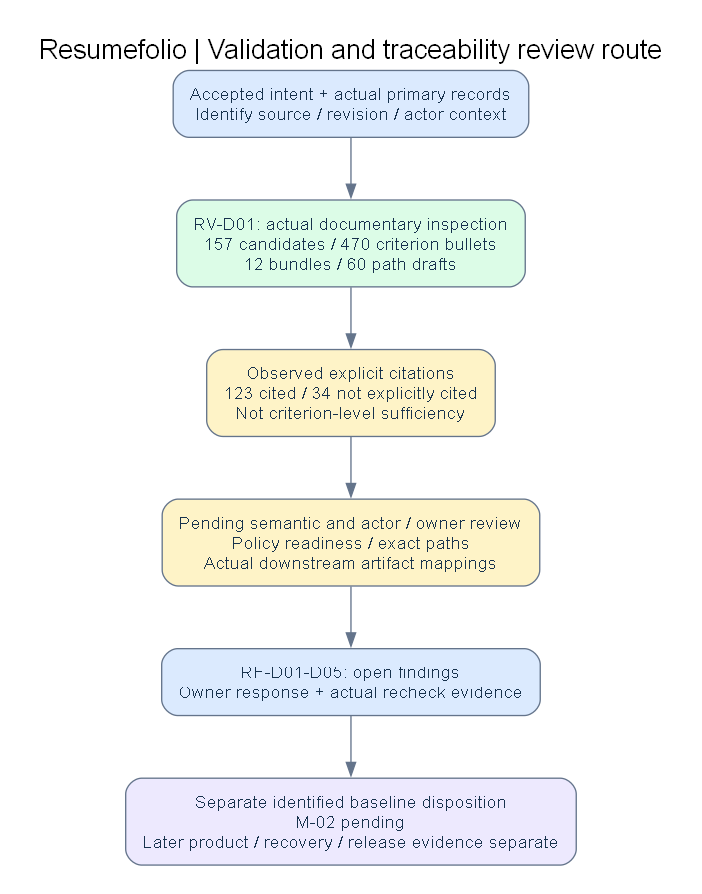

# Resumefolio — Validation and Traceability Guide

## Current implementation baseline — November 4, 2026

[BL-MVP-2026-11-04.1](../../../baseline/README.md) selects the MVP technical mechanisms, numerical policies, priorities and requirement/criterion dispositions under Farhad’s explicit delegation. It supersedes earlier Proposed/pending mechanism and whole-baseline statements below for MVP design input. Future clauses and dated evidence remain separate. Runtime/actor validation, credentials, Git isolation, capacity and backup/restore still require the named implementation/Release gates; this update reports no product test Pass.

### Prior source material and rationale (superseded where this Baseline selects a different MVP choice)

| Item | Current position |
| --- | --- |
| Owner | Farhad |
| Purpose | Follow requirement relationships, plan coherent reviews and retain actual findings/evidence |
| Status | Proposed review program with one bounded documentary activity; M-02 pending |
| Inventory | 157 candidate rows, 12 UC/ST bundles, 60 path drafts; 123 candidates explicitly cited, 34 without explicit bundle citation |
| Actual review activity | RV-D01, Codex, October 31, 2026; five local open findings, no owner baseline/product-test outcome |

**Start with [Requirements Traceability](requirements-traceability.md)** to inspect
source/candidate/scenario relationships. Read [Review Plan and Findings](review-plan-and-findings.md)
for planned semantic reviews and the actual bounded inventory findings. Counts,
links and structural checks are not proof of correct or complete requirements.

[Documents](#documents) · [Reading routes](#1-reading-routes)
· [Current evidence](#2-current-evidence-and-gaps) · [Roadmap](#3-review-and-traceability-roadmap)
· [Diagrams](#4-diagram-catalog) · [Maintenance](#5-maintenance)

## MVP requirement applicability and remaining review

Apply the current candidate release register: retain core presentation/sharing/manual applications/private files and basic ProjectForge; defer mail/calendar, advanced Git review/releases, advanced backlog/Sprints and YAML execution/deployment. Candidate IDs and planned verification stay intact. Mixed criteria must be scoped individually; allocation does not approve proposed numbers, priority or a complete baseline. Older 157-candidate/470-criterion evidence is historical larger-product coverage, not an MVP pass. Keep source, independent resume draft, explicit publication and actual submitted material identities distinct. Profile changes require preview/select/apply and cannot mutate publication or submitted history. Manual applications include status, next action and follow-up date without mail/calendar dependencies.

Authority: [OWNER-MVP-2026-11-04](../../01-project-planning/owner-mvp-decision-2026-11-04.md). [Candidate allocation](../03-requirements-specification/mvp-release-allocation.md).

## Documents

| Document / artifact | Responsibility | Actual position |
| --- | --- | --- |
| [Requirements Traceability](requirements-traceability.md) | Source navigation, primary candidate/criteria links, observed explicit scenario citations and downstream state | All 157 candidates inventoried; criterion-level sufficiency and exact PBI/design/code/product-result links pending |
| [Review Plan and Findings](review-plan-and-findings.md) | Proposed group reviews, actual activity, observations and disposition/recheck rules | RV-D01 recorded; RF-D01–RF-D05 open; semantic/actor/owner review not completed |
| [Source Inventory](evidence/traceability-source-inventory.json) | Documentary source-byte locators, observed counts and per-record/citation data | Current working-copy hashes for RV-D01; not a committed Git baseline or product test evidence |

Local RV/RF and domain/UC/ST/SCN IDs remain provisional. No final notation,
priorities, approved severity ranking, owner acceptance or release status is allocated here.

## 1. Reading Routes

| Your question | Route |
| --- | --- |
| Where is this requirement's source and criterion? | [Primary matrix](requirements-traceability.md#7-traceability-matrix) → exact candidate heading/source/criteria |
| Which scenario explicitly cites it? | Matrix UC links → bundle conditions/N/A/D/F/R paths; then review criterion-specific sufficiency |
| Why is a candidate uncited? | [Coverage limits](requirements-traceability.md#3-inventory-and-coverage-limits) → RF-D01 → decide appropriate actual scenario/analysis/review mapping |
| Is implementation or test evidence linked? | [Downstream state](requirements-traceability.md#5-backlog-design-and-verification-links) → exact actual artifact verification later; currently unassigned per candidate |
| What review actually happened? | [RV-D01](review-plan-and-findings.md#rv-d01) → hashed inventory → [findings](review-plan-and-findings.md#4-findings-register) |
| Can we accept M-02? | Actual semantic/owner review and findings disposition → [Baseline Criteria](../07-change-and-baseline/requirements-review-and-baseline-criteria.md); current decision pending |

## 2. Current Evidence and Gaps

RV-D01 observed 157 unique candidates and 470 criterion bullets, including conditional
criteria, in 15 detailed drafts. It observed 12 use-case/story bundles and 60 path
anchors. Of those candidates, 123 are explicitly named by bundle source/trace
text and 34 are not. These are structural observations, **not a coverage score**.

The five local findings cover uncited candidates, coarse criterion/path mapping,
provisional IDs/open policies, unassigned downstream links and the limits of this
activity's acceptance/capability evidence. They remain open; an apparent link
does not close a finding or prove every criterion is satisfied.

No actual live GitHub/backlog state audit, product code coverage, provider/server
test, execution control verification or recovery drill is recorded. The local
backlog is a planning index and identifies live authority elsewhere; do not invent
per-candidate PBI links from similar titles. SHA-256 locators identify inspected
source bytes, not owner approval or future unchanged content.

## 3. Review and Traceability Roadmap



[Scalable SVG](../diagrams/validation-traceability-roadmap.svg) ·
[Editable Graphviz](../diagrams/validation-traceability-roadmap.dot)

Arrows group review responsibilities, not software architecture, completed work
or a dated schedule. Colors supplement labels.

1. Inspect accepted intent, actual primary record sources and actor context.
2. Check criteria/policy readiness and exact scenario/analysis coverage, not only link presence.
3. Verify real downstream artifacts before populating their links; record actual review findings and owners.
4. Resolve or explicitly disposition gaps under the relevant gate, then retain actual rechecks.
5. Present an identifiable candidate for actual owner baseline review; later product/recovery/release decisions remain separate.

Use [Verification and Validation method](../01-process-and-approach/06-requirements-verification-and-validation.md),
[Questions](../07-change-and-baseline/open-questions-and-decisions.md),
[Change Control](../07-change-and-baseline/change-control.md) and
[Planning Gates](../../01-project-planning/10-planning-completion-criteria.md).
The wider agreed pre-implementation baseline still precedes coding.

## 4. Diagram Catalog

| Diagram | Purpose | Source | SVG | PNG |
| --- | --- | --- | --- | --- |
| Validation/traceability roadmap | Folder's review route and separate disposition | [DOT](../diagrams/validation-traceability-roadmap.dot) | [SVG](../diagrams/validation-traceability-roadmap.svg) | [PNG](../diagrams/validation-traceability-roadmap.png) |
| Evidence relationship map | Source/candidate/criteria/path and unassigned downstream boundaries | [DOT](../diagrams/traceability-evidence-map.dot) | [SVG](../diagrams/traceability-evidence-map.svg) | [PNG](../diagrams/traceability-evidence-map.png) |
| Finding disposition/recheck | Record actual evidence and review response before closure | [PlantUML](../diagrams/review-finding-disposition.puml) | [SVG](../diagrams/review-finding-disposition.svg) | [PNG](../diagrams/review-finding-disposition.png) |

## 5. Maintenance

- Keep counts, matrix citations, source hashes and review observations synchronized with the inspected revision.
- Preserve historical inspection evidence; later source changes require a new/rechecked activity, not silent replacement of the old locator.
- Keep candidate wording/criteria in primary specifications and path behavior in scenario records.
- Record actual owner dispositions, exact changed revisions and new recheck evidence before resolving findings.
- Distinguish editorial rendering/link checks, semantic review, actor validation and running-product verification.

For the initial RV-D01 activity, the supplied inventory is its original evidence
snapshot. Do not regenerate it later while retaining the same historical activity
identity as though the original bytes had not changed. A new review must reference
both original evidence and the new inspected candidate.

Follow the [diagram guide](../diagrams/README.md); retain editable sources and
SVG/PNG outputs together, inspect arrows/labels and verify local/evidence links.
From the repository root:

```powershell
$diagramFolder = 'docs\SDLC\02-requirements-engineering\diagrams'
$graphvizExe = 'C:\Program Files\Graphviz\bin\dot.exe'
$plantUmlJar = 'C:\Users\fvali\AppData\Local\Resumefolio\DiagramTools\plantuml.jar'
foreach ($format in 'svg', 'png') {
    foreach ($stem in 'validation-traceability-roadmap', 'traceability-evidence-map') {
        & $graphvizExe "-T$format" -Gdpi=140 "$diagramFolder\$stem.dot" -o "$diagramFolder\$stem.$format"
        if ($LASTEXITCODE -ne 0) { throw "Graphviz failed: $stem / $format" }
    }
    java '-Djava.awt.headless=true' -jar $plantUmlJar -charset UTF-8 "-t$format" "$diagramFolder\review-finding-disposition.puml"
    if ($LASTEXITCODE -ne 0) { throw "PlantUML failed: $format" }
}
```

Use actual installed paths elsewhere; save UTF-8 without BOM. Do not include private
product content or credentials in review examples/evidence.

[Requirements index](../README.md) · [Specification guide](../03-requirements-specification/README.md)
· [Scenarios guide](../04-scenarios-and-models/README.md)
