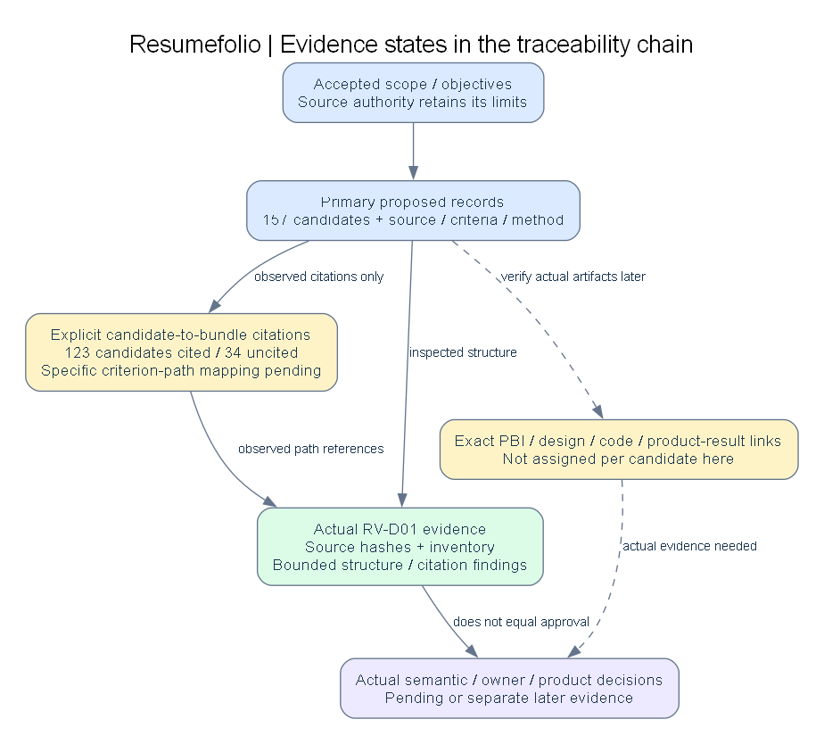

# Resumefolio — Requirements Traceability

| Item | Current position |
| --- | --- |
| Owner | Farhad |
| Status | Populated provisional documentary map — semantic review and baseline acceptance pending |
| Inventory | 157 candidate records in 15 detailed drafts; 12 UC/ST bundles and 60 path drafts |
| Explicit bundle citations | 123 candidates cited by a bundle's source/trace text; 34 without such an explicit citation |
| Criteria structure | 470 criterion bullets observed in primary candidate sections; not allocated criterion IDs or executed checks |
| Revision / inspection | October 31, 2026; local activity RV-D01 |

**At a glance:** Follow accepted intent to primary candidate records and observed
scenario citations. The map is populated from actual files, not an empty coverage
claim. A link means a relationship is recorded; it does not prove semantic coverage,
approved requirements, executable tests, implementation or a Pass result.

[Conventions](#1-purpose-and-link-semantics) · [Scope](#2-scope-and-objective-navigation)
· [Summary](#3-inventory-and-coverage-limits) · [Matrix](#7-traceability-matrix)
· [Downstream](#5-backlog-design-and-verification-links) · [Review](#6-maintenance-and-review)

Current MVP scope and selected mechanisms: [Baseline](../../../baseline/README.md). Deferred provider, advanced collaboration and workflow-execution designs are not MVP prerequisites.

## 1. Purpose and Link Semantics

Primary behavior/criteria remain in the [SRS set](../03-requirements-specification/README.md).
Stories/use cases/paths remain in [Scenarios](../04-scenarios-and-models/user-stories-and-scenarios.md).
All candidate and UC/ST/SCN references are provisional document-local navigation;
this document assigns no final global identifiers or accepted priority/status.

| Relationship | Meaning in this revision | Does not establish |
| --- | --- | --- |
| Accepted source → primary draft | Scope/objective navigation and source statements in the linked record | Approval of proposed refinement or complete source applicability |
| Candidate → explicit UC citation | The bundle source/trace field explicitly names this candidate or range | Every criterion mapped to a concrete path, reviewed sufficiency or execution |
| Candidate → criterion section | The primary heading contains observable criterion bullets | Final criterion IDs, quantitative targets, executable data or a Pass |
| Proposed path → later evidence | Planned relationship to record when checks occur | A product result merely because an SCN anchor exists |
| Backlog/design/code/result | Not assigned per candidate in this revision | An automatic match inferred from similar titles or planning PBI references |

All rows share **Proposed candidate / semantic review pending**. Owner is Farhad.
No per-candidate implementation status is inferred from documentation. Candidate
criteria can depend on undecided policies; see the primary open-detail fields.

## 2. Scope and Objective Navigation

This is a source coverage index, not a new scope decision. The primary sources
retain their accepted boundaries and conditions.

| Accepted source | Primary candidate area / navigation |
| --- | --- |
| [OBJ-01 / DEC-005](../../01-project-planning/01-purpose-and-objectives.md#dec-005) | BIZ-D01; professional content, tailored presentation and evidence |
| [OBJ-02 / DEC-004](../../01-project-planning/01-purpose-and-objectives.md#dec-004) | BIZ-D02; controlled disclosure and direct retrieval |
| [OBJ-03 / DEC-003](../../01-project-planning/01-purpose-and-objectives.md#dec-003) | BIZ-D03; manual applications and actual submitted materials |
| [OBJ-04 / DEC-002](../../01-project-planning/01-purpose-and-objectives.md#dec-002) | BIZ-D04; coherent authorized work and conditional real execution |
| [OBJ-05 / DEC-001](../../01-project-planning/01-purpose-and-objectives.md#dec-001) | BIZ-D05; operation/readiness within actual resources |
| [SCP-01 / DEC-028](../../01-project-planning/02-scope.md#dec-028) | ACC-D; USR actor contexts and cross-domain resource authority |
| [SCP-02 / DEC-027](../../01-project-planning/02-scope.md#dec-027), [SCP-03 / DEC-026](../../01-project-planning/02-scope.md#dec-026) | PRP-D; reuse, independent tailoring and selected evidence |
| [SCP-04 / DEC-025](../../01-project-planning/02-scope.md#dec-025), [SCP-05 / DEC-024](../../01-project-planning/02-scope.md#dec-024) | PDF-D plus ACC-D; variants, sharing and owner controls |
| [SCP-06 / DEC-023](../../01-project-planning/02-scope.md#dec-023) | APP-D; progress and preserved actual resume/cover-letter material |
| [SCP-07 / DEC-022](../../01-project-planning/02-scope.md#dec-022) | EGC-D; account/operations and explicit synchronization  **After MVP.** |
| [SCP-08 / DEC-021](../../01-project-planning/02-scope.md#dec-021) | PKS-D; item/task distinction and coherent Sprint Backlog |
| [SCP-09 / DEC-020](../../01-project-planning/02-scope.md#dec-020) | GIT-D; real-client and repository collaboration |
| [SCP-10 / DEC-019](../../01-project-planning/02-scope.md#dec-019) | YML-D; conditional execution and separate deployment authority  **After MVP.** |
| [SCP-11 / DEC-018](../../01-project-planning/02-scope.md#dec-018), [SCP-12 / DEC-017](../../01-project-planning/02-scope.md#dec-017) | AFO-D/QSR-D; effective limits, guides and demonstrated recovery |

BRL-D, DOM-D, EIF-D and QSR-D apply across relevant scope areas. Inspect each
record's actual source/rationale; this table does not assign every cross-cutting
candidate to every scope item or treat proposed supporting detail as already accepted.

## 3. Inventory and Coverage Limits

| Primary file / prefix | Candidate records | With explicit bundle citation | Without explicit bundle citation |
| --- | --- | --- | --- |
| [accounts authentication and permissions](../03-requirements-specification/accounts-authentication-and-permissions.md) / ACC-D | 12 | 9 | 3 |
| [administration files and operational behavior](../03-requirements-specification/administration-files-and-operational-behavior.md) / AFO-D | 12 | 12 | 0 |
| [business requirements](../03-requirements-specification/business-requirements.md) / BIZ-D | 5 | 0 | 5 |
| [business rules and data lifecycle](../03-requirements-specification/business-rules-and-data-lifecycle.md) / BRL-D | 10 | 7 | 3 |
| [domain requirements and constraints](../03-requirements-specification/domain-requirements-and-constraints.md) / DOM-D | 8 | 0 | 8 |
| [email calendar and google integration](../03-requirements-specification/email-calendar-and-google-integration.md) / EGC-D | 12 | 12 | 0 |
| [external interface requirements](../03-requirements-specification/external-interface-requirements.md) / EIF-D | 10 | 6 | 4 |
| [git hosting and collaboration](../03-requirements-specification/git-hosting-and-collaboration.md) / GIT-D | 10 | 10 | 0 |
| [manual application management](../03-requirements-specification/manual-application-management.md) / APP-D | 9 | 9 | 0 |
| [pdf and controlled sharing](../03-requirements-specification/pdf-and-controlled-sharing.md) / PDF-D | 10 | 7 | 3 |
| [profiles resumes and portfolio](../03-requirements-specification/profiles-resumes-and-portfolio.md) / PRP-D | 10 | 7 | 3 |
| [projects kanban and sprints](../03-requirements-specification/projects-kanban-and-sprints.md) / PKS-D | 11 | 11 | 0 |
| [quality security and recovery requirements](../03-requirements-specification/quality-security-and-recovery-requirements.md) / QSR-D | 14 | 9 | 5 |
| [user requirements](../03-requirements-specification/user-requirements.md) / USR-D | 12 | 12 | 0 |
| [yaml workflows and cicd](../03-requirements-specification/yaml-workflows-and-cicd.md) / YML-D | 12 | 12 | 0 |

The numeric citation count is structural, not a coverage percentage or confidence
score. A broad bundle may cite a range but still lack a criterion-specific example.
“Not explicitly cited” is a refinement gap, not proof the requirement is invalid
or outside scope. Business outcomes, constraints and cross-cutting records can
need analysis/review evidence as well as user paths. No citation was invented to
make the table look complete.

The inspection observed source, criterion and planned-method markers in all 157
candidate sections. It did not establish whether every source is sufficient,
every criterion is unambiguous or all unresolved policies can be deferred.
For exact source-byte locators and record/citation data see
[RV-D01 source inventory](evidence/traceability-source-inventory.json).

## 4. Traceability Models

[Scalable SVG](../diagrams/traceability-evidence-map.svg) · [Graphviz source](../diagrams/traceability-evidence-map.dot)

Arrows show relationships to inspect/maintain, not completed downstream mappings
or architecture. Colors supplement labels. Requirements acceptance, implemented
behavior and release readiness need their own actual evidence and owner decisions.

## 5. Backlog, Design and Verification Links

| Link category | Actual position | Required next action |
| --- | --- | --- |
| [Product Backlog](../../../Project-Management/product-backlog.md) | A planning backlog exists; no exact per-candidate delivery mapping verified here | Inspect actual PBI/issue authority, map the reviewed candidate/criterion and preserve source versus implementation-task distinction |
| Analysis/design | No exact per-candidate design artifact/revision assigned by this matrix | Link justified design decisions after relevant requirements/findings; do not infer design from conceptual diagrams |
| Implementation | No code/commit coverage assigned | Link actual implementation revision later; development repository use is not product capability proof |
| Verification/recovery | Planned methods are present in primary records; no actual product evidence linked | Record identified candidate/environment, criteria/path, actual outcome, limits and protected evidence later |
| Review/baseline | [RV-D01](review-plan-and-findings.md#rv-d01) is a bounded document inspection only | Complete semantic/owner review and [baseline criteria](../07-change-and-baseline/requirements-review-and-baseline-criteria.md); M-02 pending |

Before a later record is treated as fully traced, specify source → allocated
requirement/criterion → applicable scenarios/rules → actual PBI/design/implementation
references → actual review/verification result and relevant decision. One-to-many
links are permitted; no artificial one-to-one requirement/story/task mapping is imposed.

## 6. Maintenance and Review

- Resolve final IDs, criteria-level granularity and justified priorities without losing old references.
- Inspect uncited candidates and broad range citations; add real specific paths or an appropriate analysis/review method.
- Reconcile source/requirement/scenario changes and reverse impacts on lifecycle, grants, interfaces and quality.
- Verify exact backlog/design/result artifacts before linking; keep unassigned links visibly unassigned.
- Recheck current source hashes after changes; the evidence snapshot identifies the inspected bytes, not future working copies or a Git baseline.

Use [Questions](../07-change-and-baseline/open-questions-and-decisions.md),
[Change Control](../07-change-and-baseline/change-control.md) and
[Review Findings](review-plan-and-findings.md). Preserve existing
[Planning Gates](../../01-project-planning/10-planning-completion-criteria.md).
No matrix or count authorizes implementation or completes M-02.

## 7. Traceability Matrix

Each primary-record link opens its source/rationale, obligation, criterion bullets,
planned method and open details. The UC links below are observed **explicit bundle
citations**, not a fabricated criterion-to-test allocation. All five paths N/A/D/F/R
exist per cited bundle, but applicability to each criterion still needs review.
For **every row**, exact PBI/design/code/product-result links remain **not assigned**
in this revision; candidate acceptance and semantic review remain **pending**.

### ACC-D — accounts authentication and permissions

| Primary record: source, criteria and open details | Criterion bullets observed | Explicitly citing goal bundles |
| --- | --- | --- |
| [ACC-D01: Individual Account Context](../03-requirements-specification/accounts-authentication-and-permissions.md#acc-d01-individual-account-context) | 3 | Not explicitly cited — refine coverage |
| [ACC-D02: Unified Sign-in Across Authorized Sections](../03-requirements-specification/accounts-authentication-and-permissions.md#acc-d02-unified-sign-in-across-authorized-sections) | 2 | Not explicitly cited — refine coverage |
| [ACC-D03: Resource and Operation Authorization](../03-requirements-specification/accounts-authentication-and-permissions.md#acc-d03-resource-and-operation-authorization) | 3 | [UC-D04](../04-scenarios-and-models/user-stories-and-scenarios.md#uc-d04), [UC-D08](../04-scenarios-and-models/user-stories-and-scenarios.md#uc-d08) |
| [ACC-D04: Cross-user Private-data Isolation](../03-requirements-specification/accounts-authentication-and-permissions.md#acc-d04-cross-user-private-data-isolation) | 3 | [UC-D04](../04-scenarios-and-models/user-stories-and-scenarios.md#uc-d04), [UC-D08](../04-scenarios-and-models/user-stories-and-scenarios.md#uc-d08) |
| [ACC-D05: Limited Collaboration Authority](../03-requirements-specification/accounts-authentication-and-permissions.md#acc-d05-limited-collaboration-authority) | 3 | [UC-D08](../04-scenarios-and-models/user-stories-and-scenarios.md#uc-d08) |
| [ACC-D06: Employer Access Without a Viewer Account](../03-requirements-specification/accounts-authentication-and-permissions.md#acc-d06-employer-access-without-a-viewer-account) | 3 | [UC-D03](../04-scenarios-and-models/user-stories-and-scenarios.md#uc-d03) |
| [ACC-D07: Protected Shared File and PDF Retrieval](../03-requirements-specification/accounts-authentication-and-permissions.md#acc-d07-protected-shared-file-and-pdf-retrieval) | 3 | [UC-D03](../04-scenarios-and-models/user-stories-and-scenarios.md#uc-d03) |
| [ACC-D08: Owner Control of Employer-link Access](../03-requirements-specification/accounts-authentication-and-permissions.md#acc-d08-owner-control-of-employer-link-access) | 3 | [UC-D02](../04-scenarios-and-models/user-stories-and-scenarios.md#uc-d02), [UC-D03](../04-scenarios-and-models/user-stories-and-scenarios.md#uc-d03) |
| [ACC-D09: Explicit Administrative Powers](../03-requirements-specification/accounts-authentication-and-permissions.md#acc-d09-explicit-administrative-powers) | 3 | [UC-D11](../04-scenarios-and-models/user-stories-and-scenarios.md#uc-d11) |
| [ACC-D10: Authorization of Access-grant Changes](../03-requirements-specification/accounts-authentication-and-permissions.md#acc-d10-authorization-of-access-grant-changes) | 2 | [UC-D08](../04-scenarios-and-models/user-stories-and-scenarios.md#uc-d08) |
| [ACC-D11: No Authentication Bypass on Delivery/Provider Failure](../03-requirements-specification/accounts-authentication-and-permissions.md#acc-d11-no-authentication-bypass-on-deliveryprovider-failure) | 2 | Not explicitly cited — refine coverage |
| [ACC-D12: End-of-access and Lifecycle Enforcement](../03-requirements-specification/accounts-authentication-and-permissions.md#acc-d12-end-of-access-and-lifecycle-enforcement) | 3 | [UC-D08](../04-scenarios-and-models/user-stories-and-scenarios.md#uc-d08) |

### AFO-D — administration files and operational behavior

| Primary record: source, criteria and open details | Criterion bullets observed | Explicitly citing goal bundles |
| --- | --- | --- |
| [AFO-D01: Owner-configurable Upload and Storage Policy](../03-requirements-specification/administration-files-and-operational-behavior.md#afo-d01-owner-configurable-upload-and-storage-policy) | 3 | [UC-D11](../04-scenarios-and-models/user-stories-and-scenarios.md#uc-d11) |
| [AFO-D02: Policy Consistent with Evaluated Infrastructure](../03-requirements-specification/administration-files-and-operational-behavior.md#afo-d02-policy-consistent-with-evaluated-infrastructure) | 3 | [UC-D11](../04-scenarios-and-models/user-stories-and-scenarios.md#uc-d11) |
| [AFO-D03: Per-file Admission Limit](../03-requirements-specification/administration-files-and-operational-behavior.md#afo-d03-per-file-admission-limit) | 3 | [UC-D11](../04-scenarios-and-models/user-stories-and-scenarios.md#uc-d11) |
| [AFO-D04: Aggregate Quota and Concurrent Admission](../03-requirements-specification/administration-files-and-operational-behavior.md#afo-d04-aggregate-quota-and-concurrent-admission) | 3 | [UC-D11](../04-scenarios-and-models/user-stories-and-scenarios.md#uc-d11) |
| [AFO-D05: Supported Content and Validation](../03-requirements-specification/administration-files-and-operational-behavior.md#afo-d05-supported-content-and-validation) | 3 | [UC-D11](../04-scenarios-and-models/user-stories-and-scenarios.md#uc-d11) |
| [AFO-D06: File-resource Authorization and Isolation](../03-requirements-specification/administration-files-and-operational-behavior.md#afo-d06-file-resource-authorization-and-isolation) | 3 | [UC-D11](../04-scenarios-and-models/user-stories-and-scenarios.md#uc-d11) |
| [AFO-D07: Truthful Completion and Interrupted-operation Handling](../03-requirements-specification/administration-files-and-operational-behavior.md#afo-d07-truthful-completion-and-interrupted-operation-handling) | 3 | [UC-D11](../04-scenarios-and-models/user-stories-and-scenarios.md#uc-d11) |
| [AFO-D08: Safe Replacement and Lifecycle Effects](../03-requirements-specification/administration-files-and-operational-behavior.md#afo-d08-safe-replacement-and-lifecycle-effects) | 3 | [UC-D11](../04-scenarios-and-models/user-stories-and-scenarios.md#uc-d11) |
| [AFO-D09: Operational Outcomes and Capacity Warnings](../03-requirements-specification/administration-files-and-operational-behavior.md#afo-d09-operational-outcomes-and-capacity-warnings) | 3 | [UC-D11](../04-scenarios-and-models/user-stories-and-scenarios.md#uc-d11) |
| [AFO-D10: Administrative Operation Evidence](../03-requirements-specification/administration-files-and-operational-behavior.md#afo-d10-administrative-operation-evidence) | 3 | [UC-D11](../04-scenarios-and-models/user-stories-and-scenarios.md#uc-d11) |
| [AFO-D11: Bounded Cleanup and Storage Reclamation](../03-requirements-specification/administration-files-and-operational-behavior.md#afo-d11-bounded-cleanup-and-storage-reclamation) | 3 | [UC-D11](../04-scenarios-and-models/user-stories-and-scenarios.md#uc-d11) |
| [AFO-D12: Version-specific Operational Guidance and Readiness](../03-requirements-specification/administration-files-and-operational-behavior.md#afo-d12-version-specific-operational-guidance-and-readiness) | 3 | [UC-D11](../04-scenarios-and-models/user-stories-and-scenarios.md#uc-d11), [UC-D12](../04-scenarios-and-models/user-stories-and-scenarios.md#uc-d12) |

### BIZ-D — business requirements

| Primary record: source, criteria and open details | Criterion bullets observed | Explicitly citing goal bundles |
| --- | --- | --- |
| [BIZ-D01: Reusable Information and Relevant Professional Presentation](../03-requirements-specification/business-requirements.md#biz-d01-reusable-information-and-relevant-professional-presentation) | 3 | Not explicitly cited — refine coverage |
| [BIZ-D02: Controlled Disclosure of Professional Information](../03-requirements-specification/business-requirements.md#biz-d02-controlled-disclosure-of-professional-information) | 3 | Not explicitly cited — refine coverage |
| [BIZ-D03: Traceable Manual Applications and Preserved Submission History](../03-requirements-specification/business-requirements.md#biz-d03-traceable-manual-applications-and-preserved-submission-history) | 3 | Not explicitly cited — refine coverage |
| [BIZ-D04: Coordinated Authorized Work in One Product Experience](../03-requirements-specification/business-requirements.md#biz-d04-coordinated-authorized-work-in-one-product-experience) | 4 | Not explicitly cited — refine coverage |
| [BIZ-D05: Usable, Maintainable and Recoverable Initial Operation](../03-requirements-specification/business-requirements.md#biz-d05-usable-maintainable-and-recoverable-initial-operation) | 4 | Not explicitly cited — refine coverage |

### BRL-D — business rules and data lifecycle

| Primary record: source, criteria and open details | Criterion bullets observed | Explicitly citing goal bundles |
| --- | --- | --- |
| [BRL-D01: Resource-specific Authority](../03-requirements-specification/business-rules-and-data-lifecycle.md#brl-d01-resource-specific-authority) | 3 | Not explicitly cited — refine coverage |
| [BRL-D02: Shared Information and Independent Tailoring](../03-requirements-specification/business-rules-and-data-lifecycle.md#brl-d02-shared-information-and-independent-tailoring) | 3 | [UC-D01](../04-scenarios-and-models/user-stories-and-scenarios.md#uc-d01) |
| [BRL-D03: Explicit Shared Content and Download Availability](../03-requirements-specification/business-rules-and-data-lifecycle.md#brl-d03-explicit-shared-content-and-download-availability) | 3 | Not explicitly cited — refine coverage |
| [BRL-D04: Access Changes Govern Subsequent Retrieval](../03-requirements-specification/business-rules-and-data-lifecycle.md#brl-d04-access-changes-govern-subsequent-retrieval) | 3 | Not explicitly cited — refine coverage |
| [BRL-D05: Preserve Actual Submitted Materials](../03-requirements-specification/business-rules-and-data-lifecycle.md#brl-d05-preserve-actual-submitted-materials) | 3 | [UC-D05](../04-scenarios-and-models/user-stories-and-scenarios.md#uc-d05) |
| [BRL-D06: Validation and Truthful State Changes](../03-requirements-specification/business-rules-and-data-lifecycle.md#brl-d06-validation-and-truthful-state-changes) | 3 | [UC-D04](../04-scenarios-and-models/user-stories-and-scenarios.md#uc-d04), [UC-D07](../04-scenarios-and-models/user-stories-and-scenarios.md#uc-d07) |
| [BRL-D07: Explicit Provider Synchronization Authority](../03-requirements-specification/business-rules-and-data-lifecycle.md#brl-d07-explicit-provider-synchronization-authority) | 3 | [UC-D06](../04-scenarios-and-models/user-stories-and-scenarios.md#uc-d06)  **After MVP.** |
| [BRL-D08: Reference-aware Retirement](../03-requirements-specification/business-rules-and-data-lifecycle.md#brl-d08-reference-aware-retirement) | 3 | [UC-D05](../04-scenarios-and-models/user-stories-and-scenarios.md#uc-d05), [UC-D12](../04-scenarios-and-models/user-stories-and-scenarios.md#uc-d12) |
| [BRL-D09: Recovery Preserves Defined Business Consistency](../03-requirements-specification/business-rules-and-data-lifecycle.md#brl-d09-recovery-preserves-defined-business-consistency) | 3 | [UC-D12](../04-scenarios-and-models/user-stories-and-scenarios.md#uc-d12) |
| [BRL-D10: Defined Language and Time Meaning](../03-requirements-specification/business-rules-and-data-lifecycle.md#brl-d10-defined-language-and-time-meaning) | 3 | [UC-D04](../04-scenarios-and-models/user-stories-and-scenarios.md#uc-d04) |

### DOM-D — domain requirements and constraints

| Primary record: source, criteria and open details | Criterion bullets observed | Explicitly citing goal bundles |
| --- | --- | --- |
| [DOM-D01: Consistent Professional-information Meaning](../03-requirements-specification/domain-requirements-and-constraints.md#dom-d01-consistent-professional-information-meaning) | 3 | Not explicitly cited — refine coverage |
| [DOM-D02: Application History Represents Actual Submitted Material](../03-requirements-specification/domain-requirements-and-constraints.md#dom-d02-application-history-represents-actual-submitted-material) | 3 | Not explicitly cited — refine coverage |
| [DOM-D03: Authorization Follows the Resource and Operation](../03-requirements-specification/domain-requirements-and-constraints.md#dom-d03-authorization-follows-the-resource-and-operation) | 3 | Not explicitly cited — refine coverage |
| [DOM-D04: Explicit Human-authored Language and Application Work](../03-requirements-specification/domain-requirements-and-constraints.md#dom-d04-explicit-human-authored-language-and-application-work) | 3 | Not explicitly cited — refine coverage |
| [DOM-D05: Explicit External-service Applicability](../03-requirements-specification/domain-requirements-and-constraints.md#dom-d05-explicit-external-service-applicability) | 3 | Not explicitly cited — refine coverage |
| [DOM-D06: Establish Information-handling Applicability](../03-requirements-specification/domain-requirements-and-constraints.md#dom-d06-establish-information-handling-applicability) | 3 | Not explicitly cited — refine coverage |
| [DOM-D07: Verify Reuse and Licensing Before Adoption](../03-requirements-specification/domain-requirements-and-constraints.md#dom-d07-verify-reuse-and-licensing-before-adoption) | 3 | Not explicitly cited — refine coverage |
| [DOM-D08: Evidence-based Operation Within Constraints](../03-requirements-specification/domain-requirements-and-constraints.md#dom-d08-evidence-based-operation-within-constraints) | 3 | Not explicitly cited — refine coverage |

### EGC-D — email calendar and google integration

| Primary record: source, criteria and open details | Criterion bullets observed | Explicitly citing goal bundles |
| --- | --- | --- |
| [EGC-D01: Authorized Connection and Account Context](../03-requirements-specification/email-calendar-and-google-integration.md#egc-d01-authorized-connection-and-account-context) | 3 | [UC-D06](../04-scenarios-and-models/user-stories-and-scenarios.md#uc-d06)  **After MVP.** |
| [EGC-D02: Justified Permissions and Private-resource Isolation](../03-requirements-specification/email-calendar-and-google-integration.md#egc-d02-justified-permissions-and-private-resource-isolation) | 3 | [UC-D06](../04-scenarios-and-models/user-stories-and-scenarios.md#uc-d06)  **After MVP.** |
| [EGC-D03: Read Authorized Correspondence](../03-requirements-specification/email-calendar-and-google-integration.md#egc-d03-read-authorized-correspondence) | 3 | [UC-D06](../04-scenarios-and-models/user-stories-and-scenarios.md#uc-d06)  **After MVP.** |
| [EGC-D04: Manual Compose and Draft Handling](../03-requirements-specification/email-calendar-and-google-integration.md#egc-d04-manual-compose-and-draft-handling) | 3 | [UC-D06](../04-scenarios-and-models/user-stories-and-scenarios.md#uc-d06)  **After MVP.** |
| [EGC-D05: Deliberate Send and Truthful Outcome](../03-requirements-specification/email-calendar-and-google-integration.md#egc-d05-deliberate-send-and-truthful-outcome) | 3 | [UC-D06](../04-scenarios-and-models/user-stories-and-scenarios.md#uc-d06)  **After MVP.** |
| [EGC-D06: Reply Context and Conversation Association](../03-requirements-specification/email-calendar-and-google-integration.md#egc-d06-reply-context-and-conversation-association) | 3 | [UC-D06](../04-scenarios-and-models/user-stories-and-scenarios.md#uc-d06)  **After MVP.** |
| [EGC-D07: Calendar Activities and Time Meaning](../03-requirements-specification/email-calendar-and-google-integration.md#egc-d07-calendar-activities-and-time-meaning) | 3 | [UC-D06](../04-scenarios-and-models/user-stories-and-scenarios.md#uc-d06)  **After MVP.** |
| [EGC-D08: Explicit Synchronization Contract](../03-requirements-specification/email-calendar-and-google-integration.md#egc-d08-explicit-synchronization-contract) | 3 | [UC-D06](../04-scenarios-and-models/user-stories-and-scenarios.md#uc-d06)  **After MVP.** |
| [EGC-D09: Application Relationships Preserve Boundaries](../03-requirements-specification/email-calendar-and-google-integration.md#egc-d09-application-relationships-preserve-boundaries) | 3 | [UC-D06](../04-scenarios-and-models/user-stories-and-scenarios.md#uc-d06)  **After MVP.** |
| [EGC-D10: Reminders and Notification Outcomes](../03-requirements-specification/email-calendar-and-google-integration.md#egc-d10-reminders-and-notification-outcomes) | 3 | [UC-D06](../04-scenarios-and-models/user-stories-and-scenarios.md#uc-d06)  **After MVP.** |
| [EGC-D11: Disconnect, Revocation and Reconnect](../03-requirements-specification/email-calendar-and-google-integration.md#egc-d11-disconnect-revocation-and-reconnect) | 3 | [UC-D06](../04-scenarios-and-models/user-stories-and-scenarios.md#uc-d06)  **After MVP.** |
| [EGC-D12: Bounded Failures, Recovery and Feasibility Evidence](../03-requirements-specification/email-calendar-and-google-integration.md#egc-d12-bounded-failures-recovery-and-feasibility-evidence) | 3 | [UC-D06](../04-scenarios-and-models/user-stories-and-scenarios.md#uc-d06)  **After MVP.** |

### EIF-D — external interface requirements

| Primary record: source, criteria and open details | Criterion bullets observed | Explicitly citing goal bundles |
| --- | --- | --- |
| [EIF-D01: Reviewable Interface Contracts](../03-requirements-specification/external-interface-requirements.md#eif-d01-reviewable-interface-contracts) | 3 | Not explicitly cited — refine coverage |
| [EIF-D02: Clear, Operable User Interaction](../03-requirements-specification/external-interface-requirements.md#eif-d02-clear-operable-user-interaction) | 3 | Not explicitly cited — refine coverage |
| [EIF-D03: Consistent Authorization Across Entry Paths](../03-requirements-specification/external-interface-requirements.md#eif-d03-consistent-authorization-across-entry-paths) | 3 | [UC-D03](../04-scenarios-and-models/user-stories-and-scenarios.md#uc-d03) |
| [EIF-D04: Protected File and PDF Exchange](../03-requirements-specification/external-interface-requirements.md#eif-d04-protected-file-and-pdf-exchange) | 3 | [UC-D02](../04-scenarios-and-models/user-stories-and-scenarios.md#uc-d02), [UC-D03](../04-scenarios-and-models/user-stories-and-scenarios.md#uc-d03) |
| [EIF-D05: Explicit Google Provider Contracts](../03-requirements-specification/external-interface-requirements.md#eif-d05-explicit-google-provider-contracts) | 3 | [UC-D06](../04-scenarios-and-models/user-stories-and-scenarios.md#uc-d06)  **After MVP.** |
| [EIF-D06: Real Git-client Interoperability](../03-requirements-specification/external-interface-requirements.md#eif-d06-real-git-client-interoperability) | 3 | [UC-D09](../04-scenarios-and-models/user-stories-and-scenarios.md#uc-d09) |
| [EIF-D07: Bounded Workflow and Deployment Interfaces](../03-requirements-specification/external-interface-requirements.md#eif-d07-bounded-workflow-and-deployment-interfaces) | 3 | [UC-D10](../04-scenarios-and-models/user-stories-and-scenarios.md#uc-d10)  **After MVP.** |
| [EIF-D08: Operation-specific Failure and Repetition Semantics](../03-requirements-specification/external-interface-requirements.md#eif-d08-operation-specific-failure-and-repetition-semantics) | 3 | [UC-D06](../04-scenarios-and-models/user-stories-and-scenarios.md#uc-d06)  **After MVP.** |
| [EIF-D09: Operational Configuration and Recovery Boundaries](../03-requirements-specification/external-interface-requirements.md#eif-d09-operational-configuration-and-recovery-boundaries) | 3 | Not explicitly cited — refine coverage |
| [EIF-D10: Consistent Exchange Meaning and Lifecycle](../03-requirements-specification/external-interface-requirements.md#eif-d10-consistent-exchange-meaning-and-lifecycle) | 3 | Not explicitly cited — refine coverage |

### GIT-D — git hosting and collaboration

| Primary record: source, criteria and open details | Criterion bullets observed | Explicitly citing goal bundles |
| --- | --- | --- |
| [GIT-D01: Repository Creation and Ownership](../03-requirements-specification/git-hosting-and-collaboration.md#git-d01-repository-creation-and-ownership) | 3 | [UC-D09](../04-scenarios-and-models/user-stories-and-scenarios.md#uc-d09) |
| [GIT-D02: Repository and Ref Authorization](../03-requirements-specification/git-hosting-and-collaboration.md#git-d02-repository-and-ref-authorization) | 3 | [UC-D08](../04-scenarios-and-models/user-stories-and-scenarios.md#uc-d08), [UC-D09](../04-scenarios-and-models/user-stories-and-scenarios.md#uc-d09) |
| [GIT-D03: Real Clone, Fetch, Pull and Push](../03-requirements-specification/git-hosting-and-collaboration.md#git-d03-real-clone-fetch-pull-and-push) | 3 | [UC-D09](../04-scenarios-and-models/user-stories-and-scenarios.md#uc-d09) |
| [GIT-D04: Branches, Files and History Browsing](../03-requirements-specification/git-hosting-and-collaboration.md#git-d04-branches-files-and-history-browsing) | 3 | [UC-D09](../04-scenarios-and-models/user-stories-and-scenarios.md#uc-d09) |
| [GIT-D05: Fork Provenance and Permission Boundaries](../03-requirements-specification/git-hosting-and-collaboration.md#git-d05-fork-provenance-and-permission-boundaries) | 3 | [UC-D09](../04-scenarios-and-models/user-stories-and-scenarios.md#uc-d09)  **Advanced paths after MVP; any retained core/basic path follows the release register.** |
| [GIT-D06: Pull Requests, Comments and Review](../03-requirements-specification/git-hosting-and-collaboration.md#git-d06-pull-requests-comments-and-review) | 3 | [UC-D09](../04-scenarios-and-models/user-stories-and-scenarios.md#uc-d09)  **Advanced paths after MVP; any retained core/basic path follows the release register.** |
| [GIT-D07: Controlled Merge and Conflict Outcomes](../03-requirements-specification/git-hosting-and-collaboration.md#git-d07-controlled-merge-and-conflict-outcomes) | 3 | [UC-D09](../04-scenarios-and-models/user-stories-and-scenarios.md#uc-d09)  **Advanced paths after MVP; any retained core/basic path follows the release register.** |
| [GIT-D08: Issues and Milestones](../03-requirements-specification/git-hosting-and-collaboration.md#git-d08-issues-and-milestones) | 3 | [UC-D09](../04-scenarios-and-models/user-stories-and-scenarios.md#uc-d09) |
| [GIT-D09: Tags and Releases](../03-requirements-specification/git-hosting-and-collaboration.md#git-d09-tags-and-releases) | 3 | [UC-D09](../04-scenarios-and-models/user-stories-and-scenarios.md#uc-d09)  **Advanced paths after MVP; any retained core/basic path follows the release register.** |
| [GIT-D10: Lifecycle, Capacity and Recovery](../03-requirements-specification/git-hosting-and-collaboration.md#git-d10-lifecycle-capacity-and-recovery) | 3 | [UC-D09](../04-scenarios-and-models/user-stories-and-scenarios.md#uc-d09) |

### APP-D — manual application management

| Primary record: source, criteria and open details | Criterion bullets observed | Explicitly citing goal bundles |
| --- | --- | --- |
| [APP-D01: Company and Opportunity Context](../03-requirements-specification/manual-application-management.md#app-d01-company-and-opportunity-context) | 3 | [UC-D04](../04-scenarios-and-models/user-stories-and-scenarios.md#uc-d04) |
| [APP-D02: Relevant Resume Association](../03-requirements-specification/manual-application-management.md#app-d02-relevant-resume-association) | 3 | [UC-D04](../04-scenarios-and-models/user-stories-and-scenarios.md#uc-d04) |
| [APP-D03: Manually Authored Cover Letter](../03-requirements-specification/manual-application-management.md#app-d03-manually-authored-cover-letter) | 3 | [UC-D04](../04-scenarios-and-models/user-stories-and-scenarios.md#uc-d04) |
| [APP-D04: Explicit Progress States and Transitions](../03-requirements-specification/manual-application-management.md#app-d04-explicit-progress-states-and-transitions) | 3 | [UC-D04](../04-scenarios-and-models/user-stories-and-scenarios.md#uc-d04) |
| [APP-D05: User-directed Submission Recording](../03-requirements-specification/manual-application-management.md#app-d05-user-directed-submission-recording) | 3 | [UC-D04](../04-scenarios-and-models/user-stories-and-scenarios.md#uc-d04), [UC-D05](../04-scenarios-and-models/user-stories-and-scenarios.md#uc-d05) |
| [APP-D06: Preserved Actual Submitted Copies](../03-requirements-specification/manual-application-management.md#app-d06-preserved-actual-submitted-copies) | 3 | [UC-D05](../04-scenarios-and-models/user-stories-and-scenarios.md#uc-d05) |
| [APP-D07: Correction and Repeated Submissions](../03-requirements-specification/manual-application-management.md#app-d07-correction-and-repeated-submissions) | 3 | [UC-D05](../04-scenarios-and-models/user-stories-and-scenarios.md#uc-d05) |
| [APP-D08: Correspondence, Calendar and Follow-up Links](../03-requirements-specification/manual-application-management.md#app-d08-correspondence-calendar-and-follow-up-links) | 3 | [UC-D05](../04-scenarios-and-models/user-stories-and-scenarios.md#uc-d05) |
| [APP-D09: Private Access, Archive and Recovery](../03-requirements-specification/manual-application-management.md#app-d09-private-access-archive-and-recovery) | 3 | [UC-D05](../04-scenarios-and-models/user-stories-and-scenarios.md#uc-d05) |

### PDF-D — pdf and controlled sharing

| Primary record: source, criteria and open details | Criterion bullets observed | Explicitly citing goal bundles |
| --- | --- | --- |
| [PDF-D01: Generated Resume PDF](../03-requirements-specification/pdf-and-controlled-sharing.md#pdf-d01-generated-resume-pdf) | 3 | Not explicitly cited — refine coverage |
| [PDF-D02: Uploaded PDF and Language Identity](../03-requirements-specification/pdf-and-controlled-sharing.md#pdf-d02-uploaded-pdf-and-language-identity) | 3 | [UC-D02](../04-scenarios-and-models/user-stories-and-scenarios.md#uc-d02) |
| [PDF-D03: Per-resume Download Choices](../03-requirements-specification/pdf-and-controlled-sharing.md#pdf-d03-per-resume-download-choices) | 3 | [UC-D02](../04-scenarios-and-models/user-stories-and-scenarios.md#uc-d02), [UC-D03](../04-scenarios-and-models/user-stories-and-scenarios.md#uc-d03) |
| [PDF-D04: Scoped Password-protected Employer Access](../03-requirements-specification/pdf-and-controlled-sharing.md#pdf-d04-scoped-password-protected-employer-access) | 3 | [UC-D03](../04-scenarios-and-models/user-stories-and-scenarios.md#uc-d03) |
| [PDF-D05: Direct File and PDF Authorization](../03-requirements-specification/pdf-and-controlled-sharing.md#pdf-d05-direct-file-and-pdf-authorization) | 3 | [UC-D03](../04-scenarios-and-models/user-stories-and-scenarios.md#uc-d03) |
| [PDF-D06: Owner Password and Link Controls](../03-requirements-specification/pdf-and-controlled-sharing.md#pdf-d06-owner-password-and-link-controls) | 3 | [UC-D02](../04-scenarios-and-models/user-stories-and-scenarios.md#uc-d02), [UC-D03](../04-scenarios-and-models/user-stories-and-scenarios.md#uc-d03) |
| [PDF-D07: Explicit Live-revision and Rendition Behavior](../03-requirements-specification/pdf-and-controlled-sharing.md#pdf-d07-explicit-live-revision-and-rendition-behavior) | 3 | Not explicitly cited — refine coverage |
| [PDF-D08: Downloaded-copy and Submission Distinctions](../03-requirements-specification/pdf-and-controlled-sharing.md#pdf-d08-downloaded-copy-and-submission-distinctions) | 3 | [UC-D05](../04-scenarios-and-models/user-stories-and-scenarios.md#uc-d05) |
| [PDF-D09: Failure-safe Processing and Content Handling](../03-requirements-specification/pdf-and-controlled-sharing.md#pdf-d09-failure-safe-processing-and-content-handling) | 3 | Not explicitly cited — refine coverage |
| [PDF-D10: Reference-aware Retirement and Recovery](../03-requirements-specification/pdf-and-controlled-sharing.md#pdf-d10-reference-aware-retirement-and-recovery) | 3 | [UC-D05](../04-scenarios-and-models/user-stories-and-scenarios.md#uc-d05) |

### PRP-D — profiles resumes and portfolio

| Primary record: source, criteria and open details | Criterion bullets observed | Explicitly citing goal bundles |
| --- | --- | --- |
| [PRP-D01: Reusable Professional Information](../03-requirements-specification/profiles-resumes-and-portfolio.md#prp-d01-reusable-professional-information) | 3 | [UC-D01](../04-scenarios-and-models/user-stories-and-scenarios.md#uc-d01) |
| [PRP-D02: Opportunity-specific Resume Composition](../03-requirements-specification/profiles-resumes-and-portfolio.md#prp-d02-opportunity-specific-resume-composition) | 3 | [UC-D01](../04-scenarios-and-models/user-stories-and-scenarios.md#uc-d01) |
| [PRP-D03: Independent Selections, Layouts and Overrides](../03-requirements-specification/profiles-resumes-and-portfolio.md#prp-d03-independent-selections-layouts-and-overrides) | 3 | [UC-D01](../04-scenarios-and-models/user-stories-and-scenarios.md#uc-d01) |
| [PRP-D04: Explicit Shared-source Update Rules](../03-requirements-specification/profiles-resumes-and-portfolio.md#prp-d04-explicit-shared-source-update-rules) | 3 | [UC-D01](../04-scenarios-and-models/user-stories-and-scenarios.md#uc-d01) |
| [PRP-D05: Skill and Project Evidence Management](../03-requirements-specification/profiles-resumes-and-portfolio.md#prp-d05-skill-and-project-evidence-management) | 3 | [UC-D01](../04-scenarios-and-models/user-stories-and-scenarios.md#uc-d01) |
| [PRP-D06: Per-resume Evidence Selection and Disclosure](../03-requirements-specification/profiles-resumes-and-portfolio.md#prp-d06-per-resume-evidence-selection-and-disclosure) | 3 | [UC-D01](../04-scenarios-and-models/user-stories-and-scenarios.md#uc-d01) |
| [PRP-D07: Manually Maintained English and German Content](../03-requirements-specification/profiles-resumes-and-portfolio.md#prp-d07-manually-maintained-english-and-german-content) | 3 | [UC-D01](../04-scenarios-and-models/user-stories-and-scenarios.md#uc-d01) |
| [PRP-D08: Clear Presentation and Rendition Boundaries](../03-requirements-specification/profiles-resumes-and-portfolio.md#prp-d08-clear-presentation-and-rendition-boundaries) | 3 | Not explicitly cited — refine coverage |
| [PRP-D09: Safe Content Admission and Truthful Save Outcomes](../03-requirements-specification/profiles-resumes-and-portfolio.md#prp-d09-safe-content-admission-and-truthful-save-outcomes) | 3 | Not explicitly cited — refine coverage |
| [PRP-D10: Reference-aware Retirement and Historical Independence](../03-requirements-specification/profiles-resumes-and-portfolio.md#prp-d10-reference-aware-retirement-and-historical-independence) | 3 | Not explicitly cited — refine coverage |

### PKS-D — projects kanban and sprints

| Primary record: source, criteria and open details | Criterion bullets observed | Explicitly citing goal bundles |
| --- | --- | --- |
| [PKS-D01: Project and Board Context](../03-requirements-specification/projects-kanban-and-sprints.md#pks-d01-project-and-board-context) | 3 | [UC-D07](../04-scenarios-and-models/user-stories-and-scenarios.md#uc-d07) |
| [PKS-D02: Configurable Columns and Valid Work Movement](../03-requirements-specification/projects-kanban-and-sprints.md#pks-d02-configurable-columns-and-valid-work-movement) | 3 | [UC-D07](../04-scenarios-and-models/user-stories-and-scenarios.md#uc-d07) |
| [PKS-D03: Product Backlog and Item Definition](../03-requirements-specification/projects-kanban-and-sprints.md#pks-d03-product-backlog-and-item-definition) | 3 | [UC-D07](../04-scenarios-and-models/user-stories-and-scenarios.md#uc-d07)  **Advanced paths after MVP; any retained core/basic path follows the release register.** |
| [PKS-D04: Item Refinement and Task Relationships](../03-requirements-specification/projects-kanban-and-sprints.md#pks-d04-item-refinement-and-task-relationships) | 3 | [UC-D07](../04-scenarios-and-models/user-stories-and-scenarios.md#uc-d07)  **Advanced paths after MVP; any retained core/basic path follows the release register.** |
| [PKS-D05: Assignment, Priority and Due-date Handling](../03-requirements-specification/projects-kanban-and-sprints.md#pks-d05-assignment-priority-and-due-date-handling) | 3 | [UC-D07](../04-scenarios-and-models/user-stories-and-scenarios.md#uc-d07) |
| [PKS-D06: Scoped Collaboration and Membership Changes](../03-requirements-specification/projects-kanban-and-sprints.md#pks-d06-scoped-collaboration-and-membership-changes) | 3 | [UC-D08](../04-scenarios-and-models/user-stories-and-scenarios.md#uc-d08) |
| [PKS-D07: Sprint Goal and Selected Backlog Items](../03-requirements-specification/projects-kanban-and-sprints.md#pks-d07-sprint-goal-and-selected-backlog-items) | 3 | [UC-D07](../04-scenarios-and-models/user-stories-and-scenarios.md#uc-d07)  **Advanced paths after MVP; any retained core/basic path follows the release register.** |
| [PKS-D08: One Coherent Sprint Backlog](../03-requirements-specification/projects-kanban-and-sprints.md#pks-d08-one-coherent-sprint-backlog) | 3 | [UC-D07](../04-scenarios-and-models/user-stories-and-scenarios.md#uc-d07)  **Advanced paths after MVP; any retained core/basic path follows the release register.** |
| [PKS-D09: Explicit Completion and Sprint-end Outcomes](../03-requirements-specification/projects-kanban-and-sprints.md#pks-d09-explicit-completion-and-sprint-end-outcomes) | 3 | [UC-D07](../04-scenarios-and-models/user-stories-and-scenarios.md#uc-d07)  **Advanced paths after MVP; any retained core/basic path follows the release register.** |
| [PKS-D10: Deliberate Cross-module Links, Reports and Automation](../03-requirements-specification/projects-kanban-and-sprints.md#pks-d10-deliberate-cross-module-links-reports-and-automation) | 3 | [UC-D07](../04-scenarios-and-models/user-stories-and-scenarios.md#uc-d07)  **Advanced paths after MVP; any retained core/basic path follows the release register.** |
| [PKS-D11: Truthful Changes, Retirement and Recovery](../03-requirements-specification/projects-kanban-and-sprints.md#pks-d11-truthful-changes-retirement-and-recovery) | 3 | [UC-D07](../04-scenarios-and-models/user-stories-and-scenarios.md#uc-d07) |

### QSR-D — quality security and recovery requirements

| Primary record: source, criteria and open details | Criterion bullets observed | Explicitly citing goal bundles |
| --- | --- | --- |
| [QSR-D01: Response Performance Under Defined Workloads](../03-requirements-specification/quality-security-and-recovery-requirements.md#qsr-d01-response-performance-under-defined-workloads) | 3 | Not explicitly cited — refine coverage |
| [QSR-D02: Combined Capacity and Bounded Resource Use](../03-requirements-specification/quality-security-and-recovery-requirements.md#qsr-d02-combined-capacity-and-bounded-resource-use) | 3 | [UC-D11](../04-scenarios-and-models/user-stories-and-scenarios.md#uc-d11) |
| [QSR-D03: Operable, Accessible and Compatible Interaction](../03-requirements-specification/quality-security-and-recovery-requirements.md#qsr-d03-operable-accessible-and-compatible-interaction) | 3 | Not explicitly cited — refine coverage |
| [QSR-D04: Observable Availability and Controlled Degradation](../03-requirements-specification/quality-security-and-recovery-requirements.md#qsr-d04-observable-availability-and-controlled-degradation) | 3 | Not explicitly cited — refine coverage |
| [QSR-D05: Identity, Resource Isolation and Changed Access](../03-requirements-specification/quality-security-and-recovery-requirements.md#qsr-d05-identity-resource-isolation-and-changed-access) | 3 | [UC-D09](../04-scenarios-and-models/user-stories-and-scenarios.md#uc-d09) |
| [QSR-D06: Sensitive Information and Secret Protection](../03-requirements-specification/quality-security-and-recovery-requirements.md#qsr-d06-sensitive-information-and-secret-protection) | 3 | Not explicitly cited — refine coverage |
| [QSR-D07: Safe Content and Untrusted Execution Boundaries](../03-requirements-specification/quality-security-and-recovery-requirements.md#qsr-d07-safe-content-and-untrusted-execution-boundaries) | 3 | [UC-D10](../04-scenarios-and-models/user-stories-and-scenarios.md#uc-d10)  **After MVP.** |
| [QSR-D08: Data Integrity and Truthful Completion](../03-requirements-specification/quality-security-and-recovery-requirements.md#qsr-d08-data-integrity-and-truthful-completion) | 3 | [UC-D01](../04-scenarios-and-models/user-stories-and-scenarios.md#uc-d01), [UC-D05](../04-scenarios-and-models/user-stories-and-scenarios.md#uc-d05), [UC-D09](../04-scenarios-and-models/user-stories-and-scenarios.md#uc-d09) |
| [QSR-D09: Deliberate Retention and Reference-aware Removal](../03-requirements-specification/quality-security-and-recovery-requirements.md#qsr-d09-deliberate-retention-and-reference-aware-removal) | 3 | Not explicitly cited — refine coverage |
| [QSR-D10: Defined, Protected and Observable Backups](../03-requirements-specification/quality-security-and-recovery-requirements.md#qsr-d10-defined-protected-and-observable-backups) | 3 | [UC-D12](../04-scenarios-and-models/user-stories-and-scenarios.md#uc-d12) |
| [QSR-D11: Demonstrated Restoration and Recovery Targets](../03-requirements-specification/quality-security-and-recovery-requirements.md#qsr-d11-demonstrated-restoration-and-recovery-targets) | 3 | [UC-D12](../04-scenarios-and-models/user-stories-and-scenarios.md#uc-d12) |
| [QSR-D12: Safe Restored Access and External-state Reconciliation](../03-requirements-specification/quality-security-and-recovery-requirements.md#qsr-d12-safe-restored-access-and-external-state-reconciliation) | 3 | [UC-D10](../04-scenarios-and-models/user-stories-and-scenarios.md#uc-d10), [UC-D12](../04-scenarios-and-models/user-stories-and-scenarios.md#uc-d12)  **After MVP.** |
| [QSR-D13: Useful, Restricted Operational Evidence](../03-requirements-specification/quality-security-and-recovery-requirements.md#qsr-d13-useful-restricted-operational-evidence) | 3 | [UC-D11](../04-scenarios-and-models/user-stories-and-scenarios.md#uc-d11), [UC-D12](../04-scenarios-and-models/user-stories-and-scenarios.md#uc-d12) |
| [QSR-D14: Maintainable, Verifiable and Recoverable Changes](../03-requirements-specification/quality-security-and-recovery-requirements.md#qsr-d14-maintainable-verifiable-and-recoverable-changes) | 3 | [UC-D12](../04-scenarios-and-models/user-stories-and-scenarios.md#uc-d12) |

### USR-D — user requirements

| Primary record: source, criteria and open details | Criterion bullets observed | Explicitly citing goal bundles |
| --- | --- | --- |
| [USR-D01: Reuse and Tailor Professional Information](../03-requirements-specification/user-requirements.md#usr-d01-reuse-and-tailor-professional-information) | 3 | [UC-D01](../04-scenarios-and-models/user-stories-and-scenarios.md#uc-d01) |
| [USR-D02: Control PDF and Employer Sharing](../03-requirements-specification/user-requirements.md#usr-d02-control-pdf-and-employer-sharing) | 3 | [UC-D02](../04-scenarios-and-models/user-stories-and-scenarios.md#uc-d02) |
| [USR-D03: View Intended Professional Material Without an Account](../03-requirements-specification/user-requirements.md#usr-d03-view-intended-professional-material-without-an-account) | 3 | [UC-D03](../04-scenarios-and-models/user-stories-and-scenarios.md#uc-d03) |
| [USR-D04: Prepare and Track Applications Manually](../03-requirements-specification/user-requirements.md#usr-d04-prepare-and-track-applications-manually) | 3 | [UC-D04](../04-scenarios-and-models/user-stories-and-scenarios.md#uc-d04) |
| [USR-D05: Keep a Trustworthy Record of Actual Submitted Materials](../03-requirements-specification/user-requirements.md#usr-d05-keep-a-trustworthy-record-of-actual-submitted-materials) | 3 | [UC-D05](../04-scenarios-and-models/user-stories-and-scenarios.md#uc-d05) |
| [USR-D06: Coordinate Correspondence and Activities](../03-requirements-specification/user-requirements.md#usr-d06-coordinate-correspondence-and-activities) | 3 | [UC-D06](../04-scenarios-and-models/user-stories-and-scenarios.md#uc-d06)  **After MVP.** |
| [USR-D07: Plan and Adapt Authorized Work](../03-requirements-specification/user-requirements.md#usr-d07-plan-and-adapt-authorized-work) | 3 | [UC-D07](../04-scenarios-and-models/user-stories-and-scenarios.md#uc-d07) |
| [USR-D08: Collaborate Within Invited Resource Boundaries](../03-requirements-specification/user-requirements.md#usr-d08-collaborate-within-invited-resource-boundaries) | 3 | [UC-D08](../04-scenarios-and-models/user-stories-and-scenarios.md#uc-d08) |
| [USR-D09: Use Real Repository Collaboration](../03-requirements-specification/user-requirements.md#usr-d09-use-real-repository-collaboration) | 3 | [UC-D09](../04-scenarios-and-models/user-stories-and-scenarios.md#uc-d09) |
| [USR-D10: Run Agreed Checks and Control Deployment Separately](../03-requirements-specification/user-requirements.md#usr-d10-run-agreed-checks-and-control-deployment-separately) | 3 | [UC-D10](../04-scenarios-and-models/user-stories-and-scenarios.md#uc-d10)  **After MVP.** |
| [USR-D11: Administer Explicit Policy and Understand Failures](../03-requirements-specification/user-requirements.md#usr-d11-administer-explicit-policy-and-understand-failures) | 3 | [UC-D11](../04-scenarios-and-models/user-stories-and-scenarios.md#uc-d11) |
| [USR-D12: Operate and Recover an Identified Release](../03-requirements-specification/user-requirements.md#usr-d12-operate-and-recover-an-identified-release) | 3 | [UC-D12](../04-scenarios-and-models/user-stories-and-scenarios.md#uc-d12) |

### YML-D — yaml workflows and cicd

| Primary record: source, criteria and open details | Criterion bullets observed | Explicitly citing goal bundles |
| --- | --- | --- |
| [YML-D01: Defined Supported Workflow Contract](../03-requirements-specification/yaml-workflows-and-cicd.md#yml-d01-defined-supported-workflow-contract) | 3 | [UC-D10](../04-scenarios-and-models/user-stories-and-scenarios.md#uc-d10)  **After MVP.** |
| [YML-D02: Explicit Triggers and Run Authority](../03-requirements-specification/yaml-workflows-and-cicd.md#yml-d02-explicit-triggers-and-run-authority) | 3 | [UC-D10](../04-scenarios-and-models/user-stories-and-scenarios.md#uc-d10)  **After MVP.** |
| [YML-D03: Run Identity and Reproducible Context](../03-requirements-specification/yaml-workflows-and-cicd.md#yml-d03-run-identity-and-reproducible-context) | 3 | [UC-D10](../04-scenarios-and-models/user-stories-and-scenarios.md#uc-d10)  **After MVP.** |
| [YML-D04: Isolation and Untrusted-code Boundary](../03-requirements-specification/yaml-workflows-and-cicd.md#yml-d04-isolation-and-untrusted-code-boundary) | 3 | [UC-D10](../04-scenarios-and-models/user-stories-and-scenarios.md#uc-d10)  **After MVP.** |
| [YML-D05: Scoped Secrets and Credentials](../03-requirements-specification/yaml-workflows-and-cicd.md#yml-d05-scoped-secrets-and-credentials) | 3 | [UC-D10](../04-scenarios-and-models/user-stories-and-scenarios.md#uc-d10)  **After MVP.** |
| [YML-D06: Resource Admission and Limits](../03-requirements-specification/yaml-workflows-and-cicd.md#yml-d06-resource-admission-and-limits) | 3 | [UC-D10](../04-scenarios-and-models/user-stories-and-scenarios.md#uc-d10)  **After MVP.** |
| [YML-D07: Truthful Run and Step Outcomes](../03-requirements-specification/yaml-workflows-and-cicd.md#yml-d07-truthful-run-and-step-outcomes) | 3 | [UC-D10](../04-scenarios-and-models/user-stories-and-scenarios.md#uc-d10)  **After MVP.** |
| [YML-D08: Restricted Logs and Artifacts](../03-requirements-specification/yaml-workflows-and-cicd.md#yml-d08-restricted-logs-and-artifacts) | 3 | [UC-D10](../04-scenarios-and-models/user-stories-and-scenarios.md#uc-d10)  **After MVP.** |
| [YML-D09: Cancellation, Retry and Runner-loss Recovery](../03-requirements-specification/yaml-workflows-and-cicd.md#yml-d09-cancellation-retry-and-runner-loss-recovery) | 3 | [UC-D10](../04-scenarios-and-models/user-stories-and-scenarios.md#uc-d10)  **After MVP.** |
| [YML-D10: Separate Controlled Deployment Stage](../03-requirements-specification/yaml-workflows-and-cicd.md#yml-d10-separate-controlled-deployment-stage) | 3 | [UC-D10](../04-scenarios-and-models/user-stories-and-scenarios.md#uc-d10)  **After MVP.** |
| [YML-D11: Workspace Cleanup and Retained Evidence](../03-requirements-specification/yaml-workflows-and-cicd.md#yml-d11-workspace-cleanup-and-retained-evidence) | 3 | [UC-D10](../04-scenarios-and-models/user-stories-and-scenarios.md#uc-d10)  **After MVP.** |
| [YML-D12: Feasibility, Operational Guidance and Enabling Gate](../03-requirements-specification/yaml-workflows-and-cicd.md#yml-d12-feasibility-operational-guidance-and-enabling-gate) | 3 | [UC-D10](../04-scenarios-and-models/user-stories-and-scenarios.md#uc-d10)  **After MVP.** |

## 8. Diagram and Evidence Maintenance

Keep editable [DOT](../diagrams/traceability-evidence-map.dot) and
[SVG](../diagrams/traceability-evidence-map.svg)/[PNG](../diagrams/traceability-evidence-map.png)
synchronized. Follow the [diagram guide](../diagrams/README.md); inspect readable
labels/arrows and file/section links. The JSON inventory records only source paths,
hashes, headings/counts and citations, not private product content or credentials.

**Current outcome:** A populated provisional documentary trace map and bounded
inspection evidence, not accepted complete coverage or verified implementation.

[Validation guide](README.md) · [Review plan/findings](review-plan-and-findings.md)
· [Requirements index](../README.md)

## Current Structural Supplement — RV-D02, November 1, 2026

Historical RV-D01 counts and matrix above remain a record of the earlier inspection. This supplement reads the revised scenario text, including 16 operation-specific refinements, and checks exact candidate tokens and explicit identifier ranges. It does not prove that an individual criterion is covered, that a path is correct, or that every uncited cross-cutting record needs a user scenario rather than another justified review/analysis method.

Current primary candidates: 157 unique. Existing goal bundles: 12. Existing named path drafts: 60. New operation-specific use-case refinements: 16, without new SCN test/path IDs. No design/code/product-result mapping assigned.

| Primary candidate | Current structural observation |
| --- | --- |
| [ACC-D01](../03-requirements-specification/accounts-authentication-and-permissions.md#acc-d01-individual-account-context) | No explicit candidate/range text found |
| [ACC-D02](../03-requirements-specification/accounts-authentication-and-permissions.md#acc-d02-unified-sign-in-across-authorized-sections) | No explicit candidate/range text found |
| [ACC-D03](../03-requirements-specification/accounts-authentication-and-permissions.md#acc-d03-resource-and-operation-authorization) | Explicit candidate/range text present |
| [ACC-D04](../03-requirements-specification/accounts-authentication-and-permissions.md#acc-d04-cross-user-private-data-isolation) | Explicit candidate/range text present |
| [ACC-D05](../03-requirements-specification/accounts-authentication-and-permissions.md#acc-d05-limited-collaboration-authority) | Explicit candidate/range text present |
| [ACC-D06](../03-requirements-specification/accounts-authentication-and-permissions.md#acc-d06-employer-access-without-a-viewer-account) | Explicit candidate/range text present |
| [ACC-D07](../03-requirements-specification/accounts-authentication-and-permissions.md#acc-d07-protected-shared-file-and-pdf-retrieval) | Explicit candidate/range text present |
| [ACC-D08](../03-requirements-specification/accounts-authentication-and-permissions.md#acc-d08-owner-control-of-employer-link-access) | Explicit candidate/range text present |
| [ACC-D09](../03-requirements-specification/accounts-authentication-and-permissions.md#acc-d09-explicit-administrative-powers) | Explicit candidate/range text present |
| [ACC-D10](../03-requirements-specification/accounts-authentication-and-permissions.md#acc-d10-authorization-of-access-grant-changes) | Explicit candidate/range text present |
| [ACC-D11](../03-requirements-specification/accounts-authentication-and-permissions.md#acc-d11-no-authentication-bypass-on-deliveryprovider-failure) | No explicit candidate/range text found |
| [ACC-D12](../03-requirements-specification/accounts-authentication-and-permissions.md#acc-d12-end-of-access-and-lifecycle-enforcement) | Explicit candidate/range text present |
| [AFO-D01](../03-requirements-specification/administration-files-and-operational-behavior.md#afo-d01-owner-configurable-upload-and-storage-policy) | Explicit candidate/range text present |
| [AFO-D02](../03-requirements-specification/administration-files-and-operational-behavior.md#afo-d02-policy-consistent-with-evaluated-infrastructure) | Explicit candidate/range text present |
| [AFO-D03](../03-requirements-specification/administration-files-and-operational-behavior.md#afo-d03-per-file-admission-limit) | Explicit candidate/range text present |
| [AFO-D04](../03-requirements-specification/administration-files-and-operational-behavior.md#afo-d04-aggregate-quota-and-concurrent-admission) | Explicit candidate/range text present |
| [AFO-D05](../03-requirements-specification/administration-files-and-operational-behavior.md#afo-d05-supported-content-and-validation) | Explicit candidate/range text present |
| [AFO-D06](../03-requirements-specification/administration-files-and-operational-behavior.md#afo-d06-file-resource-authorization-and-isolation) | Explicit candidate/range text present |
| [AFO-D07](../03-requirements-specification/administration-files-and-operational-behavior.md#afo-d07-truthful-completion-and-interrupted-operation-handling) | Explicit candidate/range text present |
| [AFO-D08](../03-requirements-specification/administration-files-and-operational-behavior.md#afo-d08-safe-replacement-and-lifecycle-effects) | Explicit candidate/range text present |
| [AFO-D09](../03-requirements-specification/administration-files-and-operational-behavior.md#afo-d09-operational-outcomes-and-capacity-warnings) | Explicit candidate/range text present |
| [AFO-D10](../03-requirements-specification/administration-files-and-operational-behavior.md#afo-d10-administrative-operation-evidence) | Explicit candidate/range text present |
| [AFO-D11](../03-requirements-specification/administration-files-and-operational-behavior.md#afo-d11-bounded-cleanup-and-storage-reclamation) | Explicit candidate/range text present |
| [AFO-D12](../03-requirements-specification/administration-files-and-operational-behavior.md#afo-d12-version-specific-operational-guidance-and-readiness) | Explicit candidate/range text present |
| [BIZ-D01](../03-requirements-specification/business-requirements.md#biz-d01-reusable-information-and-relevant-professional-presentation) | No explicit candidate/range text found |
| [BIZ-D02](../03-requirements-specification/business-requirements.md#biz-d02-controlled-disclosure-of-professional-information) | No explicit candidate/range text found |
| [BIZ-D03](../03-requirements-specification/business-requirements.md#biz-d03-traceable-manual-applications-and-preserved-submission-history) | No explicit candidate/range text found |
| [BIZ-D04](../03-requirements-specification/business-requirements.md#biz-d04-coordinated-authorized-work-in-one-product-experience) | No explicit candidate/range text found |
| [BIZ-D05](../03-requirements-specification/business-requirements.md#biz-d05-usable-maintainable-and-recoverable-initial-operation) | No explicit candidate/range text found |
| [BRL-D01](../03-requirements-specification/business-rules-and-data-lifecycle.md#brl-d01-resource-specific-authority) | No explicit candidate/range text found |
| [BRL-D02](../03-requirements-specification/business-rules-and-data-lifecycle.md#brl-d02-shared-information-and-independent-tailoring) | Explicit candidate/range text present |
| [BRL-D03](../03-requirements-specification/business-rules-and-data-lifecycle.md#brl-d03-explicit-shared-content-and-download-availability) | No explicit candidate/range text found |
| [BRL-D04](../03-requirements-specification/business-rules-and-data-lifecycle.md#brl-d04-access-changes-govern-subsequent-retrieval) | No explicit candidate/range text found |
| [BRL-D05](../03-requirements-specification/business-rules-and-data-lifecycle.md#brl-d05-preserve-actual-submitted-materials) | Explicit candidate/range text present |
| [BRL-D06](../03-requirements-specification/business-rules-and-data-lifecycle.md#brl-d06-validation-and-truthful-state-changes) | Explicit candidate/range text present |
| [BRL-D07](../03-requirements-specification/business-rules-and-data-lifecycle.md#brl-d07-explicit-provider-synchronization-authority) | Explicit candidate/range text present |
| [BRL-D08](../03-requirements-specification/business-rules-and-data-lifecycle.md#brl-d08-reference-aware-retirement) | Explicit candidate/range text present |
| [BRL-D09](../03-requirements-specification/business-rules-and-data-lifecycle.md#brl-d09-recovery-preserves-defined-business-consistency) | Explicit candidate/range text present |
| [BRL-D10](../03-requirements-specification/business-rules-and-data-lifecycle.md#brl-d10-defined-language-and-time-meaning) | Explicit candidate/range text present |
| [DOM-D01](../03-requirements-specification/domain-requirements-and-constraints.md#dom-d01-consistent-professional-information-meaning) | No explicit candidate/range text found |
| [DOM-D02](../03-requirements-specification/domain-requirements-and-constraints.md#dom-d02-application-history-represents-actual-submitted-material) | No explicit candidate/range text found |
| [DOM-D03](../03-requirements-specification/domain-requirements-and-constraints.md#dom-d03-authorization-follows-the-resource-and-operation) | No explicit candidate/range text found |
| [DOM-D04](../03-requirements-specification/domain-requirements-and-constraints.md#dom-d04-explicit-human-authored-language-and-application-work) | No explicit candidate/range text found |
| [DOM-D05](../03-requirements-specification/domain-requirements-and-constraints.md#dom-d05-explicit-external-service-applicability) | No explicit candidate/range text found |
| [DOM-D06](../03-requirements-specification/domain-requirements-and-constraints.md#dom-d06-establish-information-handling-applicability) | No explicit candidate/range text found |
| [DOM-D07](../03-requirements-specification/domain-requirements-and-constraints.md#dom-d07-verify-reuse-and-licensing-before-adoption) | No explicit candidate/range text found |
| [DOM-D08](../03-requirements-specification/domain-requirements-and-constraints.md#dom-d08-evidence-based-operation-within-constraints) | No explicit candidate/range text found |
| [EGC-D01](../03-requirements-specification/email-calendar-and-google-integration.md#egc-d01-authorized-connection-and-account-context) | Explicit candidate/range text present  **After MVP.** |
| [EGC-D02](../03-requirements-specification/email-calendar-and-google-integration.md#egc-d02-justified-permissions-and-private-resource-isolation) | Explicit candidate/range text present  **After MVP.** |
| [EGC-D03](../03-requirements-specification/email-calendar-and-google-integration.md#egc-d03-read-authorized-correspondence) | Explicit candidate/range text present  **After MVP.** |
| [EGC-D04](../03-requirements-specification/email-calendar-and-google-integration.md#egc-d04-manual-compose-and-draft-handling) | Explicit candidate/range text present  **After MVP.** |
| [EGC-D05](../03-requirements-specification/email-calendar-and-google-integration.md#egc-d05-deliberate-send-and-truthful-outcome) | Explicit candidate/range text present  **After MVP.** |
| [EGC-D06](../03-requirements-specification/email-calendar-and-google-integration.md#egc-d06-reply-context-and-conversation-association) | Explicit candidate/range text present  **After MVP.** |
| [EGC-D07](../03-requirements-specification/email-calendar-and-google-integration.md#egc-d07-calendar-activities-and-time-meaning) | Explicit candidate/range text present  **After MVP.** |
| [EGC-D08](../03-requirements-specification/email-calendar-and-google-integration.md#egc-d08-explicit-synchronization-contract) | Explicit candidate/range text present  **After MVP.** |
| [EGC-D09](../03-requirements-specification/email-calendar-and-google-integration.md#egc-d09-application-relationships-preserve-boundaries) | Explicit candidate/range text present  **After MVP.** |
| [EGC-D10](../03-requirements-specification/email-calendar-and-google-integration.md#egc-d10-reminders-and-notification-outcomes) | Explicit candidate/range text present  **After MVP.** |
| [EGC-D11](../03-requirements-specification/email-calendar-and-google-integration.md#egc-d11-disconnect-revocation-and-reconnect) | Explicit candidate/range text present  **After MVP.** |
| [EGC-D12](../03-requirements-specification/email-calendar-and-google-integration.md#egc-d12-bounded-failures-recovery-and-feasibility-evidence) | Explicit candidate/range text present  **After MVP.** |
| [EIF-D01](../03-requirements-specification/external-interface-requirements.md#eif-d01-reviewable-interface-contracts) | No explicit candidate/range text found |
| [EIF-D02](../03-requirements-specification/external-interface-requirements.md#eif-d02-clear-operable-user-interaction) | No explicit candidate/range text found |
| [EIF-D03](../03-requirements-specification/external-interface-requirements.md#eif-d03-consistent-authorization-across-entry-paths) | Explicit candidate/range text present |
| [EIF-D04](../03-requirements-specification/external-interface-requirements.md#eif-d04-protected-file-and-pdf-exchange) | Explicit candidate/range text present |
| [EIF-D05](../03-requirements-specification/external-interface-requirements.md#eif-d05-explicit-google-provider-contracts) | Explicit candidate/range text present |
| [EIF-D06](../03-requirements-specification/external-interface-requirements.md#eif-d06-real-git-client-interoperability) | Explicit candidate/range text present |
| [EIF-D07](../03-requirements-specification/external-interface-requirements.md#eif-d07-bounded-workflow-and-deployment-interfaces) | Explicit candidate/range text present |
| [EIF-D08](../03-requirements-specification/external-interface-requirements.md#eif-d08-operation-specific-failure-and-repetition-semantics) | Explicit candidate/range text present |
| [EIF-D09](../03-requirements-specification/external-interface-requirements.md#eif-d09-operational-configuration-and-recovery-boundaries) | No explicit candidate/range text found |
| [EIF-D10](../03-requirements-specification/external-interface-requirements.md#eif-d10-consistent-exchange-meaning-and-lifecycle) | No explicit candidate/range text found |
| [GIT-D01](../03-requirements-specification/git-hosting-and-collaboration.md#git-d01-repository-creation-and-ownership) | Explicit candidate/range text present |
| [GIT-D02](../03-requirements-specification/git-hosting-and-collaboration.md#git-d02-repository-and-ref-authorization) | Explicit candidate/range text present |
| [GIT-D03](../03-requirements-specification/git-hosting-and-collaboration.md#git-d03-real-clone-fetch-pull-and-push) | Explicit candidate/range text present |
| [GIT-D04](../03-requirements-specification/git-hosting-and-collaboration.md#git-d04-branches-files-and-history-browsing) | Explicit candidate/range text present |
| [GIT-D05](../03-requirements-specification/git-hosting-and-collaboration.md#git-d05-fork-provenance-and-permission-boundaries) | Explicit candidate/range text present  **Advanced paths after MVP; any retained core/basic path follows the release register.** |
| [GIT-D06](../03-requirements-specification/git-hosting-and-collaboration.md#git-d06-pull-requests-comments-and-review) | Explicit candidate/range text present  **Advanced paths after MVP; any retained core/basic path follows the release register.** |
| [GIT-D07](../03-requirements-specification/git-hosting-and-collaboration.md#git-d07-controlled-merge-and-conflict-outcomes) | Explicit candidate/range text present  **Advanced paths after MVP; any retained core/basic path follows the release register.** |
| [GIT-D08](../03-requirements-specification/git-hosting-and-collaboration.md#git-d08-issues-and-milestones) | Explicit candidate/range text present |
| [GIT-D09](../03-requirements-specification/git-hosting-and-collaboration.md#git-d09-tags-and-releases) | Explicit candidate/range text present  **Advanced paths after MVP; any retained core/basic path follows the release register.** |
| [GIT-D10](../03-requirements-specification/git-hosting-and-collaboration.md#git-d10-lifecycle-capacity-and-recovery) | Explicit candidate/range text present |
| [APP-D01](../03-requirements-specification/manual-application-management.md#app-d01-company-and-opportunity-context) | Explicit candidate/range text present |
| [APP-D02](../03-requirements-specification/manual-application-management.md#app-d02-relevant-resume-association) | Explicit candidate/range text present |
| [APP-D03](../03-requirements-specification/manual-application-management.md#app-d03-manually-authored-cover-letter) | Explicit candidate/range text present |
| [APP-D04](../03-requirements-specification/manual-application-management.md#app-d04-explicit-progress-states-and-transitions) | Explicit candidate/range text present |
| [APP-D05](../03-requirements-specification/manual-application-management.md#app-d05-user-directed-submission-recording) | Explicit candidate/range text present |
| [APP-D06](../03-requirements-specification/manual-application-management.md#app-d06-preserved-actual-submitted-copies) | Explicit candidate/range text present |
| [APP-D07](../03-requirements-specification/manual-application-management.md#app-d07-correction-and-repeated-submissions) | Explicit candidate/range text present |
| [APP-D08](../03-requirements-specification/manual-application-management.md#app-d08-correspondence-calendar-and-follow-up-links) | Explicit candidate/range text present |
| [APP-D09](../03-requirements-specification/manual-application-management.md#app-d09-private-access-archive-and-recovery) | Explicit candidate/range text present |
| [PDF-D01](../03-requirements-specification/pdf-and-controlled-sharing.md#pdf-d01-generated-resume-pdf) | No explicit candidate/range text found |
| [PDF-D02](../03-requirements-specification/pdf-and-controlled-sharing.md#pdf-d02-uploaded-pdf-and-language-identity) | Explicit candidate/range text present |
| [PDF-D03](../03-requirements-specification/pdf-and-controlled-sharing.md#pdf-d03-per-resume-download-choices) | Explicit candidate/range text present |
| [PDF-D04](../03-requirements-specification/pdf-and-controlled-sharing.md#pdf-d04-scoped-password-protected-employer-access) | Explicit candidate/range text present |
| [PDF-D05](../03-requirements-specification/pdf-and-controlled-sharing.md#pdf-d05-direct-file-and-pdf-authorization) | Explicit candidate/range text present |
| [PDF-D06](../03-requirements-specification/pdf-and-controlled-sharing.md#pdf-d06-owner-password-and-link-controls) | Explicit candidate/range text present |
| [PDF-D07](../03-requirements-specification/pdf-and-controlled-sharing.md#pdf-d07-explicit-live-revision-and-rendition-behavior) | No explicit candidate/range text found |
| [PDF-D08](../03-requirements-specification/pdf-and-controlled-sharing.md#pdf-d08-downloaded-copy-and-submission-distinctions) | Explicit candidate/range text present |
| [PDF-D09](../03-requirements-specification/pdf-and-controlled-sharing.md#pdf-d09-failure-safe-processing-and-content-handling) | No explicit candidate/range text found |
| [PDF-D10](../03-requirements-specification/pdf-and-controlled-sharing.md#pdf-d10-reference-aware-retirement-and-recovery) | Explicit candidate/range text present |
| [PRP-D01](../03-requirements-specification/profiles-resumes-and-portfolio.md#prp-d01-reusable-professional-information) | Explicit candidate/range text present |
| [PRP-D02](../03-requirements-specification/profiles-resumes-and-portfolio.md#prp-d02-opportunity-specific-resume-composition) | Explicit candidate/range text present |
| [PRP-D03](../03-requirements-specification/profiles-resumes-and-portfolio.md#prp-d03-independent-selections-layouts-and-overrides) | Explicit candidate/range text present |
| [PRP-D04](../03-requirements-specification/profiles-resumes-and-portfolio.md#prp-d04-explicit-shared-source-update-rules) | Explicit candidate/range text present |
| [PRP-D05](../03-requirements-specification/profiles-resumes-and-portfolio.md#prp-d05-skill-and-project-evidence-management) | Explicit candidate/range text present |
| [PRP-D06](../03-requirements-specification/profiles-resumes-and-portfolio.md#prp-d06-per-resume-evidence-selection-and-disclosure) | Explicit candidate/range text present |
| [PRP-D07](../03-requirements-specification/profiles-resumes-and-portfolio.md#prp-d07-manually-maintained-english-and-german-content) | Explicit candidate/range text present |
| [PRP-D08](../03-requirements-specification/profiles-resumes-and-portfolio.md#prp-d08-clear-presentation-and-rendition-boundaries) | No explicit candidate/range text found |
| [PRP-D09](../03-requirements-specification/profiles-resumes-and-portfolio.md#prp-d09-safe-content-admission-and-truthful-save-outcomes) | No explicit candidate/range text found |
| [PRP-D10](../03-requirements-specification/profiles-resumes-and-portfolio.md#prp-d10-reference-aware-retirement-and-historical-independence) | No explicit candidate/range text found |
| [PKS-D01](../03-requirements-specification/projects-kanban-and-sprints.md#pks-d01-project-and-board-context) | Explicit candidate/range text present |
| [PKS-D02](../03-requirements-specification/projects-kanban-and-sprints.md#pks-d02-configurable-columns-and-valid-work-movement) | Explicit candidate/range text present |
| [PKS-D03](../03-requirements-specification/projects-kanban-and-sprints.md#pks-d03-product-backlog-and-item-definition) | Explicit candidate/range text present  **Advanced paths after MVP; any retained core/basic path follows the release register.** |
| [PKS-D04](../03-requirements-specification/projects-kanban-and-sprints.md#pks-d04-item-refinement-and-task-relationships) | Explicit candidate/range text present  **Advanced paths after MVP; any retained core/basic path follows the release register.** |
| [PKS-D05](../03-requirements-specification/projects-kanban-and-sprints.md#pks-d05-assignment-priority-and-due-date-handling) | Explicit candidate/range text present |
| [PKS-D06](../03-requirements-specification/projects-kanban-and-sprints.md#pks-d06-scoped-collaboration-and-membership-changes) | Explicit candidate/range text present |
| [PKS-D07](../03-requirements-specification/projects-kanban-and-sprints.md#pks-d07-sprint-goal-and-selected-backlog-items) | Explicit candidate/range text present  **Advanced paths after MVP; any retained core/basic path follows the release register.** |
| [PKS-D08](../03-requirements-specification/projects-kanban-and-sprints.md#pks-d08-one-coherent-sprint-backlog) | Explicit candidate/range text present  **Advanced paths after MVP; any retained core/basic path follows the release register.** |
| [PKS-D09](../03-requirements-specification/projects-kanban-and-sprints.md#pks-d09-explicit-completion-and-sprint-end-outcomes) | Explicit candidate/range text present  **Advanced paths after MVP; any retained core/basic path follows the release register.** |
| [PKS-D10](../03-requirements-specification/projects-kanban-and-sprints.md#pks-d10-deliberate-cross-module-links-reports-and-automation) | Explicit candidate/range text present  **Advanced paths after MVP; any retained core/basic path follows the release register.** |
| [PKS-D11](../03-requirements-specification/projects-kanban-and-sprints.md#pks-d11-truthful-changes-retirement-and-recovery) | Explicit candidate/range text present |
| [QSR-D01](../03-requirements-specification/quality-security-and-recovery-requirements.md#qsr-d01-response-performance-under-defined-workloads) | No explicit candidate/range text found |
| [QSR-D02](../03-requirements-specification/quality-security-and-recovery-requirements.md#qsr-d02-combined-capacity-and-bounded-resource-use) | Explicit candidate/range text present |
| [QSR-D03](../03-requirements-specification/quality-security-and-recovery-requirements.md#qsr-d03-operable-accessible-and-compatible-interaction) | No explicit candidate/range text found |
| [QSR-D04](../03-requirements-specification/quality-security-and-recovery-requirements.md#qsr-d04-observable-availability-and-controlled-degradation) | No explicit candidate/range text found |
| [QSR-D05](../03-requirements-specification/quality-security-and-recovery-requirements.md#qsr-d05-identity-resource-isolation-and-changed-access) | Explicit candidate/range text present |
| [QSR-D06](../03-requirements-specification/quality-security-and-recovery-requirements.md#qsr-d06-sensitive-information-and-secret-protection) | No explicit candidate/range text found |
| [QSR-D07](../03-requirements-specification/quality-security-and-recovery-requirements.md#qsr-d07-safe-content-and-untrusted-execution-boundaries) | Explicit candidate/range text present |
| [QSR-D08](../03-requirements-specification/quality-security-and-recovery-requirements.md#qsr-d08-data-integrity-and-truthful-completion) | Explicit candidate/range text present |
| [QSR-D09](../03-requirements-specification/quality-security-and-recovery-requirements.md#qsr-d09-deliberate-retention-and-reference-aware-removal) | No explicit candidate/range text found |
| [QSR-D10](../03-requirements-specification/quality-security-and-recovery-requirements.md#qsr-d10-defined-protected-and-observable-backups) | Explicit candidate/range text present |
| [QSR-D11](../03-requirements-specification/quality-security-and-recovery-requirements.md#qsr-d11-demonstrated-restoration-and-recovery-targets) | Explicit candidate/range text present |
| [QSR-D12](../03-requirements-specification/quality-security-and-recovery-requirements.md#qsr-d12-safe-restored-access-and-external-state-reconciliation) | Explicit candidate/range text present |
| [QSR-D13](../03-requirements-specification/quality-security-and-recovery-requirements.md#qsr-d13-useful-restricted-operational-evidence) | Explicit candidate/range text present |
| [QSR-D14](../03-requirements-specification/quality-security-and-recovery-requirements.md#qsr-d14-maintainable-verifiable-and-recoverable-changes) | Explicit candidate/range text present |
| [USR-D01](../03-requirements-specification/user-requirements.md#usr-d01-reuse-and-tailor-professional-information) | Explicit candidate/range text present |
| [USR-D02](../03-requirements-specification/user-requirements.md#usr-d02-control-pdf-and-employer-sharing) | Explicit candidate/range text present |
| [USR-D03](../03-requirements-specification/user-requirements.md#usr-d03-view-intended-professional-material-without-an-account) | Explicit candidate/range text present |
| [USR-D04](../03-requirements-specification/user-requirements.md#usr-d04-prepare-and-track-applications-manually) | Explicit candidate/range text present |
| [USR-D05](../03-requirements-specification/user-requirements.md#usr-d05-keep-a-trustworthy-record-of-actual-submitted-materials) | Explicit candidate/range text present |
| [USR-D06](../03-requirements-specification/user-requirements.md#usr-d06-coordinate-correspondence-and-activities) | Explicit candidate/range text present |
| [USR-D07](../03-requirements-specification/user-requirements.md#usr-d07-plan-and-adapt-authorized-work) | Explicit candidate/range text present |
| [USR-D08](../03-requirements-specification/user-requirements.md#usr-d08-collaborate-within-invited-resource-boundaries) | Explicit candidate/range text present |
| [USR-D09](../03-requirements-specification/user-requirements.md#usr-d09-use-real-repository-collaboration) | Explicit candidate/range text present |
| [USR-D10](../03-requirements-specification/user-requirements.md#usr-d10-run-agreed-checks-and-control-deployment-separately) | Explicit candidate/range text present |
| [USR-D11](../03-requirements-specification/user-requirements.md#usr-d11-administer-explicit-policy-and-understand-failures) | Explicit candidate/range text present |
| [USR-D12](../03-requirements-specification/user-requirements.md#usr-d12-operate-and-recover-an-identified-release) | Explicit candidate/range text present |
| [YML-D01](../03-requirements-specification/yaml-workflows-and-cicd.md#yml-d01-defined-supported-workflow-contract) | Explicit candidate/range text present  **After MVP.** |
| [YML-D02](../03-requirements-specification/yaml-workflows-and-cicd.md#yml-d02-explicit-triggers-and-run-authority) | Explicit candidate/range text present  **After MVP.** |
| [YML-D03](../03-requirements-specification/yaml-workflows-and-cicd.md#yml-d03-run-identity-and-reproducible-context) | Explicit candidate/range text present  **After MVP.** |
| [YML-D04](../03-requirements-specification/yaml-workflows-and-cicd.md#yml-d04-isolation-and-untrusted-code-boundary) | Explicit candidate/range text present  **After MVP.** |
| [YML-D05](../03-requirements-specification/yaml-workflows-and-cicd.md#yml-d05-scoped-secrets-and-credentials) | Explicit candidate/range text present  **After MVP.** |
| [YML-D06](../03-requirements-specification/yaml-workflows-and-cicd.md#yml-d06-resource-admission-and-limits) | Explicit candidate/range text present  **After MVP.** |
| [YML-D07](../03-requirements-specification/yaml-workflows-and-cicd.md#yml-d07-truthful-run-and-step-outcomes) | Explicit candidate/range text present  **After MVP.** |
| [YML-D08](../03-requirements-specification/yaml-workflows-and-cicd.md#yml-d08-restricted-logs-and-artifacts) | Explicit candidate/range text present  **After MVP.** |
| [YML-D09](../03-requirements-specification/yaml-workflows-and-cicd.md#yml-d09-cancellation-retry-and-runner-loss-recovery) | Explicit candidate/range text present  **After MVP.** |
| [YML-D10](../03-requirements-specification/yaml-workflows-and-cicd.md#yml-d10-separate-controlled-deployment-stage) | Explicit candidate/range text present  **After MVP.** |
| [YML-D11](../03-requirements-specification/yaml-workflows-and-cicd.md#yml-d11-workspace-cleanup-and-retained-evidence) | Explicit candidate/range text present  **After MVP.** |
| [YML-D12](../03-requirements-specification/yaml-workflows-and-cicd.md#yml-d12-feasibility-operational-guidance-and-enabling-gate) | Explicit candidate/range text present  **After MVP.** |

Current explicit token/range/shorthand inventory: 123 candidates named; 34 not found. Slash shorthand such as ACC-D03/D04 and ranges are expanded. This deliberately reports text presence rather than a semantic coverage percentage. Inspect each gap for an appropriate criterion-specific scenario or other justified method. Original RF-D01/RF-D02 remain open. See [review evidence](evidence/course-alignment-refinement.json) for exact inspected bytes and limitations.

## Proposed Disposition Routes for the 34 Citation Gaps

These are new **proposed review/analysis routes**, not observed citations in the scenario text, accepted criterion-level mappings or resolved RF findings. Each primary link opens the existing detailed criteria and planned method. The related bundle is a concrete starting context; where the obligation is cross-cutting, documentary/semantic/applicability review may be the suitable method instead of adding an artificial user scenario. Refine exact criterion references and actual expected data/results before claiming sufficient coverage.

| Primary candidate / criteria | Proposed starting context | Specific review/refinement action |
| --- | --- | --- |
| [ACC-D01](../03-requirements-specification/accounts-authentication-and-permissions.md#acc-d01-individual-account-context) | [UC-D04](../04-scenarios-and-models/user-stories-and-scenarios.md#uc-d04) | Account-attributed application save and denied impersonation; refine identity-specific criteria. |
| [ACC-D02](../03-requirements-specification/accounts-authentication-and-permissions.md#acc-d02-unified-sign-in-across-authorized-sections) | [UC-D06](../04-scenarios-and-models/user-stories-and-scenarios.md#uc-d06) | Authorized cross-section journey; inspect repeated-sign-in behavior separately from permissions.  **After MVP.** |
| [ACC-D11](../03-requirements-specification/accounts-authentication-and-permissions.md#acc-d11-no-authentication-bypass-on-deliveryprovider-failure) | [UC-D08](../04-scenarios-and-models/user-stories-and-scenarios.md#uc-d08) | Add a distinct authentication/recovery-delivery failure case; invitation alone is not an authentication bypass. |
| [BIZ-D01](../03-requirements-specification/business-requirements.md#biz-d01-reusable-information-and-relevant-professional-presentation) | [UC-D01](../04-scenarios-and-models/user-stories-and-scenarios.md#uc-d01) | Actor walkthrough of reuse and independent tailoring; business benefit requires actual actor assessment. |
| [BIZ-D02](../03-requirements-specification/business-requirements.md#biz-d02-controlled-disclosure-of-professional-information) | [UC-D03](../04-scenarios-and-models/user-stories-and-scenarios.md#uc-d03) | Actor walkthrough of selected disclosure plus denied direct requests. |
| [BIZ-D03](../03-requirements-specification/business-requirements.md#biz-d03-traceable-manual-applications-and-preserved-submission-history) | [UC-D05](../04-scenarios-and-models/user-stories-and-scenarios.md#uc-d05) | Review actual submitted-set distinction and truthful history, not employment success. |
| [BIZ-D04](../03-requirements-specification/business-requirements.md#biz-d04-coordinated-authorized-work-in-one-product-experience) | [UC-D08](../04-scenarios-and-models/user-stories-and-scenarios.md#uc-d08) | Review authorized cross-capability outcomes and unrelated-private-data isolation. |
| [BIZ-D05](../03-requirements-specification/business-requirements.md#biz-d05-usable-maintainable-and-recoverable-initial-operation) | [UC-D12](../04-scenarios-and-models/user-stories-and-scenarios.md#uc-d12) | Review operating constraints and later restoration evidence; source-code existence is insufficient. |
| [BRL-D01](../03-requirements-specification/business-rules-and-data-lifecycle.md#brl-d01-resource-specific-authority) | [UC-D08](../04-scenarios-and-models/user-stories-and-scenarios.md#uc-d08) | Apply resource/action authority to both direct and invited contexts. |
| [BRL-D03](../03-requirements-specification/business-rules-and-data-lifecycle.md#brl-d03-explicit-shared-content-and-download-availability) | [UC-D03](../04-scenarios-and-models/user-stories-and-scenarios.md#uc-d03) | Allocate selected-content and per-variant/language criteria to retrieval paths. |
| [BRL-D04](../03-requirements-specification/business-rules-and-data-lifecycle.md#brl-d04-access-changes-govern-subsequent-retrieval) | [UC-D02](../04-scenarios-and-models/user-stories-and-scenarios.md#uc-d02) | Refine separate password/link-change and subsequent-access cases; active-session policy remains open. |
| [DOM-D01](../03-requirements-specification/domain-requirements-and-constraints.md#dom-d01-consistent-professional-information-meaning) | [UC-D01](../04-scenarios-and-models/user-stories-and-scenarios.md#uc-d01) | Semantic dictionary/classification review across profile/resume/evidence/PDF meaning. |
| [DOM-D02](../03-requirements-specification/domain-requirements-and-constraints.md#dom-d02-application-history-represents-actual-submitted-material) | [UC-D05](../04-scenarios-and-models/user-stories-and-scenarios.md#uc-d05) | Compare actual submitted set against later editable/live information. |
| [DOM-D03](../03-requirements-specification/domain-requirements-and-constraints.md#dom-d03-authorization-follows-the-resource-and-operation) | [UC-D08](../04-scenarios-and-models/user-stories-and-scenarios.md#uc-d08) | Review actor/resource/action boundaries across selected external interfaces. |
| [DOM-D04](../03-requirements-specification/domain-requirements-and-constraints.md#dom-d04-explicit-human-authored-language-and-application-work) | [UC-D04](../04-scenarios-and-models/user-stories-and-scenarios.md#uc-d04) | Review manual content preparation and language variants without AI/automatic submission assumptions. |
| [DOM-D05](../03-requirements-specification/domain-requirements-and-constraints.md#dom-d05-explicit-external-service-applicability) | [UC-D06](../04-scenarios-and-models/user-stories-and-scenarios.md#uc-d06) | Operation/account/permission/provider applicability investigation; walkthrough alone cannot prove access.  **After MVP.** |
| [DOM-D06](../03-requirements-specification/domain-requirements-and-constraints.md#dom-d06-establish-information-handling-applicability) | [UC-D12](../04-scenarios-and-models/user-stories-and-scenarios.md#uc-d12) | Information-flow and actual applicability review; do not infer legal compliance from a recovery path. |
| [DOM-D07](../03-requirements-specification/domain-requirements-and-constraints.md#dom-d07-verify-reuse-and-licensing-before-adoption) | [UC-D09](../04-scenarios-and-models/user-stories-and-scenarios.md#uc-d09) | Dependency/provenance/license inspection before adoption; a Git scenario is navigation only. |
| [DOM-D08](../03-requirements-specification/domain-requirements-and-constraints.md#dom-d08-evidence-based-operation-within-constraints) | [UC-D10](../04-scenarios-and-models/user-stories-and-scenarios.md#uc-d10) | Actual resource/control and operating-constraint assessment before dependent commitments.  **After MVP.** |
| [EIF-D01](../03-requirements-specification/external-interface-requirements.md#eif-d01-reviewable-interface-contracts) | [UC-D06](../04-scenarios-and-models/user-stories-and-scenarios.md#uc-d06) | Review operation-specific participant/input/output/authority contracts across interfaces.  **After MVP.** |
| [EIF-D02](../03-requirements-specification/external-interface-requirements.md#eif-d02-clear-operable-user-interaction) | [UC-D03](../04-scenarios-and-models/user-stories-and-scenarios.md#uc-d03) | Actor task/keyboard/error-feedback assessment against a decided supported-client criterion. |
| [EIF-D09](../03-requirements-specification/external-interface-requirements.md#eif-d09-operational-configuration-and-recovery-boundaries) | [UC-D12](../04-scenarios-and-models/user-stories-and-scenarios.md#uc-d12) | Versioned operating/configuration/recovery procedure review and later authorized checks. |
| [EIF-D10](../03-requirements-specification/external-interface-requirements.md#eif-d10-consistent-exchange-meaning-and-lifecycle) | [UC-D06](../04-scenarios-and-models/user-stories-and-scenarios.md#uc-d06) | Review identity/time/language/version/removal meanings across exchange contracts.  **After MVP.** |
| [PDF-D01](../03-requirements-specification/pdf-and-controlled-sharing.md#pdf-d01-generated-resume-pdf) | [UC-D02](../04-scenarios-and-models/user-stories-and-scenarios.md#uc-d02) | Add a standalone generate-PDF goal with represented revision and failure/unavailable outcomes. |
| [PDF-D07](../03-requirements-specification/pdf-and-controlled-sharing.md#pdf-d07-explicit-live-revision-and-rendition-behavior) | [UC-D03](../04-scenarios-and-models/user-stories-and-scenarios.md#uc-d03) | Refine saved/live revision and stale/failed rendition cases after publication policy is decided. |
| [PDF-D09](../03-requirements-specification/pdf-and-controlled-sharing.md#pdf-d09-failure-safe-processing-and-content-handling) | [UC-D02](../04-scenarios-and-models/user-stories-and-scenarios.md#uc-d02) | Allocate validation/processing/quota/safe-serving failure criteria to distinct file operations. |
| [PRP-D08](../03-requirements-specification/profiles-resumes-and-portfolio.md#prp-d08-clear-presentation-and-rendition-boundaries) | [UC-D01](../04-scenarios-and-models/user-stories-and-scenarios.md#uc-d01) | Review screen/PDF presentation differences and intended revision without choosing rendering technology. |
| [PRP-D09](../03-requirements-specification/profiles-resumes-and-portfolio.md#prp-d09-safe-content-admission-and-truthful-save-outcomes) | [UC-D01](../04-scenarios-and-models/user-stories-and-scenarios.md#uc-d01) | Add invalid/unsafe content and interrupted-save cases with truthful resulting state. |
| [PRP-D10](../03-requirements-specification/profiles-resumes-and-portfolio.md#prp-d10-reference-aware-retirement-and-historical-independence) | [UC-D05](../04-scenarios-and-models/user-stories-and-scenarios.md#uc-d05) | Review source retirement and submitted-history independence; retention policy remains open. |
| [QSR-D01](../03-requirements-specification/quality-security-and-recovery-requirements.md#qsr-d01-response-performance-under-defined-workloads) | [UC-D03](../04-scenarios-and-models/user-stories-and-scenarios.md#uc-d03) | Later measured selected-journey performance under a decided workload/target; not a scenario-count claim. |
| [QSR-D03](../03-requirements-specification/quality-security-and-recovery-requirements.md#qsr-d03-operable-accessible-and-compatible-interaction) | [UC-D03](../04-scenarios-and-models/user-stories-and-scenarios.md#uc-d03) | Later representative task/client/accessibility checks under agreed criteria. |
| [QSR-D04](../03-requirements-specification/quality-security-and-recovery-requirements.md#qsr-d04-observable-availability-and-controlled-degradation) | [UC-D06](../04-scenarios-and-models/user-stories-and-scenarios.md#uc-d06) | Later dependency-outage/degradation checks against a decided availability contract.  **After MVP.** |
| [QSR-D06](../03-requirements-specification/quality-security-and-recovery-requirements.md#qsr-d06-sensitive-information-and-secret-protection) | [UC-D10](../04-scenarios-and-models/user-stories-and-scenarios.md#uc-d10) | Review secret/private-data handling across inputs, outputs, logs and direct access; no universal leakage guarantee.  **After MVP.** |
| [QSR-D09](../03-requirements-specification/quality-security-and-recovery-requirements.md#qsr-d09-deliberate-retention-and-reference-aware-removal) | [UC-D12](../04-scenarios-and-models/user-stories-and-scenarios.md#uc-d12) | Review reference-aware retirement and restored-deleted-data consequences with category-specific policies. |

## Focused UC-D02 Consistency Correction — November 1, 2026

The existing [SCN-D02-N](../04-scenarios-and-models/user-stories-and-scenarios.md#scn-d02-n) now describes only PDF configuration saving and its resulting download availability. The [separate link-disable path](../04-scenarios-and-models/user-stories-and-scenarios.md#uc-d02-disable-link) describes the explicit independent owner action and fresh-viewer denial required by PDF-D06/ACC-D08. Neither operation implies that the other ran. Existing UC/ST/SCN identifiers, 12 parent bundles, 16 operation-specific child cases and 60 existing path anchors are preserved; the additional anchor is navigation within UC-D02, not a new allocated case.

This records a focused scenario/source relationship and documentary correction, not complete criterion-level coverage or actual product execution. Already-authorized sessions/cache/in-flight behavior remains open. Historical traceability inventories and RF-D01–RF-D05 statuses are unchanged.

## Proposed Answer-to-Review Links — November 1, 2026

This supplement links proposed Q-D answers to 84 planned checks. It is not criterion-level verified coverage and does not rewrite historical RV-D01/RV-D02 counts or close RF-D01/RF-D02. The [proposed criterion inventory](evidence/proposed-criterion-locators.json) gives each existing bullet an exact candidate-local proposed locator while preserving wording; final IDs, semantic case allocation and acceptance remain review work.

| Question | Affected records / source | Planned review cases |
| --- | --- | --- |
| Q-D01 | [All 157 existing candidates; RF-D01–RF-D04](../03-requirements-specification/requirements-specification.md#resolution-q-d01) | [RC-Q01-01–03](../04-scenarios-and-models/user-stories-and-scenarios.md#review-q-d01) |
| Q-D02 | [USR-D01–USR-D12; RF-D05](../03-requirements-specification/user-requirements.md#resolution-q-d02) | [RC-Q02-01–03](../04-scenarios-and-models/user-stories-and-scenarios.md#review-q-d02) |
| Q-D03 | [ACC-D01/D02/D11/D12; QSR-D05/D06](../03-requirements-specification/accounts-authentication-and-permissions.md#resolution-q-d03) | [RC-Q03-01–03](../04-scenarios-and-models/user-stories-and-scenarios.md#review-q-d03) |
| Q-D04 | [ACC-D03–D05/D09/D10; PKS-D06; GIT-D02; AFO-D](../03-requirements-specification/accounts-authentication-and-permissions.md#resolution-q-d04) | [RC-Q04-01–03](../04-scenarios-and-models/user-stories-and-scenarios.md#review-q-d04) |
| Q-D05 | [ACC-D08/D12; PDF-D05/D06; EGC-D11; GIT-D02](../03-requirements-specification/accounts-authentication-and-permissions.md#resolution-q-d05) | [RC-Q05-01–03](../04-scenarios-and-models/user-stories-and-scenarios.md#review-q-d05)  **After MVP.** |
| Q-D06 | [PRP-D01/D02; dictionary professional-profile/tailored-resume](../03-requirements-specification/profiles-resumes-and-portfolio.md#resolution-q-d06) | [RC-Q06-01–03](../04-scenarios-and-models/user-stories-and-scenarios.md#review-q-d06) |
| Q-D07 | [PRP-D03/D04/D08; BRL-D02; PDF-D07](../03-requirements-specification/profiles-resumes-and-portfolio.md#resolution-q-d07) | [RC-Q07-01–03](../04-scenarios-and-models/user-stories-and-scenarios.md#review-q-d07) |
| Q-D08 | [PRP-D05/D06/D09/D10; AFO-D05/D06; EIF-D04](../03-requirements-specification/profiles-resumes-and-portfolio.md#resolution-q-d08) | [RC-Q08-01–03](../04-scenarios-and-models/user-stories-and-scenarios.md#review-q-d08) |
| Q-D09 | [PRP-D07; PDF-D02/D03; BRL-D10](../03-requirements-specification/profiles-resumes-and-portfolio.md#resolution-q-d09) | [RC-Q09-01–03](../04-scenarios-and-models/user-stories-and-scenarios.md#review-q-d09) |
| Q-D10 | [PDF-D01–PDF-D03/PDF-D07/PDF-D09; PRP-D08](../03-requirements-specification/pdf-and-controlled-sharing.md#resolution-q-d10) | [RC-Q10-01–03](../04-scenarios-and-models/user-stories-and-scenarios.md#review-q-d10) |
| Q-D11 | [PDF-D04–PDF-D06; ACC-D06–ACC-D08](../03-requirements-specification/pdf-and-controlled-sharing.md#resolution-q-d11) | [RC-Q11-01–03](../04-scenarios-and-models/user-stories-and-scenarios.md#review-q-d11) |
| Q-D12 | [APP-D01–APP-D05; BRL-D06/D10](../03-requirements-specification/manual-application-management.md#resolution-q-d12) | [RC-Q12-01–03](../04-scenarios-and-models/user-stories-and-scenarios.md#review-q-d12) |
| Q-D13 | [APP-D05/APP-D06; BRL-D05; PDF-D08](../03-requirements-specification/manual-application-management.md#resolution-q-d13) | [RC-Q13-01–03](../04-scenarios-and-models/user-stories-and-scenarios.md#review-q-d13) |
| Q-D14 | [APP-D07/APP-D09; BRL-D08/D09; QSR-D09/D12](../03-requirements-specification/manual-application-management.md#resolution-q-d14) | [RC-Q14-01–03](../04-scenarios-and-models/user-stories-and-scenarios.md#review-q-d14) |
| Q-D15 | [EGC-D01/D02/D12; DOM-D05; ASM-02/DEP-03/GAP-D02](../03-requirements-specification/email-calendar-and-google-integration.md#resolution-q-d15) | [RC-Q15-01–03](../04-scenarios-and-models/user-stories-and-scenarios.md#review-q-d15)  **After MVP.** |
| Q-D16 | [EGC-D03–EGC-D06/D09/D12; EIF-D05/D08](../03-requirements-specification/email-calendar-and-google-integration.md#resolution-q-d16) | [RC-Q16-01–03](../04-scenarios-and-models/user-stories-and-scenarios.md#review-q-d16)  **After MVP.** |
| Q-D17 | [EGC-D07–EGC-D11; BRL-D07/D10](../03-requirements-specification/email-calendar-and-google-integration.md#resolution-q-d17) | [RC-Q17-01–03](../04-scenarios-and-models/user-stories-and-scenarios.md#review-q-d17)  **After MVP.** |
| Q-D18 | [PKS-D01–PKS-D06; dictionary project-board/backlog-item/task](../03-requirements-specification/projects-kanban-and-sprints.md#resolution-q-d18) | [RC-Q18-01–03](../04-scenarios-and-models/user-stories-and-scenarios.md#review-q-d18) |
| Q-D19 | [PKS-D07–PKS-D09/D11; UC-D07](../03-requirements-specification/projects-kanban-and-sprints.md#resolution-q-d19) | [RC-Q19-01–03](../04-scenarios-and-models/user-stories-and-scenarios.md#review-q-d19)  **Advanced paths after MVP; any retained core/basic path follows the release register.** |
| Q-D20 | [PKS-D10; EGC-D09/D10; GIT-D08; EIF-D](../03-requirements-specification/projects-kanban-and-sprints.md#resolution-q-d20) | [RC-Q20-01–03](../04-scenarios-and-models/user-stories-and-scenarios.md#review-q-d20)  **After MVP.** |
| Q-D21 | [GIT-D01–GIT-D05/D10; EIF-D06; QSR-D02/D05](../03-requirements-specification/git-hosting-and-collaboration.md#resolution-q-d21) | [RC-Q21-01–03](../04-scenarios-and-models/user-stories-and-scenarios.md#review-q-d21)  **Advanced paths after MVP; any retained core/basic path follows the release register.** |
| Q-D22 | [GIT-D05–GIT-D10; PKS-D10](../03-requirements-specification/git-hosting-and-collaboration.md#resolution-q-d22) | [RC-Q22-01–03](../04-scenarios-and-models/user-stories-and-scenarios.md#review-q-d22)  **Advanced paths after MVP; any retained core/basic path follows the release register.** |
| Q-D23 | [YML-D01–YML-D12; QSR-D07/D12; GAP-D09](../03-requirements-specification/yaml-workflows-and-cicd.md#resolution-q-d23) | [RC-Q23-01–03](../04-scenarios-and-models/user-stories-and-scenarios.md#review-q-d23)  **After MVP.** |
| Q-D24 | [AFO-D01–AFO-D12; QSR-D02/D13; GAP-D01/D10](../03-requirements-specification/administration-files-and-operational-behavior.md#resolution-q-d24) | [RC-Q24-01–03](../04-scenarios-and-models/user-stories-and-scenarios.md#review-q-d24) |
| Q-D25 | [QSR-D01–QSR-D04; EIF-D02; initial ten-user target](../03-requirements-specification/quality-security-and-recovery-requirements.md#resolution-q-d25) | [RC-Q25-01–03](../04-scenarios-and-models/user-stories-and-scenarios.md#review-q-d25) |
| Q-D26 | [QSR-D09–QSR-D12; BRL-D08/D09; ASM-04/DEP-05/GAP-D04](../03-requirements-specification/quality-security-and-recovery-requirements.md#resolution-q-d26) | [RC-Q26-01–03](../04-scenarios-and-models/user-stories-and-scenarios.md#review-q-d26) |
| Q-D27 | [DOM-D05–DOM-D08; QSR-D06/D13/D14; GAP-D03/D07/D08](../03-requirements-specification/domain-requirements-and-constraints.md#resolution-q-d27) | [RC-Q27-01–03](../04-scenarios-and-models/user-stories-and-scenarios.md#review-q-d27) |
| Q-D28 | [SRS; USR; traceability; GAP-D05/D11](../03-requirements-specification/requirements-specification.md#resolution-q-d28) | [RC-Q28-01–03](../04-scenarios-and-models/user-stories-and-scenarios.md#review-q-d28) |
