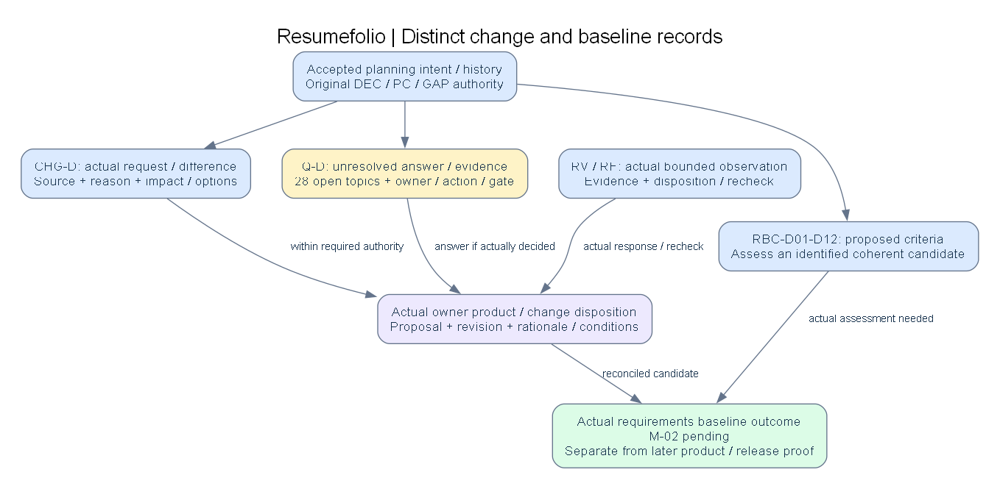

# Resumefolio — Change and Baseline Guide

## Current implementation baseline — November 4, 2026

[BL-MVP-2026-11-04.1](../../../baseline/README.md) selects the MVP technical mechanisms, numerical policies, priorities and requirement/criterion dispositions under Farhad’s explicit delegation. It supersedes earlier Proposed/pending mechanism and whole-baseline statements below for MVP design input. Future clauses and dated evidence remain separate. Runtime/actor validation, credentials, Git isolation, capacity and backup/restore still require the named implementation/Release gates; this update reports no product test Pass.

### Prior source material and rationale (superseded where this Baseline selects a different MVP choice)

| Item | Current position |
| --- | --- |
| Owner / decision authority | Farhad |
| Purpose | Keep actual requests, unresolved questions, owner decisions, review findings and baseline dispositions distinct |
| Status | Proposed requirements governance set — M-02 pending |
| Inventory | 28 local open questions, 12 proposed baseline criteria, one actual documentation request and four diagrams |
| New product/baseline decisions | None recorded by this revision |
| Revision | October 31, 2026 |

**Start with the [Question Register](open-questions-and-decisions.md#7-question-register)**
to identify unresolved answers and gates. Use [Change Control](change-control.md)
when an actual request alters records/commitments, and [Baseline Criteria](requirements-review-and-baseline-criteria.md)
when evaluating a coherent identified candidate. File completion is not owner
acceptance of its proposed product policies.

[Documents](#documents) · [Routes](#1-reading-routes) · [Distinctions](#2-authority-and-record-boundaries)
· [Readiness](#3-current-readiness-and-next-work) · [Diagrams](#4-diagram-catalog)
· [Maintenance](#5-maintenance)

## MVP requirement applicability and remaining review

Apply the current candidate release register: retain core presentation/sharing/manual applications/private files and basic ProjectForge; defer mail/calendar, advanced Git review/releases, advanced backlog/Sprints and YAML execution/deployment. Candidate IDs and planned verification stay intact. Mixed criteria must be scoped individually; allocation does not approve proposed numbers, priority or a complete baseline. Older 157-candidate/470-criterion evidence is historical larger-product coverage, not an MVP pass. Keep source, independent resume draft, explicit publication and actual submitted material identities distinct. Profile changes require preview/select/apply and cannot mutate publication or submitted history. Manual applications include status, next action and follow-up date without mail/calendar dependencies.

Authority: [OWNER-MVP-2026-11-04](../../01-project-planning/owner-mvp-decision-2026-11-04.md). [Candidate allocation](../03-requirements-specification/mvp-release-allocation.md).

## Documents

| Document | Responsibility | Current content / limit |
| --- | --- | --- |
| [Change Control](change-control.md) | Request/source, classification, impact/options, actual decision, authorized updates and recheck | Proposed procedure; CHG-D01 records the actual four-document editing request, not new product scope/approval |
| [Open Questions and Decisions](open-questions-and-decisions.md) | Missing answer/evidence, affected records, owner, action, gate and actual decision link | Q-D01–Q-D28 all open; no new product decision or accepted local deferral recorded |
| [Requirements Review and Baseline Criteria](requirements-review-and-baseline-criteria.md) | Favorable-assessment conditions, evidence, blocker/follow-up rules and actual owner disposition | RBC-D01–RBC-D12 proposed; seven-theme checklist unchecked; candidate/decision/date not recorded |

Local Q/CHG/RBC references are working navigation, not final global notation or
planning DEC/PC allocations. The documents identify actual records where present;
they do not fabricate acceptance history or populate a decision log with examples.

## 1. Reading Routes

| Your question | Route |
| --- | --- |
| Which policy or finding is unresolved? | [Question groups/register](open-questions-and-decisions.md#7-question-register) → primary domain/source → actual investigation/owner answer later |
| Is this an edit, refinement or material commitment change? | [Change categories](change-control.md#1-authority-and-change-categories) → [impact record](change-control.md#3-impact-and-decision-record) → actual disposition when needed |
| May a question be deferred? | [Blocker/follow-up rules](requirements-review-and-baseline-criteria.md#4-blockers-and-permitted-follow-up) → existing planning gate → actual explicit compatible disposition |
| Can the requirements baseline be accepted? | [Detailed criteria](requirements-review-and-baseline-criteria.md#2-proposed-detailed-review-criteria) → actual [findings/evidence](../06-validation-and-traceability/review-plan-and-findings.md) → identified candidate and owner decision |
| What changed in this documentation revision? | [CHG-D01](change-control.md#4-change-register); no accepted product/baseline decision implied |



[Scalable SVG](../diagrams/change-baseline-record-map.svg) ·
[Editable Graphviz](../diagrams/change-baseline-record-map.dot)

Relationships indicate record responsibilities, not a software architecture,
new team, automatic approval or a dated roadmap. Colors supplement labels.

## 2. Authority and Record Boundaries

| Record | What it establishes | What it does not establish |
| --- | --- | --- |
| Accepted planning DEC / PC / GAP history | Original actual planning decision/assessment and tracked follow-up for the identified snapshot | Automatic acceptance of later detailed behavior or a new working copy |
| Q-D question | A real recorded unresolved choice/evidence need with owner/action/gate | An accepted answer, deferral, numeric target or implementation selection |
| CHG-D request | An actual source/reason/proposed difference and impact/disposition trail | Scope acceptance merely because the request was written |
| RF-D finding / RV-D activity | Actual bounded observation and review evidence | Exhaustive semantic review or closed finding without actual recheck |
| RBC-D criterion | Proposed condition for assessing an identified M-02 candidate | Satisfied condition, PC planning assessment or actual baseline disposition |
| Actual owner decision | Identified selected proposal/revision, outcome/rationale and conditions when really recorded | Product Pass, provider approval, recovery success or release readiness by itself |

[M-01 acceptance](../../01-project-planning/10-planning-completion-criteria.md#dec-116)
remains attached to its recorded planning snapshot. GAP-D01–GAP-D11 retain their
accepted tracked-follow-up gates; the local questions do not revoke those decisions
or grant blanket permission to leave dependent behavior undefined. Refer to the
[Planning Decision Register](../../01-project-planning/decision-register.md) for
historical DEC authority; allocate new decisions only for actual decisions.

Routine document editing within the user's request proceeds under that authority.
Changing scope, spending, access/lifecycle policies or baseline status needs the
appropriate actual disposition; silence and document creation are not approval.
No administrative role gains product privileges from this governance guide.

## 3. Current Readiness and Next Work

The specification set contains 157 provisional candidate records. The historical
[RV-D01 inspection](../06-validation-and-traceability/review-plan-and-findings.md#rv-d01)
observed 470 criterion bullets, 12 UC/ST bundles and 60 paths; 123 candidates were
explicitly cited by bundles and 34 were not. These structural observations are not
complete semantic coverage. RF-D01–RF-D05 remain open, and detailed policies,
targets/dependencies and actual owner baseline review remain pending.

This revision changes the former baseline-criteria scaffold. RV-D01's stored
hash for that source correctly identifies the older inspected bytes. Preserve the
[original evidence snapshot](../06-validation-and-traceability/evidence/traceability-source-inventory.json)
unchanged; do not relabel it as an inspection of this revised governance set.

1. Review/split the 28 question topics and prioritize actual work without inventing owner-approved dates or severities.
2. Obtain concrete answers/findings and actual owner dispositions at dependent gates; update primary rules and scenarios/definitions.
3. Refine uncited/coarse coverage and exact stage-appropriate downstream mappings; record actual finding rechecks.
4. Reconcile IDs/priorities/criteria and assess the 12 proposed baseline criteria against an identified candidate.
5. Record actual owner baseline outcome/conditions separately from later design, implementation, recovery and release acceptance.

The wider agreed initial SDLC documentation, analysis/design and tracking
reconciliation, and pre-implementation agreement still precede product coding.
No artifact in this folder closes a finding, resolves a Q-D topic, changes the
requested delivery date or establishes execution feasibility merely by existing.

## 4. Diagram Catalog

| Diagram | Purpose | Source | SVG | PNG |
| --- | --- | --- | --- | --- |
| Governance record map | Distinguish request/question/finding/decision/baseline | [DOT](../diagrams/change-baseline-record-map.dot) | [SVG](../diagrams/change-baseline-record-map.svg) | [PNG](../diagrams/change-baseline-record-map.png) |
| Question groups | Open topics and dependent acceptance/evidence gates | [DOT](../diagrams/requirements-question-map.dot) | [SVG](../diagrams/requirements-question-map.svg) | [PNG](../diagrams/requirements-question-map.png) |
| Change flow | Classification, proportional impact, actual disposition and recheck | [PlantUML](../diagrams/requirements-change-flow.puml) | [SVG](../diagrams/requirements-change-flow.svg) | [PNG](../diagrams/requirements-change-flow.png) |
| Baseline gates | Criteria, blockers and separate actual owner outcome | [PlantUML](../diagrams/requirements-baseline-gates.puml) | [SVG](../diagrams/requirements-baseline-gates.svg) | [PNG](../diagrams/requirements-baseline-gates.png) |

## 5. Maintenance

- Preserve original decisions, exact reviewed revisions and historical source hashes.
- Update actual question/change/finding/decision links as work occurs; never fill missing outcomes with invented acceptance.
- Keep product policy in its primary domain file, proposed assessment criteria here and actual inspection outcomes in the findings register.
- Assess reverse impacts on definitions, scenarios, interfaces, quality and delivery records when meaning changes.
- Recheck relevant artifacts before recording closure or baseline status; retain real limitations/conditions.

Use [Traceability](../06-validation-and-traceability/requirements-traceability.md),
[Review Findings](../06-validation-and-traceability/review-plan-and-findings.md),
[Requirements Management](../01-process-and-approach/07-requirements-management.md)
and [Planning Gates](../../01-project-planning/10-planning-completion-criteria.md).
Keep sources/captions/renders synchronized and verify readable labels/arrows and
file/section links under the [diagram guide](../diagrams/README.md).

```powershell
$diagramFolder = 'docs\SDLC\02-requirements-engineering\diagrams'
$graphvizExe = 'C:\Program Files\Graphviz\bin\dot.exe'
$plantUmlJar = 'C:\Users\fvali\AppData\Local\Resumefolio\DiagramTools\plantuml.jar'
foreach ($format in 'svg', 'png') {
    foreach ($stem in 'change-baseline-record-map', 'requirements-question-map') {
        & $graphvizExe "-T$format" -Gdpi=140 "$diagramFolder\$stem.dot" -o "$diagramFolder\$stem.$format"
        if ($LASTEXITCODE -ne 0) { throw "Graphviz failed: $stem / $format" }
    }
    foreach ($stem in 'requirements-change-flow', 'requirements-baseline-gates') {
        java '-Djava.awt.headless=true' -jar $plantUmlJar -charset UTF-8 "-t$format" "$diagramFolder\$stem.puml"
        if ($LASTEXITCODE -ne 0) { throw "PlantUML failed: $stem / $format" }
    }
}
```

Run from the repository root using actual installed tool paths; save UTF-8 without
BOM and retain source/SVG/PNG together. Rendering and working links check document
assets, not product behavior, substantive policy approval or M-02 acceptance.

[Requirements index](../README.md) · [Specification guide](../03-requirements-specification/README.md)
· [Validation guide](../06-validation-and-traceability/README.md)

## Current Answer Review Candidate

See the [complete proposed answer package](requirements-answer-review.md): 28 source-level proposals, 84 review cases, fresh bounded server observations and six remaining evidence gates. No parent question or M-02 baseline is marked accepted by drafting these answers.
