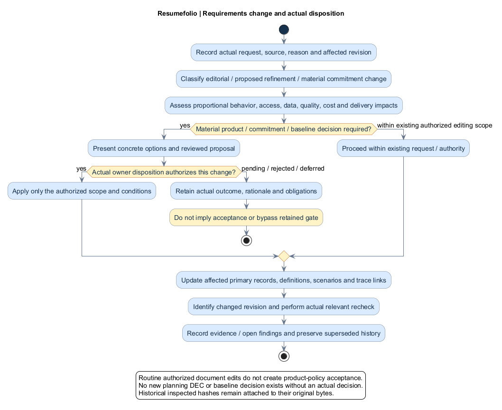

# Resumefolio — Requirements Change Control

Current implementation choices and scope: [Baseline](../../../baseline/README.md). Runtime verification remains subject to its gates.

| Item | Current position |
| --- | --- |
| Owner / decision-maker | Farhad; sole delivery and operations owner |
| Status | Proposed requirements-change procedure — no new product/baseline decision recorded |
| Authority | Existing accepted planning change rules retain their meaning; detailed procedure below is proposed |
| Current register | CHG-D01: actual documentation request, not an approved product scope change |
| Revision | October 31, 2026 |

**At a glance:** Identify what changed, why, which records/commitments it affects
and who actually decided. Keep routine authorized document editing distinct from
changing scope, access policy, costs or accepted baselines. Preserve superseded
history and recheck affected evidence; a changed file is not new acceptance.

[Authority](#1-authority-and-change-categories) · [Workflow](#2-proposed-workflow)
· [Impact](#3-impact-and-decision-record) · [Register](#4-change-register)
· [Evidence](#5-revision-history-and-recheck) · [Review](#6-review-readiness)

## 1. Authority and Change Categories

Use [Working Method and Change Control](../../01-project-planning/09-working-method-and-change-control.md),
[Scope](../../01-project-planning/02-scope.md),
[Planning Completion](../../01-project-planning/10-planning-completion-criteria.md)
and [Requirements Management](../01-process-and-approach/07-requirements-management.md).
Accepted planning snapshot/decision IDs remain historical evidence; do not edit
them to imply later working copies were accepted. Project governance is not a
product administrator permission grant.

| Category | Treatment | Boundary |
| --- | --- | --- |
| Editorial/navigation | Correct wording/layout, links and synchronized diagrams within authorized documentation scope | If meaning/authority changes, assess as substantive; formatting does not accept a baseline |
| Proposed detail/refinement | Clarify fields, states, grants, criteria or models from accepted scope | New interpretation remains proposed until actual review; update related questions/traceability |
| Product/quality/lifecycle change | Alter observable behavior, permission, retention, target or an accepted rule | Assess affected actors/data/interfaces/security, feasibility and acceptance before treating it as decided |
| Scope/cost/schedule/resource change | Include/exclude capability, purchase resources or change commitments | Preserve original commitment until actual owner disposition is recorded; no silent reduction or assumed spending |
| Baseline revision | Replace an accepted starting point with an identified reviewed candidate | Separate baseline decision and evidence required; a commit alone is not acceptance |
| Actual finding correction | Address an observed review issue | Link finding, changed revision and actual recheck; proposed fix does not close finding |

The classification is a proposed working aid, not a new automatic approval flow
for every typo. Existing user authorization covers routine document edits; it
does not constitute acceptance of proposed product policies or baseline status.

## 2. Proposed Workflow

1. Record the actual request/source, reason, current versus proposed behavior and affected revision.
2. Classify the change and identify source constraints, primary requirements/criteria, definitions, scenarios, interfaces and related findings/decisions.
3. Assess impacts using section 3, with evidence, realistic options, costs/dependencies and unresolved gates.
4. For a material product/commitment/baseline decision, present a concrete reviewable proposal and record the actual owner outcome; do not infer it from silence, a draft or elapsed time.
5. Apply authorized edits within the decided scope; keep undecided refinements visibly proposed. Update related artifacts/links and preserve historical decisions/evidence.
6. Identify the resulting revision and perform relevant actual rechecks; update findings, question status and downstream planning only with verified outcomes.

[Scalable SVG](../diagrams/requirements-change-flow.svg) ·
[Editable PlantUML](../diagrams/requirements-change-flow.puml)

The diagram describes governance, not an implemented product workflow or proof
that any pending question has been resolved. Colors supplement labels.

## 3. Impact and Decision Record

| Field | Record for a substantive change |
| --- | --- |
| Identity/source | Actual request/change ID, requester/date/source, rationale and status; provisional IDs clearly labeled |
| Before/after | Identified affected revision, current accepted/proposed meaning, exact requested difference and intended outcome |
| Behavior/actors | Normal/alternative/denied/failure/recovery paths, accessibility/language and user-value consequences |
| Data/access | Fields, ownership/grants, direct paths, source/history, references, retention and restored access |
| Interfaces/execution | Provider/client compatibility, external side effects, secret/target authority, untrusted code and repetition risk |
| Quality/resources | Measurement targets/workload, capacity, backup/recovery, operations effort and actual feasibility findings |
| Delivery/economics | Scope/inclusions, exact backlog/dependency impacts, effort/forecast ranges and one-time/recurring costs where relevant |
| Options/recommendation | Keep/revise/defer/reject alternatives, evidence limits, trade-offs and accountable recommendation |
| Actual disposition | Owner, date, reviewed proposal/revision, accepted/rejected/deferred outcome, rationale and explicit conditions |
| Implementation/recheck | Exact changed artifacts/revision, criterion/scenario/analysis method, actual evidence, findings and remaining obligations |

Not every field applies to every editorial change; record proportional impact.
Do not invent numerical estimates, legal applicability, resource availability or
provider approval. Reference actual [Questions](open-questions-and-decisions.md),
[Traceability](../06-validation-and-traceability/requirements-traceability.md) and
[Review Findings](../06-validation-and-traceability/review-plan-and-findings.md).

## 4. Change Register

CHG-D01 is an actual documentation request recorded from this conversation. It
allocates no planning DEC ID and approves no product policy or baseline.

**Local change:** CHG-D01

**Request / source / reason:** October 31, 2026; user requested completion of the four `07-change-and-baseline` documents

**Affected records / impact:** Elaborate method, sourced unresolved-question register, review criteria and guide; add synchronized diagrams; retain accepted scope/decisions and pending states

**Actual authority / disposition:** User authorized documentation editing; detailed procedure/criteria/policies remain proposed. No new product/baseline owner decision recorded

**Revision / follow-up:** This documentation revision; link exact committed revision only if later verified. Review open questions, criteria and findings at dependent gates

No other product change requests or accepted change decisions are inferred from
the existing draft questions. Add a real record only when an actual request or
decision occurs; do not fabricate populated history to avoid an empty register.

## 5. Revision History and Recheck

Preserve old references when IDs/structure change and assess reverse impacts.
Keep primary obligations in their domain files; synchronize glossary/dictionary,
scenario paths, diagrams, traceability, actual findings and delivery records as
applicable. Verify exact PBI/design/result links before recording them.

The existing [RV-D01 source inventory](../06-validation-and-traceability/evidence/traceability-source-inventory.json)
identifies historical inspected bytes. It includes the former baseline-criteria
file, which this revision changes. Retain that evidence unchanged: it is not a
hash claim about this later revision. A new/rechecked activity must identify its
own inputs and evidence. No RF finding is closed by this document update.

## 6. Review Readiness

- [ ] Review categories/decision boundaries against accepted planning authority.
- [ ] Confirm actual material requests have impact/options and explicit dispositions.
- [ ] Reconcile changed primary rules and affected definitions/scenarios/evidence.
- [ ] Identify reviewed revision and actual recheck before closing findings or changing baseline status.
- [ ] Preserve undecided policies, conditions and historical evidence rather than implying acceptance.

**Current outcome:** Proposed change procedure and one actual editorial request
record. No new scope, spending, schedule, role, retention or baseline decision is
established. M-02 and the wider pre-implementation agreement remain pending.

[Change/baseline guide](README.md) · [Questions](open-questions-and-decisions.md)
· [Baseline criteria](requirements-review-and-baseline-criteria.md) · [Requirements index](../README.md)

## CHG-D02 — Course-Aligned Requirements Refinement

Date: November 1, 2026. Source: user requested verification against the supplied FAU lectures and then instructed execution of the corrections. Authorized scope: improve existing requirements documentation, priority proposals, scenario clarity, trace references and readiness/evidence recording. Original product requirements, accepted scope and candidate identifiers are preserved. New priority attributes are proposals; unknown values/policies remain explicit blockers. The owner's confirmation that no previous numerical response/recovery targets exist is recorded in Q-D25/Q-D26 follow-up. No new planning DEC, spending, product baseline or release decision is inferred.

## CHG-D03 — Explicit Functional and Non-Functional Navigation

Date: November 1, 2026. Actual request: the owner noted that Functional and Non-Functional Requirements were not clearly visible and authorized adding explicit sections in the main SRS with links to existing primary records. Added functional and non-functional indices, cross-cutting classification guidance and reading routes. Existing obligations, IDs, priorities, open numerical targets and baseline status remain unchanged. This is documentation organization, not acceptance of a new product requirement or a change of scope.

## CHG-D04 — Separate PDF Configuration from Link Disablement

Date: November 1, 2026. Actual request: the owner reviewed the UC-D02 mismatch and instructed its correction. Scope: align the existing configuration scenario's trigger/normal steps/postcondition and document link disablement as an independently triggered action within the same bundle. Update focused trace/review records. Existing primary requirements, identifiers, case counts, diagram semantics, accepted scope and baseline status remain unchanged. Already-authorized-session/cache/in-flight behavior remains unresolved; no new technical mechanism or product policy is selected.

## CHG-D05 — Apply Observed Infrastructure Evidence

Date: November 1, 2026. Authority: after discussing which requirements questions the known server information could answer, the owner instructed “fix them.” This authorizes adding the previously supplied observations to project documentation, superseding the earlier instruction to leave those observations out. Scope: current planning resource/dependency statements, a bounded feasibility observation and sanitized evidence, Q-D24–Q-D27 next actions/status, quality-target inputs and provenance/review records.

No product scope, accepted historical planning snapshot, requirement ID, priority, numerical quality target, upload quota or unresolved product policy is changed. DEP-01 is partially observed; ASM-01 suitability and all 28 parent questions remain open. Original historical evidence hashes are preserved. No server command, provider operation, package change, restart, backup or load test was executed for this revision.

## CHG-D06 — Complete Concrete Question-Answer Proposals

Date: November 1, 2026. Authority: owner requested completion of the remaining questions. Work: concrete source-level proposals for all 28 question groups, 84 planned checks, all 157 proposed priorities, 470 proposed criterion locators, bounded fresh read-only server evidence and updated question dispositions. This is drafting/investigation authorization, not actual owner approval of new policy/thresholds, acceptance of a baseline or closure of a capability gate. Original requirement IDs and criterion bullets, historical hashes, scope/exclusions and accepted planning decisions remain intact. See [review package](requirements-answer-review.md) before adopting the proposals. No code, deployment, resource purchase, credentials, account state or production settings changed.

## CHG-D07 — Investigate Remaining Gates and Apply Confirmed Weekly Capacity

November 1, 2026. Authority: owner asked whether the remaining questions could be solved; Codex proceeded with scoped investigation and received an actual 20-hour/week availability reply. Changes record bounded operating findings, documentary review, infrastructure exclusions, preliminary sizing and phase-specific next actions. [Gate assessment](../06-validation-and-traceability/remaining-gate-assessment.md) preserves all evidence limits. This changes current working availability from unspecified full-time to the supplied 20 hours, while historical accepted snapshots/DEC records are unchanged. No product scope reduction, final architecture, numerical target approval, accepted completion date, production configuration or baseline acceptance is recorded.

## CHG-D08 — Record Actual OAuth Setup Status

November 1, 2026. Owner clarification: “I have not created OAuth.” Updated Q-D15, its primary specification, review/gate navigation and provenance to distinguish an answered existence question from an unfulfilled integration prerequisite. No product scope, priority, provider account, audience, credential, external configuration or baseline acceptance changed. Historical preparation-time unknowns are retained as dated history.

## CHG-D09 — Record Actual Backup Setup Status

November 1, 2026. Owner clarification: backups have not been set up. Updated the current dependency/question status, primary recovery specification, gate/review navigation and provenance. The factual answer does not approve a destination, spending, proposed retention/RPO/RTO, backup operation, restore or baseline. Historical preparation-time unknowns remain as dated history; current notes supersede their unanswered-input status.

## CHG-D10 — Complete the System Analysis Start Here Guide and Record Accepted Core Policy

November 1, 2026. Owner selected `03-system-analysis/00-start-here.md` for completion with organized, readable diagrams/workflows. The guide now includes actual status, an actionable work route, file/output map, bounded next task, accepted core workflow, gate handling and completion checks, with two editable/rendered figures and catalog entries. The owner had explicitly accepted the profile-preview/apply/separate-publication/history-preservation rule immediately before selecting the file; its authoritative requirement/rule, question disposition, existing criterion locator and review navigation are synchronized here rather than requesting repeat approval. Only PRP-D04-AC01 wording changes; candidate IDs and all 470 criterion locators remain. Separate domain/data drafts were not applied in this file-focused update; their actual current partial/outline status is stated accurately. Unrelated policies, full phase/baseline acceptance, implementation and production settings are unchanged.
