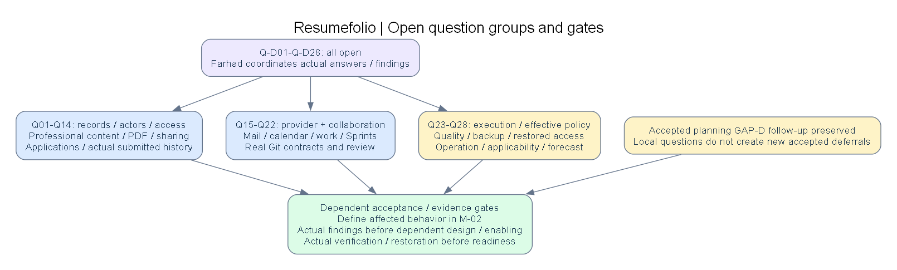

# Resumefolio — Current Questions and Decisions

Current authority: [BL-MVP-2026-11-04.1](../../../baseline/README.md), selected November 4, 2026 under Farhad’s explicit delegation. [All 28 actual dispositions](../../../baseline/policy-decisions.md) replace earlier proposed-answer statuses for the MVP. Design choices are selected; runtime, actor validation, external inputs and recovery evidence remain gated. Future-only topics remain deferred rather than blocking MVP.

The following dated register is retained for source provenance and its original anchors, including the previously owner-accepted profile update policy. Its November 1 pending/Proposed wording describes that historical revision; use the current per-question disposition inserted below each heading.

## Historical register — November 1, with current disposition pointers

| Item | Current position |
| --- | --- |
| Owner / coordinator | Farhad |
| Historical November 1 status | 28 concrete answer proposals: 21 Answer proposed; 1 Partially resolved (core policy accepted); 6 evidence-gated investigations; no entire baseline accepted |
| Source | Unresolved detail already stated in current primary drafts, scenario paths, planning follow-up and review findings |
| References | Q-D01–Q-D28 are local recorded questions, not final global requirement IDs or new planning DEC decisions |
| Actual new product/baseline decisions | Owner-accepted profile policy plus OWNER-MVP-2026-11-04 scope/system boundaries; detailed mechanisms and whole-baseline acceptance remain separate |
| Revision | November 1, 2026 — complete proposed answers and evidence-gate classification |

**At a glance:** Make unresolved choices visible with an affected record, next
action, owner and dependent gate. A question, suggested option or investigation
plan is not an accepted policy. Record actual decisions only when they occur and
preserve the original planning decisions instead of duplicating their authority.

[Conventions](#1-purpose-and-status-conventions) · [Sources](#2-source-authority-and-existing-follow-up)
· [Question map](#3-question-groups) · [Decisions](#4-actual-decision-recording)
· [Register](#7-question-register) · [Maintenance](#8-maintenance-and-review)

## MVP requirement applicability and remaining review

Settled November 4: Version 1 = MVP; owner/admin creates/invites users; ProjectForge is separate via authenticated user-scoped API; uploads private on the core server; mail/calendar deferred with per-user/account consent and no owner/admin reading privilege. These are no longer open alternatives. Remaining questions concern implementation mechanisms and numeric policies. Q-D questions about providers/advanced work/Git/execution remain future investigations; their parent records and historical answers are preserved. The earlier 21/1/6 distribution below is a dated pre-MVP-allocation snapshot, not a fresh disposition count.

Authority: [OWNER-MVP-2026-11-04](../../01-project-planning/owner-mvp-decision-2026-11-04.md). [Candidate allocation](../03-requirements-specification/mvp-release-allocation.md).

## 1. Purpose and Status Conventions

Current owner is **Farhad** for all rows. Twenty-one rows have **Answer proposed**, one has **Partially resolved — core policy accepted**, and six have **Under investigation — evidence gate remains**. Each now links a concrete proposal and planned review cases. No parent question is marked Resolved and no new owner baseline decision is inferred. Due dates and approved priority/risk ranking remain unassigned. Fresh bounded server evidence is recorded separately from product-policy recommendations.

| Working label | Meaning / evidence needed |
| --- | --- |
| Open | Answer/findings/disposition still needed; retained for historical records and future unresolved topics |
| Under investigation | Actual investigation started and its revision/activity is identified; do not infer from a plan |
| Answer proposed | Specific evidence/options/rationale exist for review; not yet owner acceptance |
| Partially resolved | Actual owner acceptance covers an identified subquestion; remaining details are explicitly separated |
| Resolved | Actual answer/decision and relevant primary-record update/recheck linked; status cannot be set from silence |
| Explicit gated follow-up | Actual permitted owner disposition retains risk/action/owner/gate; not an automatic way around a prerequisite |
| Superseded / not applicable | Actual rationale and replacement/applicability evidence retained |

These labels separate actual evidence from proposed decisions. A question can be
split into subquestions without losing its original context/references. Do not
bundle an unresolved security/retention/target choice into a vague “later” answer.

## 2. Source Authority and Existing Follow-up

[Accepted Scope](../../01-project-planning/02-scope.md),
[Resources](../../01-project-planning/05-resources-and-constraints.md),
[Assumptions/Dependencies](../../01-project-planning/06-assumptions-and-dependencies.md)
and [Planning Completion](../../01-project-planning/10-planning-completion-criteria.md)
remain authoritative for their original decisions and GAP-D01–GAP-D11 gates.
Those planning follow-ups were accepted historically as tracked deferrals; their
status is not revoked or silently replaced by creating this local Q-D register.

Q-D rows consolidate current detailed unresolved topics. They do not inherit
approval of a new numerical value, role, retention policy, implementation or
blanket deferral. Consult the [Planning Decision Register](../../01-project-planning/decision-register.md)
for existing DEC records rather than assigning new DEC IDs without an actual decision.

[RF-D01–RF-D05](../06-validation-and-traceability/review-plan-and-findings.md#4-findings-register)
remain open review findings. Q-D records describe missing answers; RF records
describe actual bounded observations; CHG records describe actual change requests.
They may link but are not interchangeable or closed by one another's creation.

## 3. Question Groups

[Scalable SVG](../diagrams/requirements-question-map.svg) ·
[Editable Graphviz](../diagrams/requirements-question-map.dot)

The map groups review topics, not staffing, architecture, priority or completed
investigations. Colors supplement labels. Record concrete answers in primary
domain documents with actual question/decision links, not competing policies here.

## 4. Actual Decision Recording

For a real answer/decision, record: question(s), source/evidence and limitations,
considered options, exact selected behavior/value/applicability, impacted records,
actual owner/date/outcome, candidate/revision, rationale, effective scope, retained
conditions/gates and required update/recheck. If a decision changes accepted scope,
cost, quality or delivery, use [Change Control](change-control.md).

**New decision log position:** No new product or baseline owner decision is
recorded in this revision. No synthetic accepted decision row or DEC ID is added.
The existing planning register remains the reference for historical acceptance.

## 5. Answer-readiness and Closure

- Identify exact required behavior, values/units and conditions rather than a general preference.
- Supply actual source/applicability or investigation evidence where the answer depends on external facts.
- Assess actor/data/access/lifecycle/interface/quality/resource/cost/delivery impacts.
- Record actual owner disposition, update the primary wording and preserve earlier references.
- Perform relevant actual recheck and reconcile findings/criteria/traceability before marking resolved.

A code example, diagram, link count or proposed option is not an accepted answer.
An actual valid deferral must identify obligations/gate and cannot bypass required
provider access, execution controls or later restoration evidence.

## 6. Register Conventions and Navigation

The following 28 records originate in already stated open-detail sections. Each
primary-source link provides the current proposed behavior and questions. The
affected references and next action are a consolidation, not a verified complete
question inventory or a claim all external obligations are known.

## 7. Question Register

### Q-D01: Identifiers, priorities and criterion-level traceability

**Current disposition (November 4): Selected.** [Selected answer](../../../baseline/policy-decisions.md#q-d01). Earlier fields below are historical.

| Field | Recorded open question |
| --- | --- |
| Question | Which final ID/status/priority conventions and criterion-to-path/analysis links will be used? How will old local references be preserved? |
| Primary source / affected records | [Primary draft](../03-requirements-specification/requirements-specification.md); SRS and all local candidate/UC/ST/SCN IDs; RF-D01/RF-D02/RF-D03/RF-D04 |
| Evidence / next action | Review the [concrete proposed answer](../03-requirements-specification/requirements-specification.md#resolution-q-d01) and [three planned checks](../04-scenarios-and-models/user-stories-and-scenarios.md#review-q-d01); Owner review of the proposed rule and its affected criteria is required; no product test is reported. |
| Owner / gate | Farhad; Before claiming complete M-02 traceability/record readiness; stage-appropriate downstream plans |
| Status / actual answer or decision | Answer proposed — concrete rule and assessment cases recorded; owner acceptance and affected review pending. |

### Q-D02: Actor outcomes and user validation

**Current disposition (November 4): Specification selected; user validation gate.** [Selected answer](../../../baseline/policy-decisions.md#q-d02). Earlier fields below are historical.

| Field | Recorded open question |
| --- | --- |
| Question | Do derived USR-D goals, participants and journeys match intended use, including denied/failure/recovery paths? |
| Primary source / affected records | [Primary draft](../03-requirements-specification/user-requirements.md); USR-D01–D12; UC/ST bundles; RF-D05 |
| Evidence / next action | Review the [concrete proposed answer](../03-requirements-specification/user-requirements.md#resolution-q-d02) and [three planned checks](../04-scenarios-and-models/user-stories-and-scenarios.md#review-q-d02); An actual owner/actor review has not occurred in this task. Proposed outcomes are ready to review; validation evidence remains required. |
| Owner / gate | Farhad; Before accepting affected user requirements/M-02 |
| Status / actual answer or decision | Under investigation — evidence gate remains; proposed contract is complete, required capability/validation evidence is not. |

### Q-D03: Identity, onboarding and account lifecycle

**Current disposition (November 4): Selected.** [Selected answer](../../../baseline/policy-decisions.md#q-d03). Earlier fields below are historical.

**Field:** Question

**Recorded open question:** What onboarding, account states, authentication/recovery and end-of-access behavior are required? Are additional factors/MFA selected?

**Field:** Primary source / affected records

**Recorded open question:** [Primary draft](../03-requirements-specification/accounts-authentication-and-permissions.md); ACC-D01/D02/D11/D12; QSR-D05/D06

**Field:** Evidence / next action

**Recorded open question:** Review the [concrete proposed answer](../03-requirements-specification/accounts-authentication-and-permissions.md#resolution-q-d03) and [three planned checks](../04-scenarios-and-models/user-stories-and-scenarios.md#review-q-d03); Onboarding, factor and timing values are new proposals. Actual notification-delivery credentials/receipt and secure recovery mechanism remain design/operational gates; no account or secret is changed.

**Field:** Owner / gate

**Recorded open question:** Farhad; Affected M-02/M-03 identity/security acceptance; GAP-D03/D06 where applicable

**Field:** Status / actual answer or decision

**Recorded open question:** Answer proposed — concrete rule and assessment cases recorded; owner acceptance and affected review pending.

### Q-D04: Resource grants and administration powers

**Current disposition (November 4): Selected.** [Selected answer](../../../baseline/policy-decisions.md#q-d04). Earlier fields below are historical.

| Field | Recorded open question |
| --- | --- |
| Question | Which actor/resource/action/state grants, invitations, assignments, transfer and administrative actions are permitted? |
| Primary source / affected records | [Primary draft](../03-requirements-specification/accounts-authentication-and-permissions.md); ACC-D03–D05/D09/D10; PKS-D06/GIT-D02; AFO-D |
| Evidence / next action | Review the [concrete proposed answer](../03-requirements-specification/accounts-authentication-and-permissions.md#resolution-q-d04) and [three planned checks](../04-scenarios-and-models/user-stories-and-scenarios.md#review-q-d04); Owner review of the proposed rule and its affected criteria is required; no product test is reported. |
| Owner / gate | Farhad; Before affected permission/administration requirement and security design acceptance; GAP-D06 |
| Status / actual answer or decision | Answer proposed — concrete rule and assessment cases recorded; owner acceptance and affected review pending. |

### Q-D05: Active access, credentials and revocation

**Current disposition (November 4): Selected.** [Selected answer](../../../baseline/policy-decisions.md#q-d05). Earlier fields below are historical.

| Field | Recorded open question |
| --- | --- |
| Question | How do sign-out, account/membership/password/link/credential changes affect fresh, active, cached and in-flight contexts? |
| Primary source / affected records | [Primary draft](../03-requirements-specification/accounts-authentication-and-permissions.md); ACC-D08/D12; PDF-D05/D06; EGC-D11; GIT-D02  **After MVP.** |
| Evidence / next action | Review the [concrete proposed answer](../03-requirements-specification/accounts-authentication-and-permissions.md#resolution-q-d05) and [three planned checks](../04-scenarios-and-models/user-stories-and-scenarios.md#review-q-d05); Owner review of the proposed rule and its affected criteria is required; no product test is reported. |
| Owner / gate | Farhad; Before affected access/lifecycle acceptance; no lifetime or instantaneous global revocation assumed |
| Status / actual answer or decision | Answer proposed — concrete rule and assessment cases recorded; owner acceptance and affected review pending. |

### Q-D06: Professional fields and resume composition

**Current disposition (November 4): Selected.** [Selected answer](../../../baseline/policy-decisions.md#q-d06). Earlier fields below are historical.

| Field | Recorded open question |
| --- | --- |
| Question | Which profile/resume fields, requiredness, ordering, identity/count, duplication and incomplete-content rules are needed? |
| Primary source / affected records | [Primary draft](../03-requirements-specification/profiles-resumes-and-portfolio.md); PRP-D01/D02; dictionary elements E01–E06 |
| Evidence / next action | Review the [concrete proposed answer](../03-requirements-specification/profiles-resumes-and-portfolio.md#resolution-q-d06) and [three planned checks](../04-scenarios-and-models/user-stories-and-scenarios.md#review-q-d06); Owner review of the proposed rule and its affected criteria is required; no product test is reported. |
| Owner / gate | Farhad; Affected M-02 data/composition acceptance; GAP-D06 |
| Status / actual answer or decision | Answer proposed — concrete rule and assessment cases recorded; owner acceptance and affected review pending. |

### Q-D07: Shared updates, overrides and publication

**Current disposition (November 4): Selected.** [Selected answer](../../../baseline/policy-decisions.md#q-d07). Earlier fields below are historical.

**Field:** Question

**Recorded open question:** Which source changes propagate, when, with what precedence/conflict/review behavior, and which saved revision becomes live?

**Field:** Primary source / affected records

**Recorded open question:** [Primary draft](../03-requirements-specification/profiles-resumes-and-portfolio.md); PRP-D03/D04/D08; BRL-D02; PDF-D07

**Field:** Evidence / next action

**Recorded open question:** Owner accepted the core source-update/apply/publication/history rule; apply it in models without seeking repeat approval. Source-removal and detailed concurrent-edit/revision handling remain separate follow-up. See [accepted decision](#owner-accepted-profile-update-policy).

**Field:** Owner / gate

**Recorded open question:** Farhad; Before accepting affected update/presentation behavior or dependent data design

**Field:** Status / actual answer or decision

**Recorded open question:** Partially resolved — core behavior accepted by the owner November 1, 2026; unrelated remaining details and implementation checks are not implied accepted.

### Q-D08: Evidence, media and external-content handling

**Current disposition (November 4): Selected.** [Selected answer](../../../baseline/policy-decisions.md#q-d08). Earlier fields below are historical.

| Field | Recorded open question |
| --- | --- |
| Question | Which evidence formats, metadata, skill/project relationships, safe rendering/embeds/link fetching and removal rules are supported? |
| Primary source / affected records | [Primary draft](../03-requirements-specification/profiles-resumes-and-portfolio.md); PRP-D05/D06/D09/D10; AFO-D05/D06; EIF-D04 |
| Evidence / next action | Review the [concrete proposed answer](../03-requirements-specification/profiles-resumes-and-portfolio.md#resolution-q-d08) and [three planned checks](../04-scenarios-and-models/user-stories-and-scenarios.md#review-q-d08); Owner review of the proposed rule and its affected criteria is required; no product test is reported. |
| Owner / gate | Farhad; Affected M-02 content/security acceptance and M-03 resource design; GAP-D01/D06/D10 |
| Status / actual answer or decision | Answer proposed — concrete rule and assessment cases recorded; owner acceptance and affected review pending. |

### Q-D09: Manual language variants and fallback

**Current disposition (November 4): Selected.** [Selected answer](../../../baseline/policy-decisions.md#q-d09). Earlier fields below are historical.

| Field | Recorded open question |
| --- | --- |
| Question | Which values are shared versus English/German-specific, and what happens when a variant is incomplete/unavailable? |
| Primary source / affected records | [Primary draft](../03-requirements-specification/profiles-resumes-and-portfolio.md); PRP-D07; PDF-D02/D03; BRL-D10 |
| Evidence / next action | Review the [concrete proposed answer](../03-requirements-specification/profiles-resumes-and-portfolio.md#resolution-q-d09) and [three planned checks](../04-scenarios-and-models/user-stories-and-scenarios.md#review-q-d09); Owner review of the proposed rule and its affected criteria is required; no product test is reported. |
| Owner / gate | Farhad; Before accepting affected content/display/PDF criteria |
| Status / actual answer or decision | Answer proposed — concrete rule and assessment cases recorded; owner acceptance and affected review pending. |

### Q-D10: PDF rendition and download contracts

**Current disposition (November 4): Selected.** [Selected answer](../../../baseline/policy-decisions.md#q-d10). Earlier fields below are historical.

| Field | Recorded open question |
| --- | --- |
| Question | Which templates/layout/fonts/pagination, represented revisions, processing failures and generated/uploaded availability behaviors are required? |
| Primary source / affected records | [Primary draft](../03-requirements-specification/pdf-and-controlled-sharing.md); PDF-D01–D03/D07/D09; EIF-D04 |
| Evidence / next action | Review the [concrete proposed answer](../03-requirements-specification/pdf-and-controlled-sharing.md#resolution-q-d10) and [three planned checks](../04-scenarios-and-models/user-stories-and-scenarios.md#review-q-d10); Owner review of the proposed rule and its affected criteria is required; no product test is reported. |
| Owner / gate | Farhad; Affected M-02 PDF/serving acceptance and later rendering/resource evidence |
| Status / actual answer or decision | Answer proposed — concrete rule and assessment cases recorded; owner acceptance and affected review pending. |

### Q-D11: Employer link/password lifecycle

**Current disposition (November 4): Selected.** [Selected answer](../../../baseline/policy-decisions.md#q-d11). Earlier fields below are historical.

| Field | Recorded open question |
| --- | --- |
| Question | What link states/count, password/abuse controls, viewer feedback and selected-content rules are needed? |
| Primary source / affected records | [Primary draft](../03-requirements-specification/pdf-and-controlled-sharing.md); PDF-D04–D06; ACC-D06–D08; UC-D02/D03 |
| Evidence / next action | Review the [concrete proposed answer](../03-requirements-specification/pdf-and-controlled-sharing.md#resolution-q-d11) and [three planned checks](../04-scenarios-and-models/user-stories-and-scenarios.md#review-q-d11); Owner review of the proposed rule and its affected criteria is required; no product test is reported. |
| Owner / gate | Farhad; Before accepting affected protected-sharing requirements/security design |
| Status / actual answer or decision | Answer proposed — concrete rule and assessment cases recorded; owner acceptance and affected review pending. |

### Q-D12: Application fields and progress

**Current disposition (November 4): Selected.** [Selected answer](../../../baseline/policy-decisions.md#q-d12). Earlier fields below are historical.

| Field | Recorded open question |
| --- | --- |
| Question | Which company/opportunity/cover-letter fields, status transitions, duplicate/time and correction rules apply? |
| Primary source / affected records | [Primary draft](../03-requirements-specification/manual-application-management.md); APP-D01–D05; BRL-D06/D10 |
| Evidence / next action | Review the [concrete proposed answer](../03-requirements-specification/manual-application-management.md#resolution-q-d12) and [three planned checks](../04-scenarios-and-models/user-stories-and-scenarios.md#review-q-d12); Owner review of the proposed rule and its affected criteria is required; no product test is reported. |
| Owner / gate | Farhad; Affected M-02 application behavior acceptance; GAP-D06 |
| Status / actual answer or decision | Answer proposed — concrete rule and assessment cases recorded; owner acceptance and affected review pending. |

### Q-D13: Actual submitted-set capture

**Current disposition (November 4): Selected.** [Selected answer](../../../baseline/policy-decisions.md#q-d13). Earlier fields below are historical.

| Field | Recorded open question |
| --- | --- |
| Question | How are the actual submitted resume/cover letter, provenance, completeness, artifact revision and progress coupling established? |
| Primary source / affected records | [Primary draft](../03-requirements-specification/manual-application-management.md); APP-D05/D06; BRL-D05; PDF-D08; UC-D05 |
| Evidence / next action | Review the [concrete proposed answer](../03-requirements-specification/manual-application-management.md#resolution-q-d13) and [three planned checks](../04-scenarios-and-models/user-stories-and-scenarios.md#review-q-d13); Owner review of the proposed rule and its affected criteria is required; no product test is reported. |
| Owner / gate | Farhad; Before accepting capture/history requirements and dependent data design |
| Status / actual answer or decision | Answer proposed — concrete rule and assessment cases recorded; owner acceptance and affected review pending. |

### Q-D14: Correction, resubmission and retained history

**Current disposition (November 4): Selected.** [Selected answer](../../../baseline/policy-decisions.md#q-d14). Earlier fields below are historical.

**Field:** Question

**Recorded open question:** How may actual submitted sets be corrected, re-submitted, archived/deleted and recovered without silent replacement?

**Field:** Primary source / affected records

**Recorded open question:** [Primary draft](../03-requirements-specification/manual-application-management.md); APP-D07/D09; BRL-D08/D09; QSR-D09/D12

**Field:** Evidence / next action

**Recorded open question:** Review the [concrete proposed answer](../03-requirements-specification/manual-application-management.md#resolution-q-d14) and [three planned checks](../04-scenarios-and-models/user-stories-and-scenarios.md#review-q-d14); Retention periods are operational proposals, not legal conclusions. Applicable privacy/retention obligations and actual backup-expiry behavior remain Q-D27/Q-D26 gates.

**Field:** Owner / gate

**Recorded open question:** Farhad; Affected history/lifecycle acceptance; numerical retention needs actual decision/applicability

**Field:** Status / actual answer or decision

**Recorded open question:** Answer proposed — concrete rule and assessment cases recorded; owner acceptance and affected review pending.

### Q-D15: Google access and external conditions

**Current disposition (November 4): Deferred after MVP.** [Selected answer](../../../baseline/policy-decisions.md#q-d15). Earlier fields below are historical.

**Field:** Question

**Recorded open question:** What account/audience, required operations, minimum permissions, provider conditions/verification applicability, quotas and costs are actually available?

**Field:** Primary source / affected records

**Recorded open question:** [Primary draft](../03-requirements-specification/email-calendar-and-google-integration.md); EGC-D01/D02/D12; DOM-D05; ASM-02/DEP-03/GAP-D02

**Field:** Evidence / next action

**Recorded open question:** Owner confirmed November 1, 2026: no OAuth project has been created. Project-existence input is answered; required Google setup/access is not available yet. Define intended audience and complete authorized project/consent/client/API setup before controlled operation checks; never request client secrets in documentation. See [actual gate assessment](../06-validation-and-traceability/remaining-gate-assessment.md).

**Field:** Owner / gate

**Recorded open question:** Farhad; Before dependent M-02/M-03 acceptance; actual access before dependent development

**Field:** Status / actual answer or decision

**Recorded open question:** Under investigation — evidence gate remains; proposed contract is complete, required capability/validation evidence is not.

### Q-D16: Mail views, drafts, send and uncertain outcomes

**Current disposition (November 4): Deferred after MVP.** [Selected answer](../../../baseline/policy-decisions.md#q-d16). Earlier fields below are historical.

| Field | Recorded open question |
| --- | --- |
| Question | Which read/search/thread/compose/reply/attachment/draft behaviors and confirmation/retry/reconciliation rules are required? |
| Primary source / affected records | [Primary draft](../03-requirements-specification/email-calendar-and-google-integration.md); EGC-D03–D06/D09/D12; EIF-D05/D08  **After MVP.** |
| Evidence / next action | Review the [concrete proposed answer](../03-requirements-specification/email-calendar-and-google-integration.md#resolution-q-d16) and [three planned checks](../04-scenarios-and-models/user-stories-and-scenarios.md#review-q-d16); Owner review of the proposed rule and its affected criteria is required; no product test is reported. |
| Owner / gate | Farhad; Before accepting detailed mail/interface behavior; GAP-D02 access prerequisites retained |
| Status / actual answer or decision | Answer proposed — concrete rule and assessment cases recorded; owner acceptance and affected review pending. |

### Q-D17: Calendar, synchronization and disconnection

**Current disposition (November 4): Deferred after MVP.** [Selected answer](../../../baseline/policy-decisions.md#q-d17). Earlier fields below are historical.

| Field | Recorded open question |
| --- | --- |
| Question | Which activities/views/actions, time zones/all-day/recurrence, reminders and local/provider authority/conflict/deletion/reconnect rules apply? |
| Primary source / affected records | [Primary draft](../03-requirements-specification/email-calendar-and-google-integration.md); EGC-D07–D11; BRL-D07/D10  **After MVP.** |
| Evidence / next action | Review the [concrete proposed answer](../03-requirements-specification/email-calendar-and-google-integration.md#resolution-q-d17) and [three planned checks](../04-scenarios-and-models/user-stories-and-scenarios.md#review-q-d17); Owner review of the proposed rule and its affected criteria is required; no product test is reported. |
| Owner / gate | Farhad; Affected M-02 integration/lifecycle acceptance and M-03 design; GAP-D02/D03 |
| Status / actual answer or decision | Answer proposed — concrete rule and assessment cases recorded; owner acceptance and affected review pending. |

### Q-D18: Work structures, fields and workflows

**Current disposition (November 4): Selected MVP slice.** [Selected answer](../../../baseline/policy-decisions.md#q-d18). Earlier fields below are historical.

| Field | Recorded open question |
| --- | --- |
| Question | How do projects/boards/backlogs/items/tasks relate, what do columns mean, and what are assignment/priority/date/completion rules? |
| Primary source / affected records | [Primary draft](../03-requirements-specification/projects-kanban-and-sprints.md); PKS-D01–D06; dictionary project-board/backlog-item/task |
| Evidence / next action | Review the [concrete proposed answer](../03-requirements-specification/projects-kanban-and-sprints.md#resolution-q-d18) and [three planned checks](../04-scenarios-and-models/user-stories-and-scenarios.md#review-q-d18); Owner review of the proposed rule and its affected criteria is required; no product test is reported. |
| Owner / gate | Farhad; Before affected M-02 work-management and M-03 data/security acceptance; GAP-D06 |
| Status / actual answer or decision | Answer proposed — concrete rule and assessment cases recorded; owner acceptance and affected review pending. |

### Q-D19: Sprint Backlog, completion and end behavior

**Current disposition (November 4): Deferred after MVP.** [Selected answer](../../../baseline/policy-decisions.md#q-d19). Earlier fields below are historical.

| Field | Recorded open question |
| --- | --- |
| Question | What Sprint dates/goal/selection/plan changes, completion authority and incomplete/cancel/carry-over behavior are permitted? |
| Primary source / affected records | [Primary draft](../03-requirements-specification/projects-kanban-and-sprints.md); PKS-D07–D09/D11; UC-D07  **Advanced paths after MVP; any retained core/basic path follows the release register.** |
| Evidence / next action | Review the [concrete proposed answer](../03-requirements-specification/projects-kanban-and-sprints.md#resolution-q-d19) and [three planned checks](../04-scenarios-and-models/user-stories-and-scenarios.md#review-q-d19); Owner review of the proposed rule and its affected criteria is required; no product test is reported. |
| Owner / gate | Farhad; Before accepting Sprint/completion/history criteria; no fixed cadence or automatic carry-over assumed |
| Status / actual answer or decision | Answer proposed — concrete rule and assessment cases recorded; owner acceptance and affected review pending. |

### Q-D20: Cross-module links, reporting and automation

**Current disposition (November 4): Selected MVP slice.** [Selected answer](../../../baseline/policy-decisions.md#q-d20). Earlier fields below are historical.

| Field | Recorded open question |
| --- | --- |
| Question | Which work/application/calendar/repository relationships, reports and automation rules are actually required and authorized? |
| Primary source / affected records | [Primary draft](../03-requirements-specification/projects-kanban-and-sprints.md); PKS-D10; EGC-D09/D10; GIT-D08; EIF-D  **After MVP.** |
| Evidence / next action | Review the [concrete proposed answer](../03-requirements-specification/projects-kanban-and-sprints.md#resolution-q-d20) and [three planned checks](../04-scenarios-and-models/user-stories-and-scenarios.md#review-q-d20); Owner review of the proposed rule and its affected criteria is required; no product test is reported. |
| Owner / gate | Farhad; Affected requirements acceptance and dependency review; no generic automation/reporting engine added |
| Status / actual answer or decision | Answer proposed — concrete rule and assessment cases recorded; owner acceptance and affected review pending. |

### Q-D21: Real Git clients, credentials and repository policy

**Current disposition (November 4): Selected design; capability gate.** [Selected answer](../../../baseline/policy-decisions.md#q-d21). Earlier fields below are historical.

**Field:** Question

**Recorded open question:** Which transports/clients, naming/visibility/ownership/refs, credentials, transfer limits and integrity/concurrency rules are required?

**Field:** Primary source / affected records

**Recorded open question:** [Primary draft](../03-requirements-specification/git-hosting-and-collaboration.md); GIT-D01–D05/D10; EIF-D06; QSR-D02/D05

**Field:** Evidence / next action

**Recorded open question:** Review the [concrete proposed answer](../03-requirements-specification/git-hosting-and-collaboration.md#resolution-q-d21) and [three planned checks](../04-scenarios-and-models/user-stories-and-scenarios.md#review-q-d21); SSH/HTTPS support and token limits are proposals. Engine feasibility and actual isolated client interoperability remain design/capability gates; no repository or credential was created.

**Field:** Owner / gate

**Recorded open question:** Farhad; Before dependent Git design/implementation; actual interoperability before capability acceptance

**Field:** Status / actual answer or decision

**Recorded open question:** Answer proposed — concrete rule and assessment cases recorded; owner acceptance and affected review pending.

### Q-D22: Git review, merge, tracking and releases

**Current disposition (November 4): Selected issues; advanced Git deferred.** [Selected answer](../../../baseline/policy-decisions.md#q-d22). Earlier fields below are historical.

| Field | Recorded open question |
| --- | --- |
| Question | Which fork/request/review states, stale approvals, merge strategy, issue/milestone and tag/release/asset behaviors apply? |
| Primary source / affected records | [Primary draft](../03-requirements-specification/git-hosting-and-collaboration.md); GIT-D05–D10; PKS-D10  **Advanced paths after MVP; any retained core/basic path follows the release register.** |
| Evidence / next action | Review the [concrete proposed answer](../03-requirements-specification/git-hosting-and-collaboration.md#resolution-q-d22) and [three planned checks](../04-scenarios-and-models/user-stories-and-scenarios.md#review-q-d22); Owner review of the proposed rule and its affected criteria is required; no product test is reported. |
| Owner / gate | Farhad; Before affected collaboration/release behavior and design acceptance |
| Status / actual answer or decision | Answer proposed — concrete rule and assessment cases recorded; owner acceptance and affected review pending. |

### Q-D23: Workflow contract, isolation, secrets and target controls

**Current disposition (November 4): Deferred after MVP.** [Selected answer](../../../baseline/policy-decisions.md#q-d23). Earlier fields below are historical.

| Field | Recorded open question |
| --- | --- |
| Question | Which YAML/trigger/run/attempt, untrusted-code/network/workspace, secret/output, resource/cancel/retry/cleanup and deployment-approval rules are feasible? |
| Primary source / affected records | [Primary draft](../03-requirements-specification/yaml-workflows-and-cicd.md); YML-D01–D12; QSR-D07/D12; DEP-01/GAP-D09  **After MVP.** |
| Evidence / next action | Docker/Podman and /dev/kvm were not found; nested virtualization is excluded by the provider evidence. A userspace-isolation option remains a research candidate, not an accepted runner. See [actual gate assessment](../06-validation-and-traceability/remaining-gate-assessment.md). |
| Owner / gate | Farhad; Before execution design acceptance/enabling; actual controls before M-08; no runner/VM/container chosen here |
| Status / actual answer or decision | Under investigation — evidence gate remains; proposed contract is complete, required capability/validation evidence is not. |

### Q-D24: Effective file policy, quotas and administrative evidence

**Current disposition (November 4): Selected; capacity gate.** [Selected answer](../../../baseline/policy-decisions.md#q-d24). Earlier fields below are historical.

**Field:** Question

**Recorded open question:** Which formats, effective size/usage limits, pools/reservations, policy-change effects, warnings/audit and cleanup powers are required?

**Field:** Primary source / affected records

**Recorded open question:** [Primary draft](../03-requirements-specification/administration-files-and-operational-behavior.md); AFO-D01–D12; QSR-D02/D13; GAP-D01/D10

**Field:** Evidence / next action

**Recorded open question:** Review the [concrete proposed answer](../03-requirements-specification/administration-files-and-operational-behavior.md#resolution-q-d24) and [three planned checks](../04-scenarios-and-models/user-stories-and-scenarios.md#review-q-d24); All numerical ceilings are proposed. Measure representative PDF/video/Git processing, reserves and existing deployment growth before acceptance; observed free disk is not a verified safety margin.

**Field:** Owner / gate

**Recorded open question:** Farhad; Affected M-02 policies and M-03 resource/security design; later enforcement/readiness evidence

**Field:** Status / actual answer or decision

**Recorded open question:** Answer proposed — concrete rule and assessment cases recorded; owner acceptance and affected review pending.

### Q-D25: Quantitative quality, client and accessibility targets

**Current disposition (November 4): Selected targets; measurement gate.** [Selected answer](../../../baseline/policy-decisions.md#q-d25). Earlier fields below are historical.

| Field | Recorded open question |
| --- | --- |
| Question | Which performance/workload, capacity, availability/degradation and supported-client/accessibility criteria are justified? |
| Primary source / affected records | [Primary draft](../03-requirements-specification/quality-security-and-recovery-requirements.md); QSR-D01–D04; EIF-D02; initial 10-user target |
| Evidence / next action | Review the [concrete proposed answer](../03-requirements-specification/quality-security-and-recovery-requirements.md#resolution-q-d25) and [three planned checks](../04-scenarios-and-models/user-stories-and-scenarios.md#review-q-d25); Owner target approval and representative workload/accessibility/availability evidence are pending; the low-load server snapshot cannot verify these targets. |
| Owner / gate | Farhad; M-02 target decisions and dependent M-03 design; actual relevant quality evidence before readiness |
| Status / actual answer or decision | Answer proposed — concrete rule and assessment cases recorded; owner acceptance and affected review pending. |

### Q-D26: Backup, retention, consistent recovery and restored access

**Current disposition (November 4): Selected design; restore gate.** [Selected answer](../../../baseline/policy-decisions.md#q-d26). Earlier fields below are historical.

**Field:** Question

**Recorded open question:** What coverage/storage/separation/keys, per-category retention, RPO/RTO, recovery point and current-access/external-state reconciliation are required?

**Field:** Primary source / affected records

**Recorded open question:** [Primary draft](../03-requirements-specification/quality-security-and-recovery-requirements.md); QSR-D09–D12; BRL-D08/D09; ASM-04/DEP-05/GAP-D04

**Field:** Evidence / next action

**Recorded open question:** Owner confirmed November 1, 2026: backups have not been set up. Existing-setup input is answered; select an actually available independent destination, coverage, key handling and schedule, then validate a consistent restore before readiness. No purchase or backup execution is authorized by this clarification. See [actual gate assessment](../06-validation-and-traceability/remaining-gate-assessment.md).

**Field:** Owner / gate

**Recorded open question:** Farhad; Requirements in M-02; design M-03; actual restoration/integrity before M-09

**Field:** Status / actual answer or decision

**Recorded open question:** Under investigation — evidence gate remains; proposed contract is complete, required capability/validation evidence is not.

### Q-D27: Operating dependencies, applicability and maintenance

**Current disposition (November 4): Selected; operational inputs gate.** [Selected answer](../../../baseline/policy-decisions.md#q-d27). Earlier fields below are historical.

| Field | Recorded open question |
| --- | --- |
| Question | Which notification delivery, domain/TLS/runtime/dependency licenses, privacy/provider obligations and update/recovery procedures apply in reality? |
| Primary source / affected records | [Primary draft](../03-requirements-specification/domain-requirements-and-constraints.md); DOM-D05–D08; QSR-D06/D13/D14; GAP-D03/D07/D08 |
| Evidence / next action | Read-only mail/OAuth declarations, certificate/timer, worker/cron/tool and selected license metadata findings are now recorded; actual delivery/renewal/worker/recovery still need evidence. See [actual gate assessment](../06-validation-and-traceability/remaining-gate-assessment.md). |
| Owner / gate | Farhad; Before affected operating/component/design commitments and later live readiness; no compliance, service purchase or rollback guarantee assumed |
| Status / actual answer or decision | Under investigation — evidence gate remains; proposed contract is complete, required capability/validation evidence is not. |

### Q-D28: Forecast, downstream reconciliation and baseline candidate

**Current disposition (November 4): Selected Baseline; no delivery forecast.** [Selected answer](../../../baseline/policy-decisions.md#q-d28). Earlier fields below are historical.

**Field:** Question

**Recorded open question:** What usable solo capacity/effort, actual PBI/design/verification mapping and identified candidate support a credible forecast and M-02/wider agreement?

**Field:** Primary source / affected records

**Recorded open question:** [Primary draft](../03-requirements-specification/requirements-specification.md); SRS/USR/traceability/findings; GAP-D05/D11; November 8 requested target

**Field:** Evidence / next action

**Recorded open question:** Owner numerical capacity is now answered: 20 project hours/week. Preliminary sizing and local-PBI mapping are recorded; live GitHub state, refined design-dependent estimates and baseline decision remain pending. See [actual gate assessment](../06-validation-and-traceability/remaining-gate-assessment.md).

**Field:** Owner / gate

**Recorded open question:** Farhad; Before accepted forecast/product coding and actual M-02/wider baseline; no new date commitment or completed milestone inferred

**Field:** Status / actual answer or decision

**Recorded open question:** Under investigation — evidence gate remains; proposed contract is complete, required capability/validation evidence is not.

## 8. Maintenance and Review

Preserve recorded questions/history when splitting or answering. Update affected
[Scenarios](../04-scenarios-and-models/user-stories-and-scenarios.md),
[Definitions](../05-data-definitions/README.md),
[Traceability](../06-validation-and-traceability/requirements-traceability.md) and
[Review Findings](../06-validation-and-traceability/review-plan-and-findings.md).
Link exact actual evidence/decisions and identify the reviewed revision; do not
overwrite historical inspected hashes when a primary document later changes.

- [ ] Review question completeness, scope and granularity with the owner.
- [ ] Prioritize actual investigation work without inventing accepted severity/dates.
- [ ] Resolve dependent blockers or record actual compatible gated dispositions.
- [ ] Update primary rules and actual recheck evidence before closing questions/findings.
- [ ] Assess [M-02 criteria](requirements-review-and-baseline-criteria.md) separately.

**Current outcome:** Every parent question now has a concrete proposal and planned checks. Twenty-one are Answer proposed; one is Partially resolved with its core policy accepted; six remain under evidence-gated investigation. No new owner product/baseline acceptance or accepted local deferral is recorded. Existing accepted planning follow-up and
its gates remain unchanged. M-02 and the wider pre-implementation agreement pending.

[Change/baseline guide](README.md) · [Change Control](change-control.md)
· [Baseline criteria](requirements-review-and-baseline-criteria.md) · [Requirements index](../README.md)

## Actual Owner Clarification — November 1, 2026

In the conversation authorizing course-alignment corrections, the owner was asked whether previous numerical response/recovery targets existed and answered that none were available. Q-D25 and Q-D26 remain **Open**: this is a recorded clarification of current knowledge, not an accepted numerical target, completed feasibility study or resolved recovery policy. The [target decision contracts](../03-requirements-specification/quality-security-and-recovery-requirements.md#target-decision-contracts) define inputs, measurement boundaries, owner and dependent gates without inventing numbers.

All other question statuses and accepted planning follow-up remain unchanged. The historical “not recorded” answer fields above describe the earlier register revision; this dated note supplies the limited actual clarification for Q-D25/Q-D26.

## November 1, 2026 — Infrastructure Evidence Applied

The owner authorized using the server observations to fix the infrastructure-related documentation. The [bounded observation](../01-process-and-approach/02-feasibility-study.md#server-observation-2026-11-01) supplies already known facts for Q-D24–Q-D27 and DEP-01; their next actions and answer fields above now distinguish those facts from remaining decisions. All 28 parent questions remain open because each includes requirements or suitability issues not answered by the snapshot. No parent question is closed merely because inventory is available. Earlier register descriptions of absent findings are historical; this note and the four updated rows record the new limited evidence. Existing owner statements that no numerical response/recovery targets were agreed remain unchanged.

## Current Proposal Disposition — November 1, 2026

The dated notes above preserve earlier states when the register had 28 wholly open questions and only inventory input. Current status is the revised header and each row: 22 Answer proposed, 6 Under investigation. The owner authorized drafting/completion work, not a fabricated review result. The [answer review package](requirements-answer-review.md) identifies every source answer, concrete limits/rules, 84 review cases, fresh server evidence and six remaining gates. A later actual owner disposition and technical evidence are required before closing a parent question. Historical source hashes, DEC-116 and RF-D01–RF-D05 are preserved.

## November 1, 2026 — Further Answers and Phase-specific Gates

Twenty-two proposal statuses and six investigation statuses remain; this is not a claim of no progress. Numerical availability is answered (20 hours/week), current runtime/configuration questions have bounded observations, and nested virtualization is excluded from the current candidate shortlist. [RV-D06](../06-validation-and-traceability/remaining-gate-assessment.md) identifies exact remaining inputs, a six-topic documentary walkthrough and the difference between requirement acceptance, dependent design findings and later implemented verification. No owner answer to the Google-project or off-server-backup questions had arrived at preparation time; do not infer either from silence.

## November 1, 2026 — Actual Google OAuth Status Answer

The owner stated: “I have not created OAuth.” In the context of the preceding project-status question, this answers that no intended OAuth project has been created. Q-D15 remains Under investigation because audience/configuration, applicable provider conditions and actual authorized operations are not established. This is a missing setup prerequisite, not an unanswered request for an existing project ID. No Google account, project, API configuration, consent or credential was created or modified. Independent backup storage is still the unanswered factual owner question; weekly capacity remains answered at 20 project hours.

## November 1, 2026 — Actual Backup Setup Answer

The owner stated: “No, I haven’t set up backups.” This answers the existing backup-setup question. No owner-configured application backup or tested restore can be relied on from current evidence. It does not prove that every provider feature is disabled or that no storage could be available; those were not independently inspected. Q-D26 remains Under investigation for actual destination, coverage, keys, retention, RPO/RTO acceptance and restoration evidence. No backup, purchase, file transfer or restore was performed.

The three recent factual owner inputs are now answered: 20 project hours/week, OAuth not created, and backups not set up. Do not repeatedly request those same facts. Proposed product rules still await review, and setup/technical evidence remains distinct from those factual answers.

## Actual Owner Acceptance — Profile Updates and Publication

Date: November 1, 2026. Decision-maker: Farhad. Source: in the voice conversation, the owner explicitly accepted the stated behavior and instructed immediate application, emphasizing that approval should not be requested again.

**Accepted behavior:** Profile changes do not automatically change existing resumes. The owner previews changes, selects/applies intended changes, and separately confirms publication. Resume-specific text/overrides and actual previously submitted documents remain preserved. This supersedes proposal-only status for these four points of Q-D07 / PRP-D03/D04/D08 / BRL-D02 / PDF-D07.

**Limits:** No acceptance of source-deletion semantics, exact concurrent-edit resolution, extra fields/cardinalities, numerical policies, renderer/storage/architecture or the whole M-02/M-03 baseline is inferred. Do not reopen approval of the four accepted points when refining those distinct questions. Product implementation and execution tests remain later work.

**Current register correction:** 21 Answer proposed, one Partially resolved (this bounded accepted policy), six Under investigation. Earlier dated 22/6 summaries describe the pre-decision state. The parent Q-D07 remains partially resolved only because it contains separate unanswered details; the four-point policy itself is accepted and is the modeling basis.
