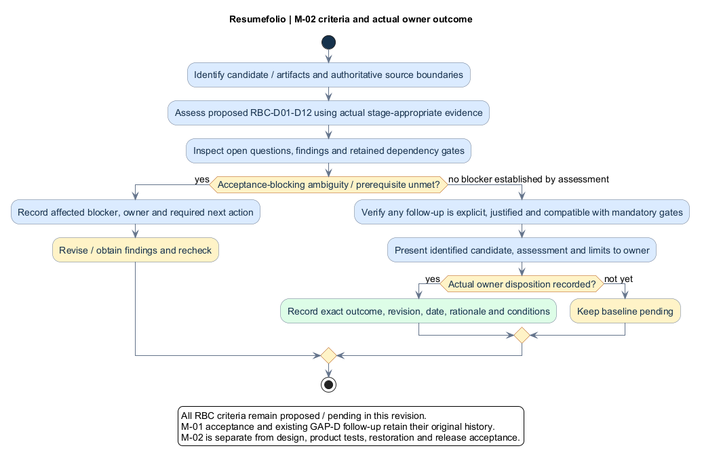

# Resumefolio — Requirements Review and Baseline Criteria

Current implementation choices and scope: [Baseline](../../../baseline/README.md). Runtime verification remains subject to its gates.

| Item | Current position |
| --- | --- |
| Milestone | M-02 — requirements baseline |
| Owner / decision authority | Farhad |
| Status | Documentary Baseline selected; actor/runtime/Release evidence remains gated |
| Selected candidate | BL-MVP-2026-11-04.1; current manifest identifies the documentary revision |
| Baseline decision/date | November 4, 2026; selected under Farhad’s explicit delegation |
| Local references | RBC-D01–RBC-D12 are proposed checklist references, not accepted planning PC criteria or product requirements |
| Revision | October 31, 2026 |

**At a glance:** A requirements baseline is an actual owner disposition for an
identified coherent candidate. Organized drafts, diagrams, counts and working
links support review but do not automatically satisfy semantic, feasibility or
acceptance criteria. Criteria below elaborate the existing proposed M-02 checklist;
none is marked satisfied by file creation.

[Authority](#1-purpose-and-acceptance-boundary) · [Criteria](#2-proposed-detailed-review-criteria)
· [Evidence](#3-current-evidence-and-readiness) · [Gaps](#4-blockers-and-permitted-follow-up)
· [Decision](#5-review-outcomes-and-decision-record) · [Checklist](#7-proposed-m-02-review-checklist)

## 1. Purpose and Acceptance Boundary

[Roadmap M-02](../../01-project-planning/08-roadmap-and-milestones.md) defines reviewed
requirements, scenarios, permissions, lifecycles and testable criteria as its
outcome. [Planning Completion](../../01-project-planning/10-planning-completion-criteria.md)
records M-01 acceptance for its identified snapshot only; this file cannot alter
that history. The [SRS](../03-requirements-specification/requirements-specification.md)
coordinates primary records, and [Review Findings](../06-validation-and-traceability/review-plan-and-findings.md)
owns actual inspection observations.

M-02 is separate from M-03 design, later implemented capability checks, provider
approval, actual recovery and M-09/M-10 release/deployment decisions. The agreed
initial SDLC documentation, analysis/design and tracking reconciliation, and the
wider pre-implementation agreement still precede product coding.

## 2. Proposed Detailed Review Criteria

All RBC references are **Proposed**, owner **Farhad**, assessment **Pending**.
Evidence suggestions are review inputs, not claims of satisfied conditions.

| Local criterion | Condition for a favorable assessment | Evidence / dependent check |
| --- | --- | --- |
| RBC-D01 — Identified candidate and authority | Exact candidate/revision and included artifacts are known; accepted intent is distinguished from proposed detail and external-source findings | Candidate manifest/commit if verified, original scope/objectives/constraints and actual review participants |
| RBC-D02 — Scope and actor outcomes | All agreed inclusions/exclusions/conditions and relevant actor goals are covered or explicitly dispositioned without silent removal | SRS coverage, BIZ/USR sources, actual actor/owner review and conditional execution boundary |
| RBC-D03 — Clear primary records | Stable reviewed IDs/levels, source/rationale, actor/conditions, behavior, owner, justified priority and actual status are coherent | Primary candidate review; final convention and preserved old references |
| RBC-D04 — Observable criteria and quality | Criteria define assessable outcomes; quantitative criteria have decided workload/environment/units/threshold/method or justified gate that does not leave affected acceptance ambiguous | QSR measurement contracts, normal/denied/failure examples and actual target decisions |
| RBC-D05 — Permissions and trust boundaries | Actor/resource/action/state rules, direct entry paths, collaboration/private contexts and changed access are sufficiently explicit for dependent decisions | Reviewed account matrix, PDF/provider/Git/execution scenarios and session/revocation policy |
| RBC-D06 — Information and lifecycle consistency | Shared definitions, relationships/authority, independent tailoring, actual submitted history, synchronization, removal and restored access agree | Dictionary/glossary, BRL/domain records, criterion/path walkthrough and actual open-policy disposition |
| RBC-D07 — Interfaces and dependency gates | Required clients/provider operations, representation/failure contracts and decisive access/resource/execution conditions have appropriate actual findings or valid retained gates | EIF/EGC/GIT/YML/AFO records, GAP-D/ASM/DEP findings and gate-specific owner responses |
| RBC-D08 — Scenario sufficiency | Goal/path coverage is reviewed at criterion-relevant granularity; broad bundle citation alone is not accepted as complete coverage | UC/ST/SCN refinement, concrete inputs/expected states and justified analysis/review methods where user paths do not apply |
| RBC-D09 — Traceability and downstream plan | Sources/criteria/paths are traceable and intended downstream work is reconciled; unassigned artifacts are explicitly handled rather than invented | Actual traceability, PBI/design/verification plan links appropriate to the stage; scope of future artifacts recorded |
| RBC-D10 — Review findings and contradictions | Actual semantic/validation observations are recorded; critical contradictions and acceptance blockers are resolved or explicitly dispositioned under valid gates | Finding status, actual owner rationale, changed revision and recheck evidence; no proposed fix counted closed |
| RBC-D11 — Risks, feasibility and follow-up | Open questions have owners/actions/gates and compatible accepted conditions; any deferral is explicit, justified and does not bypass a mandatory prerequisite | Question register, planning risks/GAP gates, resource/provider/recovery findings and material impact decisions |
| RBC-D12 — Actual owner disposition | Owner records the outcome against the reviewed candidate with evidence, conditions, follow-up and limits; documentation review is distinguished from product/release proof | Actual owner/date/revision/outcome record; baseline status changes only when real disposition occurs |

These criteria do not require code or future design artifacts to exist before
requirements can be reviewed. They do require clear stage-appropriate traceability
and delivery/verification planning, and actual decisive findings at their existing
gates. Do not accept an ambiguous required behavior simply by labeling it future work.

## 3. Current Evidence and Readiness

| Observed supporting material | What it supports | What remains unestablished |
| --- | --- | --- |
| 157 provisional primary candidates; RV-D01 observed 470 criterion bullets | Populated structure and primary record locators | Semantic correctness, final IDs/priorities, decided policies and criterion readiness |
| 12 UC/ST bundles and 60 path drafts | Actor-goal and N/A/D/F/R examples | Criterion-specific sufficient coverage and actual actor/owner validation |
| 123 candidates explicitly cited; 34 uncited in RV-D01 | A bounded citation inventory | Complete coverage or resolved RF-D01/RF-D02 |
| Definitions, interfaces, quality/control drafts and diagrams | Reviewable conceptual meanings and proposed methods | Final field/grant/lifecycle/target decisions or actual integration/control results |
| Five open local review findings | Actual limited documentary observations and next actions | Completed semantic group review, finding closure or baseline acceptance |

[RV-D01](../06-validation-and-traceability/review-plan-and-findings.md#rv-d01) and
its [source inventory](../06-validation-and-traceability/evidence/traceability-source-inventory.json)
are historical inspection evidence. Their baseline-criteria hash refers to the
previous scaffold, not this revised file. Preserve that snapshot; this revision
does not silently re-execute or close the inspection. Counts are context, not
scores or criterion satisfaction.

## 4. Blockers and Permitted Follow-up

An open item is **blocking for an affected acceptance/commitment** when its missing
behavior, authority, threshold or decisive finding prevents a coherent assessable
requirement or bypasses a retained prerequisite. Use dependency-specific scope;
one gap need not forbid independent review, but cannot be ignored by affected work.

A proposed deferral needs exact question/finding, rationale, impacted records,
remaining uncertainty/risk, responsible owner, next action, dependent gate and
actual owner disposition. It must remain compatible with accepted scope and
mandatory gates. No local Q-D question is recorded as a newly accepted deferral.
The previously accepted planning GAP-D follow-up remains historical authority;
these criteria neither revoke its gates nor turn it into blanket approval of
unresolved detailed policies.

Examples: active-session sharing revocation needs definition before affected
access acceptance; provider access must be validated before dependent development;
execution cannot be enabled before required isolation/security/resource findings;
restoration evidence is required before the relevant M-09 recovery/readiness
acceptance, not fabricated during a requirements document review.

See [Questions](open-questions-and-decisions.md),
[Findings](../06-validation-and-traceability/review-plan-and-findings.md) and
[Change Control](change-control.md). Material scope/cost/schedule changes require
an actual owner decision; open status alone is not consent to reduce scope.

## 5. Review Outcomes and Decision Record

| Proposed outcome label | Meaning / required evidence |
| --- | --- |
| Review pending | Candidate, criteria or actual assessment/disposition incomplete; current position |
| Revision required | Actual assessment identifies unresolved blockers; retain findings/actions and candidate |
| Accepted with explicit conditions | Actual owner identifies the accepted candidate and valid gated follow-up, without bypassing mandatory prerequisites |
| Accepted | Actual owner accepts the identified candidate after applicable criteria assessment; later product/design/release outcomes remain separate |
| Rejected / superseded | Actual owner disposition with rationale and preserved prior history/reference |

These labels are a proposed recording convention, not performed decisions.

| Baseline record field | Current actual value / later information required |
| --- | --- |
| Candidate/revision and included artifacts | Not identified in an actual owner acceptance decision |
| Actual reviewer/participants/method/date | Semantic baseline assessment not recorded here |
| Criteria assessment / evidence | Pending; RV-D01 limited structural evidence only |
| Open findings/questions and conditions | RF-D01–RF-D05 open; local Q-D register open; none accepted as deferred by this revision |
| Decision-maker / actual outcome / date | Farhad / Pending / Not recorded |
| Rationale, valid follow-up and changed records | To record only when an actual decision occurs |

## 6. Baseline Review Roadmap

[Scalable SVG](../diagrams/requirements-baseline-gates.svg) ·
[Editable PlantUML](../diagrams/requirements-baseline-gates.puml)

This roadmap does not constitute a gate Pass or owner approval. Re-review changed
candidate/evidence before relying on an earlier disposition; retain historical
acceptance locators and explicit conditions.

## 7. Proposed M-02 Review Checklist

- [ ] All Version 1 scope areas are covered or explicitly tracked as open with a valid disposition.
- [ ] Actors, permission boundaries, business rules and lifecycle behavior are clear for affected acceptance.
- [ ] Requirements have reviewed identifiers, sources, rationales, priorities and observable acceptance criteria.
- [ ] Quality targets and decisive external dependencies have appropriate decisions/evidence or valid gated follow-up.
- [ ] Text, diagrams, definitions, scenarios and traceability agree at the reviewed revision.
- [ ] Blocking questions, open findings and actual accepted deferrals are distinguished.
- [ ] The owner records the actual decision against a specific candidate revision.

All items remain unchecked in this file. The original seven themes are retained
and expanded by RBC-D01–RBC-D12; no historical M-01 PC assessment is overwritten.

**Current outcome:** Proposed detailed M-02 criteria. No requirements baseline,
new accepted deferral, provider/control/restore result or coding authorization is
established by this revision.

[Change/baseline guide](README.md) · [Questions](open-questions-and-decisions.md)
· [Review findings](../06-validation-and-traceability/review-plan-and-findings.md)
· [Requirements index](../README.md)
