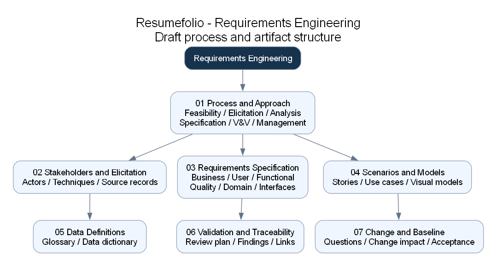
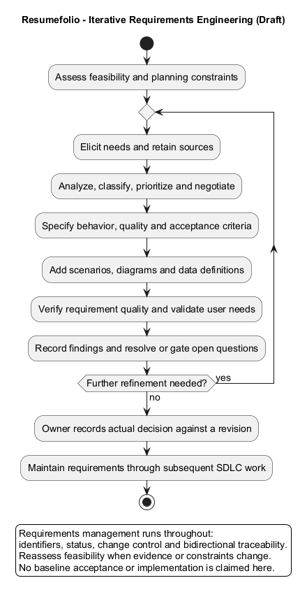

# Resumefolio — Requirements Engineering

## Current implementation baseline — November 4, 2026

[BL-MVP-2026-11-04.1](../../baseline/README.md) selects the MVP technical mechanisms, numerical policies, priorities and requirement/criterion dispositions under Farhad’s explicit delegation. It supersedes earlier Proposed/pending mechanism and whole-baseline statements below for MVP design input. Future clauses and dated evidence remain separate. Runtime/actor validation, credentials, Git isolation, capacity and backup/restore still require the named implementation/Release gates; this update reports no product test Pass.

### Prior source material and rationale (superseded where this Baseline selects a different MVP choice)

Status: Proposed draft — pending owner review
Project owner: Farhad

## MVP requirement applicability and remaining review

Apply the current candidate release register: retain core presentation/sharing/manual applications/private files and basic ProjectForge; defer mail/calendar, advanced Git review/releases, advanced backlog/Sprints and YAML execution/deployment. Candidate IDs and planned verification stay intact. Mixed criteria must be scoped individually; allocation does not approve proposed numbers, priority or a complete baseline. Older 157-candidate/470-criterion evidence is historical larger-product coverage, not an MVP pass. Keep source, independent resume draft, explicit publication and actual submitted material identities distinct. Profile changes require preview/select/apply and cannot mutate publication or submitted history. Manual applications include status, next action and follow-up date without mail/calendar dependencies.

Authority: [OWNER-MVP-2026-11-04](../01-project-planning/owner-mvp-decision-2026-11-04.md). [Candidate allocation](03-requirements-specification/mvp-release-allocation.md).

## Purpose and status
This phase separates the requirements engineering process from its product artifacts. The structure is ready for step-by-step development; requirements, feasibility findings and the M-02 baseline are not yet accepted.

## Start here
Begin with [Requirements Approach](01-process-and-approach/01-requirements-approach.md), then [Feasibility Study](01-process-and-approach/02-feasibility-study.md). Continue elicitation, analysis, specification and review iteratively. Requirements management runs throughout.

## Folder guide

| Folder | Purpose |
| --- | --- |
| [Process And Approach](01-process-and-approach/README.md) | Six core activities, approach and rationale |
| [Stakeholders And Elicitation](02-stakeholders-and-elicitation/README.md) | Actors, technique selection and evidence logs |
| [Requirements Specification](03-requirements-specification/README.md) | Business, user, functional, quality, domain and interface requirements |
| [Scenarios And Models](04-scenarios-and-models/README.md) | Stories, use cases and scenario models |
| [Data Definitions](05-data-definitions/README.md) | Glossary and data dictionary |
| [Validation And Traceability](06-validation-and-traceability/README.md) | Review evidence and bidirectional traceability |
| [Change And Baseline](07-change-and-baseline/README.md) | Open questions, change assessment and baseline decision |

## Shared materials
- [SRS entry point](03-requirements-specification/requirements-specification.md)
- [Functional Requirements](03-requirements-specification/requirements-specification.md#functional-requirements)
- [Non-Functional Requirements](03-requirements-specification/requirements-specification.md#non-functional-requirements)
- [Requirement template](templates/requirement-template.md)
- [Scenario template](templates/scenario-template.md)
- [Story template](templates/story-template.md)
- [Diagram guide](diagrams/README.md)
- [Project planning](../01-project-planning/README.md)

## Visual overview

[Graphviz source](diagrams/requirements-document-map.dot) · [SVG](diagrams/requirements-document-map.svg)

[PlantUML source](diagrams/requirements-review-flow.puml) · [SVG](diagrams/requirements-review-flow.svg)

## Working rules
Documentation is English. Combine iterative refinement with explicit reasons and editable visual models. The owner currently performs delivery and operations alone. Keep raw needs, proposed requirements, accepted decisions and verified results distinct.

Preserve the agreed Version 1 scope and planning follow-up gates. AI, automatic translation and automatic demo migration remain excluded. Use owner/admin admission with no open self-registration; do not invent service access, legal conclusions or numerical quality limits. Distinguish backlog items from tasks and preserved submitted copies from live sharing.

Use Markdown/Git, GitHub and Graphviz/PlantUML; specialized paid tools are not assumed. Follow the agreed initial SDLC documentation, analysis, design and baseline process before product coding. This revision records proposed documentation organization, not acceptance of all process choices.

[Requirements index](README.md)

## Current Detailed-Answer Candidate

The [requirements answer review package](07-change-and-baseline/requirements-answer-review.md) provides concrete proposals for all 28 question groups and links their primary specifications, planned review cases and remaining evidence gates. Review pending; product policies, numerical targets and baseline acceptance are not inferred from document completion.
