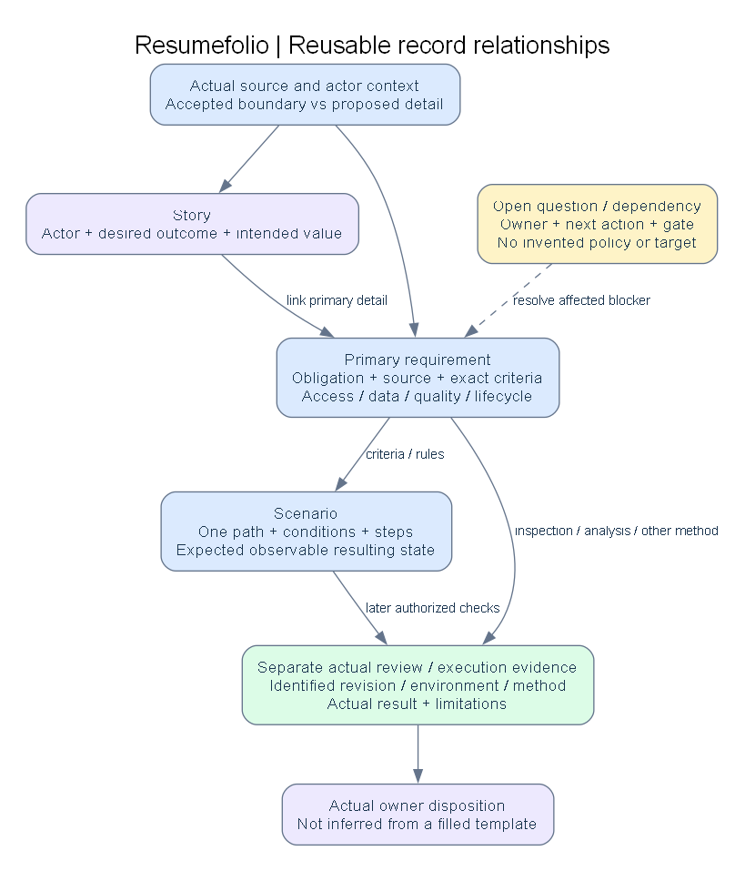

# Requirement Record Template

**Status: Template only — not an allocated requirement, decision or result.**

Copy this file or the relevant sections into the primary specification. Replace
`{brace placeholders}` with actual sourced information; never interpret a
placeholder as a decided value. Mark optional/inapplicable sections with rationale
or remove them when justified. Keep unknowns explicit with an owner/action/gate.
Do not copy this template as a new competing source of an existing requirement.

## 1. Record Identity and Authority

| Field | Value to complete |
| --- | --- |
| Identifier / title | `{record reference}` / `{one clear intended behavior, outcome or constraint}` |
| Level / type / domain | `{business / user / functional / quality / business rule / domain constraint / interface, as applicable}`; `{primary domain}` |
| Reference convention | `{final allocated convention, or explicitly provisional local reference}` |
| Owner | `{responsible person; in this project Farhad coordinates requirements}` |
| Actual state | `{Proposed / In review / Accepted / Superseded or other reviewed convention; record only actual state}` |
| Priority / rationale | `{reviewed priority and reason, or unassigned}` |
| Source / rationale | `{exact scope/objective/DEC/elicitation/external source and why this is needed}` |
| Source authority / locator | `{accepted boundary versus proposed refinement; source revision/hash/date/section and applicability if relevant}` |
| Candidate / review revision | `{exact reviewed working-copy locator or verified commit; do not invent a Git revision}` |

An actual question, finding or change request belongs in its own register, not
automatically in a product requirement. Accepted scope does not make a new
detailed refinement accepted. A role name supplies no universal permission grant.

## 2. Required Outcome or Behavior

**Rationale / intended value:** `{problem, beneficiary and reason; do not claim an unmeasured benefit}`

**Actor / resource / action / context:** `{who interacts with which resource, under what grant/state; external systems if relevant}`

**Trigger / preconditions:** `{initial state and conditions that must hold; distinguish checked access conditions from assumed test setup}`

**Proposed obligation:** `{subject}` shall `{one coherent observable outcome or behavior}`
under `{defined conditions}` while preserving `{applicable invariant}`.

**Resulting state / external effects:** `{what actually changes or is returned; no change/partial/unknown cases where applicable}`

Do not force an architecture/library/database choice into behavioral wording
unless it is an actual imposed constraint with a source. Split unrelated obligations
and retain their relationships rather than hiding several independent requirements
under one generic “shall support” statement.

## 3. Data, Access, Lifecycle and Exceptions

| Concern | Definition / link / justified inapplicability |
| --- | --- |
| Inputs and outputs | `{dictionary subjects/elements, requiredness, valid/invalid examples, representation, units, language, time and revision}` |
| Authority and sensitivity | `{actor/resource/action/state matrix, direct paths, ownership, provider/secret scope and changed access}` |
| Lifecycle and references | `{creation/change/propagation, actual submitted history, unlink/delete/retention and restored-access consequences}` |
| Interface/dependency | `{client/provider contract, actual access/feasibility conditions and retained planning gate}` |
| Alternative path | `{changed valid condition and observable outcome}` |
| Denied path | `{prohibited action and protected data/effects that must not be exposed}` |
| Failure/partial/unknown | `{invalid input, interruption, limits, concurrent change or ambiguous external outcome; actual bounded response}` |
| Recovery/correction | `{safe reconciliation/retry/restore behavior and limits; no blind repeated external effect}` |

## 4. Acceptance Criteria

Keep criterion references stable within the record, identifying the actual local
or final convention. Use Given/When/Then **or another assessable form** suitable
for the level. Business outcomes may require analysis/observation; not every
criterion is a button interaction or executable product test.

**Criterion reference:** `{criterion reference}`

**Conditions / stimulus:** `{Given initial state/data/grants; When action/event}`

**Observable expected result:** `{Then result/state/denial/measure; expected evidence}`

**Relevant path / rule:** `{exact proposed scenario/rule or unassigned}`

**Unresolved blocker:** `{specific undecided policy/value, owner and gate, or none with basis}`

Add criterion rows as needed for relevant normal, alternative, denied, failure,
concurrent and recovery cases; the row above is not an allocated criterion.
Do not require every category when inapplicable, or count one normal case as full coverage.

### Quantitative Quality Contract — When Applicable

| Measurement field | Value to decide / record |
| --- | --- |
| Evaluated workflow/stimulus | `{operation/event, expected correct response and covered path}` |
| Environment/data/workload | `{candidate/configuration, clients/providers, data volume, concurrency/request mix, background/competing demand}` |
| Measure / boundary / unit | `{what is timed/countable, start/end, units, sampling/aggregation/percentiles if selected}` |
| Proposed target / authority | `{owner-reviewed threshold/range and source, or undecided; distinguish proposed from accepted}` |
| Method / observation window | `{instrumentation, duration, representative repetitions and limitations}` |
| Exceptions / recovery | `{degradation/maintenance/failure treatment, recovery point and usable-state definition if relevant}` |

No default response time, availability, quota, retention, RPO/RTO or concurrency
is set by this template. A user count is not a load model. Conditional criteria
remain acceptance-blocked until the required policies/targets are actually decided.

## 5. Planned Verification Method

Select methods proportional to the requirement and stage. Distinguish requirement
verification/validation from later implemented-product verification.

| Method | Appropriate use | Required later evidence |
| --- | --- | --- |
| Inspection | Examine identified text/configuration/artifacts against explicit criteria | Revision, checklist/method, actual observations/findings and limits |
| Analysis | Evaluate a property with justified reasoning/calculation/model | Inputs, assumptions, method, actual conclusion and limitations |
| Demonstration | Observe a defined actor workflow under agreed conditions | Candidate/environment, scenario, actual observed outcome and limits |
| Test | Execute specified controlled inputs/actions and compare results | Exact case/criteria, candidate/data/environment, expected/actual result and evidence |

| Criterion | Planned method / rationale | Required data / conditions | Expected evidence / decision rule | Actual execution/result link |
| --- | --- | --- | --- | --- |
| `{criterion reference}` | `{inspection / analysis / demonstration / test and reason}` | `{decided setup, dependencies and authorization}` | `{what would support or fail this criterion}` | `{unassigned until actual activity; no planned Pass}` |

## 6. Open Questions and Dependencies

| Question/dependency | Affected criterion / impact | Evidence / next action | Owner / dependent gate | Actual decision / status |
| --- | --- | --- | --- | --- |
| `{actual Q/ASM/DEP/GAP reference or clearly provisional topic}` | `{why missing detail matters}` | `{specific information/check needed}` | `{responsible person; gate, no invented due date}` | `{actual disposition link or open}` |

## 7. Review and Traceability

| Relationship / record | Value to complete |
| --- | --- |
| Business/user sources and exact rules | `{verified source/record links; no inferred acceptance}` |
| Story/use case/scenario/criteria | `{exact applicable ST/UC/SCN/criterion links; label unassigned or coarse coverage}` |
| Dictionary/interface/quality/lifecycle | `{primary references and affected constraints}` |
| Backlog/design/implementation | `{actual verified artifacts/revisions, or unassigned; do not infer from similar titles}` |
| Actual review | `{reviewer/date/method/input revision, observed findings and evidence; or not recorded}` |
| Actual owner decision | `{outcome/rationale/date/reviewed candidate/conditions; or not recorded}` |
| Actual product verification | `{separate executed result/evidence and limitations; or not performed}` |
| Change/supersession history | `{real change source, before/after, disposition and affected references}` |

## 8. Completion Check for the Author

- [ ] Source and proposed versus accepted authority are explicit.
- [ ] Obligation, actors/conditions, observable criteria and relevant exception paths are coherent.
- [ ] Required fields/targets/grants/lifecycles are decided or acceptance-blocking questions retained.
- [ ] Primary wording, dictionary/scenarios/models and actual trace links agree.
- [ ] Planned methods remain separate from actual review/product results.
- [ ] Actual decision/revision is recorded only when it occurs; unused placeholders are removed before review.

## 9. Template Guidance and Visual References

[Scalable SVG](../diagrams/template-record-relationships.svg) ·
[Graphviz source](../diagrams/template-record-relationships.dot)

The diagram is reusable guidance, not an allocated traceability record or product
architecture. Colors supplement labels. Keep primary obligations and criteria in
their authoritative record; a story or scenario does not replace them.

[Specification conventions](../03-requirements-specification/requirements-specification.md#3-requirement-levels-and-record-conventions)
· [Scenario template](scenario-template.md) · [Story template](story-template.md)
· [Review criteria](../07-change-and-baseline/requirements-review-and-baseline-criteria.md)
· [Requirements index](../README.md)
