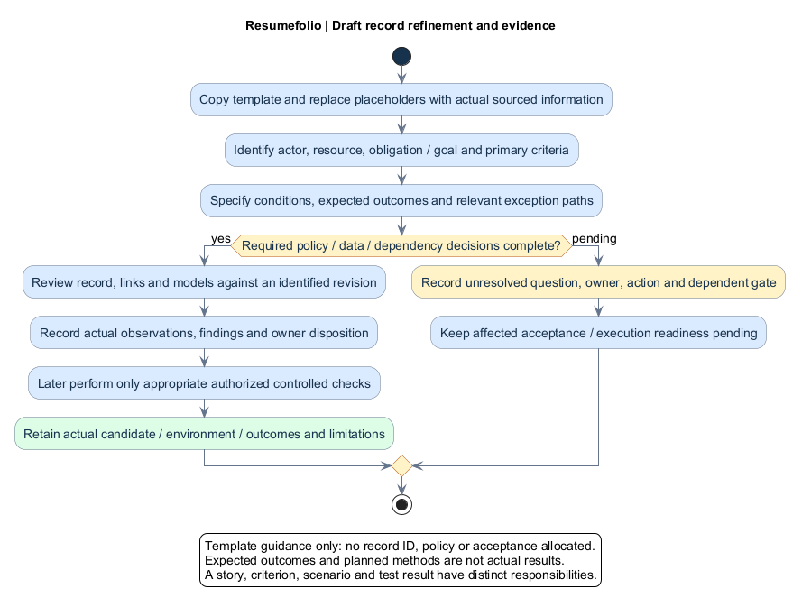

# Scenario Record Template

**Status: Template only — not an allocated scenario or executed test.**

Copy and replace `{brace placeholders}` with real sourced information. A scenario
describes one particular path; a use case groups paths toward a goal. Separate
normal/alternative/denied/failure/recovery records when their conditions/results
differ. Keep inherited context explicit and do not treat every path as a test already run.

## 1. Identity, Goal and Source

| Field | Value to complete |
| --- | --- |
| Scenario reference / title | `{final allocated reference, or explicitly provisional local reference}` / `{particular path}` |
| Parent use case / story | `{goal/context and actual UC/ST links, or unassigned}` |
| Path category | `{normal / alternative / denied / failure / recovery-correction / other justified category}` |
| Owner / priority | `{responsible person}` / `{reviewed priority/rationale or unassigned}` |
| Actual state / revision | `{proposed/in review/etc.}` / `{exact input/review revision}` |
| Source / rationale | `{scope/DEC/actor goal/elicitation source; accepted boundary versus proposed interpretation}` |
| Goal / value | `{actor outcome and why this particular path matters}` |
| Required behavior / criteria | `{exact primary candidate and criterion references; coarse or unassigned links labeled}` |

## 2. Actor, Boundary and Preconditions

| Context | Definition |
| --- | --- |
| Primary/supporting actors | `{human perspectives, selected provider/client and actual responsibilities where relevant}` |
| Resource/action/grants | `{intended resource and permitted/prohibited operations; state-dependent checks}` |
| Boundary / external effects | `{inside/outside product, protected files/provider/target; what could send, mutate, execute or disclose}` |
| Trigger | `{specific event or deliberate user action}` |
| Preconditions | `{initial business state and decided assumptions; authority checked by product is not assumed away}` |
| Controlled data | `{synthetic identities, content/artifact/code revisions, language/variant, dates/units and valid/invalid values}` |
| Environment/dependency | `{candidate/client/provider/configuration and required findings before later execution}` |
| Inherited context | `{exact parent context and any changed conditions; no ambiguous “same as above”}` |

Use fictional/sanitized data. Do not include real passwords/tokens/keys, private
emails or actual job-application documents in repository examples. A recovery or
untrusted-code scenario needs suitable isolation and authorization before later checks.

## 3. Path Steps and Observable Outcomes

**Step:** `{step reference}`

**Actor/system action or event:** `{specific input/action; identify actor and resource}`

**Expected observable response / state:** `{returned result/state/effect/denial; include no prohibited disclosure when relevant}`

**Criterion / rule:** `{exact primary criterion/rule}`

**Evidence needed later:** `{what would establish the expected result; no invented actual outcome}`

**Success/expected postcondition:** `{actual state/content/effect the path is intended to establish}`

**Denied/failure/partial/unknown postcondition:** `{protected boundary, retained/partial state and explicit uncertainty; do not assume universal rollback}`

**Non-effects/invariants relevant to this path:** `{e.g. unrelated resources not granted; actual submitted material not overwritten by source edits; include only applicable constraints}`

Do not hide different scenarios in an “all goes well” flow. For denial/failure
paths, rejection or a truthful incomplete outcome may be the expected correct
behavior; that differs from a failed scenario check later.

## 4. Related Variants and Recovery Rules

| Related path | Changed condition / trigger | Expected bounded result | Open rule / exact link |
| --- | --- | --- | --- |
| `{separate scenario reference or unallocated variant}` | `{invalid/alternative/concurrent/revoked/interrupted condition}` | `{specific state, denial or uncertainty}` | `{primary policy/criterion and outstanding blocker}` |

**Repetition/concurrency:** `{duplicate, changed revision/grant, competing write and conflict policy where relevant}`

**Recovery/correction:** `{allowed reconciliation/retry/restore, authority and limits; distinguish request from actual completion}`

**Cleanup/retained references:** `{what remains, what may be removed and under whose decided policy}`

Unknown mail/deployment outcomes are not safely repeated by default. A downloaded
copy cannot be recalled by disabling future retrieval. A preserved submitted copy
is not a backup. Apply these distinctions only when relevant to the scenario.

## 5. Data, Business Rules, Quality and Interfaces

| View | Applicable record / decided condition |
| --- | --- |
| Dictionary/language/time/revision | `{meaning, units, source authority and exact artifact/version}` |
| Access/lifecycle | `{actor/action/state, direct path, propagation/history, retention/removal/restored access}` |
| Interface/provider/real client | `{operation contract, selected account/target, actual prerequisites and expected evidence limits}` |
| Quality measure | `{stimulus/environment/workload/threshold/timing/method or explicit blocker; no default values}` |
| Model | `{editable DOT/PlantUML and actual SVG/PNG links when supplied; or not applicable with reason}` |

## 6. Open Questions and Acceptance-readiness

| Question / unresolved condition | Impact on this path | Evidence / next action | Owner / dependent gate | Actual disposition |
| --- | --- | --- | --- | --- |
| `{recorded question/reference}` | `{why the expected result cannot yet be finalized}` | `{required clarification/finding}` | `{person and gate}` | `{open or actual decision/evidence link}` |

Do not substitute assumptions for undecided grants, state transitions, provider
access, quotas, session behavior or recovery targets. A reviewable draft may
remain blocked for execution/acceptance; identify that state explicitly.

## 7. Actual Review — Complete Only When Performed

| Review field | Actual record or explicit absence |
| --- | --- |
| Reviewer/participants/date/method | `{actual activity, or not recorded}` |
| Reviewed input/revision | `{exact scenario/requirement/criterion/data version}` |
| Observations/findings | `{actual issue/evidence and limitations, not planned outcomes}` |
| Owner disposition/recheck | `{actual response/revised candidate/recheck, or pending}` |

## 8. Later Execution Evidence — Separate from the Path Draft

| Execution field | Actual record only when performed |
| --- | --- |
| Run/activity and date | `{actual check ID/date/operator; or not performed}` |
| Candidate/environment/data/grants | `{exact evaluated setup and initial state}` |
| Criterion/step → actual result | `{expected versus actual, measurements/effects and evidence locator}` |
| Outcome/limits | `{supported / unmet / blocked / inconclusive or reviewed convention; no planned Pass}` |
| Protected evidence/cleanup | `{sanitized artifacts, side-effect/cleanup outcome and remaining obligations}` |
| Findings/recheck | `{actual linked findings and later disposition}` |

A document walkthrough is not a running-product test. Product success is not
owner baseline/release acceptance. An executed case cannot establish more than
its observed conditions and evidence.

## 9. Author Check and Model Guidance

- [ ] One particular path has clear source/goal, initial conditions, actions and observable resulting state.
- [ ] Exact criteria/grants/data and relevant alternatives/failures/recovery effects are defined or blocked explicitly.
- [ ] Parent/variant links, domain rules and dictionary meaning agree.
- [ ] Models reflect the path without selecting architecture or implying actual results.
- [ ] Actual review and execution remain separate from planned steps and expected outcomes.

[Scalable SVG](../diagrams/template-readiness-flow.svg) ·
[PlantUML source](../diagrams/template-readiness-flow.puml)

Colors supplement labels. This is template guidance, not an executed workflow or
a mandatory product implementation sequence.

[Requirement template](requirement-template.md) · [Story template](story-template.md)
· [Scenario conventions](../04-scenarios-and-models/user-stories-and-scenarios.md#1-purpose-and-record-conventions)
· [Review findings](../06-validation-and-traceability/review-plan-and-findings.md)
· [Requirements index](../README.md)
