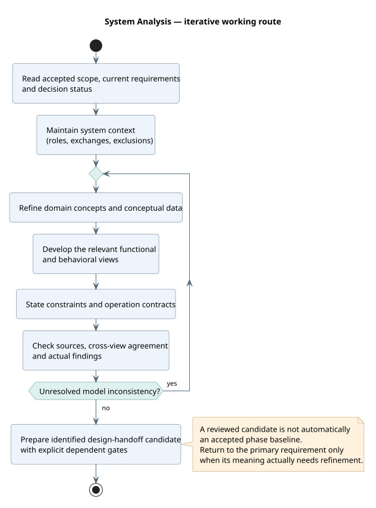
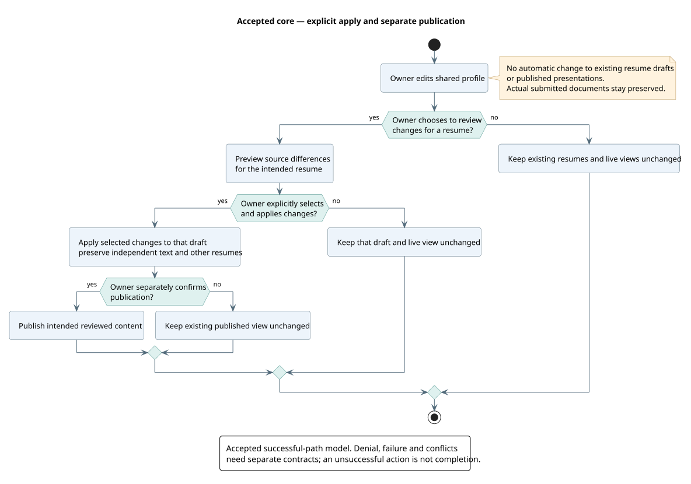
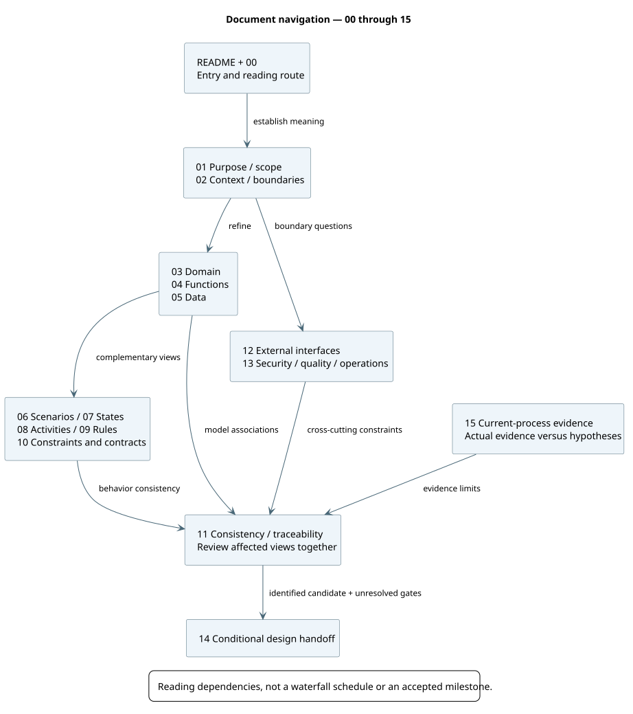

# Resumefolio — Start Here: System Analysis

[Diagram types and reading guide](#diagram-types-and-reading-guide) · [Full diagram catalog](../diagrams/README.md)

Owner: Farhad · Updated: November 1, 2026

**Purpose:** Use this page to choose the next analysis task, find its inputs, produce a real model and check the result. This guide is populated; it does not declare the whole analysis phase complete.

**Current step:** Reconcile the populated domain and data models with functions and behavior, beginning with **profile, tailored resume, published presentation, PDF representations and actual submitted material**. The approach and whole-product context are already populated. Keep their boundaries and develop the remaining models from existing requirements.

[Current position](#current-position) · [Working route](#working-route) · [Accepted core workflow](#accepted-workflow) · [Files and outputs](#files-and-outputs) · [One working iteration](#working-iteration) · [Open gates](#open-gates) · [Completion](#completion)

Current MVP scope and selected mechanisms: [Baseline](../../../baseline/README.md). Deferred provider, advanced collaboration and workflow-execution designs are not MVP prerequisites.

## 1. Where We Stand and What to Do Next

| Area | Actual current position | Consequence for this phase |
| --- | --- | --- |
| Planning | Historical M-01 baseline accepted with tracked follow-up; current availability is 20 total project hours/week | Reuse accepted scope/constraints; do not treat an old requested date as a verified forecast |
| Requirements | 157 candidate records, 470 proposed criterion locators and 84 planned question-review cases; most detailed policies remain proposed | Read the exact source and its status; a count or link is not evidence that a requirement is verified |
| Owner decision | No automatic profile-to-resume changes; explicit preview/select/apply; separate publication confirmation; independent text and actual submitted materials preserved | Use this accepted behavior now. Do not ask for its approval again |
| System context | Full logical context draft with actor/external-boundary diagrams; twelve scope and eight interface inventory areas represented | Refine the domain inside that boundary; context coverage is not complete behavioral analysis |
| Domain and data | Full-product domain and conceptual data views are populated; functional/behavioral reconciliation remains pending | Produce sourced concepts, associations, information authority and change-impact rules next |
| Other views | Selected scenario interactions are populated; functions now have decomposition and balanced DFDs; exact semantic review remains; state, activity, rule and selected contract models are populated | Populate the views needed for each behavior and cross-check them; do not merely add more headings |
| Technical setup | OAuth not created; backups not set up; runtime inventory has bounded observations | Model required interactions/failures now; keep actual setup, feasibility and verification at their dependent gates |

Source authority: [scope](../../01-project-planning/02-scope.md), [planning acceptance](../../01-project-planning/10-planning-completion-criteria.md), [current resources](../../01-project-planning/05-resources-and-constraints.md), [SRS](../../02-requirements-engineering/03-requirements-specification/requirements-specification.md), [accepted update decision](../../02-requirements-engineering/07-change-and-baseline/open-questions-and-decisions.md#owner-accepted-profile-update-policy), [analysis input review](../07-review-and-design-handoff/11-model-consistency-traceability-and-review.md).

### Immediate bounded task

1. Read the accepted core decision and PRP-D03/D04/D08, BRL-D02, PDF-D07 and APP-D06/PDF-D08 in their primary records.

2. Refine **document 03** with concepts, responsibilities and named associations for shared profile information, an independently tailored resume, its draft/live meaning, representations and actual submitted material.

3. Review/refine the populated **document 05** subjects, information authority and explicitly proposed optionality/cardinality. Do not decide physical tables, foreign keys or a storage engine.

4. Refine **documents 06–10** for preview/apply/save/publish, unavailable representations, denied requests and preservation of submitted materials. Accepted core behavior is settled; source-removal and detailed concurrent-edit handling remain distinct follow-up.

5. Add exact source/criterion/model links and the actual review outcome in **document 11**. Stop this task when those bounded outputs are reviewable, then take the next scope area.

The next task is not another folder redesign or another request to describe workflows already written in the project.

## 2. The Working Route

[PNG](../diagrams/start-here-analysis-route.png) · [Editable PlantUML source](../diagrams/start-here-analysis-route.puml)

Read downward. The feedback arrow means refine a model or its authoritative requirement when a real conflict appears. It does not mean restart every phase. Colors supplement the labels: blue is an input/context, teal is modeling, amber is review/handoff. These are logical work products, not application services or a guaranteed schedule. The repeat decision returns to affected models; it does not require restarting accepted phases.

### Chosen approach

Follow the existing domain-oriented approach recorded for FAU Applied Software Engineering. Use its seven complementary views to answer specific questions. Their selection and file organization are project adaptations; this guide does not claim the university prescribes this folder tree or that every possible diagram is mandatory.

| View | Analysis question | Typical useful representation |
| --- | --- | --- |
| Object-oriented | What domain concepts exist, what do they mean and how are they related? | Conceptual class/association diagram with responsibilities and justified multiplicities |
| Function-oriented | What transformations does the system perform and what information enters/leaves them? | Function decomposition and balanced domain-level data-flow diagrams |
| Data-oriented | What information is authoritative, selected, versioned and preserved? | Conceptual ER/data relationship model and dictionary links |
| Scenario-based | Which actors/domain objects interact to achieve one outcome? | Domain sequence/communication diagram linked to an existing scenario |
| State-based | What states and allowed transitions govern a subject? | Statechart with triggers, guards and effects |
| Control-flow-based | In what order do actions, decisions and concurrent steps occur? | Activity/workflow diagram with explicit outcomes |
| Rule-based | Which combinations of conditions determine an outcome? | Decision table/tree with conflicts and missing combinations identified |

Textual constraints and operation contracts complement the views. A logical class is not automatically a code class; a data subject is not automatically a database table; a context relationship is not a network connection.

## 3. Accepted Core Workflow: Profile Update to Publication

**Release applicability:** future-domain design retained after MVP; core operating/deployment and recovery controls still apply to MVP where relevant.

The owner explicitly accepted this behavior in the conversation and instructed its immediate application. The [question/decision record](../../02-requirements-engineering/07-change-and-baseline/open-questions-and-decisions.md#owner-accepted-profile-update-policy) is authoritative for the bounded acceptance. The four accepted points are:

1. A shared profile edit does **not automatically change existing resumes or live presentations**.

2. The owner **previews, selects and explicitly applies** intended changes; resume-specific text/overrides and other resumes remain independent.

3. **Applying/saving and publishing are separate actions**; publication requires separate confirmation.

4. **Actual previously submitted documents remain preserved** after later edits/publication.

[PNG](../diagrams/start-here-profile-publication.png) · [Editable PlantUML source](../diagrams/start-here-profile-publication.puml)

Reviewing differences is optional: a source edit does not automatically start a resume update. Each “No” branch leaves the draft or live content indicated in the figure unchanged. The preservation statement applies throughout; the picture does not claim how bytes/revisions are stored. Denied, failed and conflicting operations require their own outcomes and must not be reported as completed.

### Worked example for modeling

Profile information is used by resumes **R1** and **R2**. R1 contains a resume-specific description. Both have an existing live presentation; an application already preserves actual submitted material **S1**.

| Event | R1 / R2 draft meaning | Existing live presentation | Submitted material S1 |
| --- | --- | --- | --- |
| Owner edits the shared profile | No automatic resume change | Unchanged | Unchanged |
| Owner previews changes for R2 | Preview only | Unchanged | Unchanged |
| Owner applies selected changes to R2 and saves | Only the intended R2 draft changes; independent overrides remain protected | Unchanged until separate publication | Unchanged |
| Owner separately confirms publication of R2 | Saved draft remains identifiable | Intended R2 live presentation changes | Unchanged |
| Owner makes no apply/publication request | No corresponding transition occurs | No corresponding live update occurs | Unchanged |

Use this example across the domain, data, interaction, activity, state and contract views. Link to [Profiles/Resumes](../../02-requirements-engineering/03-requirements-specification/profiles-resumes-and-portfolio.md#resolution-q-d07), [Business Lifecycle](../../02-requirements-engineering/03-requirements-specification/business-rules-and-data-lifecycle.md), [PDF/Sharing](../../02-requirements-engineering/03-requirements-specification/pdf-and-controlled-sharing.md) and [Applications](../../02-requirements-engineering/03-requirements-specification/manual-application-management.md).

This acceptance does not settle source deletion, exact concurrent-edit resolution, every field/cardinality, renderer/storage choice, retention duration or all other proposals. Do not reopen the four accepted points when examining those distinct issues.

## 4. Which File to Use and What Belongs in It

| File | Required substantive output | Current position |
| --- | --- | --- |
| [01 — Purpose and approach](01-analysis-purpose-scope-and-approach.md) | Analysis questions, source authority, scope and dependency-aware work sequence | Populated working approach |
| [02 — Context](02-system-context-and-boundaries.md) | System responsibility boundary, actors, external exchanges, exclusions and source-linked context figures | Populated draft; owner acceptance pending |
| [03 — Domain model](../02-domain-and-information-analysis/03-domain-model-and-object-oriented-view.md) | Concepts/responsibilities, associations, justified bounds and domain operations | Populated full-product conceptual model; reconcile with data/behavior next |
| [04 — Functions](../03-functional-and-process-analysis/04-function-oriented-view.md) | Domain functions and consistent input/output/data flows | Populated decomposition/DFDs; semantic review pending |
| [05 — Data](../02-domain-and-information-analysis/05-data-oriented-view.md) | Conceptual subjects/relationships, authority, lifecycle and dictionary reconciliation | Populated ER/catalog draft; review and reconcile |
| [06 — Scenarios](../04-behavioral-and-scenario-analysis/06-scenario-based-view.md) | Selected domain interactions tied to existing use cases and exceptional paths | Populated: 16 sequence models; cross-view contract reconciliation pending |
| [07 — States](../04-behavioral-and-scenario-analysis/07-state-based-view.md) | States, triggers, guards/effects and valid/invalid transitions | Populated: 18 statecharts and 128 transition contracts |
| [08 — Control flow](../03-functional-and-process-analysis/08-control-flow-based-view.md) | Activities, decisions, responsible contexts and justified concurrency | Populated: 17 activity models with explicit branches and step responsibilities |
| [09 — Rules](../05-business-rules-and-operation-contracts/09-rule-based-view.md) | Explicit decision conditions/results and unresolved combinations | Populated: 18 decision tables and eight decision-tree diagrams |
| [10 — Constraints/contracts](../05-business-rules-and-operation-contracts/10-domain-constraints-and-operation-contracts.md) | Invariants; operation inputs, authority, pre/postconditions and failure/concurrency meaning | Populated: 18 typed constraints and 39 selected operation contracts |
| [11 — Consistency/review](../07-review-and-design-handoff/11-model-consistency-traceability-and-review.md) | Exact source-to-model links, actual checks, findings, limitations and disposition | Bounded input/context review; cross-view completion pending |
| [12 — Interfaces](../06-interfaces-security-and-quality-analysis/12-interfaces-and-external-interactions.md) | Domain interaction boundaries and observable results, linked to primary interface requirements | Populated: eight interface families and 27 bounded interaction cases |
| [13 — Security/quality/operations](../06-interfaces-security-and-quality-analysis/13-security-quality-and-operational-analysis.md) | Cross-cutting constraints and dependency consequences with evidence limits | Populated: 24 authority rows, 14 quality scenarios and scoped trust/recovery analysis |
| [14 — Design handoff](../07-review-and-design-handoff/14-feasibility-dependencies-and-design-handoff.md) | Identified coherent models, reviewed decisions and explicit dependent gates for design | Populated: conditional package, eleven existing-gate mappings and twelve design questions; acceptance pending |
| [15 — Current processes/bottlenecks](../03-functional-and-process-analysis/15-current-processes-and-bottleneck-analysis.md) | Actual sourced workflow observations and justified problems/improvements | Populated source-based analysis; daily-task baseline and improvement results unmeasured |

The [folder index](../README.md) is the full document catalog. The [diagram catalog](../diagrams/README.md) identifies existing figures and editable sources. This entry guide adds navigation/workflow illustrations; they do not complete the detailed models listed above.

### Apply the same route across the full product

Begin with professional presentation/sharing, then extend the models to manual applications and submission history; communication/calendar; projects/Kanban/backlogs/Sprints; real Git collaboration; and conditional execution/operations. Keep identity, permission, language, references, failures and recovery linked across every area. The twelve accepted scope areas stay included; working on the core first is an analysis order, not scope reduction or an accepted release priority.

## 5. How to Finish One Working Iteration

| Step | Action | Reviewable result |
| --- | --- | --- |
| 1. Identify the behavior | Select existing source requirement/criterion and relevant scenario; read its actual decision status | Exact links and a bounded question the model must answer |
| 2. State authority | Mark accepted facts, proposed refinements and genuine unknowns distinctly | Assumptions visible at the affected element/transition |
| 3. Model it | Add the smallest useful domain/data/behavior representation with consistent vocabulary | Editable diagram plus explanation of nodes, relationships, guards and effects |
| 4. Challenge it | Walk normal, denied, failed/unknown, concurrent and recovery cases where relevant | Concrete before/action/after examples and retained findings |
| 5. Reconcile views | Compare concepts, data, messages, transitions, rules and contract postconditions | Corrected cross-view meanings and exact trace links |
| 6. Verify the artifact | Render images, inspect labels/arrows, resolve local links and check source/figure consistency | Readable SVG/PNG and documented actual checks |
| 7. Record the outcome | Update the appropriate source/question/review record; preserve actual approval and historical evidence | Identified result, limits and next task; no fabricated Pass |

Keep a single primary home for each requirement, vocabulary definition and question. Models reference those homes. A finding returns to the affected authoritative record; it does not create another competing SRS.

### Diagram quality checklist

- Give each figure one clear question, title and reading direction.

- Keep labels short; explain detail in nearby text/tables.

- Name relationship meaning; label decisions and alternatives explicitly.

- Separate a domain interaction from operational dependence, and an optional action from an automatic consequence.

- Do not rely on color alone. Check text size, crossings, clipped labels and arrowheads in the rendered output.

- Keep editable source, SVG and PNG together, with the source/status/date explained nearby.

## 6. Open Matters Without Stopping All Analysis

| Matter | What is known | What may continue now | What must wait for evidence/decision |
| --- | --- | --- | --- |
| Core profile/apply/publication behavior | Four-point rule accepted by the owner | Model its domain/data/workflow/contracts directly | Unrelated source-removal/concurrency/storage choices retain their own review |
| Google access | Owner has not created OAuth | Provider responsibilities, account context and denied/disconnected/unknown outcomes | Actual setup, applicable access conditions and controlled operations before dependent commitments |
| Backup/recovery | Owner has not set up backups | Coverage, preservation/restored-access obligations and recovery concepts | Suitable independent storage/recovery design; actual restore proof before readiness |
| CI/CD isolation | No demonstrated suitable execution environment; feasibility conditions remain | Logical definition/run/attempt/result and target-authority model | Justified runner/isolation/resource design and actual controls before enabling execution |
| Quality/file limits | Concrete targets/limits are proposals; idle resources do not prove capacity | Identify workloads, boundary cases and constraints | Acceptance of affected values and later measured compliance |
| Delivery | Owner stated 20 total project hours/week; old requested date is not a forecast | Analysis/design and traceable work decomposition | A justified accepted forecast and reconciled execution baseline |

Use the [question register](../../02-requirements-engineering/07-change-and-baseline/open-questions-and-decisions.md), [feasibility study](../../02-requirements-engineering/01-process-and-approach/02-feasibility-study.md) and [gate assessment](../../02-requirements-engineering/06-validation-and-traceability/remaining-gate-assessment.md). A later implemented test is not needed merely to draw a provisional model, but a known decisive conflict cannot be waived by calling it future work.

Ask the owner only when a genuinely new material choice is missing. Present a concrete recommendation, consequence and one precise question. Reuse known facts and already accepted rules instead of requesting the same approval repeatedly.

## 7. Where the Six Broad Activities Fit

These activities are a coverage checklist across existing records, not a second parallel method.

| Activity | Authoritative home | Use during analysis |
| --- | --- | --- |
| Problem and scope | [Purpose](../../01-project-planning/01-purpose-and-objectives.md), [Scope](../../01-project-planning/02-scope.md) | Preserve boundaries and refine context |
| Feasibility | [Existing study](../../02-requirements-engineering/01-process-and-approach/02-feasibility-study.md) | Link actual findings and dependent gates; do not infer a favorable result |
| Requirements gathering | [Elicitation plan](../../02-requirements-engineering/02-stakeholders-and-elicitation/elicitation-plan-and-techniques.md), [actual log](../../02-requirements-engineering/02-stakeholders-and-elicitation/elicitation-log.md) | Reuse evidence and record actual new answers |
| System modeling | Documents 03–10 and cross-cutting 12–13 | Develop connected models that answer domain questions |
| Bottleneck analysis | [Current processes](../03-functional-and-process-analysis/15-current-processes-and-bottleneck-analysis.md) | Distinguish observed problems from hypotheses |
| Documentation/validation | [SRS](../../02-requirements-engineering/03-requirements-specification/requirements-specification.md), dictionary, questions and [analysis review](../07-review-and-design-handoff/11-model-consistency-traceability-and-review.md) | Update primary records and retain actual review evidence |

## 8. When This Phase Is Ready for Design Handoff

Use the existing phase gates; creating this guide or a set of diagrams does not accept a baseline.

- Every included domain area has the models needed to explain its intended behavior and constraints, with meaningful source links.

- Model vocabulary/relationships, data authority, interactions, states, activities, rules and contracts agree.

- Relevant allowed/denied/failure/unknown/concurrency/recovery outcomes are explicit or remain at a justified, permitted dependent gate.

- Accepted decisions are recorded as accepted; proposed choices and unverified technical claims remain distinguishable.

- Criterion-level analysis coverage is reviewed; broad source ranges or similar names do not count as exhaustive coverage.

- Diagram sources/renders and document links are readable and consistent.

- The [design handoff](../07-review-and-design-handoff/14-feasibility-dependencies-and-design-handoff.md) identifies the candidate, actual review outcome, evidence limits and remaining prerequisites.

**Current completion position:** This entry guide and its two workflow illustrations are populated. The complete System Analysis phase, detailed design and pre-implementation baseline remain unfinished. Continue with the bounded domain/data task in section 1; do not restart planning or repeat the accepted core-policy question.

[Analysis approach](01-analysis-purpose-scope-and-approach.md) · [Whole-product context](02-system-context-and-boundaries.md) · [Domain model](../02-domain-and-information-analysis/03-domain-model-and-object-oriented-view.md) · [Data view](../02-domain-and-information-analysis/05-data-oriented-view.md) · [Review record](../07-review-and-design-handoff/11-model-consistency-traceability-and-review.md)

### Current cross-view review — SA-RV03

[File 11](../07-review-and-design-handoff/11-model-consistency-traceability-and-review.md) records current structural checks and a 470-criterion trace register, including 39 bounded semantic comparisons. The other 431 criteria remain source-context indexed pending individual semantic review. The 20 earlier walkthroughs are preserved as historical evidence. Views 04 and 12–14 are populated; their existence does not certify semantic completeness. Accepted profile policy remains accepted; criterion sufficiency and dependent capability evidence are not inferred from diagram counts.

## Diagram Types and Reading Guide

Follow the graph as a reading route. Return to affected views when a rule changes; arrows do not require finishing every file before reading another. All sixteen numbered documents are represented.

[Editable source](../diagrams/documentation-navigation.puml) · [PNG](../diagrams/documentation-navigation.png)
