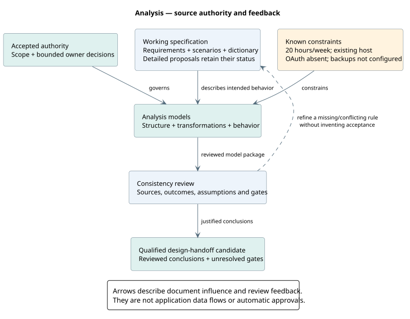
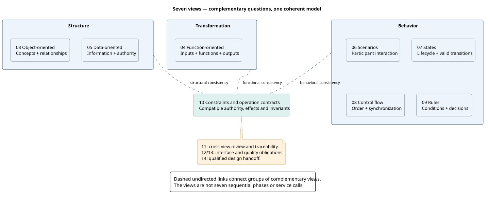
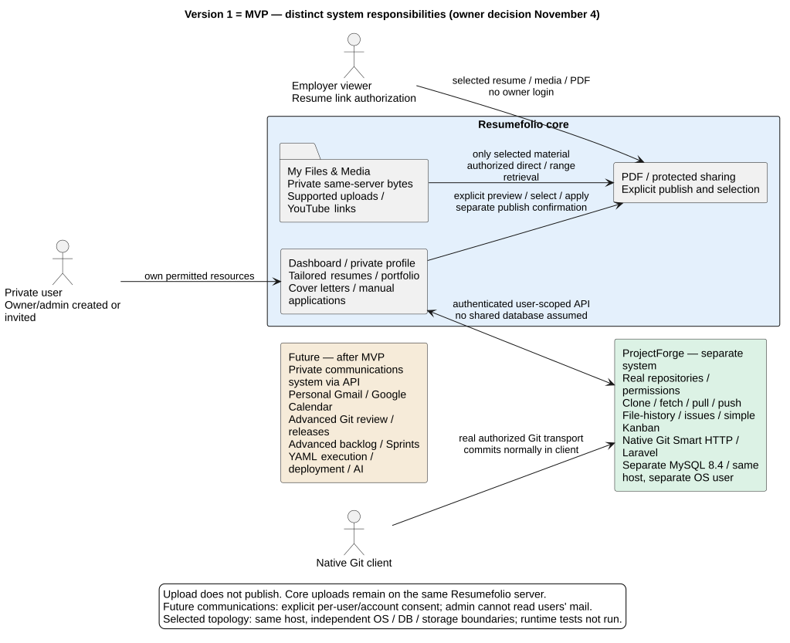

# Resumefolio — Analysis Purpose, Scope and Approach

[Diagram types and reading guide](#diagram-types-and-reading-guide) · [Full diagram catalog](../diagrams/README.md)

Owner: Farhad. Revision: November 1, 2026.

Status: working analysis charter and execution plan. This document defines the work; it does not assert completion of the models or acceptance of M-02/M-03.

## MVP analysis boundary and evidence applicability

The accepted system boundary separates the Resumefolio core from ProjectForge, joined by an authenticated user-scoped API. Logical responsibilities remain useful within each system; they do not authorize a shared core/ProjectForge process, database or transaction. Core owns dashboard, invited accounts, professional presentation, protected sharing, manual applications and same-server private My Files & Media. ProjectForge MVP owns real repositories/transfers/permissions, file/history browsing, issues and simple Kanban. Its engine, deployment and database remain open. The future communications system is independently private and API connected. Advanced Git review/releases, backlog/Sprints and execution/deployment remain deferred. Retained mail, advanced review/Sprint and execution models describe future behavior. Historical comparison/evidence results retain their original candidate/date and are not newly executed MVP checks.

Authority: [OWNER-MVP-2026-11-04](../../01-project-planning/owner-mvp-decision-2026-11-04.md).

## 1. Purpose and Intended Outcome

System Analysis develops a coherent domain-oriented description of how Resumefolio fulfills its requirements: the concepts involved, their responsibilities, information relationships, interactions, lifecycle, transformations and constraints. The outcome is a traceable model package that System Design can use without inventing product behavior.

The [Start Here guide](00-start-here.md) provides navigation and the immediate starting task. This document defines the analysis objectives, coverage, method, responsibilities and completion conditions. [System context](02-system-context-and-boundaries.md) defines the actual product boundary.

| Analysis question | Expected output |
| --- | --- |
| Who interacts with the product, and where does responsibility stop? | Actors, boundary exchanges and scope coverage in document 02 |
| What information is shared, tailored, published and preserved? | Domain responsibilities in 03; conceptual data relationships in 05 |
| Which inputs become which outputs? | Functions and data flows in 04; operation contracts in 10 |
| What happens during normal, denied, failed or competing actions? | Interactions in 06, lifecycle in 07, activities in 08 and decisions in 09 |
| Which obligations cross a provider or operational boundary? | Interface analysis in 12 and quality/operational analysis in 13 |
| What can design rely on, and what still needs evidence or a decision? | Consistency findings in 11 and qualified handoff in 14 |

Analysis may identify candidate responsibilities and logical solution behavior. Framework versions, physical schemas, endpoint signatures, deployment topology, Git engine and execution isolation mechanisms require design decisions and their supporting evidence.

## 2. Inputs, Authority and Decision Status

[Editable PlantUML](../diagrams/analysis-inputs-and-outputs.puml) · [PNG](../diagrams/analysis-inputs-and-outputs.png)

The diagram shows document authority and the feedback path for missing requirements. Its arrows represent information and review flow, not an assertion that every input or output is accepted.

| Input | Authority and use |
| --- | --- |
| [Project scope](../../01-project-planning/02-scope.md) | Accepted capability boundaries and exclusions, including DEC-028–DEC-017; maintain all twelve scope areas |
| [Planning completion criteria](../../01-project-planning/10-planning-completion-criteria.md) | Historical identified M-01 acceptance; later working copies require their own review |
| [Resources and constraints](../../01-project-planning/05-resources-and-constraints.md) | Actual availability is 20 hours/week, including learning, documentation and testing |
| [Requirements specification](../../02-requirements-engineering/03-requirements-specification/requirements-specification.md) | Entry point to primary obligations; preserve requirement IDs and link to their authoritative text |
| [Actors and context](../../02-requirements-engineering/02-stakeholders-and-elicitation/actors-and-system-context.md) and [scenarios](../../02-requirements-engineering/04-scenarios-and-models/user-stories-and-scenarios.md) | Intended goals and externally visible paths; review their detailed policy status |
| [Data dictionary](../../02-requirements-engineering/05-data-definitions/data-dictionary.md) | Shared terminology; resolve competing definitions at their source |
| [Questions and decisions](../../02-requirements-engineering/07-change-and-baseline/open-questions-and-decisions.md) | Distinguish owner decisions, partial resolution, proposals and investigation |
| [Answer review](../../02-requirements-engineering/07-change-and-baseline/requirements-answer-review.md) | Working proposals may support explicit provisional models; they are not automatically accepted |
| [Bounded input evidence](../evidence/context-input-review-2026-11-01.json) | Historical source hashes and review limits; it does not verify every later revision |

The [owner-accepted profile policy](../../02-requirements-engineering/07-change-and-baseline/open-questions-and-decisions.md#owner-accepted-profile-update-policy) is a firm input: profile edits do not automatically alter existing resumes or published views; the owner previews and explicitly applies selected changes; publication requires a separate confirmation; resume-specific content and actual previously submitted documents remain preserved. Do not seek the same approval again. Source removal and other unresolved details are not implicitly accepted by this policy.

Keep four statuses distinct: accepted decision, proposed behavior, observed fact and unresolved dependency. A model can be useful while containing clearly marked proposals. Drawing it does not close the related question.

## 3. Product Coverage and Exclusions

All twelve accepted scope areas remain in analysis. Work order changes the depth reached first, not the product boundary. The detailed source mapping remains in the [context coverage table](02-system-context-and-boundaries.md#scope-coverage).

| Scope | Domain analysis focus | Principal model concerns |
| --- | --- | --- |
| SCP-01 Accounts and access | Identity, roles, grants and actor authority | Access conditions, denial and revocation |
| SCP-02 Profiles and resumes | Shared source, independent resume content and publication | Accepted preview/apply/publish behavior; preserved overrides |
| SCP-03 Portfolio evidence | Text, media, files and externally authored diagram links | Evidence identity, selection and access lifecycle |
| SCP-04 PDF and language availability | Generated/uploaded PDF modes; independent English/German content | Availability rules and artifact identity |
| SCP-05 Employer sharing | Password-protected links and selected content | Authorization, direct file access and disable behavior |
| SCP-06 Application tracking | Companies, opportunities, cover letters and progress | Actual submitted materials and historical integrity |
| SCP-07 Google communication | Gmail and selected calendar interactions | Consent, provider boundaries, failure and synchronization  **After MVP.** |
| SCP-08 Work management | Projects, boards, tasks, backlog and Sprints | Grants; Sprint goal, selected items and plan |
| SCP-09 Real Git | Repositories, changes, collaboration and releases | Actual Git operations, permissions and operation outcomes |
| SCP-10 YAML workflows and CI | Authorized workflow execution and separate deployment approval | Execution lifecycle, isolation obligations and cleanup  **After MVP.** |
| SCP-11 File/storage policy | Effective limits and configurable platform policy | Enforcement points, capacity constraints and rejected operations |
| SCP-12 Deployment and operations | Hosting, verification, backup and restoration responsibilities | Recovery expectations, operational dependencies and evidence gates |

Excluded capabilities remain excluded: product AI, automatic translation and automatic migration of the old demo. External evidence authoring does not introduce an internal video or diagram editor. Manual application tracking does not introduce automatic job-platform submission. The development repository or board does not fulfill the product's real Git/work-management scope. YAML support does not imply compatibility with every third-party action.

Current-process and bottleneck analysis belongs in [document 15](../03-functional-and-process-analysis/15-current-processes-and-bottleneck-analysis.md). Separate documented observations from assumptions; do not invent interviews, timings or measured improvements.

## 4. Modeling Method and Complementary Views

Use the domain-oriented approach already established in this folder. Choose each notation to answer a question; a diagram count is not a completion measure. Course references retained in the [folder index](../README.md) explain the organizing approach. This revision does not independently certify formal compliance with the lecture PDFs or a standard.

[Editable PlantUML](../diagrams/analysis-seven-view-consistency.puml) · [PNG](../diagrams/analysis-seven-view-consistency.png)

The dashed undirected relationships mean consistency obligations, not calls or processing order. The seven views describe compatible aspects of one system. They are not seven sequential development phases. Contracts connect the views by stating the effects and limits of an operation.

| View and authoritative file | Use when answering | Required consistency |
| --- | --- | --- |
| [03 Object-oriented](../02-domain-and-information-analysis/03-domain-model-and-object-oriented-view.md) | Which domain concepts hold which responsibilities? | Classes and associations use dictionary terms and agree with conceptual data |
| [04 Function-oriented](../03-functional-and-process-analysis/04-function-oriented-view.md) | What transformations consume and produce information? | Data flows balance across decomposition and match operation effects |
| [05 Data-oriented](../02-domain-and-information-analysis/05-data-oriented-view.md) | What information exists, and how is it related? | Relationships and justified multiplicities agree with rules and lifecycle |
| [06 Scenario-based](../04-behavioral-and-scenario-analysis/06-scenario-based-view.md) | Which participants exchange what during a goal? | Messages correspond to allowed operations and stated outcomes |
| [07 State-based](../04-behavioral-and-scenario-analysis/07-state-based-view.md) | Which states and transitions are valid? | Guards, events and terminal states agree with scenarios and contracts |
| [08 Control-flow-based](../03-functional-and-process-analysis/08-control-flow-based-view.md) | Which steps, decisions and parallel activities occur? | Ordering, failure paths and synchronization preserve state/rule constraints |
| [09 Rule-based](../05-business-rules-and-operation-contracts/09-rule-based-view.md) | What result follows a combination of conditions? | Decision tables/trees cover relevant alternatives without conflicting outcomes |

Use [document 10](../05-business-rules-and-operation-contracts/10-domain-constraints-and-operation-contracts.md) for invariants and preconditions, effects, denial/failure outcomes and information that must remain unchanged. Keep actual interfaces in [12](../06-interfaces-security-and-quality-analysis/12-interfaces-and-external-interactions.md), cross-cutting constraints in [13](../06-interfaces-security-and-quality-analysis/13-security-quality-and-operational-analysis.md), and review evidence in [11](../07-review-and-design-handoff/11-model-consistency-traceability-and-review.md).

For each diagram, record its question, source references, meaning of arrows/notation, assumptions and related views. Store editable source, SVG and PNG together in the [diagram catalog](../diagrams/README.md). Keep technical implementation detail out of conceptual models unless needed to express an actual constraint.

## 5. Execution Packages and Dependencies

**Release applicability:** future-domain design retained after MVP; core operating/deployment and recovery controls still apply to MVP where relevant.

| Order | Work package | Concrete outputs and dependency |
| --- | --- | --- |
| 1 | Boundary and input alignment | Maintain document 02 and source authority; existing context diagrams provide a starting point, not whole-phase completion |
| 2 | Professional presentation core | Populate 03 and 05 for profile, resume, evidence, PDF, sharing and submitted artifacts; apply the accepted core policy and label unresolved multiplicities/policies |
| 3 | Core behavior | Populate 10 and coordinated 06–09 for preview/apply, publication, PDF settings, link disable and actual submission; keep PDF settings separate from disabling a link |
| 4 | Applications and Google exchanges | Extend concepts, scenarios and interfaces for tracking, mail and calendar; model missing consent/provider failure explicitly |
| 5 | Work, Git and workflow execution | Extend structural and behavioral views for backlog/Sprints, real Git and authorized execution; preserve separate deployment approval |
| 6 | Quality, operations and complete coverage | Populate 12–15; check cross-cutting access, file/storage constraints, recovery and feasibility against all twelve areas |
| 7 | Consolidation and design handoff | Complete 11 and 14 with criterion-to-model references, findings, owner dispositions and explicitly conditional design inputs |

Within each package, follow a short iteration: read the primary obligations; model the relevant concepts; describe normal and relevant alternative paths; state contracts; compare views; resolve or record findings. Correct a discovered source inconsistency immediately when its resolution is authorized. Carry a genuinely unresolved question with its impact and dependent work instead of restarting the whole review.

Parallel conceptual work is possible where dependencies allow it. OAuth is not created and backups are not configured: those are answered facts, not recurring questions to the owner. They do not prevent logical domain models. Actual provider access, a suitable execution arrangement and verified recovery remain prerequisites for dependent design/implementation/release conclusions.

## 6. Traceability and Review Contract

For each modeled behavior, retain a navigable chain: primary requirement and acceptance criterion → relevant concept/function → interaction or transition → rule/contract → review finding or disposition. Reuse stable primary IDs; identify model elements locally without creating a competing requirements catalog.

| Review check | Evidence required |
| --- | --- |
| Coverage | Each scope area and relevant criterion has an exact model reference, or an explicit justified gap |
| Vocabulary | Identical domain terms have compatible definitions across diagrams, dictionary and prose |
| Structure and behavior | Participants exist; referenced operations are meaningful; state changes and data effects agree |
| Access and failure | Relevant denial, missing input, provider failure and revocation outcomes are explicit |
| History and publication | Save/apply/publication are distinguishable; submitted artifacts are not silently replaced |
| Uncertainty | Every material proposal or open dependency states its impact and the work it gates |
| Readability | Rendered labels and arrows are legible; source and exported figures agree; links resolve |

A structural link check is not semantic validation. A proposed review case is not an executed test. Observing available host memory does not establish peak-load capacity, successful restoration or safe workflow isolation.

## 7. Responsibility, Constraints and Change Handling

Farhad owns product decisions and acceptance and is the sole delivery/operations owner. Codex prepares models, checks consistency and documents evidence within the authorized task; its review is not owner acceptance. Budget work against the actual 20 hours/week. Keep effort estimates provisional until the scope and dependency findings support them.

Maintain one primary source for each requirement, term and decision. When analysis exposes a missing rule, link the finding back to that source, record the proposed or accepted resolution, and update affected views together. Do not silently convert a proposal into an accepted obligation or infer approval of unrelated policy details.

Existing Ubuntu hosting and the deployed Laravel demo are constraints/evidence about the current environment. They do not prove that the planned scope is implemented, that capacity is sufficient under load, or that OAuth, backup and execution prerequisites are satisfied. Investigation must target the specific dependent conclusion.

## 8. Completion Conditions and Handoff

This charter is populated. The detailed analysis package remains in progress. A useful handoff must identify exactly which models and conclusions have been reviewed; diagrams alone do not establish phase acceptance.

- [ ] All twelve scope areas have appropriate structural and behavioral coverage, with justified omissions recorded.

- [ ] Primary requirements and criteria have exact model references or explicitly owned gaps.

- [ ] Cross-view contradictions are resolved or carry a clear impact and disposition.

- [ ] Accepted decisions are reflected consistently; proposed details remain visibly proposed.

- [ ] Interfaces, security/quality obligations and operational dependencies are analyzed to the depth needed by design.

- [ ] Design inputs distinguish established constraints, candidate choices and unresolved feasibility gates.

- [ ] The owner disposition and the exact reviewed version are recorded for the intended handoff scope.

The immediate next modeling output is the professional-presentation domain model in document 03 and its conceptual data counterpart in 05, followed by the corresponding operation contracts and behavioral views. This sequence advances analysis without waiting for unrelated setup, while keeping dependent acceptance gates visible.

[System Analysis index](../README.md) · [Start Here](00-start-here.md) · [Review and traceability](../07-review-and-design-handoff/11-model-consistency-traceability-and-review.md)

## Diagram Types and Reading Guide

This scope map summarizes the authoritative scope and actor contexts, not a role-permission grant matrix. See the existing scope and actor links above for primary authority.

[Editable source](../diagrams/scope-stakeholder-map.puml) · [PNG](../diagrams/scope-stakeholder-map.png)
