# Resumefolio — Domain Model and Object-Oriented View

[Diagram types and reading guide](#diagram-types-and-reading-guide) · [Full diagram catalog](../diagrams/README.md)

| Item | Current position |
| --- | --- |
| Owner | Farhad; sole delivery and operations owner |
| Revision | November 1, 2026 |
| Status | Populated full-product conceptual domain model; detailed proposals, cross-view review and whole-model acceptance remain visible |
| Coverage | All twelve accepted scope areas; ten class views and one logical package view and a shared responsibility catalog |
| Interpretation | Domain concepts and associations, not implementation classes, physical tables, services or deployment units |

**Reading route:** read the notation/authority rules, then the diagrams and concept tables, followed by relationship bounds, change impact and invariants. The model develops the [system context](../01-foundations-and-system-context/02-system-context-and-boundaries.md), following the [analysis approach](../01-foundations-and-system-context/01-analysis-purpose-scope-and-approach.md).

## MVP analysis boundary and evidence applicability

The accepted system boundary separates the Resumefolio core from ProjectForge, joined by an authenticated user-scoped API. Logical responsibilities remain useful within each system; they do not authorize a shared core/ProjectForge process, database or transaction. Core owns dashboard, invited accounts, professional presentation, protected sharing, manual applications and same-server private My Files & Media. ProjectForge MVP owns real repositories/transfers/permissions, file/history browsing, issues and simple Kanban. Its engine, deployment and database remain open. The future communications system is independently private and API connected. Advanced Git review/releases, backlog/Sprints and execution/deployment remain deferred. My Files & Media is a core private library with optional per-resume selection. Supported uploads remain in private directories on the same Resumefolio server, with type/size/quota enforcement, safe serving and backup/recovery. Direct, preview and byte-range requests use current owner or selected-resume/viewer authority. Upload does not publish. External YouTube links use simple embedded playback; private uploads are not sent to YouTube. No extra media platform or heavyweight editor/transcoding is selected. Retained mail, advanced review/Sprint and execution models describe future behavior. Historical comparison/evidence results retain their original candidate/date and are not newly executed MVP checks.

Authority: [OWNER-MVP-2026-11-04](../../01-project-planning/owner-mvp-decision-2026-11-04.md).

## 1. Sources and Interpretation

Accepted [Version 1 scope](../../01-project-planning/02-scope.md) governs capability inclusion/exclusions. The [distributed SRS](../../02-requirements-engineering/03-requirements-specification/requirements-specification.md) owns detailed obligations; the [dictionary](../../02-requirements-engineering/05-data-definitions/data-dictionary.md) and [glossary](../../02-requirements-engineering/05-data-definitions/glossary.md) own shared terms. The [question register](../../02-requirements-engineering/07-change-and-baseline/open-questions-and-decisions.md) and [answer review package](../../02-requirements-engineering/07-change-and-baseline/requirements-answer-review.md) distinguish decisions, proposals and investigations. Exact primary requirement links appear in each concept table.

### 1.1 Accepted Core and Remaining Proposals

The [owner-accepted profile policy](../../02-requirements-engineering/07-change-and-baseline/open-questions-and-decisions.md#owner-accepted-profile-update-policy) applies directly:

1. Editing shared profile information does not automatically change existing resumes or their published views.

2. The owner previews and explicitly applies selected changes to a resume, preserving independent text/overrides and other resumes.

3. Applying/saving and publishing are separate; publication requires separate owner confirmation.

4. Actual previously submitted documents remain independent of later source, resume and publication changes.

These behaviors are accepted. Do not request the same approval again. Source deletion, exact concurrent-edit reconciliation, mandatory fields, language fallback, retention and numerical limits retain their recorded status. Accepted scope does not accept every detailed requirement, all of Q-D07 or the entire model.

### 1.2 Notation and Object-Oriented Interpretation

| Modeling choice | Meaning and limit |
| --- | --- |
| UML-style concept class | Name/local ID and semantic properties. Actions remain in the adjacent responsibility table; no implementation methods or mandatory stored columns are implied |
| Solid labeled association | Domain relationship, not execution order, data transfer, authorization or lifetime ownership |
| Multiplicity | Sprint–Sprint Backlog is 1:1 from accepted scope. Other endpoint counts remain unspecified, not implicitly one-to-one; section 3 distinguishes candidate bounds from accepted meaning |
| Same concept repeated across views | Same ID and meaning, not a duplicate class; Tailored resume appears in both presentation and sharing |
| No inheritance/composition diamonds | Exclusive lifetime ownership, cascaded deletion and subtype hierarchies are not justified by the sources |
| Derived analysis concept | Selection, publication or attempt may become a value, association property or implementation component; boxes do not mandate separate entities |
| DM-Cxx / DM-Ixx | Local model/review references only; no new primary requirement IDs or physical keys |

These are PlantUML-rendered UML-style conceptual class views. Class boxes contain semantic properties; operations and full source traceability remain in the prose tables to keep the pictures readable. The diagrams are supported by textual constraints rather than claimed to form an executable UML model. Names such as Resource authority describe business responsibility, not a selected technical security component. [Input hashes and model inventory](../evidence/domain-model-review-2026-11-01.json) identify this source-derived revision; they do not establish future baseline acceptance.

## 2. Concepts and Responsibilities

### 2.1 Professional information and independent tailoring

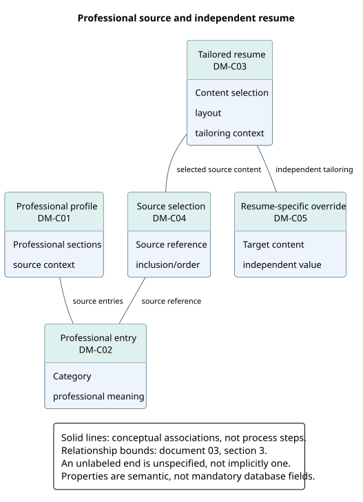

[PNG](../diagrams/domain-professional-presentation.png) · [Editable PlantUML](../diagrams/domain-professional-presentation.puml)

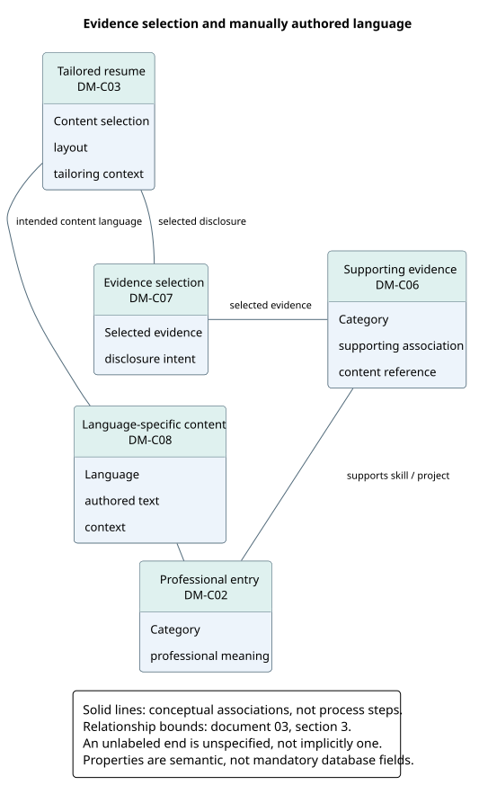

[PNG](../diagrams/domain-evidence-and-language.png) · [Editable PlantUML](../diagrams/domain-evidence-and-language.puml)

Source selection, independent override and evidence selection answer different questions: what is reused, what is tailored and what is disclosed. Selection/override boxes can become values or association properties; they are not mandated database entities. Evidence support targets the skill/professional-project subjects in the grouped entry box, not automatically every entry category.

**Primary basis:** [PRP-D01](../../02-requirements-engineering/03-requirements-specification/profiles-resumes-and-portfolio.md#prp-d01-reusable-professional-information), [PRP-D02](../../02-requirements-engineering/03-requirements-specification/profiles-resumes-and-portfolio.md#prp-d02-opportunity-specific-resume-composition), [PRP-D03](../../02-requirements-engineering/03-requirements-specification/profiles-resumes-and-portfolio.md#prp-d03-independent-selections-layouts-and-overrides), [PRP-D04](../../02-requirements-engineering/03-requirements-specification/profiles-resumes-and-portfolio.md#prp-d04-explicit-shared-source-update-rules), [PRP-D05](../../02-requirements-engineering/03-requirements-specification/profiles-resumes-and-portfolio.md#prp-d05-skill-and-project-evidence-management), [PRP-D06](../../02-requirements-engineering/03-requirements-specification/profiles-resumes-and-portfolio.md#prp-d06-per-resume-evidence-selection-and-disclosure), [PRP-D07](../../02-requirements-engineering/03-requirements-specification/profiles-resumes-and-portfolio.md#prp-d07-manually-maintained-english-and-german-content), [PRP-D09](../../02-requirements-engineering/03-requirements-specification/profiles-resumes-and-portfolio.md#prp-d09-safe-content-admission-and-truthful-save-outcomes).

| Local element | Meaning / responsibility | Conceptual information and domain actions | Exact primary basis |
| --- | --- | --- | --- |
| DM-C01 — Professional profile | Reusable private professional source information, distinct from published presentation. | Professional sections; source context. Actions: Edit source; preview changes. | [PRP-D01](../../02-requirements-engineering/03-requirements-specification/profiles-resumes-and-portfolio.md#prp-d01-reusable-professional-information), [PRP-D04](../../02-requirements-engineering/03-requirements-specification/profiles-resumes-and-portfolio.md#prp-d04-explicit-shared-source-update-rules) |
| DM-C02 — Professional entry | Experience, education, skill or professional-project information; categories do not select implementation subclasses. | Category; professional meaning. Actions: Maintain source entry. | [PRP-D01](../../02-requirements-engineering/03-requirements-specification/profiles-resumes-and-portfolio.md#prp-d01-reusable-professional-information), [PRP-D05](../../02-requirements-engineering/03-requirements-specification/profiles-resumes-and-portfolio.md#prp-d05-skill-and-project-evidence-management) |
| DM-C03 — Tailored resume | Independent opportunity-specific selections, wording and presentation. | Content selection; layout; tailoring context. Actions: Compose; apply selected changes; request publication. | [PRP-D02](../../02-requirements-engineering/03-requirements-specification/profiles-resumes-and-portfolio.md#prp-d02-opportunity-specific-resume-composition), [PRP-D03](../../02-requirements-engineering/03-requirements-specification/profiles-resumes-and-portfolio.md#prp-d03-independent-selections-layouts-and-overrides), [PRP-D04](../../02-requirements-engineering/03-requirements-specification/profiles-resumes-and-portfolio.md#prp-d04-explicit-shared-source-update-rules) |
| DM-C04 — Source selection | Meaning of selecting source information for one resume, without automatic propagation. | Source reference; inclusion/order. Actions: Select; omit; explicitly apply change. | [PRP-D02](../../02-requirements-engineering/03-requirements-specification/profiles-resumes-and-portfolio.md#prp-d02-opportunity-specific-resume-composition), [PRP-D04](../../02-requirements-engineering/03-requirements-specification/profiles-resumes-and-portfolio.md#prp-d04-explicit-shared-source-update-rules) |
| DM-C05 — Resume-specific override | Independent wording/presentation belonging to the intended resume. | Target content; independent value. Actions: Edit override; review source difference. | [PRP-D03](../../02-requirements-engineering/03-requirements-specification/profiles-resumes-and-portfolio.md#prp-d03-independent-selections-layouts-and-overrides), [PRP-D04](../../02-requirements-engineering/03-requirements-specification/profiles-resumes-and-portfolio.md#prp-d04-explicit-shared-source-update-rules) |
| DM-C06 — Supporting evidence | Externally authored text, media, files, diagrams or links supporting skills or professional projects. | Category; supporting association; content reference. Actions: Associate; revise safely. | [PRP-D05](../../02-requirements-engineering/03-requirements-specification/profiles-resumes-and-portfolio.md#prp-d05-skill-and-project-evidence-management), [PRP-D09](../../02-requirements-engineering/03-requirements-specification/profiles-resumes-and-portfolio.md#prp-d09-safe-content-admission-and-truthful-save-outcomes) |
| DM-C07 — Evidence selection | Deliberate per-resume disclosure, distinct from evidence existence. | Selected evidence; disclosure intent. Actions: Select; omit; review disclosure. | [PRP-D06](../../02-requirements-engineering/03-requirements-specification/profiles-resumes-and-portfolio.md#prp-d06-per-resume-evidence-selection-and-disclosure) |
| DM-C08 — Language-specific content | Manually maintained English/German text in its relevant source/resume context. | Language; authored text; context. Actions: Edit language variant. | [PRP-D07](../../02-requirements-engineering/03-requirements-specification/profiles-resumes-and-portfolio.md#prp-d07-manually-maintained-english-and-german-content) |

**Policy boundary:** Q-D06/Q-D08/Q-D09 remain proposals. Profile count, required fields, language fallback and evidence-removal behavior are not finalized. Accepted Q-D07 core behavior applies directly.

### 2.2 Publication, representations and protected sharing

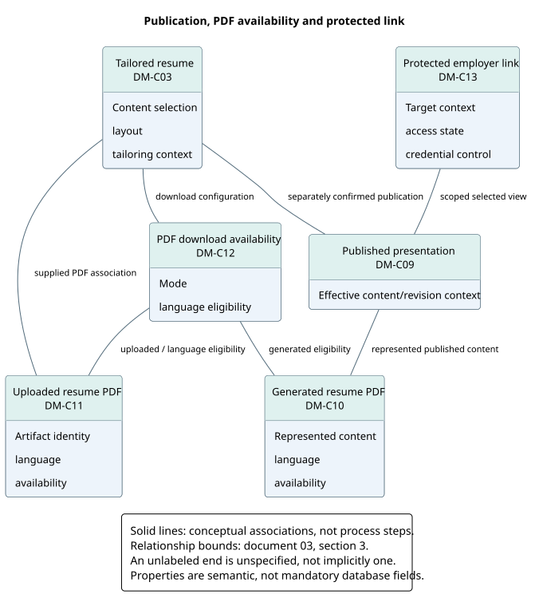

[PNG](../diagrams/domain-publication-and-sharing.png) · [Editable PlantUML](../diagrams/domain-publication-and-sharing.puml)

Published presentation differs from editable resume content. Generated and uploaded PDFs have different provenance; no shared implementation superclass is selected. Changing PDF availability and disabling a link remain independent operations.

**Primary basis:** [PRP-D04](../../02-requirements-engineering/03-requirements-specification/profiles-resumes-and-portfolio.md#prp-d04-explicit-shared-source-update-rules), [PRP-D08](../../02-requirements-engineering/03-requirements-specification/profiles-resumes-and-portfolio.md#prp-d08-clear-presentation-and-rendition-boundaries), [PDF-D01](../../02-requirements-engineering/03-requirements-specification/pdf-and-controlled-sharing.md#pdf-d01-generated-resume-pdf), [PDF-D02](../../02-requirements-engineering/03-requirements-specification/pdf-and-controlled-sharing.md#pdf-d02-uploaded-pdf-and-language-identity), [PDF-D03](../../02-requirements-engineering/03-requirements-specification/pdf-and-controlled-sharing.md#pdf-d03-per-resume-download-choices), [PDF-D04](../../02-requirements-engineering/03-requirements-specification/pdf-and-controlled-sharing.md#pdf-d04-scoped-password-protected-employer-access), [PDF-D05](../../02-requirements-engineering/03-requirements-specification/pdf-and-controlled-sharing.md#pdf-d05-direct-file-and-pdf-authorization), [PDF-D06](../../02-requirements-engineering/03-requirements-specification/pdf-and-controlled-sharing.md#pdf-d06-owner-password-and-link-controls), [PDF-D07](../../02-requirements-engineering/03-requirements-specification/pdf-and-controlled-sharing.md#pdf-d07-explicit-live-revision-and-rendition-behavior).

| Local element | Meaning / responsibility | Conceptual information and domain actions | Exact primary basis |
| --- | --- | --- | --- |
| DM-C03 (same concept) — Tailored resume | Independent opportunity-specific selections, wording and presentation. | Content selection; layout; tailoring context. Actions: Compose; apply selected changes; request publication. | [PRP-D02](../../02-requirements-engineering/03-requirements-specification/profiles-resumes-and-portfolio.md#prp-d02-opportunity-specific-resume-composition), [PRP-D03](../../02-requirements-engineering/03-requirements-specification/profiles-resumes-and-portfolio.md#prp-d03-independent-selections-layouts-and-overrides), [PRP-D04](../../02-requirements-engineering/03-requirements-specification/profiles-resumes-and-portfolio.md#prp-d04-explicit-shared-source-update-rules) |
| DM-C09 — Published presentation | Owner-confirmed effective presentation, semantically distinct from the draft; not a mandatory snapshot table. | Effective content/revision context. Actions: Confirm publication; expose selected content. | [PRP-D04](../../02-requirements-engineering/03-requirements-specification/profiles-resumes-and-portfolio.md#prp-d04-explicit-shared-source-update-rules), [PRP-D08](../../02-requirements-engineering/03-requirements-specification/profiles-resumes-and-portfolio.md#prp-d08-clear-presentation-and-rendition-boundaries), [PDF-D07](../../02-requirements-engineering/03-requirements-specification/pdf-and-controlled-sharing.md#pdf-d07-explicit-live-revision-and-rendition-behavior) |
| DM-C10 — Generated resume PDF | Derived rendition with identifiable represented content and language. | Represented content; language; availability. Actions: Request generation; report availability. | [PDF-D01](../../02-requirements-engineering/03-requirements-specification/pdf-and-controlled-sharing.md#pdf-d01-generated-resume-pdf), [PDF-D07](../../02-requirements-engineering/03-requirements-specification/pdf-and-controlled-sharing.md#pdf-d07-explicit-live-revision-and-rendition-behavior) |
| DM-C11 — Uploaded resume PDF | Independently prepared PDF associated with the intended resume and language. | Artifact identity; language; availability. Actions: Admit; replace under validation. | [PDF-D02](../../02-requirements-engineering/03-requirements-specification/pdf-and-controlled-sharing.md#pdf-d02-uploaded-pdf-and-language-identity), [PDF-D09](../../02-requirements-engineering/03-requirements-specification/pdf-and-controlled-sharing.md#pdf-d09-failure-safe-processing-and-content-handling) |
| DM-C12 — PDF download availability | Per-resume generated/uploaded/both/neither choice with applicable language availability. | Mode; language eligibility. Actions: Change download configuration. | [PDF-D03](../../02-requirements-engineering/03-requirements-specification/pdf-and-controlled-sharing.md#pdf-d03-per-resume-download-choices) |
| DM-C13 — Protected employer link | Password-protected scoped presentation access without a viewer account; not verified employer identity. | Target context; access state; credential control. Actions: Change password; disable link. | [PDF-D04](../../02-requirements-engineering/03-requirements-specification/pdf-and-controlled-sharing.md#pdf-d04-scoped-password-protected-employer-access), [PDF-D06](../../02-requirements-engineering/03-requirements-specification/pdf-and-controlled-sharing.md#pdf-d06-owner-password-and-link-controls) |

**Policy boundary:** Q-D10/Q-D11 retain detailed generation/revision/language/link proposals. This model does not accept link count, expiry, exact session-revocation timing, retained revision count or rendering technology.

### 2.3 Applications, submitted history and communication

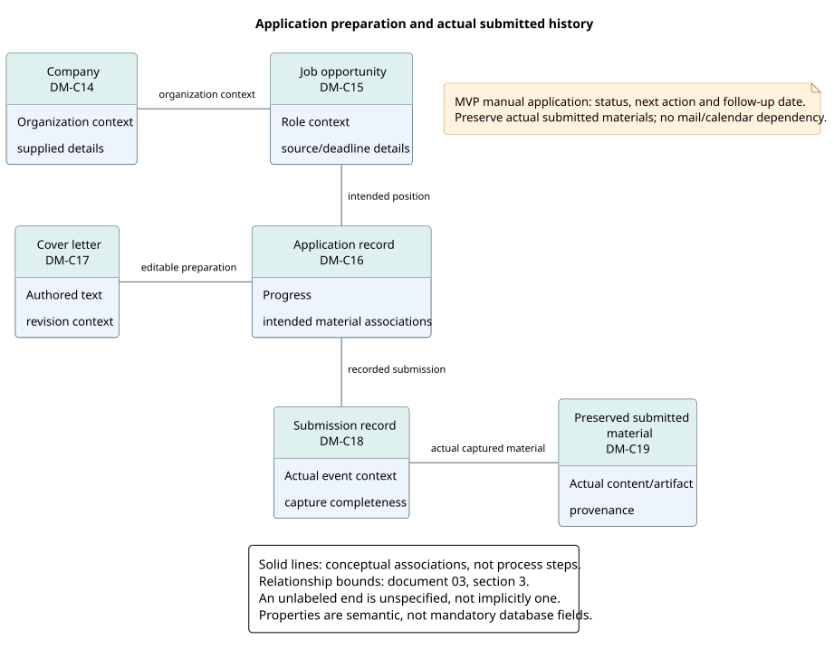

[PNG](../diagrams/domain-applications-and-communication.png) · [Editable PlantUML](../diagrams/domain-applications-and-communication.puml)

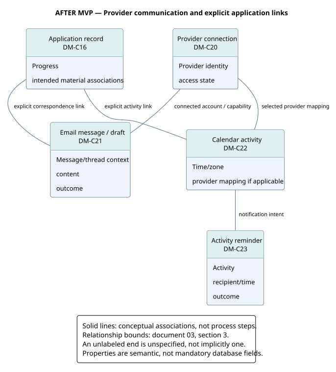

[PNG](../diagrams/domain-provider-communication.png) · [Editable PlantUML](../diagrams/domain-provider-communication.puml)

Preparation, actual submission recording and provider operations have independent meanings. An application refers to its intended resume, while preserved materials identify what was actually submitted. A provider connection does not make every activity remote or every application send mail.

**Primary basis:** [APP-D01](../../02-requirements-engineering/03-requirements-specification/manual-application-management.md#app-d01-company-and-opportunity-context), [APP-D02](../../02-requirements-engineering/03-requirements-specification/manual-application-management.md#app-d02-relevant-resume-association), [APP-D03](../../02-requirements-engineering/03-requirements-specification/manual-application-management.md#app-d03-manually-authored-cover-letter), [APP-D04](../../02-requirements-engineering/03-requirements-specification/manual-application-management.md#app-d04-explicit-progress-states-and-transitions), [APP-D05](../../02-requirements-engineering/03-requirements-specification/manual-application-management.md#app-d05-user-directed-submission-recording), [APP-D06](../../02-requirements-engineering/03-requirements-specification/manual-application-management.md#app-d06-preserved-actual-submitted-copies), [APP-D07](../../02-requirements-engineering/03-requirements-specification/manual-application-management.md#app-d07-correction-and-repeated-submissions), [APP-D08](../../02-requirements-engineering/03-requirements-specification/manual-application-management.md#app-d08-correspondence-calendar-and-follow-up-links), [EGC-D01](../../02-requirements-engineering/03-requirements-specification/email-calendar-and-google-integration.md#egc-d01-authorized-connection-and-account-context), [EGC-D05](../../02-requirements-engineering/03-requirements-specification/email-calendar-and-google-integration.md#egc-d05-deliberate-send-and-truthful-outcome), [EGC-D07](../../02-requirements-engineering/03-requirements-specification/email-calendar-and-google-integration.md#egc-d07-calendar-activities-and-time-meaning), [EGC-D08](../../02-requirements-engineering/03-requirements-specification/email-calendar-and-google-integration.md#egc-d08-explicit-synchronization-contract), [EGC-D10](../../02-requirements-engineering/03-requirements-specification/email-calendar-and-google-integration.md#egc-d10-reminders-and-notification-outcomes), [EGC-D11](../../02-requirements-engineering/03-requirements-specification/email-calendar-and-google-integration.md#egc-d11-disconnect-revocation-and-reconnect).

| Local element | Meaning / responsibility | Conceptual information and domain actions | Exact primary basis |
| --- | --- | --- | --- |
| DM-C14 — Company | Organization information for private application work; no global public directory is implied. | Organization context; supplied details. Actions: Record; revise organization context. | [APP-D01](../../02-requirements-engineering/03-requirements-specification/manual-application-management.md#app-d01-company-and-opportunity-context) |
| DM-C15 — Job opportunity | Position being considered, distinct from the application process for it. | Role context; source/deadline details. Actions: Record; associate with application. | [APP-D01](../../02-requirements-engineering/03-requirements-specification/manual-application-management.md#app-d01-company-and-opportunity-context) |
| DM-C16 — Application record | Manual preparation and progress context relating an opportunity to intended materials. | Progress; intended material associations. Actions: Prepare; record progress/submission. | [APP-D02](../../02-requirements-engineering/03-requirements-specification/manual-application-management.md#app-d02-relevant-resume-association), [APP-D04](../../02-requirements-engineering/03-requirements-specification/manual-application-management.md#app-d04-explicit-progress-states-and-transitions), [APP-D05](../../02-requirements-engineering/03-requirements-specification/manual-application-management.md#app-d05-user-directed-submission-recording) |
| DM-C17 — Cover letter | Manually authored editable application text, distinct from its actual submitted copy. | Authored text; revision context. Actions: Edit; save preparation. | [APP-D03](../../02-requirements-engineering/03-requirements-specification/manual-application-management.md#app-d03-manually-authored-cover-letter) |
| DM-C18 — Submission record | User-recorded actual submission and completeness context, not proof of receipt. | Actual event context; capture completeness. Actions: Record submission; record correction. | [APP-D05](../../02-requirements-engineering/03-requirements-specification/manual-application-management.md#app-d05-user-directed-submission-recording), [APP-D07](../../02-requirements-engineering/03-requirements-specification/manual-application-management.md#app-d07-correction-and-repeated-submissions) |
| DM-C19 — Preserved submitted material | Identifiable actual submitted resume/cover-letter material independent of later live changes. | Actual content/artifact; provenance. Actions: Capture actual material; identify history. | [APP-D06](../../02-requirements-engineering/03-requirements-specification/manual-application-management.md#app-d06-preserved-actual-submitted-copies), [APP-D07](../../02-requirements-engineering/03-requirements-specification/manual-application-management.md#app-d07-correction-and-repeated-submissions), [PDF-D08](../../02-requirements-engineering/03-requirements-specification/pdf-and-controlled-sharing.md#pdf-d08-downloaded-copy-and-submission-distinctions) |
| DM-C20 — Provider connection | Selected user/provider identity and authorized capabilities; product login is not Google consent. | Provider identity; access state. Actions: Connect; disconnect; reconcile access. | [EGC-D01](../../02-requirements-engineering/03-requirements-specification/email-calendar-and-google-integration.md#egc-d01-authorized-connection-and-account-context), [EGC-D02](../../02-requirements-engineering/03-requirements-specification/email-calendar-and-google-integration.md#egc-d02-justified-permissions-and-private-resource-isolation), [EGC-D11](../../02-requirements-engineering/03-requirements-specification/email-calendar-and-google-integration.md#egc-d11-disconnect-revocation-and-reconnect)  **After MVP.** |
| DM-C21 — Email message / draft | Correspondence with provider message/thread identity and truthful save/send outcomes. | Message/thread context; content; outcome. Actions: Read; compose; save; send/reply deliberately. | [EGC-D03](../../02-requirements-engineering/03-requirements-specification/email-calendar-and-google-integration.md#egc-d03-read-authorized-correspondence), [EGC-D04](../../02-requirements-engineering/03-requirements-specification/email-calendar-and-google-integration.md#egc-d04-manual-compose-and-draft-handling), [EGC-D05](../../02-requirements-engineering/03-requirements-specification/email-calendar-and-google-integration.md#egc-d05-deliberate-send-and-truthful-outcome), [EGC-D06](../../02-requirements-engineering/03-requirements-specification/email-calendar-and-google-integration.md#egc-d06-reply-context-and-conversation-association)  **After MVP.** |
| DM-C22 — Calendar activity | Local activity or explicitly related provider event with meaningful time and authority. | Time/zone; provider mapping if applicable. Actions: Edit; request selected synchronization. | [EGC-D07](../../02-requirements-engineering/03-requirements-specification/email-calendar-and-google-integration.md#egc-d07-calendar-activities-and-time-meaning), [EGC-D08](../../02-requirements-engineering/03-requirements-specification/email-calendar-and-google-integration.md#egc-d08-explicit-synchronization-contract)  **After MVP.** |
| DM-C23 — Activity reminder | Notification intent for an authorized activity; scheduling is not demonstrated delivery. | Activity; recipient/time; outcome. Actions: Schedule; cancel; report outcome. | [EGC-D10](../../02-requirements-engineering/03-requirements-specification/email-calendar-and-google-integration.md#egc-d10-reminders-and-notification-outcomes)  **After MVP.** |

**Policy boundary:** Q-D12–Q-D17 retain progress, capture/correction, synchronization and uncertain-result proposals. OAuth is not created; this diagram does not assert provider access or delivery.

### 2.4 Work projects, backlogs, boards and Sprints

**Release applicability:** future-domain design retained after MVP; core operating/deployment and recovery controls still apply to MVP where relevant.

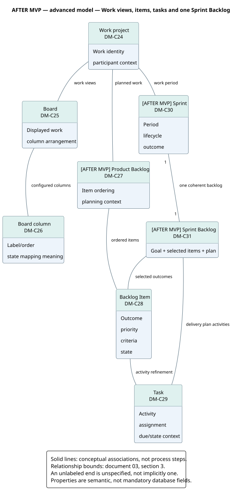

[PNG](../diagrams/domain-work-management.png) · [Editable PlantUML](../diagrams/domain-work-management.puml)

A board presents work; it is not a second backlog. A Backlog Item expresses an outcome and acceptance meaning, while a Task expresses an activity. One Sprint Backlog comprises goal, selected items and delivery plan. Product work management differs from the board used to develop Resumefolio.

**Primary basis:** [PKS-D01](../../02-requirements-engineering/03-requirements-specification/projects-kanban-and-sprints.md#pks-d01-project-and-board-context), [PKS-D02](../../02-requirements-engineering/03-requirements-specification/projects-kanban-and-sprints.md#pks-d02-configurable-columns-and-valid-work-movement), [PKS-D03](../../02-requirements-engineering/03-requirements-specification/projects-kanban-and-sprints.md#pks-d03-product-backlog-and-item-definition), [PKS-D04](../../02-requirements-engineering/03-requirements-specification/projects-kanban-and-sprints.md#pks-d04-item-refinement-and-task-relationships), [PKS-D05](../../02-requirements-engineering/03-requirements-specification/projects-kanban-and-sprints.md#pks-d05-assignment-priority-and-due-date-handling), [PKS-D06](../../02-requirements-engineering/03-requirements-specification/projects-kanban-and-sprints.md#pks-d06-scoped-collaboration-and-membership-changes), [PKS-D07](../../02-requirements-engineering/03-requirements-specification/projects-kanban-and-sprints.md#pks-d07-sprint-goal-and-selected-backlog-items), [PKS-D08](../../02-requirements-engineering/03-requirements-specification/projects-kanban-and-sprints.md#pks-d08-one-coherent-sprint-backlog), [PKS-D09](../../02-requirements-engineering/03-requirements-specification/projects-kanban-and-sprints.md#pks-d09-explicit-completion-and-sprint-end-outcomes), [PKS-D10](../../02-requirements-engineering/03-requirements-specification/projects-kanban-and-sprints.md#pks-d10-deliberate-cross-module-links-reports-and-automation).

| Local element | Meaning / responsibility | Conceptual information and domain actions | Exact primary basis |
| --- | --- | --- | --- |
| DM-C24 — Work project | Authorized work organization, distinct from professional projects and Git repositories. | Work identity; participant context. Actions: Organize permitted work. | [PKS-D01](../../02-requirements-engineering/03-requirements-specification/projects-kanban-and-sprints.md#pks-d01-project-and-board-context), [PKS-D06](../../02-requirements-engineering/03-requirements-specification/projects-kanban-and-sprints.md#pks-d06-scoped-collaboration-and-membership-changes) |
| DM-C25 — Board | Organized work view, not another Product or Sprint Backlog. | Displayed work; column arrangement. Actions: Configure view; request movement. | [PKS-D01](../../02-requirements-engineering/03-requirements-specification/projects-kanban-and-sprints.md#pks-d01-project-and-board-context), [PKS-D02](../../02-requirements-engineering/03-requirements-specification/projects-kanban-and-sprints.md#pks-d02-configurable-columns-and-valid-work-movement) |
| DM-C26 — Board column | Configured display organization whose movement rules agree with actual work states. | Label/order; state mapping meaning. Actions: Configure; map valid movement. | [PKS-D02](../../02-requirements-engineering/03-requirements-specification/projects-kanban-and-sprints.md#pks-d02-configurable-columns-and-valid-work-movement) |
| DM-C27 — Product Backlog | Ordered planned outcomes/work in an authorized work context. | Item ordering; planning context. Actions: Add; order; refine items. | [PKS-D03](../../02-requirements-engineering/03-requirements-specification/projects-kanban-and-sprints.md#pks-d03-product-backlog-and-item-definition)  **Advanced paths after MVP; any retained core/basic path follows the release register.** |
| DM-C28 — Backlog Item | Planned outcome with criteria; not interchangeable with a Task or repository Issue. | Outcome; priority; criteria; state. Actions: Refine; select; evaluate completion. | [PKS-D03](../../02-requirements-engineering/03-requirements-specification/projects-kanban-and-sprints.md#pks-d03-product-backlog-and-item-definition), [PKS-D04](../../02-requirements-engineering/03-requirements-specification/projects-kanban-and-sprints.md#pks-d04-item-refinement-and-task-relationships), [PKS-D09](../../02-requirements-engineering/03-requirements-specification/projects-kanban-and-sprints.md#pks-d09-explicit-completion-and-sprint-end-outcomes)  **Advanced paths after MVP; any retained core/basic path follows the release register.** |
| DM-C29 — Task | Specific activity contributing to work with its own assignment/completion meaning. | Activity; assignment; due/state context. Actions: Assign; update; complete activity. | [PKS-D04](../../02-requirements-engineering/03-requirements-specification/projects-kanban-and-sprints.md#pks-d04-item-refinement-and-task-relationships), [PKS-D05](../../02-requirements-engineering/03-requirements-specification/projects-kanban-and-sprints.md#pks-d05-assignment-priority-and-due-date-handling)  **Advanced paths after MVP; any retained core/basic path follows the release register.** |
| DM-C30 — Sprint | Work period with goal and actual outcome; elapsed time does not imply success. | Period; lifecycle; outcome. Actions: Start; adapt; end under authority. | [PKS-D07](../../02-requirements-engineering/03-requirements-specification/projects-kanban-and-sprints.md#pks-d07-sprint-goal-and-selected-backlog-items), [PKS-D09](../../02-requirements-engineering/03-requirements-specification/projects-kanban-and-sprints.md#pks-d09-explicit-completion-and-sprint-end-outcomes)  **Advanced paths after MVP; any retained core/basic path follows the release register.** |
| DM-C31 — Sprint Backlog | One coherent meaning comprising goal, selected Backlog Items and delivery plan. | Goal + selected items + plan. Actions: Select work; adapt plan; retain outcome. | [PKS-D07](../../02-requirements-engineering/03-requirements-specification/projects-kanban-and-sprints.md#pks-d07-sprint-goal-and-selected-backlog-items), [PKS-D08](../../02-requirements-engineering/03-requirements-specification/projects-kanban-and-sprints.md#pks-d08-one-coherent-sprint-backlog)  **Advanced paths after MVP; any retained core/basic path follows the release register.** |

**Policy boundary:** Q-D18–Q-D20 propose project/backlog counts, task-parent constraints, canonical states, at most one active Sprint and cross-module links. No mandatory cadence, team or extra delivery staff is inferred.

### 2.5 Real Git and repository collaboration

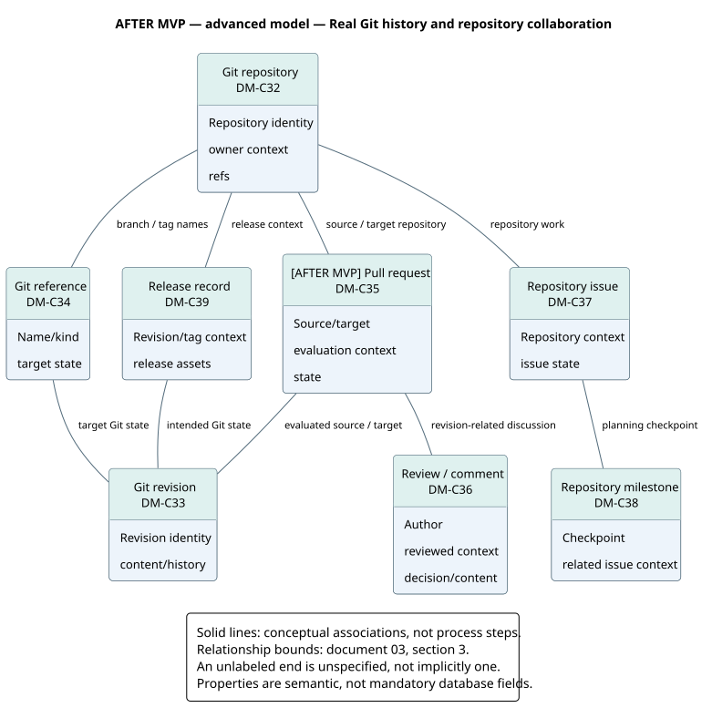

[PNG](../diagrams/domain-git-collaboration.png) · [Editable PlantUML](../diagrams/domain-git-collaboration.puml)

Repository identity, refs and identified revisions are separated so review, merge and execution cannot rely on an ambiguous moving branch name. A fork is another repository with explicit provenance and authority, not an inherited access grant. Issues/milestones differ from work-project items.

**Primary basis:** [GIT-D01](../../02-requirements-engineering/03-requirements-specification/git-hosting-and-collaboration.md#git-d01-repository-creation-and-ownership), [GIT-D02](../../02-requirements-engineering/03-requirements-specification/git-hosting-and-collaboration.md#git-d02-repository-and-ref-authorization), [GIT-D03](../../02-requirements-engineering/03-requirements-specification/git-hosting-and-collaboration.md#git-d03-real-clone-fetch-pull-and-push), [GIT-D04](../../02-requirements-engineering/03-requirements-specification/git-hosting-and-collaboration.md#git-d04-branches-files-and-history-browsing), [GIT-D05](../../02-requirements-engineering/03-requirements-specification/git-hosting-and-collaboration.md#git-d05-fork-provenance-and-permission-boundaries), [GIT-D06](../../02-requirements-engineering/03-requirements-specification/git-hosting-and-collaboration.md#git-d06-pull-requests-comments-and-review), [GIT-D07](../../02-requirements-engineering/03-requirements-specification/git-hosting-and-collaboration.md#git-d07-controlled-merge-and-conflict-outcomes), [GIT-D08](../../02-requirements-engineering/03-requirements-specification/git-hosting-and-collaboration.md#git-d08-issues-and-milestones), [GIT-D09](../../02-requirements-engineering/03-requirements-specification/git-hosting-and-collaboration.md#git-d09-tags-and-releases).

| Local element | Meaning / responsibility | Conceptual information and domain actions | Exact primary basis |
| --- | --- | --- | --- |
| DM-C32 — Git repository | Real hosted content/history under repository-specific authority. | Repository identity; owner context; refs. Actions: Create; authorize real Git operations. | [GIT-D01](../../02-requirements-engineering/03-requirements-specification/git-hosting-and-collaboration.md#git-d01-repository-creation-and-ownership), [GIT-D02](../../02-requirements-engineering/03-requirements-specification/git-hosting-and-collaboration.md#git-d02-repository-and-ref-authorization), [GIT-D03](../../02-requirements-engineering/03-requirements-specification/git-hosting-and-collaboration.md#git-d03-real-clone-fetch-pull-and-push) |
| DM-C33 — Git revision | Identified repository content/history state used in browsing, review and execution. | Revision identity; content/history. Actions: Identify; compare; browse. | [GIT-D04](../../02-requirements-engineering/03-requirements-specification/git-hosting-and-collaboration.md#git-d04-branches-files-and-history-browsing), [YML-D03](../../02-requirements-engineering/03-requirements-specification/yaml-workflows-and-cicd.md#yml-d03-run-identity-and-reproducible-context)  **After MVP.** |
| DM-C34 — Git reference | Named branch or tag associated with Git history; ref names differ from identified revisions. | Name/kind; target state. Actions: Create/update under ref authority. | [GIT-D02](../../02-requirements-engineering/03-requirements-specification/git-hosting-and-collaboration.md#git-d02-repository-and-ref-authorization), [GIT-D04](../../02-requirements-engineering/03-requirements-specification/git-hosting-and-collaboration.md#git-d04-branches-files-and-history-browsing), [GIT-D09](../../02-requirements-engineering/03-requirements-specification/git-hosting-and-collaboration.md#git-d09-tags-and-releases)  **Advanced paths after MVP; any retained core/basic path follows the release register.** |
| DM-C35 — Pull request | Proposed integration with explicit source/target repository/ref and evaluated revision context. | Source/target; evaluation context; state. Actions: Open; discuss; request controlled merge. | [GIT-D06](../../02-requirements-engineering/03-requirements-specification/git-hosting-and-collaboration.md#git-d06-pull-requests-comments-and-review), [GIT-D07](../../02-requirements-engineering/03-requirements-specification/git-hosting-and-collaboration.md#git-d07-controlled-merge-and-conflict-outcomes)  **Advanced paths after MVP; any retained core/basic path follows the release register.** |
| DM-C36 — Review / comment | Attributed discussion/review of an intended request/revision, not universal merge permission. | Author; reviewed context; decision/content. Actions: Comment; submit review. | [GIT-D06](../../02-requirements-engineering/03-requirements-specification/git-hosting-and-collaboration.md#git-d06-pull-requests-comments-and-review), [GIT-D07](../../02-requirements-engineering/03-requirements-specification/git-hosting-and-collaboration.md#git-d07-controlled-merge-and-conflict-outcomes)  **Advanced paths after MVP; any retained core/basic path follows the release register.** |
| DM-C37 — Repository issue | Repository work/discussion record distinct from a work-project Backlog Item. | Repository context; issue state. Actions: Record; discuss; update. | [GIT-D08](../../02-requirements-engineering/03-requirements-specification/git-hosting-and-collaboration.md#git-d08-issues-and-milestones) |
| DM-C38 — Repository milestone | Repository planning checkpoint for related issue work. | Checkpoint; related issue context. Actions: Organize repository planning. | [GIT-D08](../../02-requirements-engineering/03-requirements-specification/git-hosting-and-collaboration.md#git-d08-issues-and-milestones) |
| DM-C39 — Release record | Named release tied to intended Git state and protected assets; not deployment authorization. | Revision/tag context; release assets. Actions: Publish/manage under reviewed policy. | [GIT-D09](../../02-requirements-engineering/03-requirements-specification/git-hosting-and-collaboration.md#git-d09-tags-and-releases)  **Advanced paths after MVP; any retained core/basic path follows the release register.** |

**Policy boundary:** Q-D21/Q-D22 retain transport, credential, protection, review and merge proposals. No Git engine, merge strategy or public-visibility policy is selected.

### 2.6 Workflow execution and separate deployment authority

**Release applicability:** future-domain design retained after MVP; core operating/deployment and recovery controls still apply to MVP where relevant.

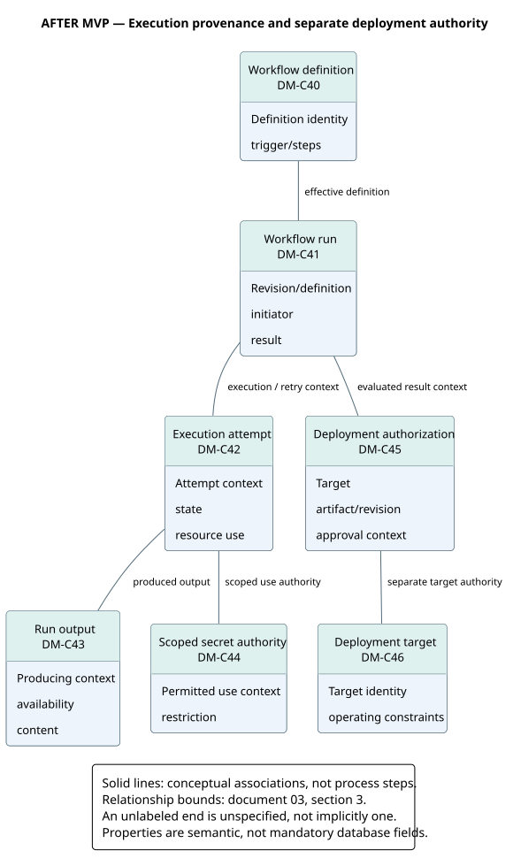

[PNG](../diagrams/domain-execution-and-deployment.png) · [Editable PlantUML](../diagrams/domain-execution-and-deployment.puml)

Validation, run request, actual execution, output and deployment approval remain distinct. Run/attempt is a provisional decomposition for retries and unknown outcomes. Deployment approval names target and exact artifact/revision; job code cannot grant itself that authority.

**Primary basis:** [YML-D01](../../02-requirements-engineering/03-requirements-specification/yaml-workflows-and-cicd.md#yml-d01-defined-supported-workflow-contract), [YML-D02](../../02-requirements-engineering/03-requirements-specification/yaml-workflows-and-cicd.md#yml-d02-explicit-triggers-and-run-authority), [YML-D03](../../02-requirements-engineering/03-requirements-specification/yaml-workflows-and-cicd.md#yml-d03-run-identity-and-reproducible-context), [YML-D04](../../02-requirements-engineering/03-requirements-specification/yaml-workflows-and-cicd.md#yml-d04-isolation-and-untrusted-code-boundary), [YML-D05](../../02-requirements-engineering/03-requirements-specification/yaml-workflows-and-cicd.md#yml-d05-scoped-secrets-and-credentials), [YML-D06](../../02-requirements-engineering/03-requirements-specification/yaml-workflows-and-cicd.md#yml-d06-resource-admission-and-limits), [YML-D07](../../02-requirements-engineering/03-requirements-specification/yaml-workflows-and-cicd.md#yml-d07-truthful-run-and-step-outcomes), [YML-D08](../../02-requirements-engineering/03-requirements-specification/yaml-workflows-and-cicd.md#yml-d08-restricted-logs-and-artifacts), [YML-D09](../../02-requirements-engineering/03-requirements-specification/yaml-workflows-and-cicd.md#yml-d09-cancellation-retry-and-runner-loss-recovery), [YML-D10](../../02-requirements-engineering/03-requirements-specification/yaml-workflows-and-cicd.md#yml-d10-separate-controlled-deployment-stage), [YML-D11](../../02-requirements-engineering/03-requirements-specification/yaml-workflows-and-cicd.md#yml-d11-workspace-cleanup-and-retained-evidence), [YML-D12](../../02-requirements-engineering/03-requirements-specification/yaml-workflows-and-cicd.md#yml-d12-feasibility-operational-guidance-and-enabling-gate).

| Local element | Meaning / responsibility | Conceptual information and domain actions | Exact primary basis |
| --- | --- | --- | --- |
| DM-C40 — Workflow definition | Supported YAML behavior at identified definition/code context; validation is not execution. | Definition identity; trigger/steps. Actions: Validate definition; evaluate eligibility. | [YML-D01](../../02-requirements-engineering/03-requirements-specification/yaml-workflows-and-cicd.md#yml-d01-defined-supported-workflow-contract), [YML-D02](../../02-requirements-engineering/03-requirements-specification/yaml-workflows-and-cicd.md#yml-d02-explicit-triggers-and-run-authority)  **After MVP.** |
| DM-C41 — Workflow run | Authorized execution request with evaluated code/definition and actual result context. | Revision/definition; initiator; result. Actions: Request; reconcile execution outcome. | [YML-D02](../../02-requirements-engineering/03-requirements-specification/yaml-workflows-and-cicd.md#yml-d02-explicit-triggers-and-run-authority), [YML-D03](../../02-requirements-engineering/03-requirements-specification/yaml-workflows-and-cicd.md#yml-d03-run-identity-and-reproducible-context), [YML-D07](../../02-requirements-engineering/03-requirements-specification/yaml-workflows-and-cicd.md#yml-d07-truthful-run-and-step-outcomes)  **After MVP.** |
| DM-C42 — Execution attempt | Candidate retry/execution distinction so earlier failed/unknown work is not silently rewritten. | Attempt context; state; resource use. Actions: Start; cancel; reconcile; retry explicitly. | [YML-D07](../../02-requirements-engineering/03-requirements-specification/yaml-workflows-and-cicd.md#yml-d07-truthful-run-and-step-outcomes), [YML-D09](../../02-requirements-engineering/03-requirements-specification/yaml-workflows-and-cicd.md#yml-d09-cancellation-retry-and-runner-loss-recovery)  **After MVP.** |
| DM-C43 — Run output | Logs/artifacts attributable to a producing execution context with protected access/lifecycle. | Producing context; availability; content. Actions: Expose permitted output; clean eligible data. | [YML-D08](../../02-requirements-engineering/03-requirements-specification/yaml-workflows-and-cicd.md#yml-d08-restricted-logs-and-artifacts), [YML-D11](../../02-requirements-engineering/03-requirements-specification/yaml-workflows-and-cicd.md#yml-d11-workspace-cleanup-and-retained-evidence)  **After MVP.** |
| DM-C44 — Scoped secret authority | Permission to use a secret for a specific repository/event/target; no secret values are modeled. | Permitted use context; restriction. Actions: Evaluate use authority; revoke. | [YML-D05](../../02-requirements-engineering/03-requirements-specification/yaml-workflows-and-cicd.md#yml-d05-scoped-secrets-and-credentials)  **After MVP.** |
| DM-C45 — Deployment authorization | Separate explicit approval for target and exact revision/artifact, not implied by a successful run. | Target; artifact/revision; approval context. Actions: Approve/reject intended deployment. | [YML-D10](../../02-requirements-engineering/03-requirements-specification/yaml-workflows-and-cicd.md#yml-d10-separate-controlled-deployment-stage)  **After MVP.** |
| DM-C46 — Deployment target | Intended environment whose effects and recovery conditions require review. | Target identity; operating constraints. Actions: Evaluate authorized deployment outcome. | [YML-D10](../../02-requirements-engineering/03-requirements-specification/yaml-workflows-and-cicd.md#yml-d10-separate-controlled-deployment-stage), [YML-D12](../../02-requirements-engineering/03-requirements-specification/yaml-workflows-and-cicd.md#yml-d12-feasibility-operational-guidance-and-enabling-gate)  **After MVP.** |

**Policy boundary:** Q-D23 remains evidence-gated. Syntax, limits, job/step detail, run/attempt structure and isolation need review/evidence. Real execution remains in scope but is not enabled or proven by this diagram; no runner is placed on the existing host.

### 2.7 Shared access, files and recoverable operation

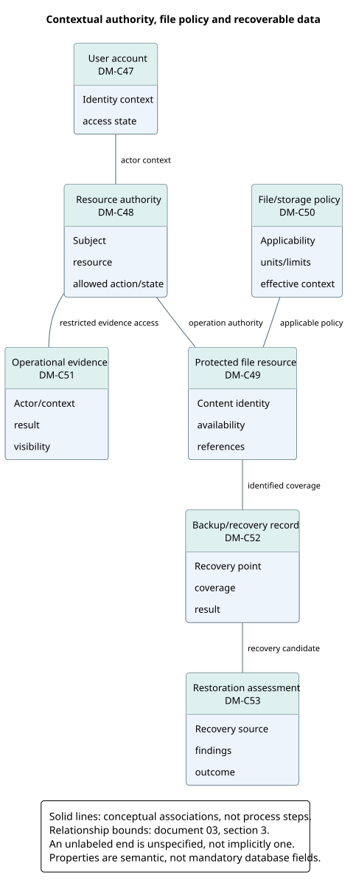

[PNG](../diagrams/domain-access-files-and-recovery.png) · [Editable PlantUML](../diagrams/domain-access-files-and-recovery.puml)

Resource authority applies across domain resources; the file edge is an example. Protected file resource is a shared access/reference meaning, not a requirement that Git objects, mail attachments and resume files use one storage engine or quota pool. Recovery records are not public presentation artifacts.

**Primary basis:** [ACC-D01](../../02-requirements-engineering/03-requirements-specification/accounts-authentication-and-permissions.md#acc-d01-individual-account-context), [ACC-D03](../../02-requirements-engineering/03-requirements-specification/accounts-authentication-and-permissions.md#acc-d03-resource-and-operation-authorization), [ACC-D05](../../02-requirements-engineering/03-requirements-specification/accounts-authentication-and-permissions.md#acc-d05-limited-collaboration-authority), [ACC-D09](../../02-requirements-engineering/03-requirements-specification/accounts-authentication-and-permissions.md#acc-d09-explicit-administrative-powers), [ACC-D10](../../02-requirements-engineering/03-requirements-specification/accounts-authentication-and-permissions.md#acc-d10-authorization-of-access-grant-changes), [ACC-D12](../../02-requirements-engineering/03-requirements-specification/accounts-authentication-and-permissions.md#acc-d12-end-of-access-and-lifecycle-enforcement), [AFO-D01](../../02-requirements-engineering/03-requirements-specification/administration-files-and-operational-behavior.md#afo-d01-owner-configurable-upload-and-storage-policy), [AFO-D02](../../02-requirements-engineering/03-requirements-specification/administration-files-and-operational-behavior.md#afo-d02-policy-consistent-with-evaluated-infrastructure), [AFO-D03](../../02-requirements-engineering/03-requirements-specification/administration-files-and-operational-behavior.md#afo-d03-per-file-admission-limit), [AFO-D04](../../02-requirements-engineering/03-requirements-specification/administration-files-and-operational-behavior.md#afo-d04-aggregate-quota-and-concurrent-admission), [AFO-D06](../../02-requirements-engineering/03-requirements-specification/administration-files-and-operational-behavior.md#afo-d06-file-resource-authorization-and-isolation), [AFO-D10](../../02-requirements-engineering/03-requirements-specification/administration-files-and-operational-behavior.md#afo-d10-administrative-operation-evidence), [QSR-D10](../../02-requirements-engineering/03-requirements-specification/quality-security-and-recovery-requirements.md#qsr-d10-defined-protected-and-observable-backups), [QSR-D11](../../02-requirements-engineering/03-requirements-specification/quality-security-and-recovery-requirements.md#qsr-d11-demonstrated-restoration-and-recovery-targets), [QSR-D12](../../02-requirements-engineering/03-requirements-specification/quality-security-and-recovery-requirements.md#qsr-d12-safe-restored-access-and-external-state-reconciliation), [QSR-D13](../../02-requirements-engineering/03-requirements-specification/quality-security-and-recovery-requirements.md#qsr-d13-useful-restricted-operational-evidence).

| Local element | Meaning / responsibility | Conceptual information and domain actions | Exact primary basis |
| --- | --- | --- | --- |
| DM-C47 — User account | Individual application identity and account state; role names do not grant universal access. | Identity context; access state. Actions: Identify actor; apply account lifecycle. | [ACC-D01](../../02-requirements-engineering/03-requirements-specification/accounts-authentication-and-permissions.md#acc-d01-individual-account-context), [ACC-D02](../../02-requirements-engineering/03-requirements-specification/accounts-authentication-and-permissions.md#acc-d02-unified-sign-in-across-authorized-sections), [ACC-D12](../../02-requirements-engineering/03-requirements-specification/accounts-authentication-and-permissions.md#acc-d12-end-of-access-and-lifecycle-enforcement) |
| DM-C48 — Resource authority | Role/permission, invitation or membership meaning for actor/resource/action/state; not an ACL schema. | Subject; resource; allowed action/state. Actions: Evaluate; grant/revoke under authority. | [ACC-D03](../../02-requirements-engineering/03-requirements-specification/accounts-authentication-and-permissions.md#acc-d03-resource-and-operation-authorization), [ACC-D05](../../02-requirements-engineering/03-requirements-specification/accounts-authentication-and-permissions.md#acc-d05-limited-collaboration-authority), [ACC-D09](../../02-requirements-engineering/03-requirements-specification/accounts-authentication-and-permissions.md#acc-d09-explicit-administrative-powers), [ACC-D10](../../02-requirements-engineering/03-requirements-specification/accounts-authentication-and-permissions.md#acc-d10-authorization-of-access-grant-changes) |
| DM-C49 — Protected file resource | Admitted content identity with its domain access/reference meaning; not a common storage engine. | Content identity; availability; references. Actions: Admit; retrieve; replace; retire. | [AFO-D03](../../02-requirements-engineering/03-requirements-specification/administration-files-and-operational-behavior.md#afo-d03-per-file-admission-limit), [AFO-D05](../../02-requirements-engineering/03-requirements-specification/administration-files-and-operational-behavior.md#afo-d05-supported-content-and-validation), [AFO-D06](../../02-requirements-engineering/03-requirements-specification/administration-files-and-operational-behavior.md#afo-d06-file-resource-authorization-and-isolation), [AFO-D07](../../02-requirements-engineering/03-requirements-specification/administration-files-and-operational-behavior.md#afo-d07-truthful-completion-and-interrupted-operation-handling) |
| DM-C50 — File/storage policy | Effective admission/accounting rules within an evaluated resource envelope. | Applicability; units/limits; effective context. Actions: Configure; evaluate policy. | [AFO-D01](../../02-requirements-engineering/03-requirements-specification/administration-files-and-operational-behavior.md#afo-d01-owner-configurable-upload-and-storage-policy), [AFO-D02](../../02-requirements-engineering/03-requirements-specification/administration-files-and-operational-behavior.md#afo-d02-policy-consistent-with-evaluated-infrastructure), [AFO-D04](../../02-requirements-engineering/03-requirements-specification/administration-files-and-operational-behavior.md#afo-d04-aggregate-quota-and-concurrent-admission) |
| DM-C51 — Operational evidence | Restricted evidence of selected sensitive/administrative outcomes, not blanket content logging. | Actor/context; result; visibility. Actions: Record specified evidence; inspect permitted records. | [AFO-D10](../../02-requirements-engineering/03-requirements-specification/administration-files-and-operational-behavior.md#afo-d10-administrative-operation-evidence), [QSR-D13](../../02-requirements-engineering/03-requirements-specification/quality-security-and-recovery-requirements.md#qsr-d13-useful-restricted-operational-evidence) |
| DM-C52 — Backup/recovery record | Identity, coverage and access context of recoverable material; existence is not restoration proof. | Recovery point; coverage; result. Actions: Identify coverage; record backup outcome. | [QSR-D10](../../02-requirements-engineering/03-requirements-specification/quality-security-and-recovery-requirements.md#qsr-d10-defined-protected-and-observable-backups) |
| DM-C53 — Restoration assessment | Evaluation of restored integrity, access and external-state reconciliation. | Recovery source; findings; outcome. Actions: Assess recovery; report actual result. | [QSR-D11](../../02-requirements-engineering/03-requirements-specification/quality-security-and-recovery-requirements.md#qsr-d11-demonstrated-restoration-and-recovery-targets), [QSR-D12](../../02-requirements-engineering/03-requirements-specification/quality-security-and-recovery-requirements.md#qsr-d12-safe-restored-access-and-external-state-reconciliation) |

**Policy boundary:** Q-D03–Q-D05 and Q-D24–Q-D27 retain detailed grants, quota applicability, retention and operational proposals. Backups are not configured; a backup record cannot substitute for demonstrated restoration.

## 3. Named Relationships and Bounds

The answer package supplies usable proposals. Unspecified numeric multiplicity means the model can analyze their consequences without presenting them as accepted decisions. Relationship names below complement the pictures, including deliberate omissions for readability.

| Relationship | Domain meaning | Bounds / unresolved detail | Source and status |
| --- | --- | --- | --- |
| Account — profile — resume | Reusable information supports independent tailored resumes | One profile per account/many resumes is Q-D06's proposal; no accepted account-wide resume maximum | PRP-D01–D04; accepted Q-D07 core controls change |
| Profile — professional entry | Source information includes experience, education, skills and professional projects | Required fields, category structure and per-entry counts remain proposed | PRP-D01/D05; Q-D06 |
| Resume — selection — source entry | Identifies reused information without automatic propagation | Representation and source deletion/removal behavior remain open | PRP-D02/D04; accepted core plus remaining Q-D07 |
| Resume — independent override | Tailoring belongs to its specific resume context | Granularity, reset-to-source and conflict reconciliation remain detailed proposals | PRP-D03/D04; Q-D06/Q-D07 |
| Evidence — entry — resume selection | Supporting competence and disclosure are separate relationships | Several supporting associations, ordering/default selection and removal rules retain proposal status | PRP-D05/D06; Q-D08 |
| Source/resume — language content | Manually maintained English/German information | Which fields vary, completeness and fallback remain proposed; no automatic translation | PRP-D07; Q-D09 |
| Resume — publication | Separate confirmed publication controls the effective presentation | No snapshot implementation, old-revision count or retention period is chosen | PRP-D04; accepted core; PDF-D07/Q-D10 |
| Resume/publication — generated/uploaded PDF | Different provenance and intended content/language | Neither representation is assumed to exist for every resume; generation timing/version counts remain proposed | PDF-D01/D02/D07; Q-D10 |
| Resume — download availability | Generated/uploaded/both/neither modes are in scope | Configuration neither creates a missing artifact nor grants access; absent-language details remain proposed | DEC-025; PDF-D03/D05; Q-D09/Q-D10 |
| Link — intended presentation | Protected access to selected content without a viewer account | Link count/expiry/session/in-flight behavior remains at Q-D05/Q-D11 | PDF-D04/D06 |
| Company — opportunity — application | Organization/role context for manual application work | Reuse, duplicate handling, counts and required fields remain proposed | APP-D01/D02; Q-D12 |
| Application — submission — captured material | Actual history remains independent of live editable content | Repeated submission events, incomplete capture and corrections retain proposal status | APP-D05–D07; accepted preservation boundary |
| Application — message/activity | Explicit links identify relevant permitted records | No automatic grant, ownership transfer, progress transition or sending | APP-D08; EGC-D09; Q-D20  **After MVP.** |
| Provider connection — correspondence/activity | Intended user/account and granted scope govern operations | Connection counts, local/provider field authority, sync and reconnect are proposed details | EGC-D01/D08/D11; Q-D15–Q-D17  **After MVP.** |
| Work project — board/backlog/Sprint | Work organization with distinct views and planning contexts | One Product Backlog/project, board counts and active-Sprint maximum remain proposals | PKS-D01/D03/D07; Q-D18/Q-D19 |
| Board/column — displayed work | A view represents permitted items/tasks and movement semantics | Card representation is not a required entity; state/column mapping remains proposed | PKS-D02/D04; Q-D18 |
| Backlog Item — task | Outcome can be refined into activities | At most one parent item and optional standalone tasks remain proposals, not class inheritance | PKS-D04/D09; Q-D18/Q-D19  **Advanced paths after MVP; any retained core/basic path follows the release register.** |
| Sprint — Sprint Backlog | One coherent goal + selected items + delivery plan | Scope meaning is established; no fixed cadence, mandatory task count or physical composition follows | DEC-021; PKS-D07/D08  **Advanced paths after MVP; any retained core/basic path follows the release register.** |
| Repository — repository (fork) | Another repository retains explicit upstream provenance | Private visibility, lifetime and revocation effects need explicit rules; no inherited authority | GIT-D05; Q-D22  **Advanced paths after MVP; any retained core/basic path follows the release register.** |
| Repository — ref — revision | Names identify history states without equating moving refs to evaluated revisions | Transport, protection, update and concurrency policies remain proposed/design-dependent | GIT-D02–D04/D09; Q-D21/Q-D22 |
| Pull request — source/target — review | Source and target may be in one or different repositories, with evaluated revisions | Review validity/counts and merge strategy remain proposed; no extra reviewer is invented | GIT-D06/D07; Q-D22  **Advanced paths after MVP; any retained core/basic path follows the release register.** |
| Repository issue — work item | Distinct concepts may have intentional links | No automatic equivalence, cross-context deletion or authority follows the association | GIT-D08; PKS-D10; Q-D20  **Advanced paths after MVP; any retained core/basic path follows the release register.** |
| Definition — run — attempt — output | Identify effective code/definition and actual execution/retry outcomes | Attempt decomposition, job/step detail and numerical limits retain Q-D23 status | YML-D03/D07–D09  **After MVP.** |
| Run/result — approval — target | A result can inform a separately authorized deployment | Approval validity/counts/expiry after changed inputs require contracts/design review | YML-D10; Q-D23  **After MVP.** |
| File — policy — references | Admission/access/accounting use applicable policy and live/history references | Git objects, job output, mail attachments and resume media do not automatically share one storage/quota pool | AFO-D02–D08; Q-D24 |
| Recovery record — restoration assessment | Candidate backup and demonstrated consistent recovery differ | Destination, coverage, retention and targets remain evidence-gated; backups not configured | QSR-D10–D12; Q-D26 |

### Cross-View Links Omitted from Individual Diagrams

Application associates its intended Tailored resume (APP-D02), while Preserved submitted material identifies the actual submitted content or rendition (APP-D06), not an arbitrary current PDF. Workflow run identifies the Repository/Git revision and effective definition (YML-D03). Release assets, run artifacts and submitted documents retain their own content/reference authority. Resource authority applies to resumes, applications, mail, work, repositories, runs, administration and recovery where required; the diagram's file edge is only an example. Fork provenance is the repository self-association described above.

## 4. Information Authority and Change Impact

| Change / domain operation | Intended effect | Independent information that must survive | Remaining detailed policy |
| --- | --- | --- | --- |
| Edit shared information | Modify profile/source | Existing resumes, published views, overrides and actual submitted material | Source deletion and concurrent reconciliation |
| Preview/apply selected source change | Modify the intended resume through explicit owner choice | Other resumes, independent text and publication until separately confirmed | Field-level conflicts and source-provenance representation |
| Confirm publication | Modify effective selected presentation | Historical actual submissions and unrelated publications | Version retention, unavailable/stale rendition timing |
| Replace evidence/uploaded PDF | Modify a live association under admission rules | Other language/resume contexts and preserved actual material | Failure/retirement/invalidation rules |
| Save PDF availability | Modify intended eligible downloads | Do not disable link merely because settings were saved | Active-session/cache/in-flight retrieval |
| Disable link/change password | Modify the intended access path | Private contexts and unrelated links/grants; already delivered bytes cannot be recalled | Exact subsequent-session/retrieval effects |
| Record/correct actual submission | Identify actual event/material completeness and correction history | Do not substitute current source for captured actual documents | Capture, correction, deletion and retention |
| Link mail/activity to application | Associate intended permitted contexts | Mail/provider authority and application progress remain separate | Sync, deletion and uncertain-send/retry behavior |
| Move work/complete task/end Sprint | Report authorized work change and actual outcome | Card movement/task completion does not alone accept an item or satisfy goal | States, completion authority and carry-over |
| Push/fork/review/merge/release | Report actual repository/ref/review result | Do not implicitly accept work, send mail or deploy | Protection/review policy and client interoperability |
| Run/retry/cancel execution | Identify intended attempt and actual/unknown result | Prior results, unrelated resources and deployment approval | Isolation, side effects, runner loss and capacity fit |
| Change quota/clean material/restore | Apply authorized effective policy/recovery decisions | Required references, actual history, current access and external state | Accounting, eligibility, recovery target/evidence |

## 5. Candidate Invariants and Concurrency Review

These local analysis obligations support cross-view review. Accepted-core rows reflect the actual owner decision. Other rows derive from scope and proposed requirements; precise detailed contracts retain primary-source status. Review cases are planned, not executed software tests.

| Local invariant | Status / primary basis | Review example |
| --- | --- | --- |
| DM-I01 — No automatic resume/live change from source editing | Accepted core; PRP-D04-AC01 | Edit a source reused in two resumes; neither draft nor live presentation changes automatically |
| DM-I02 — Explicit selected apply preserves overrides and other resumes | Accepted core; PRP-D04-AC01 | Apply to A while preserving independent text and B's content |
| DM-I03 — Apply/save differs from separately confirmed publication | Accepted core; PRP-D04-AC01 | Apply changes; employer view remains unchanged until confirmed publish |
| DM-I04 — Later editing/publication preserves actual submitted documents | Accepted core; PRP-D04-AC01, APP-D06 | Capture actual material, then edit and publish; history stays independent |
| DM-I05 — Evidence existence is not disclosure permission | Source-derived; PRP-D06, PDF-D04/D05 | Request an unselected evidence file via modified direct reference |
| DM-I06 — Download needs authorization, mode/language and actual availability | Source-derived; PDF-D03/D05/D07 | Review four modes against missing, processing and mismatched artifacts |
| DM-I07 — PDF settings do not implicitly disable sharing | Source-derived distinct operations; PDF-D03/D06 | Save settings; separately request disable; inspect independent effects |
| DM-I08 — Identity, membership and links are not universal authority | Source-derived; ACC-D03/D04/D05, EGC-D09 | Attempt unrelated resume, mailbox, repository and output access  **After MVP.** |
| DM-I09 — Provider acceptance, delivery/read and unknown are different facts | Source-derived; EGC-D05/D12, EIF-D08 | Send timeout must not imply delivered or safe automatic resend  **After MVP.** |
| DM-I10 — One coherent Sprint Backlog means goal/items/plan | Accepted scope meaning; DEC-021, PKS-D08 | Compare planning views without inventing a second Sprint Backlog  **Advanced paths after MVP; any retained core/basic path follows the release register.** |
| DM-I11 — Task completion, item acceptance and Sprint outcome differ | Source-derived; PKS-D04/D09 | Complete tasks with unmet item criteria; do not infer accepted outcome  **Advanced paths after MVP; any retained core/basic path follows the release register.** |
| DM-I12 — Ref names, evaluated revisions, review and deploy authority differ | Source-derived; GIT-D06/D07, YML-D03/D10 | Change source/target after review; inspect validity before merge/deploy  **After MVP.** |
| DM-I13 — Valid YAML or push permission is not safe execution authority | Source-derived; YML-D02/D04/D05/D06 | Denied resource/isolation/secret conditions cannot yield authorized execution  **After MVP.** |
| DM-I14 — Cleanup/accounting respect references and actual completion | Source-derived; AFO-D04/D07/D08/D11 | Competing admission/removal must not invent free capacity or destroy required history |
| DM-I15 — Backup identity differs from safe consistent restoration | Source-derived; QSR-D10/D11/D12 | Reconcile access/deletion/external state before claiming successful recovery |

### Competing Operations for Behavioral Modeling

| Competing actions | Question to resolve | Primary question / downstream views |
| --- | --- | --- |
| Source apply versus override edit | Which preview/input is still current, without lost independent text? | Remaining Q-D07; scenarios/state/contracts |
| Publish versus artifact replacement | Which revision/content is effective and available after failure? | Q-D08/Q-D10; data/state/contracts |
| Link disable/password rotation versus retrieval | Which session/request remains permitted; which bytes already left control? | Q-D05/Q-D11; access/state/rules |
| Actual capture versus edit/correction | Which actual material was captured, and what is incomplete? | Q-D13/Q-D14; history/contracts |
| Provider send/sync versus disconnect/timeout | What is confirmed, uncertain or stale; what can safely be repeated? | Q-D16/Q-D17; interfaces/provider states |
| Item movement/selection versus Sprint end | Which scope/completion/history is authoritative? | Q-D18/Q-D19; work states/contracts |
| Review/merge versus ref updates | Which evaluated source/target/check is still valid? | Q-D21/Q-D22; Git contracts |
| Cancel/retry versus runner loss/deploy | What actually stopped or had effects; what approval remains valid? | Q-D23; execution states/feasibility |
| Admission/cleanup versus policy change/restore | Which policy, usage, references and restored access apply? | Q-D24/Q-D26; operations/data/contracts |

No locking scheme, transaction boundary or automatic conflict winner is chosen here. Continue provisional modeling; resolve the affected behavior before accepting dependent design.

## 6. Traceability, Remaining Work and Review

| Scope | Principal concepts | Primary basis / diagram |
| --- | --- | --- |
| SCP-01 Accounts/access | User account, Resource authority, Protected employer link | ACC-D01–D12; 2.2/2.7 |
| SCP-02 Profiles/resumes | Profile, Entry, Resume, Selection, Override, Publication | PRP-D01–D04/D08; 2.1/2.2 |
| SCP-03 Supporting evidence | Evidence, Evidence selection, Professional entry | PRP-D05/D06/D09; 2.1 |
| SCP-04 PDFs/languages | Generated/uploaded PDF, Download availability, Language content | PRP-D07, PDF-D01–D03/D07; 2.1/2.2 |
| SCP-05 Protected sharing | Employer link, Publication, PDF availability, Resource authority | PDF-D04–D06, ACC-D06–D08; 2.2/2.7 |
| SCP-06 Applications/history | Company, Opportunity, Application, Letter, Submission, Actual material | APP-D01–D09; 2.3 |
| SCP-07 Mail/calendar | Connection, Message/draft, Activity, Reminder | EGC-D01–D12; 2.3  **After MVP.** |
| SCP-08 Work management | Project, Board/Column, Backlog/Item/Task, Sprint/Backlog | PKS-D01–D11; 2.4 |
| SCP-09 Real Git | Repository, Revision/Ref, PR/Review, Issue/Milestone, Release | GIT-D01–D10; 2.5 |
| SCP-10 Gated real execution | Workflow, Run/Attempt, Output, Secret authority, Deployment/Target | YML-D01–D12; 2.6  **After MVP.** |
| SCP-11 Effective file policy | Protected file, Policy, Authority | AFO-D01–D11; 2.7 |
| SCP-12 Recoverable operation | Evidence, Backup/recovery record, Restoration assessment | AFO-D12, QSR-D10–D14; 2.7 |

Source associations are not proof of complete acceptance-criterion coverage. [Existing criterion locators](../../02-requirements-engineering/06-validation-and-traceability/evidence/proposed-criterion-locators.json) are preserved; exact criterion-to-model coverage belongs in [document 11](../07-review-and-design-handoff/11-model-consistency-traceability-and-review.md). A concept responsibility is not a detailed state or operation contract.

## 7. Review Position and Explicit Limits

- [x] Populate a full-product source-linked concept/responsibility catalog.

- [x] Provide ten editable UML-style conceptual class diagrams and one package diagram with SVG/PNG exports.

- [x] Incorporate accepted profile/apply/publication/history behavior with actual status.

- [x] Distinguish proposed bounds, derived concepts and implementation decisions.

- [x] Define change impact, invariants and competing-operation review cases.

- [ ] Reconcile exact properties/bounds with the conceptual data view and dictionary refinements.

- [ ] Complete coordinated scenario/state/activity/rule views and operation contracts.

- [ ] Complete exact criterion-level cross-view coverage and owner disposition of the identified model.

- [ ] Obtain provider, safe execution and recovery evidence at their dependent gates.

This model is populated for analysis and review. It does not complete the whole System Analysis phase, accept M-02/M-03, implement the product or prove capacity. Existing 2-vCPU/4-GB hosting, OAuth not created, backups not configured and the owner's 20 project hours/week remain known constraints/facts. They do not prevent logical models; they still constrain dependent feasibility and acceptance. The existing Laravel demo is not implementation evidence for this full scope.

## 8. Next Views and Maintenance

Use [04 Functions](../03-functional-and-process-analysis/04-function-oriented-view.md) for transformations/data flows; [05 Data](05-data-oriented-view.md) for identity, bounds, required information and provenance. Use [06 Scenarios](../04-behavioral-and-scenario-analysis/06-scenario-based-view.md), [07 States](../04-behavioral-and-scenario-analysis/07-state-based-view.md), [08 Activities](../03-functional-and-process-analysis/08-control-flow-based-view.md), [09 Rules](../05-business-rules-and-operation-contracts/09-rule-based-view.md) and [10 Contracts](../05-business-rules-and-operation-contracts/10-domain-constraints-and-operation-contracts.md) for observable operation consequences. [12 Interfaces](../06-interfaces-security-and-quality-analysis/12-interfaces-and-external-interactions.md), [13 Quality/operations](../06-interfaces-security-and-quality-analysis/13-security-quality-and-operational-analysis.md) and [14 Handoff](../07-review-and-design-handoff/14-feasibility-dependencies-and-design-handoff.md) retain their cross-cutting responsibility.

Maintain one primary source for each term, obligation and decision. Synchronize changed meanings across concept tables, diagram sources/exports, relationship bounds and downstream views. The [diagram catalog](../diagrams/README.md) lists editable/exported artifacts. No product code, deployment, server configuration, OAuth, backup or execution is changed by this documentation work.

[System Analysis index](../README.md) · [System context](../01-foundations-and-system-context/02-system-context-and-boundaries.md) · [Analysis approach](../01-foundations-and-system-context/01-analysis-purpose-scope-and-approach.md)

## Diagram Types and Reading Guide

Existing class diagrams carry the concept details. Their documented relationship bounds remain authoritative: unspecified ends are not implicitly one. The added detail makes existing file-05 proposed cardinalities visible in UML; do not turn proposals into accepted multiplicities. The package view groups concepts without introducing implementation components.

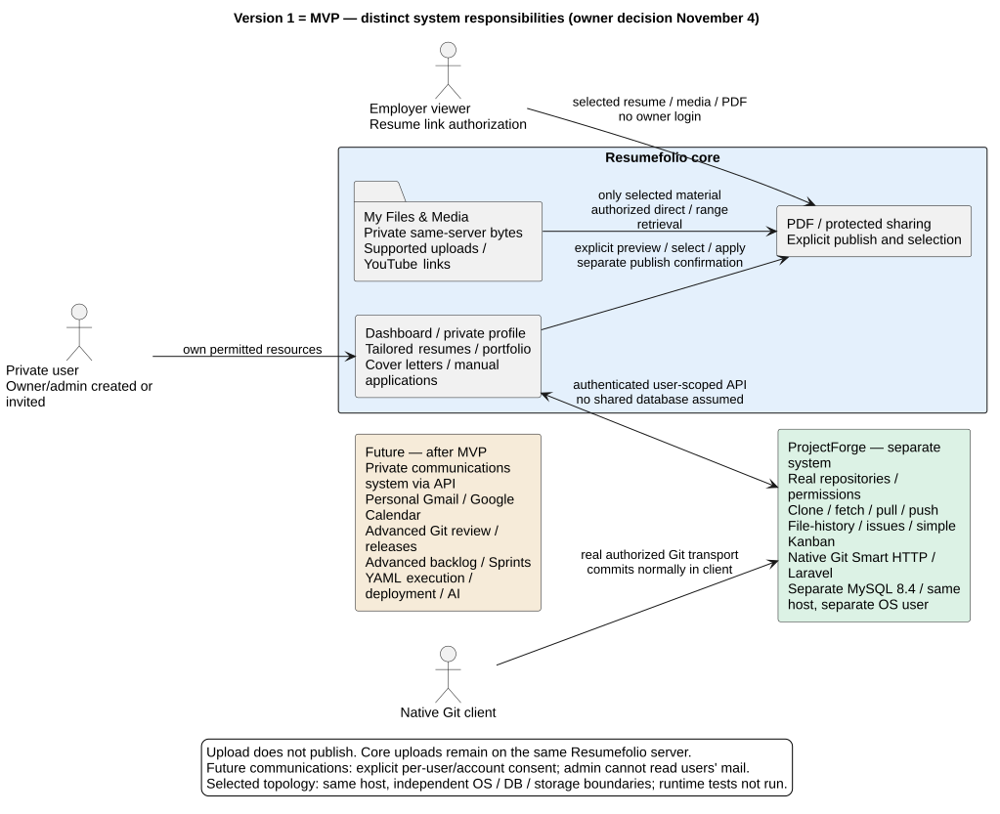

[Editable source](../diagrams/domain-package-responsibilities.puml) · [PNG](../diagrams/domain-package-responsibilities.png)

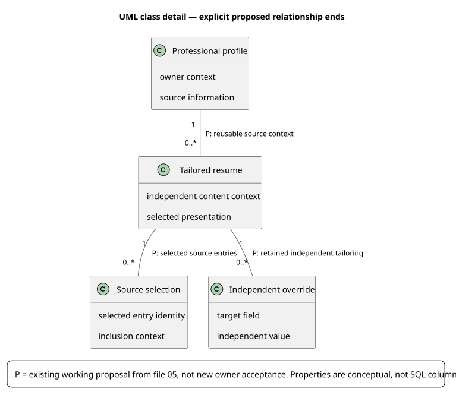

[Editable source](../diagrams/domain-proposed-multiplicity.puml) · [PNG](../diagrams/domain-proposed-multiplicity.png)
