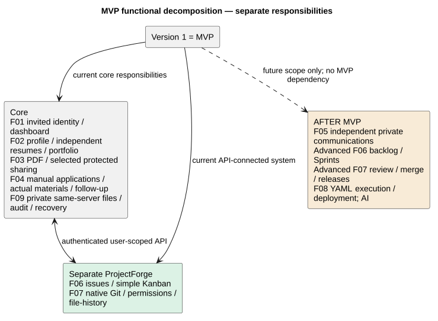
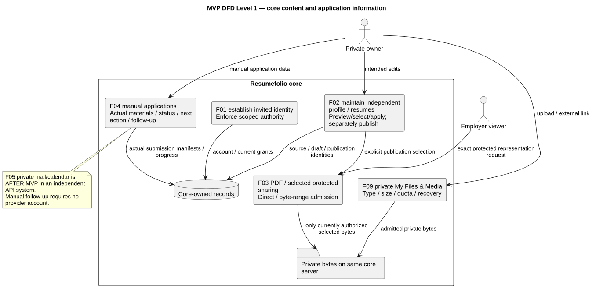
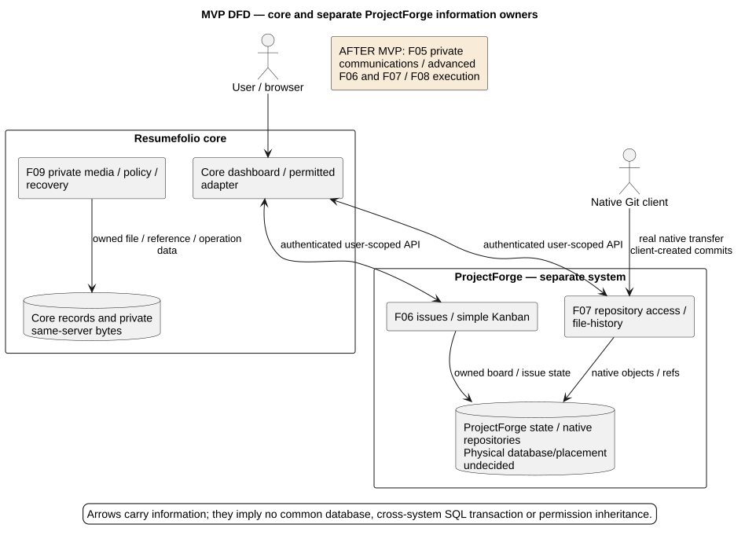
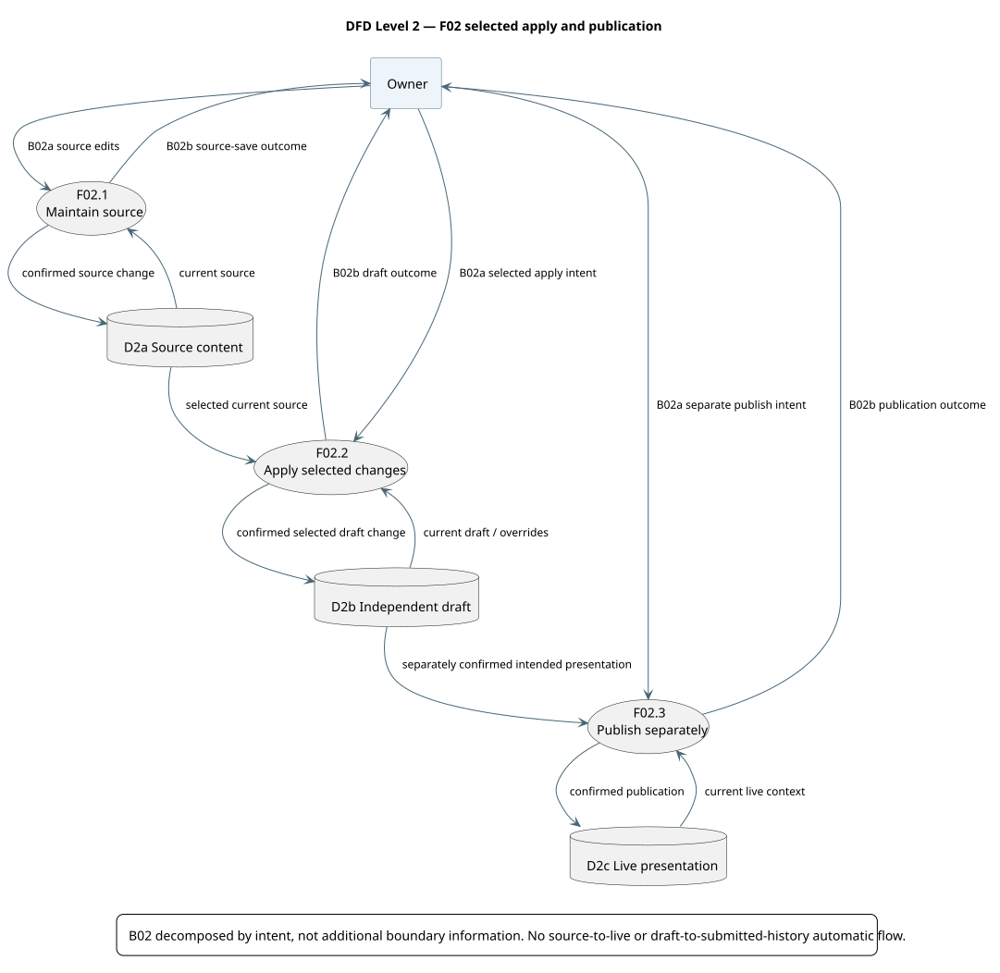

# Resumefolio — Function-Oriented View

[Diagram types and reading guide](#4-process-and-data-flow-models) · [Full diagram catalog](../diagrams/README.md)

Owner: Farhad. Updated: November 1, 2026.

Status: Populated logical analysis; exact criterion sufficiency and owner acceptance remain pending.

## MVP analysis boundary and evidence applicability

The accepted system boundary separates the Resumefolio core from ProjectForge, joined by an authenticated user-scoped API. Logical responsibilities remain useful within each system; they do not authorize a shared core/ProjectForge process, database or transaction. Core owns dashboard, invited accounts, professional presentation, protected sharing, manual applications and same-server private My Files & Media. ProjectForge MVP owns real repositories/transfers/permissions, file/history browsing, issues and simple Kanban. Its engine, deployment and database remain open. The future communications system is independently private and API connected. Advanced Git review/releases, backlog/Sprints and execution/deployment remain deferred. My Files & Media is a core private library with optional per-resume selection. Supported uploads remain in private directories on the same Resumefolio server, with type/size/quota enforcement, safe serving and backup/recovery. Direct, preview and byte-range requests use current owner or selected-resume/viewer authority. Upload does not publish. External YouTube links use simple embedded playback; private uploads are not sent to YouTube. No extra media platform or heavyweight editor/transcoding is selected. Retained mail, advanced review/Sprint and execution models describe future behavior. Historical comparison/evidence results retain their original candidate/date and are not newly executed MVP checks.

Authority: [OWNER-MVP-2026-11-04](../../01-project-planning/owner-mvp-decision-2026-11-04.md).

## Authoritative Inputs

The [distributed SRS](../../02-requirements-engineering/03-requirements-specification/requirements-specification.md), [accepted scope](../../01-project-planning/02-scope.md), [scenarios](../../02-requirements-engineering/04-scenarios-and-models/user-stories-and-scenarios.md), [dictionary](../../02-requirements-engineering/05-data-definitions/README.md) and [decisions](../../02-requirements-engineering/07-change-and-baseline/open-questions-and-decisions.md) own primary meanings. Functions below are analysis responsibilities, not new product requirements, services, tables or selected technology.

## 1. Capability coverage

All nine functional families in the SRS are represented. External-interface, quality, business-rule and domain constraints apply across them rather than becoming an invented tenth product feature. Initial user direction is not a workload or capacity proof. Conditional execution and deployment retain existing prerequisites.

[Editable source](../diagrams/function-decomposition.puml) · [PNG](../diagrams/function-decomposition.png)

## 2. Logical responsibilities

Each record describes a transformation and its information boundary. Primary family links identify source obligations, not a claim of complete criterion coverage.
### Function index

| Function | Responsibility | Logical information |
| --- | --- | --- |
| [F01](#f01) | Establish identity and enforce scoped authority | D1: Identity / scoped grants |
| [F02](#f02) | Maintain independent professional presentation | D2: Professional content / publications |
| [F03](#f03) | Generate PDFs and disclose selected material | D3: Representation / sharing context |
| [F04](#f04) | Manage manual applications and actual history | D4: Applications / submitted history |
| [F05](#f05) | Coordinate authorized mail and calendar | D5: Communication / calendar mappings |
| [F06](#f06) | Organize work and collaboration | D6: Work / Sprint planning |
| [F07](#f07) | Host real Git and repository collaboration | D7: Repositories / review context |
| [F08](#f08) | Admit conditional execution and separate deployment | D8: Attempts / artifacts / target evidence |
| [F09](#f09) | Administer files, policy and recoverable operation | D9: Policy / files / recovery evidence |

### Function details

The source references are listed with each responsibility rather than compressed into a wide table.

#### F01: Establish identity and enforce scoped authority

**Transformation and result:** Actor identity, session or grant request + Current account/grant context → Authorized context or denial; resource checks remain mandatory

**Logical information:** D1: Identity / scoped grants

**Primary requirement references:**

- [ACC-D01](../../02-requirements-engineering/03-requirements-specification/accounts-authentication-and-permissions.md#acc-d01-individual-account-context), [ACC-D02](../../02-requirements-engineering/03-requirements-specification/accounts-authentication-and-permissions.md#acc-d02-unified-sign-in-across-authorized-sections), [ACC-D03](../../02-requirements-engineering/03-requirements-specification/accounts-authentication-and-permissions.md#acc-d03-resource-and-operation-authorization)
- [ACC-D04](../../02-requirements-engineering/03-requirements-specification/accounts-authentication-and-permissions.md#acc-d04-cross-user-private-data-isolation), [ACC-D05](../../02-requirements-engineering/03-requirements-specification/accounts-authentication-and-permissions.md#acc-d05-limited-collaboration-authority), [ACC-D06](../../02-requirements-engineering/03-requirements-specification/accounts-authentication-and-permissions.md#acc-d06-employer-access-without-a-viewer-account)
- [ACC-D07](../../02-requirements-engineering/03-requirements-specification/accounts-authentication-and-permissions.md#acc-d07-protected-shared-file-and-pdf-retrieval), [ACC-D08](../../02-requirements-engineering/03-requirements-specification/accounts-authentication-and-permissions.md#acc-d08-owner-control-of-employer-link-access), [ACC-D09](../../02-requirements-engineering/03-requirements-specification/accounts-authentication-and-permissions.md#acc-d09-explicit-administrative-powers)
- [ACC-D10](../../02-requirements-engineering/03-requirements-specification/accounts-authentication-and-permissions.md#acc-d10-authorization-of-access-grant-changes), [ACC-D11](../../02-requirements-engineering/03-requirements-specification/accounts-authentication-and-permissions.md#acc-d11-no-authentication-bypass-on-deliveryprovider-failure), [ACC-D12](../../02-requirements-engineering/03-requirements-specification/accounts-authentication-and-permissions.md#acc-d12-end-of-access-and-lifecycle-enforcement)

#### F02: Maintain independent professional presentation

**Transformation and result:** Source edits, selected apply or separate publication confirmation + Profile, draft, override and publication context → Saved selected draft or separately published presentation; actual history unchanged

**Logical information:** D2: Professional content / publications

**Primary requirement references:**

- [PRP-D01](../../02-requirements-engineering/03-requirements-specification/profiles-resumes-and-portfolio.md#prp-d01-reusable-professional-information), [PRP-D02](../../02-requirements-engineering/03-requirements-specification/profiles-resumes-and-portfolio.md#prp-d02-opportunity-specific-resume-composition), [PRP-D03](../../02-requirements-engineering/03-requirements-specification/profiles-resumes-and-portfolio.md#prp-d03-independent-selections-layouts-and-overrides)
- [PRP-D04](../../02-requirements-engineering/03-requirements-specification/profiles-resumes-and-portfolio.md#prp-d04-explicit-shared-source-update-rules), [PRP-D05](../../02-requirements-engineering/03-requirements-specification/profiles-resumes-and-portfolio.md#prp-d05-skill-and-project-evidence-management), [PRP-D06](../../02-requirements-engineering/03-requirements-specification/profiles-resumes-and-portfolio.md#prp-d06-per-resume-evidence-selection-and-disclosure)
- [PRP-D07](../../02-requirements-engineering/03-requirements-specification/profiles-resumes-and-portfolio.md#prp-d07-manually-maintained-english-and-german-content), [PRP-D08](../../02-requirements-engineering/03-requirements-specification/profiles-resumes-and-portfolio.md#prp-d08-clear-presentation-and-rendition-boundaries), [PRP-D09](../../02-requirements-engineering/03-requirements-specification/profiles-resumes-and-portfolio.md#prp-d09-safe-content-admission-and-truthful-save-outcomes)
- [PRP-D10](../../02-requirements-engineering/03-requirements-specification/profiles-resumes-and-portfolio.md#prp-d10-reference-aware-retirement-and-historical-independence)

#### F03: Generate PDFs and disclose selected material

**Transformation and result:** PDF settings, generation input, link control or protected request + Selected representation and current access policy → Authorized content or explicit denial; configuration is not link revocation

**Logical information:** D3: Representation / sharing context

**Primary requirement references:**

- [PDF-D01](../../02-requirements-engineering/03-requirements-specification/pdf-and-controlled-sharing.md#pdf-d01-generated-resume-pdf), [PDF-D02](../../02-requirements-engineering/03-requirements-specification/pdf-and-controlled-sharing.md#pdf-d02-uploaded-pdf-and-language-identity), [PDF-D03](../../02-requirements-engineering/03-requirements-specification/pdf-and-controlled-sharing.md#pdf-d03-per-resume-download-choices)
- [PDF-D04](../../02-requirements-engineering/03-requirements-specification/pdf-and-controlled-sharing.md#pdf-d04-scoped-password-protected-employer-access), [PDF-D05](../../02-requirements-engineering/03-requirements-specification/pdf-and-controlled-sharing.md#pdf-d05-direct-file-and-pdf-authorization), [PDF-D06](../../02-requirements-engineering/03-requirements-specification/pdf-and-controlled-sharing.md#pdf-d06-owner-password-and-link-controls)
- [PDF-D07](../../02-requirements-engineering/03-requirements-specification/pdf-and-controlled-sharing.md#pdf-d07-explicit-live-revision-and-rendition-behavior), [PDF-D08](../../02-requirements-engineering/03-requirements-specification/pdf-and-controlled-sharing.md#pdf-d08-downloaded-copy-and-submission-distinctions), [PDF-D09](../../02-requirements-engineering/03-requirements-specification/pdf-and-controlled-sharing.md#pdf-d09-failure-safe-processing-and-content-handling)
- [PDF-D10](../../02-requirements-engineering/03-requirements-specification/pdf-and-controlled-sharing.md#pdf-d10-reference-aware-retirement-and-recovery)

#### F04: Manage manual applications and actual history

**Transformation and result:** Opportunity, manual progress and actual submitted material + Application context and provenance → Explicit progress/history record; no inferred external submission

**Logical information:** D4: Applications / submitted history

**Primary requirement references:**

- [APP-D01](../../02-requirements-engineering/03-requirements-specification/manual-application-management.md#app-d01-company-and-opportunity-context), [APP-D02](../../02-requirements-engineering/03-requirements-specification/manual-application-management.md#app-d02-relevant-resume-association), [APP-D03](../../02-requirements-engineering/03-requirements-specification/manual-application-management.md#app-d03-manually-authored-cover-letter)
- [APP-D04](../../02-requirements-engineering/03-requirements-specification/manual-application-management.md#app-d04-explicit-progress-states-and-transitions), [APP-D05](../../02-requirements-engineering/03-requirements-specification/manual-application-management.md#app-d05-user-directed-submission-recording), [APP-D06](../../02-requirements-engineering/03-requirements-specification/manual-application-management.md#app-d06-preserved-actual-submitted-copies)
- [APP-D07](../../02-requirements-engineering/03-requirements-specification/manual-application-management.md#app-d07-correction-and-repeated-submissions), [APP-D08](../../02-requirements-engineering/03-requirements-specification/manual-application-management.md#app-d08-correspondence-calendar-and-follow-up-links), [APP-D09](../../02-requirements-engineering/03-requirements-specification/manual-application-management.md#app-d09-private-access-archive-and-recovery)

#### F05: Coordinate authorized mail and calendar

**Release applicability:** future-domain design retained after MVP; core operating/deployment and recovery controls still apply to MVP where relevant.

**Transformation and result:** Selected mail/calendar intent and provider connection context + Local records plus provider responses → Attributable local/provider outcome; unknown remote effect is not success

**Logical information:** D5: Communication / calendar mappings

**Primary requirement references:**

- [EGC-D01](../../02-requirements-engineering/03-requirements-specification/email-calendar-and-google-integration.md#egc-d01-authorized-connection-and-account-context), [EGC-D02](../../02-requirements-engineering/03-requirements-specification/email-calendar-and-google-integration.md#egc-d02-justified-permissions-and-private-resource-isolation), [EGC-D03](../../02-requirements-engineering/03-requirements-specification/email-calendar-and-google-integration.md#egc-d03-read-authorized-correspondence)
- [EGC-D04](../../02-requirements-engineering/03-requirements-specification/email-calendar-and-google-integration.md#egc-d04-manual-compose-and-draft-handling), [EGC-D05](../../02-requirements-engineering/03-requirements-specification/email-calendar-and-google-integration.md#egc-d05-deliberate-send-and-truthful-outcome), [EGC-D06](../../02-requirements-engineering/03-requirements-specification/email-calendar-and-google-integration.md#egc-d06-reply-context-and-conversation-association)
- [EGC-D07](../../02-requirements-engineering/03-requirements-specification/email-calendar-and-google-integration.md#egc-d07-calendar-activities-and-time-meaning), [EGC-D08](../../02-requirements-engineering/03-requirements-specification/email-calendar-and-google-integration.md#egc-d08-explicit-synchronization-contract), [EGC-D09](../../02-requirements-engineering/03-requirements-specification/email-calendar-and-google-integration.md#egc-d09-application-relationships-preserve-boundaries)
- [EGC-D10](../../02-requirements-engineering/03-requirements-specification/email-calendar-and-google-integration.md#egc-d10-reminders-and-notification-outcomes), [EGC-D11](../../02-requirements-engineering/03-requirements-specification/email-calendar-and-google-integration.md#egc-d11-disconnect-revocation-and-reconnect), [EGC-D12](../../02-requirements-engineering/03-requirements-specification/email-calendar-and-google-integration.md#egc-d12-bounded-failures-recovery-and-feasibility-evidence)

#### F06: Organize work and collaboration

**Transformation and result:** Work refinement, assignment, movement or Sprint selection + Authorized project/item/task/Sprint context → Coherent work plan or explicit denied/conflicting result; Sprint end is not acceptance

**Logical information:** D6: Work / Sprint planning

**Primary requirement references:**

- [PKS-D01](../../02-requirements-engineering/03-requirements-specification/projects-kanban-and-sprints.md#pks-d01-project-and-board-context), [PKS-D02](../../02-requirements-engineering/03-requirements-specification/projects-kanban-and-sprints.md#pks-d02-configurable-columns-and-valid-work-movement), [PKS-D03](../../02-requirements-engineering/03-requirements-specification/projects-kanban-and-sprints.md#pks-d03-product-backlog-and-item-definition)
- [PKS-D04](../../02-requirements-engineering/03-requirements-specification/projects-kanban-and-sprints.md#pks-d04-item-refinement-and-task-relationships), [PKS-D05](../../02-requirements-engineering/03-requirements-specification/projects-kanban-and-sprints.md#pks-d05-assignment-priority-and-due-date-handling), [PKS-D06](../../02-requirements-engineering/03-requirements-specification/projects-kanban-and-sprints.md#pks-d06-scoped-collaboration-and-membership-changes)
- [PKS-D07](../../02-requirements-engineering/03-requirements-specification/projects-kanban-and-sprints.md#pks-d07-sprint-goal-and-selected-backlog-items), [PKS-D08](../../02-requirements-engineering/03-requirements-specification/projects-kanban-and-sprints.md#pks-d08-one-coherent-sprint-backlog), [PKS-D09](../../02-requirements-engineering/03-requirements-specification/projects-kanban-and-sprints.md#pks-d09-explicit-completion-and-sprint-end-outcomes)
- [PKS-D10](../../02-requirements-engineering/03-requirements-specification/projects-kanban-and-sprints.md#pks-d10-deliberate-cross-module-links-reports-and-automation), [PKS-D11](../../02-requirements-engineering/03-requirements-specification/projects-kanban-and-sprints.md#pks-d11-truthful-changes-retirement-and-recovery)

#### F07: Host real Git and repository collaboration

**Transformation and result:** Repository action, Git transfer, review or merge intent + Exact repository/revision/ref and grants → Authorized repository result; merge does not authorize deployment

**Logical information:** D7: Repositories / review context

**Primary requirement references:**

- [GIT-D01](../../02-requirements-engineering/03-requirements-specification/git-hosting-and-collaboration.md#git-d01-repository-creation-and-ownership), [GIT-D02](../../02-requirements-engineering/03-requirements-specification/git-hosting-and-collaboration.md#git-d02-repository-and-ref-authorization), [GIT-D03](../../02-requirements-engineering/03-requirements-specification/git-hosting-and-collaboration.md#git-d03-real-clone-fetch-pull-and-push)
- [GIT-D04](../../02-requirements-engineering/03-requirements-specification/git-hosting-and-collaboration.md#git-d04-branches-files-and-history-browsing), [GIT-D05](../../02-requirements-engineering/03-requirements-specification/git-hosting-and-collaboration.md#git-d05-fork-provenance-and-permission-boundaries), [GIT-D06](../../02-requirements-engineering/03-requirements-specification/git-hosting-and-collaboration.md#git-d06-pull-requests-comments-and-review)
- [GIT-D07](../../02-requirements-engineering/03-requirements-specification/git-hosting-and-collaboration.md#git-d07-controlled-merge-and-conflict-outcomes), [GIT-D08](../../02-requirements-engineering/03-requirements-specification/git-hosting-and-collaboration.md#git-d08-issues-and-milestones), [GIT-D09](../../02-requirements-engineering/03-requirements-specification/git-hosting-and-collaboration.md#git-d09-tags-and-releases)
- [GIT-D10](../../02-requirements-engineering/03-requirements-specification/git-hosting-and-collaboration.md#git-d10-lifecycle-capacity-and-recovery)

#### F08: Admit conditional execution and separate deployment

**Release applicability:** future-domain design retained after MVP; core operating/deployment and recovery controls still apply to MVP where relevant.

**Transformation and result:** Supported definition, exact revision and separately authorized target action + Gate, resource, secret and execution context → Attributable attempt/output/target evidence; uncertainty requires reconciliation

**Logical information:** D8: Attempts / artifacts / target evidence

**Primary requirement references:**

- [YML-D01](../../02-requirements-engineering/03-requirements-specification/yaml-workflows-and-cicd.md#yml-d01-defined-supported-workflow-contract), [YML-D02](../../02-requirements-engineering/03-requirements-specification/yaml-workflows-and-cicd.md#yml-d02-explicit-triggers-and-run-authority), [YML-D03](../../02-requirements-engineering/03-requirements-specification/yaml-workflows-and-cicd.md#yml-d03-run-identity-and-reproducible-context)
- [YML-D04](../../02-requirements-engineering/03-requirements-specification/yaml-workflows-and-cicd.md#yml-d04-isolation-and-untrusted-code-boundary), [YML-D05](../../02-requirements-engineering/03-requirements-specification/yaml-workflows-and-cicd.md#yml-d05-scoped-secrets-and-credentials), [YML-D06](../../02-requirements-engineering/03-requirements-specification/yaml-workflows-and-cicd.md#yml-d06-resource-admission-and-limits)
- [YML-D07](../../02-requirements-engineering/03-requirements-specification/yaml-workflows-and-cicd.md#yml-d07-truthful-run-and-step-outcomes), [YML-D08](../../02-requirements-engineering/03-requirements-specification/yaml-workflows-and-cicd.md#yml-d08-restricted-logs-and-artifacts), [YML-D09](../../02-requirements-engineering/03-requirements-specification/yaml-workflows-and-cicd.md#yml-d09-cancellation-retry-and-runner-loss-recovery)
- [YML-D10](../../02-requirements-engineering/03-requirements-specification/yaml-workflows-and-cicd.md#yml-d10-separate-controlled-deployment-stage), [YML-D11](../../02-requirements-engineering/03-requirements-specification/yaml-workflows-and-cicd.md#yml-d11-workspace-cleanup-and-retained-evidence), [YML-D12](../../02-requirements-engineering/03-requirements-specification/yaml-workflows-and-cicd.md#yml-d12-feasibility-operational-guidance-and-enabling-gate)

#### F09: Administer files, policy and recoverable operation

**Transformation and result:** Policy/file/operating or recovery request + Effective limits, file references and recovery evidence → Admitted/rejected file, scoped policy or assessed recovery outcome; deletion is not inferred reclamation

**Logical information:** D9: Policy / files / recovery evidence

**Primary requirement references:**

- [AFO-D01](../../02-requirements-engineering/03-requirements-specification/administration-files-and-operational-behavior.md#afo-d01-owner-configurable-upload-and-storage-policy), [AFO-D02](../../02-requirements-engineering/03-requirements-specification/administration-files-and-operational-behavior.md#afo-d02-policy-consistent-with-evaluated-infrastructure), [AFO-D03](../../02-requirements-engineering/03-requirements-specification/administration-files-and-operational-behavior.md#afo-d03-per-file-admission-limit)
- [AFO-D04](../../02-requirements-engineering/03-requirements-specification/administration-files-and-operational-behavior.md#afo-d04-aggregate-quota-and-concurrent-admission), [AFO-D05](../../02-requirements-engineering/03-requirements-specification/administration-files-and-operational-behavior.md#afo-d05-supported-content-and-validation), [AFO-D06](../../02-requirements-engineering/03-requirements-specification/administration-files-and-operational-behavior.md#afo-d06-file-resource-authorization-and-isolation)
- [AFO-D07](../../02-requirements-engineering/03-requirements-specification/administration-files-and-operational-behavior.md#afo-d07-truthful-completion-and-interrupted-operation-handling), [AFO-D08](../../02-requirements-engineering/03-requirements-specification/administration-files-and-operational-behavior.md#afo-d08-safe-replacement-and-lifecycle-effects), [AFO-D09](../../02-requirements-engineering/03-requirements-specification/administration-files-and-operational-behavior.md#afo-d09-operational-outcomes-and-capacity-warnings)
- [AFO-D10](../../02-requirements-engineering/03-requirements-specification/administration-files-and-operational-behavior.md#afo-d10-administrative-operation-evidence), [AFO-D11](../../02-requirements-engineering/03-requirements-specification/administration-files-and-operational-behavior.md#afo-d11-bounded-cleanup-and-storage-reclamation), [AFO-D12](../../02-requirements-engineering/03-requirements-specification/administration-files-and-operational-behavior.md#afo-d12-version-specific-operational-guidance-and-readiness)

### Relationship to the existing data-flow catalog

DA-F01–DA-F03 map to F02; DA-F04 to F09; DA-F05 to F03/F09; DA-F06 to F04; DA-F07/08 to F05; DA-F09 to F06; DA-F10 to F07; DA-F11 to F08; DA-F12/13 to F09. These DA-F records in file 05 retain their original meanings. F01 supplies the scoped identity/authority constraint across these information exchanges. The F identifiers here group responsibilities and do not rename DA-F records.

### Uniform interpretation and failure boundaries

Identity does not confer resource authority. Each function checks applicable actor/resource/action/state and effective policy. Validation, denial, conflict, confirmed pending, confirmed completion, partial effect and unknown effect must remain distinguishable where applicable. Read-only retrieval is not a mutation. A timeout does not prove rollback; consequential repeats need operation-specific reconciliation as defined by [contracts](../05-business-rules-and-operation-contracts/10-domain-constraints-and-operation-contracts.md) and [interfaces](../06-interfaces-security-and-quality-analysis/12-interfaces-and-external-interactions.md).

## 3. Cross-capability processes
### F02 → F03

**Information:** Explicit selected presentation/revision/language and applicable PDF controls

**Completion boundary and failure limitation:** Only authorized representation is disclosed; source edit does not publish or disable a link

### F02/F03 → F04

**Information:** User-identified preparation reference or actual submitted material

**Completion boundary and failure limitation:** Latest draft/live content is not evidence of what was actually submitted; preserve independent actual history

### F04 ↔ F05

**Information:** Deliberately linked correspondence/activity context

**Completion boundary and failure limitation:** Provider acceptance, delivery and actual application progress are different facts; no automatic submission

### F06 ↔ F07

**Information:** Explicit work/repository association under both scopes

**Completion boundary and failure limitation:** Work completion, review, merge and acceptance are distinct; links do not extend grants

### F07 → F08

**Information:** Exact eligible revision and supported workflow definition

**Completion boundary and failure limitation:** Push/merge alone grants neither execution eligibility nor deployment permission

### F08 → target

**Information:** Independently authorized target/artifact/revision

**Completion boundary and failure limitation:** Record observed target result; an unknown outcome requires reconciliation before consequential repetition

### F09 ↔ other functions

**Information:** Effective policy, file/reference lifecycle and recovery disposition

**Completion boundary and failure limitation:** Preserve required references/history; logical retirement does not prove physical reclamation or usable restoration

### F01 → each function

**Information:** Current identity/grant context

**Completion boundary and failure limitation:** Re-evaluate applicable resource authority at use; no one-time universal grant

These handoffs are named information dependencies. They do not impose a mandatory call chain. Their source/target data meanings are refined by [05](../02-domain-and-information-analysis/05-data-oriented-view.md), [06](../04-behavioral-and-scenario-analysis/06-scenario-based-view.md) and [10](../05-business-rules-and-operation-contracts/10-domain-constraints-and-operation-contracts.md).

## 4. Process and data-flow models

### Notation and level rules

Rectangles denote external entities, ovals logical transformations, database-shaped symbols logical stores (a local DFD convention, not physical databases), and arrows information movement. Flow IDs refer to the dictionary below. Arrows are not control flow, temporal order or permission grants. The context has one process and no internal stores. Two Level 1 panels jointly decompose it; every Bxx input/output appears exactly once in their combined external boundary. The store panel adds only internal information. The F02 Level 2 view splits B02 by existing intent without adding a new external flow.

### Context DFD

[Editable source](../diagrams/function-dfd-context.puml) · [PNG](../diagrams/function-dfd-context.png)

### Level 1 DFD for professional content and communication

**Release applicability:** future-domain design retained after MVP; core operating/deployment and recovery controls still apply to MVP where relevant.

[Editable source](../diagrams/function-dfd-level1-content.puml) · [PNG](../diagrams/function-dfd-level1-content.png)

### Level 1 DFD for work Git execution and operations

**Release applicability:** future-domain design retained after MVP; core operating/deployment and recovery controls still apply to MVP where relevant.

[Editable source](../diagrams/function-dfd-level1-work-operations.puml) · [PNG](../diagrams/function-dfd-level1-work-operations.png)

### Logical store information flows

[Editable source](../diagrams/function-store-information.puml) · [PNG](../diagrams/function-store-information.png)

### Level 2 refinement of professional presentation

[Editable source](../diagrams/function-profile-level2.puml) · [PNG](../diagrams/function-profile-level2.png)

### Boundary flow dictionary

For each row, suffix **a** means external entity → function; suffix **b** means function → external entity. The same IDs/meanings apply at context and Level 1. Names represent logical information, not selected payload schemas or transport protocols.
#### Incoming information

| Flow | External source | Function | Information |
| --- | --- | --- | --- |
| B01a | Private user / collaborator | F01 | Identity and grant request |
| B02a | Private user / collaborator | F02 | Source / selected apply / publish intent |
| B03a | Private user / collaborator | F03 | Representation and sharing intent |
| B04a | Employer viewer | F03 | Protected selected-content request |
| B05a | Private user / collaborator | F04 | Manual application and actual-material input |
| B06a | Private user / collaborator | F05 | Selected mail / calendar intent |
| B07a | Google services | F05 | Provider response / selected changes |
| B08a | Private user / collaborator | F06 | Work / Sprint intent |
| B09a | Private user / collaborator | F07 | Repository / review intent |
| B10a | Real Git client | F07 | Authorized Git transfer input |
| B11a | Private user / collaborator | F08 | Workflow / separate deploy intent |
| B12a | Conditional execution facility | F08 | Attempt evidence / output |
| B13a | Separate deployment target | F08 | Actual target outcome |
| B14a | Authorized operator / operating facilities | F09 | Policy / file / recovery request |
| B15a | Private user / collaborator | F09 | File / permitted administration input |

#### Outgoing information

| Flow | Function | External destination | Information |
| --- | --- | --- | --- |
| B01b | F01 | Private user / collaborator | Scoped context or denial |
| B02b | F02 | Private user / collaborator | Source / draft / publication outcome |
| B03b | F03 | Private user / collaborator | Representation / control outcome |
| B04b | F03 | Employer viewer | Authorized content or denial |
| B05b | F04 | Private user / collaborator | Progress / actual-history result |
| B06b | F05 | Private user / collaborator | Local / provider outcome |
| B07b | F05 | Google services | Scoped provider request |
| B08b | F06 | Private user / collaborator | Authorized plan / work result |
| B09b | F07 | Private user / collaborator | Repository / review result |
| B10b | F07 | Real Git client | Git transfer outcome |
| B11b | F08 | Private user / collaborator | Attempt / target disposition |
| B12b | F08 | Conditional execution facility | Scoped eligible execution input |
| B13b | F08 | Separate deployment target | Separately authorized target request |
| B14b | F09 | Authorized operator / operating facilities | Operating disposition / evidence |
| B15b | F09 | Private user / collaborator | Admission / policy result |

### Internal-store flow dictionary

For I1–I9, suffix a supplies the corresponding function with its current logical context; suffix b records only the authorized confirmed change within that function's responsibility. The responsibility table defines D1–D9. A confirmed change to an attempt record does not assert that a remote effect succeeded. F02's D2a/D2b/D2c are a logical refinement of D2, not extra physical stores. Publication and actual submitted history remain separate.

## 5. Consistency checks

- Context/Level 1 use the same catalog of 30 directed external information flows (15 input/output pairs).

- Nine logical responsibilities map to all primary functional families; none implies a microservice boundary.

- F02 source, draft and publication paths preserve accepted explicit-apply/separate-publication behavior.

- F07/F08 preserve real Git, execution prerequisites and separate target authority.

- Model association is not full criterion coverage. [11](../07-review-and-design-handoff/11-model-consistency-traceability-and-review.md) distinguishes the current review from historical evidence and records the remaining semantic review work.

## Review Status

The functional decomposition, flow dictionary and selected refinement are populated and mechanically balanced. Semantic completeness across all criteria and actual owner baseline disposition remain separate review work. No implementation, live service, performance, recovery or product acceptance test was run.

## Function Trees and Data-Flow Diagrams

Editable PlantUML and SVG/PNG exports accompany every view. For sequence order use file 06; for control branches use 08; DFDs here answer what information is transformed and crosses a boundary.

[System Analysis index](../README.md)
