# Resumefolio — Control-Flow-Based View

[Diagram types and reading guide](#diagram-types-and-reading-guide) · [Full diagram catalog](../diagrams/README.md)

Owner: Farhad. Updated: November 1, 2026.

Status: Populated analysis working view; selected source-backed workflows, not phase acceptance or execution evidence.

## MVP analysis boundary and evidence applicability

The accepted system boundary separates the Resumefolio core from ProjectForge, joined by an authenticated user-scoped API. Logical responsibilities remain useful within each system; they do not authorize a shared core/ProjectForge process, database or transaction. Core owns dashboard, invited accounts, professional presentation, protected sharing, manual applications and same-server private My Files & Media. ProjectForge MVP owns real repositories/transfers/permissions, file/history browsing, issues and simple Kanban. Its engine, deployment and database remain open. The future communications system is independently private and API connected. Advanced Git review/releases, backlog/Sprints and execution/deployment remain deferred. Keep source, independent resume draft, explicit publication and actual submitted material identities distinct. Profile changes require preview/select/apply and cannot mutate publication or submitted history. Manual applications include status, next action and follow-up date without mail/calendar dependencies. Retained mail, advanced review/Sprint and execution models describe future behavior. Historical comparison/evidence results retain their original candidate/date and are not newly executed MVP checks.

Authority: [OWNER-MVP-2026-11-04](../../01-project-planning/owner-mvp-decision-2026-11-04.md).

## 1. Purpose

Describe how intended domain actions are ordered, selected and concluded. An activity view answers **what happens next under which condition**, while the scenario view describes participating interactions and the state view describes a subject over time. These are complementary projections of the same behavior, not new parallel requirements.

The 16 primary activities follow the 16 existing sequence models; CF-M17 is a shared result-classification subactivity. This is selected behavior coverage across the accepted scope, not a claim that every possible UI action, CRUD operation, import or correction has been modeled.

**Authoritative inputs:** [scope](../../01-project-planning/02-scope.md), [requirements](../../02-requirements-engineering/03-requirements-specification/requirements-specification.md), [source use cases/scenarios](../../02-requirements-engineering/04-scenarios-and-models/user-stories-and-scenarios.md), [decisions/proposals](../../02-requirements-engineering/07-change-and-baseline/open-questions-and-decisions.md), [domain](../02-domain-and-information-analysis/03-domain-model-and-object-oriented-view.md), [data](../02-domain-and-information-analysis/05-data-oriented-view.md), [interactions](../04-behavioral-and-scenario-analysis/06-scenario-based-view.md) and [states](../04-behavioral-and-scenario-analysis/07-state-based-view.md).

**Authority:** The [accepted profile-update core](../../02-requirements-engineering/07-change-and-baseline/open-questions-and-decisions.md#owner-accepted-profile-update-policy) remains accepted: no automatic resume update, explicit selected apply, separate publication, preserved independent text and actual submitted documents. Other detailed policies retain their primary proposed status. This view adds proposed ordering/branch refinements; diagrams do not elevate them to accepted requirements.

## 2. Activity Model Content

### Notation and execution boundary

- Rounded boxes are actions; the actor/context appears inside the box. Diamonds ask a guard question with explicit yes/no branches. The circle starts this scoped activity; the final marker ends that path or returns the current result to its caller, not necessarily the lifetime of the domain subject.

- CF-Mxx-Syy identifies the full step/decision in the adjacent table. Branch names are complements within the stated question; uncertain operational effect has its own result treatment, not an assumed successful yes branch.

- Arrows carry control, not bytes or a database transaction. Inputs, outputs and meaningful object handoffs are described below and linked to DA-F meanings. Actor labels identify responsibility, not a selected process/thread/service boundary.

- A multi-goal activity admits only its explicitly listed alternatives. An unknown/unsupported operation kind must not fall into an otherwise branch; reject it before dispatch. Each depicted no branch means the other named operation in that bounded selection.

- No fork/join is needed by these selected workflows. Alternative goals are not parallel work. Simultaneous external events and cancellation races are modeled as observations with current-context checks, without inventing a scheduling order or distributed atomicity.

- CF-M17 is a reusable analysis subactivity. Its caller retains exact operation/subject context and uses its actual result; the reference does not choose a runtime service or workflow engine.

### Activity inventory

| Model | Goal | Interaction | State context |
| --- | --- | --- | --- |
| [CF-M01](#cf-m01) | Selected resume update and separate publication | [SB-M01](../04-behavioral-and-scenario-analysis/06-scenario-based-view.md#sb-m01) | [SM-M01](../04-behavioral-and-scenario-analysis/07-state-based-view.md#sm-m01), [SM-M07](../04-behavioral-and-scenario-analysis/07-state-based-view.md#sm-m07), [SM-M18](../04-behavioral-and-scenario-analysis/07-state-based-view.md#sm-m18) |
| [CF-M02](#cf-m02) | Download settings without link side effects | [SB-M02](../04-behavioral-and-scenario-analysis/06-scenario-based-view.md#sb-m02) | [SM-M04](../04-behavioral-and-scenario-analysis/07-state-based-view.md#sm-m04), [SM-M05](../04-behavioral-and-scenario-analysis/07-state-based-view.md#sm-m05), [SM-M18](../04-behavioral-and-scenario-analysis/07-state-based-view.md#sm-m18) |
| [CF-M03](#cf-m03) | Independent link disablement and fresh request | [SB-M03](../04-behavioral-and-scenario-analysis/06-scenario-based-view.md#sb-m03) | [SM-M04](../04-behavioral-and-scenario-analysis/07-state-based-view.md#sm-m04), [SM-M18](../04-behavioral-and-scenario-analysis/07-state-based-view.md#sm-m18) |
| [CF-M04](#cf-m04) | Controlled page and artifact retrieval | [SB-M04](../04-behavioral-and-scenario-analysis/06-scenario-based-view.md#sb-m04) | [SM-M04](../04-behavioral-and-scenario-analysis/07-state-based-view.md#sm-m04), [SM-M05](../04-behavioral-and-scenario-analysis/07-state-based-view.md#sm-m05), [SM-M18](../04-behavioral-and-scenario-analysis/07-state-based-view.md#sm-m18) |
| [CF-M05](#cf-m05) | Manual application preparation or progress recording | [SB-M05](../04-behavioral-and-scenario-analysis/06-scenario-based-view.md#sb-m05) | [SM-M06](../04-behavioral-and-scenario-analysis/07-state-based-view.md#sm-m06), [SM-M07](../04-behavioral-and-scenario-analysis/07-state-based-view.md#sm-m07), [SM-M18](../04-behavioral-and-scenario-analysis/07-state-based-view.md#sm-m18) |
| [CF-M06](#cf-m06) | Capture actual submitted materials | [SB-M06](../04-behavioral-and-scenario-analysis/06-scenario-based-view.md#sb-m06) | [SM-M07](../04-behavioral-and-scenario-analysis/07-state-based-view.md#sm-m07), [SM-M16](../04-behavioral-and-scenario-analysis/07-state-based-view.md#sm-m16), [SM-M18](../04-behavioral-and-scenario-analysis/07-state-based-view.md#sm-m18) |
| [CF-M07](#cf-m07) | Read correspondence or deliberately send | [SB-M07](../04-behavioral-and-scenario-analysis/06-scenario-based-view.md#sb-m07) | [SM-M08](../04-behavioral-and-scenario-analysis/07-state-based-view.md#sm-m08), [SM-M09](../04-behavioral-and-scenario-analysis/07-state-based-view.md#sm-m09), [SM-M18](../04-behavioral-and-scenario-analysis/07-state-based-view.md#sm-m18) |
| [CF-M08](#cf-m08) | Local activity versus selected calendar synchronization | [SB-M08](../04-behavioral-and-scenario-analysis/06-scenario-based-view.md#sb-m08) | [SM-M08](../04-behavioral-and-scenario-analysis/07-state-based-view.md#sm-m08), [SM-M10](../04-behavioral-and-scenario-analysis/07-state-based-view.md#sm-m10), [SM-M18](../04-behavioral-and-scenario-analysis/07-state-based-view.md#sm-m18) |
| [CF-M09](#cf-m09) | Refinement, Sprint planning and Sprint completion | [SB-M09](../04-behavioral-and-scenario-analysis/06-scenario-based-view.md#sb-m09) | [SM-M11](../04-behavioral-and-scenario-analysis/07-state-based-view.md#sm-m11), [SM-M12](../04-behavioral-and-scenario-analysis/07-state-based-view.md#sm-m12), [SM-M18](../04-behavioral-and-scenario-analysis/07-state-based-view.md#sm-m18) |
| [CF-M10](#cf-m10) | Invitation acceptance and subsequent scoped access | [SB-M10](../04-behavioral-and-scenario-analysis/06-scenario-based-view.md#sb-m10) | [SM-M02](../04-behavioral-and-scenario-analysis/07-state-based-view.md#sm-m02), [SM-M03](../04-behavioral-and-scenario-analysis/07-state-based-view.md#sm-m03), [SM-M18](../04-behavioral-and-scenario-analysis/07-state-based-view.md#sm-m18) |
| [CF-M11](#cf-m11) | Real Git read transfer or ref update | [SB-M11](../04-behavioral-and-scenario-analysis/06-scenario-based-view.md#sb-m11) | [SM-M03](../04-behavioral-and-scenario-analysis/07-state-based-view.md#sm-m03), [SM-M13](../04-behavioral-and-scenario-analysis/07-state-based-view.md#sm-m13), [SM-M18](../04-behavioral-and-scenario-analysis/07-state-based-view.md#sm-m18) |
| [CF-M12](#cf-m12) | Request, review or eligible integration | [SB-M12](../04-behavioral-and-scenario-analysis/06-scenario-based-view.md#sb-m12) | [SM-M13](../04-behavioral-and-scenario-analysis/07-state-based-view.md#sm-m13), [SM-M18](../04-behavioral-and-scenario-analysis/07-state-based-view.md#sm-m18) |
| [CF-M13](#cf-m13) | Gated execution attempt and cancellation race | [SB-M13](../04-behavioral-and-scenario-analysis/06-scenario-based-view.md#sb-m13) | [SM-M14](../04-behavioral-and-scenario-analysis/07-state-based-view.md#sm-m14), [SM-M18](../04-behavioral-and-scenario-analysis/07-state-based-view.md#sm-m18) |
| [CF-M14](#cf-m14) | Separate target-authorized deployment | [SB-M14](../04-behavioral-and-scenario-analysis/06-scenario-based-view.md#sb-m14) | [SM-M15](../04-behavioral-and-scenario-analysis/07-state-based-view.md#sm-m15), [SM-M18](../04-behavioral-and-scenario-analysis/07-state-based-view.md#sm-m18) |
| [CF-M15](#cf-m15) | Effective policy, file admission or restricted evidence | [SB-M15](../04-behavioral-and-scenario-analysis/06-scenario-based-view.md#sb-m15) | [SM-M05](../04-behavioral-and-scenario-analysis/07-state-based-view.md#sm-m05), [SM-M16](../04-behavioral-and-scenario-analysis/07-state-based-view.md#sm-m16), [SM-M18](../04-behavioral-and-scenario-analysis/07-state-based-view.md#sm-m18) |
| [CF-M16](#cf-m16) | Conditional isolated restore and usability assessment | [SB-M16](../04-behavioral-and-scenario-analysis/06-scenario-based-view.md#sb-m16) | [SM-M17](../04-behavioral-and-scenario-analysis/07-state-based-view.md#sm-m17), [SM-M18](../04-behavioral-and-scenario-analysis/07-state-based-view.md#sm-m18) |
| [CF-M17](#cf-m17) | Reusable actual operation-result classification | Cross-cutting result handling | [SM-M18](../04-behavioral-and-scenario-analysis/07-state-based-view.md#sm-m18) |

### CF-M01 — Selected resume update and separate publication

**Trigger:** Owner has changed shared information and chooses whether to preview/apply it for one resume.

**Start conditions:** Authorized source/resume contexts and the saved source change are identified; independent text and prior publication are known.

**End condition:** Only explicitly selected draft changes apply; separate confirmation changes intended publication. Other resumes, independent text and actual submitted material remain preserved.

**Alternative/failure meaning:** No apply or no publish leaves the corresponding state unchanged. Stale/conflicting/failed application is not success; unauthorized paths are denied before content/change access.

**Control-flow interpretation:** Source, selected draft application and publication are three different meanings. The no-apply and no-publish branches are explicit.

**Policy/evidence boundary:** Accepted Q-D07 core applies now. Source removal and exact concurrency reconciliation remain distinct proposals. Accepted core governs preservation and explicit application/publication. Exact source-removal and concurrent-edit resolution remain proposals; failure is not a rollback guarantee.

**Primary requirement basis:** [PRP-D01](../../02-requirements-engineering/03-requirements-specification/profiles-resumes-and-portfolio.md#prp-d01-reusable-professional-information), [PRP-D03](../../02-requirements-engineering/03-requirements-specification/profiles-resumes-and-portfolio.md#prp-d03-independent-selections-layouts-and-overrides), [PRP-D04](../../02-requirements-engineering/03-requirements-specification/profiles-resumes-and-portfolio.md#prp-d04-explicit-shared-source-update-rules), [PRP-D08](../../02-requirements-engineering/03-requirements-specification/profiles-resumes-and-portfolio.md#prp-d08-clear-presentation-and-rendition-boundaries), [PDF-D07](../../02-requirements-engineering/03-requirements-specification/pdf-and-controlled-sharing.md#pdf-d07-explicit-live-revision-and-rendition-behavior)

**Domain objects:** [DM-C01](../02-domain-and-information-analysis/03-domain-model-and-object-oriented-view.md#dm-c01), [DM-C03](../02-domain-and-information-analysis/03-domain-model-and-object-oriented-view.md#dm-c03), [DM-C09](../02-domain-and-information-analysis/03-domain-model-and-object-oriented-view.md#dm-c09)

**Source use cases:** [UC-D01](../../02-requirements-engineering/04-scenarios-and-models/user-stories-and-scenarios.md#uc-d01)

**Information-flow meanings:** DA-F01, DA-F02, DA-F03 in [the data view](../02-domain-and-information-analysis/05-data-oriented-view.md). These links describe information meaning; they are not new function-model completion evidence.

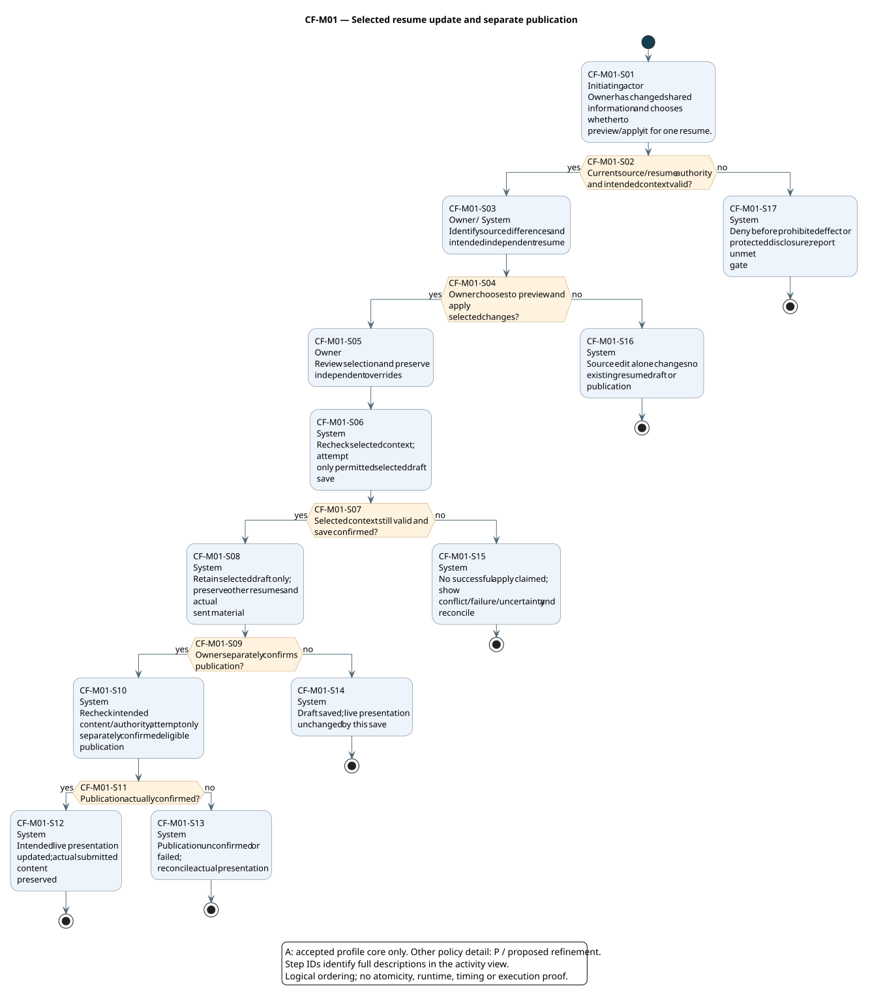

[Editable PlantUML](../diagrams/activity-profile-apply-publication.puml) · [PNG](../diagrams/activity-profile-apply-publication.png)

| Step | Kind / responsible context | Action or guard meaning |
| --- | --- | --- |
| **CF-M01-S01** | action; Initiating actor | Owner has changed shared information and chooses whether to preview/apply it for one resume. |
| **CF-M01-S02** | decision; Decision / current domain context | Current source/resume authority and intended context valid |
| **CF-M01-S03** | action; Owner / System | Identify source differences and intended independent resume |
| **CF-M01-S04** | decision; Decision / current domain context | Owner chooses to preview and apply selected changes |
| **CF-M01-S05** | action; Owner | Review selection and preserve independent overrides |
| **CF-M01-S06** | action; System | Recheck selected context; attempt only permitted selected draft save |
| **CF-M01-S07** | decision; Decision / current domain context | Selected context still valid and save confirmed |
| **CF-M01-S08** | action; System | Retain selected draft only; preserve other resumes and actual sent material |
| **CF-M01-S09** | decision; Decision / current domain context | Owner separately confirms publication |
| **CF-M01-S10** | action; System | Recheck intended content/authority; attempt only separately confirmed eligible publication |
| **CF-M01-S11** | decision; Decision / current domain context | Publication actually confirmed |
| **CF-M01-S12** | end; System | Intended live presentation updated; actual submitted content preserved |
| **CF-M01-S13** | end; System | Publication unconfirmed or failed; reconcile actual presentation |
| **CF-M01-S14** | end; System | Draft saved; live presentation unchanged by this save |
| **CF-M01-S15** | end; System | No successful apply claimed; show conflict/failure/uncertainty and reconcile |
| **CF-M01-S16** | end; System | Source edit alone changes no existing resume draft or publication |
| **CF-M01-S17** | end; System | Deny before prohibited effect or protected disclosure; report unmet gate |

### CF-M02 — Download settings without link side effects

**Trigger:** Owner explicitly requests a download-configuration change.

**Start conditions:** Intended resume, current mode and language/artifact availability are identified.

**End condition:** Actual permitted mode/language choices are saved; link enabled/disabled state is not changed by this action.

**Alternative/failure meaning:** Unauthorized request changes no settings. Invalid/unavailable/failed processing is explicit; neither mode does not disable the resume page/link.

**Control-flow interpretation:** Mode selection is independent of link disablement and published-page visibility.

**Policy/evidence boundary:** Q-D10 mode timing and artifact details remain proposed; active-session/in-flight effects are not inferred. Artifact readiness and mode timing remain Q-D10 proposals. Neither-mode removes PDF choices, not protected-page access.

**Primary requirement basis:** [PDF-D02](../../02-requirements-engineering/03-requirements-specification/pdf-and-controlled-sharing.md#pdf-d02-uploaded-pdf-and-language-identity), [PDF-D03](../../02-requirements-engineering/03-requirements-specification/pdf-and-controlled-sharing.md#pdf-d03-per-resume-download-choices), [PDF-D05](../../02-requirements-engineering/03-requirements-specification/pdf-and-controlled-sharing.md#pdf-d05-direct-file-and-pdf-authorization), [PDF-D06](../../02-requirements-engineering/03-requirements-specification/pdf-and-controlled-sharing.md#pdf-d06-owner-password-and-link-controls), [ACC-D08](../../02-requirements-engineering/03-requirements-specification/accounts-authentication-and-permissions.md#acc-d08-owner-control-of-employer-link-access)

**Domain objects:** [DM-C03](../02-domain-and-information-analysis/03-domain-model-and-object-oriented-view.md#dm-c03), [DM-C12](../02-domain-and-information-analysis/03-domain-model-and-object-oriented-view.md#dm-c12), [DM-C10](../02-domain-and-information-analysis/03-domain-model-and-object-oriented-view.md#dm-c10), [DM-C11](../02-domain-and-information-analysis/03-domain-model-and-object-oriented-view.md#dm-c11), [DM-C13](../02-domain-and-information-analysis/03-domain-model-and-object-oriented-view.md#dm-c13)

**Source use cases:** [UC-D02](../../02-requirements-engineering/04-scenarios-and-models/user-stories-and-scenarios.md#uc-d02)

**Information-flow meanings:** DA-F04, DA-F05 in [the data view](../02-domain-and-information-analysis/05-data-oriented-view.md). These links describe information meaning; they are not new function-model completion evidence.

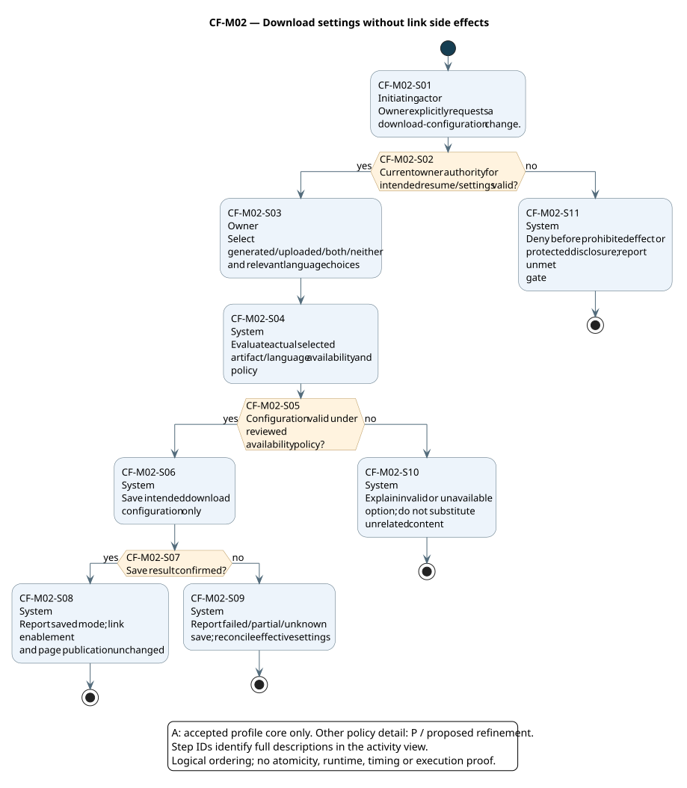

[Editable PlantUML](../diagrams/activity-pdf-settings.puml) · [PNG](../diagrams/activity-pdf-settings.png)

| Step | Kind / responsible context | Action or guard meaning |
| --- | --- | --- |
| **CF-M02-S01** | action; Initiating actor | Owner explicitly requests a download-configuration change. |
| **CF-M02-S02** | decision; Decision / current domain context | Current owner authority for intended resume/settings valid |
| **CF-M02-S03** | action; Owner | Select generated/uploaded/both/neither and relevant language choices |
| **CF-M02-S04** | action; System | Evaluate actual selected artifact/language availability and policy |
| **CF-M02-S05** | decision; Decision / current domain context | Configuration valid under reviewed availability policy |
| **CF-M02-S06** | action; System | Save intended download configuration only |
| **CF-M02-S07** | decision; Decision / current domain context | Save result confirmed |
| **CF-M02-S08** | end; System | Report saved mode; link enablement and page publication unchanged |
| **CF-M02-S09** | end; System | Report failed/partial/unknown save; reconcile effective settings |
| **CF-M02-S10** | end; System | Explain invalid or unavailable option; do not substitute unrelated content |
| **CF-M02-S11** | end; System | Deny before prohibited effect or protected disclosure; report unmet gate |

### CF-M03 — Independent link disablement and fresh request

**Trigger:** Owner separately requests disablement of a specific link.

**Start conditions:** Link identity and current owner-control authority exist; no preceding PDF settings change is required.

**End condition:** After confirmed effective disablement, a fresh request cannot gain protected access through that link; download configuration is unchanged.

**Alternative/failure meaning:** Denied/failed/unconfirmed disablement is not reported complete. Already delivered bytes cannot be recalled; existing sessions/caches/in-flight effects remain policy-specific.

**Control-flow interpretation:** The post-disable check is a subsequent fresh-request observation, not an automatic viewer action or proof that delivered bytes vanished.

**Policy/evidence boundary:** Reuse the existing separate operation under UC-D02; do not allocate a new external use-case ID. Existing sessions, caches and in-flight output remain policy-specific proposals. Already delivered copies cannot be recalled.

**Primary requirement basis:** [PDF-D06](../../02-requirements-engineering/03-requirements-specification/pdf-and-controlled-sharing.md#pdf-d06-owner-password-and-link-controls), [ACC-D08](../../02-requirements-engineering/03-requirements-specification/accounts-authentication-and-permissions.md#acc-d08-owner-control-of-employer-link-access), [PDF-D05](../../02-requirements-engineering/03-requirements-specification/pdf-and-controlled-sharing.md#pdf-d05-direct-file-and-pdf-authorization)

**Domain objects:** [DM-C13](../02-domain-and-information-analysis/03-domain-model-and-object-oriented-view.md#dm-c13), [DM-C48](../02-domain-and-information-analysis/03-domain-model-and-object-oriented-view.md#dm-c48)

**Source use cases:** [UC-D02](../../02-requirements-engineering/04-scenarios-and-models/user-stories-and-scenarios.md#uc-d02)

**Information-flow meanings:** DA-F05 in [the data view](../02-domain-and-information-analysis/05-data-oriented-view.md). These links describe information meaning; they are not new function-model completion evidence.

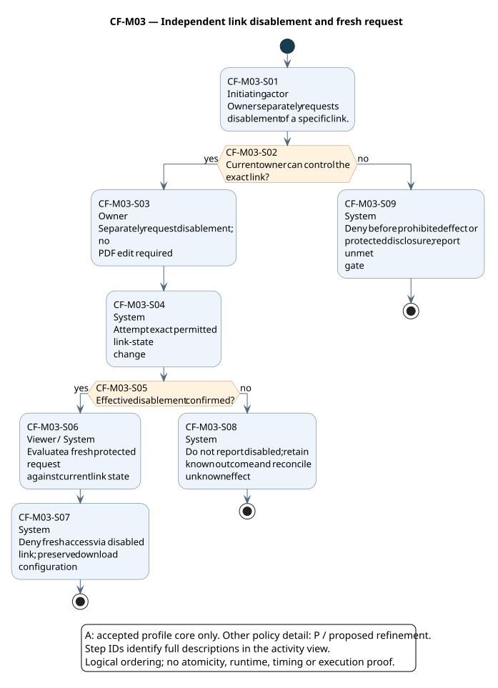

[Editable PlantUML](../diagrams/activity-disable-sharing-link.puml) · [PNG](../diagrams/activity-disable-sharing-link.png)

| Step | Kind / responsible context | Action or guard meaning |
| --- | --- | --- |
| **CF-M03-S01** | action; Initiating actor | Owner separately requests disablement of a specific link. |
| **CF-M03-S02** | decision; Decision / current domain context | Current owner can control the exact link |
| **CF-M03-S03** | action; Owner | Separately request disablement; no PDF edit required |
| **CF-M03-S04** | action; System | Attempt exact permitted link-state change |
| **CF-M03-S05** | decision; Decision / current domain context | Effective disablement confirmed |
| **CF-M03-S06** | action; Viewer / System | Evaluate a fresh protected request against current link state |
| **CF-M03-S07** | end; System | Deny fresh access via disabled link; preserve download configuration |
| **CF-M03-S08** | end; System | Do not report disabled; retain known outcome and reconcile unknown effect |
| **CF-M03-S09** | end; System | Deny before prohibited effect or protected disclosure; report unmet gate |

### CF-M04 — Controlled page and artifact retrieval

**Trigger:** Employer viewer opens an intended link and requests a page, evidence or PDF.

**Start conditions:** Controlled link/password context and selected published content are identifiable; viewer account is not required.

**End condition:** Only currently permitted selected/available content is exposed; no private workspace or unrelated resource authority is granted.

**Alternative/failure meaning:** Wrong password, disabled link, altered resource and unselected content are denied. Missing language/artifact and retrieval failure are explicit; no unrelated fallback.

**Control-flow interpretation:** Viewer account is not required. Valid link/password context is limited to the intended selected resource, not every file.

**Policy/evidence boundary:** Password/session, exact revocation timing and language-fallback proposals retain Q-D05/Q-D09/Q-D11 status. Session/revocation timing and fallback remain proposed. Retrieval completion is not proof of the recipient reading the document.

**Primary requirement basis:** [PDF-D03](../../02-requirements-engineering/03-requirements-specification/pdf-and-controlled-sharing.md#pdf-d03-per-resume-download-choices), [PDF-D04](../../02-requirements-engineering/03-requirements-specification/pdf-and-controlled-sharing.md#pdf-d04-scoped-password-protected-employer-access), [PDF-D05](../../02-requirements-engineering/03-requirements-specification/pdf-and-controlled-sharing.md#pdf-d05-direct-file-and-pdf-authorization), [PDF-D06](../../02-requirements-engineering/03-requirements-specification/pdf-and-controlled-sharing.md#pdf-d06-owner-password-and-link-controls), [ACC-D06](../../02-requirements-engineering/03-requirements-specification/accounts-authentication-and-permissions.md#acc-d06-employer-access-without-a-viewer-account), [ACC-D07](../../02-requirements-engineering/03-requirements-specification/accounts-authentication-and-permissions.md#acc-d07-protected-shared-file-and-pdf-retrieval)

**Domain objects:** [DM-C13](../02-domain-and-information-analysis/03-domain-model-and-object-oriented-view.md#dm-c13), [DM-C09](../02-domain-and-information-analysis/03-domain-model-and-object-oriented-view.md#dm-c09), [DM-C07](../02-domain-and-information-analysis/03-domain-model-and-object-oriented-view.md#dm-c07), [DM-C12](../02-domain-and-information-analysis/03-domain-model-and-object-oriented-view.md#dm-c12), [DM-C10](../02-domain-and-information-analysis/03-domain-model-and-object-oriented-view.md#dm-c10), [DM-C11](../02-domain-and-information-analysis/03-domain-model-and-object-oriented-view.md#dm-c11)

**Source use cases:** [UC-D03](../../02-requirements-engineering/04-scenarios-and-models/user-stories-and-scenarios.md#uc-d03)

**Information-flow meanings:** DA-F05 in [the data view](../02-domain-and-information-analysis/05-data-oriented-view.md). These links describe information meaning; they are not new function-model completion evidence.

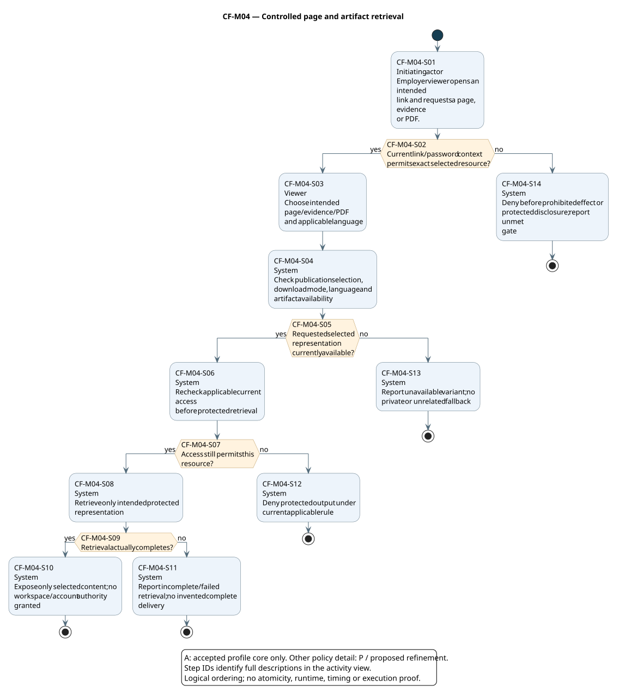

[Editable PlantUML](../diagrams/activity-protected-retrieval.puml) · [PNG](../diagrams/activity-protected-retrieval.png)

| Step | Kind / responsible context | Action or guard meaning |
| --- | --- | --- |
| **CF-M04-S01** | action; Initiating actor | Employer viewer opens an intended link and requests a page, evidence or PDF. |
| **CF-M04-S02** | decision; Decision / current domain context | Current link/password context permits exact selected resource |
| **CF-M04-S03** | action; Viewer | Choose intended page/evidence/PDF and applicable language |
| **CF-M04-S04** | action; System | Check publication selection, download mode, language and artifact availability |
| **CF-M04-S05** | decision; Decision / current domain context | Requested selected representation currently available |
| **CF-M04-S06** | action; System | Recheck applicable current access before protected retrieval |
| **CF-M04-S07** | decision; Decision / current domain context | Access still permits this resource |
| **CF-M04-S08** | action; System | Retrieve only intended protected representation |
| **CF-M04-S09** | decision; Decision / current domain context | Retrieval actually completes |
| **CF-M04-S10** | end; System | Expose only selected content; no workspace/account authority granted |
| **CF-M04-S11** | end; System | Report incomplete/failed retrieval; no invented complete delivery |
| **CF-M04-S12** | end; System | Deny protected output under current applicable rule |
| **CF-M04-S13** | end; System | Report unavailable variant; no private or unrelated fallback |
| **CF-M04-S14** | end; System | Deny before prohibited effect or protected disclosure; report unmet gate |

### CF-M05 — Manual application preparation or progress recording

**Trigger:** Applicant prepares an application or explicitly updates progress.

**Start conditions:** Permitted company/opportunity, application and selected-resume contexts are identified.

**End condition:** Actual preparation is retained; separately permitted progress records reflect the requested transition, not inferred external receipt.

**Alternative/failure meaning:** Inaccessible resume/application is denied. Incomplete drafts follow proposed rules; save failure/conflict is explicit; correction preserves required time/history context.

**Control-flow interpretation:** Preparation and progress update are alternative requested goals, not mandatory sequential steps.

**Policy/evidence boundary:** Q-D12 fields/states, Q-D13 capture coupling and Q-D14 correction details remain proposed. Normal state routes do not define every manual correction/import route. Actual submission and capture completeness remain separate.

**Primary requirement basis:** [APP-D01](../../02-requirements-engineering/03-requirements-specification/manual-application-management.md#app-d01-company-and-opportunity-context), [APP-D02](../../02-requirements-engineering/03-requirements-specification/manual-application-management.md#app-d02-relevant-resume-association), [APP-D03](../../02-requirements-engineering/03-requirements-specification/manual-application-management.md#app-d03-manually-authored-cover-letter), [APP-D04](../../02-requirements-engineering/03-requirements-specification/manual-application-management.md#app-d04-explicit-progress-states-and-transitions), [APP-D05](../../02-requirements-engineering/03-requirements-specification/manual-application-management.md#app-d05-user-directed-submission-recording)

**Domain objects:** [DM-C14](../02-domain-and-information-analysis/03-domain-model-and-object-oriented-view.md#dm-c14), [DM-C15](../02-domain-and-information-analysis/03-domain-model-and-object-oriented-view.md#dm-c15), [DM-C16](../02-domain-and-information-analysis/03-domain-model-and-object-oriented-view.md#dm-c16), [DM-C17](../02-domain-and-information-analysis/03-domain-model-and-object-oriented-view.md#dm-c17), [DM-C03](../02-domain-and-information-analysis/03-domain-model-and-object-oriented-view.md#dm-c03)

**Source use cases:** [UC-D04](../../02-requirements-engineering/04-scenarios-and-models/user-stories-and-scenarios.md#uc-d04)

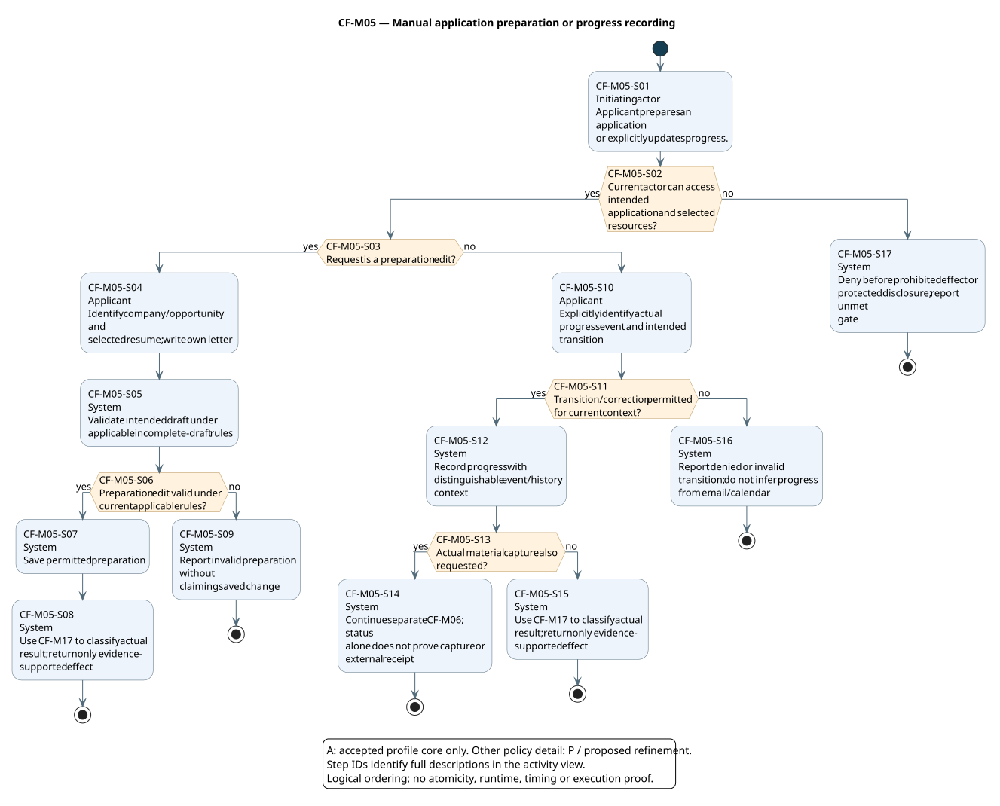

[Editable PlantUML](../diagrams/activity-application-preparation.puml) · [PNG](../diagrams/activity-application-preparation.png)

| Step | Kind / responsible context | Action or guard meaning |
| --- | --- | --- |
| **CF-M05-S01** | action; Initiating actor | Applicant prepares an application or explicitly updates progress. |
| **CF-M05-S02** | decision; Decision / current domain context | Current actor can access intended application and selected resources |
| **CF-M05-S03** | decision; Decision / current domain context | Request is a preparation edit |
| **CF-M05-S04** | action; Applicant | Identify company/opportunity and selected resume; write own letter |
| **CF-M05-S05** | action; System | Validate intended draft under applicable incomplete-draft rules |
| **CF-M05-S06** | decision; Decision / current domain context | Preparation edit valid under current applicable rules |
| **CF-M05-S07** | action; System | Save permitted preparation |
| **CF-M05-S08** | end; System | Use CF-M17 to classify actual result; return only evidence-supported effect |
| **CF-M05-S09** | end; System | Report invalid preparation without claiming saved change |
| **CF-M05-S10** | action; Applicant | Explicitly identify actual progress event and intended transition |
| **CF-M05-S11** | decision; Decision / current domain context | Transition/correction permitted for current context |
| **CF-M05-S12** | action; System | Record progress with distinguishable event/history context |
| **CF-M05-S13** | decision; Decision / current domain context | Actual material capture also requested |
| **CF-M05-S14** | end; System | Continue separate CF-M06; status alone does not prove capture or external receipt |
| **CF-M05-S15** | end; System | Use CF-M17 to classify actual result; return only evidence-supported effect |
| **CF-M05-S16** | end; System | Report denied or invalid transition; do not infer progress from email/calendar |
| **CF-M05-S17** | end; System | Deny before prohibited effect or protected disclosure; report unmet gate |

### CF-M06 — Capture actual submitted materials

**Trigger:** Applicant identifies actual submitted resume/letter material for the intended application.

**Start conditions:** Actor/application authority and actual claimed material/event context are available; current live content is not presumed identical.

**End condition:** Confirmed captured material remains identifiable independently of later edits/publication; incomplete capture cannot claim complete preservation.

**Alternative/failure meaning:** Wrong-owner retrieval/change is denied. Actual upload may differ from current PDF. Missing/failed capture is incomplete/failed; corrections/resubmissions preserve distinguishable prior/new context.

**Control-flow interpretation:** A new submission or correction keeps distinguishable event/set context rather than silently replacing prior actual history.

**Policy/evidence boundary:** Q-D13 completeness/provenance and Q-D14 correction/retention remain proposed; accepted historical independence is already settled. Historical independence is accepted; detailed completeness/provenance/retention/correction policy remains proposed.

**Primary requirement basis:** [APP-D05](../../02-requirements-engineering/03-requirements-specification/manual-application-management.md#app-d05-user-directed-submission-recording), [APP-D06](../../02-requirements-engineering/03-requirements-specification/manual-application-management.md#app-d06-preserved-actual-submitted-copies), [APP-D07](../../02-requirements-engineering/03-requirements-specification/manual-application-management.md#app-d07-correction-and-repeated-submissions), [APP-D09](../../02-requirements-engineering/03-requirements-specification/manual-application-management.md#app-d09-private-access-archive-and-recovery), [PDF-D08](../../02-requirements-engineering/03-requirements-specification/pdf-and-controlled-sharing.md#pdf-d08-downloaded-copy-and-submission-distinctions)

**Domain objects:** [DM-C16](../02-domain-and-information-analysis/03-domain-model-and-object-oriented-view.md#dm-c16), [DM-C18](../02-domain-and-information-analysis/03-domain-model-and-object-oriented-view.md#dm-c18), [DM-C19](../02-domain-and-information-analysis/03-domain-model-and-object-oriented-view.md#dm-c19), [DM-C10](../02-domain-and-information-analysis/03-domain-model-and-object-oriented-view.md#dm-c10), [DM-C11](../02-domain-and-information-analysis/03-domain-model-and-object-oriented-view.md#dm-c11), [DM-C17](../02-domain-and-information-analysis/03-domain-model-and-object-oriented-view.md#dm-c17)

**Source use cases:** [UC-D05](../../02-requirements-engineering/04-scenarios-and-models/user-stories-and-scenarios.md#uc-d05)

**Information-flow meanings:** DA-F06 in [the data view](../02-domain-and-information-analysis/05-data-oriented-view.md). These links describe information meaning; they are not new function-model completion evidence.

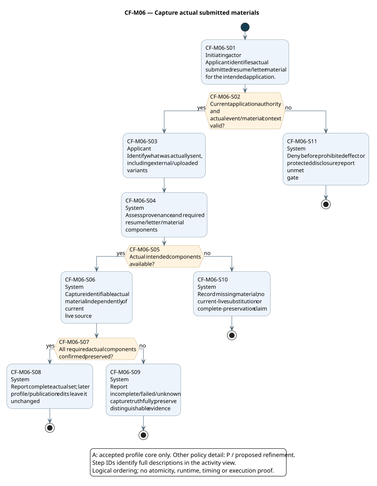

[Editable PlantUML](../diagrams/activity-actual-submission-capture.puml) · [PNG](../diagrams/activity-actual-submission-capture.png)

| Step | Kind / responsible context | Action or guard meaning |
| --- | --- | --- |
| **CF-M06-S01** | action; Initiating actor | Applicant identifies actual submitted resume/letter material for the intended application. |
| **CF-M06-S02** | decision; Decision / current domain context | Current application authority and actual event/material context valid |
| **CF-M06-S03** | action; Applicant | Identify what was actually sent, including external/uploaded variants |
| **CF-M06-S04** | action; System | Assess provenance and required resume/letter/material components |
| **CF-M06-S05** | decision; Decision / current domain context | Actual intended components available |
| **CF-M06-S06** | action; System | Capture identifiable actual material independently of current live source |
| **CF-M06-S07** | decision; Decision / current domain context | All required actual components confirmed preserved |
| **CF-M06-S08** | end; System | Report complete actual set; later profile/publication edits leave it unchanged |
| **CF-M06-S09** | end; System | Report incomplete/failed/unknown capture truthfully; preserve distinguishable evidence |
| **CF-M06-S10** | end; System | Record missing material; no current-live substitution or complete-preservation claim |
| **CF-M06-S11** | end; System | Deny before prohibited effect or protected disclosure; report unmet gate |

### CF-M07 — Read correspondence or deliberately send

**Trigger:** User separately requests correspondence reading or a reviewed send/reply.

**Start conditions:** Intended account, product/resource authority and provider capability must be valid for the chosen operation; controlled access is a future gate.

**End condition:** Read exposes permitted content; send/reply reports only provider-supported acceptance, failure or uncertainty, never invented delivery/read.

**Alternative/failure meaning:** Missing/revoked/wrong-account authority prevents provider action. Unknown send is reconciled before a proposed explicit retry; no blind duplicate send.

**Control-flow interpretation:** Read capability and send capability are distinct. Timeout after submission is not evidence that a resend is safe.

**Policy/evidence boundary:** Q-D15 actual OAuth/access remains unestablished. Q-D16 compose/reply/draft/repetition policies are proposals, not verified behavior. OAuth is not configured. This is conditional future behavior, not an active connection. Composition/draft/reply/repetition detail remains proposed.

**Primary requirement basis:** [EGC-D01](../../02-requirements-engineering/03-requirements-specification/email-calendar-and-google-integration.md#egc-d01-authorized-connection-and-account-context), [EGC-D02](../../02-requirements-engineering/03-requirements-specification/email-calendar-and-google-integration.md#egc-d02-justified-permissions-and-private-resource-isolation), [EGC-D03](../../02-requirements-engineering/03-requirements-specification/email-calendar-and-google-integration.md#egc-d03-read-authorized-correspondence), [EGC-D04](../../02-requirements-engineering/03-requirements-specification/email-calendar-and-google-integration.md#egc-d04-manual-compose-and-draft-handling), [EGC-D05](../../02-requirements-engineering/03-requirements-specification/email-calendar-and-google-integration.md#egc-d05-deliberate-send-and-truthful-outcome), [EGC-D06](../../02-requirements-engineering/03-requirements-specification/email-calendar-and-google-integration.md#egc-d06-reply-context-and-conversation-association), [EGC-D11](../../02-requirements-engineering/03-requirements-specification/email-calendar-and-google-integration.md#egc-d11-disconnect-revocation-and-reconnect), [EGC-D12](../../02-requirements-engineering/03-requirements-specification/email-calendar-and-google-integration.md#egc-d12-bounded-failures-recovery-and-feasibility-evidence), [EIF-D08](../../02-requirements-engineering/03-requirements-specification/external-interface-requirements.md#eif-d08-operation-specific-failure-and-repetition-semantics)

**Domain objects:** [DM-C20](../02-domain-and-information-analysis/03-domain-model-and-object-oriented-view.md#dm-c20), [DM-C21](../02-domain-and-information-analysis/03-domain-model-and-object-oriented-view.md#dm-c21)

**Source use cases:** [UC-D06](../../02-requirements-engineering/04-scenarios-and-models/user-stories-and-scenarios.md#uc-d06), [UC-D06-READ](../../02-requirements-engineering/04-scenarios-and-models/user-stories-and-scenarios.md#uc-d06-read), [UC-D06-SEND](../../02-requirements-engineering/04-scenarios-and-models/user-stories-and-scenarios.md#uc-d06-send)

**Information-flow meanings:** DA-F07 in [the data view](../02-domain-and-information-analysis/05-data-oriented-view.md). These links describe information meaning; they are not new function-model completion evidence.

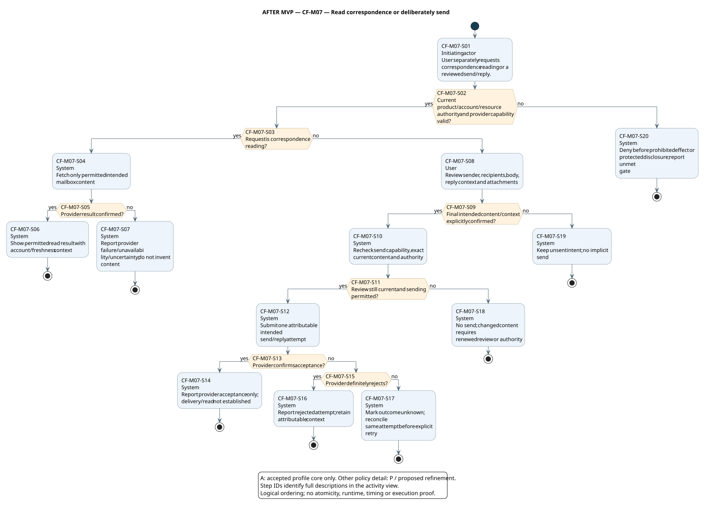

[Editable PlantUML](../diagrams/activity-gmail-read-send-outcomes.puml) · [PNG](../diagrams/activity-gmail-read-send-outcomes.png)

| Step | Kind / responsible context | Action or guard meaning |
| --- | --- | --- |
| **CF-M07-S01** | action; Initiating actor | User separately requests correspondence reading or a reviewed send/reply. |
| **CF-M07-S02** | decision; Decision / current domain context | Current product/account/resource authority and provider capability valid |
| **CF-M07-S03** | decision; Decision / current domain context | Request is correspondence reading |
| **CF-M07-S04** | action; System | Fetch only permitted intended mailbox content |
| **CF-M07-S05** | decision; Decision / current domain context | Provider result confirmed |
| **CF-M07-S06** | end; System | Show permitted read result with account/freshness context |
| **CF-M07-S07** | end; System | Report provider failure/unavailability/uncertainty; do not invent content |
| **CF-M07-S08** | action; User | Review sender, recipients, body, reply context and attachments |
| **CF-M07-S09** | decision; Decision / current domain context | Final intended content/context explicitly confirmed |
| **CF-M07-S10** | action; System | Recheck send capability, exact current content and authority |
| **CF-M07-S11** | decision; Decision / current domain context | Review still current and sending permitted |
| **CF-M07-S12** | action; System | Submit one attributable intended send/reply attempt |
| **CF-M07-S13** | decision; Decision / current domain context | Provider confirms acceptance |
| **CF-M07-S14** | end; System | Report provider acceptance only; delivery/read not established |
| **CF-M07-S15** | decision; Decision / current domain context | Provider definitely rejects |
| **CF-M07-S16** | end; System | Report rejected attempt; retain attributable context |
| **CF-M07-S17** | end; System | Mark outcome unknown; reconcile same attempt before explicit retry |
| **CF-M07-S18** | end; System | No send; changed content requires renewed review or authority |
| **CF-M07-S19** | end; System | Keep unsent intent; no implicit send |
| **CF-M07-S20** | end; System | Deny before prohibited effect or protected disclosure; report unmet gate |

### CF-M08 — Local activity versus selected calendar synchronization

**Release applicability:** future-domain design retained after MVP; core operating/deployment and recovery controls still apply to MVP where relevant.

**Trigger:** User requests a local activity action or a separate agreed synchronization action.

**Start conditions:** Actor/activity context, time meaning and optional selected provider mapping are identified; synchronization requires applicable connection authority.

**End condition:** Only the permitted local/provider action is reported; time, mapping, conflict/freshness and local notes/associations retain correct context.

**Alternative/failure meaning:** Wrong grant denies action. Concurrent local/provider changes are not silently overwritten. Missing/revoked access and uncertain provider update stay distinguishable; reconnect does not replay stale work.

**Control-flow interpretation:** Local save, mapping, provider mutation and local unlink are distinct goals. Local unlink does not require a functioning provider connection; reconnect does not authorize blind replay.

**Policy/evidence boundary:** Q-D17 direction/time/conflict/deletion/reconnect policies are proposed. Reminders require separately available delivery capability. Time-zone, conflict, direction, deletion and reminder policies retain Q-D17 proposal status; no reminder delivery capability is invented.

**Primary requirement basis:** [EGC-D07](../../02-requirements-engineering/03-requirements-specification/email-calendar-and-google-integration.md#egc-d07-calendar-activities-and-time-meaning), [EGC-D08](../../02-requirements-engineering/03-requirements-specification/email-calendar-and-google-integration.md#egc-d08-explicit-synchronization-contract), [EGC-D09](../../02-requirements-engineering/03-requirements-specification/email-calendar-and-google-integration.md#egc-d09-application-relationships-preserve-boundaries), [EGC-D10](../../02-requirements-engineering/03-requirements-specification/email-calendar-and-google-integration.md#egc-d10-reminders-and-notification-outcomes), [EGC-D11](../../02-requirements-engineering/03-requirements-specification/email-calendar-and-google-integration.md#egc-d11-disconnect-revocation-and-reconnect), [EGC-D12](../../02-requirements-engineering/03-requirements-specification/email-calendar-and-google-integration.md#egc-d12-bounded-failures-recovery-and-feasibility-evidence)

**Domain objects:** [DM-C20](../02-domain-and-information-analysis/03-domain-model-and-object-oriented-view.md#dm-c20), [DM-C22](../02-domain-and-information-analysis/03-domain-model-and-object-oriented-view.md#dm-c22), [DM-C23](../02-domain-and-information-analysis/03-domain-model-and-object-oriented-view.md#dm-c23), [DM-C16](../02-domain-and-information-analysis/03-domain-model-and-object-oriented-view.md#dm-c16)

**Source use cases:** [UC-D06](../../02-requirements-engineering/04-scenarios-and-models/user-stories-and-scenarios.md#uc-d06), [UC-D06-ACTIVITY](../../02-requirements-engineering/04-scenarios-and-models/user-stories-and-scenarios.md#uc-d06-activity), [UC-D06-SYNC](../../02-requirements-engineering/04-scenarios-and-models/user-stories-and-scenarios.md#uc-d06-sync)

**Information-flow meanings:** DA-F08 in [the data view](../02-domain-and-information-analysis/05-data-oriented-view.md). These links describe information meaning; they are not new function-model completion evidence.

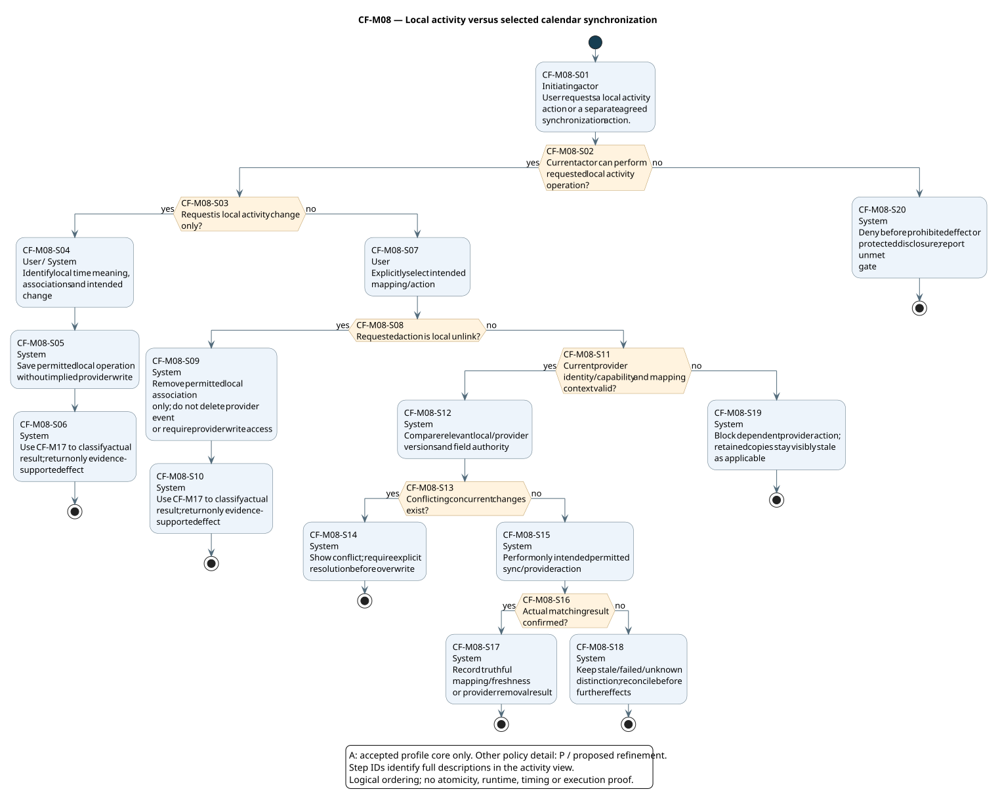

[Editable PlantUML](../diagrams/activity-calendar-local-sync.puml) · [PNG](../diagrams/activity-calendar-local-sync.png)

| Step | Kind / responsible context | Action or guard meaning |
| --- | --- | --- |
| **CF-M08-S01** | action; Initiating actor | User requests a local activity action or a separate agreed synchronization action. |
| **CF-M08-S02** | decision; Decision / current domain context | Current actor can perform requested local activity operation |
| **CF-M08-S03** | decision; Decision / current domain context | Request is local activity change only |
| **CF-M08-S04** | action; User / System | Identify local time meaning, associations and intended change |
| **CF-M08-S05** | action; System | Save permitted local operation without implied provider write |
| **CF-M08-S06** | end; System | Use CF-M17 to classify actual result; return only evidence-supported effect |
| **CF-M08-S07** | action; User | Explicitly select intended mapping/action |
| **CF-M08-S08** | decision; Decision / current domain context | Requested action is local unlink |
| **CF-M08-S09** | action; System | Remove permitted local association only; do not delete provider event or require provider write access |
| **CF-M08-S10** | end; System | Use CF-M17 to classify actual result; return only evidence-supported effect |
| **CF-M08-S11** | decision; Decision / current domain context | Current provider identity/capability and mapping context valid |
| **CF-M08-S12** | action; System | Compare relevant local/provider versions and field authority |
| **CF-M08-S13** | decision; Decision / current domain context | Conflicting concurrent changes exist |
| **CF-M08-S14** | end; System | Show conflict; require explicit resolution before overwrite |
| **CF-M08-S15** | action; System | Perform only intended permitted sync/provider action |
| **CF-M08-S16** | decision; Decision / current domain context | Actual matching result confirmed |
| **CF-M08-S17** | end; System | Record truthful mapping/freshness or provider removal result |
| **CF-M08-S18** | end; System | Keep stale/failed/unknown distinction; reconcile before further effects |
| **CF-M08-S19** | end; System | Block dependent provider action; retained copies stay visibly stale as applicable |
| **CF-M08-S20** | end; System | Deny before prohibited effect or protected disclosure; report unmet gate |

### CF-M09 — Refinement, Sprint planning and Sprint completion

**Release applicability:** future-domain design retained after MVP; core operating/deployment and recovery controls still apply to MVP where relevant.

**Trigger:** Authorized participant requests refinement, Sprint-plan change or a separate Sprint-end action.

**Start conditions:** Intended project/item/Sprint and current authority/state are identified; source-required relationship/transition policies govern the action.

**End condition:** Task refinement, coherent goal/items/plan or actual Sprint outcome is retained for the requested operation, without equating task progress with item acceptance.

**Alternative/failure meaning:** Denied or stale/conflicting moves do not succeed. Incomplete work stays identifiable and is not silently accepted, erased or automatically carried over.

**Control-flow interpretation:** Three alternative goals are not one mandatory giant transaction. Task completion does not automatically accept a backlog item; period end does not imply goal achieved.

**Policy/evidence boundary:** Q-D18/Q-D19 counts/states/acceptance/carry-over/concurrency are proposed; accepted one-composite-Sprint-Backlog meaning is preserved. Readiness-as-predicate is SM-F01 proposed refinement. No extra team, fixed cadence, count or automatic carryover is introduced.

**Primary requirement basis:** [PKS-D03](../../02-requirements-engineering/03-requirements-specification/projects-kanban-and-sprints.md#pks-d03-product-backlog-and-item-definition), [PKS-D04](../../02-requirements-engineering/03-requirements-specification/projects-kanban-and-sprints.md#pks-d04-item-refinement-and-task-relationships), [PKS-D05](../../02-requirements-engineering/03-requirements-specification/projects-kanban-and-sprints.md#pks-d05-assignment-priority-and-due-date-handling), [PKS-D07](../../02-requirements-engineering/03-requirements-specification/projects-kanban-and-sprints.md#pks-d07-sprint-goal-and-selected-backlog-items), [PKS-D08](../../02-requirements-engineering/03-requirements-specification/projects-kanban-and-sprints.md#pks-d08-one-coherent-sprint-backlog), [PKS-D09](../../02-requirements-engineering/03-requirements-specification/projects-kanban-and-sprints.md#pks-d09-explicit-completion-and-sprint-end-outcomes), [PKS-D11](../../02-requirements-engineering/03-requirements-specification/projects-kanban-and-sprints.md#pks-d11-truthful-changes-retirement-and-recovery)

**Domain objects:** [DM-C24](../02-domain-and-information-analysis/03-domain-model-and-object-oriented-view.md#dm-c24), [DM-C28](../02-domain-and-information-analysis/03-domain-model-and-object-oriented-view.md#dm-c28), [DM-C29](../02-domain-and-information-analysis/03-domain-model-and-object-oriented-view.md#dm-c29), [DM-C30](../02-domain-and-information-analysis/03-domain-model-and-object-oriented-view.md#dm-c30), [DM-C31](../02-domain-and-information-analysis/03-domain-model-and-object-oriented-view.md#dm-c31)

**Source use cases:** [UC-D07](../../02-requirements-engineering/04-scenarios-and-models/user-stories-and-scenarios.md#uc-d07), [UC-D07-REFINE](../../02-requirements-engineering/04-scenarios-and-models/user-stories-and-scenarios.md#uc-d07-refine), [UC-D07-PLAN](../../02-requirements-engineering/04-scenarios-and-models/user-stories-and-scenarios.md#uc-d07-plan), [UC-D07-END](../../02-requirements-engineering/04-scenarios-and-models/user-stories-and-scenarios.md#uc-d07-end)

**Information-flow meanings:** DA-F09 in [the data view](../02-domain-and-information-analysis/05-data-oriented-view.md). These links describe information meaning; they are not new function-model completion evidence.

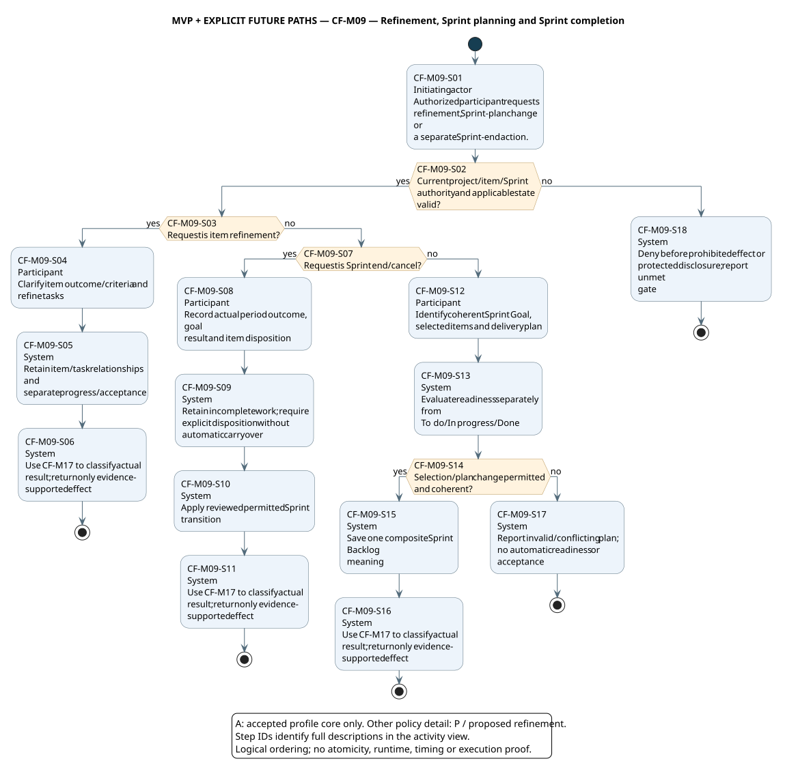

[Editable PlantUML](../diagrams/activity-work-refine-plan-end.puml) · [PNG](../diagrams/activity-work-refine-plan-end.png)

| Step | Kind / responsible context | Action or guard meaning |
| --- | --- | --- |
| **CF-M09-S01** | action; Initiating actor | Authorized participant requests refinement, Sprint-plan change or a separate Sprint-end action. |
| **CF-M09-S02** | decision; Decision / current domain context | Current project/item/Sprint authority and applicable state valid |
| **CF-M09-S03** | decision; Decision / current domain context | Request is item refinement |
| **CF-M09-S04** | action; Participant | Clarify item outcome/criteria and refine tasks |
| **CF-M09-S05** | action; System | Retain item/task relationships and separate progress/acceptance |
| **CF-M09-S06** | end; System | Use CF-M17 to classify actual result; return only evidence-supported effect |
| **CF-M09-S07** | decision; Decision / current domain context | Request is Sprint end/cancel |
| **CF-M09-S08** | action; Participant | Record actual period outcome, goal result and item disposition |
| **CF-M09-S09** | action; System | Retain incomplete work; require explicit disposition without automatic carryover |
| **CF-M09-S10** | action; System | Apply reviewed permitted Sprint transition |
| **CF-M09-S11** | end; System | Use CF-M17 to classify actual result; return only evidence-supported effect |
| **CF-M09-S12** | action; Participant | Identify coherent Sprint Goal, selected items and delivery plan |
| **CF-M09-S13** | action; System | Evaluate readiness separately from To do/In progress/Done |
| **CF-M09-S14** | decision; Decision / current domain context | Selection/plan change permitted and coherent |
| **CF-M09-S15** | action; System | Save one composite Sprint Backlog meaning |
| **CF-M09-S16** | end; System | Use CF-M17 to classify actual result; return only evidence-supported effect |
| **CF-M09-S17** | end; System | Report invalid/conflicting plan; no automatic readiness or acceptance |
| **CF-M09-S18** | end; System | Deny before prohibited effect or protected disclosure; report unmet gate |

### CF-M10 — Invitation acceptance and subsequent scoped access

**Trigger:** Invited person accepts an eligible invitation and requests a granted action; owner may later change membership.

**Start conditions:** Specific invitation/resource/action scope is identified; neither invitation nor sign-in grants unrelated private content.

**End condition:** Only confirmed current resource grants permit the intended operation; unrelated mail/resume/repository/secret access remains denied.

**Alternative/failure meaning:** Expired/ineligible invitation follows adopted policy; unconfirmed persistence is not effective membership. Changed-grant and in-flight behavior retain separate policy review.

**Control-flow interpretation:** Acceptance and later resource use are temporally distinct. Every later operation uses current applicable grant rules; not a permanent authorization snapshot.

**Policy/evidence boundary:** Q-D04/Q-D05 exact grants, invitation lifecycle and revocation timing remain proposed; no role hierarchy or arbitrary expiry is invented. Role/expiry/revocation timing remain proposals. Changed-grant during a multi-effect action requires operation-specific reconciliation.

**Primary requirement basis:** [ACC-D03](../../02-requirements-engineering/03-requirements-specification/accounts-authentication-and-permissions.md#acc-d03-resource-and-operation-authorization), [ACC-D04](../../02-requirements-engineering/03-requirements-specification/accounts-authentication-and-permissions.md#acc-d04-cross-user-private-data-isolation), [ACC-D05](../../02-requirements-engineering/03-requirements-specification/accounts-authentication-and-permissions.md#acc-d05-limited-collaboration-authority), [ACC-D10](../../02-requirements-engineering/03-requirements-specification/accounts-authentication-and-permissions.md#acc-d10-authorization-of-access-grant-changes), [ACC-D12](../../02-requirements-engineering/03-requirements-specification/accounts-authentication-and-permissions.md#acc-d12-end-of-access-and-lifecycle-enforcement), [PKS-D06](../../02-requirements-engineering/03-requirements-specification/projects-kanban-and-sprints.md#pks-d06-scoped-collaboration-and-membership-changes), [GIT-D02](../../02-requirements-engineering/03-requirements-specification/git-hosting-and-collaboration.md#git-d02-repository-and-ref-authorization)

**Domain objects:** [DM-C48](../02-domain-and-information-analysis/03-domain-model-and-object-oriented-view.md#dm-c48), [DM-C47](../02-domain-and-information-analysis/03-domain-model-and-object-oriented-view.md#dm-c47), [DM-C24](../02-domain-and-information-analysis/03-domain-model-and-object-oriented-view.md#dm-c24), [DM-C32](../02-domain-and-information-analysis/03-domain-model-and-object-oriented-view.md#dm-c32)

**Source use cases:** [UC-D08](../../02-requirements-engineering/04-scenarios-and-models/user-stories-and-scenarios.md#uc-d08)

**Information-flow meanings:** DA-F09, DA-F10 in [the data view](../02-domain-and-information-analysis/05-data-oriented-view.md). These links describe information meaning; they are not new function-model completion evidence.

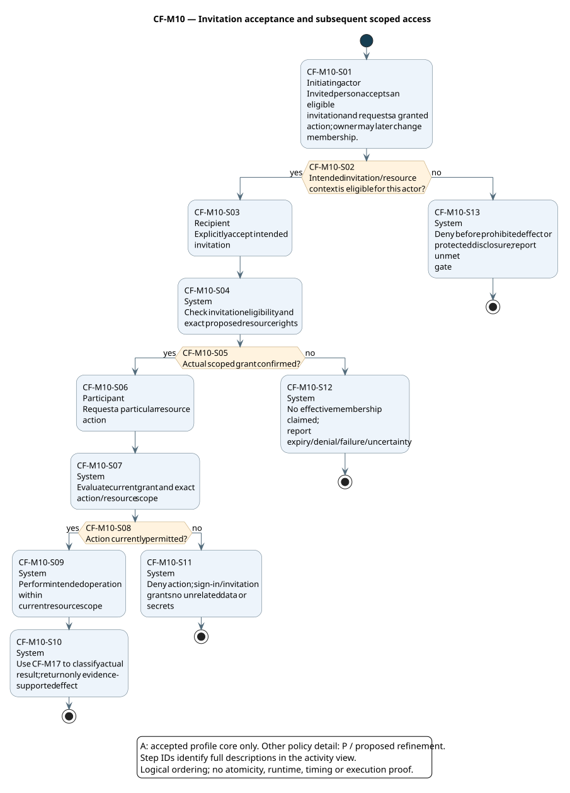

[Editable PlantUML](../diagrams/activity-collaboration-and-changed-grant.puml) · [PNG](../diagrams/activity-collaboration-and-changed-grant.png)

| Step | Kind / responsible context | Action or guard meaning |
| --- | --- | --- |
| **CF-M10-S01** | action; Initiating actor | Invited person accepts an eligible invitation and requests a granted action; owner may later change membership. |
| **CF-M10-S02** | decision; Decision / current domain context | Intended invitation/resource context is eligible for this actor |
| **CF-M10-S03** | action; Recipient | Explicitly accept intended invitation |
| **CF-M10-S04** | action; System | Check invitation eligibility and exact proposed resource rights |
| **CF-M10-S05** | decision; Decision / current domain context | Actual scoped grant confirmed |
| **CF-M10-S06** | action; Participant | Request a particular resource action |
| **CF-M10-S07** | action; System | Evaluate current grant and exact action/resource scope |
| **CF-M10-S08** | decision; Decision / current domain context | Action currently permitted |
| **CF-M10-S09** | action; System | Perform intended operation within current resource scope |
| **CF-M10-S10** | end; System | Use CF-M17 to classify actual result; return only evidence-supported effect |
| **CF-M10-S11** | end; System | Deny action; sign-in/invitation grants no unrelated data or secrets |
| **CF-M10-S12** | end; System | No effective membership claimed; report expiry/denial/failure/uncertainty |
| **CF-M10-S13** | end; System | Deny before prohibited effect or protected disclosure; report unmet gate |

### CF-M11 — Real Git read transfer or ref update

**Trigger:** Authorized client requests clone/read transfer or supplies an intended push/ref change.

**Start conditions:** A future supported client/transport and real repository context must exist; actor/repository/ref authority and expected current context are explicit.

**End condition:** Only actual authorized repository transfer/ref result is reported; push does not imply merge approval, workflow execution or deployment.

**Alternative/failure meaning:** Wrong grant/protected ref is rejected. Changed ref or interrupted transfer produces conflict/incomplete/unknown as appropriate, not invented success or unrelated ref changes.

**Control-flow interpretation:** Push is a write goal, not proof that review, execution or deployment may proceed. Read transfer does not establish write permission.

**Policy/evidence boundary:** Q-D21 transports/credentials/protection/repetition and actual interoperability remain proposals/design evidence gates. Transport/client/credential/protection feasibility is still required. No Git transport, storage engine or implementation protocol is selected.

**Primary requirement basis:** [GIT-D02](../../02-requirements-engineering/03-requirements-specification/git-hosting-and-collaboration.md#git-d02-repository-and-ref-authorization), [GIT-D03](../../02-requirements-engineering/03-requirements-specification/git-hosting-and-collaboration.md#git-d03-real-clone-fetch-pull-and-push), [GIT-D04](../../02-requirements-engineering/03-requirements-specification/git-hosting-and-collaboration.md#git-d04-branches-files-and-history-browsing), [EIF-D06](../../02-requirements-engineering/03-requirements-specification/external-interface-requirements.md#eif-d06-real-git-client-interoperability), [EIF-D08](../../02-requirements-engineering/03-requirements-specification/external-interface-requirements.md#eif-d08-operation-specific-failure-and-repetition-semantics)

**Domain objects:** [DM-C32](../02-domain-and-information-analysis/03-domain-model-and-object-oriented-view.md#dm-c32), [DM-C34](../02-domain-and-information-analysis/03-domain-model-and-object-oriented-view.md#dm-c34), [DM-C33](../02-domain-and-information-analysis/03-domain-model-and-object-oriented-view.md#dm-c33)

**Source use cases:** [UC-D09](../../02-requirements-engineering/04-scenarios-and-models/user-stories-and-scenarios.md#uc-d09), [UC-D09-CLONE](../../02-requirements-engineering/04-scenarios-and-models/user-stories-and-scenarios.md#uc-d09-clone), [UC-D09-PUSH](../../02-requirements-engineering/04-scenarios-and-models/user-stories-and-scenarios.md#uc-d09-push)

**Information-flow meanings:** DA-F10 in [the data view](../02-domain-and-information-analysis/05-data-oriented-view.md). These links describe information meaning; they are not new function-model completion evidence.

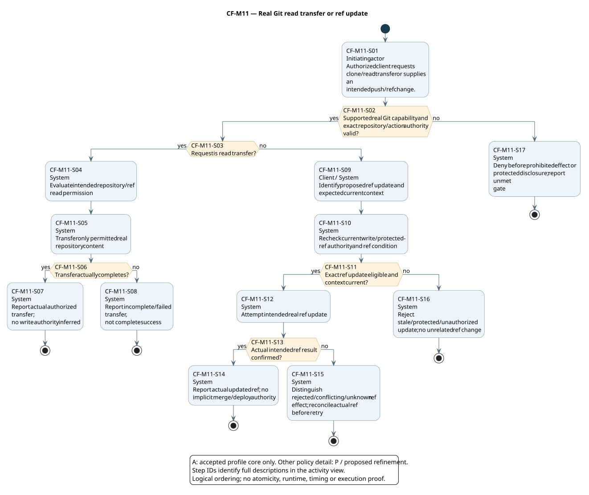

[Editable PlantUML](../diagrams/activity-git-transfer.puml) · [PNG](../diagrams/activity-git-transfer.png)

| Step | Kind / responsible context | Action or guard meaning |
| --- | --- | --- |
| **CF-M11-S01** | action; Initiating actor | Authorized client requests clone/read transfer or supplies an intended push/ref change. |
| **CF-M11-S02** | decision; Decision / current domain context | Supported real Git capability and exact repository/action authority valid |
| **CF-M11-S03** | decision; Decision / current domain context | Request is read transfer |
| **CF-M11-S04** | action; System | Evaluate intended repository/ref read permission |
| **CF-M11-S05** | action; System | Transfer only permitted real repository content |
| **CF-M11-S06** | decision; Decision / current domain context | Transfer actually completes |
| **CF-M11-S07** | end; System | Report actual authorized transfer; no write authority inferred |
| **CF-M11-S08** | end; System | Report incomplete/failed transfer, not complete success |
| **CF-M11-S09** | action; Client / System | Identify proposed ref update and expected current context |
| **CF-M11-S10** | action; System | Recheck current write/protected-ref authority and ref condition |
| **CF-M11-S11** | decision; Decision / current domain context | Exact ref update eligible and context current |
| **CF-M11-S12** | action; System | Attempt intended real ref update |
| **CF-M11-S13** | decision; Decision / current domain context | Actual intended ref result confirmed |
| **CF-M11-S14** | end; System | Report actual updated ref; no implicit merge/deploy authority |
| **CF-M11-S15** | end; System | Distinguish rejected/conflicting/unknown ref effect; reconcile actual ref before retry |
| **CF-M11-S16** | end; System | Reject stale/protected/unauthorized update; no unrelated ref change |
| **CF-M11-S17** | end; System | Deny before prohibited effect or protected disclosure; report unmet gate |

### CF-M12 — Request, review or eligible integration

**Trigger:** Participant separately opens a request, records review/comment or requests merge.

**Start conditions:** Applicable repository/source/target and operation authority are explicit; no second delivery person or approval count is assumed.

**End condition:** Only the requested permitted record/review/current eligible integration is reported; evaluated source/target and actual result remain identifiable.

**Alternative/failure meaning:** Changed source/target is re-evaluated; stale review/checks and merge conflicts cannot masquerade as current successful integration. Unauthorized merge remains denied.

**Control-flow interpretation:** Request creation, feedback and merge are separate operations. Source or target changes require reevaluation rather than carrying stale eligibility forward.

**Policy/evidence boundary:** Q-D22 review validity, merge strategy, solo review exception and counts remain proposed. Merge/release never inherits deployment authority. No second delivery person, approval count, merge strategy or solo exception is invented. Actual unknown integration is not assumed to have left the request unchanged.

**Primary requirement basis:** [GIT-D05](../../02-requirements-engineering/03-requirements-specification/git-hosting-and-collaboration.md#git-d05-fork-provenance-and-permission-boundaries), [GIT-D06](../../02-requirements-engineering/03-requirements-specification/git-hosting-and-collaboration.md#git-d06-pull-requests-comments-and-review), [GIT-D07](../../02-requirements-engineering/03-requirements-specification/git-hosting-and-collaboration.md#git-d07-controlled-merge-and-conflict-outcomes), [GIT-D09](../../02-requirements-engineering/03-requirements-specification/git-hosting-and-collaboration.md#git-d09-tags-and-releases)

**Domain objects:** [DM-C32](../02-domain-and-information-analysis/03-domain-model-and-object-oriented-view.md#dm-c32), [DM-C34](../02-domain-and-information-analysis/03-domain-model-and-object-oriented-view.md#dm-c34), [DM-C33](../02-domain-and-information-analysis/03-domain-model-and-object-oriented-view.md#dm-c33), [DM-C35](../02-domain-and-information-analysis/03-domain-model-and-object-oriented-view.md#dm-c35), [DM-C36](../02-domain-and-information-analysis/03-domain-model-and-object-oriented-view.md#dm-c36)

**Source use cases:** [UC-D09](../../02-requirements-engineering/04-scenarios-and-models/user-stories-and-scenarios.md#uc-d09), [UC-D09-REQUEST](../../02-requirements-engineering/04-scenarios-and-models/user-stories-and-scenarios.md#uc-d09-request), [UC-D09-REVIEW](../../02-requirements-engineering/04-scenarios-and-models/user-stories-and-scenarios.md#uc-d09-review), [UC-D09-MERGE](../../02-requirements-engineering/04-scenarios-and-models/user-stories-and-scenarios.md#uc-d09-merge)

**Information-flow meanings:** DA-F10 in [the data view](../02-domain-and-information-analysis/05-data-oriented-view.md). These links describe information meaning; they are not new function-model completion evidence.

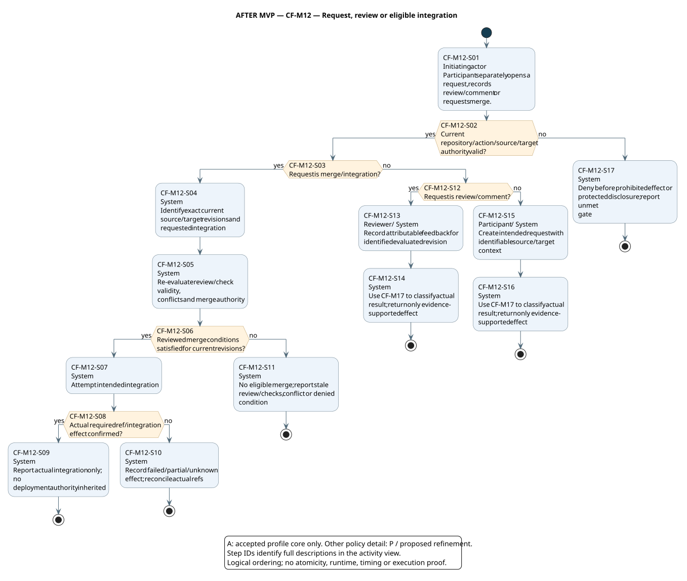

[Editable PlantUML](../diagrams/activity-pull-request-review-merge.puml) · [PNG](../diagrams/activity-pull-request-review-merge.png)

| Step | Kind / responsible context | Action or guard meaning |
| --- | --- | --- |
| **CF-M12-S01** | action; Initiating actor | Participant separately opens a request, records review/comment or requests merge. |
| **CF-M12-S02** | decision; Decision / current domain context | Current repository/action/source/target authority valid |
| **CF-M12-S03** | decision; Decision / current domain context | Request is merge/integration |
| **CF-M12-S04** | action; System | Identify exact current source/target revisions and requested integration |
| **CF-M12-S05** | action; System | Re-evaluate review/check validity, conflicts and merge authority |
| **CF-M12-S06** | decision; Decision / current domain context | Reviewed merge conditions satisfied for current revisions |
| **CF-M12-S07** | action; System | Attempt intended integration |
| **CF-M12-S08** | decision; Decision / current domain context | Actual required ref/integration effect confirmed |
| **CF-M12-S09** | end; System | Report actual integration only; no deployment authority inherited |
| **CF-M12-S10** | end; System | Record failed/partial/unknown effect; reconcile actual refs |
| **CF-M12-S11** | end; System | No eligible merge; report stale review/checks, conflict or denied condition |
| **CF-M12-S12** | decision; Decision / current domain context | Request is review/comment |
| **CF-M12-S13** | action; Reviewer / System | Record attributable feedback for identified evaluated revision |
| **CF-M12-S14** | end; System | Use CF-M17 to classify actual result; return only evidence-supported effect |
| **CF-M12-S15** | action; Participant / System | Create intended request with identifiable source/target context |
| **CF-M12-S16** | end; System | Use CF-M17 to classify actual result; return only evidence-supported effect |
| **CF-M12-S17** | end; System | Deny before prohibited effect or protected disclosure; report unmet gate |

### CF-M13 — Gated execution attempt and cancellation race

**Release applicability:** future-domain design retained after MVP; core operating/deployment and recovery controls still apply to MVP where relevant.

**Trigger:** Eligible actor/trigger requests supported workflow work for identified code/definition.

**Start conditions:** Future enabling evidence, permitted trigger, supported definition, scoped authority, isolation/resources/secrets and actual evaluated revision context must satisfy their gates before execution.

**End condition:** Admitted future run/attempt/output remains attributable to exact evaluated context; blocked/failed/unknown work is not reported successful.

**Alternative/failure meaning:** Unsupported contract or missing authority/enabling evidence means no execution. Runner loss/cancel/retry retains actual or unknown state; cancellation request is not proof of termination.

**Control-flow interpretation:** Attempt admission/start, cancellation request, actual termination and actual completion are different observations. Retry would be a new separately permitted attempt.

**Policy/evidence boundary:** Q-D23 isolation/resource/contract evidence is missing today. Model future eligibility without enabling work on the current host. The current demo host is not proven safe for untrusted workflows. No execution is enabled by this activity model; numeric limits and isolation mechanisms remain design/evidence gates.

**Primary requirement basis:** [YML-D01](../../02-requirements-engineering/03-requirements-specification/yaml-workflows-and-cicd.md#yml-d01-defined-supported-workflow-contract), [YML-D02](../../02-requirements-engineering/03-requirements-specification/yaml-workflows-and-cicd.md#yml-d02-explicit-triggers-and-run-authority), [YML-D03](../../02-requirements-engineering/03-requirements-specification/yaml-workflows-and-cicd.md#yml-d03-run-identity-and-reproducible-context), [YML-D04](../../02-requirements-engineering/03-requirements-specification/yaml-workflows-and-cicd.md#yml-d04-isolation-and-untrusted-code-boundary), [YML-D05](../../02-requirements-engineering/03-requirements-specification/yaml-workflows-and-cicd.md#yml-d05-scoped-secrets-and-credentials), [YML-D06](../../02-requirements-engineering/03-requirements-specification/yaml-workflows-and-cicd.md#yml-d06-resource-admission-and-limits), [YML-D07](../../02-requirements-engineering/03-requirements-specification/yaml-workflows-and-cicd.md#yml-d07-truthful-run-and-step-outcomes), [YML-D08](../../02-requirements-engineering/03-requirements-specification/yaml-workflows-and-cicd.md#yml-d08-restricted-logs-and-artifacts), [YML-D09](../../02-requirements-engineering/03-requirements-specification/yaml-workflows-and-cicd.md#yml-d09-cancellation-retry-and-runner-loss-recovery), [YML-D11](../../02-requirements-engineering/03-requirements-specification/yaml-workflows-and-cicd.md#yml-d11-workspace-cleanup-and-retained-evidence), [YML-D12](../../02-requirements-engineering/03-requirements-specification/yaml-workflows-and-cicd.md#yml-d12-feasibility-operational-guidance-and-enabling-gate)

**Domain objects:** [DM-C40](../02-domain-and-information-analysis/03-domain-model-and-object-oriented-view.md#dm-c40), [DM-C41](../02-domain-and-information-analysis/03-domain-model-and-object-oriented-view.md#dm-c41), [DM-C42](../02-domain-and-information-analysis/03-domain-model-and-object-oriented-view.md#dm-c42), [DM-C43](../02-domain-and-information-analysis/03-domain-model-and-object-oriented-view.md#dm-c43), [DM-C44](../02-domain-and-information-analysis/03-domain-model-and-object-oriented-view.md#dm-c44)

**Source use cases:** [UC-D10](../../02-requirements-engineering/04-scenarios-and-models/user-stories-and-scenarios.md#uc-d10), [UC-D10-RUN](../../02-requirements-engineering/04-scenarios-and-models/user-stories-and-scenarios.md#uc-d10-run)

**Information-flow meanings:** DA-F11 in [the data view](../02-domain-and-information-analysis/05-data-oriented-view.md). These links describe information meaning; they are not new function-model completion evidence.

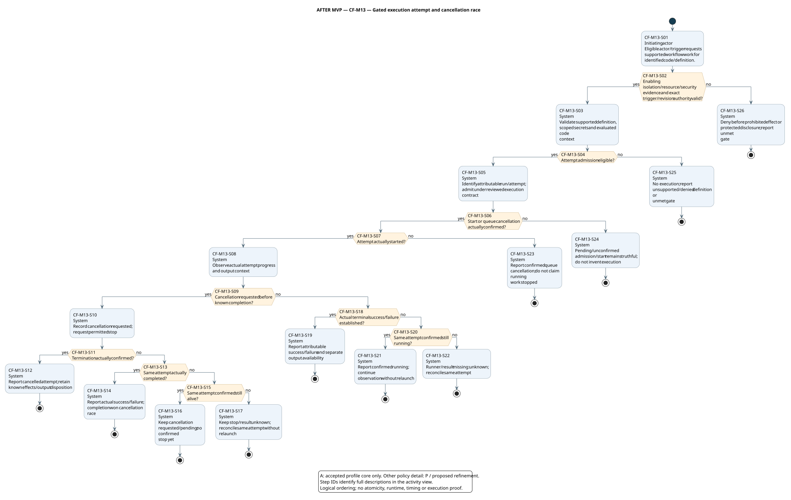

[Editable PlantUML](../diagrams/activity-workflow-admission-attempt.puml) · [PNG](../diagrams/activity-workflow-admission-attempt.png)

| Step | Kind / responsible context | Action or guard meaning |
| --- | --- | --- |
| **CF-M13-S01** | action; Initiating actor | Eligible actor/trigger requests supported workflow work for identified code/definition. |
| **CF-M13-S02** | decision; Decision / current domain context | Enabling isolation/resource/security evidence and exact trigger/revision authority valid |
| **CF-M13-S03** | action; System | Validate supported definition, scoped secrets and evaluated code context |
| **CF-M13-S04** | decision; Decision / current domain context | Attempt admission eligible |
| **CF-M13-S05** | action; System | Identify attributable run/attempt; admit under reviewed execution contract |
| **CF-M13-S06** | decision; Decision / current domain context | Start or queue cancellation actually confirmed |
| **CF-M13-S07** | decision; Decision / current domain context | Attempt actually started |
| **CF-M13-S08** | action; System | Observe actual attempt progress and output context |
| **CF-M13-S09** | decision; Decision / current domain context | Cancellation requested before known completion |
| **CF-M13-S10** | action; System | Record cancellation requested; request permitted stop |
| **CF-M13-S11** | decision; Decision / current domain context | Termination actually confirmed |
| **CF-M13-S12** | end; System | Report cancelled attempt; retain known effects/output disposition |
| **CF-M13-S13** | decision; Decision / current domain context | Same attempt actually completed |
| **CF-M13-S14** | end; System | Report actual success/failure; completion won cancellation race |
| **CF-M13-S15** | decision; Decision / current domain context | Same attempt confirmed still alive |
| **CF-M13-S16** | end; System | Keep cancellation requested/pending; no confirmed stop yet |
| **CF-M13-S17** | end; System | Keep stop/result unknown; reconcile same attempt without relaunch |
| **CF-M13-S18** | decision; Decision / current domain context | Actual terminal success/failure established |
| **CF-M13-S19** | end; System | Report attributable success/failure and separate output availability |
| **CF-M13-S20** | decision; Decision / current domain context | Same attempt confirmed still running |
| **CF-M13-S21** | end; System | Report confirmed running; continue observation without relaunch |
| **CF-M13-S22** | end; System | Runner/result missing: unknown; reconcile same attempt |
| **CF-M13-S23** | end; System | Report confirmed queue cancellation; do not claim running work stopped |
| **CF-M13-S24** | end; System | Pending/unconfirmed admission/start remains truthful; do not invent execution |
| **CF-M13-S25** | end; System | No execution; report unsupported/denied definition or unmet gate |
| **CF-M13-S26** | end; System | Deny before prohibited effect or protected disclosure; report unmet gate |

### CF-M14 — Separate target-authorized deployment

**Trigger:** Actor separately requests deployment of an identified artifact/revision to an intended target.

**Start conditions:** Target authority/approval, compatible data/recovery conditions and exact artifact/revision are explicit; successful build alone is insufficient.

**End condition:** Only independently permitted intended target effects are attempted; actual confirmed, failed or unknown target outcome is retained.

**Alternative/failure meaning:** Missing target approval, stale artifact/revision or unsuitable conditions deny deployment. An unknown outcome is reconciled before further consequential action.

**Control-flow interpretation:** Target deployment is a separate requested goal from workflow success, merge, tag or release.

**Policy/evidence boundary:** Q-D23 target/approval/execution feasibility remains gated; no target or production change is created by this analysis. No live deployment or automatic rollback is authorized. Recovery or retry must be separately eligible for actual current target state.

**Primary requirement basis:** [YML-D03](../../02-requirements-engineering/03-requirements-specification/yaml-workflows-and-cicd.md#yml-d03-run-identity-and-reproducible-context), [YML-D08](../../02-requirements-engineering/03-requirements-specification/yaml-workflows-and-cicd.md#yml-d08-restricted-logs-and-artifacts), [YML-D10](../../02-requirements-engineering/03-requirements-specification/yaml-workflows-and-cicd.md#yml-d10-separate-controlled-deployment-stage), [YML-D12](../../02-requirements-engineering/03-requirements-specification/yaml-workflows-and-cicd.md#yml-d12-feasibility-operational-guidance-and-enabling-gate), [EIF-D08](../../02-requirements-engineering/03-requirements-specification/external-interface-requirements.md#eif-d08-operation-specific-failure-and-repetition-semantics)

**Domain objects:** [DM-C45](../02-domain-and-information-analysis/03-domain-model-and-object-oriented-view.md#dm-c45), [DM-C46](../02-domain-and-information-analysis/03-domain-model-and-object-oriented-view.md#dm-c46), [DM-C43](../02-domain-and-information-analysis/03-domain-model-and-object-oriented-view.md#dm-c43), [DM-C41](../02-domain-and-information-analysis/03-domain-model-and-object-oriented-view.md#dm-c41)

**Source use cases:** [UC-D10](../../02-requirements-engineering/04-scenarios-and-models/user-stories-and-scenarios.md#uc-d10), [UC-D10-DEPLOY](../../02-requirements-engineering/04-scenarios-and-models/user-stories-and-scenarios.md#uc-d10-deploy)

**Information-flow meanings:** DA-F11 in [the data view](../02-domain-and-information-analysis/05-data-oriented-view.md). These links describe information meaning; they are not new function-model completion evidence.

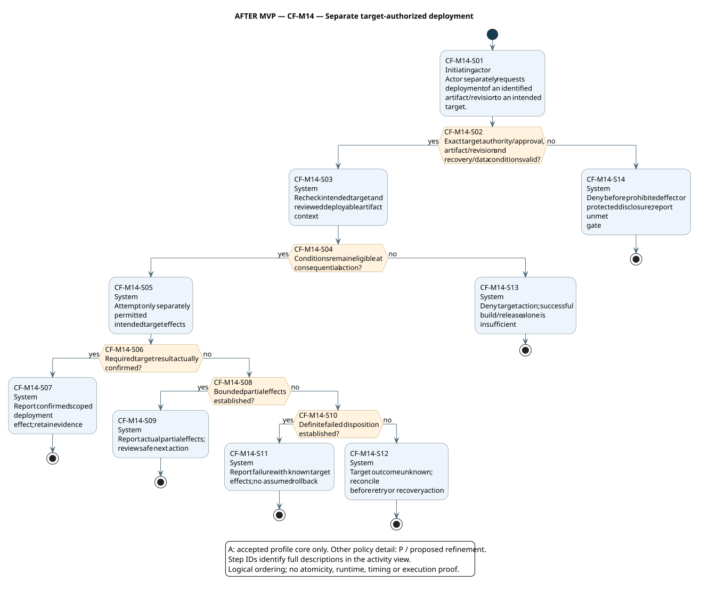

[Editable PlantUML](../diagrams/activity-separate-deployment.puml) · [PNG](../diagrams/activity-separate-deployment.png)

| Step | Kind / responsible context | Action or guard meaning |
| --- | --- | --- |
| **CF-M14-S01** | action; Initiating actor | Actor separately requests deployment of an identified artifact/revision to an intended target. |
| **CF-M14-S02** | decision; Decision / current domain context | Exact target authority/approval, artifact/revision and recovery/data conditions valid |
| **CF-M14-S03** | action; System | Recheck intended target and reviewed deployable artifact context |
| **CF-M14-S04** | decision; Decision / current domain context | Conditions remain eligible at consequential action |
| **CF-M14-S05** | action; System | Attempt only separately permitted intended target effects |
| **CF-M14-S06** | decision; Decision / current domain context | Required target result actually confirmed |
| **CF-M14-S07** | end; System | Report confirmed scoped deployment effect; retain evidence |
| **CF-M14-S08** | decision; Decision / current domain context | Bounded partial effects established |
| **CF-M14-S09** | end; System | Report actual partial effects; review safe next action |
| **CF-M14-S10** | decision; Decision / current domain context | Definite failed disposition established |
| **CF-M14-S11** | end; System | Report failure with known target effects; no assumed rollback |
| **CF-M14-S12** | end; System | Target outcome unknown; reconcile before retry or recovery action |
| **CF-M14-S13** | end; System | Deny target action; successful build/release alone is insufficient |
| **CF-M14-S14** | end; System | Deny before prohibited effect or protected disclosure; report unmet gate |

### CF-M15 — Effective policy, file admission or restricted evidence

**Trigger:** Actor requests one permitted policy, file-admission or evidence operation. Admission refines supporting file paths in the existing scenarios rather than allocating a new external use case.

**Start conditions:** Current role/resource/action authority, effective policy and actual content/usage/reference context are identified; administrative authority differs from upload authority.

**End condition:** Actual effective policy, usable admitted resource or permitted bounded evidence is reported for the requested operation only.

**Alternative/failure meaning:** Denied operations expose no restricted data. Failed persistence/processing/cleanup does not claim effective settings, usable content or freed capacity; lower limit does not silently delete history.

**Control-flow interpretation:** Policy administration, upload and evidence access are separate powers and alternative goals. A lower quota is not a cleanup instruction.

**Policy/evidence boundary:** Q-D24 numerical values/pools/concurrency and Q-D27 applicability remain proposals; actual capacity is not inferred from idle free disk. Concurrent admissions require a reviewed current capacity contract, not a pre-check promise. Cleanup eligibility and confirmed reclamation remain distinct in SM-M16.

**Primary requirement basis:** [AFO-D01](../../02-requirements-engineering/03-requirements-specification/administration-files-and-operational-behavior.md#afo-d01-owner-configurable-upload-and-storage-policy), [AFO-D02](../../02-requirements-engineering/03-requirements-specification/administration-files-and-operational-behavior.md#afo-d02-policy-consistent-with-evaluated-infrastructure), [AFO-D03](../../02-requirements-engineering/03-requirements-specification/administration-files-and-operational-behavior.md#afo-d03-per-file-admission-limit), [AFO-D04](../../02-requirements-engineering/03-requirements-specification/administration-files-and-operational-behavior.md#afo-d04-aggregate-quota-and-concurrent-admission), [AFO-D05](../../02-requirements-engineering/03-requirements-specification/administration-files-and-operational-behavior.md#afo-d05-supported-content-and-validation), [AFO-D06](../../02-requirements-engineering/03-requirements-specification/administration-files-and-operational-behavior.md#afo-d06-file-resource-authorization-and-isolation), [AFO-D07](../../02-requirements-engineering/03-requirements-specification/administration-files-and-operational-behavior.md#afo-d07-truthful-completion-and-interrupted-operation-handling), [AFO-D08](../../02-requirements-engineering/03-requirements-specification/administration-files-and-operational-behavior.md#afo-d08-safe-replacement-and-lifecycle-effects), [AFO-D09](../../02-requirements-engineering/03-requirements-specification/administration-files-and-operational-behavior.md#afo-d09-operational-outcomes-and-capacity-warnings), [AFO-D10](../../02-requirements-engineering/03-requirements-specification/administration-files-and-operational-behavior.md#afo-d10-administrative-operation-evidence), [AFO-D11](../../02-requirements-engineering/03-requirements-specification/administration-files-and-operational-behavior.md#afo-d11-bounded-cleanup-and-storage-reclamation)

**Domain objects:** [DM-C50](../02-domain-and-information-analysis/03-domain-model-and-object-oriented-view.md#dm-c50), [DM-C49](../02-domain-and-information-analysis/03-domain-model-and-object-oriented-view.md#dm-c49), [DM-C51](../02-domain-and-information-analysis/03-domain-model-and-object-oriented-view.md#dm-c51), [DM-C48](../02-domain-and-information-analysis/03-domain-model-and-object-oriented-view.md#dm-c48)

**Source use cases:** [UC-D11](../../02-requirements-engineering/04-scenarios-and-models/user-stories-and-scenarios.md#uc-d11), [UC-D11-POLICY](../../02-requirements-engineering/04-scenarios-and-models/user-stories-and-scenarios.md#uc-d11-policy), [UC-D11-EVIDENCE](../../02-requirements-engineering/04-scenarios-and-models/user-stories-and-scenarios.md#uc-d11-evidence)

**Information-flow meanings:** DA-F04, DA-F12 in [the data view](../02-domain-and-information-analysis/05-data-oriented-view.md). These links describe information meaning; they are not new function-model completion evidence.

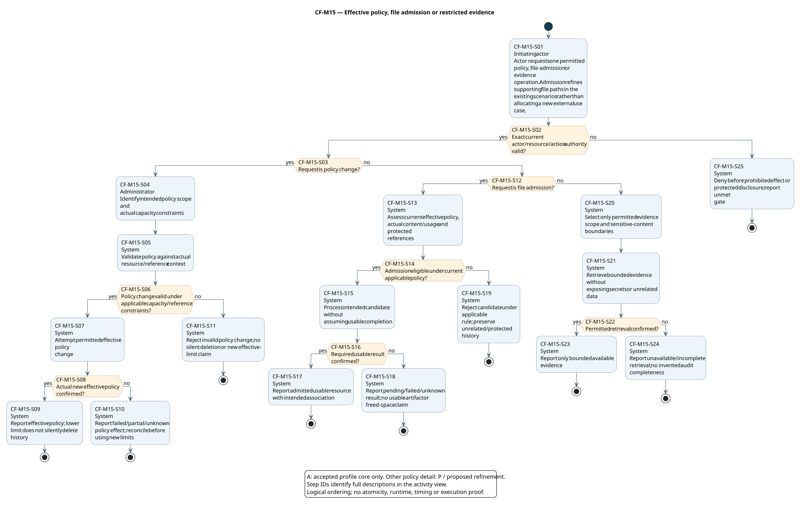

[Editable PlantUML](../diagrams/activity-policy-admission-evidence.puml) · [PNG](../diagrams/activity-policy-admission-evidence.png)

| Step | Kind / responsible context | Action or guard meaning |
| --- | --- | --- |
| **CF-M15-S01** | action; Initiating actor | Actor requests one permitted policy, file-admission or evidence operation. Admission refines supporting file paths in the existing scenarios rather than allocating a new external use case. |
| **CF-M15-S02** | decision; Decision / current domain context | Exact current actor/resource/action authority valid |
| **CF-M15-S03** | decision; Decision / current domain context | Request is policy change |
| **CF-M15-S04** | action; Administrator | Identify intended policy scope and actual capacity constraints |
| **CF-M15-S05** | action; System | Validate policy against actual resource/reference context |
| **CF-M15-S06** | decision; Decision / current domain context | Policy change valid under applicable capacity/reference constraints |
| **CF-M15-S07** | action; System | Attempt permitted effective policy change |
| **CF-M15-S08** | decision; Decision / current domain context | Actual new effective policy confirmed |
| **CF-M15-S09** | end; System | Report effective policy; lower limit does not silently delete history |
| **CF-M15-S10** | end; System | Report failed/partial/unknown policy effect; reconcile before using new limits |
| **CF-M15-S11** | end; System | Reject invalid policy change; no silent deletion or new effective-limit claim |
| **CF-M15-S12** | decision; Decision / current domain context | Request is file admission |
| **CF-M15-S13** | action; System | Assess current effective policy, actual content/usage and protected references |
| **CF-M15-S14** | decision; Decision / current domain context | Admission eligible under current applicable policy |
| **CF-M15-S15** | action; System | Process intended candidate without assuming usable completion |
| **CF-M15-S16** | decision; Decision / current domain context | Required usable result confirmed |
| **CF-M15-S17** | end; System | Report admitted usable resource with intended association |
| **CF-M15-S18** | end; System | Report pending/failed/unknown result; no usable artifact or freed-space claim |
| **CF-M15-S19** | end; System | Reject candidate under applicable rule; preserve unrelated/protected history |
| **CF-M15-S20** | action; System | Select only permitted evidence scope and sensitive-content boundaries |
| **CF-M15-S21** | action; System | Retrieve bounded evidence without exposing secrets or unrelated data |
| **CF-M15-S22** | decision; Decision / current domain context | Permitted retrieval confirmed |
| **CF-M15-S23** | end; System | Report only bounded available evidence |
| **CF-M15-S24** | end; System | Report unavailable/incomplete retrieval; no invented audit completeness |
| **CF-M15-S25** | end; System | Deny before prohibited effect or protected disclosure; report unmet gate |

### CF-M16 — Conditional isolated restore and usability assessment

**Trigger:** Operator identifies a loss/recovery scenario and requests an explicitly authorized isolated drill.

**Start conditions:** Identified protected recovery source, required artifacts/configuration, defined coverage/targets, suitable isolation and operator authority must actually exist for a later drill.

**End condition:** Actual findings identify covered/restored information, integrity, safe current access, external-state disposition and measured target comparison; no success is assumed before evidence.

**Alternative/failure meaning:** No authority/source/safe target blocks the drill. Missing/corrupt/inconsistent material or missed targets remain failed/incomplete. Revisit only under isolated authorized recovery policy.

**Control-flow interpretation:** Restored bytes are only input to usability/access/external-state assessment. Repeated drills keep distinguishable evidence.

**Policy/evidence boundary:** Backups are not configured. Q-D26 source/coverage/targets/restore proof and Q-D27 operating evidence remain open; this is not execution authorization. Backups are not configured, so the current real path stops at the prerequisite gate. No live overwrite, old-grant resurrection or external replay is authorized.

**Primary requirement basis:** [QSR-D10](../../02-requirements-engineering/03-requirements-specification/quality-security-and-recovery-requirements.md#qsr-d10-defined-protected-and-observable-backups), [QSR-D11](../../02-requirements-engineering/03-requirements-specification/quality-security-and-recovery-requirements.md#qsr-d11-demonstrated-restoration-and-recovery-targets), [QSR-D12](../../02-requirements-engineering/03-requirements-specification/quality-security-and-recovery-requirements.md#qsr-d12-safe-restored-access-and-external-state-reconciliation), [QSR-D14](../../02-requirements-engineering/03-requirements-specification/quality-security-and-recovery-requirements.md#qsr-d14-maintainable-verifiable-and-recoverable-changes), [AFO-D12](../../02-requirements-engineering/03-requirements-specification/administration-files-and-operational-behavior.md#afo-d12-version-specific-operational-guidance-and-readiness)

**Domain objects:** [DM-C52](../02-domain-and-information-analysis/03-domain-model-and-object-oriented-view.md#dm-c52), [DM-C53](../02-domain-and-information-analysis/03-domain-model-and-object-oriented-view.md#dm-c53), [DM-C48](../02-domain-and-information-analysis/03-domain-model-and-object-oriented-view.md#dm-c48)

**Source use cases:** [UC-D12](../../02-requirements-engineering/04-scenarios-and-models/user-stories-and-scenarios.md#uc-d12)

**Information-flow meanings:** DA-F13 in [the data view](../02-domain-and-information-analysis/05-data-oriented-view.md). These links describe information meaning; they are not new function-model completion evidence.

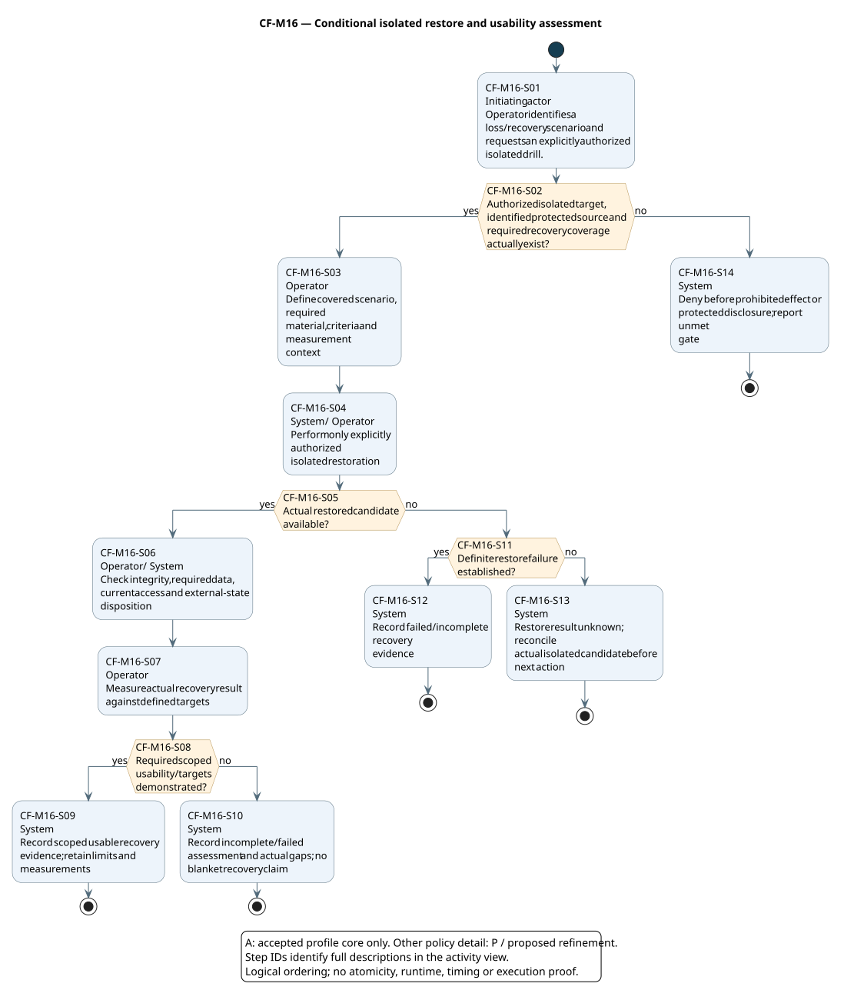

[Editable PlantUML](../diagrams/activity-isolated-recovery-assessment.puml) · [PNG](../diagrams/activity-isolated-recovery-assessment.png)

| Step | Kind / responsible context | Action or guard meaning |
| --- | --- | --- |
| **CF-M16-S01** | action; Initiating actor | Operator identifies a loss/recovery scenario and requests an explicitly authorized isolated drill. |
| **CF-M16-S02** | decision; Decision / current domain context | Authorized isolated target, identified protected source and required recovery coverage actually exist |
| **CF-M16-S03** | action; Operator | Define covered scenario, required material, criteria and measurement context |
| **CF-M16-S04** | action; System / Operator | Perform only explicitly authorized isolated restoration |
| **CF-M16-S05** | decision; Decision / current domain context | Actual restored candidate available |
| **CF-M16-S06** | action; Operator / System | Check integrity, required data, current access and external-state disposition |
| **CF-M16-S07** | action; Operator | Measure actual recovery result against defined targets |
| **CF-M16-S08** | decision; Decision / current domain context | Required scoped usability/targets demonstrated |
| **CF-M16-S09** | end; System | Record scoped usable recovery evidence; retain limits and measurements |
| **CF-M16-S10** | end; System | Record incomplete/failed assessment and actual gaps; no blanket recovery claim |
| **CF-M16-S11** | decision; Decision / current domain context | Definite restore failure established |
| **CF-M16-S12** | end; System | Record failed/incomplete recovery evidence |
| **CF-M16-S13** | end; System | Restore result unknown; reconcile actual isolated candidate before next action |
| **CF-M16-S14** | end; System | Deny before prohibited effect or protected disclosure; report unmet gate |

### CF-M17 — Reusable actual operation-result classification

**Trigger:** An intended operation has a result or missing confirmation requiring classification.

**Start conditions:** Exact intended operation context and permitted observation scope are identified.

**End condition:** Only evidence-supported confirmed, pending, failed, partial or unknown effects are reported.

**Alternative/failure meaning:** Uncertain effect is not inferred failure, success or unchanged state; no blind retry.

**Control-flow interpretation:** Called by workflows after an attempted consequential action; each caller resumes/returns according to its actual domain result. This is a reusable analysis subactivity, not a selected runtime service.

**Policy/evidence boundary:** Classification refines existing failure semantics; no retry/transaction mechanism selected. Definite failure may include known effects and is not universal rollback. An unknown result requires same-operation reconciliation; retry is a separate authorized action. When context cannot be established, do not expose protected evidence or claim an attributed result.

**Primary requirement basis:** [AFO-D07](../../02-requirements-engineering/03-requirements-specification/administration-files-and-operational-behavior.md#afo-d07-truthful-completion-and-interrupted-operation-handling), [AFO-D09](../../02-requirements-engineering/03-requirements-specification/administration-files-and-operational-behavior.md#afo-d09-operational-outcomes-and-capacity-warnings), [EIF-D08](../../02-requirements-engineering/03-requirements-specification/external-interface-requirements.md#eif-d08-operation-specific-failure-and-repetition-semantics), [QSR-D08](../../02-requirements-engineering/03-requirements-specification/quality-security-and-recovery-requirements.md#qsr-d08-data-integrity-and-truthful-completion)

**Domain objects:** [DM-C50](../02-domain-and-information-analysis/03-domain-model-and-object-oriented-view.md#dm-c50), [DM-C49](../02-domain-and-information-analysis/03-domain-model-and-object-oriented-view.md#dm-c49), [DM-C51](../02-domain-and-information-analysis/03-domain-model-and-object-oriented-view.md#dm-c51), [DM-C48](../02-domain-and-information-analysis/03-domain-model-and-object-oriented-view.md#dm-c48)

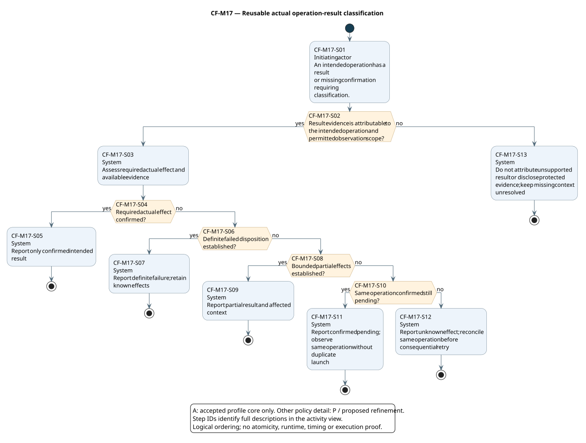

[Editable PlantUML](../diagrams/activity-operation-result-classification.puml) · [PNG](../diagrams/activity-operation-result-classification.png)

| Step | Kind / responsible context | Action or guard meaning |
| --- | --- | --- |
| **CF-M17-S01** | action; Initiating actor | An intended operation has a result or missing confirmation requiring classification. |
| **CF-M17-S02** | decision; Decision / current domain context | Result evidence is attributable to the intended operation and permitted observation scope |
| **CF-M17-S03** | action; System | Assess required actual effect and available evidence |
| **CF-M17-S04** | decision; Decision / current domain context | Required actual effect confirmed? |
| **CF-M17-S05** | end; System | Report only confirmed intended result |
| **CF-M17-S06** | decision; Decision / current domain context | Definite failed disposition established? |
| **CF-M17-S07** | end; System | Report definite failure; retain known effects |
| **CF-M17-S08** | decision; Decision / current domain context | Bounded partial effects established? |
| **CF-M17-S09** | end; System | Report partial result and affected context |
| **CF-M17-S10** | decision; Decision / current domain context | Same operation confirmed still pending |
| **CF-M17-S11** | end; System | Report confirmed pending; observe same operation without duplicate launch |
| **CF-M17-S12** | end; System | Report unknown effect; reconcile same operation before consequential retry |
| **CF-M17-S13** | end; System | Do not attribute unsupported result or disclose protected evidence; keep missing context unresolved |

## 3. Contracts and Other Views

Every activity must retain identity, current authority and actual outcome from its source interaction/state models. Do not infer atomicity or safe repetition from vertical ordering. State changes occur only when their full guard/effect conditions apply; a timeout after a consequential action cannot prove unchanged state.

### Object handoffs and authority

| Activity | Input objects / context | Output / handoff meaning |
| --- | --- | --- |
| CF-M01 | Source differences, intended resume, overrides, existing live presentation | Explicit selected draft; separately confirmed publication; actual history independent (DA-F01–03) |
| CF-M02–04 | Download choice, language/artifact, exact link and published selection | Effective saved mode, independent link change, or authorized selected representation (DA-F04–05) |
| CF-M05–06 | Company/opportunity, manual application, actual event and sent material | Preparation/progress separately retained; identifiable actual material set and completeness (DA-F06) |
| CF-M07 | Intended provider account, scoped capability, reviewed message intent | Permitted mailbox content or attributable provider acceptance/rejection/unknown send (DA-F07) |
| CF-M08 | Local activity/time, mapping, local/provider versions and field authority | Local state, explicit mapping/unlink, stale/conflict or confirmed provider result (DA-F08) |
| CF-M09–10 | Item/task/Sprint Goal/selection/plan or invitation/current grant | Coherent Sprint Backlog, actual period result, or exact scoped access (DA-F09) |
| CF-M11–12 | Repository/ref, expected/evaluated source and target revisions, review/check context | Actual transfer/ref/integration result; no inherited deployment permission (DA-F10) |
| CF-M13–14 | Evaluated code/definition, attempt, scoped secrets, artifact and exact target | Attributable actual/unknown attempt/output and separately authorized target effect (DA-F11) |
| CF-M15 | Effective policy, actual usage/content/protected references or evidence scope | Effective policy/usable admission/bounded evidence; no invented freed capacity (DA-F04/12) |
| CF-M16 | Identified recovery source, covered scenario and suitable isolated target | Assessed actual integrity/usability/current access and measured target comparison (DA-F13) |
| CF-M17 | Exact operation identity and permitted evidence about actual effects | Classified evidence-supported result, never an invented rollback or implicit retry |

This table records conceptual object flows without choosing payload formats, stored schemas or technical interfaces. The primary dictionary and data view retain meaning/authority. Function view 04 and operation contracts 10 must later make required inputs/preconditions and postconditions explicit without duplicating policy truth.

### Cross-view invariants

| Check | Required agreement |
| --- | --- |
| CF-X01 Profile preservation | CF-M01 = SB-M01 = SM-M01/07: source edits alone do not update existing resumes or actual sent content |
| CF-X02 Independent controls | CF-M02–04 = SM-M04/05: PDF mode, link eligibility and artifact availability are separate |
| CF-X03 Actual evidence | CF-M05–06 = SM-M06/07: progress does not establish preservation or receipt |
| CF-X04 Provider effects | CF-M07–08 = SM-M08–10: capability, freshness and acceptance are distinct; no blind resend/replay |
| CF-X05 Work meaning | CF-M09 = SM-M11–12: readiness differs from progress; task completion/period end is not universal acceptance |
| CF-X06 Current access | CF-M10–12 = SM-M02/03/13: scoped grants and current evaluated revisions govern consequential operations |
| CF-X07 Safe enablement | CF-M13–14 = SM-M14/15: actual execution gates and separate target authority precede effects |
| CF-X08 Reference integrity | CF-M15 = SM-M05/16: admission/cleanup cannot silently destroy protected actual history |
| CF-X09 Recovery proof | CF-M16 = SM-M17: restored candidate is assessed before usable recovery is claimed |
| CF-X10 Result honesty | CF-M17 = SM-M18: denied, definite failed, partial and unknown outcomes stay distinguishable |

## 4. Review Questions

| Review question | Current disposition |
| --- | --- |
| Are actions assigned to responsible contexts? | Yes: inline actor labels and complete step tables; no invented runtime component structure |
| Are decision alternatives visible? | Each declared decision has explicit yes/no branches; bounded dispatch assumption is stated. Source-policy finalization and guard sufficiency still need contract review |
| Are start/end and unsupported requests clear? | Yes: trigger/start/end per activity; reject unsupported operation kind before bounded alternatives |
| Is fork/join behavior justified? | No fork/join is introduced: no supported requirement demands waiting for concurrent branches here |
| Do exceptional paths avoid invented success? | Explicit failure/unknown branches and CF-M17 preserve actual outcome distinctions; review cases below remain future tests |
| Are implementation choices kept for design? | No transaction/lock/retry protocol, worker topology, transport, algorithm or execution environment is selected |
| Is every primary acceptance criterion proven? | No. Provenance and model structure checks are not exhaustive criterion coverage or execution evidence |

## 5. Interruption, concurrency and resumption

| Event / interruption | Required observable handling | Prohibited inference |
| --- | --- | --- |
| Source changes while applying/publishing | Recheck intended current context; resolve stale/conflicting result explicitly | Source edit authorizes overwrite or publication |
| Link disabled while a request is open | Apply reviewed current-request/session policy; report actual effect | Previously emitted bytes can be recalled |
| Material capture interrupted | Identify confirmed versus missing/unconfirmed actual components | Current live PDF equals actual previously submitted file |
| Mail send times out | Reconcile attributable same attempt before separately reviewed resend | Timeout proves no message was accepted |
| Local/provider edits overlap | Keep conflict/stale status until reviewed resolution | Last observed writer automatically wins |
| Grant changes during multi-step work | Recheck at consequential access and reconcile actual partial effects | Initial check is permanent authority or universal rollback |
| Ref/review changes during merge | Evaluate exact current revisions and actual ref result | Prior approval proves current merge eligibility |
| Cancellation races with attempt completion | Observe confirmed stop or actual completion; unknown stays unknown | Cancel request equals termination |
| Concurrent admissions approach limit | Current effective policy/usage and actual admission result need a reviewed contract | Two independent prechecks prove both writes fit |
| Restore reveals obsolete external/grant context | Assess current authority and external disposition in isolation | Restore authorizes reactivation, resend or deployment |

These diagrams end an observation/request path when pending or unknown; the underlying queued attempt or external operation may continue. Reconciliation resumes with the same identity and known context, not a blind restart of the whole activity. Any compensation, retry, correction or new attempt requires its own explicit eligible contract. No universal rollback guarantee is made.

## 6. Scope coverage and evidence gates

| Accepted scope | Selected activities |
| --- | --- |
| SCP-01 Accounts, permissions, unified sign-in | CF-M10, CF-M17; current-access gates throughout. Authentication onboarding is not exhaustively re-modeled |
| SCP-02 Profiles/resumes | CF-M01, CF-M06 |
| SCP-03 Portfolio/supporting evidence | CF-M01, CF-M04, CF-M15; all portfolio editing operations are not claimed covered |
| SCP-04 Generated/uploaded PDFs | CF-M02, CF-M04, CF-M06, CF-M15 |
| SCP-05 Protected employer sharing | CF-M02–04 |
| SCP-06 Manual job application management | CF-M05–06 |
| SCP-07 Gmail/calendar | CF-M07–08  **After MVP.** |
| SCP-08 Projects/Kanban/backlogs/Sprints | CF-M09–10; ordinary board operations remain source requirements |
| SCP-09 Real Git/collaboration | CF-M10–12; issues/tags/releases are not claimed fully detailed |
| SCP-10 YAML workflow/CI/CD | CF-M13–14  **After MVP.** |
| SCP-11 Upload/storage limits | CF-M15, CF-M17; detailed cleanup depends on SM-M16/contracts |
| SCP-12 Deployment/operational readiness | CF-M14, CF-M16–17 |

Known gates are carried forward without re-asking the owner: OAuth is not created; backups are not configured; suitable execution isolation/capacity is not demonstrated. The existing Ubuntu demo host has 2 vCPU, 4 GB RAM and 40 GB disk; idle resource readings do not prove multi-feature load, untrusted execution safety or recovery. These facts permit analysis of conditional workflows, not enabling dependent capabilities. The owner has 20 total project hours/week; sequencing and estimates remain planning work.

## 7. Review cases for later verification

These are review/test-design inputs, not tests that were executed against the product.

| Case | Expected path / result |
| --- | --- |
| CF-V01 Edit source; decline apply | CF-M01 no-apply path; existing draft/live unchanged by source edit |
| CF-V02 Apply selected changes; decline publish | CF-M01 save-only result; preserve live and actual history |
| CF-V03 Set neither download mode | CF-M02; no implicit link disable or page removal |
| CF-V04 Disable link; issue fresh protected request | CF-M03 deny after confirmed effective disablement |
| CF-V05 Wrong password, unselected evidence or missing language variant | CF-M04 deny/unavailable without unrelated fallback |
| CF-V06 Record submitted progress with missing actual materials | CF-M05–06 truthful progress and incomplete set, no complete-preservation claim |
| CF-V07 Send with changed attachment after confirmation | CF-M07 recheck fails current review; no send until renewed explicit review |
| CF-V08 Lose send confirmation after provider acceptance may occur | CF-M07 unknown and same-attempt reconciliation; no blind resend |
| CF-V09 Local unlink or concurrent calendar edits | CF-M08 unlink does not delete provider event; conflicts require resolution |
| CF-V10 End Sprint with unfinished selected work | CF-M09 actual disposition, no automatic acceptance/carryover |
| CF-V11 Invitation pending or grant revoked before requested action | CF-M10 no unconfirmed membership or unrelated resource access |
| CF-V12 Protected ref push or stale merge review | CF-M11–12 reject/reevaluate; actual unknown ref state reconciled |
| CF-V13 No safe runner evidence; or completion wins cancel race | CF-M13 blocks execution, or reports actual completion/unknown rather than false cancelled |
| CF-V14 Successful build but no target authority | CF-M14 denies deployment |
| CF-V15 Policy save ambiguous or admission fails | CF-M15/17 no invented new limit, usable artifact or reclaimed bytes |
| CF-V16 No backup source; or restored bytes fail access/integrity checks | CF-M16 prerequisite block or incomplete recovery, no blanket success |

## 8. Review Status and next work

This view contains 17 locally rendered PlantUML activity models: 16 source-aligned domain activities and one reusable outcome classifier. Each has bounded start/end conditions, responsible contexts, explicit guards/alternatives and provenance. Structural checks verify declared branches and scoped termination, not satisfiable guards, runtime concurrency or complete functional coverage.

Continue with [rule-based view 09](../05-business-rules-and-operation-contracts/09-rule-based-view.md) and [operation contracts 10](../05-business-rules-and-operation-contracts/10-domain-constraints-and-operation-contracts.md), then [cross-view review 11](../07-review-and-design-handoff/11-model-consistency-traceability-and-review.md). Function view 04 and the interface/quality/handoff documents remain separate substantive work. No primary requirement text/identifier or accepted decision is changed by this view; System Analysis and its phase gate are not declared complete.

[Diagram catalog](../diagrams/README.md) · [Structured review evidence](../evidence/control-flow-review-2026-11-01.json) · [System Analysis index](../README.md)

## Diagram Types and Reading Guide

The seventeen existing activity diagrams show branching and workflow progression. Decision labels and failure/unknown-result paths must be read with the step/guard tables. Swimlanes or forks, where used, express responsibility or concurrency rather than deployment topology. No additional duplicate flowchart is needed.
