# Resumefolio — Scenario-Based View

[Diagram types and reading guide](#diagram-types-and-reading-guide) · [Full diagram catalog](../diagrams/README.md)

Owner: Farhad. Revision: November 1, 2026.

Status: populated source-derived interaction model. Detailed policy proposals, dependent capability gates and cross-view acceptance remain explicit. Diagrams are models, not executed product traces.

This view refines external actor goals into logical domain interactions. It explains what is requested, which current authority/context is evaluated, what information changes, what remains unchanged, and how denied, partial, failed or uncertain outcomes differ.

Current MVP scope and selected mechanisms: [Baseline](../../../baseline/README.md). Deferred provider, advanced collaboration and workflow-execution designs are not MVP prerequisites.

## Authoritative Inputs

Use [accepted scope](../../01-project-planning/02-scope.md), the [distributed SRS](../../02-requirements-engineering/03-requirements-specification/requirements-specification.md), the [existing use-case/story/path catalog](../../02-requirements-engineering/04-scenarios-and-models/user-stories-and-scenarios.md), [domain model](../02-domain-and-information-analysis/03-domain-model-and-object-oriented-view.md), [data view](../02-domain-and-information-analysis/05-data-oriented-view.md), [dictionary](../../02-requirements-engineering/05-data-definitions/data-dictionary.md) and [question register](../../02-requirements-engineering/07-change-and-baseline/open-questions-and-decisions.md).

The [accepted core profile rule](../../02-requirements-engineering/07-change-and-baseline/open-questions-and-decisions.md#owner-accepted-profile-update-policy) governs this refinement: source editing alone does not alter existing resumes/live presentations; preview and selected application preserve independent content; publication is separately confirmed; actual submitted documents remain preserved. Older generic propagation questions in the source bundle do not reopen those four behaviors. Remaining source-removal/concurrency details retain their separate status.

Local IDs `SB-Mxx`, `SB-Xxx` and `SB-Fxx` identify interaction models, cross-view checks and findings. They do not allocate new UC/ST/SCN records. [Source hashes and review inventory](../evidence/scenario-based-review-2026-11-01.json) identify the inputs to this revision.

## 1. Source Scenario Catalog

### 1.1 Twelve Existing Goal Bundles

The source UC/ST/SCN families remain authoritative for external goals. The models below select/refine their important interactions; a link does not prove complete acceptance-criterion coverage or that an executable test passed.

| Existing external goal / source story | Normal source path | Local interaction refinements |
| --- | --- | --- |
| [UC-D01](../../02-requirements-engineering/04-scenarios-and-models/user-stories-and-scenarios.md#uc-d01) — Tailor two resumes without losing independent choices; ST-D01 remains in that bundle | [SCN-D01-N](../../02-requirements-engineering/04-scenarios-and-models/user-stories-and-scenarios.md#scn-d01-n) | [SB-M01](#sb-m01) |
| [UC-D02](../../02-requirements-engineering/04-scenarios-and-models/user-stories-and-scenarios.md#uc-d02) — Configure PDF availability and owner sharing controls; ST-D02 remains in that bundle | [SCN-D02-N](../../02-requirements-engineering/04-scenarios-and-models/user-stories-and-scenarios.md#scn-d02-n) | [SB-M02](#sb-m02), [SB-M03](#sb-m03) |
| [UC-D03](../../02-requirements-engineering/04-scenarios-and-models/user-stories-and-scenarios.md#uc-d03) — View a protected resume and retrieve only selected material; ST-D03 remains in that bundle | [SCN-D03-N](../../02-requirements-engineering/04-scenarios-and-models/user-stories-and-scenarios.md#scn-d03-n) | [SB-M04](#sb-m04) |
| [UC-D04](../../02-requirements-engineering/04-scenarios-and-models/user-stories-and-scenarios.md#uc-d04) — Prepare a manual application and record progress; ST-D04 remains in that bundle | [SCN-D04-N](../../02-requirements-engineering/04-scenarios-and-models/user-stories-and-scenarios.md#scn-d04-n) | [SB-M05](#sb-m05) |
| [UC-D05](../../02-requirements-engineering/04-scenarios-and-models/user-stories-and-scenarios.md#uc-d05) — Preserve the resume and cover letter actually submitted; ST-D05 remains in that bundle | [SCN-D05-N](../../02-requirements-engineering/04-scenarios-and-models/user-stories-and-scenarios.md#scn-d05-n) | [SB-M06](#sb-m06) |
| [UC-D06](../../02-requirements-engineering/04-scenarios-and-models/user-stories-and-scenarios.md#uc-d06) — Coordinate authorized Gmail and calendar activity; ST-D06 remains in that bundle | [SCN-D06-N](../../02-requirements-engineering/04-scenarios-and-models/user-stories-and-scenarios.md#scn-d06-n) | [SB-M07](#sb-m07), [SB-M08](#sb-m08)  **After MVP.** |
| [UC-D07](../../02-requirements-engineering/04-scenarios-and-models/user-stories-and-scenarios.md#uc-d07) — Refine work and maintain a coherent Sprint Backlog; ST-D07 remains in that bundle | [SCN-D07-N](../../02-requirements-engineering/04-scenarios-and-models/user-stories-and-scenarios.md#scn-d07-n) | [SB-M09](#sb-m09) |
| [UC-D08](../../02-requirements-engineering/04-scenarios-and-models/user-stories-and-scenarios.md#uc-d08) — Collaborate under a scoped invitation and changed membership; ST-D08 remains in that bundle | [SCN-D08-N](../../02-requirements-engineering/04-scenarios-and-models/user-stories-and-scenarios.md#scn-d08-n) | [SB-M10](#sb-m10) |
| [UC-D09](../../02-requirements-engineering/04-scenarios-and-models/user-stories-and-scenarios.md#uc-d09) — Use real Git transfer and review a current change; ST-D09 remains in that bundle | [SCN-D09-N](../../02-requirements-engineering/04-scenarios-and-models/user-stories-and-scenarios.md#scn-d09-n) | [SB-M11](#sb-m11), [SB-M12](#sb-m12) |
| [UC-D10](../../02-requirements-engineering/04-scenarios-and-models/user-stories-and-scenarios.md#uc-d10) — Run supported work with separately controlled deployment; ST-D10 remains in that bundle | [SCN-D10-N](../../02-requirements-engineering/04-scenarios-and-models/user-stories-and-scenarios.md#scn-d10-n) | [SB-M13](#sb-m13), [SB-M14](#sb-m14)  **After MVP.** |
| [UC-D11](../../02-requirements-engineering/04-scenarios-and-models/user-stories-and-scenarios.md#uc-d11) — Configure effective limits and inspect permitted operation evidence; ST-D11 remains in that bundle | [SCN-D11-N](../../02-requirements-engineering/04-scenarios-and-models/user-stories-and-scenarios.md#scn-d11-n) | [SB-M15](#sb-m15) |
| [UC-D12](../../02-requirements-engineering/04-scenarios-and-models/user-stories-and-scenarios.md#uc-d12) — Restore an identified release and reconcile access safely; ST-D12 remains in that bundle | [SCN-D12-N](../../02-requirements-engineering/04-scenarios-and-models/user-stories-and-scenarios.md#scn-d12-n) | [SB-M16](#sb-m16) |

### 1.2 Sixteen Existing Operation-Specific Use Cases

Each operation remains a separate requested goal. Reading does not automatically send mail; a local activity edit does not automatically synchronize; refinement does not automatically start/end a Sprint; cloning/pushing/reviewing/merging and requesting a run/deployment are independent actions.

| Existing operation / source | Local model |
| --- | --- |
| [UC-D06-READ](../../02-requirements-engineering/04-scenarios-and-models/user-stories-and-scenarios.md#uc-d06-read) — Read correspondence | [SB-M07](#sb-m07)  **After MVP.** |
| [UC-D06-SEND](../../02-requirements-engineering/04-scenarios-and-models/user-stories-and-scenarios.md#uc-d06-send) — Send a manually prepared message | [SB-M07](#sb-m07)  **After MVP.** |
| [UC-D06-ACTIVITY](../../02-requirements-engineering/04-scenarios-and-models/user-stories-and-scenarios.md#uc-d06-activity) — Manage a calendar activity | [SB-M08](#sb-m08)  **After MVP.** |
| [UC-D06-SYNC](../../02-requirements-engineering/04-scenarios-and-models/user-stories-and-scenarios.md#uc-d06-sync) — Synchronize selected calendar information | [SB-M08](#sb-m08)  **After MVP.** |
| [UC-D07-REFINE](../../02-requirements-engineering/04-scenarios-and-models/user-stories-and-scenarios.md#uc-d07-refine) — Refine a Backlog Item into tasks | [SB-M09](#sb-m09) |
| [UC-D07-PLAN](../../02-requirements-engineering/04-scenarios-and-models/user-stories-and-scenarios.md#uc-d07-plan) — Maintain a Sprint Backlog | [SB-M09](#sb-m09) |
| [UC-D07-END](../../02-requirements-engineering/04-scenarios-and-models/user-stories-and-scenarios.md#uc-d07-end) — Record a Sprint-end outcome | [SB-M09](#sb-m09) |
| [UC-D09-CLONE](../../02-requirements-engineering/04-scenarios-and-models/user-stories-and-scenarios.md#uc-d09-clone) — Clone an authorized repository | [SB-M11](#sb-m11) |
| [UC-D09-PUSH](../../02-requirements-engineering/04-scenarios-and-models/user-stories-and-scenarios.md#uc-d09-push) — Push a repository change | [SB-M11](#sb-m11) |
| [UC-D09-REQUEST](../../02-requirements-engineering/04-scenarios-and-models/user-stories-and-scenarios.md#uc-d09-request) — Open a pull request | [SB-M12](#sb-m12) |
| [UC-D09-REVIEW](../../02-requirements-engineering/04-scenarios-and-models/user-stories-and-scenarios.md#uc-d09-review) — Review a pull request | [SB-M12](#sb-m12) |
| [UC-D09-MERGE](../../02-requirements-engineering/04-scenarios-and-models/user-stories-and-scenarios.md#uc-d09-merge) — Merge an eligible pull request | [SB-M12](#sb-m12) |
| [UC-D10-RUN](../../02-requirements-engineering/04-scenarios-and-models/user-stories-and-scenarios.md#uc-d10-run) — Request supported workflow execution | [SB-M13](#sb-m13)  **After MVP.** |
| [UC-D10-DEPLOY](../../02-requirements-engineering/04-scenarios-and-models/user-stories-and-scenarios.md#uc-d10-deploy) — Request an authorized deployment | [SB-M14](#sb-m14)  **After MVP.** |
| [UC-D11-POLICY](../../02-requirements-engineering/04-scenarios-and-models/user-stories-and-scenarios.md#uc-d11-policy) — Change effective file policy | [SB-M15](#sb-m15) |
| [UC-D11-EVIDENCE](../../02-requirements-engineering/04-scenarios-and-models/user-stories-and-scenarios.md#uc-d11-evidence) — Inspect permitted operation evidence | [SB-M15](#sb-m15) |

The existing [independent link-disable operation](../../02-requirements-engineering/04-scenarios-and-models/user-stories-and-scenarios.md#uc-d02-disable-link) belongs to UC-D02. SB-M03 refines it without introducing a new external use-case ID. PDF settings and link disablement require no mandatory order.

## 2. System Interactions

### 2.1 Interpretation and Common Interaction Contract

| Element / convention | Meaning and limit |
| --- | --- |
| Actor | A goal/authority context, not necessarily a different person or complete permission set |
| Named domain lifeline | Logical collaborator from document 03 or a clearly labeled contextual grouping; not a controller, service, queue or selected implementation class |
| External participant | Actual boundary role such as Google or an intended deployment target; showing it does not establish usable access |
| Solid message arrow | Requested interaction or local responsibility with intended meaning; labels are not endpoint or method signatures |
| Dashed return arrow | Result/information whose actual status must be truthful; not a promise of network transport or synchronous implementation |
| `alt` / `else` frame | Mutually exclusive outcomes or independent operation choices, as labeled |
| `opt` frame | Optional explicit action; it is not triggered merely because an earlier action happened |
| Self-message | Logical evaluation/change responsibility; not a selected internal algorithm or transaction |
| Sequence numbering | Reading order within a model; not allocated scenario step IDs or timing guarantees |

Common conditions apply before any protected effect: identify the actor/resource/action/current-state context, validate relevant input/authority, preserve the intended revision/account/language meaning, and report the actual result. Authorization may need re-evaluation at later consequential requests; a prior UI view is not a permanent grant. No universal session-revocation timing, atomic rollback, safe retry or all-or-nothing multi-object update is inferred.

Controlled fixture references in the source scenarios describe intended later checks, not current populated test accounts or verified capabilities. OAuth is not created, backups are not configured, and execution isolation remains unproven. Their successful future branches are conditional; their absent prerequisites are explicitly blocking at the dependent operation, not at model authoring.

### External and Internal Domain Scenarios

External UC records express an actor goal. Internal refinement identifies the cooperating concepts and their information/state boundaries. A diagram can focus on a source-approved success path or a specific failure boundary; the accompanying record and section 3 retain other relevant alternatives. Responsibility groupings such as Rendition context, Resource authority/invitation, Repository/current refs or External-effect state do not create additional primary domain classes.

### 2.2 SB-M01 — Explicit source application and separate publication

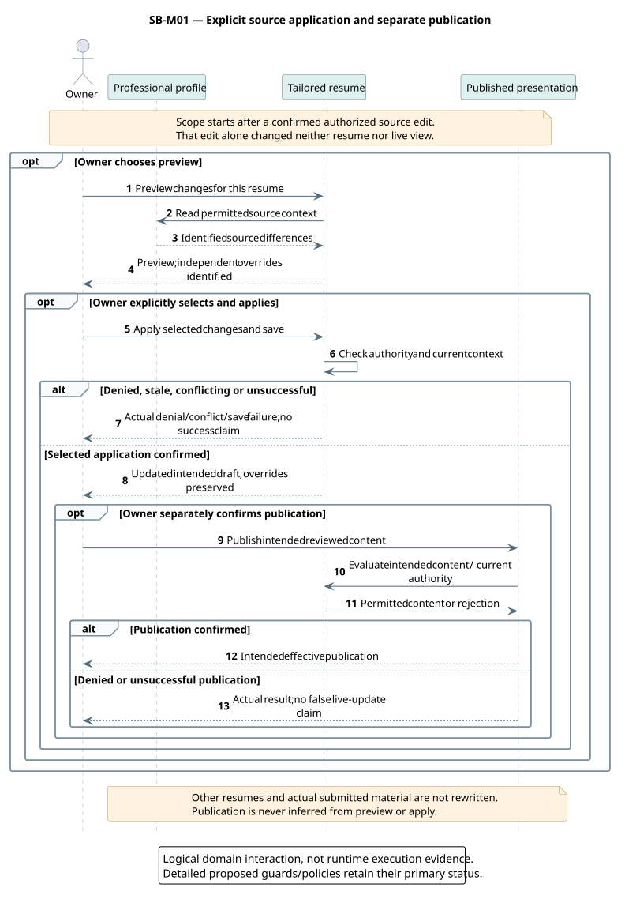

[PNG](../diagrams/scenario-profile-apply-publication.png) · [Editable PlantUML](../diagrams/scenario-profile-apply-publication.puml)

| Interaction record | Meaning / boundary |
| --- | --- |
| Existing source | [UC-D01](../../02-requirements-engineering/04-scenarios-and-models/user-stories-and-scenarios.md#uc-d01) |
| Trigger | Owner has changed shared information and chooses whether to preview/apply it for one resume. |
| Preconditions / controlled context | Authorized source/resume contexts and the saved source change are identified; independent text and prior publication are known. |
| Successful postcondition | Only explicitly selected draft changes apply; separate confirmation changes intended publication. Other resumes, independent text and actual submitted material remain preserved. |
| Alternative, denied, failed and recovery limits | No apply or no publish leaves the corresponding state unchanged. Stale/conflicting/failed application is not success; unauthorized paths are denied before content/change access. |
| Decision / evidence status | Accepted Q-D07 core applies now. Source removal and exact concurrency reconciliation remain distinct proposals. |

**Relevant domain concepts:** [DM-C01](../02-domain-and-information-analysis/03-domain-model-and-object-oriented-view.md#dm-c01), [DM-C03](../02-domain-and-information-analysis/03-domain-model-and-object-oriented-view.md#dm-c03), [DM-C09](../02-domain-and-information-analysis/03-domain-model-and-object-oriented-view.md#dm-c09). **Data:** DA-F01, DA-F02, DA-F03; [data view](../02-domain-and-information-analysis/05-data-oriented-view.md).

**Exact primary basis:** [PRP-D01](../../02-requirements-engineering/03-requirements-specification/profiles-resumes-and-portfolio.md#prp-d01-reusable-professional-information), [PRP-D03](../../02-requirements-engineering/03-requirements-specification/profiles-resumes-and-portfolio.md#prp-d03-independent-selections-layouts-and-overrides), [PRP-D04](../../02-requirements-engineering/03-requirements-specification/profiles-resumes-and-portfolio.md#prp-d04-explicit-shared-source-update-rules), [PRP-D08](../../02-requirements-engineering/03-requirements-specification/profiles-resumes-and-portfolio.md#prp-d08-clear-presentation-and-rendition-boundaries), [PDF-D07](../../02-requirements-engineering/03-requirements-specification/pdf-and-controlled-sharing.md#pdf-d07-explicit-live-revision-and-rendition-behavior).

### 2.3 SB-M02 — PDF settings without implicit link changes

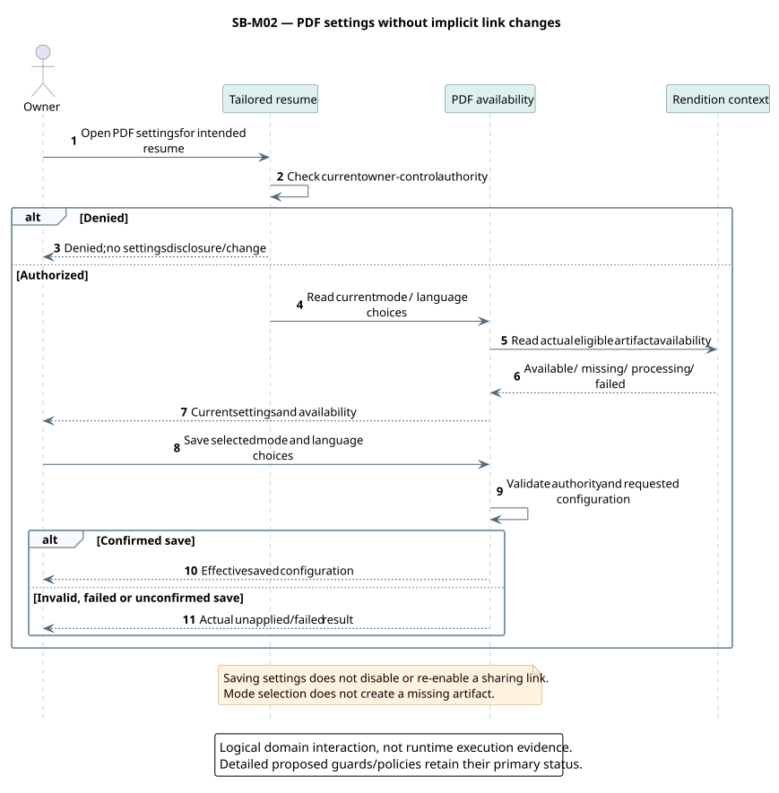

[PNG](../diagrams/scenario-pdf-settings.png) · [Editable PlantUML](../diagrams/scenario-pdf-settings.puml)

| Interaction record | Meaning / boundary |
| --- | --- |
| Existing source | [UC-D02](../../02-requirements-engineering/04-scenarios-and-models/user-stories-and-scenarios.md#uc-d02) |
| Trigger | Owner explicitly requests a download-configuration change. |
| Preconditions / controlled context | Intended resume, current mode and language/artifact availability are identified. |
| Successful postcondition | Actual permitted mode/language choices are saved; link enabled/disabled state is not changed by this action. |
| Alternative, denied, failed and recovery limits | Unauthorized request changes no settings. Invalid/unavailable/failed processing is explicit; neither mode does not disable the resume page/link. |
| Decision / evidence status | Q-D10 mode timing and artifact details remain proposed; active-session/in-flight effects are not inferred. |

**Relevant domain concepts:** [DM-C03](../02-domain-and-information-analysis/03-domain-model-and-object-oriented-view.md#dm-c03), [DM-C12](../02-domain-and-information-analysis/03-domain-model-and-object-oriented-view.md#dm-c12), [DM-C10](../02-domain-and-information-analysis/03-domain-model-and-object-oriented-view.md#dm-c10), [DM-C11](../02-domain-and-information-analysis/03-domain-model-and-object-oriented-view.md#dm-c11), [DM-C13](../02-domain-and-information-analysis/03-domain-model-and-object-oriented-view.md#dm-c13). **Data:** DA-F04, DA-F05; [data view](../02-domain-and-information-analysis/05-data-oriented-view.md).

**Exact primary basis:** [PDF-D02](../../02-requirements-engineering/03-requirements-specification/pdf-and-controlled-sharing.md#pdf-d02-uploaded-pdf-and-language-identity), [PDF-D03](../../02-requirements-engineering/03-requirements-specification/pdf-and-controlled-sharing.md#pdf-d03-per-resume-download-choices), [PDF-D05](../../02-requirements-engineering/03-requirements-specification/pdf-and-controlled-sharing.md#pdf-d05-direct-file-and-pdf-authorization), [PDF-D06](../../02-requirements-engineering/03-requirements-specification/pdf-and-controlled-sharing.md#pdf-d06-owner-password-and-link-controls), [ACC-D08](../../02-requirements-engineering/03-requirements-specification/accounts-authentication-and-permissions.md#acc-d08-owner-control-of-employer-link-access).

### 2.4 SB-M03 — Independent link disable and fresh access

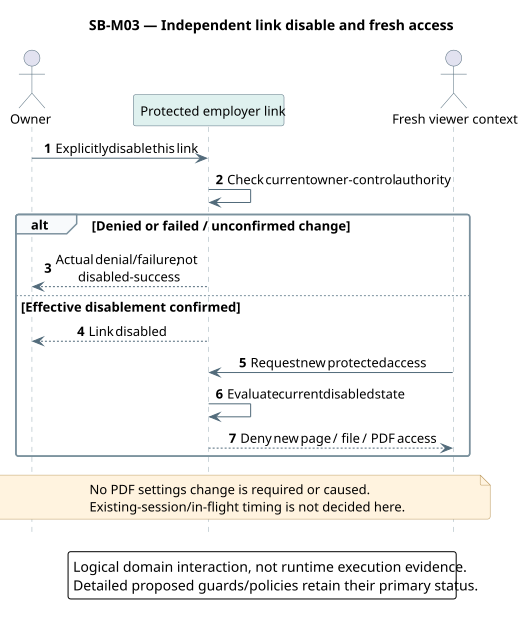

[PNG](../diagrams/scenario-disable-sharing-link.png) · [Editable PlantUML](../diagrams/scenario-disable-sharing-link.puml)

| Interaction record | Meaning / boundary |
| --- | --- |
| Existing source | [UC-D02](../../02-requirements-engineering/04-scenarios-and-models/user-stories-and-scenarios.md#uc-d02) |
| Trigger | Owner separately requests disablement of a specific link. |
| Preconditions / controlled context | Link identity and current owner-control authority exist; no preceding PDF settings change is required. |
| Successful postcondition | After confirmed effective disablement, a fresh request cannot gain protected access through that link; download configuration is unchanged. |
| Alternative, denied, failed and recovery limits | Denied/failed/unconfirmed disablement is not reported complete. Already delivered bytes cannot be recalled; existing sessions/caches/in-flight effects remain policy-specific. |
| Decision / evidence status | Reuse the existing separate operation under UC-D02; do not allocate a new external use-case ID. |

**Relevant domain concepts:** [DM-C13](../02-domain-and-information-analysis/03-domain-model-and-object-oriented-view.md#dm-c13), [DM-C48](../02-domain-and-information-analysis/03-domain-model-and-object-oriented-view.md#dm-c48). **Data:** DA-F05; [data view](../02-domain-and-information-analysis/05-data-oriented-view.md).

**Exact primary basis:** [PDF-D06](../../02-requirements-engineering/03-requirements-specification/pdf-and-controlled-sharing.md#pdf-d06-owner-password-and-link-controls), [ACC-D08](../../02-requirements-engineering/03-requirements-specification/accounts-authentication-and-permissions.md#acc-d08-owner-control-of-employer-link-access), [PDF-D05](../../02-requirements-engineering/03-requirements-specification/pdf-and-controlled-sharing.md#pdf-d05-direct-file-and-pdf-authorization).

### 2.5 SB-M04 — Selected protected retrieval and unavailable variants

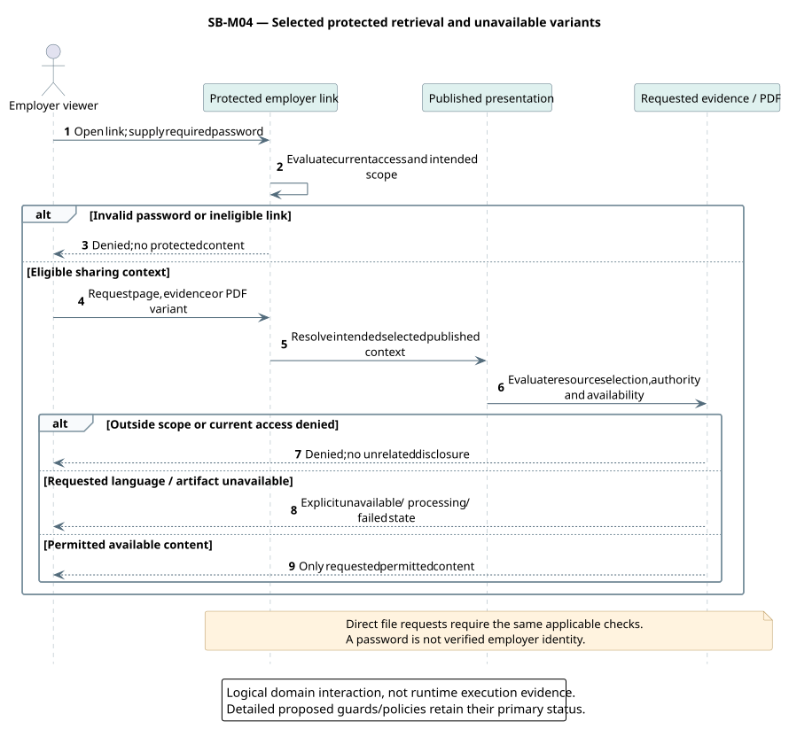

[PNG](../diagrams/scenario-protected-retrieval.png) · [Editable PlantUML](../diagrams/scenario-protected-retrieval.puml)

| Interaction record | Meaning / boundary |
| --- | --- |
| Existing source | [UC-D03](../../02-requirements-engineering/04-scenarios-and-models/user-stories-and-scenarios.md#uc-d03) |
| Trigger | Employer viewer opens an intended link and requests a page, evidence or PDF. |
| Preconditions / controlled context | Controlled link/password context and selected published content are identifiable; viewer account is not required. |
| Successful postcondition | Only currently permitted selected/available content is exposed; no private workspace or unrelated resource authority is granted. |
| Alternative, denied, failed and recovery limits | Wrong password, disabled link, altered resource and unselected content are denied. Missing language/artifact and retrieval failure are explicit; no unrelated fallback. |
| Decision / evidence status | Password/session, exact revocation timing and language-fallback proposals retain Q-D05/Q-D09/Q-D11 status. |

**Relevant domain concepts:** [DM-C13](../02-domain-and-information-analysis/03-domain-model-and-object-oriented-view.md#dm-c13), [DM-C09](../02-domain-and-information-analysis/03-domain-model-and-object-oriented-view.md#dm-c09), [DM-C07](../02-domain-and-information-analysis/03-domain-model-and-object-oriented-view.md#dm-c07), [DM-C12](../02-domain-and-information-analysis/03-domain-model-and-object-oriented-view.md#dm-c12), [DM-C10](../02-domain-and-information-analysis/03-domain-model-and-object-oriented-view.md#dm-c10), [DM-C11](../02-domain-and-information-analysis/03-domain-model-and-object-oriented-view.md#dm-c11). **Data:** DA-F05; [data view](../02-domain-and-information-analysis/05-data-oriented-view.md).

**Exact primary basis:** [PDF-D03](../../02-requirements-engineering/03-requirements-specification/pdf-and-controlled-sharing.md#pdf-d03-per-resume-download-choices), [PDF-D04](../../02-requirements-engineering/03-requirements-specification/pdf-and-controlled-sharing.md#pdf-d04-scoped-password-protected-employer-access), [PDF-D05](../../02-requirements-engineering/03-requirements-specification/pdf-and-controlled-sharing.md#pdf-d05-direct-file-and-pdf-authorization), [PDF-D06](../../02-requirements-engineering/03-requirements-specification/pdf-and-controlled-sharing.md#pdf-d06-owner-password-and-link-controls), [ACC-D06](../../02-requirements-engineering/03-requirements-specification/accounts-authentication-and-permissions.md#acc-d06-employer-access-without-a-viewer-account), [ACC-D07](../../02-requirements-engineering/03-requirements-specification/accounts-authentication-and-permissions.md#acc-d07-protected-shared-file-and-pdf-retrieval).

### 2.6 SB-M05 — Manual preparation and separate progress change

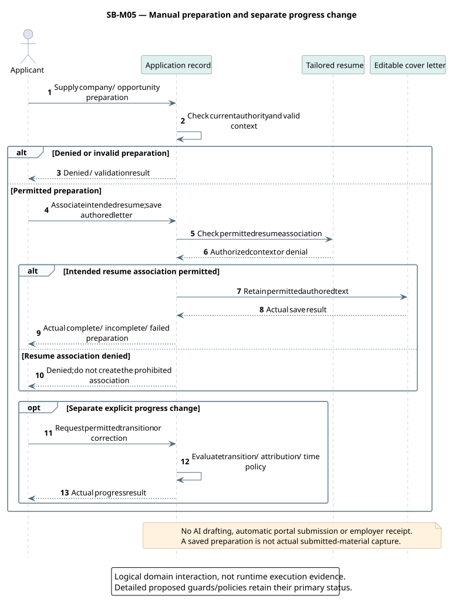

[PNG](../diagrams/scenario-application-preparation.png) · [Editable PlantUML](../diagrams/scenario-application-preparation.puml)

| Interaction record | Meaning / boundary |
| --- | --- |
| Existing source | [UC-D04](../../02-requirements-engineering/04-scenarios-and-models/user-stories-and-scenarios.md#uc-d04) |
| Trigger | Applicant prepares an application or explicitly updates progress. |
| Preconditions / controlled context | Permitted company/opportunity, application and selected-resume contexts are identified. |
| Successful postcondition | Actual preparation is retained; separately permitted progress records reflect the requested transition, not inferred external receipt. |
| Alternative, denied, failed and recovery limits | Inaccessible resume/application is denied. Incomplete drafts follow proposed rules; save failure/conflict is explicit; correction preserves required time/history context. |
| Decision / evidence status | Q-D12 fields/states, Q-D13 capture coupling and Q-D14 correction details remain proposed. |

**Relevant domain concepts:** [DM-C14](../02-domain-and-information-analysis/03-domain-model-and-object-oriented-view.md#dm-c14), [DM-C15](../02-domain-and-information-analysis/03-domain-model-and-object-oriented-view.md#dm-c15), [DM-C16](../02-domain-and-information-analysis/03-domain-model-and-object-oriented-view.md#dm-c16), [DM-C17](../02-domain-and-information-analysis/03-domain-model-and-object-oriented-view.md#dm-c17), [DM-C03](../02-domain-and-information-analysis/03-domain-model-and-object-oriented-view.md#dm-c03). **Data:** DA-S13–S17; preparation/progress flow refinement SB-F01; [data view](../02-domain-and-information-analysis/05-data-oriented-view.md).

**Exact primary basis:** [APP-D01](../../02-requirements-engineering/03-requirements-specification/manual-application-management.md#app-d01-company-and-opportunity-context), [APP-D02](../../02-requirements-engineering/03-requirements-specification/manual-application-management.md#app-d02-relevant-resume-association), [APP-D03](../../02-requirements-engineering/03-requirements-specification/manual-application-management.md#app-d03-manually-authored-cover-letter), [APP-D04](../../02-requirements-engineering/03-requirements-specification/manual-application-management.md#app-d04-explicit-progress-states-and-transitions), [APP-D05](../../02-requirements-engineering/03-requirements-specification/manual-application-management.md#app-d05-user-directed-submission-recording).

### 2.7 SB-M06 — Preserve actual material, not current live substitutes

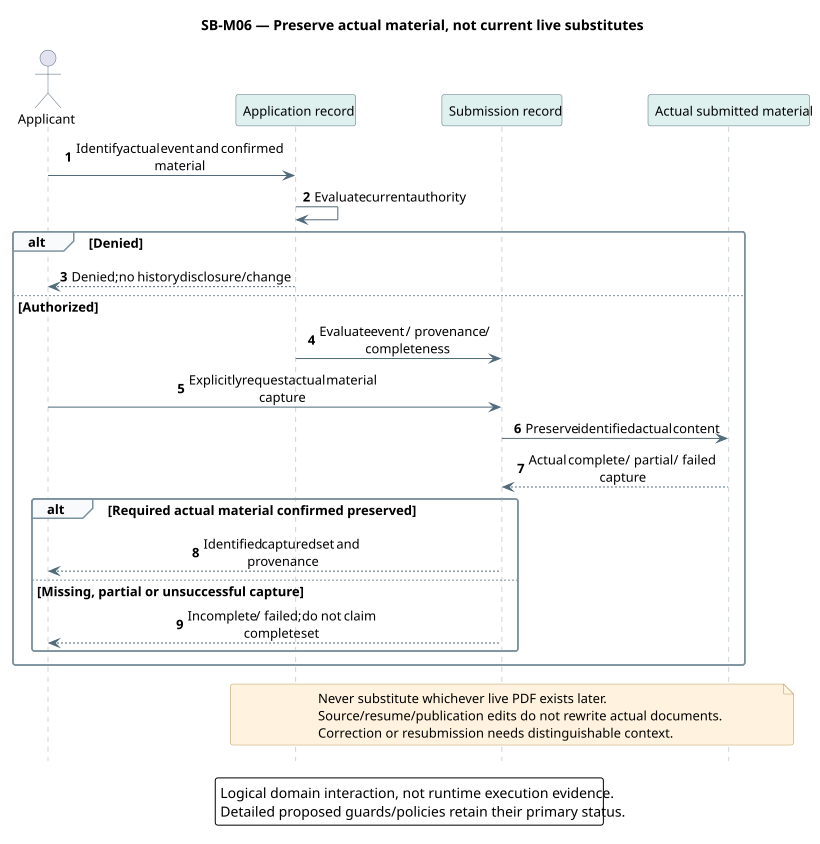

[PNG](../diagrams/scenario-actual-submission-capture.png) · [Editable PlantUML](../diagrams/scenario-actual-submission-capture.puml)

| Interaction record | Meaning / boundary |
| --- | --- |
| Existing source | [UC-D05](../../02-requirements-engineering/04-scenarios-and-models/user-stories-and-scenarios.md#uc-d05) |
| Trigger | Applicant identifies actual submitted resume/letter material for the intended application. |
| Preconditions / controlled context | Actor/application authority and actual claimed material/event context are available; current live content is not presumed identical. |
| Successful postcondition | Confirmed captured material remains identifiable independently of later edits/publication; incomplete capture cannot claim complete preservation. |
| Alternative, denied, failed and recovery limits | Wrong-owner retrieval/change is denied. Actual upload may differ from current PDF. Missing/failed capture is incomplete/failed; corrections/resubmissions preserve distinguishable prior/new context. |
| Decision / evidence status | Q-D13 completeness/provenance and Q-D14 correction/retention remain proposed; accepted historical independence is already settled. |

**Relevant domain concepts:** [DM-C16](../02-domain-and-information-analysis/03-domain-model-and-object-oriented-view.md#dm-c16), [DM-C18](../02-domain-and-information-analysis/03-domain-model-and-object-oriented-view.md#dm-c18), [DM-C19](../02-domain-and-information-analysis/03-domain-model-and-object-oriented-view.md#dm-c19), [DM-C10](../02-domain-and-information-analysis/03-domain-model-and-object-oriented-view.md#dm-c10), [DM-C11](../02-domain-and-information-analysis/03-domain-model-and-object-oriented-view.md#dm-c11), [DM-C17](../02-domain-and-information-analysis/03-domain-model-and-object-oriented-view.md#dm-c17). **Data:** DA-F06; [data view](../02-domain-and-information-analysis/05-data-oriented-view.md).

**Exact primary basis:** [APP-D05](../../02-requirements-engineering/03-requirements-specification/manual-application-management.md#app-d05-user-directed-submission-recording), [APP-D06](../../02-requirements-engineering/03-requirements-specification/manual-application-management.md#app-d06-preserved-actual-submitted-copies), [APP-D07](../../02-requirements-engineering/03-requirements-specification/manual-application-management.md#app-d07-correction-and-repeated-submissions), [APP-D09](../../02-requirements-engineering/03-requirements-specification/manual-application-management.md#app-d09-private-access-archive-and-recovery), [PDF-D08](../../02-requirements-engineering/03-requirements-specification/pdf-and-controlled-sharing.md#pdf-d08-downloaded-copy-and-submission-distinctions).

### 2.8 SB-M07 — Read or deliberately send with truthful provider outcomes

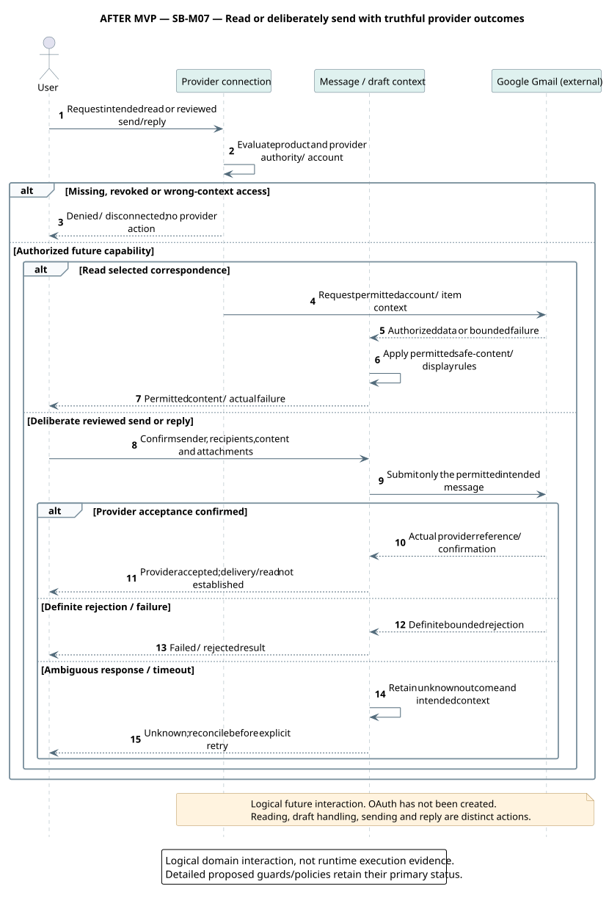

[PNG](../diagrams/scenario-gmail-read-send-outcomes.png) · [Editable PlantUML](../diagrams/scenario-gmail-read-send-outcomes.puml)

| Interaction record | Meaning / boundary |
| --- | --- |
| Existing source | [UC-D06](../../02-requirements-engineering/04-scenarios-and-models/user-stories-and-scenarios.md#uc-d06), [UC-D06-READ](../../02-requirements-engineering/04-scenarios-and-models/user-stories-and-scenarios.md#uc-d06-read), [UC-D06-SEND](../../02-requirements-engineering/04-scenarios-and-models/user-stories-and-scenarios.md#uc-d06-send)  **After MVP.** |
| Trigger | User separately requests correspondence reading or a reviewed send/reply. |
| Preconditions / controlled context | Intended account, product/resource authority and provider capability must be valid for the chosen operation; controlled access is a future gate. |
| Successful postcondition | Read exposes permitted content; send/reply reports only provider-supported acceptance, failure or uncertainty, never invented delivery/read. |
| Alternative, denied, failed and recovery limits | Missing/revoked/wrong-account authority prevents provider action. Unknown send is reconciled before a proposed explicit retry; no blind duplicate send. |
| Decision / evidence status | Q-D15 actual OAuth/access remains unestablished. Q-D16 compose/reply/draft/repetition policies are proposals, not verified behavior. |

**Relevant domain concepts:** [DM-C20](../02-domain-and-information-analysis/03-domain-model-and-object-oriented-view.md#dm-c20), [DM-C21](../02-domain-and-information-analysis/03-domain-model-and-object-oriented-view.md#dm-c21). **Data:** DA-F07; [data view](../02-domain-and-information-analysis/05-data-oriented-view.md).

**Exact primary basis:** [EGC-D01](../../02-requirements-engineering/03-requirements-specification/email-calendar-and-google-integration.md#egc-d01-authorized-connection-and-account-context), [EGC-D02](../../02-requirements-engineering/03-requirements-specification/email-calendar-and-google-integration.md#egc-d02-justified-permissions-and-private-resource-isolation), [EGC-D03](../../02-requirements-engineering/03-requirements-specification/email-calendar-and-google-integration.md#egc-d03-read-authorized-correspondence), [EGC-D04](../../02-requirements-engineering/03-requirements-specification/email-calendar-and-google-integration.md#egc-d04-manual-compose-and-draft-handling), [EGC-D05](../../02-requirements-engineering/03-requirements-specification/email-calendar-and-google-integration.md#egc-d05-deliberate-send-and-truthful-outcome), [EGC-D06](../../02-requirements-engineering/03-requirements-specification/email-calendar-and-google-integration.md#egc-d06-reply-context-and-conversation-association), [EGC-D11](../../02-requirements-engineering/03-requirements-specification/email-calendar-and-google-integration.md#egc-d11-disconnect-revocation-and-reconnect), [EGC-D12](../../02-requirements-engineering/03-requirements-specification/email-calendar-and-google-integration.md#egc-d12-bounded-failures-recovery-and-feasibility-evidence), [EIF-D08](../../02-requirements-engineering/03-requirements-specification/external-interface-requirements.md#eif-d08-operation-specific-failure-and-repetition-semantics).

### 2.9 SB-M08 — Local calendar action versus selected provider synchronization

**Release applicability:** future-domain design retained after MVP; core operating/deployment and recovery controls still apply to MVP where relevant.

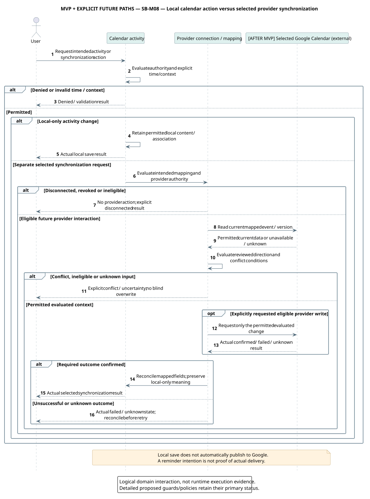

[PNG](../diagrams/scenario-calendar-local-sync.png) · [Editable PlantUML](../diagrams/scenario-calendar-local-sync.puml)

| Interaction record | Meaning / boundary |
| --- | --- |
| Existing source | [UC-D06](../../02-requirements-engineering/04-scenarios-and-models/user-stories-and-scenarios.md#uc-d06), [UC-D06-ACTIVITY](../../02-requirements-engineering/04-scenarios-and-models/user-stories-and-scenarios.md#uc-d06-activity), [UC-D06-SYNC](../../02-requirements-engineering/04-scenarios-and-models/user-stories-and-scenarios.md#uc-d06-sync)  **After MVP.** |
| Trigger | User requests a local activity action or a separate agreed synchronization action. |
| Preconditions / controlled context | Actor/activity context, time meaning and optional selected provider mapping are identified; synchronization requires applicable connection authority. |
| Successful postcondition | Only the permitted local/provider action is reported; time, mapping, conflict/freshness and local notes/associations retain correct context. |
| Alternative, denied, failed and recovery limits | Wrong grant denies action. Concurrent local/provider changes are not silently overwritten. Missing/revoked access and uncertain provider update stay distinguishable; reconnect does not replay stale work. |
| Decision / evidence status | Q-D17 direction/time/conflict/deletion/reconnect policies are proposed. Reminders require separately available delivery capability. |

**Relevant domain concepts:** [DM-C20](../02-domain-and-information-analysis/03-domain-model-and-object-oriented-view.md#dm-c20), [DM-C22](../02-domain-and-information-analysis/03-domain-model-and-object-oriented-view.md#dm-c22), [DM-C23](../02-domain-and-information-analysis/03-domain-model-and-object-oriented-view.md#dm-c23), [DM-C16](../02-domain-and-information-analysis/03-domain-model-and-object-oriented-view.md#dm-c16). **Data:** DA-F08; [data view](../02-domain-and-information-analysis/05-data-oriented-view.md).

**Exact primary basis:** [EGC-D07](../../02-requirements-engineering/03-requirements-specification/email-calendar-and-google-integration.md#egc-d07-calendar-activities-and-time-meaning), [EGC-D08](../../02-requirements-engineering/03-requirements-specification/email-calendar-and-google-integration.md#egc-d08-explicit-synchronization-contract), [EGC-D09](../../02-requirements-engineering/03-requirements-specification/email-calendar-and-google-integration.md#egc-d09-application-relationships-preserve-boundaries), [EGC-D10](../../02-requirements-engineering/03-requirements-specification/email-calendar-and-google-integration.md#egc-d10-reminders-and-notification-outcomes), [EGC-D11](../../02-requirements-engineering/03-requirements-specification/email-calendar-and-google-integration.md#egc-d11-disconnect-revocation-and-reconnect), [EGC-D12](../../02-requirements-engineering/03-requirements-specification/email-calendar-and-google-integration.md#egc-d12-bounded-failures-recovery-and-feasibility-evidence).

### 2.10 SB-M09 — Independent refinement, Sprint planning and Sprint-end actions

**Release applicability:** future-domain design retained after MVP; core operating/deployment and recovery controls still apply to MVP where relevant.

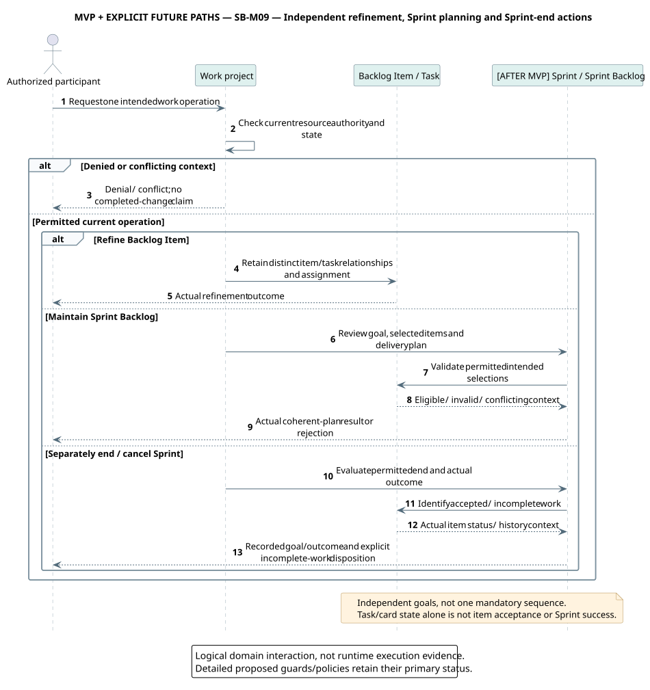

[PNG](../diagrams/scenario-work-refine-plan-end.png) · [Editable PlantUML](../diagrams/scenario-work-refine-plan-end.puml)

| Interaction record | Meaning / boundary |
| --- | --- |
| Existing source | [UC-D07](../../02-requirements-engineering/04-scenarios-and-models/user-stories-and-scenarios.md#uc-d07), [UC-D07-REFINE](../../02-requirements-engineering/04-scenarios-and-models/user-stories-and-scenarios.md#uc-d07-refine), [UC-D07-PLAN](../../02-requirements-engineering/04-scenarios-and-models/user-stories-and-scenarios.md#uc-d07-plan), [UC-D07-END](../../02-requirements-engineering/04-scenarios-and-models/user-stories-and-scenarios.md#uc-d07-end) |
| Trigger | Authorized participant requests refinement, Sprint-plan change or a separate Sprint-end action. |
| Preconditions / controlled context | Intended project/item/Sprint and current authority/state are identified; source-required relationship/transition policies govern the action. |
| Successful postcondition | Task refinement, coherent goal/items/plan or actual Sprint outcome is retained for the requested operation, without equating task progress with item acceptance. |
| Alternative, denied, failed and recovery limits | Denied or stale/conflicting moves do not succeed. Incomplete work stays identifiable and is not silently accepted, erased or automatically carried over. |
| Decision / evidence status | Q-D18/Q-D19 counts/states/acceptance/carry-over/concurrency are proposed; accepted one-composite-Sprint-Backlog meaning is preserved. |

**Relevant domain concepts:** [DM-C24](../02-domain-and-information-analysis/03-domain-model-and-object-oriented-view.md#dm-c24), [DM-C28](../02-domain-and-information-analysis/03-domain-model-and-object-oriented-view.md#dm-c28), [DM-C29](../02-domain-and-information-analysis/03-domain-model-and-object-oriented-view.md#dm-c29), [DM-C30](../02-domain-and-information-analysis/03-domain-model-and-object-oriented-view.md#dm-c30), [DM-C31](../02-domain-and-information-analysis/03-domain-model-and-object-oriented-view.md#dm-c31). **Data:** DA-F09; [data view](../02-domain-and-information-analysis/05-data-oriented-view.md).

**Exact primary basis:** [PKS-D03](../../02-requirements-engineering/03-requirements-specification/projects-kanban-and-sprints.md#pks-d03-product-backlog-and-item-definition), [PKS-D04](../../02-requirements-engineering/03-requirements-specification/projects-kanban-and-sprints.md#pks-d04-item-refinement-and-task-relationships), [PKS-D05](../../02-requirements-engineering/03-requirements-specification/projects-kanban-and-sprints.md#pks-d05-assignment-priority-and-due-date-handling), [PKS-D07](../../02-requirements-engineering/03-requirements-specification/projects-kanban-and-sprints.md#pks-d07-sprint-goal-and-selected-backlog-items), [PKS-D08](../../02-requirements-engineering/03-requirements-specification/projects-kanban-and-sprints.md#pks-d08-one-coherent-sprint-backlog), [PKS-D09](../../02-requirements-engineering/03-requirements-specification/projects-kanban-and-sprints.md#pks-d09-explicit-completion-and-sprint-end-outcomes), [PKS-D11](../../02-requirements-engineering/03-requirements-specification/projects-kanban-and-sprints.md#pks-d11-truthful-changes-retirement-and-recovery).

### 2.11 SB-M10 — Invitation acceptance and resource-scoped changed access

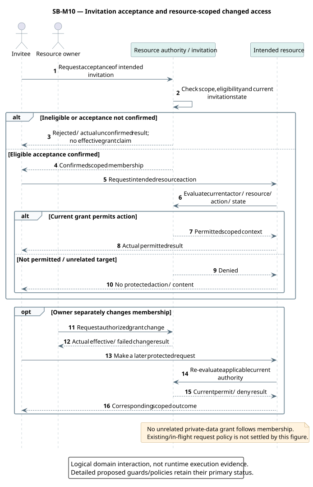

[PNG](../diagrams/scenario-collaboration-and-changed-grant.png) · [Editable PlantUML](../diagrams/scenario-collaboration-and-changed-grant.puml)

| Interaction record | Meaning / boundary |
| --- | --- |
| Existing source | [UC-D08](../../02-requirements-engineering/04-scenarios-and-models/user-stories-and-scenarios.md#uc-d08) |
| Trigger | Invited person accepts an eligible invitation and requests a granted action; owner may later change membership. |
| Preconditions / controlled context | Specific invitation/resource/action scope is identified; neither invitation nor sign-in grants unrelated private content. |
| Successful postcondition | Only confirmed current resource grants permit the intended operation; unrelated mail/resume/repository/secret access remains denied. |
| Alternative, denied, failed and recovery limits | Expired/ineligible invitation follows adopted policy; unconfirmed persistence is not effective membership. Changed-grant and in-flight behavior retain separate policy review. |
| Decision / evidence status | Q-D04/Q-D05 exact grants, invitation lifecycle and revocation timing remain proposed; no role hierarchy or arbitrary expiry is invented. |

**Relevant domain concepts:** [DM-C48](../02-domain-and-information-analysis/03-domain-model-and-object-oriented-view.md#dm-c48), [DM-C47](../02-domain-and-information-analysis/03-domain-model-and-object-oriented-view.md#dm-c47), [DM-C24](../02-domain-and-information-analysis/03-domain-model-and-object-oriented-view.md#dm-c24), [DM-C32](../02-domain-and-information-analysis/03-domain-model-and-object-oriented-view.md#dm-c32). **Data:** DA-F09, DA-F10; [data view](../02-domain-and-information-analysis/05-data-oriented-view.md).

**Exact primary basis:** [ACC-D03](../../02-requirements-engineering/03-requirements-specification/accounts-authentication-and-permissions.md#acc-d03-resource-and-operation-authorization), [ACC-D04](../../02-requirements-engineering/03-requirements-specification/accounts-authentication-and-permissions.md#acc-d04-cross-user-private-data-isolation), [ACC-D05](../../02-requirements-engineering/03-requirements-specification/accounts-authentication-and-permissions.md#acc-d05-limited-collaboration-authority), [ACC-D10](../../02-requirements-engineering/03-requirements-specification/accounts-authentication-and-permissions.md#acc-d10-authorization-of-access-grant-changes), [ACC-D12](../../02-requirements-engineering/03-requirements-specification/accounts-authentication-and-permissions.md#acc-d12-end-of-access-and-lifecycle-enforcement), [PKS-D06](../../02-requirements-engineering/03-requirements-specification/projects-kanban-and-sprints.md#pks-d06-scoped-collaboration-and-membership-changes), [GIT-D02](../../02-requirements-engineering/03-requirements-specification/git-hosting-and-collaboration.md#git-d02-repository-and-ref-authorization).

### 2.12 SB-M11 — Real Git read transfer versus authorized ref update

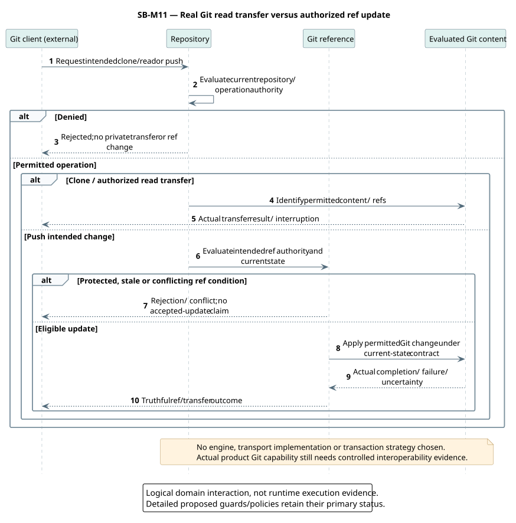

[PNG](../diagrams/scenario-git-transfer.png) · [Editable PlantUML](../diagrams/scenario-git-transfer.puml)

| Interaction record | Meaning / boundary |
| --- | --- |
| Existing source | [UC-D09](../../02-requirements-engineering/04-scenarios-and-models/user-stories-and-scenarios.md#uc-d09), [UC-D09-CLONE](../../02-requirements-engineering/04-scenarios-and-models/user-stories-and-scenarios.md#uc-d09-clone), [UC-D09-PUSH](../../02-requirements-engineering/04-scenarios-and-models/user-stories-and-scenarios.md#uc-d09-push) |
| Trigger | Authorized client requests clone/read transfer or supplies an intended push/ref change. |
| Preconditions / controlled context | A future supported client/transport and real repository context must exist; actor/repository/ref authority and expected current context are explicit. |
| Successful postcondition | Only actual authorized repository transfer/ref result is reported; push does not imply merge approval, workflow execution or deployment. |
| Alternative, denied, failed and recovery limits | Wrong grant/protected ref is rejected. Changed ref or interrupted transfer produces conflict/incomplete/unknown as appropriate, not invented success or unrelated ref changes. |
| Decision / evidence status | Q-D21 transports/credentials/protection/repetition and actual interoperability remain proposals/design evidence gates. |

**Relevant domain concepts:** [DM-C32](../02-domain-and-information-analysis/03-domain-model-and-object-oriented-view.md#dm-c32), [DM-C34](../02-domain-and-information-analysis/03-domain-model-and-object-oriented-view.md#dm-c34), [DM-C33](../02-domain-and-information-analysis/03-domain-model-and-object-oriented-view.md#dm-c33). **Data:** DA-F10; [data view](../02-domain-and-information-analysis/05-data-oriented-view.md).

**Exact primary basis:** [GIT-D02](../../02-requirements-engineering/03-requirements-specification/git-hosting-and-collaboration.md#git-d02-repository-and-ref-authorization), [GIT-D03](../../02-requirements-engineering/03-requirements-specification/git-hosting-and-collaboration.md#git-d03-real-clone-fetch-pull-and-push), [GIT-D04](../../02-requirements-engineering/03-requirements-specification/git-hosting-and-collaboration.md#git-d04-branches-files-and-history-browsing), [EIF-D06](../../02-requirements-engineering/03-requirements-specification/external-interface-requirements.md#eif-d06-real-git-client-interoperability), [EIF-D08](../../02-requirements-engineering/03-requirements-specification/external-interface-requirements.md#eif-d08-operation-specific-failure-and-repetition-semantics).

### 2.13 SB-M12 — Current source/target and revision-related review

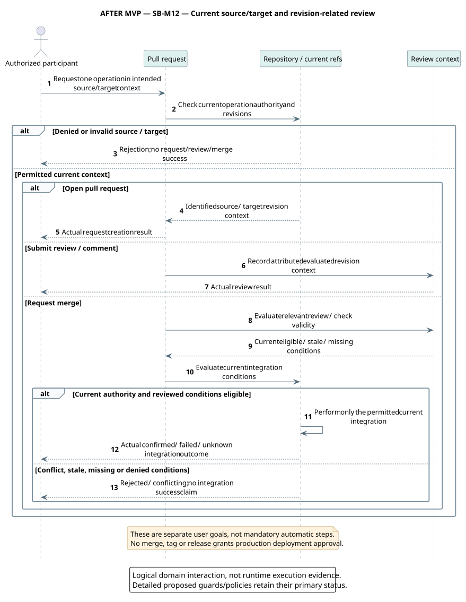

[PNG](../diagrams/scenario-pull-request-review-merge.png) · [Editable PlantUML](../diagrams/scenario-pull-request-review-merge.puml)

| Interaction record | Meaning / boundary |
| --- | --- |
| Existing source | [UC-D09](../../02-requirements-engineering/04-scenarios-and-models/user-stories-and-scenarios.md#uc-d09), [UC-D09-REQUEST](../../02-requirements-engineering/04-scenarios-and-models/user-stories-and-scenarios.md#uc-d09-request), [UC-D09-REVIEW](../../02-requirements-engineering/04-scenarios-and-models/user-stories-and-scenarios.md#uc-d09-review), [UC-D09-MERGE](../../02-requirements-engineering/04-scenarios-and-models/user-stories-and-scenarios.md#uc-d09-merge) |
| Trigger | Participant separately opens a request, records review/comment or requests merge. |
| Preconditions / controlled context | Applicable repository/source/target and operation authority are explicit; no second delivery person or approval count is assumed. |
| Successful postcondition | Only the requested permitted record/review/current eligible integration is reported; evaluated source/target and actual result remain identifiable. |
| Alternative, denied, failed and recovery limits | Changed source/target is re-evaluated; stale review/checks and merge conflicts cannot masquerade as current successful integration. Unauthorized merge remains denied. |
| Decision / evidence status | Q-D22 review validity, merge strategy, solo review exception and counts remain proposed. Merge/release never inherits deployment authority. |

**Relevant domain concepts:** [DM-C32](../02-domain-and-information-analysis/03-domain-model-and-object-oriented-view.md#dm-c32), [DM-C34](../02-domain-and-information-analysis/03-domain-model-and-object-oriented-view.md#dm-c34), [DM-C33](../02-domain-and-information-analysis/03-domain-model-and-object-oriented-view.md#dm-c33), [DM-C35](../02-domain-and-information-analysis/03-domain-model-and-object-oriented-view.md#dm-c35), [DM-C36](../02-domain-and-information-analysis/03-domain-model-and-object-oriented-view.md#dm-c36). **Data:** DA-F10; [data view](../02-domain-and-information-analysis/05-data-oriented-view.md).

**Exact primary basis:** [GIT-D05](../../02-requirements-engineering/03-requirements-specification/git-hosting-and-collaboration.md#git-d05-fork-provenance-and-permission-boundaries), [GIT-D06](../../02-requirements-engineering/03-requirements-specification/git-hosting-and-collaboration.md#git-d06-pull-requests-comments-and-review), [GIT-D07](../../02-requirements-engineering/03-requirements-specification/git-hosting-and-collaboration.md#git-d07-controlled-merge-and-conflict-outcomes), [GIT-D09](../../02-requirements-engineering/03-requirements-specification/git-hosting-and-collaboration.md#git-d09-tags-and-releases).

### 2.14 SB-M13 — Gated run admission and attributable actual attempts

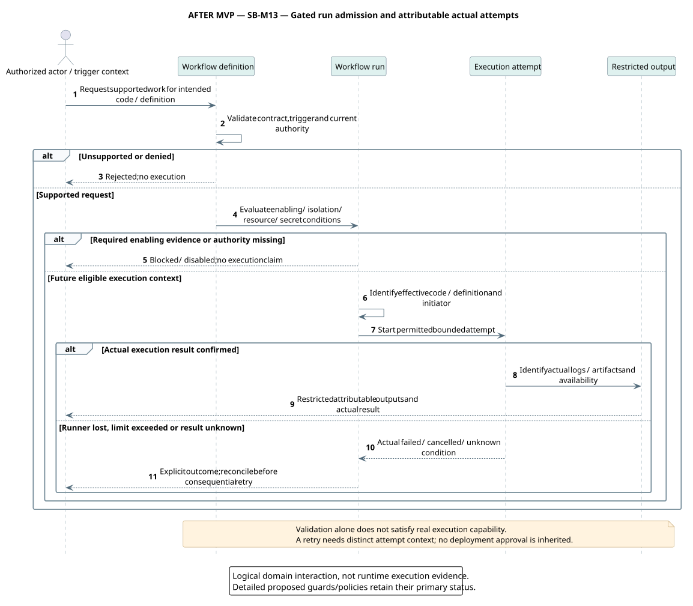

[PNG](../diagrams/scenario-workflow-admission-attempt.png) · [Editable PlantUML](../diagrams/scenario-workflow-admission-attempt.puml)

| Interaction record | Meaning / boundary |
| --- | --- |
| Existing source | [UC-D10](../../02-requirements-engineering/04-scenarios-and-models/user-stories-and-scenarios.md#uc-d10), [UC-D10-RUN](../../02-requirements-engineering/04-scenarios-and-models/user-stories-and-scenarios.md#uc-d10-run)  **After MVP.** |
| Trigger | Eligible actor/trigger requests supported workflow work for identified code/definition. |
| Preconditions / controlled context | Future enabling evidence, permitted trigger, supported definition, scoped authority, isolation/resources/secrets and actual evaluated revision context must satisfy their gates before execution. |
| Successful postcondition | Admitted future run/attempt/output remains attributable to exact evaluated context; blocked/failed/unknown work is not reported successful. |
| Alternative, denied, failed and recovery limits | Unsupported contract or missing authority/enabling evidence means no execution. Runner loss/cancel/retry retains actual or unknown state; cancellation request is not proof of termination. |
| Decision / evidence status | Q-D23 isolation/resource/contract evidence is missing today. Model future eligibility without enabling work on the current host. |

**Relevant domain concepts:** [DM-C40](../02-domain-and-information-analysis/03-domain-model-and-object-oriented-view.md#dm-c40), [DM-C41](../02-domain-and-information-analysis/03-domain-model-and-object-oriented-view.md#dm-c41), [DM-C42](../02-domain-and-information-analysis/03-domain-model-and-object-oriented-view.md#dm-c42), [DM-C43](../02-domain-and-information-analysis/03-domain-model-and-object-oriented-view.md#dm-c43), [DM-C44](../02-domain-and-information-analysis/03-domain-model-and-object-oriented-view.md#dm-c44). **Data:** DA-F11; [data view](../02-domain-and-information-analysis/05-data-oriented-view.md).

**Exact primary basis:** [YML-D01](../../02-requirements-engineering/03-requirements-specification/yaml-workflows-and-cicd.md#yml-d01-defined-supported-workflow-contract), [YML-D02](../../02-requirements-engineering/03-requirements-specification/yaml-workflows-and-cicd.md#yml-d02-explicit-triggers-and-run-authority), [YML-D03](../../02-requirements-engineering/03-requirements-specification/yaml-workflows-and-cicd.md#yml-d03-run-identity-and-reproducible-context), [YML-D04](../../02-requirements-engineering/03-requirements-specification/yaml-workflows-and-cicd.md#yml-d04-isolation-and-untrusted-code-boundary), [YML-D05](../../02-requirements-engineering/03-requirements-specification/yaml-workflows-and-cicd.md#yml-d05-scoped-secrets-and-credentials), [YML-D06](../../02-requirements-engineering/03-requirements-specification/yaml-workflows-and-cicd.md#yml-d06-resource-admission-and-limits), [YML-D07](../../02-requirements-engineering/03-requirements-specification/yaml-workflows-and-cicd.md#yml-d07-truthful-run-and-step-outcomes), [YML-D08](../../02-requirements-engineering/03-requirements-specification/yaml-workflows-and-cicd.md#yml-d08-restricted-logs-and-artifacts), [YML-D09](../../02-requirements-engineering/03-requirements-specification/yaml-workflows-and-cicd.md#yml-d09-cancellation-retry-and-runner-loss-recovery), [YML-D11](../../02-requirements-engineering/03-requirements-specification/yaml-workflows-and-cicd.md#yml-d11-workspace-cleanup-and-retained-evidence), [YML-D12](../../02-requirements-engineering/03-requirements-specification/yaml-workflows-and-cicd.md#yml-d12-feasibility-operational-guidance-and-enabling-gate).

### 2.15 SB-M14 — Target-authorized deployment is a separate goal

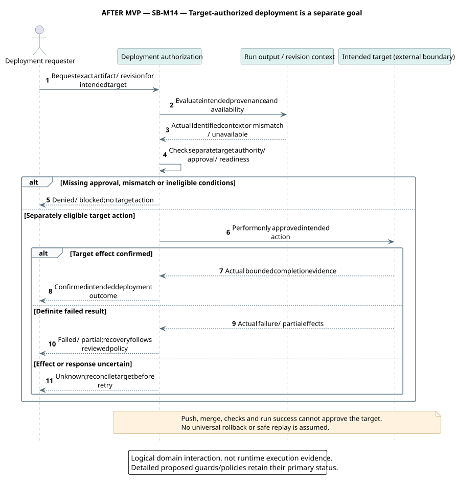

[PNG](../diagrams/scenario-separate-deployment.png) · [Editable PlantUML](../diagrams/scenario-separate-deployment.puml)

| Interaction record | Meaning / boundary |
| --- | --- |
| Existing source | [UC-D10](../../02-requirements-engineering/04-scenarios-and-models/user-stories-and-scenarios.md#uc-d10), [UC-D10-DEPLOY](../../02-requirements-engineering/04-scenarios-and-models/user-stories-and-scenarios.md#uc-d10-deploy)  **After MVP.** |
| Trigger | Actor separately requests deployment of an identified artifact/revision to an intended target. |
| Preconditions / controlled context | Target authority/approval, compatible data/recovery conditions and exact artifact/revision are explicit; successful build alone is insufficient. |
| Successful postcondition | Only independently permitted intended target effects are attempted; actual confirmed, failed or unknown target outcome is retained. |
| Alternative, denied, failed and recovery limits | Missing target approval, stale artifact/revision or unsuitable conditions deny deployment. An unknown outcome is reconciled before further consequential action. |
| Decision / evidence status | Q-D23 target/approval/execution feasibility remains gated; no target or production change is created by this analysis. |

**Relevant domain concepts:** [DM-C45](../02-domain-and-information-analysis/03-domain-model-and-object-oriented-view.md#dm-c45), [DM-C46](../02-domain-and-information-analysis/03-domain-model-and-object-oriented-view.md#dm-c46), [DM-C43](../02-domain-and-information-analysis/03-domain-model-and-object-oriented-view.md#dm-c43), [DM-C41](../02-domain-and-information-analysis/03-domain-model-and-object-oriented-view.md#dm-c41). **Data:** DA-F11; [data view](../02-domain-and-information-analysis/05-data-oriented-view.md).

**Exact primary basis:** [YML-D03](../../02-requirements-engineering/03-requirements-specification/yaml-workflows-and-cicd.md#yml-d03-run-identity-and-reproducible-context), [YML-D08](../../02-requirements-engineering/03-requirements-specification/yaml-workflows-and-cicd.md#yml-d08-restricted-logs-and-artifacts), [YML-D10](../../02-requirements-engineering/03-requirements-specification/yaml-workflows-and-cicd.md#yml-d10-separate-controlled-deployment-stage), [YML-D12](../../02-requirements-engineering/03-requirements-specification/yaml-workflows-and-cicd.md#yml-d12-feasibility-operational-guidance-and-enabling-gate), [EIF-D08](../../02-requirements-engineering/03-requirements-specification/external-interface-requirements.md#eif-d08-operation-specific-failure-and-repetition-semantics).

### 2.16 SB-M15 — Effective policy, file admission and restricted evidence

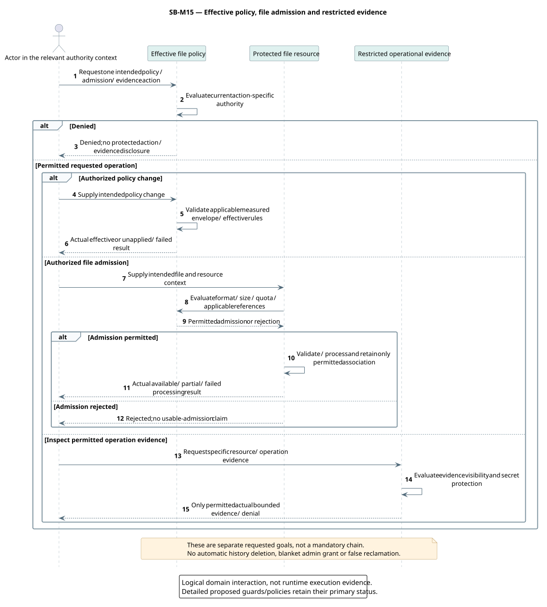

[PNG](../diagrams/scenario-policy-admission-evidence.png) · [Editable PlantUML](../diagrams/scenario-policy-admission-evidence.puml)

| Interaction record | Meaning / boundary |
| --- | --- |
| Existing source | [UC-D11](../../02-requirements-engineering/04-scenarios-and-models/user-stories-and-scenarios.md#uc-d11), [UC-D11-POLICY](../../02-requirements-engineering/04-scenarios-and-models/user-stories-and-scenarios.md#uc-d11-policy), [UC-D11-EVIDENCE](../../02-requirements-engineering/04-scenarios-and-models/user-stories-and-scenarios.md#uc-d11-evidence) |
| Trigger | Actor requests one permitted policy, file-admission or evidence operation. Admission refines supporting file paths in the existing scenarios rather than allocating a new external use case. |
| Preconditions / controlled context | Current role/resource/action authority, effective policy and actual content/usage/reference context are identified; administrative authority differs from upload authority. |
| Successful postcondition | Actual effective policy, usable admitted resource or permitted bounded evidence is reported for the requested operation only. |
| Alternative, denied, failed and recovery limits | Denied operations expose no restricted data. Failed persistence/processing/cleanup does not claim effective settings, usable content or freed capacity; lower limit does not silently delete history. |
| Decision / evidence status | Q-D24 numerical values/pools/concurrency and Q-D27 applicability remain proposals; actual capacity is not inferred from idle free disk. |

**Relevant domain concepts:** [DM-C50](../02-domain-and-information-analysis/03-domain-model-and-object-oriented-view.md#dm-c50), [DM-C49](../02-domain-and-information-analysis/03-domain-model-and-object-oriented-view.md#dm-c49), [DM-C51](../02-domain-and-information-analysis/03-domain-model-and-object-oriented-view.md#dm-c51), [DM-C48](../02-domain-and-information-analysis/03-domain-model-and-object-oriented-view.md#dm-c48). **Data:** DA-F04, DA-F12; [data view](../02-domain-and-information-analysis/05-data-oriented-view.md).

**Exact primary basis:** [AFO-D01](../../02-requirements-engineering/03-requirements-specification/administration-files-and-operational-behavior.md#afo-d01-owner-configurable-upload-and-storage-policy), [AFO-D02](../../02-requirements-engineering/03-requirements-specification/administration-files-and-operational-behavior.md#afo-d02-policy-consistent-with-evaluated-infrastructure), [AFO-D03](../../02-requirements-engineering/03-requirements-specification/administration-files-and-operational-behavior.md#afo-d03-per-file-admission-limit), [AFO-D04](../../02-requirements-engineering/03-requirements-specification/administration-files-and-operational-behavior.md#afo-d04-aggregate-quota-and-concurrent-admission), [AFO-D05](../../02-requirements-engineering/03-requirements-specification/administration-files-and-operational-behavior.md#afo-d05-supported-content-and-validation), [AFO-D06](../../02-requirements-engineering/03-requirements-specification/administration-files-and-operational-behavior.md#afo-d06-file-resource-authorization-and-isolation), [AFO-D07](../../02-requirements-engineering/03-requirements-specification/administration-files-and-operational-behavior.md#afo-d07-truthful-completion-and-interrupted-operation-handling), [AFO-D08](../../02-requirements-engineering/03-requirements-specification/administration-files-and-operational-behavior.md#afo-d08-safe-replacement-and-lifecycle-effects), [AFO-D09](../../02-requirements-engineering/03-requirements-specification/administration-files-and-operational-behavior.md#afo-d09-operational-outcomes-and-capacity-warnings), [AFO-D10](../../02-requirements-engineering/03-requirements-specification/administration-files-and-operational-behavior.md#afo-d10-administrative-operation-evidence), [AFO-D11](../../02-requirements-engineering/03-requirements-specification/administration-files-and-operational-behavior.md#afo-d11-bounded-cleanup-and-storage-reclamation).

### 2.17 SB-M16 — Conditional isolated restoration and safe reconciliation

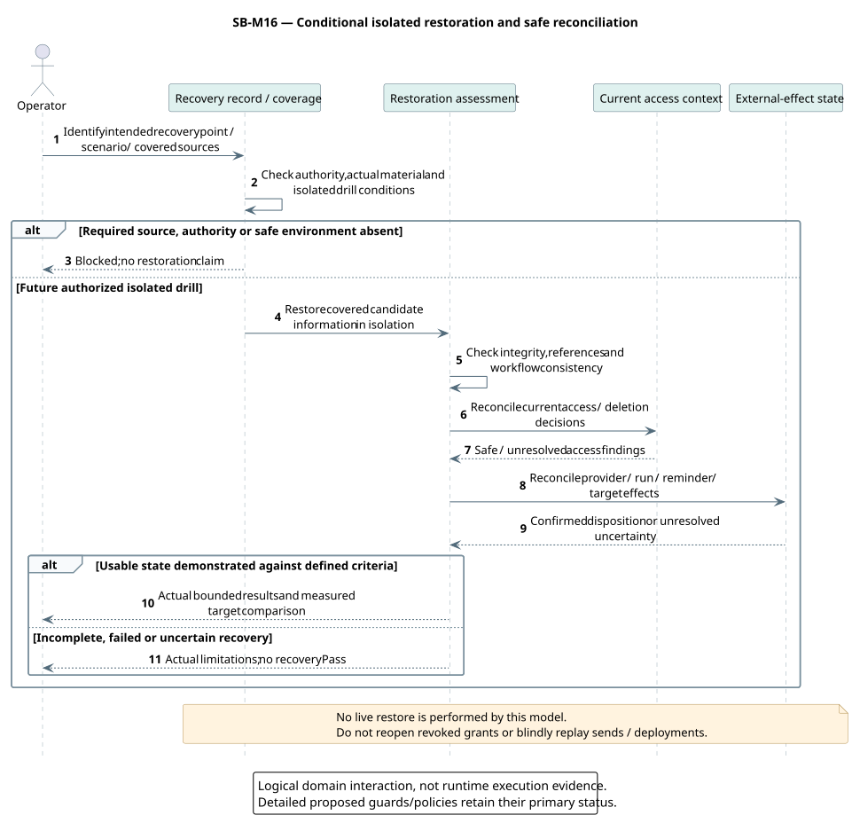

[PNG](../diagrams/scenario-isolated-recovery-assessment.png) · [Editable PlantUML](../diagrams/scenario-isolated-recovery-assessment.puml)

| Interaction record | Meaning / boundary |
| --- | --- |
| Existing source | [UC-D12](../../02-requirements-engineering/04-scenarios-and-models/user-stories-and-scenarios.md#uc-d12) |
| Trigger | Operator identifies a loss/recovery scenario and requests an explicitly authorized isolated drill. |
| Preconditions / controlled context | Identified protected recovery source, required artifacts/configuration, defined coverage/targets, suitable isolation and operator authority must actually exist for a later drill. |
| Successful postcondition | Actual findings identify covered/restored information, integrity, safe current access, external-state disposition and measured target comparison; no success is assumed before evidence. |
| Alternative, denied, failed and recovery limits | No authority/source/safe target blocks the drill. Missing/corrupt/inconsistent material or missed targets remain failed/incomplete. Revisit only under isolated authorized recovery policy. |
| Decision / evidence status | Backups are not configured. Q-D26 source/coverage/targets/restore proof and Q-D27 operating evidence remain open; this is not execution authorization. |

**Relevant domain concepts:** [DM-C52](../02-domain-and-information-analysis/03-domain-model-and-object-oriented-view.md#dm-c52), [DM-C53](../02-domain-and-information-analysis/03-domain-model-and-object-oriented-view.md#dm-c53), [DM-C48](../02-domain-and-information-analysis/03-domain-model-and-object-oriented-view.md#dm-c48). **Data:** DA-F13; [data view](../02-domain-and-information-analysis/05-data-oriented-view.md).

**Exact primary basis:** [QSR-D10](../../02-requirements-engineering/03-requirements-specification/quality-security-and-recovery-requirements.md#qsr-d10-defined-protected-and-observable-backups), [QSR-D11](../../02-requirements-engineering/03-requirements-specification/quality-security-and-recovery-requirements.md#qsr-d11-demonstrated-restoration-and-recovery-targets), [QSR-D12](../../02-requirements-engineering/03-requirements-specification/quality-security-and-recovery-requirements.md#qsr-d12-safe-restored-access-and-external-state-reconciliation), [QSR-D14](../../02-requirements-engineering/03-requirements-specification/quality-security-and-recovery-requirements.md#qsr-d14-maintainable-verifiable-and-recoverable-changes), [AFO-D12](../../02-requirements-engineering/03-requirements-specification/administration-files-and-operational-behavior.md#afo-d12-version-specific-operational-guidance-and-readiness).

## 3. Alternative and Denied Paths

All five source path types remain linked: normal, alternative, denied, failure and recovery/correction. These are models of expected behavior, not executed results. Denied requests must not produce the prohibited new effect/content. They do not establish how existing or in-flight requests behave until their specific policy is decided.

**Parent bundle:** [UC-D01](../../02-requirements-engineering/04-scenarios-and-models/user-stories-and-scenarios.md#uc-d01)

**Alternative:** [SCN-D01-A](../../02-requirements-engineering/04-scenarios-and-models/user-stories-and-scenarios.md#scn-d01-a) — Omitted source entry stays omitted

**Denied:** [SCN-D01-D](../../02-requirements-engineering/04-scenarios-and-models/user-stories-and-scenarios.md#scn-d01-d) — Wrong-owner profile/resume association denied

**Failure:** [SCN-D01-F](../../02-requirements-engineering/04-scenarios-and-models/user-stories-and-scenarios.md#scn-d01-f) — Interrupted save stays failed/incomplete

**Recovery / correction:** [SCN-D01-R](../../02-requirements-engineering/04-scenarios-and-models/user-stories-and-scenarios.md#scn-d01-r) — Reconcile source/override conflict without lost independent text

**Parent bundle:** [UC-D02](../../02-requirements-engineering/04-scenarios-and-models/user-stories-and-scenarios.md#uc-d02)

**Alternative:** [SCN-D02-A](../../02-requirements-engineering/04-scenarios-and-models/user-stories-and-scenarios.md#scn-d02-a) — Neither mode does not disable page/link

**Denied:** [SCN-D02-D](../../02-requirements-engineering/04-scenarios-and-models/user-stories-and-scenarios.md#scn-d02-d) — Unauthorized PDF/link/password control denied

**Failure:** [SCN-D02-F](../../02-requirements-engineering/04-scenarios-and-models/user-stories-and-scenarios.md#scn-d02-f) — Unavailable/failed variant is explicit

**Recovery / correction:** [SCN-D02-R](../../02-requirements-engineering/04-scenarios-and-models/user-stories-and-scenarios.md#scn-d02-r) — Correct configuration only under authorized policy; session/in-flight detail separate

**Parent bundle:** [UC-D03](../../02-requirements-engineering/04-scenarios-and-models/user-stories-and-scenarios.md#uc-d03)

**Alternative:** [SCN-D03-A](../../02-requirements-engineering/04-scenarios-and-models/user-stories-and-scenarios.md#scn-d03-a) — Unselected evidence or unavailable language stays inaccessible

**Denied:** [SCN-D03-D](../../02-requirements-engineering/04-scenarios-and-models/user-stories-and-scenarios.md#scn-d03-d) — Wrong password/disabled link/altered resource denied

**Failure:** [SCN-D03-F](../../02-requirements-engineering/04-scenarios-and-models/user-stories-and-scenarios.md#scn-d03-f) — Retrieval/rendering failure has no unrelated fallback

**Recovery / correction:** [SCN-D03-R](../../02-requirements-engineering/04-scenarios-and-models/user-stories-and-scenarios.md#scn-d03-r) — Fresh old/current credential checks; existing-session policy remains separate

**Parent bundle:** [UC-D04](../../02-requirements-engineering/04-scenarios-and-models/user-stories-and-scenarios.md#uc-d04)

**Alternative:** [SCN-D04-A](../../02-requirements-engineering/04-scenarios-and-models/user-stories-and-scenarios.md#scn-d04-a) — Permitted incomplete preparation remains labeled incomplete

**Denied:** [SCN-D04-D](../../02-requirements-engineering/04-scenarios-and-models/user-stories-and-scenarios.md#scn-d04-d) — Inaccessible resume/application association denied

**Failure:** [SCN-D04-F](../../02-requirements-engineering/04-scenarios-and-models/user-stories-and-scenarios.md#scn-d04-f) — Failed preparation/progress is not saved-success

**Recovery / correction:** [SCN-D04-R](../../02-requirements-engineering/04-scenarios-and-models/user-stories-and-scenarios.md#scn-d04-r) — Authorized progress correction retains required time/history meaning

**Parent bundle:** [UC-D05](../../02-requirements-engineering/04-scenarios-and-models/user-stories-and-scenarios.md#uc-d05)

**Alternative:** [SCN-D05-A](../../02-requirements-engineering/04-scenarios-and-models/user-stories-and-scenarios.md#scn-d05-a) — Actual sent material differs from current PDF

**Denied:** [SCN-D05-D](../../02-requirements-engineering/04-scenarios-and-models/user-stories-and-scenarios.md#scn-d05-d) — Wrong-owner history retrieval/change denied

**Failure:** [SCN-D05-F](../../02-requirements-engineering/04-scenarios-and-models/user-stories-and-scenarios.md#scn-d05-f) — Missing/partial capture is not complete preservation

**Recovery / correction:** [SCN-D05-R](../../02-requirements-engineering/04-scenarios-and-models/user-stories-and-scenarios.md#scn-d05-r) — Correction/resubmission distinguishes prior/new material

**Parent bundle:** [UC-D06](../../02-requirements-engineering/04-scenarios-and-models/user-stories-and-scenarios.md#uc-d06)

**Alternative:** [SCN-D06-A](../../02-requirements-engineering/04-scenarios-and-models/user-stories-and-scenarios.md#scn-d06-a) — Concurrent mapped event change follows reviewed conflict policy

**Denied:** [SCN-D06-D](../../02-requirements-engineering/04-scenarios-and-models/user-stories-and-scenarios.md#scn-d06-d) — Missing/revoked/wrong-account access denied

**Failure:** [SCN-D06-F](../../02-requirements-engineering/04-scenarios-and-models/user-stories-and-scenarios.md#scn-d06-f) — Provider failure/ambiguous send stays failed/unknown

**Recovery / correction:** [SCN-D06-R](../../02-requirements-engineering/04-scenarios-and-models/user-stories-and-scenarios.md#scn-d06-r) — Reconnect reconciles mapping/pending effects without blind replay

**Parent bundle:** [UC-D07](../../02-requirements-engineering/04-scenarios-and-models/user-stories-and-scenarios.md#uc-d07)

**Alternative:** [SCN-D07-A](../../02-requirements-engineering/04-scenarios-and-models/user-stories-and-scenarios.md#scn-d07-a) — Incomplete work at Sprint end stays identifiable

**Denied:** [SCN-D07-D](../../02-requirements-engineering/04-scenarios-and-models/user-stories-and-scenarios.md#scn-d07-d) — Unauthorized work move/selection denied

**Failure:** [SCN-D07-F](../../02-requirements-engineering/04-scenarios-and-models/user-stories-and-scenarios.md#scn-d07-f) — Move/column/plan conflict is not completed coherent work

**Recovery / correction:** [SCN-D07-R](../../02-requirements-engineering/04-scenarios-and-models/user-stories-and-scenarios.md#scn-d07-r) — Reconcile plan/selection without duplicate acceptance

**Parent bundle:** [UC-D08](../../02-requirements-engineering/04-scenarios-and-models/user-stories-and-scenarios.md#uc-d08)

**Alternative:** [SCN-D08-A](../../02-requirements-engineering/04-scenarios-and-models/user-stories-and-scenarios.md#scn-d08-a) — Ineligible/expired invitation follows adopted state rule

**Denied:** [SCN-D08-D](../../02-requirements-engineering/04-scenarios-and-models/user-stories-and-scenarios.md#scn-d08-d) — No self-escalation or unrelated private data access

**Failure:** [SCN-D08-F](../../02-requirements-engineering/04-scenarios-and-models/user-stories-and-scenarios.md#scn-d08-f) — Unconfirmed acceptance is not effective membership

**Recovery / correction:** [SCN-D08-R](../../02-requirements-engineering/04-scenarios-and-models/user-stories-and-scenarios.md#scn-d08-r) — Changed-grant request is re-evaluated; in-flight policy separate

**Parent bundle:** [UC-D09](../../02-requirements-engineering/04-scenarios-and-models/user-stories-and-scenarios.md#uc-d09)

**Alternative:** [SCN-D09-A](../../02-requirements-engineering/04-scenarios-and-models/user-stories-and-scenarios.md#scn-d09-a) — Changed source/target triggers current-context evaluation

**Denied:** [SCN-D09-D](../../02-requirements-engineering/04-scenarios-and-models/user-stories-and-scenarios.md#scn-d09-d) — Protected clone/push/merge/fork exposure denied

**Failure:** [SCN-D09-F](../../02-requirements-engineering/04-scenarios-and-models/user-stories-and-scenarios.md#scn-d09-f) — Interrupted transfer/conflict has no false integrated state

**Recovery / correction:** [SCN-D09-R](../../02-requirements-engineering/04-scenarios-and-models/user-stories-and-scenarios.md#scn-d09-r) — Reconcile actual ref/history before repeating operation

**Parent bundle:** [UC-D10](../../02-requirements-engineering/04-scenarios-and-models/user-stories-and-scenarios.md#uc-d10)

**Alternative:** [SCN-D10-A](../../02-requirements-engineering/04-scenarios-and-models/user-stories-and-scenarios.md#scn-d10-a) — Unsupported syntax/trigger cannot execute unsupported work

**Denied:** [SCN-D10-D](../../02-requirements-engineering/04-scenarios-and-models/user-stories-and-scenarios.md#scn-d10-d) — Cross-resource/secret/target action without authority denied

**Failure:** [SCN-D10-F](../../02-requirements-engineering/04-scenarios-and-models/user-stories-and-scenarios.md#scn-d10-f) — Runner loss/limit/unknown deployment is explicit

**Recovery / correction:** [SCN-D10-R](../../02-requirements-engineering/04-scenarios-and-models/user-stories-and-scenarios.md#scn-d10-r) — Cancel/reconcile/retry distinguishes request from actual termination/effect

**Parent bundle:** [UC-D11](../../02-requirements-engineering/04-scenarios-and-models/user-stories-and-scenarios.md#uc-d11)

**Alternative:** [SCN-D11-A](../../02-requirements-engineering/04-scenarios-and-models/user-stories-and-scenarios.md#scn-d11-a) — Lower limit does not silently delete prior content

**Denied:** [SCN-D11-D](../../02-requirements-engineering/04-scenarios-and-models/user-stories-and-scenarios.md#scn-d11-d) — Unauthorized policy/evidence/private content access denied

**Failure:** [SCN-D11-F](../../02-requirements-engineering/04-scenarios-and-models/user-stories-and-scenarios.md#scn-d11-f) — Failed policy/admission/cleanup is not effective/usable/freed success

**Recovery / correction:** [SCN-D11-R](../../02-requirements-engineering/04-scenarios-and-models/user-stories-and-scenarios.md#scn-d11-r) — Correct configuration/reclaim only eligible references with actual accounting

**Parent bundle:** [UC-D12](../../02-requirements-engineering/04-scenarios-and-models/user-stories-and-scenarios.md#uc-d12)

**Alternative:** [SCN-D12-A](../../02-requirements-engineering/04-scenarios-and-models/user-stories-and-scenarios.md#scn-d12-a) — Explicit reconstruction/exclusion is not counted silently restored

**Denied:** [SCN-D12-D](../../02-requirements-engineering/04-scenarios-and-models/user-stories-and-scenarios.md#scn-d12-d) — Unauthorized backup/configuration/restore denied

**Failure:** [SCN-D12-F](../../02-requirements-engineering/04-scenarios-and-models/user-stories-and-scenarios.md#scn-d12-f) — Corrupt/missing/inconsistent material or missed target is not Pass

**Recovery / correction:** [SCN-D12-R](../../02-requirements-engineering/04-scenarios-and-models/user-stories-and-scenarios.md#scn-d12-r) — Isolated authorized retry rechecks integrity/access and actual measurement

### Cross-Cutting Denial Checks

| Entry / attempted bypass | Required boundary |
| --- | --- |
| Change a profile/resume/application identifier | Current resource authority still applies; do not read/mutate another private context |
| Replace a selected evidence/file/PDF identifier | Check intended sharing selection, resource authority, language, mode and actual availability, including direct paths |
| Reuse membership on another project/repository/mailbox | Grant stays resource/action-specific; association or invitation is not a private-data grant |
| Use a revoked/wrong provider connection | No protected provider operation or private account disclosure follows |
| Change a ref/review/run/output identifier | Evaluate repository/ref/revision and output authority; stale review is not current approval |
| Submit YAML or target request without enabling/target authority | Validation or code/run success does not authorize unsafe execution, secrets or deployment |
| Inspect audit/backup data through an admin label | Exact permitted action and evidence visibility apply; no blanket private-content power |

No error-message template or HTTP status is selected. Interface/security views must later define feedback that is useful without leaking unrelated identities, content or secrets.

## 4. Failure and Recovery Paths

### 4.1 Result Vocabulary

| Result | Meaning | What must not be inferred |
| --- | --- | --- |
| Confirmed success | Actual result required by the operation's contract is established | Request accepted, button pressed, queued work or absence of error is not enough |
| Denied / rejected | Applicable authority/input/state condition does not permit the operation | Do not claim the prohibited new effect occurred |
| Pending / processing | Requested eligible work has not reached a confirmed final outcome | Do not expose it as a usable completed artifact or completed run |
| Definite failed | The relevant failure is known for the defined operation boundary | Do not infer universal rollback, no partial effects or automatic safe repetition |
| Partial / incomplete | Only part of the required material/effect is confirmed | Do not relabel the complete compound operation successful |
| Unknown / uncertain | Evidence does not establish the consequential result | Timeout is not proof of failure, no effect, safe resend or safe redeployment |
| Conflict / stale | Referenced source/revision/mapping/authority no longer supports the intended action | Do not silently choose an automatic winner or use old approval for changed content |
| Reconciled outcome | Later authorized examination establishes a bounded disposition | Do not invent provider confirmation, erase prior attempt history or assume all external effects are reversible |

### 4.2 Recovery Is Operation-Specific

| Operation family | Required reconciliation question / permitted continuation boundary |
| --- | --- |
| Source apply/save/publish | Identify what was actually saved/applied/published and what context is stale; preserve independent and historical material |
| File/PDF processing/replacement | Identify usable versus temporary/partial/stale content and actual associations before retry/cleanup; no false completion or freed capacity |
| Actual submission capture | Identify the exact event/material and missing parts; correction/resubmission must not silently replace prior actual history |
| Mail send/reply | Establish provider-supported disposition and intended message before a proposed explicit retry; no blind duplicate send |
| Calendar synchronization | Reconcile mapped version/field authority and intended effect; local unlink/disconnect is not implicit provider deletion |
| Work/Sprint changes | Preserve item/task/goal/selected-plan meaning and actual incomplete-work disposition; no automatic acceptance/carry-over |
| Git transfer/review/merge | Re-examine current refs/evaluated revisions and actual integration/transfer outcome before reporting success or repeating |
| Run/cancel/retry/deploy | Distinguish request from actual termination/effect; retain attempt/result/target context and re-evaluate separate authority |
| Policy/admission/cleanup | Identify effective policy, actual usage/references and eligible material; a failed change is not a new effective limit |
| Isolated restoration | Identify source/coverage, current access and external-state findings and actual scenario-specific measurements; no recovery Pass from backup existence alone |

Exact persistence, transaction, idempotency, locking, retry/backoff, worker placement and recovery mechanisms belong to later justified design. These models identify the required product outcomes and unresolved constraints rather than selecting those mechanisms.

## 5. Behavior Model Links

### 5.1 Trace Each Interaction to Its Own Sources

The record beside each diagram links its existing external UC(s), exact primary obligations, relevant domain concepts and data-flow meanings. The source use-case tables above retain normal and variant path references. The [proposed criterion locator inventory](../../02-requirements-engineering/06-validation-and-traceability/evidence/proposed-criterion-locators.json) remains authoritative for its exact primary bullets; this document does not renumber them or claim that every criterion is covered.

**Local model:** [SB-M01](#sb-m01)

**Existing UC(s):** [UC-D01](../../02-requirements-engineering/04-scenarios-and-models/user-stories-and-scenarios.md#uc-d01)

**Domain concepts:** [DM-C01](../02-domain-and-information-analysis/03-domain-model-and-object-oriented-view.md#dm-c01), [DM-C03](../02-domain-and-information-analysis/03-domain-model-and-object-oriented-view.md#dm-c03), [DM-C09](../02-domain-and-information-analysis/03-domain-model-and-object-oriented-view.md#dm-c09)

**Data meaning:** DA-F01, DA-F02, DA-F03

**Exact primary basis:** [PRP-D01](../../02-requirements-engineering/03-requirements-specification/profiles-resumes-and-portfolio.md#prp-d01-reusable-professional-information), [PRP-D03](../../02-requirements-engineering/03-requirements-specification/profiles-resumes-and-portfolio.md#prp-d03-independent-selections-layouts-and-overrides), [PRP-D04](../../02-requirements-engineering/03-requirements-specification/profiles-resumes-and-portfolio.md#prp-d04-explicit-shared-source-update-rules), [PRP-D08](../../02-requirements-engineering/03-requirements-specification/profiles-resumes-and-portfolio.md#prp-d08-clear-presentation-and-rendition-boundaries), [PDF-D07](../../02-requirements-engineering/03-requirements-specification/pdf-and-controlled-sharing.md#pdf-d07-explicit-live-revision-and-rendition-behavior)

**Local model:** [SB-M02](#sb-m02)

**Existing UC(s):** [UC-D02](../../02-requirements-engineering/04-scenarios-and-models/user-stories-and-scenarios.md#uc-d02)

**Domain concepts:** [DM-C03](../02-domain-and-information-analysis/03-domain-model-and-object-oriented-view.md#dm-c03), [DM-C12](../02-domain-and-information-analysis/03-domain-model-and-object-oriented-view.md#dm-c12), [DM-C10](../02-domain-and-information-analysis/03-domain-model-and-object-oriented-view.md#dm-c10), [DM-C11](../02-domain-and-information-analysis/03-domain-model-and-object-oriented-view.md#dm-c11), [DM-C13](../02-domain-and-information-analysis/03-domain-model-and-object-oriented-view.md#dm-c13)

**Data meaning:** DA-F04, DA-F05

**Exact primary basis:** [PDF-D02](../../02-requirements-engineering/03-requirements-specification/pdf-and-controlled-sharing.md#pdf-d02-uploaded-pdf-and-language-identity), [PDF-D03](../../02-requirements-engineering/03-requirements-specification/pdf-and-controlled-sharing.md#pdf-d03-per-resume-download-choices), [PDF-D05](../../02-requirements-engineering/03-requirements-specification/pdf-and-controlled-sharing.md#pdf-d05-direct-file-and-pdf-authorization), [PDF-D06](../../02-requirements-engineering/03-requirements-specification/pdf-and-controlled-sharing.md#pdf-d06-owner-password-and-link-controls), [ACC-D08](../../02-requirements-engineering/03-requirements-specification/accounts-authentication-and-permissions.md#acc-d08-owner-control-of-employer-link-access)

**Local model:** [SB-M03](#sb-m03)

**Existing UC(s):** [UC-D02](../../02-requirements-engineering/04-scenarios-and-models/user-stories-and-scenarios.md#uc-d02)

**Domain concepts:** [DM-C13](../02-domain-and-information-analysis/03-domain-model-and-object-oriented-view.md#dm-c13), [DM-C48](../02-domain-and-information-analysis/03-domain-model-and-object-oriented-view.md#dm-c48)

**Data meaning:** DA-F05

**Exact primary basis:** [PDF-D06](../../02-requirements-engineering/03-requirements-specification/pdf-and-controlled-sharing.md#pdf-d06-owner-password-and-link-controls), [ACC-D08](../../02-requirements-engineering/03-requirements-specification/accounts-authentication-and-permissions.md#acc-d08-owner-control-of-employer-link-access), [PDF-D05](../../02-requirements-engineering/03-requirements-specification/pdf-and-controlled-sharing.md#pdf-d05-direct-file-and-pdf-authorization)

**Local model:** [SB-M04](#sb-m04)

**Existing UC(s):** [UC-D03](../../02-requirements-engineering/04-scenarios-and-models/user-stories-and-scenarios.md#uc-d03)

**Domain concepts:** [DM-C13](../02-domain-and-information-analysis/03-domain-model-and-object-oriented-view.md#dm-c13), [DM-C09](../02-domain-and-information-analysis/03-domain-model-and-object-oriented-view.md#dm-c09), [DM-C07](../02-domain-and-information-analysis/03-domain-model-and-object-oriented-view.md#dm-c07), [DM-C12](../02-domain-and-information-analysis/03-domain-model-and-object-oriented-view.md#dm-c12), [DM-C10](../02-domain-and-information-analysis/03-domain-model-and-object-oriented-view.md#dm-c10), [DM-C11](../02-domain-and-information-analysis/03-domain-model-and-object-oriented-view.md#dm-c11)

**Data meaning:** DA-F05

**Exact primary basis:** [PDF-D03](../../02-requirements-engineering/03-requirements-specification/pdf-and-controlled-sharing.md#pdf-d03-per-resume-download-choices), [PDF-D04](../../02-requirements-engineering/03-requirements-specification/pdf-and-controlled-sharing.md#pdf-d04-scoped-password-protected-employer-access), [PDF-D05](../../02-requirements-engineering/03-requirements-specification/pdf-and-controlled-sharing.md#pdf-d05-direct-file-and-pdf-authorization), [PDF-D06](../../02-requirements-engineering/03-requirements-specification/pdf-and-controlled-sharing.md#pdf-d06-owner-password-and-link-controls), [ACC-D06](../../02-requirements-engineering/03-requirements-specification/accounts-authentication-and-permissions.md#acc-d06-employer-access-without-a-viewer-account), [ACC-D07](../../02-requirements-engineering/03-requirements-specification/accounts-authentication-and-permissions.md#acc-d07-protected-shared-file-and-pdf-retrieval)

**Local model:** [SB-M05](#sb-m05)

**Existing UC(s):** [UC-D04](../../02-requirements-engineering/04-scenarios-and-models/user-stories-and-scenarios.md#uc-d04)

**Domain concepts:** [DM-C14](../02-domain-and-information-analysis/03-domain-model-and-object-oriented-view.md#dm-c14), [DM-C15](../02-domain-and-information-analysis/03-domain-model-and-object-oriented-view.md#dm-c15), [DM-C16](../02-domain-and-information-analysis/03-domain-model-and-object-oriented-view.md#dm-c16), [DM-C17](../02-domain-and-information-analysis/03-domain-model-and-object-oriented-view.md#dm-c17), [DM-C03](../02-domain-and-information-analysis/03-domain-model-and-object-oriented-view.md#dm-c03)

**Data meaning:** DA-S13–S17; preparation/progress flow refinement SB-F01

**Exact primary basis:** [APP-D01](../../02-requirements-engineering/03-requirements-specification/manual-application-management.md#app-d01-company-and-opportunity-context), [APP-D02](../../02-requirements-engineering/03-requirements-specification/manual-application-management.md#app-d02-relevant-resume-association), [APP-D03](../../02-requirements-engineering/03-requirements-specification/manual-application-management.md#app-d03-manually-authored-cover-letter), [APP-D04](../../02-requirements-engineering/03-requirements-specification/manual-application-management.md#app-d04-explicit-progress-states-and-transitions), [APP-D05](../../02-requirements-engineering/03-requirements-specification/manual-application-management.md#app-d05-user-directed-submission-recording)

**Local model:** [SB-M06](#sb-m06)

**Existing UC(s):** [UC-D05](../../02-requirements-engineering/04-scenarios-and-models/user-stories-and-scenarios.md#uc-d05)

**Domain concepts:** [DM-C16](../02-domain-and-information-analysis/03-domain-model-and-object-oriented-view.md#dm-c16), [DM-C18](../02-domain-and-information-analysis/03-domain-model-and-object-oriented-view.md#dm-c18), [DM-C19](../02-domain-and-information-analysis/03-domain-model-and-object-oriented-view.md#dm-c19), [DM-C10](../02-domain-and-information-analysis/03-domain-model-and-object-oriented-view.md#dm-c10), [DM-C11](../02-domain-and-information-analysis/03-domain-model-and-object-oriented-view.md#dm-c11), [DM-C17](../02-domain-and-information-analysis/03-domain-model-and-object-oriented-view.md#dm-c17)

**Data meaning:** DA-F06

**Exact primary basis:** [APP-D05](../../02-requirements-engineering/03-requirements-specification/manual-application-management.md#app-d05-user-directed-submission-recording), [APP-D06](../../02-requirements-engineering/03-requirements-specification/manual-application-management.md#app-d06-preserved-actual-submitted-copies), [APP-D07](../../02-requirements-engineering/03-requirements-specification/manual-application-management.md#app-d07-correction-and-repeated-submissions), [APP-D09](../../02-requirements-engineering/03-requirements-specification/manual-application-management.md#app-d09-private-access-archive-and-recovery), [PDF-D08](../../02-requirements-engineering/03-requirements-specification/pdf-and-controlled-sharing.md#pdf-d08-downloaded-copy-and-submission-distinctions)

**Local model:** [SB-M07](#sb-m07)

**Existing UC(s):** [UC-D06](../../02-requirements-engineering/04-scenarios-and-models/user-stories-and-scenarios.md#uc-d06), [UC-D06-READ](../../02-requirements-engineering/04-scenarios-and-models/user-stories-and-scenarios.md#uc-d06-read), [UC-D06-SEND](../../02-requirements-engineering/04-scenarios-and-models/user-stories-and-scenarios.md#uc-d06-send)

**Domain concepts:** [DM-C20](../02-domain-and-information-analysis/03-domain-model-and-object-oriented-view.md#dm-c20), [DM-C21](../02-domain-and-information-analysis/03-domain-model-and-object-oriented-view.md#dm-c21)

**Data meaning:** DA-F07

**Exact primary basis:** [EGC-D01](../../02-requirements-engineering/03-requirements-specification/email-calendar-and-google-integration.md#egc-d01-authorized-connection-and-account-context), [EGC-D02](../../02-requirements-engineering/03-requirements-specification/email-calendar-and-google-integration.md#egc-d02-justified-permissions-and-private-resource-isolation), [EGC-D03](../../02-requirements-engineering/03-requirements-specification/email-calendar-and-google-integration.md#egc-d03-read-authorized-correspondence), [EGC-D04](../../02-requirements-engineering/03-requirements-specification/email-calendar-and-google-integration.md#egc-d04-manual-compose-and-draft-handling), [EGC-D05](../../02-requirements-engineering/03-requirements-specification/email-calendar-and-google-integration.md#egc-d05-deliberate-send-and-truthful-outcome), [EGC-D06](../../02-requirements-engineering/03-requirements-specification/email-calendar-and-google-integration.md#egc-d06-reply-context-and-conversation-association), [EGC-D11](../../02-requirements-engineering/03-requirements-specification/email-calendar-and-google-integration.md#egc-d11-disconnect-revocation-and-reconnect), [EGC-D12](../../02-requirements-engineering/03-requirements-specification/email-calendar-and-google-integration.md#egc-d12-bounded-failures-recovery-and-feasibility-evidence), [EIF-D08](../../02-requirements-engineering/03-requirements-specification/external-interface-requirements.md#eif-d08-operation-specific-failure-and-repetition-semantics)

**Local model:** [SB-M08](#sb-m08)

**Existing UC(s):** [UC-D06](../../02-requirements-engineering/04-scenarios-and-models/user-stories-and-scenarios.md#uc-d06), [UC-D06-ACTIVITY](../../02-requirements-engineering/04-scenarios-and-models/user-stories-and-scenarios.md#uc-d06-activity), [UC-D06-SYNC](../../02-requirements-engineering/04-scenarios-and-models/user-stories-and-scenarios.md#uc-d06-sync)

**Domain concepts:** [DM-C20](../02-domain-and-information-analysis/03-domain-model-and-object-oriented-view.md#dm-c20), [DM-C22](../02-domain-and-information-analysis/03-domain-model-and-object-oriented-view.md#dm-c22), [DM-C23](../02-domain-and-information-analysis/03-domain-model-and-object-oriented-view.md#dm-c23), [DM-C16](../02-domain-and-information-analysis/03-domain-model-and-object-oriented-view.md#dm-c16)

**Data meaning:** DA-F08

**Exact primary basis:** [EGC-D07](../../02-requirements-engineering/03-requirements-specification/email-calendar-and-google-integration.md#egc-d07-calendar-activities-and-time-meaning), [EGC-D08](../../02-requirements-engineering/03-requirements-specification/email-calendar-and-google-integration.md#egc-d08-explicit-synchronization-contract), [EGC-D09](../../02-requirements-engineering/03-requirements-specification/email-calendar-and-google-integration.md#egc-d09-application-relationships-preserve-boundaries), [EGC-D10](../../02-requirements-engineering/03-requirements-specification/email-calendar-and-google-integration.md#egc-d10-reminders-and-notification-outcomes), [EGC-D11](../../02-requirements-engineering/03-requirements-specification/email-calendar-and-google-integration.md#egc-d11-disconnect-revocation-and-reconnect), [EGC-D12](../../02-requirements-engineering/03-requirements-specification/email-calendar-and-google-integration.md#egc-d12-bounded-failures-recovery-and-feasibility-evidence)

**Local model:** [SB-M09](#sb-m09)

**Existing UC(s):** [UC-D07](../../02-requirements-engineering/04-scenarios-and-models/user-stories-and-scenarios.md#uc-d07), [UC-D07-REFINE](../../02-requirements-engineering/04-scenarios-and-models/user-stories-and-scenarios.md#uc-d07-refine), [UC-D07-PLAN](../../02-requirements-engineering/04-scenarios-and-models/user-stories-and-scenarios.md#uc-d07-plan), [UC-D07-END](../../02-requirements-engineering/04-scenarios-and-models/user-stories-and-scenarios.md#uc-d07-end)

**Domain concepts:** [DM-C24](../02-domain-and-information-analysis/03-domain-model-and-object-oriented-view.md#dm-c24), [DM-C28](../02-domain-and-information-analysis/03-domain-model-and-object-oriented-view.md#dm-c28), [DM-C29](../02-domain-and-information-analysis/03-domain-model-and-object-oriented-view.md#dm-c29), [DM-C30](../02-domain-and-information-analysis/03-domain-model-and-object-oriented-view.md#dm-c30), [DM-C31](../02-domain-and-information-analysis/03-domain-model-and-object-oriented-view.md#dm-c31)

**Data meaning:** DA-F09

**Exact primary basis:** [PKS-D03](../../02-requirements-engineering/03-requirements-specification/projects-kanban-and-sprints.md#pks-d03-product-backlog-and-item-definition), [PKS-D04](../../02-requirements-engineering/03-requirements-specification/projects-kanban-and-sprints.md#pks-d04-item-refinement-and-task-relationships), [PKS-D05](../../02-requirements-engineering/03-requirements-specification/projects-kanban-and-sprints.md#pks-d05-assignment-priority-and-due-date-handling), [PKS-D07](../../02-requirements-engineering/03-requirements-specification/projects-kanban-and-sprints.md#pks-d07-sprint-goal-and-selected-backlog-items), [PKS-D08](../../02-requirements-engineering/03-requirements-specification/projects-kanban-and-sprints.md#pks-d08-one-coherent-sprint-backlog), [PKS-D09](../../02-requirements-engineering/03-requirements-specification/projects-kanban-and-sprints.md#pks-d09-explicit-completion-and-sprint-end-outcomes), [PKS-D11](../../02-requirements-engineering/03-requirements-specification/projects-kanban-and-sprints.md#pks-d11-truthful-changes-retirement-and-recovery)

**Local model:** [SB-M10](#sb-m10)

**Existing UC(s):** [UC-D08](../../02-requirements-engineering/04-scenarios-and-models/user-stories-and-scenarios.md#uc-d08)

**Domain concepts:** [DM-C48](../02-domain-and-information-analysis/03-domain-model-and-object-oriented-view.md#dm-c48), [DM-C47](../02-domain-and-information-analysis/03-domain-model-and-object-oriented-view.md#dm-c47), [DM-C24](../02-domain-and-information-analysis/03-domain-model-and-object-oriented-view.md#dm-c24), [DM-C32](../02-domain-and-information-analysis/03-domain-model-and-object-oriented-view.md#dm-c32)

**Data meaning:** DA-F09, DA-F10

**Exact primary basis:** [ACC-D03](../../02-requirements-engineering/03-requirements-specification/accounts-authentication-and-permissions.md#acc-d03-resource-and-operation-authorization), [ACC-D04](../../02-requirements-engineering/03-requirements-specification/accounts-authentication-and-permissions.md#acc-d04-cross-user-private-data-isolation), [ACC-D05](../../02-requirements-engineering/03-requirements-specification/accounts-authentication-and-permissions.md#acc-d05-limited-collaboration-authority), [ACC-D10](../../02-requirements-engineering/03-requirements-specification/accounts-authentication-and-permissions.md#acc-d10-authorization-of-access-grant-changes), [ACC-D12](../../02-requirements-engineering/03-requirements-specification/accounts-authentication-and-permissions.md#acc-d12-end-of-access-and-lifecycle-enforcement), [PKS-D06](../../02-requirements-engineering/03-requirements-specification/projects-kanban-and-sprints.md#pks-d06-scoped-collaboration-and-membership-changes), [GIT-D02](../../02-requirements-engineering/03-requirements-specification/git-hosting-and-collaboration.md#git-d02-repository-and-ref-authorization)

**Local model:** [SB-M11](#sb-m11)

**Existing UC(s):** [UC-D09](../../02-requirements-engineering/04-scenarios-and-models/user-stories-and-scenarios.md#uc-d09), [UC-D09-CLONE](../../02-requirements-engineering/04-scenarios-and-models/user-stories-and-scenarios.md#uc-d09-clone), [UC-D09-PUSH](../../02-requirements-engineering/04-scenarios-and-models/user-stories-and-scenarios.md#uc-d09-push)

**Domain concepts:** [DM-C32](../02-domain-and-information-analysis/03-domain-model-and-object-oriented-view.md#dm-c32), [DM-C34](../02-domain-and-information-analysis/03-domain-model-and-object-oriented-view.md#dm-c34), [DM-C33](../02-domain-and-information-analysis/03-domain-model-and-object-oriented-view.md#dm-c33)

**Data meaning:** DA-F10

**Exact primary basis:** [GIT-D02](../../02-requirements-engineering/03-requirements-specification/git-hosting-and-collaboration.md#git-d02-repository-and-ref-authorization), [GIT-D03](../../02-requirements-engineering/03-requirements-specification/git-hosting-and-collaboration.md#git-d03-real-clone-fetch-pull-and-push), [GIT-D04](../../02-requirements-engineering/03-requirements-specification/git-hosting-and-collaboration.md#git-d04-branches-files-and-history-browsing), [EIF-D06](../../02-requirements-engineering/03-requirements-specification/external-interface-requirements.md#eif-d06-real-git-client-interoperability), [EIF-D08](../../02-requirements-engineering/03-requirements-specification/external-interface-requirements.md#eif-d08-operation-specific-failure-and-repetition-semantics)

**Local model:** [SB-M12](#sb-m12)

**Existing UC(s):** [UC-D09](../../02-requirements-engineering/04-scenarios-and-models/user-stories-and-scenarios.md#uc-d09), [UC-D09-REQUEST](../../02-requirements-engineering/04-scenarios-and-models/user-stories-and-scenarios.md#uc-d09-request), [UC-D09-REVIEW](../../02-requirements-engineering/04-scenarios-and-models/user-stories-and-scenarios.md#uc-d09-review), [UC-D09-MERGE](../../02-requirements-engineering/04-scenarios-and-models/user-stories-and-scenarios.md#uc-d09-merge)

**Domain concepts:** [DM-C32](../02-domain-and-information-analysis/03-domain-model-and-object-oriented-view.md#dm-c32), [DM-C34](../02-domain-and-information-analysis/03-domain-model-and-object-oriented-view.md#dm-c34), [DM-C33](../02-domain-and-information-analysis/03-domain-model-and-object-oriented-view.md#dm-c33), [DM-C35](../02-domain-and-information-analysis/03-domain-model-and-object-oriented-view.md#dm-c35), [DM-C36](../02-domain-and-information-analysis/03-domain-model-and-object-oriented-view.md#dm-c36)

**Data meaning:** DA-F10

**Exact primary basis:** [GIT-D05](../../02-requirements-engineering/03-requirements-specification/git-hosting-and-collaboration.md#git-d05-fork-provenance-and-permission-boundaries), [GIT-D06](../../02-requirements-engineering/03-requirements-specification/git-hosting-and-collaboration.md#git-d06-pull-requests-comments-and-review), [GIT-D07](../../02-requirements-engineering/03-requirements-specification/git-hosting-and-collaboration.md#git-d07-controlled-merge-and-conflict-outcomes), [GIT-D09](../../02-requirements-engineering/03-requirements-specification/git-hosting-and-collaboration.md#git-d09-tags-and-releases)

**Local model:** [SB-M13](#sb-m13)

**Existing UC(s):** [UC-D10](../../02-requirements-engineering/04-scenarios-and-models/user-stories-and-scenarios.md#uc-d10), [UC-D10-RUN](../../02-requirements-engineering/04-scenarios-and-models/user-stories-and-scenarios.md#uc-d10-run)

**Domain concepts:** [DM-C40](../02-domain-and-information-analysis/03-domain-model-and-object-oriented-view.md#dm-c40), [DM-C41](../02-domain-and-information-analysis/03-domain-model-and-object-oriented-view.md#dm-c41), [DM-C42](../02-domain-and-information-analysis/03-domain-model-and-object-oriented-view.md#dm-c42), [DM-C43](../02-domain-and-information-analysis/03-domain-model-and-object-oriented-view.md#dm-c43), [DM-C44](../02-domain-and-information-analysis/03-domain-model-and-object-oriented-view.md#dm-c44)

**Data meaning:** DA-F11

**Exact primary basis:** [YML-D01](../../02-requirements-engineering/03-requirements-specification/yaml-workflows-and-cicd.md#yml-d01-defined-supported-workflow-contract), [YML-D02](../../02-requirements-engineering/03-requirements-specification/yaml-workflows-and-cicd.md#yml-d02-explicit-triggers-and-run-authority), [YML-D03](../../02-requirements-engineering/03-requirements-specification/yaml-workflows-and-cicd.md#yml-d03-run-identity-and-reproducible-context), [YML-D04](../../02-requirements-engineering/03-requirements-specification/yaml-workflows-and-cicd.md#yml-d04-isolation-and-untrusted-code-boundary), [YML-D05](../../02-requirements-engineering/03-requirements-specification/yaml-workflows-and-cicd.md#yml-d05-scoped-secrets-and-credentials), [YML-D06](../../02-requirements-engineering/03-requirements-specification/yaml-workflows-and-cicd.md#yml-d06-resource-admission-and-limits), [YML-D07](../../02-requirements-engineering/03-requirements-specification/yaml-workflows-and-cicd.md#yml-d07-truthful-run-and-step-outcomes), [YML-D08](../../02-requirements-engineering/03-requirements-specification/yaml-workflows-and-cicd.md#yml-d08-restricted-logs-and-artifacts), [YML-D09](../../02-requirements-engineering/03-requirements-specification/yaml-workflows-and-cicd.md#yml-d09-cancellation-retry-and-runner-loss-recovery), [YML-D11](../../02-requirements-engineering/03-requirements-specification/yaml-workflows-and-cicd.md#yml-d11-workspace-cleanup-and-retained-evidence), [YML-D12](../../02-requirements-engineering/03-requirements-specification/yaml-workflows-and-cicd.md#yml-d12-feasibility-operational-guidance-and-enabling-gate)

**Local model:** [SB-M14](#sb-m14)

**Existing UC(s):** [UC-D10](../../02-requirements-engineering/04-scenarios-and-models/user-stories-and-scenarios.md#uc-d10), [UC-D10-DEPLOY](../../02-requirements-engineering/04-scenarios-and-models/user-stories-and-scenarios.md#uc-d10-deploy)

**Domain concepts:** [DM-C45](../02-domain-and-information-analysis/03-domain-model-and-object-oriented-view.md#dm-c45), [DM-C46](../02-domain-and-information-analysis/03-domain-model-and-object-oriented-view.md#dm-c46), [DM-C43](../02-domain-and-information-analysis/03-domain-model-and-object-oriented-view.md#dm-c43), [DM-C41](../02-domain-and-information-analysis/03-domain-model-and-object-oriented-view.md#dm-c41)

**Data meaning:** DA-F11

**Exact primary basis:** [YML-D03](../../02-requirements-engineering/03-requirements-specification/yaml-workflows-and-cicd.md#yml-d03-run-identity-and-reproducible-context), [YML-D08](../../02-requirements-engineering/03-requirements-specification/yaml-workflows-and-cicd.md#yml-d08-restricted-logs-and-artifacts), [YML-D10](../../02-requirements-engineering/03-requirements-specification/yaml-workflows-and-cicd.md#yml-d10-separate-controlled-deployment-stage), [YML-D12](../../02-requirements-engineering/03-requirements-specification/yaml-workflows-and-cicd.md#yml-d12-feasibility-operational-guidance-and-enabling-gate), [EIF-D08](../../02-requirements-engineering/03-requirements-specification/external-interface-requirements.md#eif-d08-operation-specific-failure-and-repetition-semantics)

**Local model:** [SB-M15](#sb-m15)

**Existing UC(s):** [UC-D11](../../02-requirements-engineering/04-scenarios-and-models/user-stories-and-scenarios.md#uc-d11), [UC-D11-POLICY](../../02-requirements-engineering/04-scenarios-and-models/user-stories-and-scenarios.md#uc-d11-policy), [UC-D11-EVIDENCE](../../02-requirements-engineering/04-scenarios-and-models/user-stories-and-scenarios.md#uc-d11-evidence)

**Domain concepts:** [DM-C50](../02-domain-and-information-analysis/03-domain-model-and-object-oriented-view.md#dm-c50), [DM-C49](../02-domain-and-information-analysis/03-domain-model-and-object-oriented-view.md#dm-c49), [DM-C51](../02-domain-and-information-analysis/03-domain-model-and-object-oriented-view.md#dm-c51), [DM-C48](../02-domain-and-information-analysis/03-domain-model-and-object-oriented-view.md#dm-c48)

**Data meaning:** DA-F04, DA-F12

**Exact primary basis:** [AFO-D01](../../02-requirements-engineering/03-requirements-specification/administration-files-and-operational-behavior.md#afo-d01-owner-configurable-upload-and-storage-policy), [AFO-D02](../../02-requirements-engineering/03-requirements-specification/administration-files-and-operational-behavior.md#afo-d02-policy-consistent-with-evaluated-infrastructure), [AFO-D03](../../02-requirements-engineering/03-requirements-specification/administration-files-and-operational-behavior.md#afo-d03-per-file-admission-limit), [AFO-D04](../../02-requirements-engineering/03-requirements-specification/administration-files-and-operational-behavior.md#afo-d04-aggregate-quota-and-concurrent-admission), [AFO-D05](../../02-requirements-engineering/03-requirements-specification/administration-files-and-operational-behavior.md#afo-d05-supported-content-and-validation), [AFO-D06](../../02-requirements-engineering/03-requirements-specification/administration-files-and-operational-behavior.md#afo-d06-file-resource-authorization-and-isolation), [AFO-D07](../../02-requirements-engineering/03-requirements-specification/administration-files-and-operational-behavior.md#afo-d07-truthful-completion-and-interrupted-operation-handling), [AFO-D08](../../02-requirements-engineering/03-requirements-specification/administration-files-and-operational-behavior.md#afo-d08-safe-replacement-and-lifecycle-effects), [AFO-D09](../../02-requirements-engineering/03-requirements-specification/administration-files-and-operational-behavior.md#afo-d09-operational-outcomes-and-capacity-warnings), [AFO-D10](../../02-requirements-engineering/03-requirements-specification/administration-files-and-operational-behavior.md#afo-d10-administrative-operation-evidence), [AFO-D11](../../02-requirements-engineering/03-requirements-specification/administration-files-and-operational-behavior.md#afo-d11-bounded-cleanup-and-storage-reclamation)

**Local model:** [SB-M16](#sb-m16)

**Existing UC(s):** [UC-D12](../../02-requirements-engineering/04-scenarios-and-models/user-stories-and-scenarios.md#uc-d12)

**Domain concepts:** [DM-C52](../02-domain-and-information-analysis/03-domain-model-and-object-oriented-view.md#dm-c52), [DM-C53](../02-domain-and-information-analysis/03-domain-model-and-object-oriented-view.md#dm-c53), [DM-C48](../02-domain-and-information-analysis/03-domain-model-and-object-oriented-view.md#dm-c48)

**Data meaning:** DA-F13

**Exact primary basis:** [QSR-D10](../../02-requirements-engineering/03-requirements-specification/quality-security-and-recovery-requirements.md#qsr-d10-defined-protected-and-observable-backups), [QSR-D11](../../02-requirements-engineering/03-requirements-specification/quality-security-and-recovery-requirements.md#qsr-d11-demonstrated-restoration-and-recovery-targets), [QSR-D12](../../02-requirements-engineering/03-requirements-specification/quality-security-and-recovery-requirements.md#qsr-d12-safe-restored-access-and-external-state-reconciliation), [QSR-D14](../../02-requirements-engineering/03-requirements-specification/quality-security-and-recovery-requirements.md#qsr-d14-maintainable-verifiable-and-recoverable-changes), [AFO-D12](../../02-requirements-engineering/03-requirements-specification/administration-files-and-operational-behavior.md#afo-d12-version-specific-operational-guidance-and-readiness)

The accepted-core model supports the intended meaning of PRP-D04-AC01 and DM-I01–I04 / DA-I01–I03: no automatic draft/live update, explicit selected application, separate publication and preserved actual submitted material. Other cited primary records retain their detailed proposal status. A source association is not a product-test result or acceptance decision.

### 5.2 Guards and Contract Responsibilities

| Interaction boundary | Preconditions/guard to retain | Successful effect | Information that must remain independent |
| --- | --- | --- | --- |
| Selected source application | Current actor/resume/source context and explicit selection | Intended draft change only | Other resumes, independent text, current live view and actual history |
| Publication | Separate confirmation of intended permitted content | Intended effective presentation | Actual submitted documents and unrelated publications |
| PDF/settings/link control | Current specific resource/action authority; separate requested operation | Actual configuration or link-state result | No implicit cross-operation change; missing artifact stays missing |
| Protected retrieval | Current eligibility, selected resource, mode/language and availability | Only permitted requested material | Private workspace, unrelated evidence and prior downloaded bytes |
| Actual capture | Intended application/event/material and capture policy | Actual identifiable preserved set when complete | Live source/draft/view and distinguishable prior corrections/submissions |
| Provider operations | Intended connected account/capability and reviewed operation/mapping | Provider/local evidence supports the reported result | Private account boundaries, local-only fields and unresolved effects |
| Work/Sprint | Current action/state/selection authority | Actual requested refinement/plan/outcome | Task/item/goal/board distinctions and historical selection meaning |
| Git review/merge | Intended repositories/current refs/evaluated revisions and eligible conditions | Actual transfer, record or integration outcome | Changed code cannot inherit stale approval; no target approval |
| Execution/deployment | Separate supported/enabling/run/secret/resource/target conditions | Actual bounded result of the specific eligible action | Other resources, prior attempts, protected secrets and target authority |
| Policy/recovery | Specific operation authority, real applicable context and later required evidence | Actual effective policy/admission/evidence or isolated restore result | Required historical data, current restrictions and external state |

[Operation contracts](../05-business-rules-and-operation-contracts/10-domain-constraints-and-operation-contracts.md) must later define exact inputs, pre/postconditions, unchanged information, partial-state meaning and concurrency obligations. These responsibility statements do not declare those detailed contracts already complete.

## 6. Cross-View Consistency Checks

| Local check | Domain/data/state relationship to reconcile |
| --- | --- |
| SB-X01 | Every relevant participant/context has a defined meaning in document 03, document 05 or the external context; grouping does not introduce a hidden implementation service |
| SB-X02 | Message input and result preserve resource, language, account, revision and actual/historical identity |
| SB-X03 | Optional apply and publication are explicit requests; no profile edit or preview implies a later command |
| SB-X04 | Save, apply, publication, generated availability, live retrieval and actual submission are different effects |
| SB-X05 | Denied direct/browser/client/provider paths cannot bypass the same applicable resource/action boundary |
| SB-X06 | Each changing interaction must correspond to a valid subject transition/contract when states are populated; the sequence is not itself a statechart |
| SB-X07 | Provider acceptance, delivery/read, processing, failure, partial and unknown outcomes must not collapse into one success flag |
| SB-X08 | Work selection/outcome and Git/ref/review/run provenance must retain the correct current versus historical/evaluated context |
| SB-X09 | Denied or unconfirmed permission/policy changes must not be displayed as effective; active/in-flight timing remains explicitly scoped |
| SB-X10 | Recovery/retry must preserve actual evidence and current access, without automatic replay of external effects |
| SB-X11 | Diagram branch/optional structure and prose pre/postconditions agree; separate source operations are not shown as a mandatory chain |
| SB-X12 | Capability-gated future branches remain conditional until actual provider/execution/recovery evidence exists |

No new numerical timeouts, limits, quorum, password rule, retention period, framework, engine or physical topology is introduced here.

## 7. Scope Coverage and Findings

| Accepted scope | Scenario / model coverage |
| --- | --- |
| SCP-01 Accounts/access | Current authority across all models; scoped collaboration SB-M10; protected viewer SB-M04 |
| SCP-02 Profiles/resumes | Existing UC-D01 / SB-M01 and accepted source/apply/publication distinctions |
| SCP-03 Evidence | Selected disclosure SB-M04; safe admission SB-M15; independent actual history SB-M06 |
| SCP-04 PDF/language | SB-M02/SB-M04/SB-M15 distinguish configuration, actual artifacts, language and availability |
| SCP-05 Protected sharing | Separate PDF settings SB-M02, disable SB-M03 and current protected retrieval SB-M04 |
| SCP-06 Applications/history | Manual preparation/progress SB-M05 and actual captured material SB-M06 |
| SCP-07 Google communication | Separate read/send/reply SB-M07 and local activity/selected synchronization SB-M08  **After MVP.** |
| SCP-08 Work | Distinct refinement/plan/end branches SB-M09 plus collaboration SB-M10 |
| SCP-09 Real Git | Independent real transfer SB-M11 and request/review/current integration SB-M12 |
| SCP-10 Conditional real execution | Gated run/attempt/output SB-M13 and separately authorized target action SB-M14  **After MVP.** |
| SCP-11 File/storage policy | Action-specific effective policy, admission and evidence SB-M15 |
| SCP-12 Recoverable operation | Conditional isolated restore assessment SB-M16; restricted evidence SB-M15 |

This is selected source-level interaction coverage across the full boundary. It does not claim a sequence for every subsidiary account, evidence, Git/tag/release or operational operation, nor exhaustive acceptance-criterion coverage. Those operations remain in scope and use their primary records and later contract/state/rule refinements.

### Findings Retained for the Next Modeling Views

**Local finding:** SB-F01 Preparation-flow refinement

**Established issue / consequence:** Document 05's 13-flow inventory has an actual-submission-capture flow (DA-F06), but no dedicated preparation/progress flow

**Disposition and next action:** SB-M05 is correctly sourced to APP-D01–D05 and DA-S13–S17; do not mislabel it as capture. Add the distinct preparation/progress information flow when reconciling document 04/05. This is documentation refinement, not a new owner product decision

**Local finding:** SB-F02 Existing detailed policy bounds

**Established issue / consequence:** Source bundles retain open concurrency, effective-revision, session, mapping, state and lifecycle rules; the four accepted profile behaviors are already settled

**Disposition and next action:** Continue proposed state/rule/contract models using actual recorded answers. Resolve only the dependent detail before its design acceptance; do not re-ask the accepted core

**Local finding:** SB-F03 Actual capability evidence

**Established issue / consequence:** OAuth absent, safe execution unproven and backups not configured

**Disposition and next action:** Keep successful dependent branches conditional. No live send, workflow, deployment or restore was run by creating these diagrams

**Local finding:** SB-F04 Cross-view completeness

**Established issue / consequence:** Functions and several state/activity/rule/contract views remain pending

**Disposition and next action:** This file provides messages/outcomes and checkable source links. It cannot mark those other views or an entire phase complete

The findings record real limits of this revision; they do not reopen every earlier phase or require another folder redesign. The owner need not answer the already known setup/capacity facts again.

## 8. Review Status and Continuation

- [x] Reuse all 12 existing parent UC/ST/SCN families and all 16 operation-specific UC references.

- [x] Link normal and alternative/denied/failure/recovery paths to their existing source anchors.

- [x] Populate 16 logical interaction models with triggers, preconditions, results and policy limits.

- [x] Provide editable PlantUML sequence sources plus locally rendered and visually checked SVG/PNG.

- [x] Preserve accepted core behavior and independent PDF/link/run/deployment operations.

- [x] Keep source requirement IDs/text unchanged and distinguish proposed behavior from actual evidence.

- [ ] Finish exact criterion-to-message/contract mapping and cross-view semantic disposition in document 11.

- [ ] Reconcile complete function/data flows, states, activities, rules and operation contracts as those views are populated.

- [ ] Record owner disposition of the identified detailed candidate and actual dependent capability evidence at the relevant gates.

Continue with [07 States](07-state-based-view.md), [08 Control flow](../03-functional-and-process-analysis/08-control-flow-based-view.md), [09 Rules](../05-business-rules-and-operation-contracts/09-rule-based-view.md) and [10 Contracts](../05-business-rules-and-operation-contracts/10-domain-constraints-and-operation-contracts.md), coordinating [04 Functions](../03-functional-and-process-analysis/04-function-oriented-view.md) and [05 Data](../02-domain-and-information-analysis/05-data-oriented-view.md). Use [11 Review](../07-review-and-design-handoff/11-model-consistency-traceability-and-review.md), [12 Interfaces](../06-interfaces-security-and-quality-analysis/12-interfaces-and-external-interactions.md), [13 Quality/operations](../06-interfaces-security-and-quality-analysis/13-security-quality-and-operational-analysis.md) and [14 Handoff](../07-review-and-design-handoff/14-feasibility-dependencies-and-design-handoff.md) for their respective conclusions.

The review here checks document/model artifacts and source consistency. It does not implement product behavior, perform runtime tests, configure OAuth/backups, enable code execution, change a server or accept M-02/M-03. No commit or deployment is performed.

[System Analysis index](../README.md) · [Diagram catalog](../diagrams/README.md) · [Existing external scenarios](../../02-requirements-engineering/04-scenarios-and-models/user-stories-and-scenarios.md)

## Diagram Types and Reading Guide

The authoritative actor/use-case overview is embedded below; its editable source stays in Requirements Engineering to avoid divergent copies. The sixteen sequence views in this document refine those goals. Messages describe logical intent/results, not a selected HTTP API.

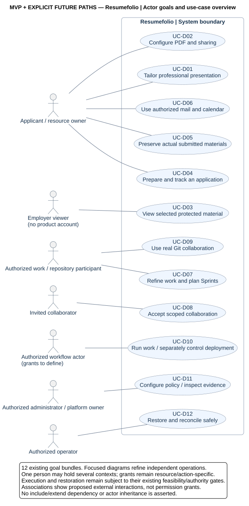

[Use-case source](../../02-requirements-engineering/diagrams/actors-goal-overview.puml) · [PNG](../../02-requirements-engineering/diagrams/actors-goal-overview.png)

### Detailed authoritative Use Case diagrams

These five views are maintained in Requirements Engineering. They complement the overview above and the operation-to-sequence mappings in this document; links do not create a second authoritative model.

| Area | View | Editable source |
| --- | --- | --- |
| Mail and calendar | [SVG](../../02-requirements-engineering/diagrams/use-cases-mail-and-calendar.svg) · [PNG](../../02-requirements-engineering/diagrams/use-cases-mail-and-calendar.png) | [PlantUML](../../02-requirements-engineering/diagrams/use-cases-mail-and-calendar.puml) |
| Work and Sprints | [SVG](../../02-requirements-engineering/diagrams/use-cases-work-and-sprints.svg) · [PNG](../../02-requirements-engineering/diagrams/use-cases-work-and-sprints.png) | [PlantUML](../../02-requirements-engineering/diagrams/use-cases-work-and-sprints.puml) |
| Git collaboration | [SVG](../../02-requirements-engineering/diagrams/use-cases-git-collaboration.svg) · [PNG](../../02-requirements-engineering/diagrams/use-cases-git-collaboration.png) | [PlantUML](../../02-requirements-engineering/diagrams/use-cases-git-collaboration.puml) |
| Execution and deployment | [SVG](../../02-requirements-engineering/diagrams/use-cases-execution-and-deployment.svg) · [PNG](../../02-requirements-engineering/diagrams/use-cases-execution-and-deployment.png) | [PlantUML](../../02-requirements-engineering/diagrams/use-cases-execution-and-deployment.puml) |
| Administration | [SVG](../../02-requirements-engineering/diagrams/use-cases-administration.svg) · [PNG](../../02-requirements-engineering/diagrams/use-cases-administration.png) | [PlantUML](../../02-requirements-engineering/diagrams/use-cases-administration.puml) |
