# State-Based View

[Diagram types and reading guide](#diagram-types-and-reading-guide) · [Full diagram catalog](../diagrams/README.md)

Owner: Farhad. Updated: November 1, 2026.

Status: Populated analysis working model; primary proposals and remaining operational gates are not phase acceptance.

Current MVP scope and selected mechanisms: [Baseline](../../../baseline/README.md). Deferred provider, advanced collaboration and workflow-execution designs are not MVP prerequisites.

## Authoritative Inputs

- [Scope](../../01-project-planning/02-scope.md), [requirements](../../02-requirements-engineering/03-requirements-specification/requirements-specification.md), and [existing scenarios](../../02-requirements-engineering/04-scenarios-and-models/user-stories-and-scenarios.md).

- [Decisions and proposals](../../02-requirements-engineering/07-change-and-baseline/open-questions-and-decisions.md); [accepted profile policy](../../02-requirements-engineering/07-change-and-baseline/open-questions-and-decisions.md#owner-accepted-profile-update-policy).

- [Domain view](../02-domain-and-information-analysis/03-domain-model-and-object-oriented-view.md), [data view](../02-domain-and-information-analysis/05-data-oriented-view.md), [scenario view](06-scenario-based-view.md).

## 1. State subjects

A state describes one subject or one explicitly bounded observation context over time. It is not a screen, process step, database table, or proof that an operation succeeded. Separate dimensions remain separate rather than creating one huge combined state machine. Initial markers identify the modeled instance context, not every possible imported or historical record.

**Authority:** A = accepted profile-update core behavior; P = existing proposed behavior; R = source-derived proposed refinement. A does not approve the invented state labels. All state names are analysis vocabulary, not selected implementation enums. Requirement links establish provenance, not verified acceptance-criterion coverage.

| Model | Subject / lifecycle | Initial context | Related sequences |
| --- | --- | --- | --- |
| [SM-M01](#sm-m01) | Independent draft and live presentation context | Draft exists; no published presentation | [SB-M01](06-scenario-based-view.md#sb-m01) |
| [SM-M02](#sm-m02) | Proposed account access eligibility | Invitation pending | [SB-M10](06-scenario-based-view.md#sb-m10) |
| [SM-M03](#sm-m03) | Invitation and scoped grant instance | Invitation pending | [SB-M10](06-scenario-based-view.md#sb-m10) |
| [SM-M04](#sm-m04) | Enabled link is separate from current retrieval eligibility | Link disabled | [SB-M02](06-scenario-based-view.md#sb-m02), [SB-M03](06-scenario-based-view.md#sb-m03), [SB-M04](06-scenario-based-view.md#sb-m04) |
| [SM-M05](#sm-m05) | Candidate admission and confirmed usable artifact | Candidate content identified | [SB-M02](06-scenario-based-view.md#sb-m02), [SB-M04](06-scenario-based-view.md#sb-m04), [SB-M15](06-scenario-based-view.md#sb-m15) |
| [SM-M06](#sm-m06) | Proposed manual application progress | Preparing | [SB-M05](06-scenario-based-view.md#sb-m05), [SB-M06](06-scenario-based-view.md#sb-m06) |
| [SM-M07](#sm-m07) | Actual submitted-set completeness | Recorded event; material set incomplete | [SB-M05](06-scenario-based-view.md#sb-m05), [SB-M06](06-scenario-based-view.md#sb-m06) |
| [SM-M08](#sm-m08) | Usable provider capability versus disconnected data | Not connected / disconnected | [SB-M07](06-scenario-based-view.md#sb-m07), [SB-M08](06-scenario-based-view.md#sb-m08) |
| [SM-M09](#sm-m09) | Provider acceptance and unknown mail outcome | Prepared message intent | [SB-M07](06-scenario-based-view.md#sb-m07) |
| [SM-M10](#sm-m10) | Local/provider mapping and freshness | Local-only / unmapped activity | [SB-M08](06-scenario-based-view.md#sb-m08) |
| [SM-M11](#sm-m11) | Work status with subject-specific completion guards | To do | [SB-M09](06-scenario-based-view.md#sb-m09) |
| [SM-M12](#sm-m12) | Sprint period and recorded actual outcome | Planned | [SB-M09](06-scenario-based-view.md#sb-m09) |
| [SM-M13](#sm-m13) | Request lifecycle with revision-specific eligibility | Open request | [SB-M11](06-scenario-based-view.md#sb-m11), [SB-M12](06-scenario-based-view.md#sb-m12) |
| [SM-M14](#sm-m14) | Actual attempt, cancellation request and runner uncertainty | Queued admitted attempt | [SB-M13](06-scenario-based-view.md#sb-m13) |
| [SM-M15](#sm-m15) | Separate target authority and actual deployment effect | Requested exact target effect | [SB-M14](06-scenario-based-view.md#sb-m14) |
| [SM-M16](#sm-m16) | User-managed record retention and actual reclamation | Active record/content context | [SB-M05](06-scenario-based-view.md#sb-m05), [SB-M06](06-scenario-based-view.md#sb-m06), [SB-M15](06-scenario-based-view.md#sb-m15), [SB-M16](06-scenario-based-view.md#sb-m16) |
| [SM-M17](#sm-m17) | Gated isolated restoration and demonstrated usable state | Recovery prerequisites missing | [SB-M16](06-scenario-based-view.md#sb-m16) |
| [SM-M18](#sm-m18) | Observed operation result is separate from subject state | Intended operation requested | [SB-M01](06-scenario-based-view.md#sb-m01), [SB-M02](06-scenario-based-view.md#sb-m02), [SB-M05](06-scenario-based-view.md#sb-m05), [SB-M06](06-scenario-based-view.md#sb-m06), [SB-M07](06-scenario-based-view.md#sb-m07), [SB-M08](06-scenario-based-view.md#sb-m08), [SB-M11](06-scenario-based-view.md#sb-m11), [SB-M12](06-scenario-based-view.md#sb-m12), [SB-M13](06-scenario-based-view.md#sb-m13), [SB-M14](06-scenario-based-view.md#sb-m14), [SB-M15](06-scenario-based-view.md#sb-m15), [SB-M16](06-scenario-based-view.md#sb-m16) |

## 2. Transition contracts

Read an arrow as **event [guard] / effect**. Diagrams abbreviate the event and guard; the matching SM-T row below is the full contract. A request alone is not its confirmed effect. Guards apply to the exact current subject, resource scope, revision and operation context; authorization must not be inferred from a stale page or a role name alone. Effects describe observable domain meaning without choosing transactions, queues, locks or service boundaries.

Denied means the prohibited effect is not admitted. A definite failure, partial effect and unknown effect are different results; none universally proves the subject kept its old state. Use SM-M18 to reconcile unconfirmed changes. Omitted arrows are not blanket permission or proof of impossibility: an unmodeled correction/import route needs an explicit contract.

### SM-M01 — Independent draft and live presentation context

One resume context observed across its editable content and effective presentation. Aligned/diverged are descriptive relationships, not a selected revision-storage design.

**Basis:** [PRP-D03](../../02-requirements-engineering/03-requirements-specification/profiles-resumes-and-portfolio.md#prp-d03-independent-selections-layouts-and-overrides), [PRP-D04](../../02-requirements-engineering/03-requirements-specification/profiles-resumes-and-portfolio.md#prp-d04-explicit-shared-source-update-rules), [PRP-D08](../../02-requirements-engineering/03-requirements-specification/profiles-resumes-and-portfolio.md#prp-d08-clear-presentation-and-rendition-boundaries), [PDF-D07](../../02-requirements-engineering/03-requirements-specification/pdf-and-controlled-sharing.md#pdf-d07-explicit-live-revision-and-rendition-behavior)

**Domain:** [DM-C03](../02-domain-and-information-analysis/03-domain-model-and-object-oriented-view.md#dm-c03), [DM-C01](../02-domain-and-information-analysis/03-domain-model-and-object-oriented-view.md#dm-c01), [DM-C09](../02-domain-and-information-analysis/03-domain-model-and-object-oriented-view.md#dm-c09)

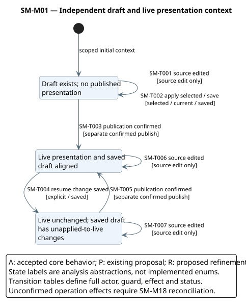

[Editable PlantUML](../diagrams/state-resume-draft-publication.puml) · [PNG](../diagrams/state-resume-draft-publication.png)

**Invariant:** Source editing and preview alone cannot publish or change existing resume content; explicit apply/save and separately confirmed publication remain different.

**Boundary / authority:** A marks the accepted Q-D07 behavior, not owner acceptance of these abstract state labels. Preview is an observation, not a persistent business-state transition. Failed/unknown save or publish uses SM-M18; do not infer rollback or a known current revision.

**Transition / source → target:** **SM-T001**: Draft exists; no published presentation → Draft exists; no published presentation

**Event; actor:** source edited; Profile owner

**Guard:** Authorized source edit only; no resume apply/publish request

**Effect / observable meaning:** Keep existing resume content and no-publication condition unchanged

**Authority:** A

**Transition / source → target:** **SM-T002**: Draft exists; no published presentation → Draft exists; no published presentation

**Event; actor:** apply selected / save; Resume owner

**Guard:** Explicit selected application; current authority/context; save confirmed

**Effect / observable meaning:** Retain intended independent draft and overrides; do not publish

**Authority:** A

**Transition / source → target:** **SM-T003**: Draft exists; no published presentation → Live presentation and saved draft aligned

**Event; actor:** publication confirmed; Resume owner

**Guard:** Separate explicit confirmation; eligible intended content; publication actually confirmed

**Effect / observable meaning:** Make intended presentation effective; actual submitted documents unchanged

**Authority:** A

**Transition / source → target:** **SM-T004**: Live presentation and saved draft aligned → Live unchanged; saved draft has unapplied-to-live changes

**Event; actor:** resume change saved; Resume owner

**Guard:** Explicit permitted apply or independent edit; actual save confirmed

**Effect / observable meaning:** Change intended draft only; preserve live content, other resumes and independent text

**Authority:** A

**Transition / source → target:** **SM-T005**: Live unchanged; saved draft has unapplied-to-live changes → Live presentation and saved draft aligned

**Event; actor:** publication confirmed; Resume owner

**Guard:** Separate confirmation of current intended content; actual eligible publication confirmed

**Effect / observable meaning:** Make reviewed presentation effective without changing actual submitted material

**Authority:** A

**Transition / source → target:** **SM-T006**: Live presentation and saved draft aligned → Live presentation and saved draft aligned

**Event; actor:** source edited; Profile owner

**Guard:** Source changed without explicit resume action

**Effect / observable meaning:** No automatic draft/live update

**Authority:** A

**Transition / source → target:** **SM-T007**: Live unchanged; saved draft has unapplied-to-live changes → Live unchanged; saved draft has unapplied-to-live changes

**Event; actor:** source edited; Profile owner

**Guard:** Source changed without explicit resume action

**Effect / observable meaning:** Preserve existing draft/live difference and independent content

**Authority:** A

### SM-M02 — Proposed account access eligibility

Access-eligibility context under Q-D03; Pending refers to proposed invitation-based onboarding, not public registration.

**Basis:** [ACC-D01](../../02-requirements-engineering/03-requirements-specification/accounts-authentication-and-permissions.md#acc-d01-individual-account-context), [ACC-D02](../../02-requirements-engineering/03-requirements-specification/accounts-authentication-and-permissions.md#acc-d02-unified-sign-in-across-authorized-sections), [ACC-D09](../../02-requirements-engineering/03-requirements-specification/accounts-authentication-and-permissions.md#acc-d09-explicit-administrative-powers), [ACC-D11](../../02-requirements-engineering/03-requirements-specification/accounts-authentication-and-permissions.md#acc-d11-no-authentication-bypass-on-deliveryprovider-failure), [ACC-D12](../../02-requirements-engineering/03-requirements-specification/accounts-authentication-and-permissions.md#acc-d12-end-of-access-and-lifecycle-enforcement), [QSR-D05](../../02-requirements-engineering/03-requirements-specification/quality-security-and-recovery-requirements.md#qsr-d05-identity-resource-isolation-and-changed-access)

**Domain:** [DM-C47](../02-domain-and-information-analysis/03-domain-model-and-object-oriented-view.md#dm-c47), [DM-C48](../02-domain-and-information-analysis/03-domain-model-and-object-oriented-view.md#dm-c48)

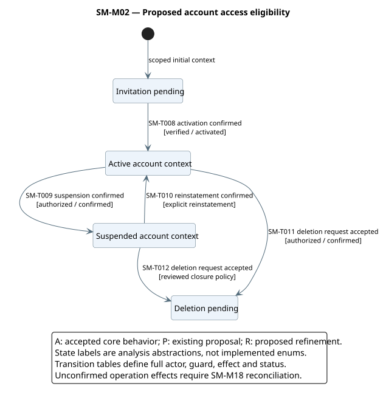

[Editable PlantUML](../diagrams/state-account-eligibility.puml) · [PNG](../diagrams/state-account-eligibility.png)

**Invariant:** Account activation or administrator label is not universal data authority; suspension is not deletion, and recovery does not bypass suspension.

**Boundary / authority:** All enumeration/onboarding/restoration details remain proposed. Deletion-pending is not proof of reclaimed data; category-specific retention handles that separately. No invitation/session timeout, password value or factor mechanism is chosen.

**Transition / source → target:** **SM-T008**: Invitation pending → Active account context

**Event; actor:** activation confirmed; Invited recipient / permitted operator

**Guard:** Intended recipient control and reviewed onboarding verified; actual activation confirmed

**Effect / observable meaning:** Establish active account context without unrelated resource grants

**Authority:** P

**Transition / source → target:** **SM-T009**: Active account context → Suspended account context

**Event; actor:** suspension confirmed; Authorized administrator

**Guard:** Exact permitted account-state power and actual suspension completion

**Effect / observable meaning:** Apply reviewed account-access consequences; retain data under policy

**Authority:** P

**Transition / source → target:** **SM-T010**: Suspended account context → Active account context

**Event; actor:** reinstatement confirmed; Authorized administrator

**Guard:** Reviewed reinstatement authority and eligibility; no authentication-recovery bypass

**Effect / observable meaning:** Re-establish only permitted account access; do not resurrect unrelated grants

**Authority:** R

**Transition / source → target:** **SM-T011**: Active account context → Deletion pending

**Event; actor:** deletion request accepted; Authorized account actor

**Guard:** Reviewed closure/deletion eligibility and actual accepted state change

**Effect / observable meaning:** Record deletion-pending; no immediate data purge inferred

**Authority:** P

**Transition / source → target:** **SM-T012**: Suspended account context → Deletion pending

**Event; actor:** deletion request accepted; Authorized account actor

**Guard:** Reviewed closure policy permits change despite suspension; actual result confirmed

**Effect / observable meaning:** Preserve applicable references and restrictions

**Authority:** R

### SM-M03 — Invitation and scoped grant instance

One invitation/grant instance for an explicit resource. Project and repository grants are separate contexts.

**Basis:** [ACC-D03](../../02-requirements-engineering/03-requirements-specification/accounts-authentication-and-permissions.md#acc-d03-resource-and-operation-authorization), [ACC-D04](../../02-requirements-engineering/03-requirements-specification/accounts-authentication-and-permissions.md#acc-d04-cross-user-private-data-isolation), [ACC-D05](../../02-requirements-engineering/03-requirements-specification/accounts-authentication-and-permissions.md#acc-d05-limited-collaboration-authority), [ACC-D10](../../02-requirements-engineering/03-requirements-specification/accounts-authentication-and-permissions.md#acc-d10-authorization-of-access-grant-changes), [ACC-D12](../../02-requirements-engineering/03-requirements-specification/accounts-authentication-and-permissions.md#acc-d12-end-of-access-and-lifecycle-enforcement), [PKS-D06](../../02-requirements-engineering/03-requirements-specification/projects-kanban-and-sprints.md#pks-d06-scoped-collaboration-and-membership-changes), [GIT-D02](../../02-requirements-engineering/03-requirements-specification/git-hosting-and-collaboration.md#git-d02-repository-and-ref-authorization)

**Domain:** [DM-C48](../02-domain-and-information-analysis/03-domain-model-and-object-oriented-view.md#dm-c48), [DM-C24](../02-domain-and-information-analysis/03-domain-model-and-object-oriented-view.md#dm-c24), [DM-C32](../02-domain-and-information-analysis/03-domain-model-and-object-oriented-view.md#dm-c32)

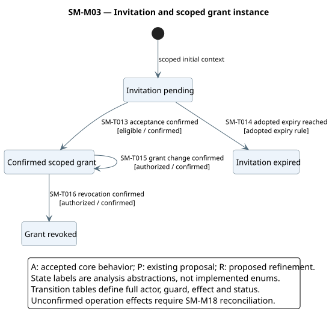

[Editable PlantUML](../diagrams/state-collaboration-grant.puml) · [PNG](../diagrams/state-collaboration-grant.png)

**Invariant:** Invitation is not effective membership before confirmation; revocation does not delete unrelated owned resources.

**Boundary / authority:** Q-D04/Q-D05 remain proposed, including active/in-flight timing. Expiry exists only if adopted; no duration is invented. Restoring data does not reactivate this revoked instance. Any fresh grant needs its own authorized lifecycle.

| Transition / source → target | Event; actor | Guard | Effect / observable meaning | Authority |
| --- | --- | --- | --- | --- |
| **SM-T013**: Invitation pending → Confirmed scoped grant | acceptance confirmed; Intended invited account | Recipient/resource eligibility and actual acceptance/grant completion | Establish only intended resource/action membership | P |
| **SM-T014**: Invitation pending → Invitation expired | adopted expiry reached; Policy evaluation | An expiry policy is adopted and its condition actually holds | Invitation cannot newly grant membership | P |
| **SM-T015**: Confirmed scoped grant → Confirmed scoped grant | grant change confirmed; Permitted resource owner | Current authority permits exact change; result confirmed | Apply new scoped rights; unrelated resources unchanged | P |
| **SM-T016**: Confirmed scoped grant → Grant revoked | revocation confirmed; Permitted resource owner | Reviewed removal authority and effective change confirmed | Use current grant state for later applicable authorization decisions | P |

### SM-M04 — Enabled link is separate from current retrieval eligibility

Link enabled/disabled state from Q-D11 is distinct from per-request eligibility, optional expiry, selected disclosure and artifact availability.

**Basis:** [PDF-D03](../../02-requirements-engineering/03-requirements-specification/pdf-and-controlled-sharing.md#pdf-d03-per-resume-download-choices), [PDF-D04](../../02-requirements-engineering/03-requirements-specification/pdf-and-controlled-sharing.md#pdf-d04-scoped-password-protected-employer-access), [PDF-D05](../../02-requirements-engineering/03-requirements-specification/pdf-and-controlled-sharing.md#pdf-d05-direct-file-and-pdf-authorization), [PDF-D06](../../02-requirements-engineering/03-requirements-specification/pdf-and-controlled-sharing.md#pdf-d06-owner-password-and-link-controls), [ACC-D08](../../02-requirements-engineering/03-requirements-specification/accounts-authentication-and-permissions.md#acc-d08-owner-control-of-employer-link-access), [ACC-D12](../../02-requirements-engineering/03-requirements-specification/accounts-authentication-and-permissions.md#acc-d12-end-of-access-and-lifecycle-enforcement)

**Domain:** [DM-C13](../02-domain-and-information-analysis/03-domain-model-and-object-oriented-view.md#dm-c13), [DM-C12](../02-domain-and-information-analysis/03-domain-model-and-object-oriented-view.md#dm-c12), [DM-C48](../02-domain-and-information-analysis/03-domain-model-and-object-oriented-view.md#dm-c48)

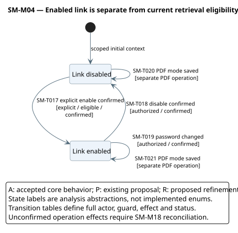

[Editable PlantUML](../diagrams/state-protected-link.puml) · [PNG](../diagrams/state-protected-link.png)

**Invariant:** Fresh access through an effectively disabled link is denied. Already delivered bytes cannot be recalled.

**Boundary / authority:** Initial disabled, re-enable and password/session details are proposals. Expiry is evaluated as an adopted eligibility condition, not invented as a third persisted link state. Existing/in-flight response timing stays Q-D05/Q-D11 policy.

**Transition / source → target:** **SM-T017**: Link disabled → Link enabled

**Event; actor:** explicit enable confirmed; Resume/link owner

**Guard:** Reviewed owner authority; required password and intended publication conditions; actual enablement confirmed

**Effect / observable meaning:** Allow only subsequent eligible scoped requests

**Authority:** P

**Transition / source → target:** **SM-T018**: Link enabled → Link disabled

**Event; actor:** disable confirmed; Resume/link owner

**Guard:** Specific owner-control authority; effective disablement confirmed

**Effect / observable meaning:** Deny fresh protected access through link; PDF configuration stays independent

**Authority:** P

**Transition / source → target:** **SM-T019**: Link enabled → Link enabled

**Event; actor:** password changed; Resume/link owner

**Guard:** Authorized credential change actually confirmed

**Effect / observable meaning:** Apply reviewed credential/session consequences without changing PDF mode

**Authority:** P

**Transition / source → target:** **SM-T020**: Link disabled → Link disabled

**Event; actor:** PDF mode saved; Resume owner

**Guard:** Separate permitted PDF configuration save

**Effect / observable meaning:** Keep disabled link state; availability does not re-enable link

**Authority:** P

**Transition / source → target:** **SM-T021**: Link enabled → Link enabled

**Event; actor:** PDF mode saved; Resume owner

**Guard:** Separate permitted PDF configuration save

**Effect / observable meaning:** Keep enabled link state; neither mode does not disable page/link

**Authority:** P

### SM-M05 — Candidate admission and confirmed usable artifact

One candidate/artifact instance, not a worker-process state. Awaiting completion means no usable result is confirmed, including unresolved processing.

**Basis:** [PRP-D09](../../02-requirements-engineering/03-requirements-specification/profiles-resumes-and-portfolio.md#prp-d09-safe-content-admission-and-truthful-save-outcomes), [PDF-D01](../../02-requirements-engineering/03-requirements-specification/pdf-and-controlled-sharing.md#pdf-d01-generated-resume-pdf), [PDF-D02](../../02-requirements-engineering/03-requirements-specification/pdf-and-controlled-sharing.md#pdf-d02-uploaded-pdf-and-language-identity), [PDF-D07](../../02-requirements-engineering/03-requirements-specification/pdf-and-controlled-sharing.md#pdf-d07-explicit-live-revision-and-rendition-behavior), [PDF-D09](../../02-requirements-engineering/03-requirements-specification/pdf-and-controlled-sharing.md#pdf-d09-failure-safe-processing-and-content-handling), [AFO-D03](../../02-requirements-engineering/03-requirements-specification/administration-files-and-operational-behavior.md#afo-d03-per-file-admission-limit), [AFO-D05](../../02-requirements-engineering/03-requirements-specification/administration-files-and-operational-behavior.md#afo-d05-supported-content-and-validation), [AFO-D07](../../02-requirements-engineering/03-requirements-specification/administration-files-and-operational-behavior.md#afo-d07-truthful-completion-and-interrupted-operation-handling), [AFO-D08](../../02-requirements-engineering/03-requirements-specification/administration-files-and-operational-behavior.md#afo-d08-safe-replacement-and-lifecycle-effects)

**Domain:** [DM-C49](../02-domain-and-information-analysis/03-domain-model-and-object-oriented-view.md#dm-c49), [DM-C10](../02-domain-and-information-analysis/03-domain-model-and-object-oriented-view.md#dm-c10), [DM-C11](../02-domain-and-information-analysis/03-domain-model-and-object-oriented-view.md#dm-c11), [DM-C06](../02-domain-and-information-analysis/03-domain-model-and-object-oriented-view.md#dm-c06)

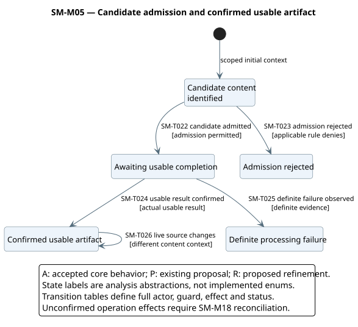

[Editable PlantUML](../diagrams/state-artifact-availability.puml) · [PNG](../diagrams/state-artifact-availability.png)

**Invariant:** Available is not authorization or matching-current-revision eligibility. A failed replacement candidate does not by itself destroy the prior usable association.

**Boundary / authority:** Generation/replacement/retirement details remain Q-D08/Q-D10/Q-D24 proposals. Replacement uses a distinguishable candidate; do not loop a failed candidate into a fabricated success. Draft previews remain distinguished from employer-facing published renditions.

**Transition / source → target:** **SM-T022**: Candidate content identified → Awaiting usable completion

**Event; actor:** candidate admitted; Authorized content actor / processor

**Guard:** Intended resource/language; applicable validation/policy/authority permits processing

**Effect / observable meaning:** Retain pending candidate context; no usable-success claim

**Authority:** P

**Transition / source → target:** **SM-T023**: Candidate content identified → Admission rejected

**Event; actor:** admission rejected; Admission evaluation

**Guard:** Applicable authority/content/size/quota rule denies candidate

**Effect / observable meaning:** Do not expose candidate as usable content

**Authority:** P

**Transition / source → target:** **SM-T024**: Awaiting usable completion → Confirmed usable artifact

**Event; actor:** usable result confirmed; Processing observation

**Guard:** Actual validated usable content and intended association confirmed

**Effect / observable meaning:** Make this artifact available under its own authority/provenance

**Authority:** P

**Transition / source → target:** **SM-T025**: Awaiting usable completion → Definite processing failure

**Event; actor:** definite failure observed; Processing observation

**Guard:** Required processing definitively failed

**Effect / observable meaning:** Report failed candidate without false availability

**Authority:** P

**Transition / source → target:** **SM-T026**: Confirmed usable artifact → Confirmed usable artifact

**Event; actor:** live source changes; Authorized source actor

**Guard:** Different source/publication changed; this artifact identity/content not replaced

**Effect / observable meaning:** Retain bytes/identity; recompute eligibility for requested revision separately

**Authority:** R

### SM-M06 — Proposed manual application progress

Q-D12 normal manual progress routes. A progress label is neither receipt proof nor proof that actual document capture completed.

**Basis:** [APP-D01](../../02-requirements-engineering/03-requirements-specification/manual-application-management.md#app-d01-company-and-opportunity-context), [APP-D04](../../02-requirements-engineering/03-requirements-specification/manual-application-management.md#app-d04-explicit-progress-states-and-transitions), [APP-D05](../../02-requirements-engineering/03-requirements-specification/manual-application-management.md#app-d05-user-directed-submission-recording), [APP-D07](../../02-requirements-engineering/03-requirements-specification/manual-application-management.md#app-d07-correction-and-repeated-submissions), [APP-D08](../../02-requirements-engineering/03-requirements-specification/manual-application-management.md#app-d08-correspondence-calendar-and-follow-up-links)

**Domain:** [DM-C16](../02-domain-and-information-analysis/03-domain-model-and-object-oriented-view.md#dm-c16), [DM-C15](../02-domain-and-information-analysis/03-domain-model-and-object-oriented-view.md#dm-c15), [DM-C18](../02-domain-and-information-analysis/03-domain-model-and-object-oriented-view.md#dm-c18)

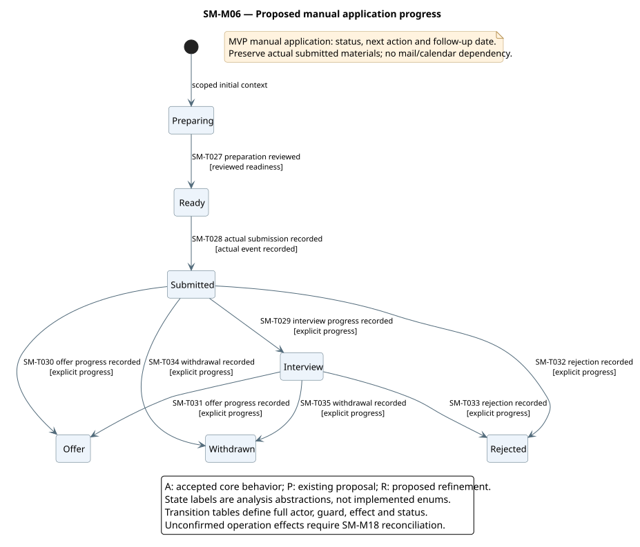

[Editable PlantUML](../diagrams/state-application-progress.puml) · [PNG](../diagrams/state-application-progress.png)

**Invariant:** Submitted requires a recorded actual event; progress, captured-set completeness and external receipt stay separate.

**Boundary / authority:** Other corrections, direct manual-channel entry and offer acceptance/decline use explicit reviewed history rules; no silent arbitrary reset is granted. This selected normal-route model is not an accepted exhaustive transition matrix. Offer outcome can be attributed without inventing additional accepted progress states.

**Transition / source → target:** **SM-T027**: Preparing → Ready

**Event; actor:** preparation reviewed; Application owner

**Guard:** Reviewed preparation/material readiness rules hold; authorized result confirmed

**Effect / observable meaning:** Record Ready without claiming external submission

**Authority:** P

**Transition / source → target:** **SM-T028**: Ready → Submitted

**Event; actor:** actual submission recorded; Application owner

**Guard:** Authorized actual submission context recorded under reviewed policy

**Effect / observable meaning:** Record Submitted; complete captured material is a separate condition

**Authority:** P

**Transition / source → target:** **SM-T029**: Submitted → Interview

**Event; actor:** interview progress recorded; Application owner

**Guard:** Permitted explicit progress change with attributable context

**Effect / observable meaning:** Record Interview; no automatic inference from email/calendar

**Authority:** P

**Transition / source → target:** **SM-T030**: Submitted → Offer

**Event; actor:** offer progress recorded; Application owner

**Guard:** Reviewed explicit transition and evidence/attribution conditions

**Effect / observable meaning:** Record Offer without rewriting submitted documents

**Authority:** P

**Transition / source → target:** **SM-T031**: Interview → Offer

**Event; actor:** offer progress recorded; Application owner

**Guard:** Reviewed permitted progress transition

**Effect / observable meaning:** Record intended offer context

**Authority:** P

**Transition / source → target:** **SM-T032**: Submitted → Rejected

**Event; actor:** rejection recorded; Application owner

**Guard:** Explicit permitted change/correction under progress policy

**Effect / observable meaning:** Record rejection with applicable history

**Authority:** P

**Transition / source → target:** **SM-T033**: Interview → Rejected

**Event; actor:** rejection recorded; Application owner

**Guard:** Explicit permitted progress update

**Effect / observable meaning:** Retain actual outcome/history

**Authority:** P

**Transition / source → target:** **SM-T034**: Submitted → Withdrawn

**Event; actor:** withdrawal recorded; Application owner

**Guard:** Reviewed explicit withdrawal transition

**Effect / observable meaning:** Record withdrawal without undoing past submission

**Authority:** P

**Transition / source → target:** **SM-T035**: Interview → Withdrawn

**Event; actor:** withdrawal recorded; Application owner

**Guard:** Reviewed explicit withdrawal transition

**Effect / observable meaning:** Retain actual prior history

**Authority:** P

### SM-M07 — Actual submitted-set completeness

Completeness of one recorded actual submission set; application progress and current retrieval authority are separate subjects.

**Basis:** [APP-D05](../../02-requirements-engineering/03-requirements-specification/manual-application-management.md#app-d05-user-directed-submission-recording), [APP-D06](../../02-requirements-engineering/03-requirements-specification/manual-application-management.md#app-d06-preserved-actual-submitted-copies), [APP-D07](../../02-requirements-engineering/03-requirements-specification/manual-application-management.md#app-d07-correction-and-repeated-submissions), [PDF-D08](../../02-requirements-engineering/03-requirements-specification/pdf-and-controlled-sharing.md#pdf-d08-downloaded-copy-and-submission-distinctions), [PRP-D04](../../02-requirements-engineering/03-requirements-specification/profiles-resumes-and-portfolio.md#prp-d04-explicit-shared-source-update-rules)

**Domain:** [DM-C18](../02-domain-and-information-analysis/03-domain-model-and-object-oriented-view.md#dm-c18), [DM-C19](../02-domain-and-information-analysis/03-domain-model-and-object-oriented-view.md#dm-c19), [DM-C16](../02-domain-and-information-analysis/03-domain-model-and-object-oriented-view.md#dm-c16)

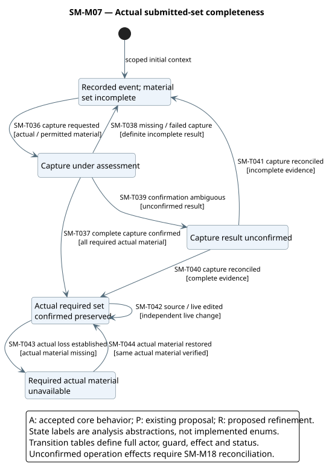

[Editable PlantUML](../diagrams/state-submitted-set-completeness.puml) · [PNG](../diagrams/state-submitted-set-completeness.png)

**Invariant:** A missing file or ambiguous capture cannot satisfy complete-preserved-copy acceptance. Later live changes do not rewrite actual submitted material.

**Boundary / authority:** Q-D13/Q-D14 capture/correction/retry details remain proposed. A new submission or correction/version is distinguishable from this set; do not silently replace the original. A caller-specific access denial does not itself prove global material loss.

**Transition / source → target:** **SM-T036**: Recorded event; material set incomplete → Capture under assessment

**Event; actor:** capture requested; Application owner

**Guard:** Actual event/material and capture authority identified; explicit permitted capture

**Effect / observable meaning:** Assess actual intended material; retain prior partial/history context

**Authority:** P

**Transition / source → target:** **SM-T037**: Capture under assessment → Actual required set confirmed preserved

**Event; actor:** complete capture confirmed; Capture observation

**Guard:** Every required actual material/provenance condition confirmed

**Effect / observable meaning:** Report complete identifiable actual set, not inferred current source

**Authority:** P

**Transition / source → target:** **SM-T038**: Capture under assessment → Recorded event; material set incomplete

**Event; actor:** missing / failed capture; Capture observation

**Guard:** Known missing or incomplete required capture

**Effect / observable meaning:** Report incomplete set without false full preservation

**Authority:** P

**Transition / source → target:** **SM-T039**: Capture under assessment → Capture result unconfirmed

**Event; actor:** confirmation ambiguous; Capture observation

**Guard:** Result evidence cannot establish completed or failed capture

**Effect / observable meaning:** Retain unknown outcome; reconcile before new consequential action

**Authority:** R

**Transition / source → target:** **SM-T040**: Capture result unconfirmed → Actual required set confirmed preserved

**Event; actor:** capture reconciled; Authorized reconciliation

**Guard:** Evidence confirms required actual material is preserved

**Effect / observable meaning:** Record bounded confirmed complete set

**Authority:** R

**Transition / source → target:** **SM-T041**: Capture result unconfirmed → Recorded event; material set incomplete

**Event; actor:** capture reconciled; Authorized reconciliation

**Guard:** Evidence establishes missing/incomplete actual material

**Effect / observable meaning:** Record honest incomplete result

**Authority:** R

**Transition / source → target:** **SM-T042**: Actual required set confirmed preserved → Actual required set confirmed preserved

**Event; actor:** source / live edited; Authorized source/resume owner

**Guard:** Only a later source, draft or publication change occurred

**Effect / observable meaning:** Keep actual submitted documents unchanged

**Authority:** A

**Transition / source → target:** **SM-T043**: Actual required set confirmed preserved → Required actual material unavailable

**Event; actor:** actual loss established; Authorized integrity observation

**Guard:** Required actual material is definitely unavailable, not merely denied to a caller

**Effect / observable meaning:** Report unavailable history rather than substitute a live artifact

**Authority:** R

**Transition / source → target:** **SM-T044**: Required actual material unavailable → Actual required set confirmed preserved

**Event; actor:** actual material restored; Authorized recovery

**Guard:** Same actual material identity/content/provenance verified under recovery policy

**Effect / observable meaning:** Restore truthful confirmed availability without fabricated current substitutes

**Authority:** R

### SM-M08 — Usable provider capability versus disconnected data

Usability of the selected provider/account capability, not a token-store design or a claim that all provider operations are allowed.

**Basis:** [EGC-D01](../../02-requirements-engineering/03-requirements-specification/email-calendar-and-google-integration.md#egc-d01-authorized-connection-and-account-context), [EGC-D02](../../02-requirements-engineering/03-requirements-specification/email-calendar-and-google-integration.md#egc-d02-justified-permissions-and-private-resource-isolation), [EGC-D08](../../02-requirements-engineering/03-requirements-specification/email-calendar-and-google-integration.md#egc-d08-explicit-synchronization-contract), [EGC-D11](../../02-requirements-engineering/03-requirements-specification/email-calendar-and-google-integration.md#egc-d11-disconnect-revocation-and-reconnect), [EGC-D12](../../02-requirements-engineering/03-requirements-specification/email-calendar-and-google-integration.md#egc-d12-bounded-failures-recovery-and-feasibility-evidence)

**Domain:** [DM-C20](../02-domain-and-information-analysis/03-domain-model-and-object-oriented-view.md#dm-c20)

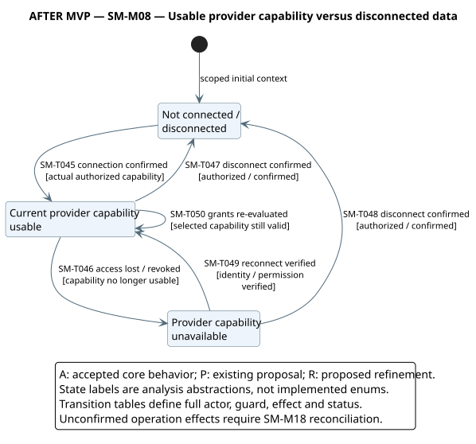

[Editable PlantUML](../diagrams/state-provider-connection.puml) · [PNG](../diagrams/state-provider-connection.png)

**Invariant:** Connected/usable is not synchronized/fresh local content or permission to act on every accessible calendar. Disconnect does not silently send/delete/replay.

**Boundary / authority:** Q-D15 setup/access is missing now; initial not-connected is consistent with that fact. Q-D17 retained-data/reconnect details remain proposals. No token value, refresh algorithm or account-global source of truth is selected.

**Transition / source → target:** **SM-T045**: Not connected / disconnected → Current provider capability usable

**Event; actor:** connection confirmed; Connection owner

**Guard:** Explicit consent/identity/scopes and actual usable connection verified

**Effect / observable meaning:** Establish only permitted provider capability; no automatic stale replay

**Authority:** P

**Transition / source → target:** **SM-T046**: Current provider capability usable → Provider capability unavailable

**Event; actor:** access lost / revoked; Provider/current access observation

**Guard:** Applicable required capability is no longer usable

**Effect / observable meaning:** Prevent new dependent protected operations; retained copies have freshness limits

**Authority:** P

**Transition / source → target:** **SM-T047**: Current provider capability usable → Not connected / disconnected

**Event; actor:** disconnect confirmed; Connection owner

**Guard:** Authorized disconnect actually completed under policy

**Effect / observable meaning:** Stop dependent fetch/push/reminder work; preserve reviewed local data semantics

**Authority:** P

**Transition / source → target:** **SM-T048**: Provider capability unavailable → Not connected / disconnected

**Event; actor:** disconnect confirmed; Connection owner

**Guard:** Permitted disconnect cleanup confirmed

**Effect / observable meaning:** Do not imply provider-owned content was deleted

**Authority:** P

**Transition / source → target:** **SM-T049**: Provider capability unavailable → Current provider capability usable

**Event; actor:** reconnect verified; Connection owner

**Guard:** Explicit applicable reconnect; actual identity/permission verified

**Effect / observable meaning:** Restore current capability, then reconcile mappings/pending work separately

**Authority:** P

**Transition / source → target:** **SM-T050**: Current provider capability usable → Current provider capability usable

**Event; actor:** grants re-evaluated; Current access observation

**Guard:** Actual capabilities changed but required selected operation remains eligible

**Effect / observable meaning:** Re-evaluate operation-specific rights; no entire-account disclosure

**Authority:** R

### SM-M09 — Provider acceptance and unknown mail outcome

One deliberately requested send/reply attempt, not the lifetime of an entire email thread or a draft-save operation.

**Basis:** [EGC-D04](../../02-requirements-engineering/03-requirements-specification/email-calendar-and-google-integration.md#egc-d04-manual-compose-and-draft-handling), [EGC-D05](../../02-requirements-engineering/03-requirements-specification/email-calendar-and-google-integration.md#egc-d05-deliberate-send-and-truthful-outcome), [EGC-D06](../../02-requirements-engineering/03-requirements-specification/email-calendar-and-google-integration.md#egc-d06-reply-context-and-conversation-association), [EGC-D11](../../02-requirements-engineering/03-requirements-specification/email-calendar-and-google-integration.md#egc-d11-disconnect-revocation-and-reconnect), [EGC-D12](../../02-requirements-engineering/03-requirements-specification/email-calendar-and-google-integration.md#egc-d12-bounded-failures-recovery-and-feasibility-evidence), [EIF-D08](../../02-requirements-engineering/03-requirements-specification/external-interface-requirements.md#eif-d08-operation-specific-failure-and-repetition-semantics)

**Domain:** [DM-C21](../02-domain-and-information-analysis/03-domain-model-and-object-oriented-view.md#dm-c21), [DM-C20](../02-domain-and-information-analysis/03-domain-model-and-object-oriented-view.md#dm-c20)

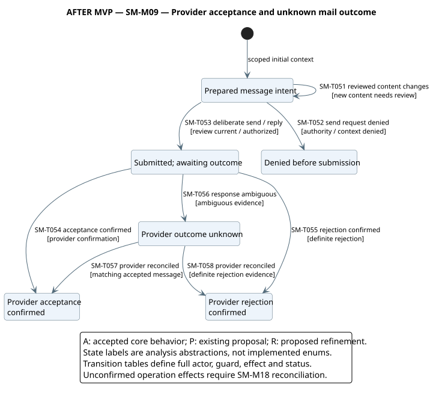

[Editable PlantUML](../diagrams/state-mail-send-attempt.puml) · [PNG](../diagrams/state-mail-send-attempt.png)

**Invariant:** Accepted is not delivered or read. Unknown is not failed, safe-to-repeat or proof no effect occurred.

**Boundary / authority:** Q-D16 safe retry and provider reconciliation are proposals; actual OAuth is not created. Retrying requires a separately authorized distinguishable attempt after the reviewed disposition, not an automatic Unknown→InFlight loop.

**Transition / source → target:** **SM-T051**: Prepared message intent → Prepared message intent

**Event; actor:** reviewed content changes; Message owner

**Guard:** Sender/recipient/content/attachment set changes before submit

**Effect / observable meaning:** Require renewed final review; no send follows automatically

**Authority:** R

**Transition / source → target:** **SM-T052**: Prepared message intent → Denied before submission

**Event; actor:** send request denied; Current authority evaluation

**Guard:** Wrong/missing account, resource or provider capability prevents action

**Effect / observable meaning:** No protected provider submission

**Authority:** P

**Transition / source → target:** **SM-T053**: Prepared message intent → Submitted; awaiting outcome

**Event; actor:** deliberate send / reply; Message owner

**Guard:** Current reviewed final intent; permitted sender/thread/recipients and usable capability

**Effect / observable meaning:** Submit only intended message and retain account/item context

**Authority:** P

**Transition / source → target:** **SM-T054**: Submitted; awaiting outcome → Provider acceptance confirmed

**Event; actor:** acceptance confirmed; Provider observation

**Guard:** Actual provider acceptance/reference supports this claim

**Effect / observable meaning:** Report accepted, not recipient delivered/read

**Authority:** P

**Transition / source → target:** **SM-T055**: Submitted; awaiting outcome → Provider rejection confirmed

**Event; actor:** rejection confirmed; Provider observation

**Guard:** Definite provider rejection/failure is established

**Effect / observable meaning:** Report rejected without confusing timeout and definite failure

**Authority:** P

**Transition / source → target:** **SM-T056**: Submitted; awaiting outcome → Provider outcome unknown

**Event; actor:** response ambiguous; Operation observation

**Guard:** Evidence does not establish provider effect

**Effect / observable meaning:** Retain unknown result and prevent blind automatic duplicate send

**Authority:** P

**Transition / source → target:** **SM-T057**: Provider outcome unknown → Provider acceptance confirmed

**Event; actor:** provider reconciled; Authorized reconciliation

**Guard:** Evidence identifies accepted intended message in its correct account/thread context

**Effect / observable meaning:** Record bounded provider acceptance

**Authority:** P

**Transition / source → target:** **SM-T058**: Provider outcome unknown → Provider rejection confirmed

**Event; actor:** provider reconciled; Authorized reconciliation

**Guard:** Authoritative evidence establishes definite rejected/no-accepted-effect disposition

**Effect / observable meaning:** Record known rejection; absence of immediate search result alone is insufficient

**Authority:** P

### SM-M10 — Local/provider mapping and freshness

Mapping/freshness of an activity, not provider connection status, reminder delivery or the whole account calendar.

**Basis:** [EGC-D07](../../02-requirements-engineering/03-requirements-specification/email-calendar-and-google-integration.md#egc-d07-calendar-activities-and-time-meaning), [EGC-D08](../../02-requirements-engineering/03-requirements-specification/email-calendar-and-google-integration.md#egc-d08-explicit-synchronization-contract), [EGC-D09](../../02-requirements-engineering/03-requirements-specification/email-calendar-and-google-integration.md#egc-d09-application-relationships-preserve-boundaries), [EGC-D10](../../02-requirements-engineering/03-requirements-specification/email-calendar-and-google-integration.md#egc-d10-reminders-and-notification-outcomes), [EGC-D11](../../02-requirements-engineering/03-requirements-specification/email-calendar-and-google-integration.md#egc-d11-disconnect-revocation-and-reconnect), [EGC-D12](../../02-requirements-engineering/03-requirements-specification/email-calendar-and-google-integration.md#egc-d12-bounded-failures-recovery-and-feasibility-evidence)

**Domain:** [DM-C22](../02-domain-and-information-analysis/03-domain-model-and-object-oriented-view.md#dm-c22), [DM-C20](../02-domain-and-information-analysis/03-domain-model-and-object-oriented-view.md#dm-c20)

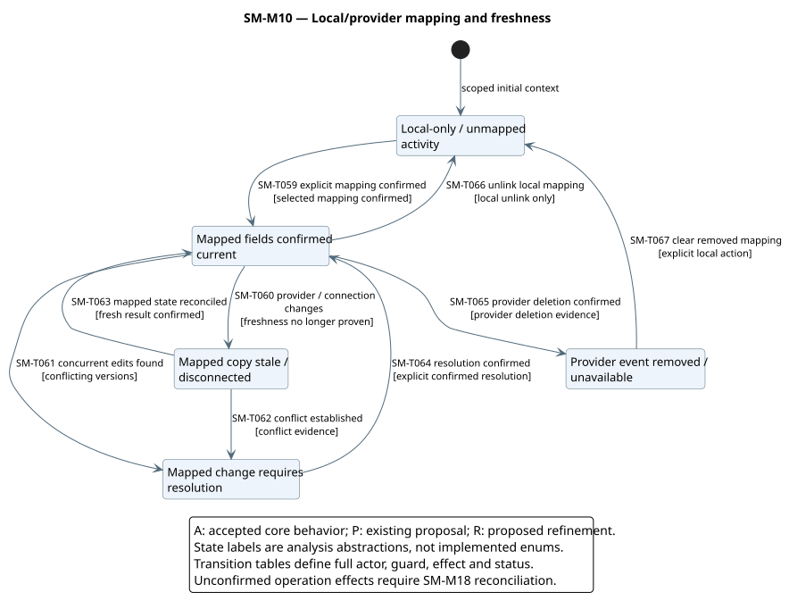

[Editable PlantUML](../diagrams/state-calendar-mapping.puml) · [PNG](../diagrams/state-calendar-mapping.png)

**Invariant:** Local save does not automatically publish externally; reconnect alone does not prove a stale mapping fresh or recreate a deleted event.

**Boundary / authority:** Q-D17 direction, version, conflict, deletion and reconnect rules are proposed. Unknown provider writes use SM-M18 and cannot establish Fresh. A new mapping to another event must have distinguishable intended identity and confirmation.

**Transition / source → target:** **SM-T059**: Local-only / unmapped activity → Mapped fields confirmed current

**Event; actor:** explicit mapping confirmed; Activity owner

**Guard:** Selected provider/account/event mapping permitted and actual result confirmed

**Effect / observable meaning:** Identify mapped fields and preserve local-only notes/associations

**Authority:** P

**Transition / source → target:** **SM-T060**: Mapped fields confirmed current → Mapped copy stale / disconnected

**Event; actor:** provider / connection changes; Provider/current-capability observation

**Guard:** Mapped version changes or dependent connection becomes unusable

**Effect / observable meaning:** Mark retained mapped information stale rather than currently synchronized

**Authority:** P

**Transition / source → target:** **SM-T061**: Mapped fields confirmed current → Mapped change requires resolution

**Event; actor:** concurrent edits found; Mapping evaluation

**Guard:** Reviewed local/provider version evidence conflicts

**Effect / observable meaning:** Do not silently overwrite with last-write-wins

**Authority:** P

**Transition / source → target:** **SM-T062**: Mapped copy stale / disconnected → Mapped change requires resolution

**Event; actor:** conflict established; Authorized reconciliation

**Guard:** Current comparable evidence establishes competing edits

**Effect / observable meaning:** Keep conflict visible until explicit resolution

**Authority:** P

**Transition / source → target:** **SM-T063**: Mapped copy stale / disconnected → Mapped fields confirmed current

**Event; actor:** mapped state reconciled; Authorized activity/connection actor

**Guard:** Usable capability and actual permitted refreshed field context confirmed

**Effect / observable meaning:** Re-establish only confirmed mapped freshness

**Authority:** P

**Transition / source → target:** **SM-T064**: Mapped change requires resolution → Mapped fields confirmed current

**Event; actor:** resolution confirmed; Activity owner / permitted resolver

**Guard:** Explicit permitted resolution and actual resulting provider/local outcome confirmed

**Effect / observable meaning:** Preserve local-only meaning and record actual selected mapping

**Authority:** P

**Transition / source → target:** **SM-T065**: Mapped fields confirmed current → Provider event removed / unavailable

**Event; actor:** provider deletion confirmed; Provider observation

**Guard:** Actual intended provider event deletion established

**Effect / observable meaning:** Report mapped event unavailable; do not invent a replacement

**Authority:** P

**Transition / source → target:** **SM-T066**: Mapped fields confirmed current → Local-only / unmapped activity

**Event; actor:** unlink local mapping; Activity owner

**Guard:** Explicit permitted local association removal

**Effect / observable meaning:** Do not delete the provider event solely because local association was removed

**Authority:** P

**Transition / source → target:** **SM-T067**: Provider event removed / unavailable → Local-only / unmapped activity

**Event; actor:** clear removed mapping; Activity owner

**Guard:** Reviewed permitted local mapping change

**Effect / observable meaning:** Retain permitted local meaning and history without recreating provider content

**Authority:** R

### SM-M11 — Work status with subject-specific completion guards

One work subject at a time: Task and Backlog Item can share candidate labels without sharing identity or completion authority.

**Basis:** [PKS-D02](../../02-requirements-engineering/03-requirements-specification/projects-kanban-and-sprints.md#pks-d02-configurable-columns-and-valid-work-movement), [PKS-D03](../../02-requirements-engineering/03-requirements-specification/projects-kanban-and-sprints.md#pks-d03-product-backlog-and-item-definition), [PKS-D04](../../02-requirements-engineering/03-requirements-specification/projects-kanban-and-sprints.md#pks-d04-item-refinement-and-task-relationships), [PKS-D05](../../02-requirements-engineering/03-requirements-specification/projects-kanban-and-sprints.md#pks-d05-assignment-priority-and-due-date-handling), [PKS-D09](../../02-requirements-engineering/03-requirements-specification/projects-kanban-and-sprints.md#pks-d09-explicit-completion-and-sprint-end-outcomes), [PKS-D11](../../02-requirements-engineering/03-requirements-specification/projects-kanban-and-sprints.md#pks-d11-truthful-changes-retirement-and-recovery)

**Domain:** [DM-C28](../02-domain-and-information-analysis/03-domain-model-and-object-oriented-view.md#dm-c28), [DM-C29](../02-domain-and-information-analysis/03-domain-model-and-object-oriented-view.md#dm-c29), [DM-C25](../02-domain-and-information-analysis/03-domain-model-and-object-oriented-view.md#dm-c25)

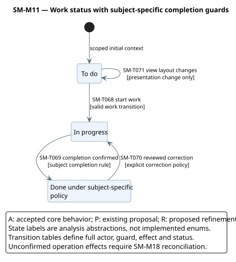

[Editable PlantUML](../diagrams/state-work-item-task.puml) · [PNG](../diagrams/state-work-item-task.png)

**Invariant:** A board move/label or all tasks marked done does not alone satisfy item acceptance; ordering, priority and readiness are different meanings.

**Boundary / authority:** Q-D18/Q-D19 propose canonical To do/In progress/Done but also refer to Ready. This model treats selection readiness as a separate proposed predicate, not a silently accepted fourth canonical state. Exact direct completion/reopen/column mappings still require primary-policy disposition.

**Transition / source → target:** **SM-T068**: To do → In progress

**Event; actor:** start work; Authorized work participant

**Guard:** Current work/action authority and valid intended state change

**Effect / observable meaning:** Record in-progress activity/outcome context

**Authority:** P

**Transition / source → target:** **SM-T069**: In progress → Done under subject-specific policy

**Event; actor:** completion confirmed; Authorized completion/acceptance actor

**Guard:** Task: required activity completion; Item: criteria and authorized acceptance actually satisfied

**Effect / observable meaning:** Record Done for the correct subject; do not derive item acceptance solely from tasks

**Authority:** P

**Transition / source → target:** **SM-T070**: Done under subject-specific policy → In progress

**Event; actor:** reviewed correction; Authorized work actor

**Guard:** Adopted reopen/correction policy permits change with attribution/history

**Effect / observable meaning:** Preserve prior outcome history and explicit current state

**Authority:** R

**Transition / source → target:** **SM-T071**: To do → To do

**Event; actor:** view layout changes; Authorized board actor

**Guard:** Column/order/display changed without an actual mapped work-state change

**Effect / observable meaning:** Keep business work state independent of label/layout

**Authority:** R

### SM-M12 — Sprint period and recorded actual outcome

**Release applicability:** future-domain design retained after MVP; core operating/deployment and recovery controls still apply to MVP where relevant.

Lifecycle of a Sprint period; goal success, accepted-item counts and incomplete work are separate outcomes.

**Basis:** [PKS-D07](../../02-requirements-engineering/03-requirements-specification/projects-kanban-and-sprints.md#pks-d07-sprint-goal-and-selected-backlog-items), [PKS-D08](../../02-requirements-engineering/03-requirements-specification/projects-kanban-and-sprints.md#pks-d08-one-coherent-sprint-backlog), [PKS-D09](../../02-requirements-engineering/03-requirements-specification/projects-kanban-and-sprints.md#pks-d09-explicit-completion-and-sprint-end-outcomes), [PKS-D11](../../02-requirements-engineering/03-requirements-specification/projects-kanban-and-sprints.md#pks-d11-truthful-changes-retirement-and-recovery)

**Domain:** [DM-C30](../02-domain-and-information-analysis/03-domain-model-and-object-oriented-view.md#dm-c30), [DM-C31](../02-domain-and-information-analysis/03-domain-model-and-object-oriented-view.md#dm-c31), [DM-C28](../02-domain-and-information-analysis/03-domain-model-and-object-oriented-view.md#dm-c28), [DM-C29](../02-domain-and-information-analysis/03-domain-model-and-object-oriented-view.md#dm-c29)

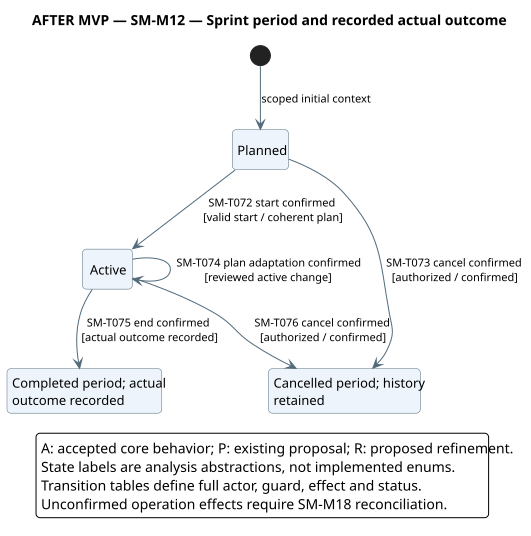

[Editable PlantUML](../diagrams/state-sprint-lifecycle.puml) · [PNG](../diagrams/state-sprint-lifecycle.png)

**Invariant:** One coherent Sprint Backlog remains goal + selected items + delivery plan. Elapsed time is not automatic completion or success.

**Boundary / authority:** Q-D19 enumeration, active-Sprint count and change/end policies remain proposed. A completed/cancelled period is not deleted; future Sprint selection is explicit. Corrections and historical reporting must not rewrite earlier meaning.

**Transition / source → target:** **SM-T072**: Planned → Active

**Event; actor:** start confirmed; Permitted Sprint owner

**Guard:** Reviewed start/date/project rules and coherent goal/selected-items/plan hold

**Effect / observable meaning:** Activate the intended period; no extra team or cadence inferred

**Authority:** P

**Transition / source → target:** **SM-T073**: Planned → Cancelled period; history retained

**Event; actor:** cancel confirmed; Permitted Sprint owner

**Guard:** Authorized planned-period cancellation actually confirmed

**Effect / observable meaning:** Retain identified planning/history context

**Authority:** P

**Transition / source → target:** **SM-T074**: Active → Active

**Event; actor:** plan adaptation confirmed; Permitted planning actor

**Guard:** Reviewed active-change authority and required goal/scope confirmation/history

**Effect / observable meaning:** Retain one coherent Sprint Backlog with attributable adaptation

**Authority:** P

**Transition / source → target:** **SM-T075**: Active → Completed period; actual outcome recorded

**Event; actor:** end confirmed; Permitted Sprint owner

**Guard:** Actual goal/item outcomes and explicit incomplete-work disposition recorded

**Effect / observable meaning:** End period with history; completion does not imply goal achieved/all items accepted

**Authority:** P

**Transition / source → target:** **SM-T076**: Active → Cancelled period; history retained

**Event; actor:** cancel confirmed; Permitted Sprint owner

**Guard:** Authorized cancellation and actual work disposition confirmed

**Effect / observable meaning:** Preserve goal/items/plan/history; no automatic carry-over

**Authority:** P

### SM-M13 — Request lifecycle with revision-specific eligibility

Lifecycle of one pull request. Current review/check eligibility is revision-specific accompanying information rather than a second accepted request-state enum.

**Basis:** [GIT-D02](../../02-requirements-engineering/03-requirements-specification/git-hosting-and-collaboration.md#git-d02-repository-and-ref-authorization), [GIT-D05](../../02-requirements-engineering/03-requirements-specification/git-hosting-and-collaboration.md#git-d05-fork-provenance-and-permission-boundaries), [GIT-D06](../../02-requirements-engineering/03-requirements-specification/git-hosting-and-collaboration.md#git-d06-pull-requests-comments-and-review), [GIT-D07](../../02-requirements-engineering/03-requirements-specification/git-hosting-and-collaboration.md#git-d07-controlled-merge-and-conflict-outcomes), [GIT-D09](../../02-requirements-engineering/03-requirements-specification/git-hosting-and-collaboration.md#git-d09-tags-and-releases)

**Domain:** [DM-C35](../02-domain-and-information-analysis/03-domain-model-and-object-oriented-view.md#dm-c35), [DM-C36](../02-domain-and-information-analysis/03-domain-model-and-object-oriented-view.md#dm-c36), [DM-C32](../02-domain-and-information-analysis/03-domain-model-and-object-oriented-view.md#dm-c32), [DM-C34](../02-domain-and-information-analysis/03-domain-model-and-object-oriented-view.md#dm-c34), [DM-C33](../02-domain-and-information-analysis/03-domain-model-and-object-oriented-view.md#dm-c33)

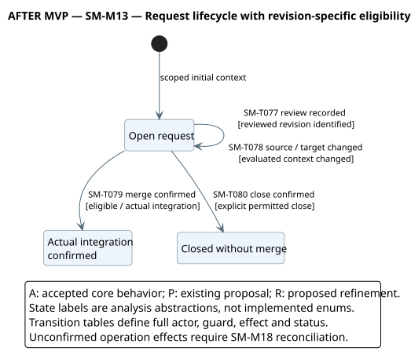

[Editable PlantUML](../diagrams/state-pull-request-lifecycle.puml) · [PNG](../diagrams/state-pull-request-lifecycle.png)

**Invariant:** Open does not imply merge-ready. A source change invalidates prior approval under the proposal; target changes need re-evaluation. Closed is not Merged.

**Boundary / authority:** Q-D22 review counts, solo-owner exception, merge strategy, reopen/correction and release mutations remain proposed. Unknown merge results require actual-ref reconciliation via SM-M18; do not assert Open or Merged merely from a lost response.

**Transition / source → target:** **SM-T077**: Open request → Open request

**Event; actor:** review recorded; Permitted reviewer

**Guard:** Review targets the intended current evaluated revision; actual record confirmed

**Effect / observable meaning:** Retain attributable review evidence, not universal merge authority

**Authority:** P

**Transition / source → target:** **SM-T078**: Open request → Open request

**Event; actor:** source / target changed; Repository observation

**Guard:** Actual source/target revision differs from evaluated context

**Effect / observable meaning:** Invalidate/re-evaluate applicable review/check eligibility without pretending request merged

**Authority:** P

**Transition / source → target:** **SM-T079**: Open request → Actual integration confirmed

**Event; actor:** merge confirmed; Authorized merge actor

**Guard:** Current source/target authority, reviewed checks/review eligibility and actual integration confirmed

**Effect / observable meaning:** Record actual integrated context; no deployment authority inherited

**Authority:** P

**Transition / source → target:** **SM-T080**: Open request → Closed without merge

**Event; actor:** close confirmed; Permitted request actor

**Guard:** Reviewed close authority and actual request-state change confirmed

**Effect / observable meaning:** Retain discussion/revision history without integration claim

**Authority:** R

### SM-M14 — Actual attempt, cancellation request and runner uncertainty

One admitted attempt, not the request/enabling gate, aggregate multi-job result or lifetime of all retries. Admission/start requires future satisfied enabling conditions.

**Basis:** [YML-D02](../../02-requirements-engineering/03-requirements-specification/yaml-workflows-and-cicd.md#yml-d02-explicit-triggers-and-run-authority), [YML-D03](../../02-requirements-engineering/03-requirements-specification/yaml-workflows-and-cicd.md#yml-d03-run-identity-and-reproducible-context), [YML-D04](../../02-requirements-engineering/03-requirements-specification/yaml-workflows-and-cicd.md#yml-d04-isolation-and-untrusted-code-boundary), [YML-D05](../../02-requirements-engineering/03-requirements-specification/yaml-workflows-and-cicd.md#yml-d05-scoped-secrets-and-credentials), [YML-D06](../../02-requirements-engineering/03-requirements-specification/yaml-workflows-and-cicd.md#yml-d06-resource-admission-and-limits), [YML-D07](../../02-requirements-engineering/03-requirements-specification/yaml-workflows-and-cicd.md#yml-d07-truthful-run-and-step-outcomes), [YML-D08](../../02-requirements-engineering/03-requirements-specification/yaml-workflows-and-cicd.md#yml-d08-restricted-logs-and-artifacts), [YML-D09](../../02-requirements-engineering/03-requirements-specification/yaml-workflows-and-cicd.md#yml-d09-cancellation-retry-and-runner-loss-recovery), [YML-D11](../../02-requirements-engineering/03-requirements-specification/yaml-workflows-and-cicd.md#yml-d11-workspace-cleanup-and-retained-evidence), [YML-D12](../../02-requirements-engineering/03-requirements-specification/yaml-workflows-and-cicd.md#yml-d12-feasibility-operational-guidance-and-enabling-gate)

**Domain:** [DM-C41](../02-domain-and-information-analysis/03-domain-model-and-object-oriented-view.md#dm-c41), [DM-C42](../02-domain-and-information-analysis/03-domain-model-and-object-oriented-view.md#dm-c42), [DM-C43](../02-domain-and-information-analysis/03-domain-model-and-object-oriented-view.md#dm-c43), [DM-C44](../02-domain-and-information-analysis/03-domain-model-and-object-oriented-view.md#dm-c44)

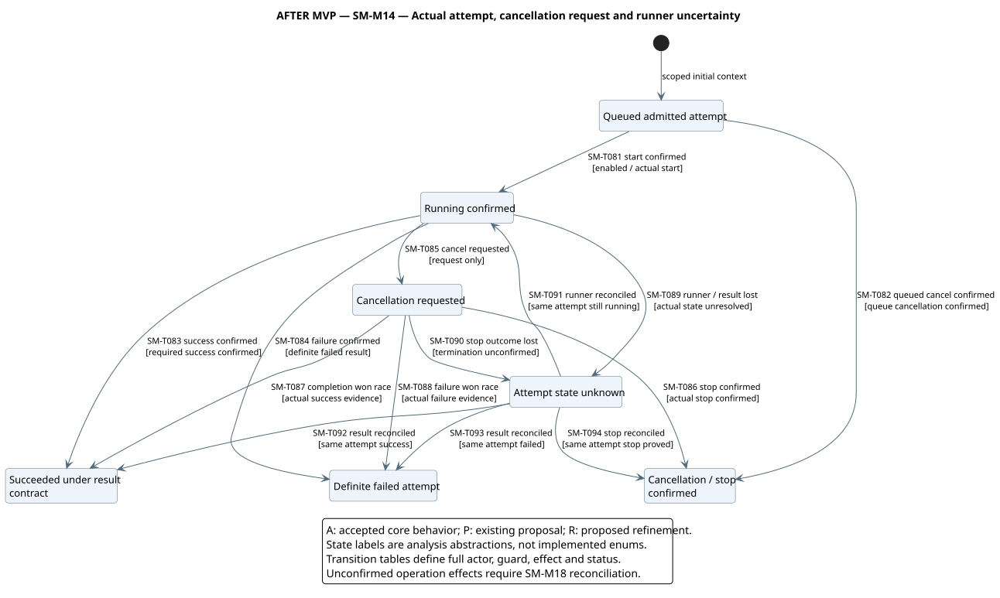

[Editable PlantUML](../diagrams/state-execution-attempt.puml) · [PNG](../diagrams/state-execution-attempt.png)

**Invariant:** Cancellation requested is not termination; runner loss is not success or automatically failure. Retrying creates a separately authorized distinguishable attempt.

**Boundary / authority:** Q-D23 canonical result states and cancellation/retry mechanisms remain proposals; Cancel requested/race handling are explicit R refinements. Real isolation/resources are unproven now. A successful attempt does not imply artifacts are available or deployment approved.

**Transition / source → target:** **SM-T081**: Queued admitted attempt → Running confirmed

**Event; actor:** start confirmed; Permitted execution authority

**Guard:** Required enabling/current authority/isolation/resources hold; actual start confirmed

**Effect / observable meaning:** Bind evaluated code/definition and bounded attempt context

**Authority:** P

**Transition / source → target:** **SM-T082**: Queued admitted attempt → Cancellation / stop confirmed

**Event; actor:** queued cancel confirmed; Permitted cancellation actor

**Guard:** Authorized queue cancellation actually confirmed before execution

**Effect / observable meaning:** Record cancelled attempt; no execution termination inferred from request alone

**Authority:** P

**Transition / source → target:** **SM-T083**: Running confirmed → Succeeded under result contract

**Event; actor:** success confirmed; Execution observation

**Guard:** Actual reviewed required success conditions for this revision/attempt confirmed

**Effect / observable meaning:** Record success; output availability/access and target approval remain separate

**Authority:** P

**Transition / source → target:** **SM-T084**: Running confirmed → Definite failed attempt

**Event; actor:** failure confirmed; Execution observation

**Guard:** Actual definite failed result under reviewed attempt contract

**Effect / observable meaning:** Retain failure evidence and any output context

**Authority:** P

**Transition / source → target:** **SM-T085**: Running confirmed → Cancellation requested

**Event; actor:** cancel requested; Authorized cancellation actor

**Guard:** Current cancellation authority; request recorded

**Effect / observable meaning:** Do not claim actual termination

**Authority:** R

**Transition / source → target:** **SM-T086**: Cancellation requested → Cancellation / stop confirmed

**Event; actor:** stop confirmed; Execution reconciliation

**Guard:** Actual intended attempt termination/cancellation established

**Effect / observable meaning:** Report cancelled without replaying side effects

**Authority:** P

**Transition / source → target:** **SM-T087**: Cancellation requested → Succeeded under result contract

**Event; actor:** completion won race; Execution observation

**Guard:** Same attempt actually met success conditions before cancellation took effect

**Effect / observable meaning:** Report actual success, not invented cancellation

**Authority:** R

**Transition / source → target:** **SM-T088**: Cancellation requested → Definite failed attempt

**Event; actor:** failure won race; Execution observation

**Guard:** Same attempt actual definite failure established

**Effect / observable meaning:** Retain actual failed result, not assumed cancellation

**Authority:** R

**Transition / source → target:** **SM-T089**: Running confirmed → Attempt state unknown

**Event; actor:** runner / result lost; Execution observation

**Guard:** Current actual attempt state is not established

**Effect / observable meaning:** Retain unresolved result; no blind retry

**Authority:** P

**Transition / source → target:** **SM-T090**: Cancellation requested → Attempt state unknown

**Event; actor:** stop outcome lost; Execution observation

**Guard:** Requested cancellation has no confirmed actual termination/result

**Effect / observable meaning:** Preserve uncertainty instead of declaring cancelled

**Authority:** R

**Transition / source → target:** **SM-T091**: Attempt state unknown → Running confirmed

**Event; actor:** runner reconciled; Authorized reconciliation

**Guard:** Authoritative evidence confirms the same attempt is still running

**Effect / observable meaning:** Observe same attempt; do not launch replacement work

**Authority:** R

**Transition / source → target:** **SM-T092**: Attempt state unknown → Succeeded under result contract

**Event; actor:** result reconciled; Authorized reconciliation

**Guard:** Actual same-attempt required success established

**Effect / observable meaning:** Record bounded success for evaluated code/definition

**Authority:** P

**Transition / source → target:** **SM-T093**: Attempt state unknown → Definite failed attempt

**Event; actor:** result reconciled; Authorized reconciliation

**Guard:** Definite same-attempt failed outcome established

**Effect / observable meaning:** Retain failure rather than inferring it from timeout

**Authority:** P

**Transition / source → target:** **SM-T094**: Attempt state unknown → Cancellation / stop confirmed

**Event; actor:** stop reconciled; Authorized reconciliation

**Guard:** Same attempt actual cancellation/termination established

**Effect / observable meaning:** Record confirmed cancellation

**Authority:** P

### SM-M15 — Separate target authority and actual deployment effect

One bounded target-effect request/attempt with separate authority. A target approval is tied to intended context, not a permanent blanket flag.

**Basis:** [YML-D03](../../02-requirements-engineering/03-requirements-specification/yaml-workflows-and-cicd.md#yml-d03-run-identity-and-reproducible-context), [YML-D08](../../02-requirements-engineering/03-requirements-specification/yaml-workflows-and-cicd.md#yml-d08-restricted-logs-and-artifacts), [YML-D10](../../02-requirements-engineering/03-requirements-specification/yaml-workflows-and-cicd.md#yml-d10-separate-controlled-deployment-stage), [YML-D12](../../02-requirements-engineering/03-requirements-specification/yaml-workflows-and-cicd.md#yml-d12-feasibility-operational-guidance-and-enabling-gate), [EIF-D08](../../02-requirements-engineering/03-requirements-specification/external-interface-requirements.md#eif-d08-operation-specific-failure-and-repetition-semantics)

**Domain:** [DM-C45](../02-domain-and-information-analysis/03-domain-model-and-object-oriented-view.md#dm-c45), [DM-C46](../02-domain-and-information-analysis/03-domain-model-and-object-oriented-view.md#dm-c46), [DM-C41](../02-domain-and-information-analysis/03-domain-model-and-object-oriented-view.md#dm-c41), [DM-C43](../02-domain-and-information-analysis/03-domain-model-and-object-oriented-view.md#dm-c43)

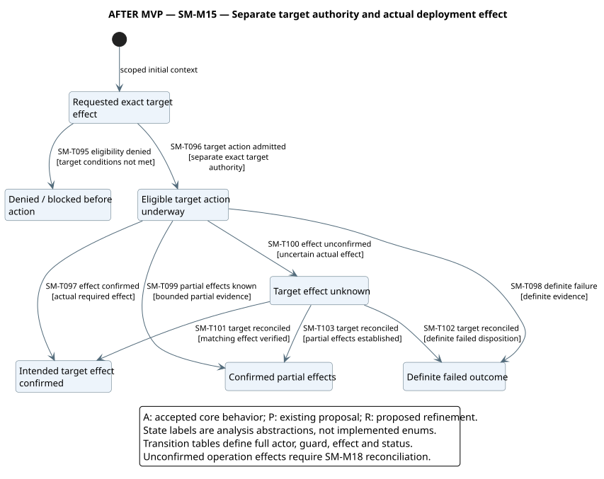

[Editable PlantUML](../diagrams/state-deployment-effect.puml) · [PNG](../diagrams/state-deployment-effect.png)

**Invariant:** No automatic Succeeded transition from push, merge, build, approval alone or timeout. Failed/Partial/Unknown do not promise rollback or safe repeat.

**Boundary / authority:** These effect labels refine Q-D23/YML-D10 and EIF-D08; they are proposed analysis states. Actual target/execution/recovery suitability remains gated. New corrective action/retry must retain distinguishable context and authority.

**Transition / source → target:** **SM-T095**: Requested exact target effect → Denied / blocked before action

**Event; actor:** eligibility denied; Target-authority evaluation

**Guard:** Missing target approval, wrong artifact/revision or unmet readiness conditions

**Effect / observable meaning:** No target action; run/push/merge success cannot grant approval

**Authority:** P

**Transition / source → target:** **SM-T096**: Requested exact target effect → Eligible target action underway

**Event; actor:** target action admitted; Authorized target actor

**Guard:** Separate current approval, exact artifact/revision and reviewed target/data/recovery conditions

**Effect / observable meaning:** Perform only the intended permitted target action

**Authority:** P

**Transition / source → target:** **SM-T097**: Eligible target action underway → Intended target effect confirmed

**Event; actor:** effect confirmed; Target observation

**Guard:** Actual intended usable target effect verified under the reviewed contract

**Effect / observable meaning:** Record bounded confirmed deployment; no general release-baseline acceptance

**Authority:** P

**Transition / source → target:** **SM-T098**: Eligible target action underway → Definite failed outcome

**Event; actor:** definite failure; Target observation

**Guard:** Definite failure for the defined effect boundary; no blanket rollback inference

**Effect / observable meaning:** Record actual failed outcome and known limitations

**Authority:** P

**Transition / source → target:** **SM-T099**: Eligible target action underway → Confirmed partial effects

**Event; actor:** partial effects known; Target observation

**Guard:** Some intended effects confirmed while required complete effect is not

**Effect / observable meaning:** Report partial state; recovery follows explicit reviewed policy

**Authority:** P

**Transition / source → target:** **SM-T100**: Eligible target action underway → Target effect unknown

**Event; actor:** effect unconfirmed; Target observation

**Guard:** Evidence cannot establish actual target result

**Effect / observable meaning:** Prevent blind consequential replay; reconcile target

**Authority:** P

**Transition / source → target:** **SM-T101**: Target effect unknown → Intended target effect confirmed

**Event; actor:** target reconciled; Authorized reconciliation

**Guard:** Matching intended effect actually confirmed

**Effect / observable meaning:** Record confirmed target result

**Authority:** P

**Transition / source → target:** **SM-T102**: Target effect unknown → Definite failed outcome

**Event; actor:** target reconciled; Authorized reconciliation

**Guard:** Definite failed disposition established

**Effect / observable meaning:** Record known failure rather than infer it from silence

**Authority:** P

**Transition / source → target:** **SM-T103**: Target effect unknown → Confirmed partial effects

**Event; actor:** target reconciled; Authorized reconciliation

**Guard:** Only bounded partial effects are established

**Effect / observable meaning:** Retain actual partial-result limitations

**Authority:** P

### SM-M16 — User-managed record retention and actual reclamation

Illustrative user-managed application/content retention proposal from Q-D14; not a universal lifecycle or retention period for every data category.

**Basis:** [APP-D07](../../02-requirements-engineering/03-requirements-specification/manual-application-management.md#app-d07-correction-and-repeated-submissions), [APP-D09](../../02-requirements-engineering/03-requirements-specification/manual-application-management.md#app-d09-private-access-archive-and-recovery), [PRP-D10](../../02-requirements-engineering/03-requirements-specification/profiles-resumes-and-portfolio.md#prp-d10-reference-aware-retirement-and-historical-independence), [PDF-D10](../../02-requirements-engineering/03-requirements-specification/pdf-and-controlled-sharing.md#pdf-d10-reference-aware-retirement-and-recovery), [AFO-D08](../../02-requirements-engineering/03-requirements-specification/administration-files-and-operational-behavior.md#afo-d08-safe-replacement-and-lifecycle-effects), [AFO-D11](../../02-requirements-engineering/03-requirements-specification/administration-files-and-operational-behavior.md#afo-d11-bounded-cleanup-and-storage-reclamation), [QSR-D09](../../02-requirements-engineering/03-requirements-specification/quality-security-and-recovery-requirements.md#qsr-d09-deliberate-retention-and-reference-aware-removal), [QSR-D12](../../02-requirements-engineering/03-requirements-specification/quality-security-and-recovery-requirements.md#qsr-d12-safe-restored-access-and-external-state-reconciliation)

**Domain:** [DM-C16](../02-domain-and-information-analysis/03-domain-model-and-object-oriented-view.md#dm-c16), [DM-C19](../02-domain-and-information-analysis/03-domain-model-and-object-oriented-view.md#dm-c19), [DM-C49](../02-domain-and-information-analysis/03-domain-model-and-object-oriented-view.md#dm-c49), [DM-C48](../02-domain-and-information-analysis/03-domain-model-and-object-oriented-view.md#dm-c48)

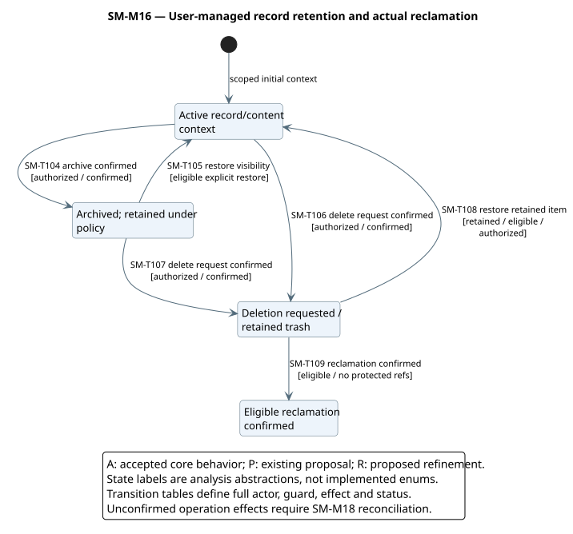

[Editable PlantUML](../diagrams/state-reference-aware-retention.puml) · [PNG](../diagrams/state-reference-aware-retention.png)

**Invariant:** Archive, unlink, trash, purge and storage accounting are different. Purge eligibility is a condition, not proof that cleanup ran or bytes were reclaimed.

**Boundary / authority:** No numerical retention period or legal conclusion is selected. Other categories need explicit applicability/coverage. A reclaimed local item cannot be fabricated from a different live resume; actual recovery is assessed separately. Failed/unknown reclamation uses SM-M18.

**Transition / source → target:** **SM-T104**: Active record/content context → Archived; retained under policy

**Event; actor:** archive confirmed; Authorized resource owner

**Guard:** Category-specific archive policy and actual change confirmed

**Effect / observable meaning:** Hide from active views as defined; preserve permitted history

**Authority:** P

**Transition / source → target:** **SM-T105**: Archived; retained under policy → Active record/content context

**Event; actor:** restore visibility; Authorized resource owner

**Guard:** Explicit category-specific restoration eligibility and current authority

**Effect / observable meaning:** Restore intended visible state without reopening revoked grants

**Authority:** P

**Transition / source → target:** **SM-T106**: Active record/content context → Deletion requested / retained trash

**Event; actor:** delete request confirmed; Authorized resource owner

**Guard:** Reviewed applicable deletion/trash policy permits operation

**Effect / observable meaning:** Retain protected references/material under adopted retention rules

**Authority:** P

**Transition / source → target:** **SM-T107**: Archived; retained under policy → Deletion requested / retained trash

**Event; actor:** delete request confirmed; Authorized resource owner

**Guard:** Applicable explicit deletion policy and actual request confirmed

**Effect / observable meaning:** Preserve required historical/reference limits

**Authority:** P

**Transition / source → target:** **SM-T108**: Deletion requested / retained trash → Active record/content context

**Event; actor:** restore retained item; Authorized resource owner

**Guard:** Within adopted restoration eligibility; actual material exists; current access reconciled

**Effect / observable meaning:** Restore only intended record context; do not resend/redeploy/re-enable links

**Authority:** P

**Transition / source → target:** **SM-T109**: Deletion requested / retained trash → Eligible reclamation confirmed

**Event; actor:** reclamation confirmed; Authorized cleanup authority

**Guard:** Applicable retention/removal eligibility, no protected retained references and actual permitted reclamation confirmed

**Effect / observable meaning:** Report actual reclamation only; do not invent restored material

**Authority:** P

### SM-M17 — Gated isolated restoration and demonstrated usable state

One defined isolated drill/assessment, not a proof that a backup job ran or the production system is recovered.

**Basis:** [QSR-D10](../../02-requirements-engineering/03-requirements-specification/quality-security-and-recovery-requirements.md#qsr-d10-defined-protected-and-observable-backups), [QSR-D11](../../02-requirements-engineering/03-requirements-specification/quality-security-and-recovery-requirements.md#qsr-d11-demonstrated-restoration-and-recovery-targets), [QSR-D12](../../02-requirements-engineering/03-requirements-specification/quality-security-and-recovery-requirements.md#qsr-d12-safe-restored-access-and-external-state-reconciliation), [QSR-D14](../../02-requirements-engineering/03-requirements-specification/quality-security-and-recovery-requirements.md#qsr-d14-maintainable-verifiable-and-recoverable-changes), [AFO-D12](../../02-requirements-engineering/03-requirements-specification/administration-files-and-operational-behavior.md#afo-d12-version-specific-operational-guidance-and-readiness)

**Domain:** [DM-C52](../02-domain-and-information-analysis/03-domain-model-and-object-oriented-view.md#dm-c52), [DM-C53](../02-domain-and-information-analysis/03-domain-model-and-object-oriented-view.md#dm-c53), [DM-C48](../02-domain-and-information-analysis/03-domain-model-and-object-oriented-view.md#dm-c48)

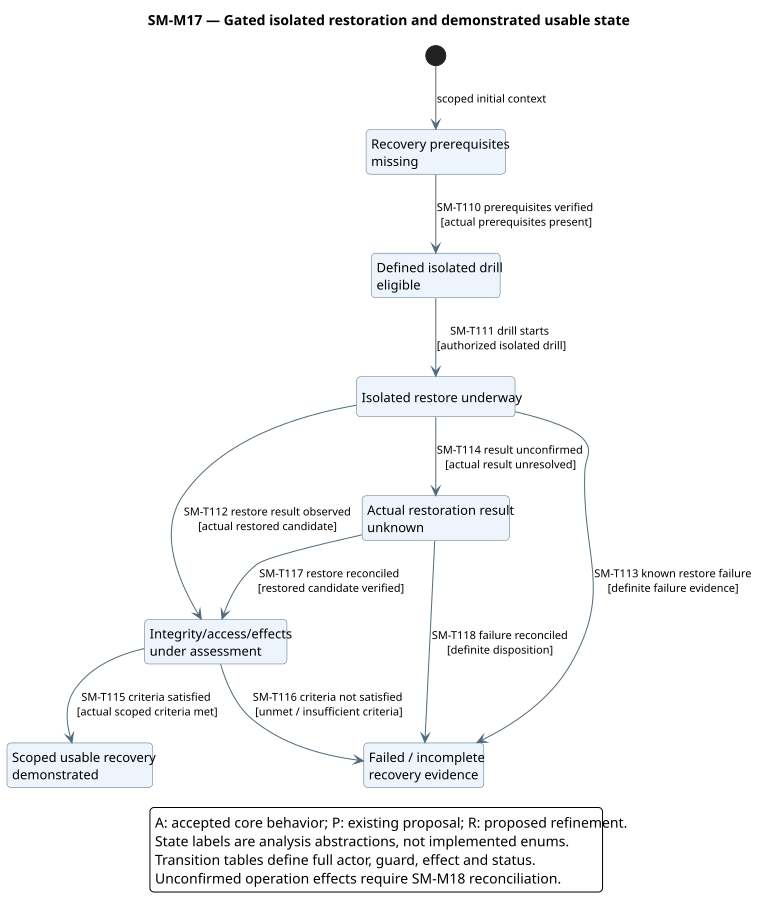

[Editable PlantUML](../diagrams/state-recovery-assessment.puml) · [PNG](../diagrams/state-recovery-assessment.png)

**Invariant:** Restored data does not automatically re-enable revoked grants/links, replay sends/deployments or satisfy targets without measurements.

**Boundary / authority:** Backups are not configured now; Blocked reflects known prerequisites. Q-D26/Q-D27 sources/coverage/targets and actual proof remain gated. Any repeat drill is distinguishable evidence rather than overwriting this assessment. No live restoration is authorized here.

**Transition / source → target:** **SM-T110**: Recovery prerequisites missing → Defined isolated drill eligible

**Event; actor:** prerequisites verified; Authorized operator

**Guard:** Actual protected source/coverage, isolation, authority and measurement boundaries established

**Effect / observable meaning:** Identify eligible candidate drill; this is not restore success

**Authority:** P

**Transition / source → target:** **SM-T111**: Defined isolated drill eligible → Isolated restore underway

**Event; actor:** drill starts; Authorized operator

**Guard:** Current authorized isolated conditions and required sources remain valid

**Effect / observable meaning:** Restore only covered intended candidate information

**Authority:** P

**Transition / source → target:** **SM-T112**: Isolated restore underway → Integrity/access/effects under assessment

**Event; actor:** restore result observed; Recovery observation

**Guard:** Covered information actually restored sufficiently for defined checks

**Effect / observable meaning:** Evaluate integrity, references, current access and external-state disposition

**Authority:** P

**Transition / source → target:** **SM-T113**: Isolated restore underway → Failed / incomplete recovery evidence

**Event; actor:** known restore failure; Recovery observation

**Guard:** Definite missing/corrupt/inconsistent covered material or failed restoration

**Effect / observable meaning:** Record failed/incomplete evidence, not recovery Pass

**Authority:** P

**Transition / source → target:** **SM-T114**: Isolated restore underway → Actual restoration result unknown

**Event; actor:** result unconfirmed; Recovery observation

**Guard:** Actual restoration outcome not established

**Effect / observable meaning:** Retain uncertainty without declaring safe usable state

**Authority:** R

**Transition / source → target:** **SM-T115**: Integrity/access/effects under assessment → Scoped usable recovery demonstrated

**Event; actor:** criteria satisfied; Authorized assessment

**Guard:** Actual integrity/access/external-state findings and measured scenario targets satisfy defined criteria

**Effect / observable meaning:** Record bounded usable-state evidence and limitations

**Authority:** P

**Transition / source → target:** **SM-T116**: Integrity/access/effects under assessment → Failed / incomplete recovery evidence

**Event; actor:** criteria not satisfied; Authorized assessment

**Guard:** Defined integrity/access/target condition fails or remains insufficient

**Effect / observable meaning:** Record limitations and unmet criteria without successful acceptance

**Authority:** P

**Transition / source → target:** **SM-T117**: Actual restoration result unknown → Integrity/access/effects under assessment

**Event; actor:** restore reconciled; Authorized reconciliation

**Guard:** Actual covered restored candidate identified in safe isolation

**Effect / observable meaning:** Perform full required checks; reconciliation alone is not Pass

**Authority:** R

**Transition / source → target:** **SM-T118**: Actual restoration result unknown → Failed / incomplete recovery evidence

**Event; actor:** failure reconciled; Authorized reconciliation

**Guard:** Actual failed/incomplete recovery disposition established

**Effect / observable meaning:** Retain honest failed/incomplete assessment

**Authority:** R

### SM-M18 — Observed operation result is separate from subject state

Semantic result vocabulary for a specific operation, including effective policy changes and evidence access; not a universal stored enum or state shared by all domain objects.

**Basis:** [AFO-D01](../../02-requirements-engineering/03-requirements-specification/administration-files-and-operational-behavior.md#afo-d01-owner-configurable-upload-and-storage-policy), [AFO-D07](../../02-requirements-engineering/03-requirements-specification/administration-files-and-operational-behavior.md#afo-d07-truthful-completion-and-interrupted-operation-handling), [AFO-D09](../../02-requirements-engineering/03-requirements-specification/administration-files-and-operational-behavior.md#afo-d09-operational-outcomes-and-capacity-warnings), [AFO-D10](../../02-requirements-engineering/03-requirements-specification/administration-files-and-operational-behavior.md#afo-d10-administrative-operation-evidence), [EIF-D08](../../02-requirements-engineering/03-requirements-specification/external-interface-requirements.md#eif-d08-operation-specific-failure-and-repetition-semantics), [QSR-D08](../../02-requirements-engineering/03-requirements-specification/quality-security-and-recovery-requirements.md#qsr-d08-data-integrity-and-truthful-completion)

**Domain:** [DM-C50](../02-domain-and-information-analysis/03-domain-model-and-object-oriented-view.md#dm-c50), [DM-C49](../02-domain-and-information-analysis/03-domain-model-and-object-oriented-view.md#dm-c49), [DM-C51](../02-domain-and-information-analysis/03-domain-model-and-object-oriented-view.md#dm-c51), [DM-C48](../02-domain-and-information-analysis/03-domain-model-and-object-oriented-view.md#dm-c48)

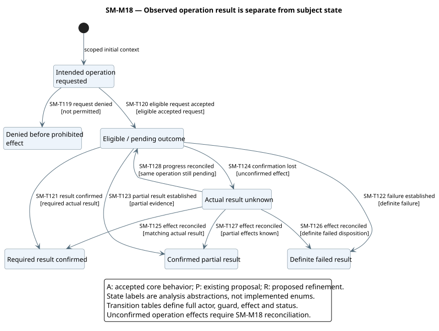

[Editable PlantUML](../diagrams/state-operation-observation.puml) · [PNG](../diagrams/state-operation-observation.png)

**Invariant:** Failed/Partial/Unknown does not universally prove old subject state was retained. A pending policy change is not the new effective policy until confirmed; unknown effect needs reconciliation.

**Boundary / authority:** R/P labels are proposed source-derived refinements of existing failure semantics. A retry/correction is explicit and context-preserving; this model does not choose idempotency, retry timing, locks, transactions or service architecture.

**Transition / source → target:** **SM-T119**: Intended operation requested → Denied before prohibited effect

**Event; actor:** request denied; Current authority/input evaluation

**Guard:** Applicable resource/action/state or validity condition forbids operation before effect

**Effect / observable meaning:** Do not perform prohibited action or disclose protected content

**Authority:** P

**Transition / source → target:** **SM-T120**: Intended operation requested → Eligible / pending outcome

**Event; actor:** eligible request accepted; Permitted operation actor

**Guard:** Reviewed current authority/context and eligible request actually accepted

**Effect / observable meaning:** Retain pending identity/context; request acceptance is not completion

**Authority:** P

**Transition / source → target:** **SM-T121**: Eligible / pending outcome → Required result confirmed

**Event; actor:** result confirmed; Operation observation

**Guard:** Actual required postconditions for this specific operation established

**Effect / observable meaning:** Report bounded success and corresponding known effective data

**Authority:** P

**Transition / source → target:** **SM-T122**: Eligible / pending outcome → Definite failed result

**Event; actor:** failure established; Operation observation

**Guard:** Definite operation-boundary failure established

**Effect / observable meaning:** Report failed result without inventing global rollback

**Authority:** P

**Transition / source → target:** **SM-T123**: Eligible / pending outcome → Confirmed partial result

**Event; actor:** partial result established; Operation observation

**Guard:** Known required subset completed but complete claim not established

**Effect / observable meaning:** Report actual partial result and limitations

**Authority:** P

**Transition / source → target:** **SM-T124**: Eligible / pending outcome → Actual result unknown

**Event; actor:** confirmation lost; Operation observation

**Guard:** Actual consequential result not established

**Effect / observable meaning:** Do not infer unchanged subject, failure, success or safe repetition

**Authority:** P

**Transition / source → target:** **SM-T125**: Actual result unknown → Required result confirmed

**Event; actor:** effect reconciled; Authorized reconciliation

**Guard:** Actual matching required postconditions now established

**Effect / observable meaning:** Record confirmed outcome without rewriting prior uncertainty

**Authority:** P

**Transition / source → target:** **SM-T126**: Actual result unknown → Definite failed result

**Event; actor:** effect reconciled; Authorized reconciliation

**Guard:** Definite failed disposition now established

**Effect / observable meaning:** Record failure based on evidence, not missing reply

**Authority:** P

**Transition / source → target:** **SM-T127**: Actual result unknown → Confirmed partial result

**Event; actor:** effect reconciled; Authorized reconciliation

**Guard:** Bounded actual partial effects established

**Effect / observable meaning:** Retain partial-state meaning and reviewed recovery needs

**Authority:** P

**Transition / source → target:** **SM-T128**: Actual result unknown → Eligible / pending outcome

**Event; actor:** progress reconciled; Authorized reconciliation

**Guard:** Evidence confirms same operation remains pending/in progress

**Effect / observable meaning:** Observe same operation; do not launch a blind duplicate

**Authority:** R

## 3. Lifecycle and references

The source profile, an independent resume draft, the effective published presentation and actual submitted material have different authority and lifetimes. The accepted profile rule prevents automatic propagation into existing resumes and submitted documents. Explicit save is separate from publication; preview is an observation. A failed or ambiguous publication requires reconciliation, not an invented rollback guarantee.

| Dimension | Must remain independent from |
| --- | --- |
| Published presentation | PDF generation/availability, download mode and link eligibility |
| Artifact availability | Match to intended current revision and permission to retrieve it |
| Enabled link | Password verification, optional adopted expiry and current resource eligibility |
| Application progress | Actual submitted-material completeness and external receipt |
| Provider connection | Individual capabilities and freshness/conflict of each mapped object |
| Work progress | Readiness to select, acceptance criteria and sprint outcome |
| Pull request lifecycle | Current revision-specific review/check/merge eligibility |
| Execution result | Output availability and separate target deployment authority |
| Retention | Current access rights, protected references and actual physical reclamation |

Archive, unlink, trash, restore and physical reclamation are distinct operations. SM-M16 is a category-specific retention example, not one retention rule for every object. Protected actual-submission references must be considered before cleanup. No storage/cascade mechanism or new retention period is selected here.

## 4. Revocation and recovery

Account suspension, scoped membership revocation, protected-link disablement and provider credential loss affect different subjects. A confirmed effective policy change governs subsequent checks in its scope. Details for already-open sessions and bytes already being emitted remain proposed in the primary decision register; these diagrams do not pretend that already downloaded bytes can be recalled. Updating PDF mode does not disable a link.

Restoring retained data must not silently reactivate old grants, send a message, replay provider changes or deploy code. Current authorization and current external state are reassessed. Unknown results are reconciled against the same operation/attempt before any separately authorized retry. Retry is not an automatic Unknown-to-success arrow.

Known constraints: OAuth is not configured; backups are not configured. The existing 2-vCPU / 4-GB / 40-GB Ubuntu demo host and idle resource readings do not establish safe execution isolation, load capacity or usable recovery. SM-M17 therefore begins with missing prerequisites. No live restore, deployment or server change is authorized by this document. The owner has 20 total project hours/week; this is planning input, not a state transition.

## 5. Business-rule consistency

| Consistency condition | Models that must agree |
| --- | --- |
| Profile edits never auto-publish; overrides and actual sent content preserved | SM-M01, SM-M07; domain/data/scenario profile policy |
| PDF-mode save is independent of link disablement | SM-M04, SM-M05; SB-M02–04 |
| Invitation/account activation does not grant universal resource authority | SM-M02–03, SM-M04, SM-M18 |
| Submitted status does not certify complete actual evidence | SM-M06–07 |
| Provider acceptance is not recipient delivery/read proof | SM-M08–09 |
| Reconnection does not make a stale mapping fresh | SM-M08, SM-M10 |
| Completing a task or ending a sprint does not automatically accept all items | SM-M11–12 |
| Changed revisions require renewed merge eligibility | SM-M13 |
| Cancellation requested is not confirmed termination | SM-M14 |
| Successful build does not authorize deployment | SM-M14–15 |
| Eligible cleanup is not confirmed reclamation | SM-M16 |
| Successful byte restoration is not demonstrated usable recovery | SM-M17 |
| Unknown observation is distinct from the actual subject state | SM-M18 and all affected models |

Apply these conditions alongside the primary business/lifecycle requirements, not as replacement requirements. [Rules](../05-business-rules-and-operation-contracts/09-rule-based-view.md) and [operation contracts](../05-business-rules-and-operation-contracts/10-domain-constraints-and-operation-contracts.md) must carry the same exact scope and authority when developed.

## 6. Concurrency and review cases

These are analysis review cases for later contracts and product tests, not execution results. A reachable drawing alone does not prove satisfiable guards or complete concurrency handling.

| Concurrent or exceptional case | Required distinction / review result |
| --- | --- |
| Source edit during selected apply | Confirm intended selected source/context; preserve independent text and other resumes |
| Publish while PDF processing | Live presentation and artifact availability remain independently observable |
| Link revoked during retrieval | Apply reviewed current-request policy; do not claim recall of emitted bytes |
| Submission recorded while material capture fails | Retain truthful progress with incomplete actual-set evidence |
| Mail timeout after possible acceptance | Unknown; reconcile same attempt before any explicit resend |
| Provider and local edits overlap | Conflict/staleness remains visible until explicit resolution |
| Sprint ends with incomplete items | Record actual outcome and explicit disposition; no automatic carryover |
| Source/target changes before merge | Re-evaluate exact revisions, checks and authority |
| Run finishes while cancellation pending | Actual completion may win; cancellation request alone is not stop evidence |
| Cleanup meets quota pressure but protected references exist | Do not infer purge eligibility from pressure alone |
| Restore reintroduces old membership/provider context | Reassess present authority and external effects; no automatic reactivation |

No locking, idempotency protocol, queue design, resource limit or retry interval is selected. Those mechanisms follow reviewed operation contracts and system design. Statecharts are sufficient for the questions above; add Petri nets only if a real synchronization question needs them.

## 7. Coverage and identified refinements

| Scope | State models |
| --- | --- |
| SCP-01 Accounts/permissions/sign-in | SM-M02–03, SM-M18 |
| SCP-02 Profiles/resumes | SM-M01, SM-M05, SM-M07 |
| SCP-03 Portfolio/evidence | SM-M05, SM-M16, SM-M18 |
| SCP-04 Generated/uploaded PDFs | SM-M04–05, SM-M07 |
| SCP-05 Protected employer sharing | SM-M04–05, SM-M18 |
| SCP-06 Manual job application management | SM-M06–07, SM-M16 |
| SCP-07 Gmail/calendar | SM-M08–10  **After MVP.** |
| SCP-08 Projects/Kanban/backlogs/sprints | SM-M03, SM-M11–12 |
| SCP-09 Git hosting/collaboration | SM-M03, SM-M13 |
| SCP-10 YAML execution/CI/CD | SM-M14–15, SM-M18  **After MVP.** |
| SCP-11 Upload/storage limits | SM-M05, SM-M16, SM-M18 |
| SCP-12 Deployment/operational readiness | SM-M15–18 |

**SM-F01 — Readiness versus progress:** Q-D18 uses canonical To do / In progress / Done and also mentions Ready. This view proposes readiness as a separate selection predicate, not an accepted fourth progress state. Reconcile this explicitly in the rule/contract views and primary policy review.

**SM-F02 — Failure versus unchanged state:** A failed or missing response does not universally establish the previous business state. SM-M18 distinguishes definite, partial and unknown effects without selecting a recovery mechanism.

**SM-F03 — Application route coverage:** SM-M06 describes selected normal proposed routes. Direct manual recording, historical correction and outcome-specific extensions need explicit scoped contracts; absent arrows are not universal prohibitions.

**SM-F04 — Operational evidence:** Missing OAuth, backups and execution-isolation evidence are known gates for their dependent capabilities. They do not block conceptual modeling and are not repeatedly reopened as unanswered owner questions.

## 8. Review Status

The state view now contains 18 PlantUML statecharts with 128 individually identified transition contracts, subject boundaries, guards/effects and authority labels. Render/link/state-reference checks are document evidence, not product tests or acceptance of M02/M03. Primary requirements and their identifiers are unchanged.

Continue with the activity view (08), reconcile rules (09) and operation contracts (10), then run cross-view consistency review (11). Function view (04) and remaining interface/quality/design-handoff work also remain substantive tasks. Completion of this document does not declare the whole System Analysis phase complete.

## State Model Detail

Editable diagram sources, SVG and PNG renders are cataloged in [the diagram index](../diagrams/README.md). Structured transition/source evidence is in [the review record](../evidence/state-based-review-2026-11-01.json). No implementation enum, database schema, release or deployment is created by these analysis artifacts.

## Diagram Types and Reading Guide

The eighteen existing statecharts are the authoritative behavioral diagrams for this view. Read each edge with its transition record: trigger, guard and effect. States are analysis abstractions, not implemented enums; unknown operation effects are distinct from proven unchanged state. Do not reinterpret a state transition as an activity or data-flow arrow.
