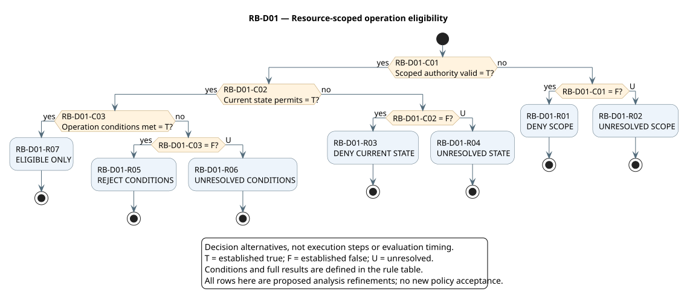
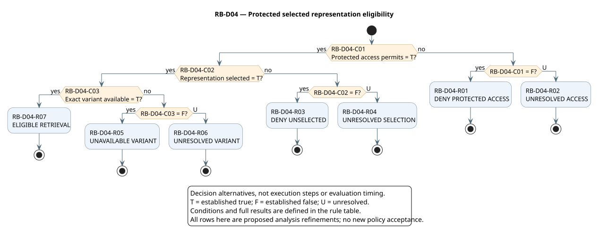
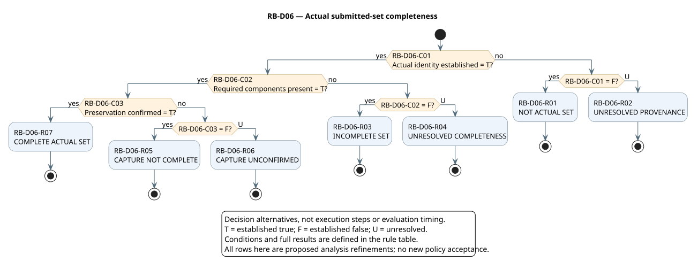
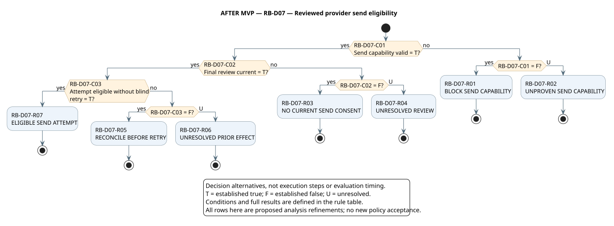
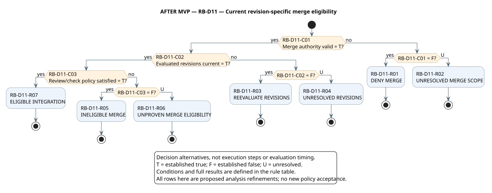
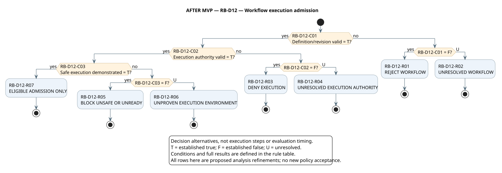
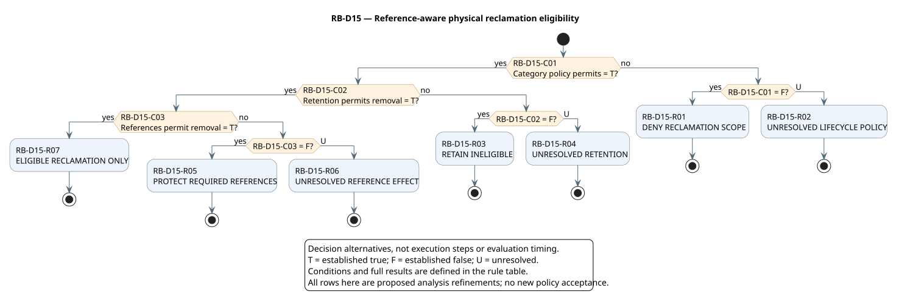
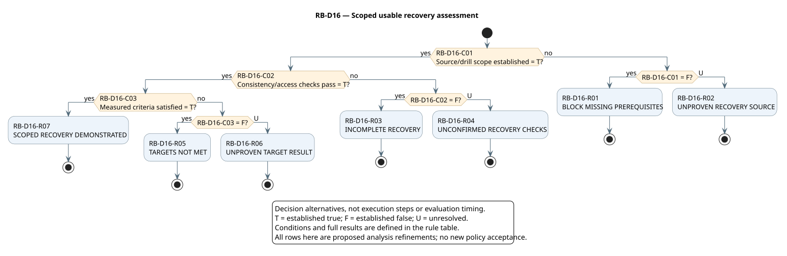

# Resumefolio — Rule-Based View

[Diagram types and reading guide](#diagram-types-and-reading-guide) · [Full diagram catalog](../diagrams/README.md)

Owner: Farhad. Updated: November 1, 2026.

Status: Populated analysis working view; primary proposed policies remain proposed. No rule engine, implementation or whole-phase acceptance is selected.

## MVP analysis boundary and evidence applicability

The accepted system boundary separates the Resumefolio core from ProjectForge, joined by an authenticated user-scoped API. Logical responsibilities remain useful within each system; they do not authorize a shared core/ProjectForge process, database or transaction. Core owns dashboard, invited accounts, professional presentation, protected sharing, manual applications and same-server private My Files & Media. ProjectForge MVP owns real repositories/transfers/permissions, file/history browsing, issues and simple Kanban. Its engine, deployment and database remain open. The future communications system is independently private and API connected. Advanced Git review/releases, backlog/Sprints and execution/deployment remain deferred. My Files & Media is a core private library with optional per-resume selection. Supported uploads remain in private directories on the same Resumefolio server, with type/size/quota enforcement, safe serving and backup/recovery. Direct, preview and byte-range requests use current owner or selected-resume/viewer authority. Upload does not publish. External YouTube links use simple embedded playback; private uploads are not sent to YouTube. No extra media platform or heavyweight editor/transcoding is selected. Retained mail, advanced review/Sprint and execution models describe future behavior. Historical comparison/evidence results retain their original candidate/date and are not newly executed MVP checks.

Authority: [OWNER-MVP-2026-11-04](../../01-project-planning/owner-mvp-decision-2026-11-04.md).

## 1. Purpose and Source Authority

Make domain decisions explicit as finite-domain decision tables: which facts matter, which combinations permit an outcome, and what must remain unresolved. Rules constrain behavior; they do not schedule execution. The [activity view](../03-functional-and-process-analysis/08-control-flow-based-view.md) describes ordering and the [state view](../04-behavioral-and-scenario-analysis/07-state-based-view.md) defines lifecycle context.

**Authority order:** accepted scope and explicit recorded owner decisions govern their exact scope. Primary detailed specifications own requirements; this view is a source-derived analysis refinement. [BRL-D01–BRL-D10](../../02-requirements-engineering/03-requirements-specification/business-rules-and-data-lifecycle.md#2-proposed-business-rules) remain provisional document-local source references. RB-Dxx/Rxx/Cxx below are local analysis locators, not newly allocated global requirements.

Sources: [scope](../../01-project-planning/02-scope.md), [distributed SRS](../../02-requirements-engineering/03-requirements-specification/requirements-specification.md), [dictionary](../../02-requirements-engineering/05-data-definitions/data-dictionary.md), [decisions/proposals](../../02-requirements-engineering/07-change-and-baseline/open-questions-and-decisions.md), [domain](../02-domain-and-information-analysis/03-domain-model-and-object-oriented-view.md), [data](../02-domain-and-information-analysis/05-data-oriented-view.md), [scenarios](../04-behavioral-and-scenario-analysis/06-scenario-based-view.md), [states](../04-behavioral-and-scenario-analysis/07-state-based-view.md) and [activities](../03-functional-and-process-analysis/08-control-flow-based-view.md).

**A = accepted core behavior:** the [accepted profile policy](../../02-requirements-engineering/07-change-and-baseline/open-questions-and-decisions.md#owner-accepted-profile-update-policy) forbids automatic propagation into existing resumes and actual sent history; selected apply and separately confirmed publication remain explicit. **P = primary proposed policy detail. R = proposed analysis refinement.** Most rows are R: a derived table is not a new acceptance decision. A labels the bounded rule core, not acceptance of every guard abstraction or physical representation.

## 2. Decision Record

### Table notation and condition meaning

- **T**: the precisely defined condition is established true in the intended current scope. **F**: established false. **U**: unresolved, including missing applicable policy/evidence or unconfirmed current state. U is not F, T or permission.

- `-` in a condition cell means do not care for this row because its result already applies within that bounded decision. It does not mean missing, false, any resource permission, or an input outside the declared domain.

- Rows are disjoint within each declared condition space. Gate tables use a first-non-T partition: earlier conditions are T, one condition is F/U, later conditions do not matter for that row. This is an explicit diagnostic classification convention, not required runtime check order, delivery priority or authority to disclose the failed condition.

- The all-T row establishes only its named conclusion. An eligibility decision does not prove execution, saved state, delivery, freed bytes or recovery. Observed effects are interpreted separately in RB-D18.

- Enumerated operation/mode/variant inputs are closed to the explicitly supported alternatives. Invalid/out-of-domain/unsupported inputs must be rejected or left unresolved before table use; a dash does not silently admit them.

- Composite conditions intentionally refer to existing scoped contracts; their meaning is stated in full. The finite-domain check proves table partitioning, not that every real-world fact can be resolved or that raw evidence is consistent. Semantic contradictions must be reconciled rather than forced into T.

- All tables operate on an intended exact subject/operation context. A table about completeness, variant mode or wording never grants underlying resource access. Apply the relevant current authority contract independently.

### Decision inventory

| Decision | Question | State / activity links |
| --- | --- | --- |
| [RB-D01](#rb-d01) — Resource-scoped operation eligibility | May the intended actor perform this exact protected operation? | [SM-M02](../04-behavioral-and-scenario-analysis/07-state-based-view.md#sm-m02), [SM-M03](../04-behavioral-and-scenario-analysis/07-state-based-view.md#sm-m03), [SM-M18](../04-behavioral-and-scenario-analysis/07-state-based-view.md#sm-m18); [CF-M10](../03-functional-and-process-analysis/08-control-flow-based-view.md#cf-m10), [CF-M17](../03-functional-and-process-analysis/08-control-flow-based-view.md#cf-m17) |
| [RB-D02](#rb-d02) — Profile edit, selected apply and separate publication | Which requested action may affect which presentation? | [SM-M01](../04-behavioral-and-scenario-analysis/07-state-based-view.md#sm-m01), [SM-M07](../04-behavioral-and-scenario-analysis/07-state-based-view.md#sm-m07), [SM-M18](../04-behavioral-and-scenario-analysis/07-state-based-view.md#sm-m18); [CF-M01](../03-functional-and-process-analysis/08-control-flow-based-view.md#cf-m01), [CF-M06](../03-functional-and-process-analysis/08-control-flow-based-view.md#cf-m06) |
| [RB-D03](#rb-d03) — PDF mode and requested variant | Does the saved mode enable the requested PDF category before other checks? | [SM-M04](../04-behavioral-and-scenario-analysis/07-state-based-view.md#sm-m04), [SM-M05](../04-behavioral-and-scenario-analysis/07-state-based-view.md#sm-m05); [CF-M02](../03-functional-and-process-analysis/08-control-flow-based-view.md#cf-m02), [CF-M04](../03-functional-and-process-analysis/08-control-flow-based-view.md#cf-m04) |
| [RB-D04](#rb-d04) — Protected selected representation eligibility | May this exact page/evidence/PDF representation be exposed now? | [SM-M04](../04-behavioral-and-scenario-analysis/07-state-based-view.md#sm-m04), [SM-M05](../04-behavioral-and-scenario-analysis/07-state-based-view.md#sm-m05), [SM-M18](../04-behavioral-and-scenario-analysis/07-state-based-view.md#sm-m18); [CF-M03](../03-functional-and-process-analysis/08-control-flow-based-view.md#cf-m03), [CF-M04](../03-functional-and-process-analysis/08-control-flow-based-view.md#cf-m04) |
| [RB-D05](#rb-d05) — Fresh request after confirmed link change | Can a fresh request obtain access through this specific link? | [SM-M04](../04-behavioral-and-scenario-analysis/07-state-based-view.md#sm-m04), [SM-M18](../04-behavioral-and-scenario-analysis/07-state-based-view.md#sm-m18); [CF-M02](../03-functional-and-process-analysis/08-control-flow-based-view.md#cf-m02), [CF-M03](../03-functional-and-process-analysis/08-control-flow-based-view.md#cf-m03), [CF-M04](../03-functional-and-process-analysis/08-control-flow-based-view.md#cf-m04) |
| [RB-D06](#rb-d06) — Actual submitted-set completeness | May this recorded material set be described as complete preservation? | [SM-M06](../04-behavioral-and-scenario-analysis/07-state-based-view.md#sm-m06), [SM-M07](../04-behavioral-and-scenario-analysis/07-state-based-view.md#sm-m07), [SM-M16](../04-behavioral-and-scenario-analysis/07-state-based-view.md#sm-m16), [SM-M18](../04-behavioral-and-scenario-analysis/07-state-based-view.md#sm-m18); [CF-M05](../03-functional-and-process-analysis/08-control-flow-based-view.md#cf-m05), [CF-M06](../03-functional-and-process-analysis/08-control-flow-based-view.md#cf-m06) |
| [RB-D07](#rb-d07) — Reviewed provider send eligibility | May the intended message/reply be submitted as a new explicit attempt? | [SM-M08](../04-behavioral-and-scenario-analysis/07-state-based-view.md#sm-m08), [SM-M09](../04-behavioral-and-scenario-analysis/07-state-based-view.md#sm-m09), [SM-M18](../04-behavioral-and-scenario-analysis/07-state-based-view.md#sm-m18); [CF-M07](../03-functional-and-process-analysis/08-control-flow-based-view.md#cf-m07), [CF-M17](../03-functional-and-process-analysis/08-control-flow-based-view.md#cf-m17) |
| [RB-D08](#rb-d08) — Local calendar action versus provider mutation | Does this selected goal require provider capability or conflict resolution? | [SM-M08](../04-behavioral-and-scenario-analysis/07-state-based-view.md#sm-m08), [SM-M10](../04-behavioral-and-scenario-analysis/07-state-based-view.md#sm-m10), [SM-M18](../04-behavioral-and-scenario-analysis/07-state-based-view.md#sm-m18); [CF-M08](../03-functional-and-process-analysis/08-control-flow-based-view.md#cf-m08), [CF-M17](../03-functional-and-process-analysis/08-control-flow-based-view.md#cf-m17) |
| [RB-D09](#rb-d09) — Subject-specific work completion | May this task or backlog item be described as completed/accepted? | [SM-M11](../04-behavioral-and-scenario-analysis/07-state-based-view.md#sm-m11), [SM-M18](../04-behavioral-and-scenario-analysis/07-state-based-view.md#sm-m18); [CF-M09](../03-functional-and-process-analysis/08-control-flow-based-view.md#cf-m09), [CF-M17](../03-functional-and-process-analysis/08-control-flow-based-view.md#cf-m17) |
| [RB-D10](#rb-d10) — Sprint period end versus goal/item outcome | May the Sprint-end result be recorded as a concluded period? | [SM-M11](../04-behavioral-and-scenario-analysis/07-state-based-view.md#sm-m11), [SM-M12](../04-behavioral-and-scenario-analysis/07-state-based-view.md#sm-m12), [SM-M18](../04-behavioral-and-scenario-analysis/07-state-based-view.md#sm-m18); [CF-M09](../03-functional-and-process-analysis/08-control-flow-based-view.md#cf-m09), [CF-M17](../03-functional-and-process-analysis/08-control-flow-based-view.md#cf-m17) |
| [RB-D11](#rb-d11) — Current revision-specific merge eligibility | May this exact intended integration be attempted? | [SM-M03](../04-behavioral-and-scenario-analysis/07-state-based-view.md#sm-m03), [SM-M13](../04-behavioral-and-scenario-analysis/07-state-based-view.md#sm-m13), [SM-M18](../04-behavioral-and-scenario-analysis/07-state-based-view.md#sm-m18); [CF-M11](../03-functional-and-process-analysis/08-control-flow-based-view.md#cf-m11), [CF-M12](../03-functional-and-process-analysis/08-control-flow-based-view.md#cf-m12), [CF-M17](../03-functional-and-process-analysis/08-control-flow-based-view.md#cf-m17) |
| [RB-D12](#rb-d12) — Workflow execution admission | May an attributable attempt be admitted under the reviewed execution contract? | [SM-M14](../04-behavioral-and-scenario-analysis/07-state-based-view.md#sm-m14), [SM-M18](../04-behavioral-and-scenario-analysis/07-state-based-view.md#sm-m18); [CF-M13](../03-functional-and-process-analysis/08-control-flow-based-view.md#cf-m13), [CF-M17](../03-functional-and-process-analysis/08-control-flow-based-view.md#cf-m17) |
| [RB-D13](#rb-d13) — Separate target deployment eligibility | May this exact artifact/revision affect this intended target? | [SM-M15](../04-behavioral-and-scenario-analysis/07-state-based-view.md#sm-m15), [SM-M18](../04-behavioral-and-scenario-analysis/07-state-based-view.md#sm-m18); [CF-M14](../03-functional-and-process-analysis/08-control-flow-based-view.md#cf-m14), [CF-M17](../03-functional-and-process-analysis/08-control-flow-based-view.md#cf-m17) |
| [RB-D14](#rb-d14) — Effective file admission | May this exact candidate be admitted under the actual effective policy? | [SM-M05](../04-behavioral-and-scenario-analysis/07-state-based-view.md#sm-m05), [SM-M16](../04-behavioral-and-scenario-analysis/07-state-based-view.md#sm-m16), [SM-M18](../04-behavioral-and-scenario-analysis/07-state-based-view.md#sm-m18); [CF-M15](../03-functional-and-process-analysis/08-control-flow-based-view.md#cf-m15), [CF-M17](../03-functional-and-process-analysis/08-control-flow-based-view.md#cf-m17) |
| [RB-D15](#rb-d15) — Reference-aware physical reclamation eligibility | May this specific retained information be physically reclaimed? | [SM-M16](../04-behavioral-and-scenario-analysis/07-state-based-view.md#sm-m16), [SM-M18](../04-behavioral-and-scenario-analysis/07-state-based-view.md#sm-m18); [CF-M15](../03-functional-and-process-analysis/08-control-flow-based-view.md#cf-m15), [CF-M17](../03-functional-and-process-analysis/08-control-flow-based-view.md#cf-m17) |
| [RB-D16](#rb-d16) — Scoped usable recovery assessment | May this isolated recovery be described as demonstrated usable recovery? | [SM-M17](../04-behavioral-and-scenario-analysis/07-state-based-view.md#sm-m17), [SM-M18](../04-behavioral-and-scenario-analysis/07-state-based-view.md#sm-m18); [CF-M16](../03-functional-and-process-analysis/08-control-flow-based-view.md#cf-m16), [CF-M17](../03-functional-and-process-analysis/08-control-flow-based-view.md#cf-m17) |
| [RB-D17](#rb-d17) — Meaningful language and historical time context | May the selected language/time-dependent record be interpreted as the intended value? | [SM-M06](../04-behavioral-and-scenario-analysis/07-state-based-view.md#sm-m06), [SM-M07](../04-behavioral-and-scenario-analysis/07-state-based-view.md#sm-m07), [SM-M10](../04-behavioral-and-scenario-analysis/07-state-based-view.md#sm-m10), [SM-M18](../04-behavioral-and-scenario-analysis/07-state-based-view.md#sm-m18); [CF-M04](../03-functional-and-process-analysis/08-control-flow-based-view.md#cf-m04), [CF-M05](../03-functional-and-process-analysis/08-control-flow-based-view.md#cf-m05), [CF-M06](../03-functional-and-process-analysis/08-control-flow-based-view.md#cf-m06), [CF-M08](../03-functional-and-process-analysis/08-control-flow-based-view.md#cf-m08) |
| [RB-D18](#rb-d18) — Truthful observed result wording | What may be reported from the normalized evidence disposition for this exact operation? | [SM-M18](../04-behavioral-and-scenario-analysis/07-state-based-view.md#sm-m18); [CF-M17](../03-functional-and-process-analysis/08-control-flow-based-view.md#cf-m17) |

### RB-D01 — Resource-scoped operation eligibility

**Decision question:** May the intended actor perform this exact protected operation?

**Primary basis:** [BRL-D01](../../02-requirements-engineering/03-requirements-specification/business-rules-and-data-lifecycle.md#brl-d01-resource-specific-authority), [BRL-D06](../../02-requirements-engineering/03-requirements-specification/business-rules-and-data-lifecycle.md#brl-d06-validation-and-truthful-state-changes), [ACC-D03](../../02-requirements-engineering/03-requirements-specification/accounts-authentication-and-permissions.md#acc-d03-resource-and-operation-authorization), [ACC-D04](../../02-requirements-engineering/03-requirements-specification/accounts-authentication-and-permissions.md#acc-d04-cross-user-private-data-isolation), [ACC-D05](../../02-requirements-engineering/03-requirements-specification/accounts-authentication-and-permissions.md#acc-d05-limited-collaboration-authority), [ACC-D10](../../02-requirements-engineering/03-requirements-specification/accounts-authentication-and-permissions.md#acc-d10-authorization-of-access-grant-changes), [ACC-D12](../../02-requirements-engineering/03-requirements-specification/accounts-authentication-and-permissions.md#acc-d12-end-of-access-and-lifecycle-enforcement)

**Domain context:** [DM-C47](../02-domain-and-information-analysis/03-domain-model-and-object-oriented-view.md#dm-c47), [DM-C48](../02-domain-and-information-analysis/03-domain-model-and-object-oriented-view.md#dm-c48)

**Policy / interpretation boundary:** Existing detailed grants/state policies remain proposed. This table does not create a complete role/action matrix, universal admin access or a persistent authorization cache.

| Condition | Allowed values | Exact meaning |
| --- | --- | --- |
| **RB-D01-C01 — Scoped authority valid** | T, F, U | Exact actor/resource/action scope has an applicable defined grant; invitation, sign-in, another-resource membership or administrator label alone is insufficient. |
| **RB-D01-C02 — Current state permits** | T, F, U | Applicable account/resource/grant state permits this operation under the current reviewed policy. |
| **RB-D01-C03 — Operation conditions met** | T, F, U | Required current subject/revision/relationship conditions are satisfied for the intended operation. |

**Rule:** **RB-D01-R01**

**C01:** F

**C02:** -

**C03:** -

**Result:** DENY_SCOPE

**Meaning:** Do not perform protected operation or disclose protected content.

**Authority:** R

**Rule:** **RB-D01-R02**

**C01:** U

**C02:** -

**C03:** -

**Result:** UNRESOLVED_SCOPE

**Meaning:** No positive authorization until intended scope/grant is established.

**Authority:** R

**Rule:** **RB-D01-R03**

**C01:** T

**C02:** F

**C03:** -

**Result:** DENY_CURRENT_STATE

**Meaning:** Do not use a revoked/ineligible context for the requested effect.

**Authority:** R

**Rule:** **RB-D01-R04**

**C01:** T

**C02:** U

**C03:** -

**Result:** UNRESOLVED_STATE

**Meaning:** Reconcile current eligibility; do not assume a stale permission remains effective.

**Authority:** R

**Rule:** **RB-D01-R05**

**C01:** T

**C02:** T

**C03:** F

**Result:** REJECT_CONDITIONS

**Meaning:** Report invalid/conflicting/ineligible request without claiming success.

**Authority:** R

**Rule:** **RB-D01-R06**

**C01:** T

**C02:** T

**C03:** U

**Result:** UNRESOLVED_CONDITIONS

**Meaning:** Keep missing policy/evidence visible; do not infer permission.

**Authority:** R

**Rule:** **RB-D01-R07**

**C01:** T

**C02:** T

**C03:** T

**Result:** ELIGIBLE_ONLY

**Meaning:** Eligibility is established for this scope; actual execution/result still requires its own contract.

**Authority:** R

[Editable PlantUML](../diagrams/rule-rb-d01-decision.puml) · [PNG](../diagrams/rule-rb-d01-decision.png)

The tree is a reading aid for this table. It shows decision alternatives, not a temporal sequence of protected reads or side effects. Full meanings and authority remain in the rows.

### RB-D02 — Profile edit, selected apply and separate publication

**Decision question:** Which requested action may affect which presentation?

**Primary basis:** [BRL-D02](../../02-requirements-engineering/03-requirements-specification/business-rules-and-data-lifecycle.md#brl-d02-shared-information-and-independent-tailoring), [BRL-D05](../../02-requirements-engineering/03-requirements-specification/business-rules-and-data-lifecycle.md#brl-d05-preserve-actual-submitted-materials), [PRP-D03](../../02-requirements-engineering/03-requirements-specification/profiles-resumes-and-portfolio.md#prp-d03-independent-selections-layouts-and-overrides), [PRP-D04](../../02-requirements-engineering/03-requirements-specification/profiles-resumes-and-portfolio.md#prp-d04-explicit-shared-source-update-rules), [PRP-D08](../../02-requirements-engineering/03-requirements-specification/profiles-resumes-and-portfolio.md#prp-d08-clear-presentation-and-rendition-boundaries), [PDF-D07](../../02-requirements-engineering/03-requirements-specification/pdf-and-controlled-sharing.md#pdf-d07-explicit-live-revision-and-rendition-behavior)

**Domain context:** [DM-C01](../02-domain-and-information-analysis/03-domain-model-and-object-oriented-view.md#dm-c01), [DM-C03](../02-domain-and-information-analysis/03-domain-model-and-object-oriented-view.md#dm-c03), [DM-C05](../02-domain-and-information-analysis/03-domain-model-and-object-oriented-view.md#dm-c05), [DM-C09](../02-domain-and-information-analysis/03-domain-model-and-object-oriented-view.md#dm-c09), [DM-C19](../02-domain-and-information-analysis/03-domain-model-and-object-oriented-view.md#dm-c19)

**Policy / interpretation boundary:** A labels accepted preservation/explicit-action core, not acceptance of abstract validation predicates or implementation labels. Eligibility is not confirmation that a save/publish actually happened.

| Condition | Allowed values | Exact meaning |
| --- | --- | --- |
| **RB-D02-C01 — Operation** | Source edit, Apply, Publish | Supported intended goal; no unsupported operation enters this table. |
| **RB-D02-C02 — Explicit confirmation** | T, F, U | Owner explicitly confirms this exact selected apply or separately intended publication; preview alone is not confirmation. |
| **RB-D02-C03 — Current eligible context** | T, F, U | Current intended scope/content is valid and eligible; this abstracts validation rather than choosing a concurrency mechanism. |

**Rule:** **RB-D02-R01**

**C01:** Source edit

**C02:** -

**C03:** -

**Result:** NO_PROPAGATION

**Meaning:** Source edit alone changes no existing resume draft/live presentation; actual sent content remains independent.

**Authority:** A

**Rule:** **RB-D02-R02**

**C01:** Apply

**C02:** F

**C03:** -

**Result:** NO_APPLY

**Meaning:** No requested application; keep existing resume content unchanged by source edit alone.

**Authority:** A

**Rule:** **RB-D02-R03**

**C01:** Apply

**C02:** U

**C03:** -

**Result:** UNRESOLVED_CONFIRMATION

**Meaning:** Do not infer consent to apply.

**Authority:** R

**Rule:** **RB-D02-R04**

**C01:** Apply

**C02:** T

**C03:** F

**Result:** REJECT_APPLY_CONTEXT

**Meaning:** Do not claim eligible selected application.

**Authority:** R

**Rule:** **RB-D02-R05**

**C01:** Apply

**C02:** T

**C03:** U

**Result:** UNRESOLVED_APPLY_CONTEXT

**Meaning:** Resolve intended selection/current context before claiming eligible apply.

**Authority:** R

**Rule:** **RB-D02-R06**

**C01:** Apply

**C02:** T

**C03:** T

**Result:** ELIGIBLE_SELECTED_APPLY

**Meaning:** Explicit selected apply affects intended draft only; preserve overrides/other resumes/actual history; does not publish.

**Authority:** A

**Rule:** **RB-D02-R07**

**C01:** Publish

**C02:** F

**C03:** -

**Result:** NO_PUBLICATION

**Meaning:** Saving/applying alone does not publish.

**Authority:** A

**Rule:** **RB-D02-R08**

**C01:** Publish

**C02:** U

**C03:** -

**Result:** UNRESOLVED_CONFIRMATION

**Meaning:** Do not infer separate publication consent.

**Authority:** R

**Rule:** **RB-D02-R09**

**C01:** Publish

**C02:** T

**C03:** F

**Result:** REJECT_PUBLICATION_CONTEXT

**Meaning:** Do not claim eligible publication.

**Authority:** R

**Rule:** **RB-D02-R10**

**C01:** Publish

**C02:** T

**C03:** U

**Result:** UNRESOLVED_PUBLICATION_CONTEXT

**Meaning:** Resolve exact intended current publication context.

**Authority:** R

**Rule:** **RB-D02-R11**

**C01:** Publish

**C02:** T

**C03:** T

**Result:** ELIGIBLE_SEPARATE_PUBLICATION

**Meaning:** Separate confirmed eligible publication may change intended live presentation; actual history stays independent.

**Authority:** A

### RB-D03 — PDF mode and requested variant

**Decision question:** Does the saved mode enable the requested PDF category before other checks?

**Primary basis:** [BRL-D03](../../02-requirements-engineering/03-requirements-specification/business-rules-and-data-lifecycle.md#brl-d03-explicit-shared-content-and-download-availability), [BRL-D10](../../02-requirements-engineering/03-requirements-specification/business-rules-and-data-lifecycle.md#brl-d10-defined-language-and-time-meaning), [PDF-D01](../../02-requirements-engineering/03-requirements-specification/pdf-and-controlled-sharing.md#pdf-d01-generated-resume-pdf), [PDF-D02](../../02-requirements-engineering/03-requirements-specification/pdf-and-controlled-sharing.md#pdf-d02-uploaded-pdf-and-language-identity), [PDF-D03](../../02-requirements-engineering/03-requirements-specification/pdf-and-controlled-sharing.md#pdf-d03-per-resume-download-choices), [PDF-D05](../../02-requirements-engineering/03-requirements-specification/pdf-and-controlled-sharing.md#pdf-d05-direct-file-and-pdf-authorization), [PDF-D07](../../02-requirements-engineering/03-requirements-specification/pdf-and-controlled-sharing.md#pdf-d07-explicit-live-revision-and-rendition-behavior)

**Domain context:** [DM-C12](../02-domain-and-information-analysis/03-domain-model-and-object-oriented-view.md#dm-c12), [DM-C10](../02-domain-and-information-analysis/03-domain-model-and-object-oriented-view.md#dm-c10), [DM-C11](../02-domain-and-information-analysis/03-domain-model-and-object-oriented-view.md#dm-c11), [DM-C08](../02-domain-and-information-analysis/03-domain-model-and-object-oriented-view.md#dm-c08), [DM-C09](../02-domain-and-information-analysis/03-domain-model-and-object-oriented-view.md#dm-c09)

**Policy / interpretation boundary:** Generated/uploaded/both/neither is a scope capability; timing, stale rendition and language fallback details retain Q-D09/Q-D10 proposal status. No automatic translation or unrelated fallback is inferred.

| Condition | Allowed values | Exact meaning |
| --- | --- | --- |
| **RB-D03-C01 — Mode** | Generated, Uploaded, Both, Neither | Actual effective per-resume mode, not a pending or assumed settings save. |
| **RB-D03-C02 — Variant** | Generated, Uploaded | Requested PDF category; uploaded language availability is checked separately. |

**Rule:** **RB-D03-R01**

**C01:** Generated

**C02:** Generated

**Result:** MODE_ENABLED

**Meaning:** Category is enabled only; still check intended publication/language, actual availability and protected access.

**Authority:** P

**Rule:** **RB-D03-R02**

**C01:** Generated

**C02:** Uploaded

**Result:** MODE_DISABLED

**Meaning:** Do not expose this PDF category through this mode; do not disable page/link or substitute a private variant.

**Authority:** P

**Rule:** **RB-D03-R03**

**C01:** Uploaded

**C02:** Generated

**Result:** MODE_DISABLED

**Meaning:** Do not expose this PDF category through this mode; do not disable page/link or substitute a private variant.

**Authority:** P

**Rule:** **RB-D03-R04**

**C01:** Uploaded

**C02:** Uploaded

**Result:** MODE_ENABLED

**Meaning:** Category is enabled only; still check intended publication/language, actual availability and protected access.

**Authority:** P

**Rule:** **RB-D03-R05**

**C01:** Both

**C02:** Generated

**Result:** MODE_ENABLED

**Meaning:** Category is enabled only; still check intended publication/language, actual availability and protected access.

**Authority:** P

**Rule:** **RB-D03-R06**

**C01:** Both

**C02:** Uploaded

**Result:** MODE_ENABLED

**Meaning:** Category is enabled only; still check intended publication/language, actual availability and protected access.

**Authority:** P

**Rule:** **RB-D03-R07**

**C01:** Neither

**C02:** Generated

**Result:** MODE_DISABLED

**Meaning:** Do not expose this PDF category through this mode; do not disable page/link or substitute a private variant.

**Authority:** P

**Rule:** **RB-D03-R08**

**C01:** Neither

**C02:** Uploaded

**Result:** MODE_DISABLED

**Meaning:** Do not expose this PDF category through this mode; do not disable page/link or substitute a private variant.

**Authority:** P

### RB-D04 — Protected selected representation eligibility

**Decision question:** May this exact page/evidence/PDF representation be exposed now?

**Primary basis:** [BRL-D03](../../02-requirements-engineering/03-requirements-specification/business-rules-and-data-lifecycle.md#brl-d03-explicit-shared-content-and-download-availability), [BRL-D04](../../02-requirements-engineering/03-requirements-specification/business-rules-and-data-lifecycle.md#brl-d04-access-changes-govern-subsequent-retrieval), [BRL-D10](../../02-requirements-engineering/03-requirements-specification/business-rules-and-data-lifecycle.md#brl-d10-defined-language-and-time-meaning), [PDF-D03](../../02-requirements-engineering/03-requirements-specification/pdf-and-controlled-sharing.md#pdf-d03-per-resume-download-choices), [PDF-D04](../../02-requirements-engineering/03-requirements-specification/pdf-and-controlled-sharing.md#pdf-d04-scoped-password-protected-employer-access), [PDF-D05](../../02-requirements-engineering/03-requirements-specification/pdf-and-controlled-sharing.md#pdf-d05-direct-file-and-pdf-authorization), [PDF-D06](../../02-requirements-engineering/03-requirements-specification/pdf-and-controlled-sharing.md#pdf-d06-owner-password-and-link-controls), [ACC-D06](../../02-requirements-engineering/03-requirements-specification/accounts-authentication-and-permissions.md#acc-d06-employer-access-without-a-viewer-account), [ACC-D07](../../02-requirements-engineering/03-requirements-specification/accounts-authentication-and-permissions.md#acc-d07-protected-shared-file-and-pdf-retrieval)

**Domain context:** [DM-C13](../02-domain-and-information-analysis/03-domain-model-and-object-oriented-view.md#dm-c13), [DM-C09](../02-domain-and-information-analysis/03-domain-model-and-object-oriented-view.md#dm-c09), [DM-C07](../02-domain-and-information-analysis/03-domain-model-and-object-oriented-view.md#dm-c07), [DM-C12](../02-domain-and-information-analysis/03-domain-model-and-object-oriented-view.md#dm-c12), [DM-C10](../02-domain-and-information-analysis/03-domain-model-and-object-oriented-view.md#dm-c10), [DM-C11](../02-domain-and-information-analysis/03-domain-model-and-object-oriented-view.md#dm-c11), [DM-C08](../02-domain-and-information-analysis/03-domain-model-and-object-oriented-view.md#dm-c08)

**Policy / interpretation boundary:** Current-request eligibility is distinct from already downloaded copies. Detailed active-session/in-flight/password-change timing remains proposed; no invented duration.

| Condition | Allowed values | Exact meaning |
| --- | --- | --- |
| **RB-D04-C01 — Protected access permits** | T, F, U | Applicable exact-link/password/current access context is valid for this request; employer viewer account is not required. |
| **RB-D04-C02 — Representation selected** | T, F, U | Intended published page/evidence or mode-enabled PDF is selected for this employer context; direct file reference cannot bypass selection. |
| **RB-D04-C03 — Exact variant available** | T, F, U | Exact requested revision/language/artifact is actually available and eligible under reviewed rendition policy. |

**Rule:** **RB-D04-R01**

**C01:** F

**C02:** -

**C03:** -

**Result:** DENY_PROTECTED_ACCESS

**Meaning:** Do not expose protected content.

**Authority:** R

**Rule:** **RB-D04-R02**

**C01:** U

**C02:** -

**C03:** -

**Result:** UNRESOLVED_ACCESS

**Meaning:** No positive exposure decision without established applicable access.

**Authority:** R

**Rule:** **RB-D04-R03**

**C01:** T

**C02:** F

**C03:** -

**Result:** DENY_UNSELECTED

**Meaning:** Do not expose unrelated/unselected content or a disabled PDF category.

**Authority:** R

**Rule:** **RB-D04-R04**

**C01:** T

**C02:** U

**C03:** -

**Result:** UNRESOLVED_SELECTION

**Meaning:** Resolve intended publication/selection/mode before exposure.

**Authority:** R

**Rule:** **RB-D04-R05**

**C01:** T

**C02:** T

**C03:** F

**Result:** UNAVAILABLE_VARIANT

**Meaning:** Report unavailable selection/variant; no unrelated or private fallback.

**Authority:** R

**Rule:** **RB-D04-R06**

**C01:** T

**C02:** T

**C03:** U

**Result:** UNRESOLVED_VARIANT

**Meaning:** Do not claim current available representation based on stale/ambiguous evidence.

**Authority:** R

**Rule:** **RB-D04-R07**

**C01:** T

**C02:** T

**C03:** T

**Result:** ELIGIBLE_RETRIEVAL

**Meaning:** Expose only permitted exact representation under current retrieval contract; actual completion is separate.

**Authority:** R

[Editable PlantUML](../diagrams/rule-rb-d04-decision.puml) · [PNG](../diagrams/rule-rb-d04-decision.png)

The tree is a reading aid for this table. It shows decision alternatives, not a temporal sequence of protected reads or side effects. Full meanings and authority remain in the rows.

### RB-D05 — Fresh request after confirmed link change

**Decision question:** Can a fresh request obtain access through this specific link?

**Primary basis:** [BRL-D04](../../02-requirements-engineering/03-requirements-specification/business-rules-and-data-lifecycle.md#brl-d04-access-changes-govern-subsequent-retrieval), [PDF-D04](../../02-requirements-engineering/03-requirements-specification/pdf-and-controlled-sharing.md#pdf-d04-scoped-password-protected-employer-access), [PDF-D05](../../02-requirements-engineering/03-requirements-specification/pdf-and-controlled-sharing.md#pdf-d05-direct-file-and-pdf-authorization), [PDF-D06](../../02-requirements-engineering/03-requirements-specification/pdf-and-controlled-sharing.md#pdf-d06-owner-password-and-link-controls), [ACC-D08](../../02-requirements-engineering/03-requirements-specification/accounts-authentication-and-permissions.md#acc-d08-owner-control-of-employer-link-access), [ACC-D12](../../02-requirements-engineering/03-requirements-specification/accounts-authentication-and-permissions.md#acc-d12-end-of-access-and-lifecycle-enforcement)

**Domain context:** [DM-C13](../02-domain-and-information-analysis/03-domain-model-and-object-oriented-view.md#dm-c13), [DM-C48](../02-domain-and-information-analysis/03-domain-model-and-object-oriented-view.md#dm-c48), [DM-C12](../02-domain-and-information-analysis/03-domain-model-and-object-oriented-view.md#dm-c12)

**Policy / interpretation boundary:** Fresh-request disablement is required scope behavior; exact session/in-flight effects remain Q-D05/Q-D11 proposals. Password changes and enable/disable are independent from PDF-mode edits.

| Condition | Allowed values | Exact meaning |
| --- | --- | --- |
| **RB-D05-C01 — Effective enabled state** | T, F, U | Actual current link enablement is confirmed; saving PDF mode does not change this fact. |
| **RB-D05-C02 — Applicable credentials** | T, F, U | Exact current request satisfies adopted password/optional-expiry/current-access policy. |

**Rule:** **RB-D05-R01**

**C01:** F

**C02:** -

**Result:** DENY_DISABLED

**Meaning:** Fresh request cannot gain protected access via a confirmed disabled link.

**Authority:** R

**Rule:** **RB-D05-R02**

**C01:** U

**C02:** -

**Result:** UNRESOLVED_LINK_STATE

**Meaning:** Reconcile actual effective link state; do not report confirmed disablement or authorize from uncertainty.

**Authority:** R

**Rule:** **RB-D05-R03**

**C01:** T

**C02:** F

**Result:** DENY_CREDENTIAL_CONTEXT

**Meaning:** Reject this protected access context without claiming recall of delivered copies.

**Authority:** R

**Rule:** **RB-D05-R04**

**C01:** T

**C02:** U

**Result:** UNRESOLVED_CREDENTIAL_POLICY

**Meaning:** Do not invent credential/session/expiry timing or permission.

**Authority:** R

**Rule:** **RB-D05-R05**

**C01:** T

**C02:** T

**Result:** CONTINUE_SELECTION_CHECK

**Meaning:** Proceed to RB-D04 selection/representation checks, not unrestricted resource access.

**Authority:** R

### RB-D06 — Actual submitted-set completeness

**Decision question:** May this recorded material set be described as complete preservation?

**Primary basis:** [BRL-D02](../../02-requirements-engineering/03-requirements-specification/business-rules-and-data-lifecycle.md#brl-d02-shared-information-and-independent-tailoring), [BRL-D05](../../02-requirements-engineering/03-requirements-specification/business-rules-and-data-lifecycle.md#brl-d05-preserve-actual-submitted-materials), [BRL-D06](../../02-requirements-engineering/03-requirements-specification/business-rules-and-data-lifecycle.md#brl-d06-validation-and-truthful-state-changes), [APP-D05](../../02-requirements-engineering/03-requirements-specification/manual-application-management.md#app-d05-user-directed-submission-recording), [APP-D06](../../02-requirements-engineering/03-requirements-specification/manual-application-management.md#app-d06-preserved-actual-submitted-copies), [APP-D07](../../02-requirements-engineering/03-requirements-specification/manual-application-management.md#app-d07-correction-and-repeated-submissions), [APP-D09](../../02-requirements-engineering/03-requirements-specification/manual-application-management.md#app-d09-private-access-archive-and-recovery), [PDF-D08](../../02-requirements-engineering/03-requirements-specification/pdf-and-controlled-sharing.md#pdf-d08-downloaded-copy-and-submission-distinctions)

**Domain context:** [DM-C16](../02-domain-and-information-analysis/03-domain-model-and-object-oriented-view.md#dm-c16), [DM-C18](../02-domain-and-information-analysis/03-domain-model-and-object-oriented-view.md#dm-c18), [DM-C19](../02-domain-and-information-analysis/03-domain-model-and-object-oriented-view.md#dm-c19), [DM-C17](../02-domain-and-information-analysis/03-domain-model-and-object-oriented-view.md#dm-c17), [DM-C10](../02-domain-and-information-analysis/03-domain-model-and-object-oriented-view.md#dm-c10), [DM-C11](../02-domain-and-information-analysis/03-domain-model-and-object-oriented-view.md#dm-c11)

**Policy / interpretation boundary:** Historical independence is accepted. Required components, provenance, corrections/resubmissions and retention remain detailed proposals. Complete actual history is not a backup or indefinite-retention guarantee.

| Condition | Allowed values | Exact meaning |
| --- | --- | --- |
| **RB-D06-C01 — Actual identity established** | T, F, U | Intended application/event and material actually submitted are identified; current live content is not presumed identical. |
| **RB-D06-C02 — Required components present** | T, F, U | All required components under the reviewed capture contract are present for this actual set. |
| **RB-D06-C03 — Preservation confirmed** | T, F, U | Actual required components and associations are confirmed retained in identifiable independent context. |

**Rule:** **RB-D06-R01**

**C01:** F

**C02:** -

**C03:** -

**Result:** NOT_ACTUAL_SET

**Meaning:** Do not substitute current source and claim actual preservation.

**Authority:** R

**Rule:** **RB-D06-R02**

**C01:** U

**C02:** -

**C03:** -

**Result:** UNRESOLVED_PROVENANCE

**Meaning:** Retain uncertainty about actual material/event identity.

**Authority:** R

**Rule:** **RB-D06-R03**

**C01:** T

**C02:** F

**C03:** -

**Result:** INCOMPLETE_SET

**Meaning:** Report missing required material; progress may still be separately truthful.

**Authority:** R

**Rule:** **RB-D06-R04**

**C01:** T

**C02:** U

**C03:** -

**Result:** UNRESOLVED_COMPLETENESS

**Meaning:** Do not claim all required actual components are present.

**Authority:** R

**Rule:** **RB-D06-R05**

**C01:** T

**C02:** T

**C03:** F

**Result:** CAPTURE_NOT_COMPLETE

**Meaning:** Report definite incomplete/failed preservation with known effects.

**Authority:** R

**Rule:** **RB-D06-R06**

**C01:** T

**C02:** T

**C03:** U

**Result:** CAPTURE_UNCONFIRMED

**Meaning:** Reconcile actual capture; do not replace uncertainty by a success claim.

**Authority:** R

**Rule:** **RB-D06-R07**

**C01:** T

**C02:** T

**C03:** T

**Result:** COMPLETE_ACTUAL_SET

**Meaning:** Describe only this confirmed actual set as complete; later source/live edits do not overwrite it.

**Authority:** R

[Editable PlantUML](../diagrams/rule-rb-d06-decision.puml) · [PNG](../diagrams/rule-rb-d06-decision.png)

The tree is a reading aid for this table. It shows decision alternatives, not a temporal sequence of protected reads or side effects. Full meanings and authority remain in the rows.

### RB-D07 — Reviewed provider send eligibility

**Decision question:** May the intended message/reply be submitted as a new explicit attempt?

**Primary basis:** [BRL-D06](../../02-requirements-engineering/03-requirements-specification/business-rules-and-data-lifecycle.md#brl-d06-validation-and-truthful-state-changes), [BRL-D07](../../02-requirements-engineering/03-requirements-specification/business-rules-and-data-lifecycle.md#brl-d07-explicit-provider-synchronization-authority), [EGC-D01](../../02-requirements-engineering/03-requirements-specification/email-calendar-and-google-integration.md#egc-d01-authorized-connection-and-account-context), [EGC-D02](../../02-requirements-engineering/03-requirements-specification/email-calendar-and-google-integration.md#egc-d02-justified-permissions-and-private-resource-isolation), [EGC-D04](../../02-requirements-engineering/03-requirements-specification/email-calendar-and-google-integration.md#egc-d04-manual-compose-and-draft-handling), [EGC-D05](../../02-requirements-engineering/03-requirements-specification/email-calendar-and-google-integration.md#egc-d05-deliberate-send-and-truthful-outcome), [EGC-D06](../../02-requirements-engineering/03-requirements-specification/email-calendar-and-google-integration.md#egc-d06-reply-context-and-conversation-association), [EGC-D11](../../02-requirements-engineering/03-requirements-specification/email-calendar-and-google-integration.md#egc-d11-disconnect-revocation-and-reconnect), [EGC-D12](../../02-requirements-engineering/03-requirements-specification/email-calendar-and-google-integration.md#egc-d12-bounded-failures-recovery-and-feasibility-evidence), [EIF-D08](../../02-requirements-engineering/03-requirements-specification/external-interface-requirements.md#eif-d08-operation-specific-failure-and-repetition-semantics)

**Domain context:** [DM-C20](../02-domain-and-information-analysis/03-domain-model-and-object-oriented-view.md#dm-c20), [DM-C21](../02-domain-and-information-analysis/03-domain-model-and-object-oriented-view.md#dm-c21)

**Policy / interpretation boundary:** OAuth has not been created. This is conditional proposed behavior; provider acceptance is not recipient delivery/read. No deduplication or retry mechanism is selected.

| Condition | Allowed values | Exact meaning |
| --- | --- | --- |
| **RB-D07-C01 — Send capability valid** | T, F, U | Intended account identity, product/resource authority and actual provider send capability are current. |
| **RB-D07-C02 — Final review current** | T, F, U | Explicit confirmation matches current sender/recipients/body/attachments/reply context; later changes require renewed review. |
| **RB-D07-C03 — Attempt eligible without blind retry** | T, F, U | No unresolved prior equivalent send effect is being blindly retried; proposed new attempt is separately eligible. |

**Rule:** **RB-D07-R01**

**C01:** F

**C02:** -

**C03:** -

**Result:** BLOCK_SEND_CAPABILITY

**Meaning:** No provider send action under denied/revoked/wrong-account context.

**Authority:** R

**Rule:** **RB-D07-R02**

**C01:** U

**C02:** -

**C03:** -

**Result:** UNPROVEN_SEND_CAPABILITY

**Meaning:** No enabled send claim; establish actual capability.

**Authority:** R

**Rule:** **RB-D07-R03**

**C01:** T

**C02:** F

**C03:** -

**Result:** NO_CURRENT_SEND_CONSENT

**Meaning:** Keep unsent intent; do not reuse stale confirmation.

**Authority:** R

**Rule:** **RB-D07-R04**

**C01:** T

**C02:** U

**C03:** -

**Result:** UNRESOLVED_REVIEW

**Meaning:** Do not infer final send consent from missing evidence.

**Authority:** R

**Rule:** **RB-D07-R05**

**C01:** T

**C02:** T

**C03:** F

**Result:** RECONCILE_BEFORE_RETRY

**Meaning:** Do not create blind duplicate; reconcile attributable prior effect.

**Authority:** R

**Rule:** **RB-D07-R06**

**C01:** T

**C02:** T

**C03:** U

**Result:** UNRESOLVED_PRIOR_EFFECT

**Meaning:** Keep prior acceptance uncertainty visible before consequential resend.

**Authority:** R

**Rule:** **RB-D07-R07**

**C01:** T

**C02:** T

**C03:** T

**Result:** ELIGIBLE_SEND_ATTEMPT

**Meaning:** May attempt exact reviewed send; classify actual provider outcome with RB-D18, never infer delivery/read.

**Authority:** R

[Editable PlantUML](../diagrams/rule-rb-d07-decision.puml) · [PNG](../diagrams/rule-rb-d07-decision.png)

The tree is a reading aid for this table. It shows decision alternatives, not a temporal sequence of protected reads or side effects. Full meanings and authority remain in the rows.

### RB-D08 — Local calendar action versus provider mutation

**Release applicability:** future-domain design retained after MVP; core operating/deployment and recovery controls still apply to MVP where relevant.

**Decision question:** Does this selected goal require provider capability or conflict resolution?

**Primary basis:** [BRL-D07](../../02-requirements-engineering/03-requirements-specification/business-rules-and-data-lifecycle.md#brl-d07-explicit-provider-synchronization-authority), [BRL-D10](../../02-requirements-engineering/03-requirements-specification/business-rules-and-data-lifecycle.md#brl-d10-defined-language-and-time-meaning), [EGC-D07](../../02-requirements-engineering/03-requirements-specification/email-calendar-and-google-integration.md#egc-d07-calendar-activities-and-time-meaning), [EGC-D08](../../02-requirements-engineering/03-requirements-specification/email-calendar-and-google-integration.md#egc-d08-explicit-synchronization-contract), [EGC-D09](../../02-requirements-engineering/03-requirements-specification/email-calendar-and-google-integration.md#egc-d09-application-relationships-preserve-boundaries), [EGC-D10](../../02-requirements-engineering/03-requirements-specification/email-calendar-and-google-integration.md#egc-d10-reminders-and-notification-outcomes), [EGC-D11](../../02-requirements-engineering/03-requirements-specification/email-calendar-and-google-integration.md#egc-d11-disconnect-revocation-and-reconnect), [EGC-D12](../../02-requirements-engineering/03-requirements-specification/email-calendar-and-google-integration.md#egc-d12-bounded-failures-recovery-and-feasibility-evidence)

**Domain context:** [DM-C20](../02-domain-and-information-analysis/03-domain-model-and-object-oriented-view.md#dm-c20), [DM-C22](../02-domain-and-information-analysis/03-domain-model-and-object-oriented-view.md#dm-c22), [DM-C23](../02-domain-and-information-analysis/03-domain-model-and-object-oriented-view.md#dm-c23), [DM-C16](../02-domain-and-information-analysis/03-domain-model-and-object-oriented-view.md#dm-c16)

**Policy / interpretation boundary:** Local paths still require RB-D01/current validation; dashes ignore provider facts only. Reconnection does not make stale mappings fresh or authorize replay. Direction/time/delete/reminder policies remain proposed.

| Condition | Allowed values | Exact meaning |
| --- | --- | --- |
| **RB-D08-C01 — Goal** | Local change, Local unlink, Provider action | Supported requested goal; local unlink only removes association. |
| **RB-D08-C02 — Connection** | T, F, U | Actual intended provider identity/capability is usable. |
| **RB-D08-C03 — Mapping/context** | T, F, U | Relevant account/mapping/version/field-authority context is established and current. |
| **RB-D08-C04 — Conflict** | T, F, U | A relevant concurrent local/provider conflict is established. |

**Rule:** **RB-D08-R01**

**C01:** Local change

**C02:** -

**C03:** -

**C04:** -

**Result:** LOCAL_CONTRACT

**Meaning:** Use current local-operation authority/validation contract; no provider write or active connection inferred.

**Authority:** R

**Rule:** **RB-D08-R02**

**C01:** Local unlink

**C02:** -

**C03:** -

**C04:** -

**Result:** LOCAL_UNLINK_CONTRACT

**Meaning:** Use permitted local unlink contract; no provider delete or provider write capability required.

**Authority:** R

**Rule:** **RB-D08-R03**

**C01:** Provider action

**C02:** F

**C03:** -

**C04:** -

**Result:** BLOCK_PROVIDER_ACTION

**Meaning:** No dependent provider mutation; retained copy may remain stale.

**Authority:** R

**Rule:** **RB-D08-R04**

**C01:** Provider action

**C02:** U

**C03:** -

**C04:** -

**Result:** UNPROVEN_PROVIDER_ACTION

**Meaning:** Do not assume actual provider access.

**Authority:** R

**Rule:** **RB-D08-R05**

**C01:** Provider action

**C02:** T

**C03:** F

**C04:** -

**Result:** STALE_OR_INVALID_MAPPING

**Meaning:** Reconcile selected account/mapping/current context before mutation.

**Authority:** R

**Rule:** **RB-D08-R06**

**C01:** Provider action

**C02:** T

**C03:** U

**C04:** -

**Result:** UNRESOLVED_MAPPING

**Meaning:** Do not infer current mapping/field authority.

**Authority:** R

**Rule:** **RB-D08-R07**

**C01:** Provider action

**C02:** T

**C03:** T

**C04:** T

**Result:** RESOLVE_CONFLICT

**Meaning:** Do not silently overwrite conflicting local/provider changes.

**Authority:** R

**Rule:** **RB-D08-R08**

**C01:** Provider action

**C02:** T

**C03:** T

**C04:** U

**Result:** UNRESOLVED_CONFLICT

**Meaning:** Assess relevant versions; unknown conflict status is not conflict-free.

**Authority:** R

**Rule:** **RB-D08-R09**

**C01:** Provider action

**C02:** T

**C03:** T

**C04:** F

**Result:** ELIGIBLE_PROVIDER_CONTRACT

**Meaning:** Perform only exact permitted selected action; classify actual result and freshness separately.

**Authority:** R

### RB-D09 — Subject-specific work completion

**Decision question:** May this task or backlog item be described as completed/accepted?

**Primary basis:** [BRL-D06](../../02-requirements-engineering/03-requirements-specification/business-rules-and-data-lifecycle.md#brl-d06-validation-and-truthful-state-changes), [PKS-D03](../../02-requirements-engineering/03-requirements-specification/projects-kanban-and-sprints.md#pks-d03-product-backlog-and-item-definition), [PKS-D04](../../02-requirements-engineering/03-requirements-specification/projects-kanban-and-sprints.md#pks-d04-item-refinement-and-task-relationships), [PKS-D05](../../02-requirements-engineering/03-requirements-specification/projects-kanban-and-sprints.md#pks-d05-assignment-priority-and-due-date-handling), [PKS-D09](../../02-requirements-engineering/03-requirements-specification/projects-kanban-and-sprints.md#pks-d09-explicit-completion-and-sprint-end-outcomes), [PKS-D11](../../02-requirements-engineering/03-requirements-specification/projects-kanban-and-sprints.md#pks-d11-truthful-changes-retirement-and-recovery)

**Domain context:** [DM-C28](../02-domain-and-information-analysis/03-domain-model-and-object-oriented-view.md#dm-c28), [DM-C29](../02-domain-and-information-analysis/03-domain-model-and-object-oriented-view.md#dm-c29), [DM-C25](../02-domain-and-information-analysis/03-domain-model-and-object-oriented-view.md#dm-c25), [DM-C26](../02-domain-and-information-analysis/03-domain-model-and-object-oriented-view.md#dm-c26)

**Policy / interpretation boundary:** Readiness to select is a separate proposed predicate (SM-F01), not an accepted fourth To do/In progress/Done state. No counts or acceptance role are invented.

| Condition | Allowed values | Exact meaning |
| --- | --- | --- |
| **RB-D09-C01 — Subject operation** | T, F, U | Exact current subject and requested completion/correction are authorized and valid for its state. |
| **RB-D09-C02 — Subject criteria** | T, F, U | Reviewed criteria for this subject are actually satisfied; task progress alone is not backlog-item acceptance. |
| **RB-D09-C03 — Required acceptance** | T, F, U | Any separately required item acceptance is actually established; for a task this means its own applicable completion contract, not invented item approval. |

**Rule:** **RB-D09-R01**

**C01:** F

**C02:** -

**C03:** -

**Result:** REJECT_COMPLETION

**Meaning:** Do not force an invalid/unauthorized progress transition.

**Authority:** R

**Rule:** **RB-D09-R02**

**C01:** U

**C02:** -

**C03:** -

**Result:** UNRESOLVED_WORK_CONTEXT

**Meaning:** Establish exact subject/state/operation rather than inferring from board position.

**Authority:** R

**Rule:** **RB-D09-R03**

**C01:** T

**C02:** F

**C03:** -

**Result:** NOT_COMPLETE

**Meaning:** Retain incomplete result under applicable subject rules.

**Authority:** R

**Rule:** **RB-D09-R04**

**C01:** T

**C02:** U

**C03:** -

**Result:** UNPROVEN_COMPLETION

**Meaning:** Do not infer completion from missing criterion evidence.

**Authority:** R

**Rule:** **RB-D09-R05**

**C01:** T

**C02:** T

**C03:** F

**Result:** NOT_ACCEPTED

**Meaning:** Do not claim item acceptance because all tasks appear Done.

**Authority:** R

**Rule:** **RB-D09-R06**

**C01:** T

**C02:** T

**C03:** U

**Result:** UNRESOLVED_ACCEPTANCE

**Meaning:** Retain current acceptance uncertainty.

**Authority:** R

**Rule:** **RB-D09-R07**

**C01:** T

**C02:** T

**C03:** T

**Result:** SUBJECT_COMPLETION_ESTABLISHED

**Meaning:** Report completion/acceptance only for evaluated subject and reviewed contract.

**Authority:** R

### RB-D10 — Sprint period end versus goal/item outcome

**Release applicability:** future-domain design retained after MVP; core operating/deployment and recovery controls still apply to MVP where relevant.

**Decision question:** May the Sprint-end result be recorded as a concluded period?

**Primary basis:** [BRL-D06](../../02-requirements-engineering/03-requirements-specification/business-rules-and-data-lifecycle.md#brl-d06-validation-and-truthful-state-changes), [PKS-D07](../../02-requirements-engineering/03-requirements-specification/projects-kanban-and-sprints.md#pks-d07-sprint-goal-and-selected-backlog-items), [PKS-D08](../../02-requirements-engineering/03-requirements-specification/projects-kanban-and-sprints.md#pks-d08-one-coherent-sprint-backlog), [PKS-D09](../../02-requirements-engineering/03-requirements-specification/projects-kanban-and-sprints.md#pks-d09-explicit-completion-and-sprint-end-outcomes), [PKS-D11](../../02-requirements-engineering/03-requirements-specification/projects-kanban-and-sprints.md#pks-d11-truthful-changes-retirement-and-recovery)

**Domain context:** [DM-C30](../02-domain-and-information-analysis/03-domain-model-and-object-oriented-view.md#dm-c30), [DM-C31](../02-domain-and-information-analysis/03-domain-model-and-object-oriented-view.md#dm-c31), [DM-C28](../02-domain-and-information-analysis/03-domain-model-and-object-oriented-view.md#dm-c28), [DM-C29](../02-domain-and-information-analysis/03-domain-model-and-object-oriented-view.md#dm-c29)

**Policy / interpretation boundary:** One composite Sprint Backlog retains goal, selected items and plan. No fixed cadence, extra team member, automatic carryover or all-work-Done precondition is introduced.

| Condition | Allowed values | Exact meaning |
| --- | --- | --- |
| **RB-D10-C01 — End transition** | T, F, U | Current Sprint scope/state and end/cancel operation are permitted. |
| **RB-D10-C02 — Actual period result** | T, F, U | Actual period/goal result is identified truthfully; this is not a predicate requiring goal achievement. |
| **RB-D10-C03 — Work disposition** | T, F, U | Selected items and incomplete work have explicit reviewed disposition; no silent acceptance/erasure/carryover. |

**Rule:** **RB-D10-R01**

**C01:** F

**C02:** -

**C03:** -

**Result:** REJECT_END

**Meaning:** Do not claim invalid period transition.

**Authority:** R

**Rule:** **RB-D10-R02**

**C01:** U

**C02:** -

**C03:** -

**Result:** UNRESOLVED_END

**Meaning:** Establish current permitted transition.

**Authority:** R

**Rule:** **RB-D10-R03**

**C01:** T

**C02:** F

**C03:** -

**Result:** MISSING_ACTUAL_RESULT

**Meaning:** Do not invent achieved goal or completed work.

**Authority:** R

**Rule:** **RB-D10-R04**

**C01:** T

**C02:** U

**C03:** -

**Result:** UNRESOLVED_GOAL_RESULT

**Meaning:** Keep actual goal outcome unconfirmed.

**Authority:** R

**Rule:** **RB-D10-R05**

**C01:** T

**C02:** T

**C03:** F

**Result:** INCOMPLETE_END_RECORD

**Meaning:** Retain incomplete disposition rather than automatic carryover.

**Authority:** R

**Rule:** **RB-D10-R06**

**C01:** T

**C02:** T

**C03:** U

**Result:** UNRESOLVED_DISPOSITION

**Meaning:** Resolve required actual item disposition before complete end record.

**Authority:** R

**Rule:** **RB-D10-R07**

**C01:** T

**C02:** T

**C03:** T

**Result:** PERIOD_CONCLUSION_RECORDED

**Meaning:** May record actual permitted period conclusion even if goal was not achieved and items remain incomplete.

**Authority:** R

### RB-D11 — Current revision-specific merge eligibility

**Decision question:** May this exact intended integration be attempted?

**Primary basis:** [BRL-D01](../../02-requirements-engineering/03-requirements-specification/business-rules-and-data-lifecycle.md#brl-d01-resource-specific-authority), [BRL-D06](../../02-requirements-engineering/03-requirements-specification/business-rules-and-data-lifecycle.md#brl-d06-validation-and-truthful-state-changes), [GIT-D02](../../02-requirements-engineering/03-requirements-specification/git-hosting-and-collaboration.md#git-d02-repository-and-ref-authorization), [GIT-D05](../../02-requirements-engineering/03-requirements-specification/git-hosting-and-collaboration.md#git-d05-fork-provenance-and-permission-boundaries), [GIT-D06](../../02-requirements-engineering/03-requirements-specification/git-hosting-and-collaboration.md#git-d06-pull-requests-comments-and-review), [GIT-D07](../../02-requirements-engineering/03-requirements-specification/git-hosting-and-collaboration.md#git-d07-controlled-merge-and-conflict-outcomes), [GIT-D09](../../02-requirements-engineering/03-requirements-specification/git-hosting-and-collaboration.md#git-d09-tags-and-releases)

**Domain context:** [DM-C32](../02-domain-and-information-analysis/03-domain-model-and-object-oriented-view.md#dm-c32), [DM-C34](../02-domain-and-information-analysis/03-domain-model-and-object-oriented-view.md#dm-c34), [DM-C33](../02-domain-and-information-analysis/03-domain-model-and-object-oriented-view.md#dm-c33), [DM-C35](../02-domain-and-information-analysis/03-domain-model-and-object-oriented-view.md#dm-c35), [DM-C36](../02-domain-and-information-analysis/03-domain-model-and-object-oriented-view.md#dm-c36)

**Policy / interpretation boundary:** No merge strategy, reviewer count or solo-review exception is selected. Clone/read/push/review/merge and deployment remain distinct authorities.

| Condition | Allowed values | Exact meaning |
| --- | --- | --- |
| **RB-D11-C01 — Merge authority valid** | T, F, U | Current repository/source/target and merge-operation authority permit intended integration. |
| **RB-D11-C02 — Evaluated revisions current** | T, F, U | Intended evaluated source/target revisions match the current relevant integration context. |
| **RB-D11-C03 — Review/check policy satisfied** | T, F, U | Applicable review/check validity, conflict conditions and reviewed merge policy are satisfied for those revisions. |

**Rule:** **RB-D11-R01**

**C01:** F

**C02:** -

**C03:** -

**Result:** DENY_MERGE

**Meaning:** Do not integrate under unrelated or stale resource authority.

**Authority:** R

**Rule:** **RB-D11-R02**

**C01:** U

**C02:** -

**C03:** -

**Result:** UNRESOLVED_MERGE_SCOPE

**Meaning:** Do not assume merge authority.

**Authority:** R

**Rule:** **RB-D11-R03**

**C01:** T

**C02:** F

**C03:** -

**Result:** REEVALUATE_REVISIONS

**Meaning:** Re-evaluate changed source/target; do not silently carry old eligibility.

**Authority:** R

**Rule:** **RB-D11-R04**

**C01:** T

**C02:** U

**C03:** -

**Result:** UNRESOLVED_REVISIONS

**Meaning:** Establish actual current evaluated context.

**Authority:** R

**Rule:** **RB-D11-R05**

**C01:** T

**C02:** T

**C03:** F

**Result:** INELIGIBLE_MERGE

**Meaning:** Report conflict/stale review/check or unmet policy without integration success.

**Authority:** R

**Rule:** **RB-D11-R06**

**C01:** T

**C02:** T

**C03:** U

**Result:** UNPROVEN_MERGE_ELIGIBILITY

**Meaning:** No positive merge decision from missing review/check/policy evidence.

**Authority:** R

**Rule:** **RB-D11-R07**

**C01:** T

**C02:** T

**C03:** T

**Result:** ELIGIBLE_INTEGRATION

**Meaning:** May attempt only intended integration; actual ref effect must be confirmed/reconciled separately.

**Authority:** R

[Editable PlantUML](../diagrams/rule-rb-d11-decision.puml) · [PNG](../diagrams/rule-rb-d11-decision.png)

The tree is a reading aid for this table. It shows decision alternatives, not a temporal sequence of protected reads or side effects. Full meanings and authority remain in the rows.

### RB-D12 — Workflow execution admission

**Release applicability:** future-domain design retained after MVP; core operating/deployment and recovery controls still apply to MVP where relevant.

**Decision question:** May an attributable attempt be admitted under the reviewed execution contract?

**Primary basis:** [BRL-D01](../../02-requirements-engineering/03-requirements-specification/business-rules-and-data-lifecycle.md#brl-d01-resource-specific-authority), [BRL-D06](../../02-requirements-engineering/03-requirements-specification/business-rules-and-data-lifecycle.md#brl-d06-validation-and-truthful-state-changes), [YML-D01](../../02-requirements-engineering/03-requirements-specification/yaml-workflows-and-cicd.md#yml-d01-defined-supported-workflow-contract), [YML-D02](../../02-requirements-engineering/03-requirements-specification/yaml-workflows-and-cicd.md#yml-d02-explicit-triggers-and-run-authority), [YML-D03](../../02-requirements-engineering/03-requirements-specification/yaml-workflows-and-cicd.md#yml-d03-run-identity-and-reproducible-context), [YML-D04](../../02-requirements-engineering/03-requirements-specification/yaml-workflows-and-cicd.md#yml-d04-isolation-and-untrusted-code-boundary), [YML-D05](../../02-requirements-engineering/03-requirements-specification/yaml-workflows-and-cicd.md#yml-d05-scoped-secrets-and-credentials), [YML-D06](../../02-requirements-engineering/03-requirements-specification/yaml-workflows-and-cicd.md#yml-d06-resource-admission-and-limits), [YML-D07](../../02-requirements-engineering/03-requirements-specification/yaml-workflows-and-cicd.md#yml-d07-truthful-run-and-step-outcomes), [YML-D08](../../02-requirements-engineering/03-requirements-specification/yaml-workflows-and-cicd.md#yml-d08-restricted-logs-and-artifacts), [YML-D09](../../02-requirements-engineering/03-requirements-specification/yaml-workflows-and-cicd.md#yml-d09-cancellation-retry-and-runner-loss-recovery), [YML-D11](../../02-requirements-engineering/03-requirements-specification/yaml-workflows-and-cicd.md#yml-d11-workspace-cleanup-and-retained-evidence), [YML-D12](../../02-requirements-engineering/03-requirements-specification/yaml-workflows-and-cicd.md#yml-d12-feasibility-operational-guidance-and-enabling-gate)

**Domain context:** [DM-C40](../02-domain-and-information-analysis/03-domain-model-and-object-oriented-view.md#dm-c40), [DM-C41](../02-domain-and-information-analysis/03-domain-model-and-object-oriented-view.md#dm-c41), [DM-C42](../02-domain-and-information-analysis/03-domain-model-and-object-oriented-view.md#dm-c42), [DM-C44](../02-domain-and-information-analysis/03-domain-model-and-object-oriented-view.md#dm-c44), [DM-C43](../02-domain-and-information-analysis/03-domain-model-and-object-oriented-view.md#dm-c43)

**Policy / interpretation boundary:** Safe execution environment is not demonstrated. No isolation technology, resource number, queue, retry protocol or runner topology is chosen.

| Condition | Allowed values | Exact meaning |
| --- | --- | --- |
| **RB-D12-C01 — Definition/revision valid** | T, F, U | Trigger, evaluated code/revision and supported workflow definition are identified and valid. |
| **RB-D12-C02 — Execution authority valid** | T, F, U | Current scoped execution/secret authority permits this intended attempt; unrelated repository access is insufficient. |
| **RB-D12-C03 — Safe execution demonstrated** | T, F, U | Suitable isolation, actual resources/limits, secret boundaries and cleanup/operational conditions are demonstrated for this attempt. |

**Rule:** **RB-D12-R01**

**C01:** F

**C02:** -

**C03:** -

**Result:** REJECT_WORKFLOW

**Meaning:** No unsupported/stale-context execution.

**Authority:** R

**Rule:** **RB-D12-R02**

**C01:** U

**C02:** -

**C03:** -

**Result:** UNRESOLVED_WORKFLOW

**Meaning:** Do not infer supported definition or evaluated code.

**Authority:** R

**Rule:** **RB-D12-R03**

**C01:** T

**C02:** F

**C03:** -

**Result:** DENY_EXECUTION

**Meaning:** No execution under missing intended authority.

**Authority:** R

**Rule:** **RB-D12-R04**

**C01:** T

**C02:** U

**C03:** -

**Result:** UNRESOLVED_EXECUTION_AUTHORITY

**Meaning:** No enablement based on assumed permissions.

**Authority:** R

**Rule:** **RB-D12-R05**

**C01:** T

**C02:** T

**C03:** F

**Result:** BLOCK_UNSAFE_OR_UNREADY

**Meaning:** Do not enable dependent execution without required conditions.

**Authority:** R

**Rule:** **RB-D12-R06**

**C01:** T

**C02:** T

**C03:** U

**Result:** UNPROVEN_EXECUTION_ENVIRONMENT

**Meaning:** Current demo/idle capacity does not prove safe suitable execution.

**Authority:** R

**Rule:** **RB-D12-R07**

**C01:** T

**C02:** T

**C03:** T

**Result:** ELIGIBLE_ADMISSION_ONLY

**Meaning:** May admit attributable attempt under actual reviewed contract; admission is not start/success/output/deploy proof.

**Authority:** R

[Editable PlantUML](../diagrams/rule-rb-d12-decision.puml) · [PNG](../diagrams/rule-rb-d12-decision.png)

The tree is a reading aid for this table. It shows decision alternatives, not a temporal sequence of protected reads or side effects. Full meanings and authority remain in the rows.

### RB-D13 — Separate target deployment eligibility

**Decision question:** May this exact artifact/revision affect this intended target?

**Primary basis:** [BRL-D01](../../02-requirements-engineering/03-requirements-specification/business-rules-and-data-lifecycle.md#brl-d01-resource-specific-authority), [BRL-D06](../../02-requirements-engineering/03-requirements-specification/business-rules-and-data-lifecycle.md#brl-d06-validation-and-truthful-state-changes), [BRL-D09](../../02-requirements-engineering/03-requirements-specification/business-rules-and-data-lifecycle.md#brl-d09-recovery-preserves-defined-business-consistency), [YML-D03](../../02-requirements-engineering/03-requirements-specification/yaml-workflows-and-cicd.md#yml-d03-run-identity-and-reproducible-context), [YML-D08](../../02-requirements-engineering/03-requirements-specification/yaml-workflows-and-cicd.md#yml-d08-restricted-logs-and-artifacts), [YML-D10](../../02-requirements-engineering/03-requirements-specification/yaml-workflows-and-cicd.md#yml-d10-separate-controlled-deployment-stage), [YML-D12](../../02-requirements-engineering/03-requirements-specification/yaml-workflows-and-cicd.md#yml-d12-feasibility-operational-guidance-and-enabling-gate), [EIF-D08](../../02-requirements-engineering/03-requirements-specification/external-interface-requirements.md#eif-d08-operation-specific-failure-and-repetition-semantics)

**Domain context:** [DM-C45](../02-domain-and-information-analysis/03-domain-model-and-object-oriented-view.md#dm-c45), [DM-C46](../02-domain-and-information-analysis/03-domain-model-and-object-oriented-view.md#dm-c46), [DM-C43](../02-domain-and-information-analysis/03-domain-model-and-object-oriented-view.md#dm-c43), [DM-C41](../02-domain-and-information-analysis/03-domain-model-and-object-oriented-view.md#dm-c41)

**Policy / interpretation boundary:** No live deployment, universal rollback or blind retry is authorized. Existing target state must be reconciled before further consequential recovery/retry.

| Condition | Allowed values | Exact meaning |
| --- | --- | --- |
| **RB-D13-C01 — Target authority** | T, F, U | Separate current exact-target operation/approval conditions are satisfied; merge/build/release is insufficient. |
| **RB-D13-C02 — Artifact identity** | T, F, U | Exact intended deployable artifact/revision is available and suitable for intended target. |
| **RB-D13-C03 — Target conditions** | T, F, U | Actual current target/data compatibility/recovery conditions required by reviewed deployment contract are met. |

**Rule:** **RB-D13-R01**

**C01:** F

**C02:** -

**C03:** -

**Result:** DENY_TARGET_EFFECT

**Meaning:** No target action from inherited build/merge permission.

**Authority:** R

**Rule:** **RB-D13-R02**

**C01:** U

**C02:** -

**C03:** -

**Result:** UNRESOLVED_TARGET_AUTHORITY

**Meaning:** Do not assume target approval.

**Authority:** R

**Rule:** **RB-D13-R03**

**C01:** T

**C02:** F

**C03:** -

**Result:** REJECT_ARTIFACT_CONTEXT

**Meaning:** Do not deploy stale/wrong/unavailable content.

**Authority:** R

**Rule:** **RB-D13-R04**

**C01:** T

**C02:** U

**C03:** -

**Result:** UNRESOLVED_ARTIFACT

**Meaning:** Establish intended artifact/revision before consequential action.

**Authority:** R

**Rule:** **RB-D13-R05**

**C01:** T

**C02:** T

**C03:** F

**Result:** BLOCK_TARGET_CONDITIONS

**Meaning:** Do not proceed under unmet target/recovery conditions.

**Authority:** R

**Rule:** **RB-D13-R06**

**C01:** T

**C02:** T

**C03:** U

**Result:** UNPROVEN_TARGET_CONDITIONS

**Meaning:** Do not infer safety or recovery ability from build success.

**Authority:** R

**Rule:** **RB-D13-R07**

**C01:** T

**C02:** T

**C03:** T

**Result:** ELIGIBLE_TARGET_ATTEMPT

**Meaning:** Only intended authorized target effect may be attempted; actual partial/unknown result remains separately assessed.

**Authority:** R

### RB-D14 — Effective file admission

**Decision question:** May this exact candidate be admitted under the actual effective policy?

**Primary basis:** [BRL-D03](../../02-requirements-engineering/03-requirements-specification/business-rules-and-data-lifecycle.md#brl-d03-explicit-shared-content-and-download-availability), [BRL-D06](../../02-requirements-engineering/03-requirements-specification/business-rules-and-data-lifecycle.md#brl-d06-validation-and-truthful-state-changes), [BRL-D08](../../02-requirements-engineering/03-requirements-specification/business-rules-and-data-lifecycle.md#brl-d08-reference-aware-retirement), [AFO-D01](../../02-requirements-engineering/03-requirements-specification/administration-files-and-operational-behavior.md#afo-d01-owner-configurable-upload-and-storage-policy), [AFO-D02](../../02-requirements-engineering/03-requirements-specification/administration-files-and-operational-behavior.md#afo-d02-policy-consistent-with-evaluated-infrastructure), [AFO-D03](../../02-requirements-engineering/03-requirements-specification/administration-files-and-operational-behavior.md#afo-d03-per-file-admission-limit), [AFO-D04](../../02-requirements-engineering/03-requirements-specification/administration-files-and-operational-behavior.md#afo-d04-aggregate-quota-and-concurrent-admission), [AFO-D05](../../02-requirements-engineering/03-requirements-specification/administration-files-and-operational-behavior.md#afo-d05-supported-content-and-validation), [AFO-D06](../../02-requirements-engineering/03-requirements-specification/administration-files-and-operational-behavior.md#afo-d06-file-resource-authorization-and-isolation), [AFO-D07](../../02-requirements-engineering/03-requirements-specification/administration-files-and-operational-behavior.md#afo-d07-truthful-completion-and-interrupted-operation-handling), [AFO-D08](../../02-requirements-engineering/03-requirements-specification/administration-files-and-operational-behavior.md#afo-d08-safe-replacement-and-lifecycle-effects), [AFO-D11](../../02-requirements-engineering/03-requirements-specification/administration-files-and-operational-behavior.md#afo-d11-bounded-cleanup-and-storage-reclamation)

**Domain context:** [DM-C50](../02-domain-and-information-analysis/03-domain-model-and-object-oriented-view.md#dm-c50), [DM-C49](../02-domain-and-information-analysis/03-domain-model-and-object-oriented-view.md#dm-c49), [DM-C10](../02-domain-and-information-analysis/03-domain-model-and-object-oriented-view.md#dm-c10), [DM-C11](../02-domain-and-information-analysis/03-domain-model-and-object-oriented-view.md#dm-c11), [DM-C19](../02-domain-and-information-analysis/03-domain-model-and-object-oriented-view.md#dm-c19)

**Policy / interpretation boundary:** No numeric quota/retention/resource values or accounting algorithm are invented. Policy lowering is not cleanup; failed replacement does not itself authorize deletion of prior required material.

| Condition | Allowed values | Exact meaning |
| --- | --- | --- |
| **RB-D14-C01 — Effective policy** | T, F, U | Exact action authority and currently effective valid policy are established; a proposed/pending save is not effective. |
| **RB-D14-C02 — Candidate conditions** | T, F, U | Actual candidate/content/reference and processing requirements satisfy reviewed admission rules. |
| **RB-D14-C03 — Actual capacity** | T, F, U | Applicable current actual usage, configured limits and concurrent-admission/resource contract permit intended growth. |

**Rule:** **RB-D14-R01**

**C01:** F

**C02:** -

**C03:** -

**Result:** REJECT_POLICY_CONTEXT

**Meaning:** No admission under an invalid/unauthorized effective-policy claim.

**Authority:** R

**Rule:** **RB-D14-R02**

**C01:** U

**C02:** -

**C03:** -

**Result:** UNRESOLVED_POLICY

**Meaning:** Reconcile actual effective policy; do not use an unconfirmed new limit.

**Authority:** R

**Rule:** **RB-D14-R03**

**C01:** T

**C02:** F

**C03:** -

**Result:** REJECT_CANDIDATE

**Meaning:** Reject candidate without destroying unrelated/protected material.

**Authority:** R

**Rule:** **RB-D14-R04**

**C01:** T

**C02:** U

**C03:** -

**Result:** UNRESOLVED_CANDIDATE

**Meaning:** Do not claim an eligible/usable artifact from missing evidence.

**Authority:** R

**Rule:** **RB-D14-R05**

**C01:** T

**C02:** T

**C03:** F

**Result:** CAPACITY_REJECTED

**Meaning:** Do not exceed reviewed effective allowance or silently delete history for space.

**Authority:** R

**Rule:** **RB-D14-R06**

**C01:** T

**C02:** T

**C03:** U

**Result:** UNPROVEN_CAPACITY

**Meaning:** Idle free disk/two independent prechecks are not a proven concurrent-admission guarantee.

**Authority:** R

**Rule:** **RB-D14-R07**

**C01:** T

**C02:** T

**C03:** T

**Result:** ELIGIBLE_CANDIDATE_ONLY

**Meaning:** May process intended candidate; actual usable completion and any capacity reclamation need confirmation.

**Authority:** R

### RB-D15 — Reference-aware physical reclamation eligibility

**Decision question:** May this specific retained information be physically reclaimed?

**Primary basis:** [BRL-D05](../../02-requirements-engineering/03-requirements-specification/business-rules-and-data-lifecycle.md#brl-d05-preserve-actual-submitted-materials), [BRL-D08](../../02-requirements-engineering/03-requirements-specification/business-rules-and-data-lifecycle.md#brl-d08-reference-aware-retirement), [APP-D07](../../02-requirements-engineering/03-requirements-specification/manual-application-management.md#app-d07-correction-and-repeated-submissions), [APP-D09](../../02-requirements-engineering/03-requirements-specification/manual-application-management.md#app-d09-private-access-archive-and-recovery), [PRP-D10](../../02-requirements-engineering/03-requirements-specification/profiles-resumes-and-portfolio.md#prp-d10-reference-aware-retirement-and-historical-independence), [PDF-D10](../../02-requirements-engineering/03-requirements-specification/pdf-and-controlled-sharing.md#pdf-d10-reference-aware-retirement-and-recovery), [AFO-D08](../../02-requirements-engineering/03-requirements-specification/administration-files-and-operational-behavior.md#afo-d08-safe-replacement-and-lifecycle-effects), [AFO-D11](../../02-requirements-engineering/03-requirements-specification/administration-files-and-operational-behavior.md#afo-d11-bounded-cleanup-and-storage-reclamation), [QSR-D09](../../02-requirements-engineering/03-requirements-specification/quality-security-and-recovery-requirements.md#qsr-d09-deliberate-retention-and-reference-aware-removal), [QSR-D12](../../02-requirements-engineering/03-requirements-specification/quality-security-and-recovery-requirements.md#qsr-d12-safe-restored-access-and-external-state-reconciliation)

**Domain context:** [DM-C49](../02-domain-and-information-analysis/03-domain-model-and-object-oriented-view.md#dm-c49), [DM-C19](../02-domain-and-information-analysis/03-domain-model-and-object-oriented-view.md#dm-c19), [DM-C18](../02-domain-and-information-analysis/03-domain-model-and-object-oriented-view.md#dm-c18), [DM-C48](../02-domain-and-information-analysis/03-domain-model-and-object-oriented-view.md#dm-c48)

**Policy / interpretation boundary:** Category-specific policy is required; no universal soft delete, cascade, retention period or physical cleanup action is selected. Restore is independently authorized.

| Condition | Allowed values | Exact meaning |
| --- | --- | --- |
| **RB-D15-C01 — Category policy permits** | T, F, U | Exact resource/category reclamation authority and explicit reviewed lifecycle policy apply; archive/unlink/trash are distinct goals. |
| **RB-D15-C02 — Retention permits removal** | T, F, U | Applicable reviewed retention conditions actually permit reclamation now. |
| **RB-D15-C03 — References permit removal** | T, F, U | All affected required references/actual-submission obligations permit intended reclamation under reviewed relationship rules. |

**Rule:** **RB-D15-R01**

**C01:** F

**C02:** -

**C03:** -

**Result:** DENY_RECLAMATION_SCOPE

**Meaning:** Do not infer purge authority from archive, association removal or general admin label.

**Authority:** R

**Rule:** **RB-D15-R02**

**C01:** U

**C02:** -

**C03:** -

**Result:** UNRESOLVED_LIFECYCLE_POLICY

**Meaning:** No invented deletion cascade, trash period or purge contract.

**Authority:** R

**Rule:** **RB-D15-R03**

**C01:** T

**C02:** F

**C03:** -

**Result:** RETAIN_INELIGIBLE

**Meaning:** Do not reclaim merely due to quota pressure or a pending delete request.

**Authority:** R

**Rule:** **RB-D15-R04**

**C01:** T

**C02:** U

**C03:** -

**Result:** UNRESOLVED_RETENTION

**Meaning:** Resolve applicable eligibility without inventing a duration.

**Authority:** R

**Rule:** **RB-D15-R05**

**C01:** T

**C02:** T

**C03:** F

**Result:** PROTECT_REQUIRED_REFERENCES

**Meaning:** Do not silently destroy protected actual history or unrelated content.

**Authority:** R

**Rule:** **RB-D15-R06**

**C01:** T

**C02:** T

**C03:** U

**Result:** UNRESOLVED_REFERENCE_EFFECT

**Meaning:** Assess actual dependent references; missing evidence is not absence of references.

**Authority:** R

**Rule:** **RB-D15-R07**

**C01:** T

**C02:** T

**C03:** T

**Result:** ELIGIBLE_RECLAMATION_ONLY

**Meaning:** Eligibility only; report freed storage/data removed only after actual required effect is confirmed.

**Authority:** R

[Editable PlantUML](../diagrams/rule-rb-d15-decision.puml) · [PNG](../diagrams/rule-rb-d15-decision.png)

The tree is a reading aid for this table. It shows decision alternatives, not a temporal sequence of protected reads or side effects. Full meanings and authority remain in the rows.

### RB-D16 — Scoped usable recovery assessment

**Decision question:** May this isolated recovery be described as demonstrated usable recovery?

**Primary basis:** [BRL-D08](../../02-requirements-engineering/03-requirements-specification/business-rules-and-data-lifecycle.md#brl-d08-reference-aware-retirement), [BRL-D09](../../02-requirements-engineering/03-requirements-specification/business-rules-and-data-lifecycle.md#brl-d09-recovery-preserves-defined-business-consistency), [BRL-D10](../../02-requirements-engineering/03-requirements-specification/business-rules-and-data-lifecycle.md#brl-d10-defined-language-and-time-meaning), [QSR-D10](../../02-requirements-engineering/03-requirements-specification/quality-security-and-recovery-requirements.md#qsr-d10-defined-protected-and-observable-backups), [QSR-D11](../../02-requirements-engineering/03-requirements-specification/quality-security-and-recovery-requirements.md#qsr-d11-demonstrated-restoration-and-recovery-targets), [QSR-D12](../../02-requirements-engineering/03-requirements-specification/quality-security-and-recovery-requirements.md#qsr-d12-safe-restored-access-and-external-state-reconciliation), [QSR-D14](../../02-requirements-engineering/03-requirements-specification/quality-security-and-recovery-requirements.md#qsr-d14-maintainable-verifiable-and-recoverable-changes), [AFO-D12](../../02-requirements-engineering/03-requirements-specification/administration-files-and-operational-behavior.md#afo-d12-version-specific-operational-guidance-and-readiness)

**Domain context:** [DM-C52](../02-domain-and-information-analysis/03-domain-model-and-object-oriented-view.md#dm-c52), [DM-C53](../02-domain-and-information-analysis/03-domain-model-and-object-oriented-view.md#dm-c53), [DM-C48](../02-domain-and-information-analysis/03-domain-model-and-object-oriented-view.md#dm-c48), [DM-C49](../02-domain-and-information-analysis/03-domain-model-and-object-oriented-view.md#dm-c49)

**Policy / interpretation boundary:** Backups are not configured. No backup provider, recovery target, retention number, live overwrite or automatic rights restoration is chosen.

| Condition | Allowed values | Exact meaning |
| --- | --- | --- |
| **RB-D16-C01 — Source/drill scope established** | T, F, U | Protected identified source, required material/coverage, operator authority and suitable isolated target actually exist for the authorized scenario. |
| **RB-D16-C02 — Consistency/access checks pass** | T, F, U | Restored candidate integrity, required relationships/artifacts, present access and external-state disposition pass defined scoped checks. |
| **RB-D16-C03 — Measured criteria satisfied** | T, F, U | Actual measurements and required scoped usability/target criteria are defined and satisfied for this drill. |

**Rule:** **RB-D16-R01**

**C01:** F

**C02:** -

**C03:** -

**Result:** BLOCK_MISSING_PREREQUISITES

**Meaning:** No drill/completeness claim without actual source/isolated scope.

**Authority:** R

**Rule:** **RB-D16-R02**

**C01:** U

**C02:** -

**C03:** -

**Result:** UNPROVEN_RECOVERY_SOURCE

**Meaning:** No readiness assumption from backup existence or host capacity.

**Authority:** R

**Rule:** **RB-D16-R03**

**C01:** T

**C02:** F

**C03:** -

**Result:** INCOMPLETE_RECOVERY

**Meaning:** Record actual gaps/failed checks; do not reactivate old grants or replay external effects by default.

**Authority:** R

**Rule:** **RB-D16-R04**

**C01:** T

**C02:** U

**C03:** -

**Result:** UNCONFIRMED_RECOVERY_CHECKS

**Meaning:** Restored bytes alone do not establish usable recovery.

**Authority:** R

**Rule:** **RB-D16-R05**

**C01:** T

**C02:** T

**C03:** F

**Result:** TARGETS_NOT_MET

**Meaning:** Record actual missed criteria/limits, not blanket success.

**Authority:** R

**Rule:** **RB-D16-R06**

**C01:** T

**C02:** T

**C03:** U

**Result:** UNPROVEN_TARGET_RESULT

**Meaning:** No invented RPO/RTO or success without defined measured evidence.

**Authority:** R

**Rule:** **RB-D16-R07**

**C01:** T

**C02:** T

**C03:** T

**Result:** SCOPED_RECOVERY_DEMONSTRATED

**Meaning:** Record demonstrated scoped usable recovery with measurements/limits; no universal guarantee or live-restore authority.

**Authority:** R

[Editable PlantUML](../diagrams/rule-rb-d16-decision.puml) · [PNG](../diagrams/rule-rb-d16-decision.png)

The tree is a reading aid for this table. It shows decision alternatives, not a temporal sequence of protected reads or side effects. Full meanings and authority remain in the rows.

### RB-D17 — Meaningful language and historical time context

**Decision question:** May the selected language/time-dependent record be interpreted as the intended value?

**Primary basis:** [BRL-D05](../../02-requirements-engineering/03-requirements-specification/business-rules-and-data-lifecycle.md#brl-d05-preserve-actual-submitted-materials), [BRL-D07](../../02-requirements-engineering/03-requirements-specification/business-rules-and-data-lifecycle.md#brl-d07-explicit-provider-synchronization-authority), [BRL-D10](../../02-requirements-engineering/03-requirements-specification/business-rules-and-data-lifecycle.md#brl-d10-defined-language-and-time-meaning), [PRP-D07](../../02-requirements-engineering/03-requirements-specification/profiles-resumes-and-portfolio.md#prp-d07-manually-maintained-english-and-german-content), [PDF-D02](../../02-requirements-engineering/03-requirements-specification/pdf-and-controlled-sharing.md#pdf-d02-uploaded-pdf-and-language-identity), [APP-D05](../../02-requirements-engineering/03-requirements-specification/manual-application-management.md#app-d05-user-directed-submission-recording), [APP-D06](../../02-requirements-engineering/03-requirements-specification/manual-application-management.md#app-d06-preserved-actual-submitted-copies), [EGC-D07](../../02-requirements-engineering/03-requirements-specification/email-calendar-and-google-integration.md#egc-d07-calendar-activities-and-time-meaning), [EGC-D10](../../02-requirements-engineering/03-requirements-specification/email-calendar-and-google-integration.md#egc-d10-reminders-and-notification-outcomes)

**Domain context:** [DM-C08](../02-domain-and-information-analysis/03-domain-model-and-object-oriented-view.md#dm-c08), [DM-C22](../02-domain-and-information-analysis/03-domain-model-and-object-oriented-view.md#dm-c22), [DM-C16](../02-domain-and-information-analysis/03-domain-model-and-object-oriented-view.md#dm-c16), [DM-C18](../02-domain-and-information-analysis/03-domain-model-and-object-oriented-view.md#dm-c18), [DM-C19](../02-domain-and-information-analysis/03-domain-model-and-object-oriented-view.md#dm-c19)

**Policy / interpretation boundary:** Apply this template to one specific language-dependent or time-dependent decision, not a requirement for both on every record. No automatic translation, timezone value, ordering precision or storage schema is selected.

| Condition | Allowed values | Exact meaning |
| --- | --- | --- |
| **RB-D17-C01 — Defined semantic role** | T, F, U | Requested manual language variant or relevant event/recorded/displayed-time role is identified under reviewed domain meaning. |
| **RB-D17-C02 — Actual value/context** | T, F, U | Exact intended variant/value and necessary language/time-zone/precision context are available where required by that domain operation. |
| **RB-D17-C03 — Provenance/correction** | T, F, U | Required original/corrected/history context remains distinguishable under applicable reviewed policy. |

**Rule:** **RB-D17-R01**

**C01:** F

**C02:** -

**C03:** -

**Result:** REJECT_AMBIGUOUS_ROLE

**Meaning:** Do not conflate manual language content or event/recorded/displayed times.

**Authority:** R

**Rule:** **RB-D17-R02**

**C01:** U

**C02:** -

**C03:** -

**Result:** UNRESOLVED_SEMANTICS

**Meaning:** Keep missing language/time meaning explicit.

**Authority:** R

**Rule:** **RB-D17-R03**

**C01:** T

**C02:** F

**C03:** -

**Result:** UNAVAILABLE_VALUE

**Meaning:** Report missing/unavailable intended value without automatic translation or unrelated fallback.

**Authority:** R

**Rule:** **RB-D17-R04**

**C01:** T

**C02:** U

**C03:** -

**Result:** UNPROVEN_VALUE_CONTEXT

**Meaning:** Do not guess time-zone, event order or variant identity.

**Authority:** R

**Rule:** **RB-D17-R05**

**C01:** T

**C02:** T

**C03:** F

**Result:** INVALID_HISTORY_MEANING

**Meaning:** Do not silently overwrite represented actual event/material meaning.

**Authority:** R

**Rule:** **RB-D17-R06**

**C01:** T

**C02:** T

**C03:** U

**Result:** UNRESOLVED_PROVENANCE

**Meaning:** Keep uncertain correction/event context visible.

**Authority:** R

**Rule:** **RB-D17-R07**

**C01:** T

**C02:** T

**C03:** T

**Result:** INTERPRETABLE_SCOPED_VALUE

**Meaning:** Use only established domain-specific meaning; this does not choose universal timestamp/language storage fields.

**Authority:** R

### RB-D18 — Truthful observed result wording

**Decision question:** What may be reported from the normalized evidence disposition for this exact operation?

**Primary basis:** [BRL-D06](../../02-requirements-engineering/03-requirements-specification/business-rules-and-data-lifecycle.md#brl-d06-validation-and-truthful-state-changes), [BRL-D07](../../02-requirements-engineering/03-requirements-specification/business-rules-and-data-lifecycle.md#brl-d07-explicit-provider-synchronization-authority), [BRL-D08](../../02-requirements-engineering/03-requirements-specification/business-rules-and-data-lifecycle.md#brl-d08-reference-aware-retirement), [BRL-D09](../../02-requirements-engineering/03-requirements-specification/business-rules-and-data-lifecycle.md#brl-d09-recovery-preserves-defined-business-consistency), [EIF-D08](../../02-requirements-engineering/03-requirements-specification/external-interface-requirements.md#eif-d08-operation-specific-failure-and-repetition-semantics), [AFO-D07](../../02-requirements-engineering/03-requirements-specification/administration-files-and-operational-behavior.md#afo-d07-truthful-completion-and-interrupted-operation-handling), [AFO-D09](../../02-requirements-engineering/03-requirements-specification/administration-files-and-operational-behavior.md#afo-d09-operational-outcomes-and-capacity-warnings), [QSR-D08](../../02-requirements-engineering/03-requirements-specification/quality-security-and-recovery-requirements.md#qsr-d08-data-integrity-and-truthful-completion)

**Domain context:** [DM-C51](../02-domain-and-information-analysis/03-domain-model-and-object-oriented-view.md#dm-c51), [DM-C48](../02-domain-and-information-analysis/03-domain-model-and-object-oriented-view.md#dm-c48), [DM-C49](../02-domain-and-information-analysis/03-domain-model-and-object-oriented-view.md#dm-c49), [DM-C50](../02-domain-and-information-analysis/03-domain-model-and-object-oriented-view.md#dm-c50)

**Policy / interpretation boundary:** This table governs report meaning after evidence assessment, not a mechanism that derives truthful facts from arbitrary logs. Inconsistent/unsupported raw evidence stays unresolved; reporting eligibility does not grant protected evidence access.

| Condition | Allowed values | Exact meaning |
| --- | --- | --- |
| **RB-D18-C01 — Evidence disposition** | Confirmed required effect, Definite failed disposition, Bounded partial effects, Confirmed pending, Unconfirmed effect, Denied before effect, Contradictory evidence | Mutually exclusive normalized outcome of evidence assessment, not raw facts presumed mutually exclusive. |

**Rule:** **RB-D18-R01**

**C01:** Confirmed required effect

**Result:** CONFIRMED_RESULT

**Meaning:** Report only required confirmed effect; no inferred recipient reading, universal deployment success or recovery guarantee.

**Authority:** R

**Rule:** **RB-D18-R02**

**C01:** Definite failed disposition

**Result:** DEFINITE_FAILURE

**Meaning:** Report definite failure with known effects; failure does not universally prove rollback/old subject state.

**Authority:** R

**Rule:** **RB-D18-R03**

**C01:** Bounded partial effects

**Result:** PARTIAL_RESULT

**Meaning:** Report confirmed partial effects and remaining uncertainty; do not claim full success or full removal.

**Authority:** R

**Rule:** **RB-D18-R04**

**C01:** Confirmed pending

**Result:** PENDING

**Meaning:** Report same operation still pending/in progress; observation end is not subject termination.

**Authority:** R

**Rule:** **RB-D18-R05**

**C01:** Unconfirmed effect

**Result:** UNKNOWN_RESULT

**Meaning:** Reconcile attributable same operation; no automatic resend/restart/retry or assumption unchanged.

**Authority:** R

**Rule:** **RB-D18-R06**

**C01:** Denied before effect

**Result:** DENIED

**Meaning:** Report denied intended prohibited effect; do not imply a previous unknown operation was rolled back.

**Authority:** R

**Rule:** **RB-D18-R07**

**C01:** Contradictory evidence

**Result:** UNRESOLVED_EVIDENCE

**Meaning:** Do not fabricate normalized certainty; reconcile permitted authoritative evidence before consequential action.

**Authority:** R

## 3. Correctness Checks

**Check:** Declared input coverage

**Defined treatment / evidence limit:** Enumerate each finite Cartesian condition domain and require exactly one matching row; U and mode/operation variants are included

**Check:** Overlap/conflict

**Defined treatment / evidence limit:** Require disjoint matches; multiple compatible or incompatible matches are both structural errors for these single-result tables

**Check:** Impossible versus unmodeled

**Defined treatment / evidence limit:** No declared combinations are silently excluded as impossible. Any future impossible-case claim needs a stated domain invariant and check. Unsupported real inputs remain outside the declared model and need an explicit rejected/unresolved handling contract

**Check:** Don’t-care correctness

**Defined treatment / evidence limit:** A dash may only cover declared values; earlier gate failure/unresolved classification makes later gate values irrelevant to this table result

**Check:** Dependency preservation

**Defined treatment / evidence limit:** Downstream eligibility never bypasses RB-D01/current applicable access; local calendar unlink is not blocked by provider connectivity

**Check:** Accepted/proposed distinction

**Defined treatment / evidence limit:** Only bounded profile core rows carry A; proposed validation/lifecycle details remain R/P

**Check:** Execution/result separation

**Defined treatment / evidence limit:** Eligibility rows do not imply actual effects; RB-D18 and SM-M18 preserve partial/pending/unknown results

**Check:** Time/revision/current authority

**Defined treatment / evidence limit:** Predicates refer to intended current context; a stale evaluated ref/grant is not assumed still valid

**Check:** Product proof

**Defined treatment / evidence limit:** Table partition/render/link checks are document checks; product tests, real guard resolution and exhaustive criterion coverage are not claimed

### Combination audit

The review evidence records per-table combination counts, rule counts, zero uncovered combinations and zero overlaps for the declared abstract domains. This is a bounded logical consistency check. It does not decide missing policy, prove runtime atomicity or independently establish external facts.

## 4. Candidate Applications

The original candidate topics are now populated for protected sharing/PDF availability, effective file admission and state-dependent eligibility. The selected families also cover profile preservation, actual history, provider operations, work/Sprint outcomes, Git integration, execution/deployment, reference-aware retirement and recovery. Not every ordinary CRUD, onboarding, board, issue or release operation is exhaustively defined here.

| Accepted scope | Selected rule families |
| --- | --- |
| SCP-01 Accounts, permissions, unified sign-in | RB-D01 and applicable current-context guards; no new complete role matrix |
| SCP-02 Profiles/resumes | RB-D02, RB-D06 |
| SCP-03 Portfolio/supporting evidence | RB-D04, RB-D14–15 |
| SCP-04 Generated/uploaded PDFs | RB-D03–04, RB-D06, RB-D17 |
| SCP-05 Protected employer sharing | RB-D04–05 |
| SCP-06 Manual job application management | RB-D06, RB-D17–18 |
| SCP-07 Gmail/calendar | RB-D07–08, RB-D17–18  **After MVP.** |
| SCP-08 Projects/Kanban/backlogs/Sprints | RB-D01, RB-D09–10 |
| SCP-09 Real Git/collaboration | RB-D01, RB-D11, RB-D18 |
| SCP-10 Workflow/CI/CD | RB-D12–13, RB-D18  **After MVP.** |
| SCP-11 Upload/storage limits | RB-D14–15, RB-D18 |
| SCP-12 Deployment/operational readiness | RB-D13, RB-D16, RB-D18 |

## 5. Cross-view constraints and rule composition

| Cross-view check | Required agreement |
| --- | --- |
| RB-X01 Explicit apply/publication | RB-D02 agrees with SM-M01/07 and CF-M01/06; source edits alone cannot change existing resume/live/history |
| RB-X02 Representation selection | RB-D03 is only a mode-category decision; RB-D04 additionally requires exact authorized selected available representation |
| RB-X03 Current access | RB-D05 fresh-link state and RB-D01 scope remain distinct; no account requirement is invented for employer viewers |
| RB-X04 Progress/capture | RB-D06 completeness does not establish application progress/receipt, and submitted progress does not establish complete actual preservation |
| RB-X05 Provider effects | RB-D07 requires current final review before attempted send; RB-D18 provider acceptance never becomes delivery/read proof |
| RB-X06 Calendar goals | RB-D08 local unlink does not require provider write capability or delete provider data; reconnect does not refresh mapping automatically |
| RB-X07 Work/period outcomes | RB-D09 task completion does not automatically accept an item; RB-D10 period end may record an unachieved goal and unfinished work |
| RB-X08 Integration/execution/deployment | RB-D11, RB-D12 and RB-D13 are separate authorities; success in one is not eligibility in another |
| RB-X09 Admission/cleanup | RB-D14 eligibility is not a usable artifact; RB-D15 eligibility is not confirmed reclamation |
| RB-X10 Recovery | RB-D16 restored bytes are not scoped usability; current access/external disposition and actual criteria remain necessary |
| RB-X11 Unknown result | RB-D18 agrees with SM-M18/CF-M17; failed/partial/unknown does not universally prove unchanged business subject |

Composition is semantic, not an instruction to execute every table in sequence. A request selects its relevant rules and retains exact subject/revision/evidence context. No rule result overrides an independently applicable denial or preserves stale authorization through an operation. Where a policy is unreviewed, keep the affected conclusion unresolved and continue unrelated analysis.

## 6. Source alignment and remaining refinements

**RB-F01 — Accepted profile decision versus older proposal wording:** The explicit accepted profile-update entry governs its exact scope. Older BRL-D02/D03 open-definition prose about update triggers/publication must not reopen that decision or override separate explicit publication. This view applies the accepted core; a later primary-document wording synchronization can remove stale broad open wording without asking the owner again. Source removal/concurrency details remain separate proposals.

**RB-F02 — Readiness versus progress:** As recorded in SM-F01, Ready is modeled as a proposed selection predicate, separate from To do/In progress/Done. This view does not accept an additional progress state or invent acceptance roles/counts.

**RB-F03 — Known dependent gates:** OAuth has not been created; backups are not configured; safe execution isolation/capacity is not demonstrated. These facts do not block domain-rule modeling. They prevent treating dependent provider, recovery or execution capabilities as proven ready.

**RB-F04 — Quantitative/technical policy:** No RPO/RTO, quota, resource limit, session/invitation duration, retention period, concurrency protocol, isolation technology or recovery guarantee is invented here. The existing 2-vCPU/4-GB/40-GB Ubuntu demo and idle readings do not prove those properties.

**RB-F05 — Predicate refinement:** Composite predicate definitions expose required questions without selecting storage/runtime mechanisms. Operation contracts must refine current authority, input relationships, result evidence and concurrent-change behavior for each consequential operation. Finite-domain completeness does not close these policy/evidence obligations.

## 7. Verification cases for later product tests

| Case | Expected decision meaning |
| --- | --- |
| RB-V01 Grant absent, unrelated resource membership or unknown current scope | RB-D01 denied/unresolved; no universal administrator/sign-in authority |
| RB-V02 Source edit only; apply without publish | RB-D02 no propagation or draft-only eligible apply; actual sent content preserved |
| RB-V03 Generated/uploaded/both/neither × requested category | RB-D03 correct enabled category, followed by RB-D04 checks |
| RB-V04 Disabled link, changed reference, missing language or unselected evidence | RB-D04/05 deny/unavailable/unresolved without private fallback or delivered-copy recall |
| RB-V05 Progress Submitted but actual material missing | RB-D06 incomplete; no complete-history claim or current-live substitution |
| RB-V06 Message changed after review; prior send acceptance unknown | RB-D07 renewed review/reconciliation, never blind resend |
| RB-V07 Disconnected provider with permitted local unlink | RB-D08 local-only contract remains separate; no provider deletion |
| RB-V08 Calendar conflict or unknown conflict status | RB-D08 resolution/unresolved, never silently conflict-free |
| RB-V09 All tasks Done but required item acceptance absent | RB-D09 item not accepted |
| RB-V10 Sprint ends with goal unachieved and explicit unfinished-work disposition | RB-D10 may record actual concluded period without false goal success |
| RB-V11 Changed source/target or stale review/check | RB-D11 reevaluate/ineligible/unresolved; merge result remains separate |
| RB-V12 Valid workflow but isolation evidence absent | RB-D12 unproven/blocked, not enabled on demo host |
| RB-V13 Build succeeds but target approval missing | RB-D13 denied/unresolved target action |
| RB-V14 Policy save unknown, capacity under concurrent pressure | RB-D14 unresolved actual policy/capacity, no invented allowance |
| RB-V15 Delete requested but protected actual-set reference remains | RB-D15 retain/protect; no freed-byte claim |
| RB-V16 Backup missing or restored access/relationships incomplete | RB-D16 blocked/incomplete/unconfirmed, not demonstrated recovery |
| RB-V17 Missing language/time/provenance meaning | RB-D17 unavailable/unresolved; no guessed translation/timezone |
| RB-V18 Evidence partial/pending/unknown/contradictory | RB-D18 truthful bounded result, same-operation reconciliation and no blind retry |

These are test-design/review examples. They were not executed against the product.

## 8. Review Status and next work

This view supplies 18 decision tables and eight focused PlantUML decision-tree diagrams, with conditions, finite values, explicit result meanings and authority labels. The structured [review record](../evidence/rule-based-review-2026-11-01.json) contains the model and actual artifact checks. [The diagram catalog](../diagrams/README.md) includes editable sources and SVG/PNG outputs.

Continue with [operation contracts 10](10-domain-constraints-and-operation-contracts.md) and [cross-view review 11](../07-review-and-design-handoff/11-model-consistency-traceability-and-review.md). Function view 04 and interface/quality/handoff work remain substantive. Primary requirements/IDs are unchanged. This is a populated working rule view, not acceptance of the whole System Analysis phase or proof of product behavior.

[System Analysis index](../README.md)

## Diagram Types and Reading Guide

The eighteen decision tables and eight existing decision-tree diagrams provide the requested rule notation. Conditions and outcomes are policy evaluations, not measured probabilities. Table rows and source status govern the interpretation; a tree does not accept a proposed policy or supply an undecided threshold.
