# Resumefolio — Domain Constraints and Operation Contracts

[Diagram types and reading guide](#diagram-types-and-reading-guide) · [Full diagram catalog](../diagrams/README.md)

Owner: Farhad. Updated: November 1, 2026.

Status: Populated analysis working view: 18 typed constraints, 39 selected operation contracts and eleven complementary diagrams (eight boundary views, one object snapshot and two constraint/result guides). No whole-phase acceptance or product execution is claimed.

**Read this document:** [Typed constraints](#2-typed-domain-constraints) → [reverse association index](#constraint-to-contract-index) → [shared exceptional outcomes](#shared-exceptional-result-contract) → [operation inventory](#operation-inventory) → [cross-view checks](#4-cross-view-links) → [planned verification cases](#6-review-and-verification-cases).

**Key distinction:** the confirmed-success postcondition describes an attributable result; the frame limits what that operation may change. Neither proves that a failed or unanswered operation left the entire system unchanged. Accepted behavior, proposed details and performed verification are separate statuses.

Current MVP scope and selected mechanisms: [Baseline](../../../baseline/README.md). Deferred provider, advanced collaboration and workflow-execution designs are not MVP prerequisites.

## 1. Purpose

State precisely what each selected domain operation requires, may change, must preserve and may truthfully report. The contracts connect domain concepts to scenarios, states, activities and rule decisions. They are conceptual obligations, not API endpoints, method signatures, database transactions or deployment components.

Sources: [scope](../../01-project-planning/02-scope.md), [primary SRS](../../02-requirements-engineering/03-requirements-specification/requirements-specification.md), [business/lifecycle rules](../../02-requirements-engineering/03-requirements-specification/business-rules-and-data-lifecycle.md), [dictionary](../../02-requirements-engineering/05-data-definitions/data-dictionary.md), [source scenarios](../../02-requirements-engineering/04-scenarios-and-models/user-stories-and-scenarios.md), and [decisions/proposals](../../02-requirements-engineering/07-change-and-baseline/open-questions-and-decisions.md). Model sources are [domain 03](../02-domain-and-information-analysis/03-domain-model-and-object-oriented-view.md), [data 05](../02-domain-and-information-analysis/05-data-oriented-view.md), [scenarios 06](../04-behavioral-and-scenario-analysis/06-scenario-based-view.md), [states 07](../04-behavioral-and-scenario-analysis/07-state-based-view.md), [activities 08](../03-functional-and-process-analysis/08-control-flow-based-view.md) and [rules 09](09-rule-based-view.md).

**Authority:** A = accepted bounded core; R = proposed source-derived refinement; A/R = accepted core plus explicitly proposed contract details. The [accepted profile-update policy](../../02-requirements-engineering/07-change-and-baseline/open-questions-and-decisions.md#owner-accepted-profile-update-policy) remains accepted. Remaining primary detailed policies retain their recorded status. DC-Ixx/DC-Oxx are local analysis locators; they do not allocate global requirements. BRL references also retain their primary document-local status.

### Contract interpretation

- Preconditions express required current scope, relationships and eligibility before the permitted consequential effect. Unknown policy/evidence does not satisfy a required predicate. Authorization checks are distinct from domain-state invariants.

- A successful postcondition is claimed only from the actual attributable confirmed effect for the intended context. Eligibility, admission or an absent error message alone is not completion. A later independent edit does not retroactively invalidate the truthful observation of a prior operation.

- Frame means what this operation is not permitted to change or imply. It does not freeze independently authorized concurrent work or promise that a failed request rolled everything back. Comparisons of before/after refer to the same identified subject/context.

- Denied/invalid, definite failure, bounded partial effects, confirmed pending and unknown effects remain distinct. Shared result semantics below apply to every contract; operation-specific exceptions add scope. No omitted error path is implicit success.

- Repetition is not presumed safe or idempotent. Resolve the exact prior effect/current subject before any separately eligible consequential retry/correction; a new attempt/event may need distinct identity. No locking, transaction, deduplication or retry algorithm is chosen.

- Natural language is used with explicit identities and observation conditions. OCL is not introduced because these models have not selected a complete executable type/operation semantics. Formal-looking expressions would not establish correctness.

## 2. Typed Domain Constraints

The catalog below types each statement. State/relationship invariants describe valid modeled information; temporal/frame statements constrain changes; precondition/authorization statements gate actions; evidence/output statements constrain claims. Calling all of them state invariants would conceal those differences.

| Constraint | Type | Authority |
| --- | --- | --- |
| [DC-I01 — Scoped identity](#dc-i01) | State/relationship invariant | R |
| [DC-I02 — Independent tailoring](#dc-i02) | Transition/frame constraint | A |
| [DC-I03 — Separate publication](#dc-i03) | Transition/precondition constraint | A |
| [DC-I04 — Actual historical independence](#dc-i04) | Temporal preservation constraint | A/R |
| [DC-I05 — Selected disclosure](#dc-i05) | Authorization/output constraint | R |
| [DC-I06 — Independent representation dimensions](#dc-i06) | State/relationship invariant | R |
| [DC-I07 — Completeness is an evidence claim](#dc-i07) | State/evidence invariant | R |
| [DC-I08 — Current scoped authority](#dc-i08) | Precondition/authorization constraint | R |
| [DC-I09 — Provider/local separation](#dc-i09) | State/relationship invariant | R |
| [DC-I10 — Work and period meaning](#dc-i10) | State/relationship invariant | R |
| [DC-I11 — Evaluated revision context](#dc-i11) | State/provenance invariant | R |
| [DC-I12 — Attempt and target separation](#dc-i12) | State/identity invariant | R |
| [DC-I13 — Effective versus requested policy](#dc-i13) | State/evidence invariant | R |
| [DC-I14 — Reference-aware retirement](#dc-i14) | Precondition/frame constraint | R |
| [DC-I15 — Language/time provenance](#dc-i15) | State/semantic invariant | R |
| [DC-I16 — Recovery evidence and access](#dc-i16) | Evidence/postcondition constraint | R |
| [DC-I17 — Truthful observed effects](#dc-i17) | Evidence/output constraint | R |
| [DC-I18 — No implicit consequential propagation](#dc-i18) | Transition/authorization constraint | R |

### Constraint details

#### DC-I01 — Scoped identity

**Type:** State/relationship invariant. **Authority:** R.

A resource identity, association, provider mapping or artifact provenance retains its intended owner/resource/account/type context; a bare reference does not confer authority.

**Primary sources and concepts:**

- [BRL-D01](../../02-requirements-engineering/03-requirements-specification/business-rules-and-data-lifecycle.md#brl-d01-resource-specific-authority), [ACC-D04](../../02-requirements-engineering/03-requirements-specification/accounts-authentication-and-permissions.md#acc-d04-cross-user-private-data-isolation), [ACC-D05](../../02-requirements-engineering/03-requirements-specification/accounts-authentication-and-permissions.md#acc-d05-limited-collaboration-authority)

- [EGC-D11](../../02-requirements-engineering/03-requirements-specification/email-calendar-and-google-integration.md#egc-d11-disconnect-revocation-and-reconnect), [AFO-D03](../../02-requirements-engineering/03-requirements-specification/administration-files-and-operational-behavior.md#afo-d03-per-file-admission-limit), [DM-C48](../02-domain-and-information-analysis/03-domain-model-and-object-oriented-view.md#dm-c48)

- [DM-C49](../02-domain-and-information-analysis/03-domain-model-and-object-oriented-view.md#dm-c49), [DM-C20](../02-domain-and-information-analysis/03-domain-model-and-object-oriented-view.md#dm-c20), [DM-C32](../02-domain-and-information-analysis/03-domain-model-and-object-oriented-view.md#dm-c32)

#### DC-I02 — Independent tailoring

**Type:** Transition/frame constraint. **Authority:** A.

A shared source edit alone cannot change existing resume drafts, live presentations, other resumes or their independent text.

**Primary sources and concepts:**

- [BRL-D02](../../02-requirements-engineering/03-requirements-specification/business-rules-and-data-lifecycle.md#brl-d02-shared-information-and-independent-tailoring), [PRP-D04](../../02-requirements-engineering/03-requirements-specification/profiles-resumes-and-portfolio.md#prp-d04-explicit-shared-source-update-rules), [DM-C01](../02-domain-and-information-analysis/03-domain-model-and-object-oriented-view.md#dm-c01)

- [DM-C03](../02-domain-and-information-analysis/03-domain-model-and-object-oriented-view.md#dm-c03), [DM-C05](../02-domain-and-information-analysis/03-domain-model-and-object-oriented-view.md#dm-c05), [DM-C09](../02-domain-and-information-analysis/03-domain-model-and-object-oriented-view.md#dm-c09)

#### DC-I03 — Separate publication

**Type:** Transition/precondition constraint. **Authority:** A.

Explicit selected draft application and separately confirmed publication are different operations; successful apply alone does not change live presentation.

**Primary sources and concepts:**

- [PRP-D04](../../02-requirements-engineering/03-requirements-specification/profiles-resumes-and-portfolio.md#prp-d04-explicit-shared-source-update-rules), [PRP-D08](../../02-requirements-engineering/03-requirements-specification/profiles-resumes-and-portfolio.md#prp-d08-clear-presentation-and-rendition-boundaries), [PDF-D07](../../02-requirements-engineering/03-requirements-specification/pdf-and-controlled-sharing.md#pdf-d07-explicit-live-revision-and-rendition-behavior)

- [DM-C03](../02-domain-and-information-analysis/03-domain-model-and-object-oriented-view.md#dm-c03), [DM-C09](../02-domain-and-information-analysis/03-domain-model-and-object-oriented-view.md#dm-c09)

#### DC-I04 — Actual historical independence

**Type:** Temporal preservation constraint. **Authority:** A/R.

Later source/resume/letter/publication edits do not overwrite the actual previously submitted material; authorized correction/resubmission retains distinguishable context under reviewed policy. The accepted core is independence; correction details remain proposed.

**Primary sources and concepts:**

- [BRL-D05](../../02-requirements-engineering/03-requirements-specification/business-rules-and-data-lifecycle.md#brl-d05-preserve-actual-submitted-materials), [APP-D06](../../02-requirements-engineering/03-requirements-specification/manual-application-management.md#app-d06-preserved-actual-submitted-copies), [APP-D07](../../02-requirements-engineering/03-requirements-specification/manual-application-management.md#app-d07-correction-and-repeated-submissions)

- [PRP-D04](../../02-requirements-engineering/03-requirements-specification/profiles-resumes-and-portfolio.md#prp-d04-explicit-shared-source-update-rules), [PDF-D08](../../02-requirements-engineering/03-requirements-specification/pdf-and-controlled-sharing.md#pdf-d08-downloaded-copy-and-submission-distinctions), [DM-C18](../02-domain-and-information-analysis/03-domain-model-and-object-oriented-view.md#dm-c18)

- [DM-C19](../02-domain-and-information-analysis/03-domain-model-and-object-oriented-view.md#dm-c19), [DM-C16](../02-domain-and-information-analysis/03-domain-model-and-object-oriented-view.md#dm-c16), [DM-C17](../02-domain-and-information-analysis/03-domain-model-and-object-oriented-view.md#dm-c17)

#### DC-I05 — Selected disclosure

**Type:** Authorization/output constraint. **Authority:** R.

Employer context exposes only the intended selected published representation and applicable PDF variant; direct file retrieval is not a bypass.

**Primary sources and concepts:**

- [BRL-D03](../../02-requirements-engineering/03-requirements-specification/business-rules-and-data-lifecycle.md#brl-d03-explicit-shared-content-and-download-availability), [PDF-D03](../../02-requirements-engineering/03-requirements-specification/pdf-and-controlled-sharing.md#pdf-d03-per-resume-download-choices), [PDF-D04](../../02-requirements-engineering/03-requirements-specification/pdf-and-controlled-sharing.md#pdf-d04-scoped-password-protected-employer-access)

- [PDF-D05](../../02-requirements-engineering/03-requirements-specification/pdf-and-controlled-sharing.md#pdf-d05-direct-file-and-pdf-authorization), [ACC-D06](../../02-requirements-engineering/03-requirements-specification/accounts-authentication-and-permissions.md#acc-d06-employer-access-without-a-viewer-account), [DM-C13](../02-domain-and-information-analysis/03-domain-model-and-object-oriented-view.md#dm-c13)

- [DM-C09](../02-domain-and-information-analysis/03-domain-model-and-object-oriented-view.md#dm-c09), [DM-C07](../02-domain-and-information-analysis/03-domain-model-and-object-oriented-view.md#dm-c07), [DM-C12](../02-domain-and-information-analysis/03-domain-model-and-object-oriented-view.md#dm-c12)

#### DC-I06 — Independent representation dimensions

**Type:** State/relationship invariant. **Authority:** R.

Publication, download-mode eligibility, artifact availability and current protected access remain independently distinguishable facts.

**Primary sources and concepts:**

- [PRP-D08](../../02-requirements-engineering/03-requirements-specification/profiles-resumes-and-portfolio.md#prp-d08-clear-presentation-and-rendition-boundaries), [PDF-D03](../../02-requirements-engineering/03-requirements-specification/pdf-and-controlled-sharing.md#pdf-d03-per-resume-download-choices), [PDF-D05](../../02-requirements-engineering/03-requirements-specification/pdf-and-controlled-sharing.md#pdf-d05-direct-file-and-pdf-authorization)

- [PDF-D07](../../02-requirements-engineering/03-requirements-specification/pdf-and-controlled-sharing.md#pdf-d07-explicit-live-revision-and-rendition-behavior), [DM-C09](../02-domain-and-information-analysis/03-domain-model-and-object-oriented-view.md#dm-c09), [DM-C10](../02-domain-and-information-analysis/03-domain-model-and-object-oriented-view.md#dm-c10)

- [DM-C11](../02-domain-and-information-analysis/03-domain-model-and-object-oriented-view.md#dm-c11), [DM-C12](../02-domain-and-information-analysis/03-domain-model-and-object-oriented-view.md#dm-c12), [DM-C13](../02-domain-and-information-analysis/03-domain-model-and-object-oriented-view.md#dm-c13)

#### DC-I07 — Completeness is an evidence claim

**Type:** State/evidence invariant. **Authority:** R.

Submitted application progress, complete preserved actual material, provider acceptance and recipient receipt are distinct claims; missing material cannot be labeled complete.

**Primary sources and concepts:**

- [BRL-D05](../../02-requirements-engineering/03-requirements-specification/business-rules-and-data-lifecycle.md#brl-d05-preserve-actual-submitted-materials), [BRL-D06](../../02-requirements-engineering/03-requirements-specification/business-rules-and-data-lifecycle.md#brl-d06-validation-and-truthful-state-changes), [APP-D05](../../02-requirements-engineering/03-requirements-specification/manual-application-management.md#app-d05-user-directed-submission-recording)

- [APP-D07](../../02-requirements-engineering/03-requirements-specification/manual-application-management.md#app-d07-correction-and-repeated-submissions), [EIF-D08](../../02-requirements-engineering/03-requirements-specification/external-interface-requirements.md#eif-d08-operation-specific-failure-and-repetition-semantics), [DM-C16](../02-domain-and-information-analysis/03-domain-model-and-object-oriented-view.md#dm-c16)

- [DM-C18](../02-domain-and-information-analysis/03-domain-model-and-object-oriented-view.md#dm-c18), [DM-C19](../02-domain-and-information-analysis/03-domain-model-and-object-oriented-view.md#dm-c19), [DM-C21](../02-domain-and-information-analysis/03-domain-model-and-object-oriented-view.md#dm-c21)

#### DC-I08 — Current scoped authority

**Type:** Precondition/authorization constraint. **Authority:** R.

Every consequential protected operation uses its applicable current exact-scope policy; initial sign-in or a membership on another resource does not grant universal authority.

**Primary sources and concepts:**

- [BRL-D01](../../02-requirements-engineering/03-requirements-specification/business-rules-and-data-lifecycle.md#brl-d01-resource-specific-authority), [BRL-D04](../../02-requirements-engineering/03-requirements-specification/business-rules-and-data-lifecycle.md#brl-d04-access-changes-govern-subsequent-retrieval), [ACC-D10](../../02-requirements-engineering/03-requirements-specification/accounts-authentication-and-permissions.md#acc-d10-authorization-of-access-grant-changes)

- [ACC-D12](../../02-requirements-engineering/03-requirements-specification/accounts-authentication-and-permissions.md#acc-d12-end-of-access-and-lifecycle-enforcement), [DM-C47](../02-domain-and-information-analysis/03-domain-model-and-object-oriented-view.md#dm-c47), [DM-C48](../02-domain-and-information-analysis/03-domain-model-and-object-oriented-view.md#dm-c48)

- [DM-C13](../02-domain-and-information-analysis/03-domain-model-and-object-oriented-view.md#dm-c13)

#### DC-I09 — Provider/local separation

**Type:** State/relationship invariant. **Authority:** R.

A local association, provider object and provider capability have different authority; local unlink is not provider delete, and reconnect does not itself establish fresh synchronized state.

**Primary sources and concepts:**

- [BRL-D07](../../02-requirements-engineering/03-requirements-specification/business-rules-and-data-lifecycle.md#brl-d07-explicit-provider-synchronization-authority), [EGC-D08](../../02-requirements-engineering/03-requirements-specification/email-calendar-and-google-integration.md#egc-d08-explicit-synchronization-contract), [EGC-D09](../../02-requirements-engineering/03-requirements-specification/email-calendar-and-google-integration.md#egc-d09-application-relationships-preserve-boundaries)

- [EGC-D11](../../02-requirements-engineering/03-requirements-specification/email-calendar-and-google-integration.md#egc-d11-disconnect-revocation-and-reconnect), [EGC-D12](../../02-requirements-engineering/03-requirements-specification/email-calendar-and-google-integration.md#egc-d12-bounded-failures-recovery-and-feasibility-evidence), [DM-C20](../02-domain-and-information-analysis/03-domain-model-and-object-oriented-view.md#dm-c20)

- [DM-C22](../02-domain-and-information-analysis/03-domain-model-and-object-oriented-view.md#dm-c22), [DM-C23](../02-domain-and-information-analysis/03-domain-model-and-object-oriented-view.md#dm-c23)

#### DC-I10 — Work and period meaning

**Type:** State/relationship invariant. **Authority:** R.

Task progress, backlog-item criteria/acceptance and Sprint period/goal outcomes stay distinct; one Sprint Backlog combines goal, selected items and delivery plan.

**Primary sources and concepts:**

- [PKS-D03](../../02-requirements-engineering/03-requirements-specification/projects-kanban-and-sprints.md#pks-d03-product-backlog-and-item-definition), [PKS-D07](../../02-requirements-engineering/03-requirements-specification/projects-kanban-and-sprints.md#pks-d07-sprint-goal-and-selected-backlog-items), [PKS-D08](../../02-requirements-engineering/03-requirements-specification/projects-kanban-and-sprints.md#pks-d08-one-coherent-sprint-backlog)

- [PKS-D09](../../02-requirements-engineering/03-requirements-specification/projects-kanban-and-sprints.md#pks-d09-explicit-completion-and-sprint-end-outcomes), [DM-C28](../02-domain-and-information-analysis/03-domain-model-and-object-oriented-view.md#dm-c28), [DM-C29](../02-domain-and-information-analysis/03-domain-model-and-object-oriented-view.md#dm-c29)

- [DM-C30](../02-domain-and-information-analysis/03-domain-model-and-object-oriented-view.md#dm-c30), [DM-C31](../02-domain-and-information-analysis/03-domain-model-and-object-oriented-view.md#dm-c31)

#### DC-I11 — Evaluated revision context

**Type:** State/provenance invariant. **Authority:** R.

Reviews/checks, integration and workflow results retain evaluated repository/revision context rather than treating moving ref names as identical evidence.

**Primary sources and concepts:**

- [GIT-D05](../../02-requirements-engineering/03-requirements-specification/git-hosting-and-collaboration.md#git-d05-fork-provenance-and-permission-boundaries), [GIT-D06](../../02-requirements-engineering/03-requirements-specification/git-hosting-and-collaboration.md#git-d06-pull-requests-comments-and-review), [GIT-D07](../../02-requirements-engineering/03-requirements-specification/git-hosting-and-collaboration.md#git-d07-controlled-merge-and-conflict-outcomes)

- [YML-D02](../../02-requirements-engineering/03-requirements-specification/yaml-workflows-and-cicd.md#yml-d02-explicit-triggers-and-run-authority), [YML-D08](../../02-requirements-engineering/03-requirements-specification/yaml-workflows-and-cicd.md#yml-d08-restricted-logs-and-artifacts), [DM-C33](../02-domain-and-information-analysis/03-domain-model-and-object-oriented-view.md#dm-c33)

- [DM-C34](../02-domain-and-information-analysis/03-domain-model-and-object-oriented-view.md#dm-c34), [DM-C35](../02-domain-and-information-analysis/03-domain-model-and-object-oriented-view.md#dm-c35), [DM-C36](../02-domain-and-information-analysis/03-domain-model-and-object-oriented-view.md#dm-c36)

- [DM-C41](../02-domain-and-information-analysis/03-domain-model-and-object-oriented-view.md#dm-c41), [DM-C43](../02-domain-and-information-analysis/03-domain-model-and-object-oriented-view.md#dm-c43)

#### DC-I12 — Attempt and target separation

**Type:** State/identity invariant. **Authority:** R.

A run, its actual attempts, outputs and independently authorized target effects are distinguishable. Cancellation requested is not confirmed stop; retry is a distinct attempt.

**Primary sources and concepts:**

- [YML-D03](../../02-requirements-engineering/03-requirements-specification/yaml-workflows-and-cicd.md#yml-d03-run-identity-and-reproducible-context), [YML-D07](../../02-requirements-engineering/03-requirements-specification/yaml-workflows-and-cicd.md#yml-d07-truthful-run-and-step-outcomes), [YML-D08](../../02-requirements-engineering/03-requirements-specification/yaml-workflows-and-cicd.md#yml-d08-restricted-logs-and-artifacts)

- [YML-D10](../../02-requirements-engineering/03-requirements-specification/yaml-workflows-and-cicd.md#yml-d10-separate-controlled-deployment-stage), [YML-D12](../../02-requirements-engineering/03-requirements-specification/yaml-workflows-and-cicd.md#yml-d12-feasibility-operational-guidance-and-enabling-gate), [DM-C41](../02-domain-and-information-analysis/03-domain-model-and-object-oriented-view.md#dm-c41)

- [DM-C42](../02-domain-and-information-analysis/03-domain-model-and-object-oriented-view.md#dm-c42), [DM-C43](../02-domain-and-information-analysis/03-domain-model-and-object-oriented-view.md#dm-c43), [DM-C45](../02-domain-and-information-analysis/03-domain-model-and-object-oriented-view.md#dm-c45)

- [DM-C46](../02-domain-and-information-analysis/03-domain-model-and-object-oriented-view.md#dm-c46)

#### DC-I13 — Effective versus requested policy

**Type:** State/evidence invariant. **Authority:** R.

Only actually confirmed effective policy governs a claimed new allowance; admission eligibility is not proof of a usable artifact or freed capacity.

**Primary sources and concepts:**

- [AFO-D01](../../02-requirements-engineering/03-requirements-specification/administration-files-and-operational-behavior.md#afo-d01-owner-configurable-upload-and-storage-policy), [AFO-D02](../../02-requirements-engineering/03-requirements-specification/administration-files-and-operational-behavior.md#afo-d02-policy-consistent-with-evaluated-infrastructure), [AFO-D07](../../02-requirements-engineering/03-requirements-specification/administration-files-and-operational-behavior.md#afo-d07-truthful-completion-and-interrupted-operation-handling)

- [AFO-D11](../../02-requirements-engineering/03-requirements-specification/administration-files-and-operational-behavior.md#afo-d11-bounded-cleanup-and-storage-reclamation), [DM-C50](../02-domain-and-information-analysis/03-domain-model-and-object-oriented-view.md#dm-c50), [DM-C49](../02-domain-and-information-analysis/03-domain-model-and-object-oriented-view.md#dm-c49)

#### DC-I14 — Reference-aware retirement

**Type:** Precondition/frame constraint. **Authority:** R.

Archive/unlink/trash/reclaim are distinct; removal must respect category authority, required references and reviewed retention, not silently erase protected actual history.

**Primary sources and concepts:**

- [BRL-D08](../../02-requirements-engineering/03-requirements-specification/business-rules-and-data-lifecycle.md#brl-d08-reference-aware-retirement), [APP-D07](../../02-requirements-engineering/03-requirements-specification/manual-application-management.md#app-d07-correction-and-repeated-submissions), [AFO-D08](../../02-requirements-engineering/03-requirements-specification/administration-files-and-operational-behavior.md#afo-d08-safe-replacement-and-lifecycle-effects)

- [AFO-D11](../../02-requirements-engineering/03-requirements-specification/administration-files-and-operational-behavior.md#afo-d11-bounded-cleanup-and-storage-reclamation), [DM-C49](../02-domain-and-information-analysis/03-domain-model-and-object-oriented-view.md#dm-c49), [DM-C19](../02-domain-and-information-analysis/03-domain-model-and-object-oriented-view.md#dm-c19)

- [DM-C18](../02-domain-and-information-analysis/03-domain-model-and-object-oriented-view.md#dm-c18)

#### DC-I15 — Language/time provenance

**Type:** State/semantic invariant. **Authority:** R.

Manual variant identity and required event/recorded/displayed-time meaning remain distinguishable; missing precision/language/context is not guessed or automatically translated.

**Primary sources and concepts:**

- [BRL-D10](../../02-requirements-engineering/03-requirements-specification/business-rules-and-data-lifecycle.md#brl-d10-defined-language-and-time-meaning), [PRP-D07](../../02-requirements-engineering/03-requirements-specification/profiles-resumes-and-portfolio.md#prp-d07-manually-maintained-english-and-german-content), [PDF-D02](../../02-requirements-engineering/03-requirements-specification/pdf-and-controlled-sharing.md#pdf-d02-uploaded-pdf-and-language-identity)

- [EGC-D07](../../02-requirements-engineering/03-requirements-specification/email-calendar-and-google-integration.md#egc-d07-calendar-activities-and-time-meaning), [APP-D05](../../02-requirements-engineering/03-requirements-specification/manual-application-management.md#app-d05-user-directed-submission-recording), [DM-C08](../02-domain-and-information-analysis/03-domain-model-and-object-oriented-view.md#dm-c08)

- [DM-C22](../02-domain-and-information-analysis/03-domain-model-and-object-oriented-view.md#dm-c22), [DM-C16](../02-domain-and-information-analysis/03-domain-model-and-object-oriented-view.md#dm-c16), [DM-C18](../02-domain-and-information-analysis/03-domain-model-and-object-oriented-view.md#dm-c18)

#### DC-I16 — Recovery evidence and access

**Type:** Evidence/postcondition constraint. **Authority:** R.

Restored bytes or a completed backup do not establish scoped usable recovery; required integrity/current access/external-state checks and measured criteria must actually be assessed.

**Primary sources and concepts:**

- [BRL-D09](../../02-requirements-engineering/03-requirements-specification/business-rules-and-data-lifecycle.md#brl-d09-recovery-preserves-defined-business-consistency), [QSR-D10](../../02-requirements-engineering/03-requirements-specification/quality-security-and-recovery-requirements.md#qsr-d10-defined-protected-and-observable-backups), [QSR-D11](../../02-requirements-engineering/03-requirements-specification/quality-security-and-recovery-requirements.md#qsr-d11-demonstrated-restoration-and-recovery-targets)

- [QSR-D12](../../02-requirements-engineering/03-requirements-specification/quality-security-and-recovery-requirements.md#qsr-d12-safe-restored-access-and-external-state-reconciliation), [QSR-D14](../../02-requirements-engineering/03-requirements-specification/quality-security-and-recovery-requirements.md#qsr-d14-maintainable-verifiable-and-recoverable-changes), [DM-C52](../02-domain-and-information-analysis/03-domain-model-and-object-oriented-view.md#dm-c52)

- [DM-C53](../02-domain-and-information-analysis/03-domain-model-and-object-oriented-view.md#dm-c53), [DM-C48](../02-domain-and-information-analysis/03-domain-model-and-object-oriented-view.md#dm-c48)

#### DC-I17 — Truthful observed effects

**Type:** Evidence/output constraint. **Authority:** R.

Denied, definite failed, partial, confirmed pending and unknown effects have different meanings; a missing/failed response does not universally prove previous subject state or rollback.

**Primary sources and concepts:**

- [BRL-D06](../../02-requirements-engineering/03-requirements-specification/business-rules-and-data-lifecycle.md#brl-d06-validation-and-truthful-state-changes), [EIF-D08](../../02-requirements-engineering/03-requirements-specification/external-interface-requirements.md#eif-d08-operation-specific-failure-and-repetition-semantics), [AFO-D07](../../02-requirements-engineering/03-requirements-specification/administration-files-and-operational-behavior.md#afo-d07-truthful-completion-and-interrupted-operation-handling)

- [QSR-D08](../../02-requirements-engineering/03-requirements-specification/quality-security-and-recovery-requirements.md#qsr-d08-data-integrity-and-truthful-completion), [DM-C51](../02-domain-and-information-analysis/03-domain-model-and-object-oriented-view.md#dm-c51), [DM-C49](../02-domain-and-information-analysis/03-domain-model-and-object-oriented-view.md#dm-c49)

- [DM-C50](../02-domain-and-information-analysis/03-domain-model-and-object-oriented-view.md#dm-c50)

#### DC-I18 — No implicit consequential propagation

**Type:** Transition/authorization constraint. **Authority:** R.

Save, connection recovery, merge, build/release and data restore do not automatically authorize publication, provider resend/replay, deployment or restored old rights. Each needs its relevant exact contract.

**Primary sources and concepts:**

- [BRL-D01](../../02-requirements-engineering/03-requirements-specification/business-rules-and-data-lifecycle.md#brl-d01-resource-specific-authority), [BRL-D07](../../02-requirements-engineering/03-requirements-specification/business-rules-and-data-lifecycle.md#brl-d07-explicit-provider-synchronization-authority), [BRL-D09](../../02-requirements-engineering/03-requirements-specification/business-rules-and-data-lifecycle.md#brl-d09-recovery-preserves-defined-business-consistency)

- [YML-D10](../../02-requirements-engineering/03-requirements-specification/yaml-workflows-and-cicd.md#yml-d10-separate-controlled-deployment-stage), [ACC-D12](../../02-requirements-engineering/03-requirements-specification/accounts-authentication-and-permissions.md#acc-d12-end-of-access-and-lifecycle-enforcement), [DM-C09](../02-domain-and-information-analysis/03-domain-model-and-object-oriented-view.md#dm-c09)

- [DM-C20](../02-domain-and-information-analysis/03-domain-model-and-object-oriented-view.md#dm-c20), [DM-C45](../02-domain-and-information-analysis/03-domain-model-and-object-oriented-view.md#dm-c45), [DM-C53](../02-domain-and-information-analysis/03-domain-model-and-object-oriented-view.md#dm-c53)

- [DM-C48](../02-domain-and-information-analysis/03-domain-model-and-object-oriented-view.md#dm-c48)

### Constraint-to-contract index

This reverse index is derived from each contract's **Applicable typed constraints** field. It records explicit selected associations, not a claim of exhaustive applicability or test coverage. The common current-authority, truthful-result and frame rules in section 1 apply even where an operation's selected list does not repeat them. In particular, an omitted DC-I08/DC-I17 link never waives authorization or truthful outcome reporting.

**[DC-I01 — Scoped identity](#dc-i01)**

- [DC-O01](#dc-o01), [DC-O06](#dc-o06), [DC-O07](#dc-o07), [DC-O11](#dc-o11), [DC-O13](#dc-o13)

- [DC-O14](#dc-o14), [DC-O15](#dc-o15), [DC-O16](#dc-o16), [DC-O20](#dc-o20), [DC-O21](#dc-o21)

- [DC-O22](#dc-o22), [DC-O23](#dc-o23), [DC-O24](#dc-o24), [DC-O25](#dc-o25), [DC-O32](#dc-o32)

- [DC-O33](#dc-o33), [DC-O34](#dc-o34), [DC-O36](#dc-o36), [DC-O37](#dc-o37), [DC-O38](#dc-o38)

- [DC-O39](#dc-o39)

**[DC-I02 — Independent tailoring](#dc-i02)**

- [DC-O01](#dc-o01), [DC-O02](#dc-o02)

**[DC-I03 — Separate publication](#dc-i03)**

- [DC-O02](#dc-o02), [DC-O03](#dc-o03)

**[DC-I04 — Actual historical independence](#dc-i04)**

- [DC-O01](#dc-o01), [DC-O02](#dc-o02), [DC-O03](#dc-o03), [DC-O09](#dc-o09), [DC-O10](#dc-o10)

- [DC-O34](#dc-o34), [DC-O35](#dc-o35), [DC-O36](#dc-o36)

**[DC-I05 — Selected disclosure](#dc-i05)**

- [DC-O04](#dc-o04), [DC-O05](#dc-o05), [DC-O06](#dc-o06), [DC-O32](#dc-o32)

**[DC-I06 — Independent representation dimensions](#dc-i06)**

- [DC-O03](#dc-o03), [DC-O04](#dc-o04), [DC-O05](#dc-o05), [DC-O06](#dc-o06), [DC-O32](#dc-o32)

**[DC-I07 — Completeness is an evidence claim](#dc-i07)**

- [DC-O07](#dc-o07), [DC-O08](#dc-o08), [DC-O09](#dc-o09), [DC-O10](#dc-o10)

**[DC-I08 — Current scoped authority](#dc-i08)**

- [DC-O05](#dc-o05), [DC-O06](#dc-o06), [DC-O11](#dc-o11), [DC-O12](#dc-o12), [DC-O20](#dc-o20)

- [DC-O21](#dc-o21), [DC-O22](#dc-o22), [DC-O23](#dc-o23), [DC-O26](#dc-o26), [DC-O27](#dc-o27)

- [DC-O30](#dc-o30), [DC-O31](#dc-o31), [DC-O33](#dc-o33), [DC-O36](#dc-o36), [DC-O37](#dc-o37)

- [DC-O38](#dc-o38), [DC-O39](#dc-o39)

**[DC-I09 — Provider/local separation](#dc-i09)**

- [DC-O11](#dc-o11), [DC-O12](#dc-o12), [DC-O13](#dc-o13), [DC-O14](#dc-o14), [DC-O15](#dc-o15)

**[DC-I10 — Work and period meaning](#dc-i10)**

- [DC-O16](#dc-o16), [DC-O17](#dc-o17), [DC-O18](#dc-o18), [DC-O19](#dc-o19)

**[DC-I11 — Evaluated revision context](#dc-i11)**

- [DC-O22](#dc-o22), [DC-O23](#dc-o23), [DC-O24](#dc-o24), [DC-O25](#dc-o25), [DC-O26](#dc-o26)

- [DC-O27](#dc-o27), [DC-O29](#dc-o29), [DC-O30](#dc-o30)

**[DC-I12 — Attempt and target separation](#dc-i12)**

- [DC-O27](#dc-o27), [DC-O28](#dc-o28), [DC-O29](#dc-o29), [DC-O30](#dc-o30)

**[DC-I13 — Effective versus requested policy](#dc-i13)**

- [DC-O04](#dc-o04), [DC-O31](#dc-o31), [DC-O32](#dc-o32), [DC-O35](#dc-o35)

**[DC-I14 — Reference-aware retirement](#dc-i14)**

- [DC-O09](#dc-o09), [DC-O10](#dc-o10), [DC-O31](#dc-o31), [DC-O32](#dc-o32), [DC-O34](#dc-o34)

- [DC-O35](#dc-o35), [DC-O36](#dc-o36), [DC-O37](#dc-o37), [DC-O39](#dc-o39)

**[DC-I15 — Language/time provenance](#dc-i15)**

- [DC-O07](#dc-o07), [DC-O08](#dc-o08), [DC-O09](#dc-o09), [DC-O10](#dc-o10), [DC-O13](#dc-o13)

- [DC-O15](#dc-o15)

**[DC-I16 — Recovery evidence and access](#dc-i16)**

- [DC-O37](#dc-o37)

**[DC-I17 — Truthful observed effects](#dc-i17)**

- [DC-O08](#dc-o08), [DC-O11](#dc-o11), [DC-O12](#dc-o12), [DC-O17](#dc-o17), [DC-O19](#dc-o19)

- [DC-O27](#dc-o27), [DC-O28](#dc-o28), [DC-O29](#dc-o29), [DC-O30](#dc-o30), [DC-O31](#dc-o31)

- [DC-O33](#dc-o33), [DC-O35](#dc-o35), [DC-O37](#dc-o37), [DC-O38](#dc-o38)

**[DC-I18 — No implicit consequential propagation](#dc-i18)**

- [DC-O12](#dc-o12), [DC-O14](#dc-o14), [DC-O15](#dc-o15), [DC-O21](#dc-o21), [DC-O23](#dc-o23)

- [DC-O24](#dc-o24), [DC-O26](#dc-o26), [DC-O30](#dc-o30), [DC-O36](#dc-o36), [DC-O37](#dc-o37)

- [DC-O39](#dc-o39)

[Download the same association index](../evidence/contract-constraint-index-2026-11-01.csv). Counts describe documentary associations only.

### Preservation example and limit

For the same existing resume r and actual material set h, a source-only edit has no authorized effect on r.draft, r.live or h.actualContent. A selected-apply operation may affect its intended draft selection, while a publication operation may affect its separately confirmed intended live presentation. Neither operation authorizes rewriting h as the latest live content. This is a domain/frame statement, not a storage-copy design or a claim that a separate simultaneous authorized operation cannot occur. Reviewed retention/correction is separate from an ordinary source edit.

## 3. Operation Contracts

The original template is now populated below. Each record supplies purpose, source/criterion context, actor/target, conceptual input, current preconditions, confirmed success, protected frame, exceptional outcomes, concurrency/repetition, typed constraints and known policy/evidence limits. No pending setup answer is repeatedly requested.

### Shared exceptional-result contract

| Disposition | Required meaning for all operations |
| --- | --- |
| Denied / invalid before intended effect | Do not perform the prohibited intended effect or reveal protected information through a failed authorization check. Report only permitted bounded context; denying a new request does not resolve a prior unknown effect |
| Definite failure | Report established failure and known attributable effects. Do not universally infer old subject state or completed rollback |
| Partial | Identify confirmed bounded effects and unresolved/missing remainder; do not claim full success, complete preserved set, all removed data or freed capacity |
| Confirmed pending / running | Report actual same-operation progress without duplicate launch; observation/request end does not terminate the business subject |
| Unknown / contradictory evidence | Keep actual effect unresolved and reconcile permitted authoritative same-operation context before consequential action. Never turn a missing response into assumed success, failure or safe resend |

The full result decision is [RB-D18](09-rule-based-view.md#rb-d18), its state observation is [SM-M18](../04-behavioral-and-scenario-analysis/07-state-based-view.md#sm-m18), and its activity is [CF-M17](../03-functional-and-process-analysis/08-control-flow-based-view.md#cf-m17). These are analysis meanings, not one universal stored enum.

### Constraint and result diagrams

The first graph shows selected constraints applied to operations; it is not a state machine or a claim that one constraint logically implies another. The second separates permission to attempt an operation from evidence supporting its reported outcome. Admission, cancellation request and provider acceptance have their own limited postconditions; none means deployment success, actual termination or recipient delivery.

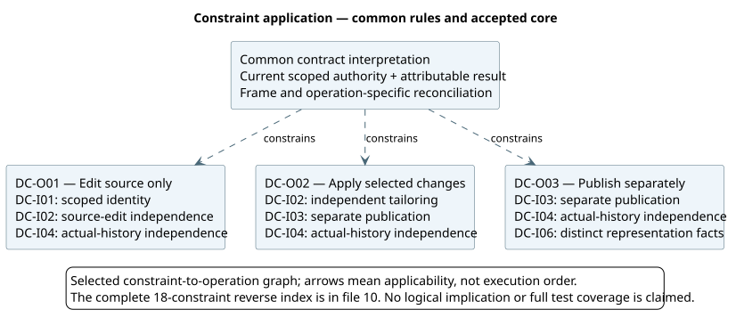

[Editable PlantUML](../diagrams/contract-constraint-application.puml) · [PNG](../diagrams/contract-constraint-application.png)

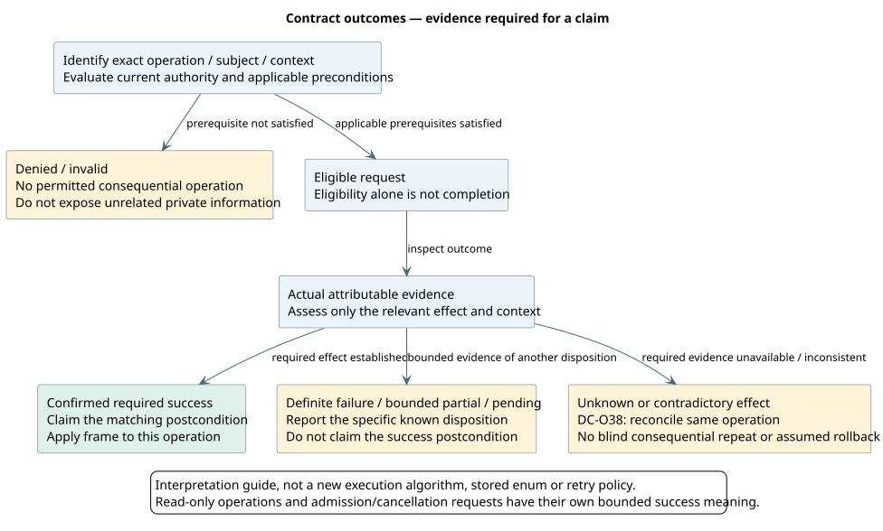

[Editable PlantUML](../diagrams/contract-outcome-interpretation.puml) · [PNG](../diagrams/contract-outcome-interpretation.png)

### Operation inventory

Use this short index to open a contract. Rule links remain in each contract’s **Cross-view provenance** field.

#### Professional content and sharing

| Contract | Operation |
| --- | --- |
| [DC-O01](#dc-o01) | Edit shared professional information |
| [DC-O02](#dc-o02) | Apply selected source changes to one draft |
| [DC-O03](#dc-o03) | Publish separately confirmed intended presentation |
| [DC-O04](#dc-o04) | Save PDF download configuration |
| [DC-O05](#dc-o05) | Disable a specific protected link |
| [DC-O06](#dc-o06) | Retrieve selected protected representation |

#### Applications and actual history

| Contract | Operation |
| --- | --- |
| [DC-O07](#dc-o07) | Save manual application preparation |
| [DC-O08](#dc-o08) | Record actual application progress event |
| [DC-O09](#dc-o09) | Capture actual submitted material |
| [DC-O10](#dc-o10) | Record distinguishable correction or resubmission |

#### Mail and calendar

**Release applicability:** future-domain design retained after MVP; core operating/deployment and recovery controls still apply to MVP where relevant.

| Contract | Operation |
| --- | --- |
| [DC-O11](#dc-o11) | Read permitted provider correspondence |
| [DC-O12](#dc-o12) | Submit a reviewed mail send/reply attempt |
| [DC-O13](#dc-o13) | Save a local calendar activity |
| [DC-O14](#dc-o14) | Unlink a local provider mapping |
| [DC-O15](#dc-o15) | Perform selected provider synchronization |

#### Work and Sprint planning

**Release applicability:** future-domain design retained after MVP; core operating/deployment and recovery controls still apply to MVP where relevant.

| Contract | Operation |
| --- | --- |
| [DC-O16](#dc-o16) | Refine a backlog item into tasks |
| [DC-O17](#dc-o17) | Record subject-specific work completion |
| [DC-O18](#dc-o18) | Create/adapt a coherent Sprint plan |
| [DC-O19](#dc-o19) | End or cancel a Sprint with actual disposition |

#### Invitations and grants

| Contract | Operation |
| --- | --- |
| [DC-O20](#dc-o20) | Accept an eligible resource invitation |
| [DC-O21](#dc-o21) | Change or revoke an exact resource grant |

#### Git and repository collaboration

| Contract | Operation |
| --- | --- |
| [DC-O22](#dc-o22) | Read-transfer a real Git repository |
| [DC-O23](#dc-o23) | Push an intended real Git ref update |
| [DC-O24](#dc-o24) | Open a source/target integration request |
| [DC-O25](#dc-o25) | Record review/comment on evaluated revision |
| [DC-O26](#dc-o26) | Merge only current eligible evaluated revisions |

#### Execution and deployment

**Release applicability:** future-domain design retained after MVP; core operating/deployment and recovery controls still apply to MVP where relevant.

| Contract | Operation |
| --- | --- |
| [DC-O27](#dc-o27) | Admit a gated attributable workflow attempt |
| [DC-O28](#dc-o28) | Request cancellation and assess actual stop |
| [DC-O29](#dc-o29) | Request a separate eligible retry attempt |
| [DC-O30](#dc-o30) | Attempt a separately target-authorized deployment |

#### Administration, files and lifecycle

| Contract | Operation |
| --- | --- |
| [DC-O31](#dc-o31) | Change an effective administration/file policy |
| [DC-O32](#dc-o32) | Admit and process an intended file candidate |
| [DC-O33](#dc-o33) | Read restricted operational/audit evidence |
| [DC-O34](#dc-o34) | Archive, unlink or request category-specific retirement |
| [DC-O35](#dc-o35) | Physically reclaim eligible retained information |
| [DC-O36](#dc-o36) | Restore retained category information/visibility |

#### Recovery, evidence and account access

| Contract | Operation |
| --- | --- |
| [DC-O37](#dc-o37) | Perform and assess an authorized isolated recovery drill |
| [DC-O38](#dc-o38) | Observe/reconcile same operation effect truthfully |
| [DC-O39](#dc-o39) | Change account access eligibility under reviewed policy |

### DC-O01 — Edit shared professional information

**Contract authority:** A/R. **Acting context:** Profile owner.

**Primary requirements:** [PRP-D01](../../02-requirements-engineering/03-requirements-specification/profiles-resumes-and-portfolio.md#prp-d01-reusable-professional-information), [PRP-D04](../../02-requirements-engineering/03-requirements-specification/profiles-resumes-and-portfolio.md#prp-d04-explicit-shared-source-update-rules), [BRL-D02](../../02-requirements-engineering/03-requirements-specification/business-rules-and-data-lifecycle.md#brl-d02-shared-information-and-independent-tailoring)

**Concepts / responsibilities:** [DM-C01](../02-domain-and-information-analysis/03-domain-model-and-object-oriented-view.md#dm-c01), [DM-C02](../02-domain-and-information-analysis/03-domain-model-and-object-oriented-view.md#dm-c02), [DM-C03](../02-domain-and-information-analysis/03-domain-model-and-object-oriented-view.md#dm-c03), [DM-C09](../02-domain-and-information-analysis/03-domain-model-and-object-oriented-view.md#dm-c09). Consult their responsibility catalog; these contracts do not prescribe implementation methods.

**Inputs / target meaning:** Intended source fields/entries, source context and requested edit.

**Preconditions / current authority:** Current exact source-edit authority and reviewed field/reference validity; no implicit request to apply to a resume.

**Successful postcondition / result:** Confirmed permitted source edit is retained in its intended source context.

**Frame / information protected from this operation:** Existing resumes, overrides, live presentations and actual sent material remain unchanged by this source edit alone.

**Denied / invalid / failed / partial / unknown:** Denied/invalid edit is not a saved change; failed/partial/unknown source-save effect is reported from evidence without an assumed rollback. The shared disposition contract also applies; known pending progress remains distinct from lost outcome.

**Concurrency / repetition:** Concurrent source edits require explicit current-context/conflict handling; a repeat cannot silently overwrite newer source.

**Applicable typed constraints:** [DC-I01](#dc-i01), [DC-I02](#dc-i02), [DC-I04](#dc-i04)

**Policy / evidence boundary:** Accepted preservation core applies; detailed fields, source removal and concurrency remain proposed.

**Cross-view provenance:** Interactions: [SB-M01](../04-behavioral-and-scenario-analysis/06-scenario-based-view.md#sb-m01); Source use-case context: [UC-D01](../../02-requirements-engineering/04-scenarios-and-models/user-stories-and-scenarios.md#uc-d01); Activity context: [CF-M01](../03-functional-and-process-analysis/08-control-flow-based-view.md#cf-m01); Selected activity-step context: [CF-M01-S01](../03-functional-and-process-analysis/08-control-flow-based-view.md#cf-m01-s01); States: [SM-M01](../04-behavioral-and-scenario-analysis/07-state-based-view.md#sm-m01); Related transitions/observations: [SM-T001](../04-behavioral-and-scenario-analysis/07-state-based-view.md#sm-t001), [SM-T006](../04-behavioral-and-scenario-analysis/07-state-based-view.md#sm-t006), [SM-T007](../04-behavioral-and-scenario-analysis/07-state-based-view.md#sm-t007); Decisions: [RB-D01](09-rule-based-view.md#rb-d01), [RB-D02](09-rule-based-view.md#rb-d02).

**Mapping limit:** Supporting/upstream lifecycle refinement or adjacent context; step/use-case links are provenance, not complete direct-path coverage. Linked transitions include relevant environmental/concurrent/result observations; this contract does not cause every listed transition. No new state edge or external UC is allocated.

**Criterion context:** 9 existing proposed criterion locators belong to the linked primary candidates; exact locator/candidate/source records are preserved in [contract evidence](../evidence/operation-contract-review-2026-11-01.json). This is candidate-level related context, not a claim that this operation satisfies every associated criterion. Primary wording and the 470-locator inventory are unchanged.

### DC-O02 — Apply selected source changes to one draft

**Contract authority:** A/R. **Acting context:** Resume owner.

**Primary requirements:** [PRP-D03](../../02-requirements-engineering/03-requirements-specification/profiles-resumes-and-portfolio.md#prp-d03-independent-selections-layouts-and-overrides), [PRP-D04](../../02-requirements-engineering/03-requirements-specification/profiles-resumes-and-portfolio.md#prp-d04-explicit-shared-source-update-rules), [BRL-D02](../../02-requirements-engineering/03-requirements-specification/business-rules-and-data-lifecycle.md#brl-d02-shared-information-and-independent-tailoring)

**Concepts / responsibilities:** [DM-C01](../02-domain-and-information-analysis/03-domain-model-and-object-oriented-view.md#dm-c01), [DM-C03](../02-domain-and-information-analysis/03-domain-model-and-object-oriented-view.md#dm-c03), [DM-C05](../02-domain-and-information-analysis/03-domain-model-and-object-oriented-view.md#dm-c05), [DM-C09](../02-domain-and-information-analysis/03-domain-model-and-object-oriented-view.md#dm-c09). Consult their responsibility catalog; these contracts do not prescribe implementation methods.

**Inputs / target meaning:** Exact intended resume, selected source changes, preview/context and explicit apply confirmation.

**Preconditions / current authority:** Current resume/source scope, valid selected context and explicit owner choice; changed/stale selection must be re-evaluated before allowed effect.

**Successful postcondition / result:** Confirmed selected changes affect only intended saved draft with intended independent overrides preserved.

**Frame / information protected from this operation:** Other resumes, existing live presentation and actual submitted materials are not changed by applying this selection.

**Denied / invalid / failed / partial / unknown:** Decline/preview alone makes no apply; invalid/denied selection cannot claim success; partial/unknown save needs actual draft reconciliation. The shared disposition contract also applies; known pending progress remains distinct from lost outcome.

**Concurrency / repetition:** A changed source/draft does not authorize stale overwrite. Repeated request must reconcile actual effect before reapplying consequential changes.

**Applicable typed constraints:** [DC-I02](#dc-i02), [DC-I03](#dc-i03), [DC-I04](#dc-i04)

**Policy / evidence boundary:** Accepted explicit apply/preservation; exact concurrency/source-removal mechanism not selected.

**Cross-view provenance:** Interactions: [SB-M01](../04-behavioral-and-scenario-analysis/06-scenario-based-view.md#sb-m01); Source use-case context: [UC-D01](../../02-requirements-engineering/04-scenarios-and-models/user-stories-and-scenarios.md#uc-d01); Activity context: [CF-M01](../03-functional-and-process-analysis/08-control-flow-based-view.md#cf-m01); Selected activity-step context: [CF-M01-S05](../03-functional-and-process-analysis/08-control-flow-based-view.md#cf-m01-s05), [CF-M01-S06](../03-functional-and-process-analysis/08-control-flow-based-view.md#cf-m01-s06), [CF-M01-S08](../03-functional-and-process-analysis/08-control-flow-based-view.md#cf-m01-s08); States: [SM-M01](../04-behavioral-and-scenario-analysis/07-state-based-view.md#sm-m01); Related transitions/observations: [SM-T002](../04-behavioral-and-scenario-analysis/07-state-based-view.md#sm-t002), [SM-T004](../04-behavioral-and-scenario-analysis/07-state-based-view.md#sm-t004); Decisions: [RB-D01](09-rule-based-view.md#rb-d01), [RB-D02](09-rule-based-view.md#rb-d02).

**Mapping limit:** Selected operation-to-source association; semantic criterion/path completeness still requires cross-view review. Linked transitions include relevant environmental/concurrent/result observations; this contract does not cause every listed transition. No new state edge or external UC is allocated.

**Criterion context:** 9 existing proposed criterion locators belong to the linked primary candidates; exact locator/candidate/source records are preserved in [contract evidence](../evidence/operation-contract-review-2026-11-01.json). This is candidate-level related context, not a claim that this operation satisfies every associated criterion. Primary wording and the 470-locator inventory are unchanged.

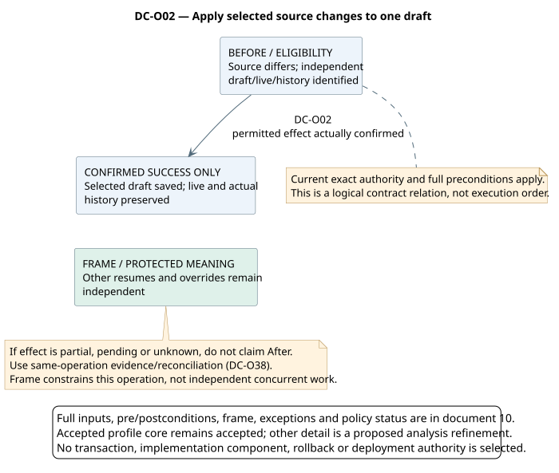

[Editable PlantUML](../diagrams/contract-dc-o02-boundary.puml) · [PNG](../diagrams/contract-dc-o02-boundary.png)

After applies only when the matching permitted success is actually confirmed. The frame constrains this operation; unknown effects do not justify claiming the drawn after-state or universal unchanged before-state.

### DC-O03 — Publish separately confirmed intended presentation

**Contract authority:** A/R. **Acting context:** Resume owner.

**Primary requirements:** [PRP-D04](../../02-requirements-engineering/03-requirements-specification/profiles-resumes-and-portfolio.md#prp-d04-explicit-shared-source-update-rules), [PRP-D08](../../02-requirements-engineering/03-requirements-specification/profiles-resumes-and-portfolio.md#prp-d08-clear-presentation-and-rendition-boundaries), [PDF-D07](../../02-requirements-engineering/03-requirements-specification/pdf-and-controlled-sharing.md#pdf-d07-explicit-live-revision-and-rendition-behavior)

**Concepts / responsibilities:** [DM-C03](../02-domain-and-information-analysis/03-domain-model-and-object-oriented-view.md#dm-c03), [DM-C09](../02-domain-and-information-analysis/03-domain-model-and-object-oriented-view.md#dm-c09), [DM-C10](../02-domain-and-information-analysis/03-domain-model-and-object-oriented-view.md#dm-c10). Consult their responsibility catalog; these contracts do not prescribe implementation methods.

**Inputs / target meaning:** Exact intended saved content/presentation context and separate publication confirmation.

**Preconditions / current authority:** Current publication authority, separately reviewed intended content and applicable publication validity; apply/save alone is insufficient.

**Successful postcondition / result:** Only actual confirmed publication establishes intended effective live presentation.

**Frame / information protected from this operation:** Actual sent history and other resumes remain independent; successful web publication does not itself certify PDF readiness.

**Denied / invalid / failed / partial / unknown:** No confirmation means no publication request; denied/invalid/failed/unknown effect cannot claim intended live state. The shared disposition contract also applies; known pending progress remains distinct from lost outcome.

**Concurrency / repetition:** Recheck changed intended content/authority; reconcile actual presentation after lost confirmation before retry.

**Applicable typed constraints:** [DC-I03](#dc-i03), [DC-I04](#dc-i04), [DC-I06](#dc-i06)

**Policy / evidence boundary:** Separate publication is accepted core; exact rendition/timing/concurrency details remain proposed.

**Cross-view provenance:** Interactions: [SB-M01](../04-behavioral-and-scenario-analysis/06-scenario-based-view.md#sb-m01); Source use-case context: [UC-D01](../../02-requirements-engineering/04-scenarios-and-models/user-stories-and-scenarios.md#uc-d01); Activity context: [CF-M01](../03-functional-and-process-analysis/08-control-flow-based-view.md#cf-m01); Selected activity-step context: [CF-M01-S10](../03-functional-and-process-analysis/08-control-flow-based-view.md#cf-m01-s10); States: [SM-M01](../04-behavioral-and-scenario-analysis/07-state-based-view.md#sm-m01); Related transitions/observations: [SM-T003](../04-behavioral-and-scenario-analysis/07-state-based-view.md#sm-t003), [SM-T005](../04-behavioral-and-scenario-analysis/07-state-based-view.md#sm-t005); Decisions: [RB-D01](09-rule-based-view.md#rb-d01), [RB-D02](09-rule-based-view.md#rb-d02), [RB-D18](09-rule-based-view.md#rb-d18).

**Mapping limit:** Selected operation-to-source association; semantic criterion/path completeness still requires cross-view review. Linked transitions include relevant environmental/concurrent/result observations; this contract does not cause every listed transition. No new state edge or external UC is allocated.

**Criterion context:** 9 existing proposed criterion locators belong to the linked primary candidates; exact locator/candidate/source records are preserved in [contract evidence](../evidence/operation-contract-review-2026-11-01.json). This is candidate-level related context, not a claim that this operation satisfies every associated criterion. Primary wording and the 470-locator inventory are unchanged.

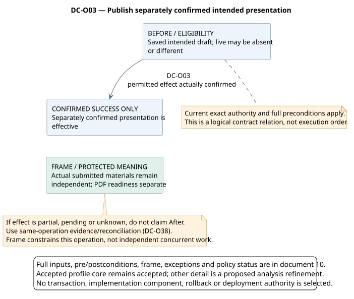

[Editable PlantUML](../diagrams/contract-dc-o03-boundary.puml) · [PNG](../diagrams/contract-dc-o03-boundary.png)

After applies only when the matching permitted success is actually confirmed. The frame constrains this operation; unknown effects do not justify claiming the drawn after-state or universal unchanged before-state.

### DC-O04 — Save PDF download configuration

**Contract authority:** R. **Acting context:** Resume owner.

**Primary requirements:** [PDF-D02](../../02-requirements-engineering/03-requirements-specification/pdf-and-controlled-sharing.md#pdf-d02-uploaded-pdf-and-language-identity), [PDF-D03](../../02-requirements-engineering/03-requirements-specification/pdf-and-controlled-sharing.md#pdf-d03-per-resume-download-choices), [PDF-D05](../../02-requirements-engineering/03-requirements-specification/pdf-and-controlled-sharing.md#pdf-d05-direct-file-and-pdf-authorization), [PDF-D06](../../02-requirements-engineering/03-requirements-specification/pdf-and-controlled-sharing.md#pdf-d06-owner-password-and-link-controls)

**Concepts / responsibilities:** [DM-C12](../02-domain-and-information-analysis/03-domain-model-and-object-oriented-view.md#dm-c12), [DM-C03](../02-domain-and-information-analysis/03-domain-model-and-object-oriented-view.md#dm-c03), [DM-C10](../02-domain-and-information-analysis/03-domain-model-and-object-oriented-view.md#dm-c10), [DM-C11](../02-domain-and-information-analysis/03-domain-model-and-object-oriented-view.md#dm-c11), [DM-C13](../02-domain-and-information-analysis/03-domain-model-and-object-oriented-view.md#dm-c13). Consult their responsibility catalog; these contracts do not prescribe implementation methods.

**Inputs / target meaning:** Intended resume, generated/uploaded/both/neither choice and applicable language/artifact choices.

**Preconditions / current authority:** Current setting authority; validate requested mode/options against reviewed actual availability/timing policy.

**Successful postcondition / result:** Actual confirmed setting save establishes intended effective download configuration only.

**Frame / information protected from this operation:** Link enablement, page publication and actual sent documents are not changed by this setting operation.

**Denied / invalid / failed / partial / unknown:** Invalid/unavailable choices are explained; failed/unknown save does not establish a new effective mode or silently substitute private content. The shared disposition contract also applies; known pending progress remains distinct from lost outcome.

**Concurrency / repetition:** Concurrent settings/availability changes require current-context handling; mode does not prove artifact existence.

**Applicable typed constraints:** [DC-I05](#dc-i05), [DC-I06](#dc-i06), [DC-I13](#dc-i13)

**Policy / evidence boundary:** Q-D09/Q-D10 detailed availability/mode timing and session policy remain proposed.

**Cross-view provenance:** Interactions: [SB-M02](../04-behavioral-and-scenario-analysis/06-scenario-based-view.md#sb-m02); Source use-case context: [UC-D02](../../02-requirements-engineering/04-scenarios-and-models/user-stories-and-scenarios.md#uc-d02); Activity context: [CF-M02](../03-functional-and-process-analysis/08-control-flow-based-view.md#cf-m02); Selected activity-step context: [CF-M02-S03](../03-functional-and-process-analysis/08-control-flow-based-view.md#cf-m02-s03), [CF-M02-S04](../03-functional-and-process-analysis/08-control-flow-based-view.md#cf-m02-s04), [CF-M02-S06](../03-functional-and-process-analysis/08-control-flow-based-view.md#cf-m02-s06); States: [SM-M04](../04-behavioral-and-scenario-analysis/07-state-based-view.md#sm-m04); Related transitions/observations: [SM-T020](../04-behavioral-and-scenario-analysis/07-state-based-view.md#sm-t020), [SM-T021](../04-behavioral-and-scenario-analysis/07-state-based-view.md#sm-t021); Decisions: [RB-D01](09-rule-based-view.md#rb-d01), [RB-D03](09-rule-based-view.md#rb-d03), [RB-D04](09-rule-based-view.md#rb-d04).

**Mapping limit:** Selected operation-to-source association; semantic criterion/path completeness still requires cross-view review. Linked transitions include relevant environmental/concurrent/result observations; this contract does not cause every listed transition. No new state edge or external UC is allocated.

**Criterion context:** 12 existing proposed criterion locators belong to the linked primary candidates; exact locator/candidate/source records are preserved in [contract evidence](../evidence/operation-contract-review-2026-11-01.json). This is candidate-level related context, not a claim that this operation satisfies every associated criterion. Primary wording and the 470-locator inventory are unchanged.

### DC-O05 — Disable a specific protected link

**Contract authority:** R. **Acting context:** Link owner.

**Primary requirements:** [PDF-D05](../../02-requirements-engineering/03-requirements-specification/pdf-and-controlled-sharing.md#pdf-d05-direct-file-and-pdf-authorization), [PDF-D06](../../02-requirements-engineering/03-requirements-specification/pdf-and-controlled-sharing.md#pdf-d06-owner-password-and-link-controls), [ACC-D08](../../02-requirements-engineering/03-requirements-specification/accounts-authentication-and-permissions.md#acc-d08-owner-control-of-employer-link-access), [ACC-D12](../../02-requirements-engineering/03-requirements-specification/accounts-authentication-and-permissions.md#acc-d12-end-of-access-and-lifecycle-enforcement)

**Concepts / responsibilities:** [DM-C13](../02-domain-and-information-analysis/03-domain-model-and-object-oriented-view.md#dm-c13), [DM-C48](../02-domain-and-information-analysis/03-domain-model-and-object-oriented-view.md#dm-c48), [DM-C12](../02-domain-and-information-analysis/03-domain-model-and-object-oriented-view.md#dm-c12). Consult their responsibility catalog; these contracts do not prescribe implementation methods.

**Inputs / target meaning:** Specific link identity and independent explicit disable request.

**Preconditions / current authority:** Current exact link-control authority; no preceding download-mode change is required.

**Successful postcondition / result:** After actual effective disablement, fresh request cannot gain protected access via this link.

**Frame / information protected from this operation:** PDF download configuration and unrelated links are not changed; delivered copies are not recalled.

**Denied / invalid / failed / partial / unknown:** Denied/failed/unconfirmed disablement is not reported completed; actual state needs reconciliation. The shared disposition contract also applies; known pending progress remains distinct from lost outcome.

**Concurrency / repetition:** Recheck current link change; old session/in-flight output behavior follows its reviewed policy rather than a global immediate-revocation promise.

**Applicable typed constraints:** [DC-I05](#dc-i05), [DC-I06](#dc-i06), [DC-I08](#dc-i08)

**Policy / evidence boundary:** Fresh-disable scope required; active-session/password/in-flight details remain proposed.

**Cross-view provenance:** Interactions: [SB-M03](../04-behavioral-and-scenario-analysis/06-scenario-based-view.md#sb-m03); Source use-case context: [UC-D02](../../02-requirements-engineering/04-scenarios-and-models/user-stories-and-scenarios.md#uc-d02); Activity context: [CF-M03](../03-functional-and-process-analysis/08-control-flow-based-view.md#cf-m03); Selected activity-step context: [CF-M03-S03](../03-functional-and-process-analysis/08-control-flow-based-view.md#cf-m03-s03), [CF-M03-S04](../03-functional-and-process-analysis/08-control-flow-based-view.md#cf-m03-s04), [CF-M03-S06](../03-functional-and-process-analysis/08-control-flow-based-view.md#cf-m03-s06); States: [SM-M04](../04-behavioral-and-scenario-analysis/07-state-based-view.md#sm-m04); Related transitions/observations: [SM-T018](../04-behavioral-and-scenario-analysis/07-state-based-view.md#sm-t018); Decisions: [RB-D01](09-rule-based-view.md#rb-d01), [RB-D05](09-rule-based-view.md#rb-d05).

**Mapping limit:** Selected operation-to-source association; semantic criterion/path completeness still requires cross-view review. Linked transitions include relevant environmental/concurrent/result observations; this contract does not cause every listed transition. No new state edge or external UC is allocated.

**Criterion context:** 12 existing proposed criterion locators belong to the linked primary candidates; exact locator/candidate/source records are preserved in [contract evidence](../evidence/operation-contract-review-2026-11-01.json). This is candidate-level related context, not a claim that this operation satisfies every associated criterion. Primary wording and the 470-locator inventory are unchanged.

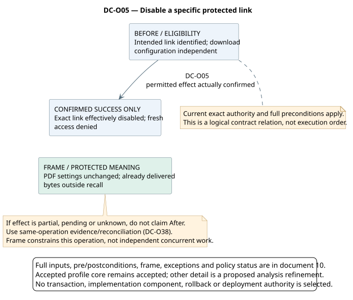

[Editable PlantUML](../diagrams/contract-dc-o05-boundary.puml) · [PNG](../diagrams/contract-dc-o05-boundary.png)

After applies only when the matching permitted success is actually confirmed. The frame constrains this operation; unknown effects do not justify claiming the drawn after-state or universal unchanged before-state.

### DC-O06 — Retrieve selected protected representation

**Contract authority:** R. **Acting context:** Employer viewer.

**Primary requirements:** [PDF-D03](../../02-requirements-engineering/03-requirements-specification/pdf-and-controlled-sharing.md#pdf-d03-per-resume-download-choices), [PDF-D04](../../02-requirements-engineering/03-requirements-specification/pdf-and-controlled-sharing.md#pdf-d04-scoped-password-protected-employer-access), [PDF-D05](../../02-requirements-engineering/03-requirements-specification/pdf-and-controlled-sharing.md#pdf-d05-direct-file-and-pdf-authorization), [PDF-D06](../../02-requirements-engineering/03-requirements-specification/pdf-and-controlled-sharing.md#pdf-d06-owner-password-and-link-controls), [ACC-D06](../../02-requirements-engineering/03-requirements-specification/accounts-authentication-and-permissions.md#acc-d06-employer-access-without-a-viewer-account), [ACC-D07](../../02-requirements-engineering/03-requirements-specification/accounts-authentication-and-permissions.md#acc-d07-protected-shared-file-and-pdf-retrieval)

**Concepts / responsibilities:** [DM-C13](../02-domain-and-information-analysis/03-domain-model-and-object-oriented-view.md#dm-c13), [DM-C09](../02-domain-and-information-analysis/03-domain-model-and-object-oriented-view.md#dm-c09), [DM-C07](../02-domain-and-information-analysis/03-domain-model-and-object-oriented-view.md#dm-c07), [DM-C12](../02-domain-and-information-analysis/03-domain-model-and-object-oriented-view.md#dm-c12), [DM-C10](../02-domain-and-information-analysis/03-domain-model-and-object-oriented-view.md#dm-c10), [DM-C11](../02-domain-and-information-analysis/03-domain-model-and-object-oriented-view.md#dm-c11). Consult their responsibility catalog; these contracts do not prescribe implementation methods.

**Inputs / target meaning:** Intended page/evidence/PDF, exact resource/variant/language and applicable link/password context.

**Preconditions / current authority:** Current applicable protected access, intended selected publication/mode and actual available representation; no viewer account invented.

**Successful postcondition / result:** Only permitted exact selected representation is exposed; report actual complete/incomplete retrieval truthfully.

**Frame / information protected from this operation:** No private workspace, unrelated evidence/file or account/repository authority is granted.

**Denied / invalid / failed / partial / unknown:** Wrong credentials/disabled/unselected/altered resource denied; unavailable variant is explicit without unrelated/private fallback. The shared disposition contract also applies; known pending progress remains distinct from lost outcome.

**Concurrency / repetition:** Current-request checks and interruption follow reviewed revocation/retrieval policy; no recall of emitted bytes.

**Applicable typed constraints:** [DC-I01](#dc-i01), [DC-I05](#dc-i05), [DC-I06](#dc-i06), [DC-I08](#dc-i08)

**Policy / evidence boundary:** Session/expiry/in-flight/fallback details retain primary proposed status; read-only domain operation has no invented state transition.

**Cross-view provenance:** Interactions: [SB-M04](../04-behavioral-and-scenario-analysis/06-scenario-based-view.md#sb-m04); Source use-case context: [UC-D03](../../02-requirements-engineering/04-scenarios-and-models/user-stories-and-scenarios.md#uc-d03); Activity context: [CF-M04](../03-functional-and-process-analysis/08-control-flow-based-view.md#cf-m04); Selected activity-step context: [CF-M04-S04](../03-functional-and-process-analysis/08-control-flow-based-view.md#cf-m04-s04), [CF-M04-S06](../03-functional-and-process-analysis/08-control-flow-based-view.md#cf-m04-s06), [CF-M04-S08](../03-functional-and-process-analysis/08-control-flow-based-view.md#cf-m04-s08); States: [SM-M04](../04-behavioral-and-scenario-analysis/07-state-based-view.md#sm-m04), [SM-M05](../04-behavioral-and-scenario-analysis/07-state-based-view.md#sm-m05); Decisions: [RB-D03](09-rule-based-view.md#rb-d03), [RB-D04](09-rule-based-view.md#rb-d04), [RB-D05](09-rule-based-view.md#rb-d05).

**Mapping limit:** Selected operation-to-source association; semantic criterion/path completeness still requires cross-view review. Linked transitions include relevant environmental/concurrent/result observations; this contract does not cause every listed transition. No new state edge or external UC is allocated.

**Criterion context:** 18 existing proposed criterion locators belong to the linked primary candidates; exact locator/candidate/source records are preserved in [contract evidence](../evidence/operation-contract-review-2026-11-01.json). This is candidate-level related context, not a claim that this operation satisfies every associated criterion. Primary wording and the 470-locator inventory are unchanged.

### DC-O07 — Save manual application preparation

**Contract authority:** R. **Acting context:** Applicant.

**Primary requirements:** [APP-D01](../../02-requirements-engineering/03-requirements-specification/manual-application-management.md#app-d01-company-and-opportunity-context), [APP-D02](../../02-requirements-engineering/03-requirements-specification/manual-application-management.md#app-d02-relevant-resume-association), [APP-D03](../../02-requirements-engineering/03-requirements-specification/manual-application-management.md#app-d03-manually-authored-cover-letter), [APP-D04](../../02-requirements-engineering/03-requirements-specification/manual-application-management.md#app-d04-explicit-progress-states-and-transitions)

**Concepts / responsibilities:** [DM-C14](../02-domain-and-information-analysis/03-domain-model-and-object-oriented-view.md#dm-c14), [DM-C15](../02-domain-and-information-analysis/03-domain-model-and-object-oriented-view.md#dm-c15), [DM-C16](../02-domain-and-information-analysis/03-domain-model-and-object-oriented-view.md#dm-c16), [DM-C17](../02-domain-and-information-analysis/03-domain-model-and-object-oriented-view.md#dm-c17), [DM-C03](../02-domain-and-information-analysis/03-domain-model-and-object-oriented-view.md#dm-c03). Consult their responsibility catalog; these contracts do not prescribe implementation methods.

**Inputs / target meaning:** Company/position, intended application, permitted selected resume and manually written letter/preparation.

**Preconditions / current authority:** Exact application/resource authority and applicable required-field/reference/incomplete-draft validity.

**Successful postcondition / result:** Confirmed permitted preparation is saved in intended application context.

**Frame / information protected from this operation:** Does not itself record actual submission, send mail, preserve a complete actual set or change live resume.

**Denied / invalid / failed / partial / unknown:** Invalid/inaccessible inputs rejected or explicitly incomplete under reviewed rules; save failure/unknown is not success. The shared disposition contract also applies; known pending progress remains distinct from lost outcome.

**Concurrency / repetition:** Concurrent preparation edit/correction keeps current context and distinguishable history where required; no blind stale overwrite.

**Applicable typed constraints:** [DC-I01](#dc-i01), [DC-I07](#dc-i07), [DC-I15](#dc-i15)

**Policy / evidence boundary:** Q-D12 fields/incomplete-draft/correction policies remain proposed; no automatic application automation.

**Cross-view provenance:** Interactions: [SB-M05](../04-behavioral-and-scenario-analysis/06-scenario-based-view.md#sb-m05); Source use-case context: [UC-D04](../../02-requirements-engineering/04-scenarios-and-models/user-stories-and-scenarios.md#uc-d04); Activity context: [CF-M05](../03-functional-and-process-analysis/08-control-flow-based-view.md#cf-m05); Selected activity-step context: [CF-M05-S04](../03-functional-and-process-analysis/08-control-flow-based-view.md#cf-m05-s04), [CF-M05-S05](../03-functional-and-process-analysis/08-control-flow-based-view.md#cf-m05-s05), [CF-M05-S07](../03-functional-and-process-analysis/08-control-flow-based-view.md#cf-m05-s07); States: [SM-M06](../04-behavioral-and-scenario-analysis/07-state-based-view.md#sm-m06), [SM-M18](../04-behavioral-and-scenario-analysis/07-state-based-view.md#sm-m18); Decisions: [RB-D01](09-rule-based-view.md#rb-d01), [RB-D18](09-rule-based-view.md#rb-d18).

**Mapping limit:** Selected operation-to-source association; semantic criterion/path completeness still requires cross-view review. Linked transitions include relevant environmental/concurrent/result observations; this contract does not cause every listed transition. No new state edge or external UC is allocated.

**Criterion context:** 12 existing proposed criterion locators belong to the linked primary candidates; exact locator/candidate/source records are preserved in [contract evidence](../evidence/operation-contract-review-2026-11-01.json). This is candidate-level related context, not a claim that this operation satisfies every associated criterion. Primary wording and the 470-locator inventory are unchanged.

### DC-O08 — Record actual application progress event

**Contract authority:** R. **Acting context:** Applicant.

**Primary requirements:** [APP-D04](../../02-requirements-engineering/03-requirements-specification/manual-application-management.md#app-d04-explicit-progress-states-and-transitions), [APP-D05](../../02-requirements-engineering/03-requirements-specification/manual-application-management.md#app-d05-user-directed-submission-recording), [APP-D07](../../02-requirements-engineering/03-requirements-specification/manual-application-management.md#app-d07-correction-and-repeated-submissions), [BRL-D06](../../02-requirements-engineering/03-requirements-specification/business-rules-and-data-lifecycle.md#brl-d06-validation-and-truthful-state-changes)

**Concepts / responsibilities:** [DM-C16](../02-domain-and-information-analysis/03-domain-model-and-object-oriented-view.md#dm-c16), [DM-C15](../02-domain-and-information-analysis/03-domain-model-and-object-oriented-view.md#dm-c15), [DM-C18](../02-domain-and-information-analysis/03-domain-model-and-object-oriented-view.md#dm-c18). Consult their responsibility catalog; these contracts do not prescribe implementation methods.

**Inputs / target meaning:** Intended actual progress/event, current application context and relevant event/recorded-time meaning.

**Preconditions / current authority:** Permitted current transition or explicitly reviewed manual correction/import route; no inference from email/calendar activity alone.

**Successful postcondition / result:** Actual confirmed progress event is retained with appropriate distinguishable context.

**Frame / information protected from this operation:** Submitted progress is not complete material capture or external receipt; prior actual set is not replaced by current live content.

**Denied / invalid / failed / partial / unknown:** Invalid/denied/stale transition cannot claim new status; partial/unknown record effect stays truthful. The shared disposition contract also applies; known pending progress remains distinct from lost outcome.

**Concurrency / repetition:** Re-evaluate changed status/event; repeated/corrected event must not silently erase earlier meaning.

**Applicable typed constraints:** [DC-I07](#dc-i07), [DC-I15](#dc-i15), [DC-I17](#dc-i17)

**Policy / evidence boundary:** SM-M06 selected normal routes are not exhaustive correction/import rules; Q-D12/Q-D14 detail remains proposed.

**Cross-view provenance:** Interactions: [SB-M05](../04-behavioral-and-scenario-analysis/06-scenario-based-view.md#sb-m05); Source use-case context: [UC-D04](../../02-requirements-engineering/04-scenarios-and-models/user-stories-and-scenarios.md#uc-d04); Activity context: [CF-M05](../03-functional-and-process-analysis/08-control-flow-based-view.md#cf-m05); Selected activity-step context: [CF-M05-S10](../03-functional-and-process-analysis/08-control-flow-based-view.md#cf-m05-s10), [CF-M05-S12](../03-functional-and-process-analysis/08-control-flow-based-view.md#cf-m05-s12); States: [SM-M06](../04-behavioral-and-scenario-analysis/07-state-based-view.md#sm-m06); Related transitions/observations: [SM-T027](../04-behavioral-and-scenario-analysis/07-state-based-view.md#sm-t027), [SM-T028](../04-behavioral-and-scenario-analysis/07-state-based-view.md#sm-t028), [SM-T029](../04-behavioral-and-scenario-analysis/07-state-based-view.md#sm-t029), [SM-T030](../04-behavioral-and-scenario-analysis/07-state-based-view.md#sm-t030), [SM-T031](../04-behavioral-and-scenario-analysis/07-state-based-view.md#sm-t031), [SM-T032](../04-behavioral-and-scenario-analysis/07-state-based-view.md#sm-t032), [SM-T033](../04-behavioral-and-scenario-analysis/07-state-based-view.md#sm-t033), [SM-T034](../04-behavioral-and-scenario-analysis/07-state-based-view.md#sm-t034), [SM-T035](../04-behavioral-and-scenario-analysis/07-state-based-view.md#sm-t035); Decisions: [RB-D01](09-rule-based-view.md#rb-d01), [RB-D06](09-rule-based-view.md#rb-d06), [RB-D17](09-rule-based-view.md#rb-d17), [RB-D18](09-rule-based-view.md#rb-d18).

**Mapping limit:** Selected operation-to-source association; semantic criterion/path completeness still requires cross-view review. Linked transitions include relevant environmental/concurrent/result observations; this contract does not cause every listed transition. No new state edge or external UC is allocated.

**Criterion context:** 12 existing proposed criterion locators belong to the linked primary candidates; exact locator/candidate/source records are preserved in [contract evidence](../evidence/operation-contract-review-2026-11-01.json). This is candidate-level related context, not a claim that this operation satisfies every associated criterion. Primary wording and the 470-locator inventory are unchanged.

### DC-O09 — Capture actual submitted material

**Contract authority:** A/R. **Acting context:** Applicant.

**Primary requirements:** [APP-D05](../../02-requirements-engineering/03-requirements-specification/manual-application-management.md#app-d05-user-directed-submission-recording), [APP-D06](../../02-requirements-engineering/03-requirements-specification/manual-application-management.md#app-d06-preserved-actual-submitted-copies), [APP-D07](../../02-requirements-engineering/03-requirements-specification/manual-application-management.md#app-d07-correction-and-repeated-submissions), [PDF-D08](../../02-requirements-engineering/03-requirements-specification/pdf-and-controlled-sharing.md#pdf-d08-downloaded-copy-and-submission-distinctions), [BRL-D05](../../02-requirements-engineering/03-requirements-specification/business-rules-and-data-lifecycle.md#brl-d05-preserve-actual-submitted-materials)

**Concepts / responsibilities:** [DM-C16](../02-domain-and-information-analysis/03-domain-model-and-object-oriented-view.md#dm-c16), [DM-C18](../02-domain-and-information-analysis/03-domain-model-and-object-oriented-view.md#dm-c18), [DM-C19](../02-domain-and-information-analysis/03-domain-model-and-object-oriented-view.md#dm-c19), [DM-C10](../02-domain-and-information-analysis/03-domain-model-and-object-oriented-view.md#dm-c10), [DM-C11](../02-domain-and-information-analysis/03-domain-model-and-object-oriented-view.md#dm-c11), [DM-C17](../02-domain-and-information-analysis/03-domain-model-and-object-oriented-view.md#dm-c17). Consult their responsibility catalog; these contracts do not prescribe implementation methods.

**Inputs / target meaning:** Exact actual event and actually sent components/provenance, including external/uploaded variants.

**Preconditions / current authority:** Authority and intended actual-set context valid; assess required components without presuming current live PDF is identical.

**Successful postcondition / result:** Confirmed retained required actual components/associations establish identifiable complete actual set independent of later edits.

**Frame / information protected from this operation:** Profile/draft/live content and other actual submission contexts remain independent.

**Denied / invalid / failed / partial / unknown:** Missing/failed capture is incomplete; uncertain effect remains unconfirmed; never claim complete capture for missing required material. The shared disposition contract also applies; known pending progress remains distinct from lost outcome.

**Concurrency / repetition:** Concurrent source/publication changes cannot replace actual identity; reconcile same capture before any reviewed correction/new set.

**Applicable typed constraints:** [DC-I04](#dc-i04), [DC-I07](#dc-i07), [DC-I14](#dc-i14), [DC-I15](#dc-i15)

**Policy / evidence boundary:** Independence accepted; required components/provenance/capture coupling remain proposed.

**Cross-view provenance:** Interactions: [SB-M06](../04-behavioral-and-scenario-analysis/06-scenario-based-view.md#sb-m06); Source use-case context: [UC-D05](../../02-requirements-engineering/04-scenarios-and-models/user-stories-and-scenarios.md#uc-d05); Activity context: [CF-M06](../03-functional-and-process-analysis/08-control-flow-based-view.md#cf-m06); Selected activity-step context: [CF-M06-S03](../03-functional-and-process-analysis/08-control-flow-based-view.md#cf-m06-s03), [CF-M06-S04](../03-functional-and-process-analysis/08-control-flow-based-view.md#cf-m06-s04), [CF-M06-S06](../03-functional-and-process-analysis/08-control-flow-based-view.md#cf-m06-s06); States: [SM-M07](../04-behavioral-and-scenario-analysis/07-state-based-view.md#sm-m07); Related transitions/observations: [SM-T036](../04-behavioral-and-scenario-analysis/07-state-based-view.md#sm-t036), [SM-T037](../04-behavioral-and-scenario-analysis/07-state-based-view.md#sm-t037), [SM-T038](../04-behavioral-and-scenario-analysis/07-state-based-view.md#sm-t038), [SM-T039](../04-behavioral-and-scenario-analysis/07-state-based-view.md#sm-t039); Decisions: [RB-D01](09-rule-based-view.md#rb-d01), [RB-D06](09-rule-based-view.md#rb-d06), [RB-D18](09-rule-based-view.md#rb-d18).

**Mapping limit:** Selected operation-to-source association; semantic criterion/path completeness still requires cross-view review. Linked transitions include relevant environmental/concurrent/result observations; this contract does not cause every listed transition. No new state edge or external UC is allocated.

**Criterion context:** 15 existing proposed criterion locators belong to the linked primary candidates; exact locator/candidate/source records are preserved in [contract evidence](../evidence/operation-contract-review-2026-11-01.json). This is candidate-level related context, not a claim that this operation satisfies every associated criterion. Primary wording and the 470-locator inventory are unchanged.

### DC-O10 — Record distinguishable correction or resubmission

**Contract authority:** R. **Acting context:** Applicant.

**Primary requirements:** [APP-D06](../../02-requirements-engineering/03-requirements-specification/manual-application-management.md#app-d06-preserved-actual-submitted-copies), [APP-D07](../../02-requirements-engineering/03-requirements-specification/manual-application-management.md#app-d07-correction-and-repeated-submissions), [APP-D09](../../02-requirements-engineering/03-requirements-specification/manual-application-management.md#app-d09-private-access-archive-and-recovery), [BRL-D05](../../02-requirements-engineering/03-requirements-specification/business-rules-and-data-lifecycle.md#brl-d05-preserve-actual-submitted-materials), [BRL-D08](../../02-requirements-engineering/03-requirements-specification/business-rules-and-data-lifecycle.md#brl-d08-reference-aware-retirement)

**Concepts / responsibilities:** [DM-C16](../02-domain-and-information-analysis/03-domain-model-and-object-oriented-view.md#dm-c16), [DM-C18](../02-domain-and-information-analysis/03-domain-model-and-object-oriented-view.md#dm-c18), [DM-C19](../02-domain-and-information-analysis/03-domain-model-and-object-oriented-view.md#dm-c19), [DM-C17](../02-domain-and-information-analysis/03-domain-model-and-object-oriented-view.md#dm-c17). Consult their responsibility catalog; these contracts do not prescribe implementation methods.

**Inputs / target meaning:** Explicit corrected event/material or separate actual resubmission and reason/context where required.

**Preconditions / current authority:** Reviewed specific correction/resubmission authority and reference/retention semantics; distinguish corrected information from a new actual send.

**Successful postcondition / result:** Actual confirmed correction/new set remains distinguishable from represented earlier event/set under reviewed policy.

**Frame / information protected from this operation:** No silent replacement of prior actual history by later current source; unrelated material remains outside scope.

**Denied / invalid / failed / partial / unknown:** Unreviewed/ambiguous correction policy blocks affected claim; failure/unknown cannot invent a new complete historical set. The shared disposition contract also applies; known pending progress remains distinct from lost outcome.

**Concurrency / repetition:** Reconcile competing corrections and actual-set versions; no silent all-to-all status correction or duplicate send.

**Applicable typed constraints:** [DC-I04](#dc-i04), [DC-I07](#dc-i07), [DC-I14](#dc-i14), [DC-I15](#dc-i15)

**Policy / evidence boundary:** Detailed Q-D13/Q-D14 correction/retention remains proposed; no new external UC or arbitrary new state edge is allocated.

**Cross-view provenance:** Interactions: [SB-M06](../04-behavioral-and-scenario-analysis/06-scenario-based-view.md#sb-m06); Source use-case context: [UC-D05](../../02-requirements-engineering/04-scenarios-and-models/user-stories-and-scenarios.md#uc-d05); Activity context: [CF-M06](../03-functional-and-process-analysis/08-control-flow-based-view.md#cf-m06); Selected activity-step context: [CF-M06-S03](../03-functional-and-process-analysis/08-control-flow-based-view.md#cf-m06-s03), [CF-M06-S04](../03-functional-and-process-analysis/08-control-flow-based-view.md#cf-m06-s04); States: [SM-M07](../04-behavioral-and-scenario-analysis/07-state-based-view.md#sm-m07), [SM-M16](../04-behavioral-and-scenario-analysis/07-state-based-view.md#sm-m16); Decisions: [RB-D01](09-rule-based-view.md#rb-d01), [RB-D06](09-rule-based-view.md#rb-d06), [RB-D17](09-rule-based-view.md#rb-d17), [RB-D18](09-rule-based-view.md#rb-d18).

**Mapping limit:** Supporting/upstream lifecycle refinement or adjacent context; step/use-case links are provenance, not complete direct-path coverage. Linked transitions include relevant environmental/concurrent/result observations; this contract does not cause every listed transition. No new state edge or external UC is allocated.

**Criterion context:** 15 existing proposed criterion locators belong to the linked primary candidates; exact locator/candidate/source records are preserved in [contract evidence](../evidence/operation-contract-review-2026-11-01.json). This is candidate-level related context, not a claim that this operation satisfies every associated criterion. Primary wording and the 470-locator inventory are unchanged.

### DC-O11 — Read permitted provider correspondence

**Contract authority:** R. **Acting context:** Connected user.

**Primary requirements:** [EGC-D01](../../02-requirements-engineering/03-requirements-specification/email-calendar-and-google-integration.md#egc-d01-authorized-connection-and-account-context), [EGC-D02](../../02-requirements-engineering/03-requirements-specification/email-calendar-and-google-integration.md#egc-d02-justified-permissions-and-private-resource-isolation), [EGC-D03](../../02-requirements-engineering/03-requirements-specification/email-calendar-and-google-integration.md#egc-d03-read-authorized-correspondence), [EGC-D11](../../02-requirements-engineering/03-requirements-specification/email-calendar-and-google-integration.md#egc-d11-disconnect-revocation-and-reconnect), [EGC-D12](../../02-requirements-engineering/03-requirements-specification/email-calendar-and-google-integration.md#egc-d12-bounded-failures-recovery-and-feasibility-evidence)

**Concepts / responsibilities:** [DM-C20](../02-domain-and-information-analysis/03-domain-model-and-object-oriented-view.md#dm-c20), [DM-C21](../02-domain-and-information-analysis/03-domain-model-and-object-oriented-view.md#dm-c21). Consult their responsibility catalog; these contracts do not prescribe implementation methods.

**Inputs / target meaning:** Intended provider account, requested mailbox/message scope and read operation.

**Preconditions / current authority:** Actual product/resource/account authority and read capability valid for exact request.

**Successful postcondition / result:** Only actual permitted provider content/result is returned with intended account/freshness context.

**Frame / information protected from this operation:** No send/reply, unrelated mailbox disclosure or application-progress mutation is implied by reading.

**Denied / invalid / failed / partial / unknown:** Missing/revoked/wrong-account capability blocks dependent reading; unavailable/failed/uncertain fetch remains explicit. The shared disposition contract also applies; known pending progress remains distinct from lost outcome.

**Concurrency / repetition:** Recheck applicable current capability; retained stale copies are not represented as freshly retrieved.

**Applicable typed constraints:** [DC-I01](#dc-i01), [DC-I08](#dc-i08), [DC-I09](#dc-i09), [DC-I17](#dc-i17)

**Policy / evidence boundary:** OAuth is not created; conditional provider behavior only. Reading has no invented message lifecycle transition.

**Cross-view provenance:** Interactions: [SB-M07](../04-behavioral-and-scenario-analysis/06-scenario-based-view.md#sb-m07); Source use-case context: [UC-D06](../../02-requirements-engineering/04-scenarios-and-models/user-stories-and-scenarios.md#uc-d06), [UC-D06-READ](../../02-requirements-engineering/04-scenarios-and-models/user-stories-and-scenarios.md#uc-d06-read); Activity context: [CF-M07](../03-functional-and-process-analysis/08-control-flow-based-view.md#cf-m07); Selected activity-step context: [CF-M07-S04](../03-functional-and-process-analysis/08-control-flow-based-view.md#cf-m07-s04); States: [SM-M08](../04-behavioral-and-scenario-analysis/07-state-based-view.md#sm-m08); Decisions: [RB-D01](09-rule-based-view.md#rb-d01), [RB-D18](09-rule-based-view.md#rb-d18).

**Mapping limit:** Selected operation-to-source association; semantic criterion/path completeness still requires cross-view review. Linked transitions include relevant environmental/concurrent/result observations; this contract does not cause every listed transition. No new state edge or external UC is allocated.

**Criterion context:** 15 existing proposed criterion locators belong to the linked primary candidates; exact locator/candidate/source records are preserved in [contract evidence](../evidence/operation-contract-review-2026-11-01.json). This is candidate-level related context, not a claim that this operation satisfies every associated criterion. Primary wording and the 470-locator inventory are unchanged.

### DC-O12 — Submit a reviewed mail send/reply attempt

**Contract authority:** R. **Acting context:** Message sender.

**Primary requirements:** [EGC-D04](../../02-requirements-engineering/03-requirements-specification/email-calendar-and-google-integration.md#egc-d04-manual-compose-and-draft-handling), [EGC-D05](../../02-requirements-engineering/03-requirements-specification/email-calendar-and-google-integration.md#egc-d05-deliberate-send-and-truthful-outcome), [EGC-D06](../../02-requirements-engineering/03-requirements-specification/email-calendar-and-google-integration.md#egc-d06-reply-context-and-conversation-association), [EGC-D11](../../02-requirements-engineering/03-requirements-specification/email-calendar-and-google-integration.md#egc-d11-disconnect-revocation-and-reconnect), [EGC-D12](../../02-requirements-engineering/03-requirements-specification/email-calendar-and-google-integration.md#egc-d12-bounded-failures-recovery-and-feasibility-evidence), [EIF-D08](../../02-requirements-engineering/03-requirements-specification/external-interface-requirements.md#eif-d08-operation-specific-failure-and-repetition-semantics)

**Concepts / responsibilities:** [DM-C20](../02-domain-and-information-analysis/03-domain-model-and-object-oriented-view.md#dm-c20), [DM-C21](../02-domain-and-information-analysis/03-domain-model-and-object-oriented-view.md#dm-c21). Consult their responsibility catalog; these contracts do not prescribe implementation methods.

**Inputs / target meaning:** Exact sender/recipients/body/attachments/reply context, final review and intended attempt.

**Preconditions / current authority:** Current exact send capability, final confirmation still matches content, and no blind retry of unresolved prior effect.

**Successful postcondition / result:** Actual provider acceptance is confirmed for this attributable intended attempt; acceptance does not prove recipient delivery/read.

**Frame / information protected from this operation:** No unrelated message send, implicit application submission/progress or actual-set completeness is claimed.

**Denied / invalid / failed / partial / unknown:** Changed review means no eligible send; definite provider rejection is a failed send result; ambiguous response remains unknown even if provider may have accepted. The shared disposition contract also applies; known pending progress remains distinct from lost outcome.

**Concurrency / repetition:** Reconcile same prior attempt before separately confirmed eligible retry; changed final content requires renewed review.

**Applicable typed constraints:** [DC-I08](#dc-i08), [DC-I09](#dc-i09), [DC-I17](#dc-i17), [DC-I18](#dc-i18)

**Policy / evidence boundary:** OAuth absent; composition/draft/reply/repetition detail proposed; no chosen deduplication algorithm.

**Cross-view provenance:** Interactions: [SB-M07](../04-behavioral-and-scenario-analysis/06-scenario-based-view.md#sb-m07); Source use-case context: [UC-D06](../../02-requirements-engineering/04-scenarios-and-models/user-stories-and-scenarios.md#uc-d06), [UC-D06-SEND](../../02-requirements-engineering/04-scenarios-and-models/user-stories-and-scenarios.md#uc-d06-send); Activity context: [CF-M07](../03-functional-and-process-analysis/08-control-flow-based-view.md#cf-m07); Selected activity-step context: [CF-M07-S08](../03-functional-and-process-analysis/08-control-flow-based-view.md#cf-m07-s08), [CF-M07-S10](../03-functional-and-process-analysis/08-control-flow-based-view.md#cf-m07-s10), [CF-M07-S12](../03-functional-and-process-analysis/08-control-flow-based-view.md#cf-m07-s12); States: [SM-M09](../04-behavioral-and-scenario-analysis/07-state-based-view.md#sm-m09); Related transitions/observations: [SM-T051](../04-behavioral-and-scenario-analysis/07-state-based-view.md#sm-t051), [SM-T052](../04-behavioral-and-scenario-analysis/07-state-based-view.md#sm-t052), [SM-T053](../04-behavioral-and-scenario-analysis/07-state-based-view.md#sm-t053), [SM-T054](../04-behavioral-and-scenario-analysis/07-state-based-view.md#sm-t054), [SM-T055](../04-behavioral-and-scenario-analysis/07-state-based-view.md#sm-t055), [SM-T056](../04-behavioral-and-scenario-analysis/07-state-based-view.md#sm-t056); Decisions: [RB-D01](09-rule-based-view.md#rb-d01), [RB-D07](09-rule-based-view.md#rb-d07), [RB-D18](09-rule-based-view.md#rb-d18).

**Mapping limit:** Selected operation-to-source association; semantic criterion/path completeness still requires cross-view review. Linked transitions include relevant environmental/concurrent/result observations; this contract does not cause every listed transition. No new state edge or external UC is allocated.

**Criterion context:** 18 existing proposed criterion locators belong to the linked primary candidates; exact locator/candidate/source records are preserved in [contract evidence](../evidence/operation-contract-review-2026-11-01.json). This is candidate-level related context, not a claim that this operation satisfies every associated criterion. Primary wording and the 470-locator inventory are unchanged.

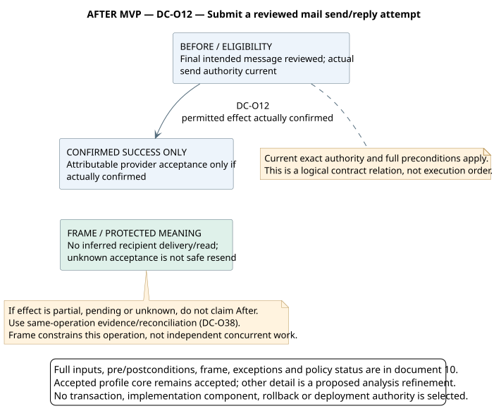

[Editable PlantUML](../diagrams/contract-dc-o12-boundary.puml) · [PNG](../diagrams/contract-dc-o12-boundary.png)

After applies only when the matching permitted success is actually confirmed. The frame constrains this operation; unknown effects do not justify claiming the drawn after-state or universal unchanged before-state.

### DC-O13 — Save a local calendar activity

**Release applicability:** future-domain design retained after MVP; core operating/deployment and recovery controls still apply to MVP where relevant.

**Contract authority:** R. **Acting context:** Activity owner.

**Primary requirements:** [EGC-D07](../../02-requirements-engineering/03-requirements-specification/email-calendar-and-google-integration.md#egc-d07-calendar-activities-and-time-meaning), [EGC-D10](../../02-requirements-engineering/03-requirements-specification/email-calendar-and-google-integration.md#egc-d10-reminders-and-notification-outcomes), [EGC-D11](../../02-requirements-engineering/03-requirements-specification/email-calendar-and-google-integration.md#egc-d11-disconnect-revocation-and-reconnect), [BRL-D10](../../02-requirements-engineering/03-requirements-specification/business-rules-and-data-lifecycle.md#brl-d10-defined-language-and-time-meaning)

**Concepts / responsibilities:** [DM-C22](../02-domain-and-information-analysis/03-domain-model-and-object-oriented-view.md#dm-c22), [DM-C23](../02-domain-and-information-analysis/03-domain-model-and-object-oriented-view.md#dm-c23), [DM-C16](../02-domain-and-information-analysis/03-domain-model-and-object-oriented-view.md#dm-c16). Consult their responsibility catalog; these contracts do not prescribe implementation methods.

**Inputs / target meaning:** Intended local event/deadline/follow-up, time meaning and permitted local associations.

**Preconditions / current authority:** Current local operation authority/validation and required time/context rules; provider write capability not required for local-only change.

**Successful postcondition / result:** Confirmed local change retains intended time/association meaning.

**Frame / information protected from this operation:** No provider mutation, delivery of reminder, email send or application-progress update is implicitly performed.

**Denied / invalid / failed / partial / unknown:** Invalid/ambiguous local inputs rejected/unresolved as appropriate; failed/unknown save does not certify persisted new activity. The shared disposition contract also applies; known pending progress remains distinct from lost outcome.

**Concurrency / repetition:** Concurrent edits need current local context; local save does not erase provider conflict/freshness distinctions.

**Applicable typed constraints:** [DC-I01](#dc-i01), [DC-I09](#dc-i09), [DC-I15](#dc-i15)

**Policy / evidence boundary:** Time rules and actual reminder delivery capability remain proposed/dependent; no storage timezone or reminder backend selected.

**Cross-view provenance:** Interactions: [SB-M08](../04-behavioral-and-scenario-analysis/06-scenario-based-view.md#sb-m08); Source use-case context: [UC-D06](../../02-requirements-engineering/04-scenarios-and-models/user-stories-and-scenarios.md#uc-d06), [UC-D06-ACTIVITY](../../02-requirements-engineering/04-scenarios-and-models/user-stories-and-scenarios.md#uc-d06-activity); Activity context: [CF-M08](../03-functional-and-process-analysis/08-control-flow-based-view.md#cf-m08); Selected activity-step context: [CF-M08-S04](../03-functional-and-process-analysis/08-control-flow-based-view.md#cf-m08-s04), [CF-M08-S05](../03-functional-and-process-analysis/08-control-flow-based-view.md#cf-m08-s05); States: [SM-M10](../04-behavioral-and-scenario-analysis/07-state-based-view.md#sm-m10), [SM-M18](../04-behavioral-and-scenario-analysis/07-state-based-view.md#sm-m18); Decisions: [RB-D01](09-rule-based-view.md#rb-d01), [RB-D08](09-rule-based-view.md#rb-d08), [RB-D17](09-rule-based-view.md#rb-d17), [RB-D18](09-rule-based-view.md#rb-d18).

**Mapping limit:** Selected operation-to-source association; semantic criterion/path completeness still requires cross-view review. Linked transitions include relevant environmental/concurrent/result observations; this contract does not cause every listed transition. No new state edge or external UC is allocated.

**Criterion context:** 12 existing proposed criterion locators belong to the linked primary candidates; exact locator/candidate/source records are preserved in [contract evidence](../evidence/operation-contract-review-2026-11-01.json). This is candidate-level related context, not a claim that this operation satisfies every associated criterion. Primary wording and the 470-locator inventory are unchanged.

### DC-O14 — Unlink a local provider mapping

**Contract authority:** R. **Acting context:** Activity owner.

**Primary requirements:** [EGC-D08](../../02-requirements-engineering/03-requirements-specification/email-calendar-and-google-integration.md#egc-d08-explicit-synchronization-contract), [EGC-D09](../../02-requirements-engineering/03-requirements-specification/email-calendar-and-google-integration.md#egc-d09-application-relationships-preserve-boundaries), [EGC-D11](../../02-requirements-engineering/03-requirements-specification/email-calendar-and-google-integration.md#egc-d11-disconnect-revocation-and-reconnect), [EGC-D12](../../02-requirements-engineering/03-requirements-specification/email-calendar-and-google-integration.md#egc-d12-bounded-failures-recovery-and-feasibility-evidence), [BRL-D07](../../02-requirements-engineering/03-requirements-specification/business-rules-and-data-lifecycle.md#brl-d07-explicit-provider-synchronization-authority)

**Concepts / responsibilities:** [DM-C20](../02-domain-and-information-analysis/03-domain-model-and-object-oriented-view.md#dm-c20), [DM-C22](../02-domain-and-information-analysis/03-domain-model-and-object-oriented-view.md#dm-c22). Consult their responsibility catalog; these contracts do not prescribe implementation methods.

**Inputs / target meaning:** Exact local mapping/association and explicit unlink intention.

**Preconditions / current authority:** Current local unlink authority, identified association and reviewed local reference consequences; active provider connection/write capability is not required.

**Successful postcondition / result:** Confirmed local unlink removes only intended local association under reviewed policy.

**Frame / information protected from this operation:** Does not delete provider event, unrelated local content or grant provider mutation rights.

**Denied / invalid / failed / partial / unknown:** Denied/unknown unlink is not reported completed; provider availability is not used as an invented local-unlink gate. The shared disposition contract also applies; known pending progress remains distinct from lost outcome.

**Concurrency / repetition:** Changed mappings require exact current association check; repeat must reconcile actual unlink rather than delete a different newly linked provider object.

**Applicable typed constraints:** [DC-I01](#dc-i01), [DC-I09](#dc-i09), [DC-I18](#dc-i18)

**Policy / evidence boundary:** Q-D17 detailed local retention/mapping policy remains proposed; provider deletion is a different operation.

**Cross-view provenance:** Interactions: [SB-M08](../04-behavioral-and-scenario-analysis/06-scenario-based-view.md#sb-m08); Source use-case context: [UC-D06](../../02-requirements-engineering/04-scenarios-and-models/user-stories-and-scenarios.md#uc-d06), [UC-D06-SYNC](../../02-requirements-engineering/04-scenarios-and-models/user-stories-and-scenarios.md#uc-d06-sync); Activity context: [CF-M08](../03-functional-and-process-analysis/08-control-flow-based-view.md#cf-m08); Selected activity-step context: [CF-M08-S07](../03-functional-and-process-analysis/08-control-flow-based-view.md#cf-m08-s07), [CF-M08-S09](../03-functional-and-process-analysis/08-control-flow-based-view.md#cf-m08-s09); States: [SM-M10](../04-behavioral-and-scenario-analysis/07-state-based-view.md#sm-m10); Related transitions/observations: [SM-T066](../04-behavioral-and-scenario-analysis/07-state-based-view.md#sm-t066), [SM-T067](../04-behavioral-and-scenario-analysis/07-state-based-view.md#sm-t067); Decisions: [RB-D01](09-rule-based-view.md#rb-d01), [RB-D08](09-rule-based-view.md#rb-d08), [RB-D18](09-rule-based-view.md#rb-d18).

**Mapping limit:** Supporting/upstream lifecycle refinement or adjacent context; step/use-case links are provenance, not complete direct-path coverage. Linked transitions include relevant environmental/concurrent/result observations; this contract does not cause every listed transition. No new state edge or external UC is allocated.

**Criterion context:** 15 existing proposed criterion locators belong to the linked primary candidates; exact locator/candidate/source records are preserved in [contract evidence](../evidence/operation-contract-review-2026-11-01.json). This is candidate-level related context, not a claim that this operation satisfies every associated criterion. Primary wording and the 470-locator inventory are unchanged.

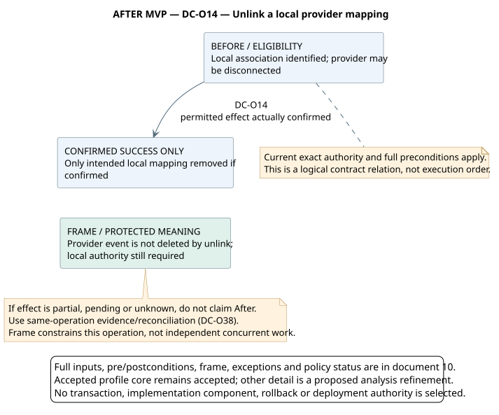

[Editable PlantUML](../diagrams/contract-dc-o14-boundary.puml) · [PNG](../diagrams/contract-dc-o14-boundary.png)

After applies only when the matching permitted success is actually confirmed. The frame constrains this operation; unknown effects do not justify claiming the drawn after-state or universal unchanged before-state.

### DC-O15 — Perform selected provider synchronization

**Contract authority:** R. **Acting context:** Connected activity owner.

**Primary requirements:** [EGC-D08](../../02-requirements-engineering/03-requirements-specification/email-calendar-and-google-integration.md#egc-d08-explicit-synchronization-contract), [EGC-D09](../../02-requirements-engineering/03-requirements-specification/email-calendar-and-google-integration.md#egc-d09-application-relationships-preserve-boundaries), [EGC-D10](../../02-requirements-engineering/03-requirements-specification/email-calendar-and-google-integration.md#egc-d10-reminders-and-notification-outcomes), [EGC-D11](../../02-requirements-engineering/03-requirements-specification/email-calendar-and-google-integration.md#egc-d11-disconnect-revocation-and-reconnect), [EGC-D12](../../02-requirements-engineering/03-requirements-specification/email-calendar-and-google-integration.md#egc-d12-bounded-failures-recovery-and-feasibility-evidence), [BRL-D07](../../02-requirements-engineering/03-requirements-specification/business-rules-and-data-lifecycle.md#brl-d07-explicit-provider-synchronization-authority)

**Concepts / responsibilities:** [DM-C20](../02-domain-and-information-analysis/03-domain-model-and-object-oriented-view.md#dm-c20), [DM-C22](../02-domain-and-information-analysis/03-domain-model-and-object-oriented-view.md#dm-c22), [DM-C16](../02-domain-and-information-analysis/03-domain-model-and-object-oriented-view.md#dm-c16). Consult their responsibility catalog; these contracts do not prescribe implementation methods.

**Inputs / target meaning:** Exact selected account/mapping/action, local/provider versions and applicable field authority.

**Preconditions / current authority:** Current provider capability/context, defined selected direction/action and conflict evaluation; unresolved conflicts cannot be silently overwritten.

**Successful postcondition / result:** Only actual confirmed permitted mapping/provider result establishes applicable fresh/removed state.

**Frame / information protected from this operation:** Local notes/associations outside provider-owned scope survive; reconnect does not automatically replay stale changes.

**Denied / invalid / failed / partial / unknown:** Conflict/stale/missing capability/unknown external effect remains distinct from confirmed synchronized result. The shared disposition contract also applies; known pending progress remains distinct from lost outcome.

**Concurrency / repetition:** Reconcile relevant concurrent versions and exact actual external effect before reviewed resolution/repetition; no last-write-wins assumption.

**Applicable typed constraints:** [DC-I01](#dc-i01), [DC-I09](#dc-i09), [DC-I15](#dc-i15), [DC-I18](#dc-i18)

**Policy / evidence boundary:** OAuth absent; direction/time/deletion/conflict/reminder policy remains Q-D17 proposed.

**Cross-view provenance:** Interactions: [SB-M08](../04-behavioral-and-scenario-analysis/06-scenario-based-view.md#sb-m08); Source use-case context: [UC-D06](../../02-requirements-engineering/04-scenarios-and-models/user-stories-and-scenarios.md#uc-d06), [UC-D06-SYNC](../../02-requirements-engineering/04-scenarios-and-models/user-stories-and-scenarios.md#uc-d06-sync); Activity context: [CF-M08](../03-functional-and-process-analysis/08-control-flow-based-view.md#cf-m08); Selected activity-step context: [CF-M08-S12](../03-functional-and-process-analysis/08-control-flow-based-view.md#cf-m08-s12), [CF-M08-S15](../03-functional-and-process-analysis/08-control-flow-based-view.md#cf-m08-s15); States: [SM-M08](../04-behavioral-and-scenario-analysis/07-state-based-view.md#sm-m08), [SM-M10](../04-behavioral-and-scenario-analysis/07-state-based-view.md#sm-m10); Related transitions/observations: [SM-T059](../04-behavioral-and-scenario-analysis/07-state-based-view.md#sm-t059), [SM-T060](../04-behavioral-and-scenario-analysis/07-state-based-view.md#sm-t060), [SM-T061](../04-behavioral-and-scenario-analysis/07-state-based-view.md#sm-t061), [SM-T062](../04-behavioral-and-scenario-analysis/07-state-based-view.md#sm-t062), [SM-T063](../04-behavioral-and-scenario-analysis/07-state-based-view.md#sm-t063), [SM-T064](../04-behavioral-and-scenario-analysis/07-state-based-view.md#sm-t064), [SM-T065](../04-behavioral-and-scenario-analysis/07-state-based-view.md#sm-t065); Decisions: [RB-D01](09-rule-based-view.md#rb-d01), [RB-D08](09-rule-based-view.md#rb-d08), [RB-D17](09-rule-based-view.md#rb-d17), [RB-D18](09-rule-based-view.md#rb-d18).

**Mapping limit:** Selected operation-to-source association; semantic criterion/path completeness still requires cross-view review. Linked transitions include relevant environmental/concurrent/result observations; this contract does not cause every listed transition. No new state edge or external UC is allocated.

**Criterion context:** 18 existing proposed criterion locators belong to the linked primary candidates; exact locator/candidate/source records are preserved in [contract evidence](../evidence/operation-contract-review-2026-11-01.json). This is candidate-level related context, not a claim that this operation satisfies every associated criterion. Primary wording and the 470-locator inventory are unchanged.

### DC-O16 — Refine a backlog item into tasks

**Contract authority:** R. **Acting context:** Authorized project participant.

**Primary requirements:** [PKS-D03](../../02-requirements-engineering/03-requirements-specification/projects-kanban-and-sprints.md#pks-d03-product-backlog-and-item-definition), [PKS-D04](../../02-requirements-engineering/03-requirements-specification/projects-kanban-and-sprints.md#pks-d04-item-refinement-and-task-relationships), [PKS-D05](../../02-requirements-engineering/03-requirements-specification/projects-kanban-and-sprints.md#pks-d05-assignment-priority-and-due-date-handling), [PKS-D09](../../02-requirements-engineering/03-requirements-specification/projects-kanban-and-sprints.md#pks-d09-explicit-completion-and-sprint-end-outcomes), [PKS-D11](../../02-requirements-engineering/03-requirements-specification/projects-kanban-and-sprints.md#pks-d11-truthful-changes-retirement-and-recovery)

**Concepts / responsibilities:** [DM-C28](../02-domain-and-information-analysis/03-domain-model-and-object-oriented-view.md#dm-c28), [DM-C29](../02-domain-and-information-analysis/03-domain-model-and-object-oriented-view.md#dm-c29), [DM-C24](../02-domain-and-information-analysis/03-domain-model-and-object-oriented-view.md#dm-c24). Consult their responsibility catalog; these contracts do not prescribe implementation methods.

**Inputs / target meaning:** Intended item outcome/criteria and requested task refinement/relationships.

**Preconditions / current authority:** Current exact project/item authority and valid task/reference refinement under reviewed policy.

**Successful postcondition / result:** Confirmed refinement preserves distinguishable item/task meanings and intended relationships.

**Frame / information protected from this operation:** Task decomposition or board arrangement alone does not accept item or alter unrelated Sprint commitments.

**Denied / invalid / failed / partial / unknown:** Denied/invalid/stale refinement rejected; partial/unknown save not labeled fully completed refinement. The shared disposition contract also applies; known pending progress remains distinct from lost outcome.

**Concurrency / repetition:** Recheck changed item/task context and distinguish progress from readiness/acceptance on repeat.

**Applicable typed constraints:** [DC-I01](#dc-i01), [DC-I10](#dc-i10)

**Policy / evidence boundary:** Field/acceptance/readiness policy remains proposed; no numeric task/item limits or new team roles.

**Cross-view provenance:** Interactions: [SB-M09](../04-behavioral-and-scenario-analysis/06-scenario-based-view.md#sb-m09); Source use-case context: [UC-D07](../../02-requirements-engineering/04-scenarios-and-models/user-stories-and-scenarios.md#uc-d07), [UC-D07-REFINE](../../02-requirements-engineering/04-scenarios-and-models/user-stories-and-scenarios.md#uc-d07-refine); Activity context: [CF-M09](../03-functional-and-process-analysis/08-control-flow-based-view.md#cf-m09); Selected activity-step context: [CF-M09-S04](../03-functional-and-process-analysis/08-control-flow-based-view.md#cf-m09-s04), [CF-M09-S05](../03-functional-and-process-analysis/08-control-flow-based-view.md#cf-m09-s05); States: [SM-M11](../04-behavioral-and-scenario-analysis/07-state-based-view.md#sm-m11); Decisions: [RB-D01](09-rule-based-view.md#rb-d01), [RB-D09](09-rule-based-view.md#rb-d09), [RB-D18](09-rule-based-view.md#rb-d18).

**Mapping limit:** Selected operation-to-source association; semantic criterion/path completeness still requires cross-view review. Linked transitions include relevant environmental/concurrent/result observations; this contract does not cause every listed transition. No new state edge or external UC is allocated.

**Criterion context:** 15 existing proposed criterion locators belong to the linked primary candidates; exact locator/candidate/source records are preserved in [contract evidence](../evidence/operation-contract-review-2026-11-01.json). This is candidate-level related context, not a claim that this operation satisfies every associated criterion. Primary wording and the 470-locator inventory are unchanged.

### DC-O17 — Record subject-specific work completion

**Contract authority:** R. **Acting context:** Authorized project participant.

**Primary requirements:** [PKS-D03](../../02-requirements-engineering/03-requirements-specification/projects-kanban-and-sprints.md#pks-d03-product-backlog-and-item-definition), [PKS-D04](../../02-requirements-engineering/03-requirements-specification/projects-kanban-and-sprints.md#pks-d04-item-refinement-and-task-relationships), [PKS-D05](../../02-requirements-engineering/03-requirements-specification/projects-kanban-and-sprints.md#pks-d05-assignment-priority-and-due-date-handling), [PKS-D09](../../02-requirements-engineering/03-requirements-specification/projects-kanban-and-sprints.md#pks-d09-explicit-completion-and-sprint-end-outcomes), [PKS-D11](../../02-requirements-engineering/03-requirements-specification/projects-kanban-and-sprints.md#pks-d11-truthful-changes-retirement-and-recovery)

**Concepts / responsibilities:** [DM-C28](../02-domain-and-information-analysis/03-domain-model-and-object-oriented-view.md#dm-c28), [DM-C29](../02-domain-and-information-analysis/03-domain-model-and-object-oriented-view.md#dm-c29), [DM-C25](../02-domain-and-information-analysis/03-domain-model-and-object-oriented-view.md#dm-c25), [DM-C26](../02-domain-and-information-analysis/03-domain-model-and-object-oriented-view.md#dm-c26). Consult their responsibility catalog; these contracts do not prescribe implementation methods.

**Inputs / target meaning:** Exact task or item, intended current transition and applicable criteria/acceptance evidence.

**Preconditions / current authority:** Current subject/state authority and reviewed subject-specific completion contract; required item acceptance cannot be inferred from all tasks Done.

**Successful postcondition / result:** Confirmed transition/completion pertains only to intended subject; item acceptance is claimed only when its separate applicable criteria are met.

**Frame / information protected from this operation:** Board movement/layout, task completion and item acceptance remain distinct; Sprint goal is not automatically achieved.

**Denied / invalid / failed / partial / unknown:** Incomplete/unsupported correction/unknown evidence is not complete/accepted work; no universal direct transition rule is invented. The shared disposition contract also applies; known pending progress remains distinct from lost outcome.

**Concurrency / repetition:** Changed work/context or reviewed reopening requires explicit conflict/current-state semantics.

**Applicable typed constraints:** [DC-I10](#dc-i10), [DC-I17](#dc-i17)

**Policy / evidence boundary:** SM-F01 readiness is a proposed separate predicate; exact acceptance roles/correction details remain proposed.

**Cross-view provenance:** Interactions: [SB-M09](../04-behavioral-and-scenario-analysis/06-scenario-based-view.md#sb-m09); Source use-case context: [UC-D07](../../02-requirements-engineering/04-scenarios-and-models/user-stories-and-scenarios.md#uc-d07); Activity context: [CF-M09](../03-functional-and-process-analysis/08-control-flow-based-view.md#cf-m09); Selected activity-step context: [CF-M09-S05](../03-functional-and-process-analysis/08-control-flow-based-view.md#cf-m09-s05); States: [SM-M11](../04-behavioral-and-scenario-analysis/07-state-based-view.md#sm-m11); Related transitions/observations: [SM-T068](../04-behavioral-and-scenario-analysis/07-state-based-view.md#sm-t068), [SM-T069](../04-behavioral-and-scenario-analysis/07-state-based-view.md#sm-t069), [SM-T070](../04-behavioral-and-scenario-analysis/07-state-based-view.md#sm-t070); Decisions: [RB-D01](09-rule-based-view.md#rb-d01), [RB-D09](09-rule-based-view.md#rb-d09), [RB-D18](09-rule-based-view.md#rb-d18).

**Mapping limit:** Supporting/upstream lifecycle refinement or adjacent context; step/use-case links are provenance, not complete direct-path coverage. Linked transitions include relevant environmental/concurrent/result observations; this contract does not cause every listed transition. No new state edge or external UC is allocated.

**Criterion context:** 15 existing proposed criterion locators belong to the linked primary candidates; exact locator/candidate/source records are preserved in [contract evidence](../evidence/operation-contract-review-2026-11-01.json). This is candidate-level related context, not a claim that this operation satisfies every associated criterion. Primary wording and the 470-locator inventory are unchanged.

### DC-O18 — Create/adapt a coherent Sprint plan

**Release applicability:** future-domain design retained after MVP; core operating/deployment and recovery controls still apply to MVP where relevant.

**Contract authority:** R. **Acting context:** Authorized project participant.

**Primary requirements:** [PKS-D07](../../02-requirements-engineering/03-requirements-specification/projects-kanban-and-sprints.md#pks-d07-sprint-goal-and-selected-backlog-items), [PKS-D08](../../02-requirements-engineering/03-requirements-specification/projects-kanban-and-sprints.md#pks-d08-one-coherent-sprint-backlog), [PKS-D09](../../02-requirements-engineering/03-requirements-specification/projects-kanban-and-sprints.md#pks-d09-explicit-completion-and-sprint-end-outcomes), [PKS-D11](../../02-requirements-engineering/03-requirements-specification/projects-kanban-and-sprints.md#pks-d11-truthful-changes-retirement-and-recovery)

**Concepts / responsibilities:** [DM-C30](../02-domain-and-information-analysis/03-domain-model-and-object-oriented-view.md#dm-c30), [DM-C31](../02-domain-and-information-analysis/03-domain-model-and-object-oriented-view.md#dm-c31), [DM-C28](../02-domain-and-information-analysis/03-domain-model-and-object-oriented-view.md#dm-c28), [DM-C29](../02-domain-and-information-analysis/03-domain-model-and-object-oriented-view.md#dm-c29), [DM-C24](../02-domain-and-information-analysis/03-domain-model-and-object-oriented-view.md#dm-c24). Consult their responsibility catalog; these contracts do not prescribe implementation methods.

**Inputs / target meaning:** Intended Sprint Goal, selected items, delivery plan and requested start/adaptation.

**Preconditions / current authority:** Current Sprint/project authority/state; explicit valid selection/readiness and coherent plan; start versus adaptation is identified.

**Successful postcondition / result:** Confirmed permitted plan keeps one coherent Sprint Backlog meaning: goal, selected items and delivery plan; actual start only when start is confirmed.

**Frame / information protected from this operation:** No implicit item acceptance, completion, extra team member or automatically fixed future Sprint content.

**Denied / invalid / failed / partial / unknown:** Invalid/stale/incoherent plan cannot claim saved/started Sprint; unknown actual effect must be reconciled. The shared disposition contract also applies; known pending progress remains distinct from lost outcome.

**Concurrency / repetition:** Concurrent selection/plan changes re-evaluate coherent current context rather than silently replacing others.

**Applicable typed constraints:** [DC-I10](#dc-i10)

**Policy / evidence boundary:** Accepted composite meaning retained; cadence/counts/readiness/concurrency details remain proposed.

**Cross-view provenance:** Interactions: [SB-M09](../04-behavioral-and-scenario-analysis/06-scenario-based-view.md#sb-m09); Source use-case context: [UC-D07](../../02-requirements-engineering/04-scenarios-and-models/user-stories-and-scenarios.md#uc-d07), [UC-D07-PLAN](../../02-requirements-engineering/04-scenarios-and-models/user-stories-and-scenarios.md#uc-d07-plan); Activity context: [CF-M09](../03-functional-and-process-analysis/08-control-flow-based-view.md#cf-m09); Selected activity-step context: [CF-M09-S12](../03-functional-and-process-analysis/08-control-flow-based-view.md#cf-m09-s12), [CF-M09-S13](../03-functional-and-process-analysis/08-control-flow-based-view.md#cf-m09-s13), [CF-M09-S15](../03-functional-and-process-analysis/08-control-flow-based-view.md#cf-m09-s15); States: [SM-M12](../04-behavioral-and-scenario-analysis/07-state-based-view.md#sm-m12); Related transitions/observations: [SM-T072](../04-behavioral-and-scenario-analysis/07-state-based-view.md#sm-t072), [SM-T074](../04-behavioral-and-scenario-analysis/07-state-based-view.md#sm-t074); Decisions: [RB-D01](09-rule-based-view.md#rb-d01), [RB-D09](09-rule-based-view.md#rb-d09), [RB-D10](09-rule-based-view.md#rb-d10), [RB-D18](09-rule-based-view.md#rb-d18).

**Mapping limit:** Selected operation-to-source association; semantic criterion/path completeness still requires cross-view review. Linked transitions include relevant environmental/concurrent/result observations; this contract does not cause every listed transition. No new state edge or external UC is allocated.

**Criterion context:** 12 existing proposed criterion locators belong to the linked primary candidates; exact locator/candidate/source records are preserved in [contract evidence](../evidence/operation-contract-review-2026-11-01.json). This is candidate-level related context, not a claim that this operation satisfies every associated criterion. Primary wording and the 470-locator inventory are unchanged.

### DC-O19 — End or cancel a Sprint with actual disposition

**Release applicability:** future-domain design retained after MVP; core operating/deployment and recovery controls still apply to MVP where relevant.

**Contract authority:** R. **Acting context:** Authorized project participant.

**Primary requirements:** [PKS-D07](../../02-requirements-engineering/03-requirements-specification/projects-kanban-and-sprints.md#pks-d07-sprint-goal-and-selected-backlog-items), [PKS-D08](../../02-requirements-engineering/03-requirements-specification/projects-kanban-and-sprints.md#pks-d08-one-coherent-sprint-backlog), [PKS-D09](../../02-requirements-engineering/03-requirements-specification/projects-kanban-and-sprints.md#pks-d09-explicit-completion-and-sprint-end-outcomes), [PKS-D11](../../02-requirements-engineering/03-requirements-specification/projects-kanban-and-sprints.md#pks-d11-truthful-changes-retirement-and-recovery)

**Concepts / responsibilities:** [DM-C30](../02-domain-and-information-analysis/03-domain-model-and-object-oriented-view.md#dm-c30), [DM-C31](../02-domain-and-information-analysis/03-domain-model-and-object-oriented-view.md#dm-c31), [DM-C28](../02-domain-and-information-analysis/03-domain-model-and-object-oriented-view.md#dm-c28), [DM-C29](../02-domain-and-information-analysis/03-domain-model-and-object-oriented-view.md#dm-c29). Consult their responsibility catalog; these contracts do not prescribe implementation methods.

**Inputs / target meaning:** Intended end/cancel action, actual period/goal result and selected-work disposition.

**Preconditions / current authority:** Permitted current period transition and defined truthful outcome/disposition; goal success and all-work-Done are not invented preconditions for end.

**Successful postcondition / result:** Confirmed end/cancel records actual period result and explicit incomplete-work disposition.

**Frame / information protected from this operation:** No automatic acceptance, erasure or carryover of unfinished items; historical Sprint context remains distinguishable.

**Denied / invalid / failed / partial / unknown:** Missing/unknown disposition or failed transition does not establish fully recorded period conclusion. The shared disposition contract also applies; known pending progress remains distinct from lost outcome.

**Concurrency / repetition:** Reconcile concurrent work/period updates; later re-selection is explicit and keeps prior actual context.

**Applicable typed constraints:** [DC-I10](#dc-i10), [DC-I17](#dc-i17)

**Policy / evidence boundary:** Q-D19 ending/carryover/concurrency policy remains proposed; no fixed cadence or calendar schedule selected.

**Cross-view provenance:** Interactions: [SB-M09](../04-behavioral-and-scenario-analysis/06-scenario-based-view.md#sb-m09); Source use-case context: [UC-D07](../../02-requirements-engineering/04-scenarios-and-models/user-stories-and-scenarios.md#uc-d07), [UC-D07-END](../../02-requirements-engineering/04-scenarios-and-models/user-stories-and-scenarios.md#uc-d07-end); Activity context: [CF-M09](../03-functional-and-process-analysis/08-control-flow-based-view.md#cf-m09); Selected activity-step context: [CF-M09-S08](../03-functional-and-process-analysis/08-control-flow-based-view.md#cf-m09-s08), [CF-M09-S09](../03-functional-and-process-analysis/08-control-flow-based-view.md#cf-m09-s09), [CF-M09-S10](../03-functional-and-process-analysis/08-control-flow-based-view.md#cf-m09-s10); States: [SM-M12](../04-behavioral-and-scenario-analysis/07-state-based-view.md#sm-m12); Related transitions/observations: [SM-T073](../04-behavioral-and-scenario-analysis/07-state-based-view.md#sm-t073), [SM-T075](../04-behavioral-and-scenario-analysis/07-state-based-view.md#sm-t075), [SM-T076](../04-behavioral-and-scenario-analysis/07-state-based-view.md#sm-t076); Decisions: [RB-D01](09-rule-based-view.md#rb-d01), [RB-D10](09-rule-based-view.md#rb-d10), [RB-D18](09-rule-based-view.md#rb-d18).

**Mapping limit:** Selected operation-to-source association; semantic criterion/path completeness still requires cross-view review. Linked transitions include relevant environmental/concurrent/result observations; this contract does not cause every listed transition. No new state edge or external UC is allocated.

**Criterion context:** 12 existing proposed criterion locators belong to the linked primary candidates; exact locator/candidate/source records are preserved in [contract evidence](../evidence/operation-contract-review-2026-11-01.json). This is candidate-level related context, not a claim that this operation satisfies every associated criterion. Primary wording and the 470-locator inventory are unchanged.

### DC-O20 — Accept an eligible resource invitation

**Contract authority:** R. **Acting context:** Intended invitation recipient.

**Primary requirements:** [ACC-D03](../../02-requirements-engineering/03-requirements-specification/accounts-authentication-and-permissions.md#acc-d03-resource-and-operation-authorization), [ACC-D04](../../02-requirements-engineering/03-requirements-specification/accounts-authentication-and-permissions.md#acc-d04-cross-user-private-data-isolation), [ACC-D05](../../02-requirements-engineering/03-requirements-specification/accounts-authentication-and-permissions.md#acc-d05-limited-collaboration-authority), [ACC-D10](../../02-requirements-engineering/03-requirements-specification/accounts-authentication-and-permissions.md#acc-d10-authorization-of-access-grant-changes), [ACC-D12](../../02-requirements-engineering/03-requirements-specification/accounts-authentication-and-permissions.md#acc-d12-end-of-access-and-lifecycle-enforcement), [PKS-D06](../../02-requirements-engineering/03-requirements-specification/projects-kanban-and-sprints.md#pks-d06-scoped-collaboration-and-membership-changes), [GIT-D02](../../02-requirements-engineering/03-requirements-specification/git-hosting-and-collaboration.md#git-d02-repository-and-ref-authorization)

**Concepts / responsibilities:** [DM-C48](../02-domain-and-information-analysis/03-domain-model-and-object-oriented-view.md#dm-c48), [DM-C47](../02-domain-and-information-analysis/03-domain-model-and-object-oriented-view.md#dm-c47), [DM-C24](../02-domain-and-information-analysis/03-domain-model-and-object-oriented-view.md#dm-c24), [DM-C32](../02-domain-and-information-analysis/03-domain-model-and-object-oriented-view.md#dm-c32). Consult their responsibility catalog; these contracts do not prescribe implementation methods.

**Inputs / target meaning:** Exact invitation, intended resource/action scope and recipient acceptance.

**Preconditions / current authority:** Intended recipient/eligibility and reviewed invitation policy valid; pending invitation or sign-in alone is not effective membership.

**Successful postcondition / result:** Only actually confirmed acceptance/grant establishes intended current scoped resource rights.

**Frame / information protected from this operation:** No unrelated resumes/mail/repositories/secrets or universal administration rights are granted.

**Denied / invalid / failed / partial / unknown:** Ineligible/expired/denied or persistence-unconfirmed invitation cannot claim active membership. The shared disposition contract also applies; known pending progress remains distinct from lost outcome.

**Concurrency / repetition:** Recheck invitation/current resource grant; repeat acceptance must not widen scope or resurrect revoked rights.

**Applicable typed constraints:** [DC-I01](#dc-i01), [DC-I08](#dc-i08)

**Policy / evidence boundary:** Detailed roles, invitation expiry and account onboarding remain proposed; no duration or role hierarchy invented.

**Cross-view provenance:** Interactions: [SB-M10](../04-behavioral-and-scenario-analysis/06-scenario-based-view.md#sb-m10); Source use-case context: [UC-D08](../../02-requirements-engineering/04-scenarios-and-models/user-stories-and-scenarios.md#uc-d08); Activity context: [CF-M10](../03-functional-and-process-analysis/08-control-flow-based-view.md#cf-m10); Selected activity-step context: [CF-M10-S03](../03-functional-and-process-analysis/08-control-flow-based-view.md#cf-m10-s03), [CF-M10-S04](../03-functional-and-process-analysis/08-control-flow-based-view.md#cf-m10-s04); States: [SM-M03](../04-behavioral-and-scenario-analysis/07-state-based-view.md#sm-m03); Related transitions/observations: [SM-T013](../04-behavioral-and-scenario-analysis/07-state-based-view.md#sm-t013), [SM-T014](../04-behavioral-and-scenario-analysis/07-state-based-view.md#sm-t014); Decisions: [RB-D01](09-rule-based-view.md#rb-d01), [RB-D18](09-rule-based-view.md#rb-d18).

**Mapping limit:** Selected operation-to-source association; semantic criterion/path completeness still requires cross-view review. Linked transitions include relevant environmental/concurrent/result observations; this contract does not cause every listed transition. No new state edge or external UC is allocated.

**Criterion context:** 20 existing proposed criterion locators belong to the linked primary candidates; exact locator/candidate/source records are preserved in [contract evidence](../evidence/operation-contract-review-2026-11-01.json). This is candidate-level related context, not a claim that this operation satisfies every associated criterion. Primary wording and the 470-locator inventory are unchanged.

### DC-O21 — Change or revoke an exact resource grant

**Contract authority:** R. **Acting context:** Authorized grant controller.

**Primary requirements:** [ACC-D03](../../02-requirements-engineering/03-requirements-specification/accounts-authentication-and-permissions.md#acc-d03-resource-and-operation-authorization), [ACC-D04](../../02-requirements-engineering/03-requirements-specification/accounts-authentication-and-permissions.md#acc-d04-cross-user-private-data-isolation), [ACC-D05](../../02-requirements-engineering/03-requirements-specification/accounts-authentication-and-permissions.md#acc-d05-limited-collaboration-authority), [ACC-D10](../../02-requirements-engineering/03-requirements-specification/accounts-authentication-and-permissions.md#acc-d10-authorization-of-access-grant-changes), [ACC-D12](../../02-requirements-engineering/03-requirements-specification/accounts-authentication-and-permissions.md#acc-d12-end-of-access-and-lifecycle-enforcement), [PKS-D06](../../02-requirements-engineering/03-requirements-specification/projects-kanban-and-sprints.md#pks-d06-scoped-collaboration-and-membership-changes), [GIT-D02](../../02-requirements-engineering/03-requirements-specification/git-hosting-and-collaboration.md#git-d02-repository-and-ref-authorization)

**Concepts / responsibilities:** [DM-C48](../02-domain-and-information-analysis/03-domain-model-and-object-oriented-view.md#dm-c48), [DM-C47](../02-domain-and-information-analysis/03-domain-model-and-object-oriented-view.md#dm-c47), [DM-C24](../02-domain-and-information-analysis/03-domain-model-and-object-oriented-view.md#dm-c24), [DM-C32](../02-domain-and-information-analysis/03-domain-model-and-object-oriented-view.md#dm-c32). Consult their responsibility catalog; these contracts do not prescribe implementation methods.

**Inputs / target meaning:** Exact target grant/resource/action rights and explicit change/revoke request.

**Preconditions / current authority:** Current exact grant-management power and reviewed state/reference constraints; no universal admin assumption.

**Successful postcondition / result:** Confirmed effective grant change governs subsequent applicable checks for that exact scope.

**Frame / information protected from this operation:** Unrelated resource grants and protected content outside operation scope remain unaffected; restoration does not silently reinstate old grant.

**Denied / invalid / failed / partial / unknown:** Unconfirmed persistence is not effective revocation; already delivered copies are not recalled; actual partial/unknown effects remain explicit. The shared disposition contract also applies; known pending progress remains distinct from lost outcome.

**Concurrency / repetition:** Re-evaluate changed rights/current request context; ongoing-operation/session behavior follows scoped reviewed policy.

**Applicable typed constraints:** [DC-I01](#dc-i01), [DC-I08](#dc-i08), [DC-I18](#dc-i18)

**Policy / evidence boundary:** Q-D04/Q-D05 detailed management and in-flight policy remains proposed; no new role/count/session timeout.

**Cross-view provenance:** Interactions: [SB-M10](../04-behavioral-and-scenario-analysis/06-scenario-based-view.md#sb-m10); Source use-case context: [UC-D08](../../02-requirements-engineering/04-scenarios-and-models/user-stories-and-scenarios.md#uc-d08); Activity context: [CF-M10](../03-functional-and-process-analysis/08-control-flow-based-view.md#cf-m10); Selected activity-step context: [CF-M10-S07](../03-functional-and-process-analysis/08-control-flow-based-view.md#cf-m10-s07); States: [SM-M03](../04-behavioral-and-scenario-analysis/07-state-based-view.md#sm-m03); Related transitions/observations: [SM-T015](../04-behavioral-and-scenario-analysis/07-state-based-view.md#sm-t015), [SM-T016](../04-behavioral-and-scenario-analysis/07-state-based-view.md#sm-t016); Decisions: [RB-D01](09-rule-based-view.md#rb-d01), [RB-D18](09-rule-based-view.md#rb-d18).

**Mapping limit:** Supporting/upstream lifecycle refinement or adjacent context; step/use-case links are provenance, not complete direct-path coverage. Linked transitions include relevant environmental/concurrent/result observations; this contract does not cause every listed transition. No new state edge or external UC is allocated.

**Criterion context:** 20 existing proposed criterion locators belong to the linked primary candidates; exact locator/candidate/source records are preserved in [contract evidence](../evidence/operation-contract-review-2026-11-01.json). This is candidate-level related context, not a claim that this operation satisfies every associated criterion. Primary wording and the 470-locator inventory are unchanged.

### DC-O22 — Read-transfer a real Git repository

**Contract authority:** R. **Acting context:** Authorized Git client/user.

**Primary requirements:** [GIT-D02](../../02-requirements-engineering/03-requirements-specification/git-hosting-and-collaboration.md#git-d02-repository-and-ref-authorization), [GIT-D03](../../02-requirements-engineering/03-requirements-specification/git-hosting-and-collaboration.md#git-d03-real-clone-fetch-pull-and-push), [EIF-D06](../../02-requirements-engineering/03-requirements-specification/external-interface-requirements.md#eif-d06-real-git-client-interoperability), [EIF-D08](../../02-requirements-engineering/03-requirements-specification/external-interface-requirements.md#eif-d08-operation-specific-failure-and-repetition-semantics)

**Concepts / responsibilities:** [DM-C32](../02-domain-and-information-analysis/03-domain-model-and-object-oriented-view.md#dm-c32), [DM-C34](../02-domain-and-information-analysis/03-domain-model-and-object-oriented-view.md#dm-c34), [DM-C33](../02-domain-and-information-analysis/03-domain-model-and-object-oriented-view.md#dm-c33), [DM-C48](../02-domain-and-information-analysis/03-domain-model-and-object-oriented-view.md#dm-c48). Consult their responsibility catalog; these contracts do not prescribe implementation methods.

**Inputs / target meaning:** Intended real repository/ref and supported read-transfer request.

**Preconditions / current authority:** Actually supported client/transport and current exact repository/ref read permission.

**Successful postcondition / result:** Only actual authorized real content transfer/completion is reported.

**Frame / information protected from this operation:** No repository/ref mutation, merge approval, workflow execution or deployment is implied by read access.

**Denied / invalid / failed / partial / unknown:** Protected/wrong resource denied; interrupted/failed transfer is not complete; no fictitious real-Git interoperability claim. The shared disposition contract also applies; known pending progress remains distinct from lost outcome.

**Concurrency / repetition:** Current applicable grant/ref context governs transfer; retry is bounded to intended read and actual supported behavior.

**Applicable typed constraints:** [DC-I01](#dc-i01), [DC-I08](#dc-i08), [DC-I11](#dc-i11)

**Policy / evidence boundary:** Q-D21 transport/credentials/protection and real interoperability evidence remain design/dependent work.

**Cross-view provenance:** Interactions: [SB-M11](../04-behavioral-and-scenario-analysis/06-scenario-based-view.md#sb-m11); Source use-case context: [UC-D09](../../02-requirements-engineering/04-scenarios-and-models/user-stories-and-scenarios.md#uc-d09), [UC-D09-CLONE](../../02-requirements-engineering/04-scenarios-and-models/user-stories-and-scenarios.md#uc-d09-clone); Activity context: [CF-M11](../03-functional-and-process-analysis/08-control-flow-based-view.md#cf-m11); Selected activity-step context: [CF-M11-S04](../03-functional-and-process-analysis/08-control-flow-based-view.md#cf-m11-s04), [CF-M11-S05](../03-functional-and-process-analysis/08-control-flow-based-view.md#cf-m11-s05); States: [SM-M03](../04-behavioral-and-scenario-analysis/07-state-based-view.md#sm-m03), [SM-M18](../04-behavioral-and-scenario-analysis/07-state-based-view.md#sm-m18); Decisions: [RB-D01](09-rule-based-view.md#rb-d01), [RB-D18](09-rule-based-view.md#rb-d18).

**Mapping limit:** Selected operation-to-source association; semantic criterion/path completeness still requires cross-view review. Linked transitions include relevant environmental/concurrent/result observations; this contract does not cause every listed transition. No new state edge or external UC is allocated.

**Criterion context:** 12 existing proposed criterion locators belong to the linked primary candidates; exact locator/candidate/source records are preserved in [contract evidence](../evidence/operation-contract-review-2026-11-01.json). This is candidate-level related context, not a claim that this operation satisfies every associated criterion. Primary wording and the 470-locator inventory are unchanged.

### DC-O23 — Push an intended real Git ref update

**Contract authority:** R. **Acting context:** Authorized Git writer/client.

**Primary requirements:** [GIT-D02](../../02-requirements-engineering/03-requirements-specification/git-hosting-and-collaboration.md#git-d02-repository-and-ref-authorization), [GIT-D03](../../02-requirements-engineering/03-requirements-specification/git-hosting-and-collaboration.md#git-d03-real-clone-fetch-pull-and-push), [GIT-D04](../../02-requirements-engineering/03-requirements-specification/git-hosting-and-collaboration.md#git-d04-branches-files-and-history-browsing), [EIF-D06](../../02-requirements-engineering/03-requirements-specification/external-interface-requirements.md#eif-d06-real-git-client-interoperability), [EIF-D08](../../02-requirements-engineering/03-requirements-specification/external-interface-requirements.md#eif-d08-operation-specific-failure-and-repetition-semantics)

**Concepts / responsibilities:** [DM-C32](../02-domain-and-information-analysis/03-domain-model-and-object-oriented-view.md#dm-c32), [DM-C34](../02-domain-and-information-analysis/03-domain-model-and-object-oriented-view.md#dm-c34), [DM-C33](../02-domain-and-information-analysis/03-domain-model-and-object-oriented-view.md#dm-c33), [DM-C48](../02-domain-and-information-analysis/03-domain-model-and-object-oriented-view.md#dm-c48). Consult their responsibility catalog; these contracts do not prescribe implementation methods.

**Inputs / target meaning:** Exact repository/ref, proposed change and expected current context.

**Preconditions / current authority:** Current write/protected-ref authority and valid intended update against actual relevant current ref conditions.

**Successful postcondition / result:** Only actual confirmed intended ref result is reported as updated.

**Frame / information protected from this operation:** No unrelated ref change, PR merge acceptance, workflow enablement or target deployment authority is inferred.

**Denied / invalid / failed / partial / unknown:** Denied/protected/stale update rejected; interrupted/partial/unknown ref result reconciled rather than assumed unchanged. The shared disposition contract also applies; known pending progress remains distinct from lost outcome.

**Concurrency / repetition:** Re-evaluate changed refs/current permission; unknown prior push effect needs actual-ref reconciliation before consequential repeat.

**Applicable typed constraints:** [DC-I01](#dc-i01), [DC-I08](#dc-i08), [DC-I11](#dc-i11), [DC-I18](#dc-i18)

**Policy / evidence boundary:** Transport/protection/repetition policy remains proposed; no Git hosting storage/transport engine selected.

**Cross-view provenance:** Interactions: [SB-M11](../04-behavioral-and-scenario-analysis/06-scenario-based-view.md#sb-m11); Source use-case context: [UC-D09](../../02-requirements-engineering/04-scenarios-and-models/user-stories-and-scenarios.md#uc-d09), [UC-D09-PUSH](../../02-requirements-engineering/04-scenarios-and-models/user-stories-and-scenarios.md#uc-d09-push); Activity context: [CF-M11](../03-functional-and-process-analysis/08-control-flow-based-view.md#cf-m11); Selected activity-step context: [CF-M11-S09](../03-functional-and-process-analysis/08-control-flow-based-view.md#cf-m11-s09), [CF-M11-S10](../03-functional-and-process-analysis/08-control-flow-based-view.md#cf-m11-s10), [CF-M11-S12](../03-functional-and-process-analysis/08-control-flow-based-view.md#cf-m11-s12); States: [SM-M13](../04-behavioral-and-scenario-analysis/07-state-based-view.md#sm-m13), [SM-M18](../04-behavioral-and-scenario-analysis/07-state-based-view.md#sm-m18); Decisions: [RB-D01](09-rule-based-view.md#rb-d01), [RB-D11](09-rule-based-view.md#rb-d11), [RB-D18](09-rule-based-view.md#rb-d18).

**Mapping limit:** Selected operation-to-source association; semantic criterion/path completeness still requires cross-view review. Linked transitions include relevant environmental/concurrent/result observations; this contract does not cause every listed transition. No new state edge or external UC is allocated.

**Criterion context:** 15 existing proposed criterion locators belong to the linked primary candidates; exact locator/candidate/source records are preserved in [contract evidence](../evidence/operation-contract-review-2026-11-01.json). This is candidate-level related context, not a claim that this operation satisfies every associated criterion. Primary wording and the 470-locator inventory are unchanged.

### DC-O24 — Open a source/target integration request

**Contract authority:** R. **Acting context:** Authorized repository participant.

**Primary requirements:** [GIT-D05](../../02-requirements-engineering/03-requirements-specification/git-hosting-and-collaboration.md#git-d05-fork-provenance-and-permission-boundaries), [GIT-D06](../../02-requirements-engineering/03-requirements-specification/git-hosting-and-collaboration.md#git-d06-pull-requests-comments-and-review), [GIT-D07](../../02-requirements-engineering/03-requirements-specification/git-hosting-and-collaboration.md#git-d07-controlled-merge-and-conflict-outcomes)

**Concepts / responsibilities:** [DM-C32](../02-domain-and-information-analysis/03-domain-model-and-object-oriented-view.md#dm-c32), [DM-C34](../02-domain-and-information-analysis/03-domain-model-and-object-oriented-view.md#dm-c34), [DM-C33](../02-domain-and-information-analysis/03-domain-model-and-object-oriented-view.md#dm-c33), [DM-C35](../02-domain-and-information-analysis/03-domain-model-and-object-oriented-view.md#dm-c35). Consult their responsibility catalog; these contracts do not prescribe implementation methods.

**Inputs / target meaning:** Intended repository/source/target and request context.

**Preconditions / current authority:** Current exact request-creation permission and valid identified source/target relationships.

**Successful postcondition / result:** Confirmed request retains intended source/target context for later evaluation.

**Frame / information protected from this operation:** Does not itself integrate refs, satisfy review/check policy or authorize deployment.

**Denied / invalid / failed / partial / unknown:** Invalid/denied/unconfirmed creation does not claim an actual current open request. The shared disposition contract also applies; known pending progress remains distinct from lost outcome.

**Concurrency / repetition:** Concurrent ref changes remain distinguishable for later reevaluation; repeat creation must not invent uniqueness/deduplication policy.

**Applicable typed constraints:** [DC-I01](#dc-i01), [DC-I11](#dc-i11), [DC-I18](#dc-i18)

**Policy / evidence boundary:** Detailed request/review policy remains proposed; SM-M13 initial Open is a context, not an invented creation transition.

**Cross-view provenance:** Interactions: [SB-M12](../04-behavioral-and-scenario-analysis/06-scenario-based-view.md#sb-m12); Source use-case context: [UC-D09](../../02-requirements-engineering/04-scenarios-and-models/user-stories-and-scenarios.md#uc-d09), [UC-D09-REQUEST](../../02-requirements-engineering/04-scenarios-and-models/user-stories-and-scenarios.md#uc-d09-request); Activity context: [CF-M12](../03-functional-and-process-analysis/08-control-flow-based-view.md#cf-m12); Selected activity-step context: [CF-M12-S15](../03-functional-and-process-analysis/08-control-flow-based-view.md#cf-m12-s15); States: [SM-M13](../04-behavioral-and-scenario-analysis/07-state-based-view.md#sm-m13); Decisions: [RB-D01](09-rule-based-view.md#rb-d01), [RB-D11](09-rule-based-view.md#rb-d11), [RB-D18](09-rule-based-view.md#rb-d18).

**Mapping limit:** Selected operation-to-source association; semantic criterion/path completeness still requires cross-view review. Linked transitions include relevant environmental/concurrent/result observations; this contract does not cause every listed transition. No new state edge or external UC is allocated.

**Criterion context:** 9 existing proposed criterion locators belong to the linked primary candidates; exact locator/candidate/source records are preserved in [contract evidence](../evidence/operation-contract-review-2026-11-01.json). This is candidate-level related context, not a claim that this operation satisfies every associated criterion. Primary wording and the 470-locator inventory are unchanged.

### DC-O25 — Record review/comment on evaluated revision

**Contract authority:** R. **Acting context:** Authorized reviewer/participant.

**Primary requirements:** [GIT-D05](../../02-requirements-engineering/03-requirements-specification/git-hosting-and-collaboration.md#git-d05-fork-provenance-and-permission-boundaries), [GIT-D06](../../02-requirements-engineering/03-requirements-specification/git-hosting-and-collaboration.md#git-d06-pull-requests-comments-and-review), [GIT-D07](../../02-requirements-engineering/03-requirements-specification/git-hosting-and-collaboration.md#git-d07-controlled-merge-and-conflict-outcomes), [GIT-D09](../../02-requirements-engineering/03-requirements-specification/git-hosting-and-collaboration.md#git-d09-tags-and-releases)

**Concepts / responsibilities:** [DM-C32](../02-domain-and-information-analysis/03-domain-model-and-object-oriented-view.md#dm-c32), [DM-C33](../02-domain-and-information-analysis/03-domain-model-and-object-oriented-view.md#dm-c33), [DM-C35](../02-domain-and-information-analysis/03-domain-model-and-object-oriented-view.md#dm-c35), [DM-C36](../02-domain-and-information-analysis/03-domain-model-and-object-oriented-view.md#dm-c36). Consult their responsibility catalog; these contracts do not prescribe implementation methods.

**Inputs / target meaning:** Exact request, evaluated source/target revision context and attributable review/comment.

**Preconditions / current authority:** Current reviewed/comment operation authority and identifiable evaluated context; no second person/count assumed.

**Successful postcondition / result:** Confirmed feedback remains attributable to evaluated revision context; changing refs requires eligibility reevaluation.

**Frame / information protected from this operation:** Review/comment alone does not mutate integrated target or provide deployment authority.

**Denied / invalid / failed / partial / unknown:** Denied/stale/unconfirmed record cannot be shown as actual current merge eligibility. The shared disposition contract also applies; known pending progress remains distinct from lost outcome.

**Concurrency / repetition:** Source/target changes invalidate/re-evaluate applicable review/check meaning under reviewed policy; repeat record keeps attribution.

**Applicable typed constraints:** [DC-I01](#dc-i01), [DC-I11](#dc-i11)

**Policy / evidence boundary:** Q-D22 review validity, counts and solo exception remain proposed; no merge strategy selected.

**Cross-view provenance:** Interactions: [SB-M12](../04-behavioral-and-scenario-analysis/06-scenario-based-view.md#sb-m12); Source use-case context: [UC-D09](../../02-requirements-engineering/04-scenarios-and-models/user-stories-and-scenarios.md#uc-d09), [UC-D09-REVIEW](../../02-requirements-engineering/04-scenarios-and-models/user-stories-and-scenarios.md#uc-d09-review); Activity context: [CF-M12](../03-functional-and-process-analysis/08-control-flow-based-view.md#cf-m12); Selected activity-step context: [CF-M12-S13](../03-functional-and-process-analysis/08-control-flow-based-view.md#cf-m12-s13); States: [SM-M13](../04-behavioral-and-scenario-analysis/07-state-based-view.md#sm-m13); Related transitions/observations: [SM-T077](../04-behavioral-and-scenario-analysis/07-state-based-view.md#sm-t077), [SM-T078](../04-behavioral-and-scenario-analysis/07-state-based-view.md#sm-t078); Decisions: [RB-D01](09-rule-based-view.md#rb-d01), [RB-D11](09-rule-based-view.md#rb-d11), [RB-D18](09-rule-based-view.md#rb-d18).

**Mapping limit:** Selected operation-to-source association; semantic criterion/path completeness still requires cross-view review. Linked transitions include relevant environmental/concurrent/result observations; this contract does not cause every listed transition. No new state edge or external UC is allocated.

**Criterion context:** 12 existing proposed criterion locators belong to the linked primary candidates; exact locator/candidate/source records are preserved in [contract evidence](../evidence/operation-contract-review-2026-11-01.json). This is candidate-level related context, not a claim that this operation satisfies every associated criterion. Primary wording and the 470-locator inventory are unchanged.

### DC-O26 — Merge only current eligible evaluated revisions

**Contract authority:** R. **Acting context:** Authorized integrator.

**Primary requirements:** [GIT-D02](../../02-requirements-engineering/03-requirements-specification/git-hosting-and-collaboration.md#git-d02-repository-and-ref-authorization), [GIT-D05](../../02-requirements-engineering/03-requirements-specification/git-hosting-and-collaboration.md#git-d05-fork-provenance-and-permission-boundaries), [GIT-D06](../../02-requirements-engineering/03-requirements-specification/git-hosting-and-collaboration.md#git-d06-pull-requests-comments-and-review), [GIT-D07](../../02-requirements-engineering/03-requirements-specification/git-hosting-and-collaboration.md#git-d07-controlled-merge-and-conflict-outcomes), [GIT-D09](../../02-requirements-engineering/03-requirements-specification/git-hosting-and-collaboration.md#git-d09-tags-and-releases)

**Concepts / responsibilities:** [DM-C32](../02-domain-and-information-analysis/03-domain-model-and-object-oriented-view.md#dm-c32), [DM-C34](../02-domain-and-information-analysis/03-domain-model-and-object-oriented-view.md#dm-c34), [DM-C33](../02-domain-and-information-analysis/03-domain-model-and-object-oriented-view.md#dm-c33), [DM-C35](../02-domain-and-information-analysis/03-domain-model-and-object-oriented-view.md#dm-c35), [DM-C36](../02-domain-and-information-analysis/03-domain-model-and-object-oriented-view.md#dm-c36). Consult their responsibility catalog; these contracts do not prescribe implementation methods.

**Inputs / target meaning:** Exact intended request/source/target revisions and required current review/check evidence.

**Preconditions / current authority:** Current exact merge authority, evaluated revisions current and applicable conflict/review/check conditions satisfied at consequential action.

**Successful postcondition / result:** Only actual confirmed intended integration/ref effect establishes merged result.

**Frame / information protected from this operation:** No unrelated refs, stale-approval reuse, workflow admission or target deployment permission follows automatically.

**Denied / invalid / failed / partial / unknown:** Conflict/denial prevents eligible merge; failed/partial/unknown integration does not prove target unchanged or request still Open. The shared disposition contract also applies; known pending progress remains distinct from lost outcome.

**Concurrency / repetition:** Changed source/target requires reevaluation; reconcile actual refs and attributable integration before repeat.

**Applicable typed constraints:** [DC-I08](#dc-i08), [DC-I11](#dc-i11), [DC-I18](#dc-i18)

**Policy / evidence boundary:** Q-D22 strategy/review policy remains proposed; no transaction/locking/merge algorithm selected.

**Cross-view provenance:** Interactions: [SB-M12](../04-behavioral-and-scenario-analysis/06-scenario-based-view.md#sb-m12); Source use-case context: [UC-D09](../../02-requirements-engineering/04-scenarios-and-models/user-stories-and-scenarios.md#uc-d09), [UC-D09-MERGE](../../02-requirements-engineering/04-scenarios-and-models/user-stories-and-scenarios.md#uc-d09-merge); Activity context: [CF-M12](../03-functional-and-process-analysis/08-control-flow-based-view.md#cf-m12); Selected activity-step context: [CF-M12-S04](../03-functional-and-process-analysis/08-control-flow-based-view.md#cf-m12-s04), [CF-M12-S05](../03-functional-and-process-analysis/08-control-flow-based-view.md#cf-m12-s05), [CF-M12-S07](../03-functional-and-process-analysis/08-control-flow-based-view.md#cf-m12-s07); States: [SM-M13](../04-behavioral-and-scenario-analysis/07-state-based-view.md#sm-m13); Related transitions/observations: [SM-T078](../04-behavioral-and-scenario-analysis/07-state-based-view.md#sm-t078), [SM-T079](../04-behavioral-and-scenario-analysis/07-state-based-view.md#sm-t079); Decisions: [RB-D01](09-rule-based-view.md#rb-d01), [RB-D11](09-rule-based-view.md#rb-d11), [RB-D18](09-rule-based-view.md#rb-d18).

**Mapping limit:** Selected operation-to-source association; semantic criterion/path completeness still requires cross-view review. Linked transitions include relevant environmental/concurrent/result observations; this contract does not cause every listed transition. No new state edge or external UC is allocated.

**Criterion context:** 15 existing proposed criterion locators belong to the linked primary candidates; exact locator/candidate/source records are preserved in [contract evidence](../evidence/operation-contract-review-2026-11-01.json). This is candidate-level related context, not a claim that this operation satisfies every associated criterion. Primary wording and the 470-locator inventory are unchanged.

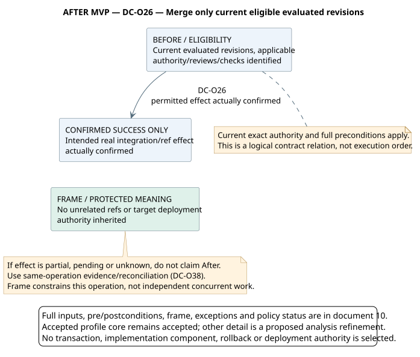

[Editable PlantUML](../diagrams/contract-dc-o26-boundary.puml) · [PNG](../diagrams/contract-dc-o26-boundary.png)

After applies only when the matching permitted success is actually confirmed. The frame constrains this operation; unknown effects do not justify claiming the drawn after-state or universal unchanged before-state.

### DC-O27 — Admit a gated attributable workflow attempt

**Release applicability:** future-domain design retained after MVP; core operating/deployment and recovery controls still apply to MVP where relevant.

**Contract authority:** R. **Acting context:** Authorized trigger/actor.

**Primary requirements:** [YML-D01](../../02-requirements-engineering/03-requirements-specification/yaml-workflows-and-cicd.md#yml-d01-defined-supported-workflow-contract), [YML-D02](../../02-requirements-engineering/03-requirements-specification/yaml-workflows-and-cicd.md#yml-d02-explicit-triggers-and-run-authority), [YML-D03](../../02-requirements-engineering/03-requirements-specification/yaml-workflows-and-cicd.md#yml-d03-run-identity-and-reproducible-context), [YML-D04](../../02-requirements-engineering/03-requirements-specification/yaml-workflows-and-cicd.md#yml-d04-isolation-and-untrusted-code-boundary), [YML-D05](../../02-requirements-engineering/03-requirements-specification/yaml-workflows-and-cicd.md#yml-d05-scoped-secrets-and-credentials), [YML-D06](../../02-requirements-engineering/03-requirements-specification/yaml-workflows-and-cicd.md#yml-d06-resource-admission-and-limits), [YML-D07](../../02-requirements-engineering/03-requirements-specification/yaml-workflows-and-cicd.md#yml-d07-truthful-run-and-step-outcomes), [YML-D08](../../02-requirements-engineering/03-requirements-specification/yaml-workflows-and-cicd.md#yml-d08-restricted-logs-and-artifacts), [YML-D09](../../02-requirements-engineering/03-requirements-specification/yaml-workflows-and-cicd.md#yml-d09-cancellation-retry-and-runner-loss-recovery), [YML-D11](../../02-requirements-engineering/03-requirements-specification/yaml-workflows-and-cicd.md#yml-d11-workspace-cleanup-and-retained-evidence), [YML-D12](../../02-requirements-engineering/03-requirements-specification/yaml-workflows-and-cicd.md#yml-d12-feasibility-operational-guidance-and-enabling-gate)

**Concepts / responsibilities:** [DM-C40](../02-domain-and-information-analysis/03-domain-model-and-object-oriented-view.md#dm-c40), [DM-C41](../02-domain-and-information-analysis/03-domain-model-and-object-oriented-view.md#dm-c41), [DM-C42](../02-domain-and-information-analysis/03-domain-model-and-object-oriented-view.md#dm-c42), [DM-C43](../02-domain-and-information-analysis/03-domain-model-and-object-oriented-view.md#dm-c43), [DM-C44](../02-domain-and-information-analysis/03-domain-model-and-object-oriented-view.md#dm-c44). Consult their responsibility catalog; these contracts do not prescribe implementation methods.

**Inputs / target meaning:** Supported exact definition, evaluated code/revision, scoped intended resources/secrets and trigger context.

**Preconditions / current authority:** Actual enabling isolation/resource/security evidence and exact execution authority/definition contract valid before dependent execution.

**Successful postcondition / result:** Admitted attributable run/attempt retains evaluated context; actual start/success/failure/output availability is reported only from matching evidence.

**Frame / information protected from this operation:** No implied target deployment, universal secret access or use of demo host as proven safe untrusted runner.

**Denied / invalid / failed / partial / unknown:** Missing authority/enabling evidence blocks execution; pending/failed/lost runner result remains truthful and may be unknown. The shared disposition contract also applies; known pending progress remains distinct from lost outcome.

**Concurrency / repetition:** Current definition/code/authority changes require reevaluation; observation of same live attempt is not a relaunch.

**Applicable typed constraints:** [DC-I08](#dc-i08), [DC-I11](#dc-i11), [DC-I12](#dc-i12), [DC-I17](#dc-i17)

**Policy / evidence boundary:** Safe suitable execution environment unproven; no runner/isolation/resource numeric choice is made.

**Cross-view provenance:** Interactions: [SB-M13](../04-behavioral-and-scenario-analysis/06-scenario-based-view.md#sb-m13); Source use-case context: [UC-D10](../../02-requirements-engineering/04-scenarios-and-models/user-stories-and-scenarios.md#uc-d10), [UC-D10-RUN](../../02-requirements-engineering/04-scenarios-and-models/user-stories-and-scenarios.md#uc-d10-run); Activity context: [CF-M13](../03-functional-and-process-analysis/08-control-flow-based-view.md#cf-m13); Selected activity-step context: [CF-M13-S03](../03-functional-and-process-analysis/08-control-flow-based-view.md#cf-m13-s03), [CF-M13-S05](../03-functional-and-process-analysis/08-control-flow-based-view.md#cf-m13-s05); States: [SM-M14](../04-behavioral-and-scenario-analysis/07-state-based-view.md#sm-m14); Related transitions/observations: [SM-T081](../04-behavioral-and-scenario-analysis/07-state-based-view.md#sm-t081), [SM-T083](../04-behavioral-and-scenario-analysis/07-state-based-view.md#sm-t083), [SM-T084](../04-behavioral-and-scenario-analysis/07-state-based-view.md#sm-t084), [SM-T089](../04-behavioral-and-scenario-analysis/07-state-based-view.md#sm-t089); Decisions: [RB-D01](09-rule-based-view.md#rb-d01), [RB-D12](09-rule-based-view.md#rb-d12), [RB-D18](09-rule-based-view.md#rb-d18).

**Mapping limit:** Selected operation-to-source association; semantic criterion/path completeness still requires cross-view review. Linked transitions include relevant environmental/concurrent/result observations; this contract does not cause every listed transition. No new state edge or external UC is allocated.

**Criterion context:** 33 existing proposed criterion locators belong to the linked primary candidates; exact locator/candidate/source records are preserved in [contract evidence](../evidence/operation-contract-review-2026-11-01.json). This is candidate-level related context, not a claim that this operation satisfies every associated criterion. Primary wording and the 470-locator inventory are unchanged.

### DC-O28 — Request cancellation and assess actual stop

**Contract authority:** R. **Acting context:** Authorized run controller.

**Primary requirements:** [YML-D03](../../02-requirements-engineering/03-requirements-specification/yaml-workflows-and-cicd.md#yml-d03-run-identity-and-reproducible-context), [YML-D07](../../02-requirements-engineering/03-requirements-specification/yaml-workflows-and-cicd.md#yml-d07-truthful-run-and-step-outcomes), [YML-D08](../../02-requirements-engineering/03-requirements-specification/yaml-workflows-and-cicd.md#yml-d08-restricted-logs-and-artifacts), [YML-D09](../../02-requirements-engineering/03-requirements-specification/yaml-workflows-and-cicd.md#yml-d09-cancellation-retry-and-runner-loss-recovery), [YML-D12](../../02-requirements-engineering/03-requirements-specification/yaml-workflows-and-cicd.md#yml-d12-feasibility-operational-guidance-and-enabling-gate)

**Concepts / responsibilities:** [DM-C41](../02-domain-and-information-analysis/03-domain-model-and-object-oriented-view.md#dm-c41), [DM-C42](../02-domain-and-information-analysis/03-domain-model-and-object-oriented-view.md#dm-c42), [DM-C43](../02-domain-and-information-analysis/03-domain-model-and-object-oriented-view.md#dm-c43). Consult their responsibility catalog; these contracts do not prescribe implementation methods.

**Inputs / target meaning:** Exact admitted/running attempt and explicit permitted cancel request.

**Preconditions / current authority:** Current cancellation authority and actual attempt context identified; distinguish queued work from running work.

**Successful postcondition / result:** Request establishes cancellation-requested only; cancelled/stop result is claimed only after actual matching termination or queue cancellation is confirmed.

**Frame / information protected from this operation:** Known effects/output remain attributable; no guarantee that prior side effects are reversed.

**Denied / invalid / failed / partial / unknown:** Completion may win race; still-alive means pending stop; lost stop/result evidence remains unknown, not cancelled. The shared disposition contract also applies; known pending progress remains distinct from lost outcome.

**Concurrency / repetition:** Reconcile same attempt; repeated cancel cannot imply duplicate execution or prove termination; actual completion/stop observations govern.

**Applicable typed constraints:** [DC-I12](#dc-i12), [DC-I17](#dc-i17)

**Policy / evidence boundary:** Cancellation-requested is a proposed analysis refinement; no signal/timeout/kill escalation mechanism or bound selected.

**Cross-view provenance:** Interactions: [SB-M13](../04-behavioral-and-scenario-analysis/06-scenario-based-view.md#sb-m13); Source use-case context: [UC-D10](../../02-requirements-engineering/04-scenarios-and-models/user-stories-and-scenarios.md#uc-d10), [UC-D10-RUN](../../02-requirements-engineering/04-scenarios-and-models/user-stories-and-scenarios.md#uc-d10-run); Activity context: [CF-M13](../03-functional-and-process-analysis/08-control-flow-based-view.md#cf-m13); Selected activity-step context: [CF-M13-S10](../03-functional-and-process-analysis/08-control-flow-based-view.md#cf-m13-s10); States: [SM-M14](../04-behavioral-and-scenario-analysis/07-state-based-view.md#sm-m14); Related transitions/observations: [SM-T082](../04-behavioral-and-scenario-analysis/07-state-based-view.md#sm-t082), [SM-T085](../04-behavioral-and-scenario-analysis/07-state-based-view.md#sm-t085), [SM-T086](../04-behavioral-and-scenario-analysis/07-state-based-view.md#sm-t086), [SM-T087](../04-behavioral-and-scenario-analysis/07-state-based-view.md#sm-t087), [SM-T088](../04-behavioral-and-scenario-analysis/07-state-based-view.md#sm-t088), [SM-T090](../04-behavioral-and-scenario-analysis/07-state-based-view.md#sm-t090), [SM-T094](../04-behavioral-and-scenario-analysis/07-state-based-view.md#sm-t094); Decisions: [RB-D01](09-rule-based-view.md#rb-d01), [RB-D12](09-rule-based-view.md#rb-d12), [RB-D18](09-rule-based-view.md#rb-d18).

**Mapping limit:** Selected operation-to-source association; semantic criterion/path completeness still requires cross-view review. Linked transitions include relevant environmental/concurrent/result observations; this contract does not cause every listed transition. No new state edge or external UC is allocated.

**Criterion context:** 15 existing proposed criterion locators belong to the linked primary candidates; exact locator/candidate/source records are preserved in [contract evidence](../evidence/operation-contract-review-2026-11-01.json). This is candidate-level related context, not a claim that this operation satisfies every associated criterion. Primary wording and the 470-locator inventory are unchanged.

### DC-O29 — Request a separate eligible retry attempt

**Contract authority:** R. **Acting context:** Authorized run requester.

**Primary requirements:** [YML-D02](../../02-requirements-engineering/03-requirements-specification/yaml-workflows-and-cicd.md#yml-d02-explicit-triggers-and-run-authority), [YML-D03](../../02-requirements-engineering/03-requirements-specification/yaml-workflows-and-cicd.md#yml-d03-run-identity-and-reproducible-context), [YML-D07](../../02-requirements-engineering/03-requirements-specification/yaml-workflows-and-cicd.md#yml-d07-truthful-run-and-step-outcomes), [YML-D08](../../02-requirements-engineering/03-requirements-specification/yaml-workflows-and-cicd.md#yml-d08-restricted-logs-and-artifacts), [YML-D09](../../02-requirements-engineering/03-requirements-specification/yaml-workflows-and-cicd.md#yml-d09-cancellation-retry-and-runner-loss-recovery), [YML-D12](../../02-requirements-engineering/03-requirements-specification/yaml-workflows-and-cicd.md#yml-d12-feasibility-operational-guidance-and-enabling-gate)

**Concepts / responsibilities:** [DM-C41](../02-domain-and-information-analysis/03-domain-model-and-object-oriented-view.md#dm-c41), [DM-C42](../02-domain-and-information-analysis/03-domain-model-and-object-oriented-view.md#dm-c42), [DM-C33](../02-domain-and-information-analysis/03-domain-model-and-object-oriented-view.md#dm-c33), [DM-C40](../02-domain-and-information-analysis/03-domain-model-and-object-oriented-view.md#dm-c40). Consult their responsibility catalog; these contracts do not prescribe implementation methods.

**Inputs / target meaning:** Explicit new-attempt intention linked to prior run/attempt/evaluated context and known disposition.

**Preconditions / current authority:** Current execution gates still satisfied; prior uncertain consequential effect is reconciled sufficiently under reviewed retry contract; no blind relaunch of possibly live work.

**Successful postcondition / result:** Actually admitted retry is a distinguishable new attempt with intended evaluated context; it does not relabel old attempt.

**Frame / information protected from this operation:** Prior actual attempt evidence and independently affected target/material history remain distinguishable.

**Denied / invalid / failed / partial / unknown:** Unmet gate/unknown unsafe prior disposition prevents a claimed eligible retry; retry admission is not success. The shared disposition contract also applies; known pending progress remains distinct from lost outcome.

**Concurrency / repetition:** Re-evaluate changed code/definition/authority and actual prior effects; no automatic retry count or same-attempt transition to Queued invented.

**Applicable typed constraints:** [DC-I11](#dc-i11), [DC-I12](#dc-i12), [DC-I17](#dc-i17)

**Policy / evidence boundary:** Retry is new attempt; detailed repetition/reconciliation policy remains proposed, not a chosen idempotency protocol.

**Cross-view provenance:** Interactions: [SB-M13](../04-behavioral-and-scenario-analysis/06-scenario-based-view.md#sb-m13); Source use-case context: [UC-D10](../../02-requirements-engineering/04-scenarios-and-models/user-stories-and-scenarios.md#uc-d10), [UC-D10-RUN](../../02-requirements-engineering/04-scenarios-and-models/user-stories-and-scenarios.md#uc-d10-run); Activity context: [CF-M13](../03-functional-and-process-analysis/08-control-flow-based-view.md#cf-m13); Selected activity-step context: [CF-M13-S03](../03-functional-and-process-analysis/08-control-flow-based-view.md#cf-m13-s03), [CF-M13-S05](../03-functional-and-process-analysis/08-control-flow-based-view.md#cf-m13-s05); States: [SM-M14](../04-behavioral-and-scenario-analysis/07-state-based-view.md#sm-m14), [SM-M18](../04-behavioral-and-scenario-analysis/07-state-based-view.md#sm-m18); Decisions: [RB-D01](09-rule-based-view.md#rb-d01), [RB-D12](09-rule-based-view.md#rb-d12), [RB-D18](09-rule-based-view.md#rb-d18).

**Mapping limit:** Supporting/upstream lifecycle refinement or adjacent context; step/use-case links are provenance, not complete direct-path coverage. Linked transitions include relevant environmental/concurrent/result observations; this contract does not cause every listed transition. No new state edge or external UC is allocated.

**Criterion context:** 18 existing proposed criterion locators belong to the linked primary candidates; exact locator/candidate/source records are preserved in [contract evidence](../evidence/operation-contract-review-2026-11-01.json). This is candidate-level related context, not a claim that this operation satisfies every associated criterion. Primary wording and the 470-locator inventory are unchanged.

### DC-O30 — Attempt a separately target-authorized deployment

**Contract authority:** R. **Acting context:** Authorized target deployer.

**Primary requirements:** [YML-D03](../../02-requirements-engineering/03-requirements-specification/yaml-workflows-and-cicd.md#yml-d03-run-identity-and-reproducible-context), [YML-D08](../../02-requirements-engineering/03-requirements-specification/yaml-workflows-and-cicd.md#yml-d08-restricted-logs-and-artifacts), [YML-D10](../../02-requirements-engineering/03-requirements-specification/yaml-workflows-and-cicd.md#yml-d10-separate-controlled-deployment-stage), [YML-D12](../../02-requirements-engineering/03-requirements-specification/yaml-workflows-and-cicd.md#yml-d12-feasibility-operational-guidance-and-enabling-gate), [EIF-D08](../../02-requirements-engineering/03-requirements-specification/external-interface-requirements.md#eif-d08-operation-specific-failure-and-repetition-semantics)

**Concepts / responsibilities:** [DM-C45](../02-domain-and-information-analysis/03-domain-model-and-object-oriented-view.md#dm-c45), [DM-C46](../02-domain-and-information-analysis/03-domain-model-and-object-oriented-view.md#dm-c46), [DM-C43](../02-domain-and-information-analysis/03-domain-model-and-object-oriented-view.md#dm-c43), [DM-C41](../02-domain-and-information-analysis/03-domain-model-and-object-oriented-view.md#dm-c41). Consult their responsibility catalog; these contracts do not prescribe implementation methods.

**Inputs / target meaning:** Exact intended target and deployable artifact/revision plus separate applicable approval/context.

**Preconditions / current authority:** Current exact target authority/approval, actual intended artifact availability and required target/data/recovery conditions valid; build/merge/release success alone insufficient.

**Successful postcondition / result:** Only actual required confirmed intended target effect is reported successful with matching context.

**Frame / information protected from this operation:** No unrelated target change or automatic rights/infrastructure mutation; no universal rollback promise.

**Denied / invalid / failed / partial / unknown:** Denied/missing gate means no eligible target action; actual definite failed, partial and unknown effects remain separate. The shared disposition contract also applies; known pending progress remains distinct from lost outcome.

**Concurrency / repetition:** Recheck changed artifact/target/authority; reconcile actual target before consequential retry/recovery, not blind redeploy.

**Applicable typed constraints:** [DC-I08](#dc-i08), [DC-I11](#dc-i11), [DC-I12](#dc-i12), [DC-I17](#dc-i17), [DC-I18](#dc-i18)

**Policy / evidence boundary:** Target/execution feasibility remains gated; no live action or deployment technology is authorized.

**Cross-view provenance:** Interactions: [SB-M14](../04-behavioral-and-scenario-analysis/06-scenario-based-view.md#sb-m14); Source use-case context: [UC-D10](../../02-requirements-engineering/04-scenarios-and-models/user-stories-and-scenarios.md#uc-d10), [UC-D10-DEPLOY](../../02-requirements-engineering/04-scenarios-and-models/user-stories-and-scenarios.md#uc-d10-deploy); Activity context: [CF-M14](../03-functional-and-process-analysis/08-control-flow-based-view.md#cf-m14); Selected activity-step context: [CF-M14-S03](../03-functional-and-process-analysis/08-control-flow-based-view.md#cf-m14-s03), [CF-M14-S05](../03-functional-and-process-analysis/08-control-flow-based-view.md#cf-m14-s05); States: [SM-M15](../04-behavioral-and-scenario-analysis/07-state-based-view.md#sm-m15); Related transitions/observations: [SM-T095](../04-behavioral-and-scenario-analysis/07-state-based-view.md#sm-t095), [SM-T096](../04-behavioral-and-scenario-analysis/07-state-based-view.md#sm-t096), [SM-T097](../04-behavioral-and-scenario-analysis/07-state-based-view.md#sm-t097), [SM-T098](../04-behavioral-and-scenario-analysis/07-state-based-view.md#sm-t098), [SM-T099](../04-behavioral-and-scenario-analysis/07-state-based-view.md#sm-t099), [SM-T100](../04-behavioral-and-scenario-analysis/07-state-based-view.md#sm-t100); Decisions: [RB-D01](09-rule-based-view.md#rb-d01), [RB-D13](09-rule-based-view.md#rb-d13), [RB-D18](09-rule-based-view.md#rb-d18).

**Mapping limit:** Selected operation-to-source association; semantic criterion/path completeness still requires cross-view review. Linked transitions include relevant environmental/concurrent/result observations; this contract does not cause every listed transition. No new state edge or external UC is allocated.

**Criterion context:** 15 existing proposed criterion locators belong to the linked primary candidates; exact locator/candidate/source records are preserved in [contract evidence](../evidence/operation-contract-review-2026-11-01.json). This is candidate-level related context, not a claim that this operation satisfies every associated criterion. Primary wording and the 470-locator inventory are unchanged.

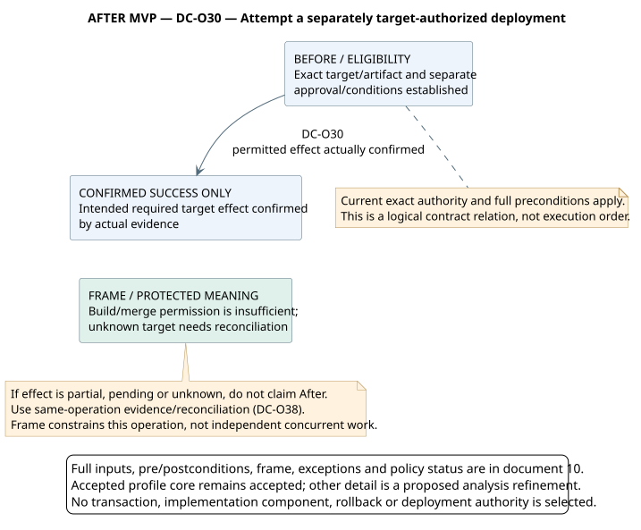

[Editable PlantUML](../diagrams/contract-dc-o30-boundary.puml) · [PNG](../diagrams/contract-dc-o30-boundary.png)

After applies only when the matching permitted success is actually confirmed. The frame constrains this operation; unknown effects do not justify claiming the drawn after-state or universal unchanged before-state.

### DC-O31 — Change an effective administration/file policy

**Contract authority:** R. **Acting context:** Explicitly authorized policy administrator.

**Primary requirements:** [AFO-D01](../../02-requirements-engineering/03-requirements-specification/administration-files-and-operational-behavior.md#afo-d01-owner-configurable-upload-and-storage-policy), [AFO-D02](../../02-requirements-engineering/03-requirements-specification/administration-files-and-operational-behavior.md#afo-d02-policy-consistent-with-evaluated-infrastructure), [AFO-D06](../../02-requirements-engineering/03-requirements-specification/administration-files-and-operational-behavior.md#afo-d06-file-resource-authorization-and-isolation), [AFO-D07](../../02-requirements-engineering/03-requirements-specification/administration-files-and-operational-behavior.md#afo-d07-truthful-completion-and-interrupted-operation-handling), [AFO-D10](../../02-requirements-engineering/03-requirements-specification/administration-files-and-operational-behavior.md#afo-d10-administrative-operation-evidence), [AFO-D11](../../02-requirements-engineering/03-requirements-specification/administration-files-and-operational-behavior.md#afo-d11-bounded-cleanup-and-storage-reclamation)

**Concepts / responsibilities:** [DM-C50](../02-domain-and-information-analysis/03-domain-model-and-object-oriented-view.md#dm-c50), [DM-C49](../02-domain-and-information-analysis/03-domain-model-and-object-oriented-view.md#dm-c49), [DM-C51](../02-domain-and-information-analysis/03-domain-model-and-object-oriented-view.md#dm-c51), [DM-C48](../02-domain-and-information-analysis/03-domain-model-and-object-oriented-view.md#dm-c48). Consult their responsibility catalog; these contracts do not prescribe implementation methods.

**Inputs / target meaning:** Exact setting scope, requested valid value/meaning and actual capacity/reference context.

**Preconditions / current authority:** Exact policy-management authority and reviewed validity against actual applicable constraints; general uploader permission is insufficient.

**Successful postcondition / result:** Only confirmed actual new effective policy establishes new allowance/behavior in intended scope.

**Frame / information protected from this operation:** Lowering limit does not silently remove history/content; unrelated policy/private evidence remains outside scope.

**Denied / invalid / failed / partial / unknown:** Invalid/denied save rejected; pending/failed/partial/unknown persistence cannot claim intended effective new setting. The shared disposition contract also applies; known pending progress remains distinct from lost outcome.

**Concurrency / repetition:** Concurrent policy/admission operations require reviewed current-effective-policy semantics; reconcile after ambiguous change before relying on new limits.

**Applicable typed constraints:** [DC-I08](#dc-i08), [DC-I13](#dc-i13), [DC-I14](#dc-i14), [DC-I17](#dc-i17)

**Policy / evidence boundary:** No numeric limit, policy pool or administrative powers beyond reviewed scope are invented.

**Cross-view provenance:** Interactions: [SB-M15](../04-behavioral-and-scenario-analysis/06-scenario-based-view.md#sb-m15); Source use-case context: [UC-D11](../../02-requirements-engineering/04-scenarios-and-models/user-stories-and-scenarios.md#uc-d11), [UC-D11-POLICY](../../02-requirements-engineering/04-scenarios-and-models/user-stories-and-scenarios.md#uc-d11-policy); Activity context: [CF-M15](../03-functional-and-process-analysis/08-control-flow-based-view.md#cf-m15); Selected activity-step context: [CF-M15-S04](../03-functional-and-process-analysis/08-control-flow-based-view.md#cf-m15-s04), [CF-M15-S05](../03-functional-and-process-analysis/08-control-flow-based-view.md#cf-m15-s05), [CF-M15-S07](../03-functional-and-process-analysis/08-control-flow-based-view.md#cf-m15-s07); States: [SM-M18](../04-behavioral-and-scenario-analysis/07-state-based-view.md#sm-m18); Related transitions/observations: [SM-T120](../04-behavioral-and-scenario-analysis/07-state-based-view.md#sm-t120), [SM-T121](../04-behavioral-and-scenario-analysis/07-state-based-view.md#sm-t121), [SM-T122](../04-behavioral-and-scenario-analysis/07-state-based-view.md#sm-t122), [SM-T123](../04-behavioral-and-scenario-analysis/07-state-based-view.md#sm-t123), [SM-T124](../04-behavioral-and-scenario-analysis/07-state-based-view.md#sm-t124); Decisions: [RB-D01](09-rule-based-view.md#rb-d01), [RB-D14](09-rule-based-view.md#rb-d14), [RB-D18](09-rule-based-view.md#rb-d18).

**Mapping limit:** Selected operation-to-source association; semantic criterion/path completeness still requires cross-view review. Linked transitions include relevant environmental/concurrent/result observations; this contract does not cause every listed transition. No new state edge or external UC is allocated.

**Criterion context:** 18 existing proposed criterion locators belong to the linked primary candidates; exact locator/candidate/source records are preserved in [contract evidence](../evidence/operation-contract-review-2026-11-01.json). This is candidate-level related context, not a claim that this operation satisfies every associated criterion. Primary wording and the 470-locator inventory are unchanged.

### DC-O32 — Admit and process an intended file candidate

**Contract authority:** R. **Acting context:** Authorized uploader.

**Primary requirements:** [AFO-D03](../../02-requirements-engineering/03-requirements-specification/administration-files-and-operational-behavior.md#afo-d03-per-file-admission-limit), [AFO-D04](../../02-requirements-engineering/03-requirements-specification/administration-files-and-operational-behavior.md#afo-d04-aggregate-quota-and-concurrent-admission), [AFO-D05](../../02-requirements-engineering/03-requirements-specification/administration-files-and-operational-behavior.md#afo-d05-supported-content-and-validation), [AFO-D07](../../02-requirements-engineering/03-requirements-specification/administration-files-and-operational-behavior.md#afo-d07-truthful-completion-and-interrupted-operation-handling), [AFO-D08](../../02-requirements-engineering/03-requirements-specification/administration-files-and-operational-behavior.md#afo-d08-safe-replacement-and-lifecycle-effects), [AFO-D11](../../02-requirements-engineering/03-requirements-specification/administration-files-and-operational-behavior.md#afo-d11-bounded-cleanup-and-storage-reclamation), [PRP-D09](../../02-requirements-engineering/03-requirements-specification/profiles-resumes-and-portfolio.md#prp-d09-safe-content-admission-and-truthful-save-outcomes), [PDF-D09](../../02-requirements-engineering/03-requirements-specification/pdf-and-controlled-sharing.md#pdf-d09-failure-safe-processing-and-content-handling)

**Concepts / responsibilities:** [DM-C49](../02-domain-and-information-analysis/03-domain-model-and-object-oriented-view.md#dm-c49), [DM-C50](../02-domain-and-information-analysis/03-domain-model-and-object-oriented-view.md#dm-c50), [DM-C10](../02-domain-and-information-analysis/03-domain-model-and-object-oriented-view.md#dm-c10), [DM-C11](../02-domain-and-information-analysis/03-domain-model-and-object-oriented-view.md#dm-c11), [DM-C19](../02-domain-and-information-analysis/03-domain-model-and-object-oriented-view.md#dm-c19). Consult their responsibility catalog; these contracts do not prescribe implementation methods.

**Inputs / target meaning:** Intended candidate/content/owner/language/association and actual usage/reference context.

**Preconditions / current authority:** Current exact admission authority, effective policy/content rules and actual current capacity/concurrency conditions permit intended growth.

**Successful postcondition / result:** Actual confirmed usable processing establishes intended resource/association; admission alone is not usable completion.

**Frame / information protected from this operation:** No unrelated/private/protected historical material is deleted merely because replacement or space pressure exists.

**Denied / invalid / failed / partial / unknown:** Rejected/unavailable/failed/pending/unknown processing reported truthfully; failed new candidate does not itself authorize destroying required prior usable association. The shared disposition contract also applies; known pending progress remains distinct from lost outcome.

**Concurrency / repetition:** Re-evaluate concurrent effective limits, growth and replacement references; no two-precheck capacity guarantee or unreviewed silent overwrite.

**Applicable typed constraints:** [DC-I01](#dc-i01), [DC-I05](#dc-i05), [DC-I06](#dc-i06), [DC-I13](#dc-i13), [DC-I14](#dc-i14)

**Policy / evidence boundary:** Detailed quotas/replacement/cleanup policy remains proposed; no storage/processing technology or numeric maximum selected.

**Cross-view provenance:** Interactions: [SB-M15](../04-behavioral-and-scenario-analysis/06-scenario-based-view.md#sb-m15); Source use-case context: [UC-D11](../../02-requirements-engineering/04-scenarios-and-models/user-stories-and-scenarios.md#uc-d11); Activity context: [CF-M15](../03-functional-and-process-analysis/08-control-flow-based-view.md#cf-m15); Selected activity-step context: [CF-M15-S13](../03-functional-and-process-analysis/08-control-flow-based-view.md#cf-m15-s13), [CF-M15-S15](../03-functional-and-process-analysis/08-control-flow-based-view.md#cf-m15-s15); States: [SM-M05](../04-behavioral-and-scenario-analysis/07-state-based-view.md#sm-m05); Related transitions/observations: [SM-T022](../04-behavioral-and-scenario-analysis/07-state-based-view.md#sm-t022), [SM-T023](../04-behavioral-and-scenario-analysis/07-state-based-view.md#sm-t023), [SM-T024](../04-behavioral-and-scenario-analysis/07-state-based-view.md#sm-t024), [SM-T025](../04-behavioral-and-scenario-analysis/07-state-based-view.md#sm-t025); Decisions: [RB-D01](09-rule-based-view.md#rb-d01), [RB-D14](09-rule-based-view.md#rb-d14), [RB-D18](09-rule-based-view.md#rb-d18).

**Mapping limit:** Supporting/upstream lifecycle refinement or adjacent context; step/use-case links are provenance, not complete direct-path coverage. Linked transitions include relevant environmental/concurrent/result observations; this contract does not cause every listed transition. No new state edge or external UC is allocated.

**Criterion context:** 24 existing proposed criterion locators belong to the linked primary candidates; exact locator/candidate/source records are preserved in [contract evidence](../evidence/operation-contract-review-2026-11-01.json). This is candidate-level related context, not a claim that this operation satisfies every associated criterion. Primary wording and the 470-locator inventory are unchanged.

### DC-O33 — Read restricted operational/audit evidence

**Contract authority:** R. **Acting context:** Authorized evidence viewer/operator.

**Primary requirements:** [AFO-D09](../../02-requirements-engineering/03-requirements-specification/administration-files-and-operational-behavior.md#afo-d09-operational-outcomes-and-capacity-warnings), [AFO-D10](../../02-requirements-engineering/03-requirements-specification/administration-files-and-operational-behavior.md#afo-d10-administrative-operation-evidence), [AFO-D12](../../02-requirements-engineering/03-requirements-specification/administration-files-and-operational-behavior.md#afo-d12-version-specific-operational-guidance-and-readiness), [QSR-D08](../../02-requirements-engineering/03-requirements-specification/quality-security-and-recovery-requirements.md#qsr-d08-data-integrity-and-truthful-completion)

**Concepts / responsibilities:** [DM-C51](../02-domain-and-information-analysis/03-domain-model-and-object-oriented-view.md#dm-c51), [DM-C48](../02-domain-and-information-analysis/03-domain-model-and-object-oriented-view.md#dm-c48), [DM-C50](../02-domain-and-information-analysis/03-domain-model-and-object-oriented-view.md#dm-c50). Consult their responsibility catalog; these contracts do not prescribe implementation methods.

**Inputs / target meaning:** Exact requested evidence scope and intended operational question.

**Preconditions / current authority:** Current specific evidence-read power and bounded sensitive-content policy; administration label does not grant all secrets/private content.

**Successful postcondition / result:** Only actual permitted bounded evidence is returned with known limits.

**Frame / information protected from this operation:** No secrets/unrelated private resources or operational state changes are implied by evidence access.

**Denied / invalid / failed / partial / unknown:** Denied/unavailable/incomplete evidence is explicit; no invented complete audit trail or successful product test. The shared disposition contract also applies; known pending progress remains distinct from lost outcome.

**Concurrency / repetition:** Recheck current scope and distinguish changing/partial observations; repeat read cannot imply replaying any operation.

**Applicable typed constraints:** [DC-I01](#dc-i01), [DC-I08](#dc-i08), [DC-I17](#dc-i17)

**Policy / evidence boundary:** Evidence applicability and actual controls remain dependent operational work; no log storage/retention scheme chosen.

**Cross-view provenance:** Interactions: [SB-M15](../04-behavioral-and-scenario-analysis/06-scenario-based-view.md#sb-m15); Source use-case context: [UC-D11](../../02-requirements-engineering/04-scenarios-and-models/user-stories-and-scenarios.md#uc-d11), [UC-D11-EVIDENCE](../../02-requirements-engineering/04-scenarios-and-models/user-stories-and-scenarios.md#uc-d11-evidence); Activity context: [CF-M15](../03-functional-and-process-analysis/08-control-flow-based-view.md#cf-m15); Selected activity-step context: [CF-M15-S20](../03-functional-and-process-analysis/08-control-flow-based-view.md#cf-m15-s20), [CF-M15-S21](../03-functional-and-process-analysis/08-control-flow-based-view.md#cf-m15-s21); States: [SM-M18](../04-behavioral-and-scenario-analysis/07-state-based-view.md#sm-m18); Decisions: [RB-D01](09-rule-based-view.md#rb-d01), [RB-D18](09-rule-based-view.md#rb-d18).

**Mapping limit:** Selected operation-to-source association; semantic criterion/path completeness still requires cross-view review. Linked transitions include relevant environmental/concurrent/result observations; this contract does not cause every listed transition. No new state edge or external UC is allocated.

**Criterion context:** 12 existing proposed criterion locators belong to the linked primary candidates; exact locator/candidate/source records are preserved in [contract evidence](../evidence/operation-contract-review-2026-11-01.json). This is candidate-level related context, not a claim that this operation satisfies every associated criterion. Primary wording and the 470-locator inventory are unchanged.

### DC-O34 — Archive, unlink or request category-specific retirement

**Contract authority:** R. **Acting context:** Authorized resource controller.

**Primary requirements:** [BRL-D08](../../02-requirements-engineering/03-requirements-specification/business-rules-and-data-lifecycle.md#brl-d08-reference-aware-retirement), [APP-D09](../../02-requirements-engineering/03-requirements-specification/manual-application-management.md#app-d09-private-access-archive-and-recovery), [PRP-D10](../../02-requirements-engineering/03-requirements-specification/profiles-resumes-and-portfolio.md#prp-d10-reference-aware-retirement-and-historical-independence), [PDF-D10](../../02-requirements-engineering/03-requirements-specification/pdf-and-controlled-sharing.md#pdf-d10-reference-aware-retirement-and-recovery), [AFO-D08](../../02-requirements-engineering/03-requirements-specification/administration-files-and-operational-behavior.md#afo-d08-safe-replacement-and-lifecycle-effects), [AFO-D11](../../02-requirements-engineering/03-requirements-specification/administration-files-and-operational-behavior.md#afo-d11-bounded-cleanup-and-storage-reclamation)

**Concepts / responsibilities:** [DM-C49](../02-domain-and-information-analysis/03-domain-model-and-object-oriented-view.md#dm-c49), [DM-C19](../02-domain-and-information-analysis/03-domain-model-and-object-oriented-view.md#dm-c19), [DM-C18](../02-domain-and-information-analysis/03-domain-model-and-object-oriented-view.md#dm-c18), [DM-C48](../02-domain-and-information-analysis/03-domain-model-and-object-oriented-view.md#dm-c48). Consult their responsibility catalog; these contracts do not prescribe implementation methods.

**Inputs / target meaning:** Explicit intended category/action and exact subject/association/reference context.

**Preconditions / current authority:** Current exact action authority and explicit reviewed category consequences; archive/unlink/trash/delete are not interchangeable.

**Successful postcondition / result:** Confirmed intended category action has only its defined visibility/reference/request consequences; no physical reclamation inferred.

**Frame / information protected from this operation:** Protected actual history and unrelated/shared information remain protected under reviewed reference policy.

**Denied / invalid / failed / partial / unknown:** Missing cascade/retention semantics prevents assumed removal; failed/partial/unknown action cannot claim all data removed or capacity freed. The shared disposition contract also applies; known pending progress remains distinct from lost outcome.

**Concurrency / repetition:** Re-evaluate changed required references/current action context; repeated association removal cannot target newly unrelated content.

**Applicable typed constraints:** [DC-I01](#dc-i01), [DC-I04](#dc-i04), [DC-I14](#dc-i14)

**Policy / evidence boundary:** Category policy remains proposed; SM-M16 is illustrative, not universal trash/soft-delete lifecycle or new external use case.

**Cross-view provenance:** States: [SM-M16](../04-behavioral-and-scenario-analysis/07-state-based-view.md#sm-m16); Related transitions/observations: [SM-T104](../04-behavioral-and-scenario-analysis/07-state-based-view.md#sm-t104), [SM-T106](../04-behavioral-and-scenario-analysis/07-state-based-view.md#sm-t106), [SM-T107](../04-behavioral-and-scenario-analysis/07-state-based-view.md#sm-t107); Decisions: [RB-D01](09-rule-based-view.md#rb-d01), [RB-D15](09-rule-based-view.md#rb-d15), [RB-D18](09-rule-based-view.md#rb-d18).

**Mapping limit:** Supporting/upstream lifecycle refinement or adjacent context; step/use-case links are provenance, not complete direct-path coverage. Linked transitions include relevant environmental/concurrent/result observations; this contract does not cause every listed transition. No new state edge or external UC is allocated.

**Criterion context:** 18 existing proposed criterion locators belong to the linked primary candidates; exact locator/candidate/source records are preserved in [contract evidence](../evidence/operation-contract-review-2026-11-01.json). This is candidate-level related context, not a claim that this operation satisfies every associated criterion. Primary wording and the 470-locator inventory are unchanged.

### DC-O35 — Physically reclaim eligible retained information

**Contract authority:** R. **Acting context:** Specifically authorized reclamation operator.

**Primary requirements:** [BRL-D05](../../02-requirements-engineering/03-requirements-specification/business-rules-and-data-lifecycle.md#brl-d05-preserve-actual-submitted-materials), [BRL-D08](../../02-requirements-engineering/03-requirements-specification/business-rules-and-data-lifecycle.md#brl-d08-reference-aware-retirement), [APP-D07](../../02-requirements-engineering/03-requirements-specification/manual-application-management.md#app-d07-correction-and-repeated-submissions), [APP-D09](../../02-requirements-engineering/03-requirements-specification/manual-application-management.md#app-d09-private-access-archive-and-recovery), [AFO-D08](../../02-requirements-engineering/03-requirements-specification/administration-files-and-operational-behavior.md#afo-d08-safe-replacement-and-lifecycle-effects), [AFO-D11](../../02-requirements-engineering/03-requirements-specification/administration-files-and-operational-behavior.md#afo-d11-bounded-cleanup-and-storage-reclamation), [QSR-D09](../../02-requirements-engineering/03-requirements-specification/quality-security-and-recovery-requirements.md#qsr-d09-deliberate-retention-and-reference-aware-removal), [QSR-D12](../../02-requirements-engineering/03-requirements-specification/quality-security-and-recovery-requirements.md#qsr-d12-safe-restored-access-and-external-state-reconciliation)

**Concepts / responsibilities:** [DM-C49](../02-domain-and-information-analysis/03-domain-model-and-object-oriented-view.md#dm-c49), [DM-C19](../02-domain-and-information-analysis/03-domain-model-and-object-oriented-view.md#dm-c19), [DM-C18](../02-domain-and-information-analysis/03-domain-model-and-object-oriented-view.md#dm-c18), [DM-C50](../02-domain-and-information-analysis/03-domain-model-and-object-oriented-view.md#dm-c50). Consult their responsibility catalog; these contracts do not prescribe implementation methods.

**Inputs / target meaning:** Exact intended resource/category, retention decision, affected references and actual cleanup result context.

**Preconditions / current authority:** Current exact reclamation authority, reviewed category retention eligibility and all required references permit this actual action at its consequential point.

**Successful postcondition / result:** Claim only actual confirmed required removal/reclamation and measured accounting effect; eligibility alone is not freed bytes.

**Frame / information protected from this operation:** No unrelated/shared/protected actual history is destroyed by a general space-pressure or association-removal inference.

**Denied / invalid / failed / partial / unknown:** Ineligible/denied action blocked; actual failed/partial/unknown cleanup cannot report complete data/storage removal. The shared disposition contract also applies; known pending progress remains distinct from lost outcome.

**Concurrency / repetition:** Recheck newly created/changed references and actual accounting; repeated cleanup reconciles actual remaining material rather than assuming all prior effects.

**Applicable typed constraints:** [DC-I04](#dc-i04), [DC-I13](#dc-i13), [DC-I14](#dc-i14), [DC-I17](#dc-i17)

**Policy / evidence boundary:** No retention duration, cascade, cleanup schedule, universal purge semantics or physical backend chosen.

**Cross-view provenance:** States: [SM-M16](../04-behavioral-and-scenario-analysis/07-state-based-view.md#sm-m16); Related transitions/observations: [SM-T109](../04-behavioral-and-scenario-analysis/07-state-based-view.md#sm-t109); Decisions: [RB-D01](09-rule-based-view.md#rb-d01), [RB-D15](09-rule-based-view.md#rb-d15), [RB-D18](09-rule-based-view.md#rb-d18).

**Mapping limit:** Supporting/upstream lifecycle refinement or adjacent context; step/use-case links are provenance, not complete direct-path coverage. Linked transitions include relevant environmental/concurrent/result observations; this contract does not cause every listed transition. No new state edge or external UC is allocated.

**Criterion context:** 24 existing proposed criterion locators belong to the linked primary candidates; exact locator/candidate/source records are preserved in [contract evidence](../evidence/operation-contract-review-2026-11-01.json). This is candidate-level related context, not a claim that this operation satisfies every associated criterion. Primary wording and the 470-locator inventory are unchanged.

### DC-O36 — Restore retained category information/visibility

**Contract authority:** R. **Acting context:** Authorized restoring controller.

**Primary requirements:** [BRL-D08](../../02-requirements-engineering/03-requirements-specification/business-rules-and-data-lifecycle.md#brl-d08-reference-aware-retirement), [APP-D09](../../02-requirements-engineering/03-requirements-specification/manual-application-management.md#app-d09-private-access-archive-and-recovery), [AFO-D08](../../02-requirements-engineering/03-requirements-specification/administration-files-and-operational-behavior.md#afo-d08-safe-replacement-and-lifecycle-effects), [QSR-D09](../../02-requirements-engineering/03-requirements-specification/quality-security-and-recovery-requirements.md#qsr-d09-deliberate-retention-and-reference-aware-removal), [QSR-D12](../../02-requirements-engineering/03-requirements-specification/quality-security-and-recovery-requirements.md#qsr-d12-safe-restored-access-and-external-state-reconciliation)

**Concepts / responsibilities:** [DM-C49](../02-domain-and-information-analysis/03-domain-model-and-object-oriented-view.md#dm-c49), [DM-C19](../02-domain-and-information-analysis/03-domain-model-and-object-oriented-view.md#dm-c19), [DM-C18](../02-domain-and-information-analysis/03-domain-model-and-object-oriented-view.md#dm-c18), [DM-C48](../02-domain-and-information-analysis/03-domain-model-and-object-oriented-view.md#dm-c48). Consult their responsibility catalog; these contracts do not prescribe implementation methods.

**Inputs / target meaning:** Exact retained subject/association or actual material and intended restoration scope.

**Preconditions / current authority:** Material actually retained and eligible under current category/access/reference policy; restoration of an actual set requires same actual-content identity verification.

**Successful postcondition / result:** Only confirmed permitted retained item/visibility or matching actual material is restored in its intended context.

**Frame / information protected from this operation:** No automatic reactivation of revoked grants/shares, provider send/replay or deployment; unrelated history remains independent.

**Denied / invalid / failed / partial / unknown:** Missing/reclaimed/corrupt/ineligible content not reported restored; actual partial/unknown effect stays explicit. The shared disposition contract also applies; known pending progress remains distinct from lost outcome.

**Concurrency / repetition:** Reconcile current retained identity/references and existing restoration effect; never replace prior actual material with a newer live substitute.

**Applicable typed constraints:** [DC-I01](#dc-i01), [DC-I04](#dc-i04), [DC-I08](#dc-i08), [DC-I14](#dc-i14), [DC-I18](#dc-i18)

**Policy / evidence boundary:** Category restore is distinct from backup restore; no new external UC, universal restore path or access resurrection policy.

**Cross-view provenance:** States: [SM-M16](../04-behavioral-and-scenario-analysis/07-state-based-view.md#sm-m16), [SM-M07](../04-behavioral-and-scenario-analysis/07-state-based-view.md#sm-m07); Related transitions/observations: [SM-T105](../04-behavioral-and-scenario-analysis/07-state-based-view.md#sm-t105), [SM-T108](../04-behavioral-and-scenario-analysis/07-state-based-view.md#sm-t108), [SM-T044](../04-behavioral-and-scenario-analysis/07-state-based-view.md#sm-t044); Decisions: [RB-D01](09-rule-based-view.md#rb-d01), [RB-D15](09-rule-based-view.md#rb-d15), [RB-D18](09-rule-based-view.md#rb-d18).

**Mapping limit:** Supporting/upstream lifecycle refinement or adjacent context; step/use-case links are provenance, not complete direct-path coverage. Linked transitions include relevant environmental/concurrent/result observations; this contract does not cause every listed transition. No new state edge or external UC is allocated.

**Criterion context:** 15 existing proposed criterion locators belong to the linked primary candidates; exact locator/candidate/source records are preserved in [contract evidence](../evidence/operation-contract-review-2026-11-01.json). This is candidate-level related context, not a claim that this operation satisfies every associated criterion. Primary wording and the 470-locator inventory are unchanged.

### DC-O37 — Perform and assess an authorized isolated recovery drill

**Contract authority:** R. **Acting context:** Authorized recovery operator.

**Primary requirements:** [BRL-D09](../../02-requirements-engineering/03-requirements-specification/business-rules-and-data-lifecycle.md#brl-d09-recovery-preserves-defined-business-consistency), [QSR-D10](../../02-requirements-engineering/03-requirements-specification/quality-security-and-recovery-requirements.md#qsr-d10-defined-protected-and-observable-backups), [QSR-D11](../../02-requirements-engineering/03-requirements-specification/quality-security-and-recovery-requirements.md#qsr-d11-demonstrated-restoration-and-recovery-targets), [QSR-D12](../../02-requirements-engineering/03-requirements-specification/quality-security-and-recovery-requirements.md#qsr-d12-safe-restored-access-and-external-state-reconciliation), [QSR-D14](../../02-requirements-engineering/03-requirements-specification/quality-security-and-recovery-requirements.md#qsr-d14-maintainable-verifiable-and-recoverable-changes), [AFO-D12](../../02-requirements-engineering/03-requirements-specification/administration-files-and-operational-behavior.md#afo-d12-version-specific-operational-guidance-and-readiness)

**Concepts / responsibilities:** [DM-C52](../02-domain-and-information-analysis/03-domain-model-and-object-oriented-view.md#dm-c52), [DM-C53](../02-domain-and-information-analysis/03-domain-model-and-object-oriented-view.md#dm-c53), [DM-C48](../02-domain-and-information-analysis/03-domain-model-and-object-oriented-view.md#dm-c48), [DM-C49](../02-domain-and-information-analysis/03-domain-model-and-object-oriented-view.md#dm-c49). Consult their responsibility catalog; these contracts do not prescribe implementation methods.

**Inputs / target meaning:** Defined loss scenario, actual protected source/required artifacts/configuration, covered point and isolated target/criteria.

**Preconditions / current authority:** Actual source/coverage/operator authority and suitable isolation exist; define required scoped checks/measurement before claiming success.

**Successful postcondition / result:** Only actual restored candidate followed by passing integrity/relationship/current-access/external-state and measured criteria assessment establishes scoped demonstrated usable recovery.

**Frame / information protected from this operation:** No live overwrite, blind external replay, old grant resurrection or blanket recovery guarantee; retain actual measured limitations.

**Denied / invalid / failed / partial / unknown:** No backup/prerequisite blocks drill; missing/corrupt/inconsistent material and failed/missed criteria remain incomplete; unknown result reconciled. The shared disposition contract also applies; known pending progress remains distinct from lost outcome.

**Concurrency / repetition:** Reconcile actual isolated candidate; repeated drills retain distinguishable evidence and require their own eligible scope.

**Applicable typed constraints:** [DC-I01](#dc-i01), [DC-I08](#dc-i08), [DC-I14](#dc-i14), [DC-I16](#dc-i16), [DC-I17](#dc-i17), [DC-I18](#dc-i18)

**Policy / evidence boundary:** Backups not configured; no RPO/RTO/retention/technology values or live-restore authority invented.

**Cross-view provenance:** Interactions: [SB-M16](../04-behavioral-and-scenario-analysis/06-scenario-based-view.md#sb-m16); Source use-case context: [UC-D12](../../02-requirements-engineering/04-scenarios-and-models/user-stories-and-scenarios.md#uc-d12); Activity context: [CF-M16](../03-functional-and-process-analysis/08-control-flow-based-view.md#cf-m16); Selected activity-step context: [CF-M16-S03](../03-functional-and-process-analysis/08-control-flow-based-view.md#cf-m16-s03), [CF-M16-S04](../03-functional-and-process-analysis/08-control-flow-based-view.md#cf-m16-s04), [CF-M16-S06](../03-functional-and-process-analysis/08-control-flow-based-view.md#cf-m16-s06), [CF-M16-S07](../03-functional-and-process-analysis/08-control-flow-based-view.md#cf-m16-s07); States: [SM-M17](../04-behavioral-and-scenario-analysis/07-state-based-view.md#sm-m17); Related transitions/observations: [SM-T110](../04-behavioral-and-scenario-analysis/07-state-based-view.md#sm-t110), [SM-T111](../04-behavioral-and-scenario-analysis/07-state-based-view.md#sm-t111), [SM-T112](../04-behavioral-and-scenario-analysis/07-state-based-view.md#sm-t112), [SM-T113](../04-behavioral-and-scenario-analysis/07-state-based-view.md#sm-t113), [SM-T114](../04-behavioral-and-scenario-analysis/07-state-based-view.md#sm-t114), [SM-T115](../04-behavioral-and-scenario-analysis/07-state-based-view.md#sm-t115), [SM-T116](../04-behavioral-and-scenario-analysis/07-state-based-view.md#sm-t116); Decisions: [RB-D01](09-rule-based-view.md#rb-d01), [RB-D16](09-rule-based-view.md#rb-d16), [RB-D18](09-rule-based-view.md#rb-d18).

**Mapping limit:** Selected operation-to-source association; semantic criterion/path completeness still requires cross-view review. Linked transitions include relevant environmental/concurrent/result observations; this contract does not cause every listed transition. No new state edge or external UC is allocated.

**Criterion context:** 18 existing proposed criterion locators belong to the linked primary candidates; exact locator/candidate/source records are preserved in [contract evidence](../evidence/operation-contract-review-2026-11-01.json). This is candidate-level related context, not a claim that this operation satisfies every associated criterion. Primary wording and the 470-locator inventory are unchanged.

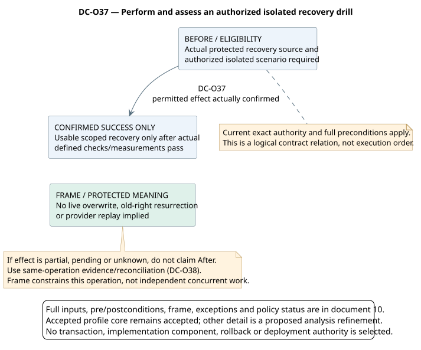

[Editable PlantUML](../diagrams/contract-dc-o37-boundary.puml) · [PNG](../diagrams/contract-dc-o37-boundary.png)

After applies only when the matching permitted success is actually confirmed. The frame constrains this operation; unknown effects do not justify claiming the drawn after-state or universal unchanged before-state.

### DC-O38 — Observe/reconcile same operation effect truthfully

**Contract authority:** R. **Acting context:** Authorized observer/reconciler.

**Primary requirements:** [BRL-D06](../../02-requirements-engineering/03-requirements-specification/business-rules-and-data-lifecycle.md#brl-d06-validation-and-truthful-state-changes), [BRL-D07](../../02-requirements-engineering/03-requirements-specification/business-rules-and-data-lifecycle.md#brl-d07-explicit-provider-synchronization-authority), [BRL-D08](../../02-requirements-engineering/03-requirements-specification/business-rules-and-data-lifecycle.md#brl-d08-reference-aware-retirement), [BRL-D09](../../02-requirements-engineering/03-requirements-specification/business-rules-and-data-lifecycle.md#brl-d09-recovery-preserves-defined-business-consistency), [EIF-D08](../../02-requirements-engineering/03-requirements-specification/external-interface-requirements.md#eif-d08-operation-specific-failure-and-repetition-semantics), [AFO-D07](../../02-requirements-engineering/03-requirements-specification/administration-files-and-operational-behavior.md#afo-d07-truthful-completion-and-interrupted-operation-handling), [QSR-D08](../../02-requirements-engineering/03-requirements-specification/quality-security-and-recovery-requirements.md#qsr-d08-data-integrity-and-truthful-completion)

**Concepts / responsibilities:** [DM-C51](../02-domain-and-information-analysis/03-domain-model-and-object-oriented-view.md#dm-c51), [DM-C48](../02-domain-and-information-analysis/03-domain-model-and-object-oriented-view.md#dm-c48), [DM-C49](../02-domain-and-information-analysis/03-domain-model-and-object-oriented-view.md#dm-c49), [DM-C50](../02-domain-and-information-analysis/03-domain-model-and-object-oriented-view.md#dm-c50). Consult their responsibility catalog; these contracts do not prescribe implementation methods.

**Inputs / target meaning:** Exact intended original operation/attempt/subject and available permitted attributable evidence.

**Preconditions / current authority:** Exact evidence-observation scope and original operation context established; new mutation requires independent authority/contract.

**Successful postcondition / result:** Report only evidence-supported confirmed, definite failed, bounded partial, confirmed pending or unknown disposition; reconcile same attributable effect.

**Frame / information protected from this operation:** Observation/reconciliation does not itself grant resend/restart/deploy/restore authority or rewrite prior evidence as success.

**Denied / invalid / failed / partial / unknown:** Missing/contradictory/unattributable evidence stays unresolved; denial of evidence access does not prove original operation had no effect. The shared disposition contract also applies; known pending progress remains distinct from lost outcome.

**Concurrency / repetition:** Observe same actual pending work without relaunch; any correction/retry/compensation is a separately eligible operation with distinguishable context.

**Applicable typed constraints:** [DC-I01](#dc-i01), [DC-I08](#dc-i08), [DC-I17](#dc-i17)

**Policy / evidence boundary:** Analysis observation vocabulary, not universal stored enum, logging guarantee, idempotency service or recovery algorithm.

**Cross-view provenance:** Activity context: [CF-M17](../03-functional-and-process-analysis/08-control-flow-based-view.md#cf-m17); Selected activity-step context: [CF-M17-S03](../03-functional-and-process-analysis/08-control-flow-based-view.md#cf-m17-s03); States: [SM-M18](../04-behavioral-and-scenario-analysis/07-state-based-view.md#sm-m18); Related transitions/observations: [SM-T119](../04-behavioral-and-scenario-analysis/07-state-based-view.md#sm-t119), [SM-T120](../04-behavioral-and-scenario-analysis/07-state-based-view.md#sm-t120), [SM-T121](../04-behavioral-and-scenario-analysis/07-state-based-view.md#sm-t121), [SM-T122](../04-behavioral-and-scenario-analysis/07-state-based-view.md#sm-t122), [SM-T123](../04-behavioral-and-scenario-analysis/07-state-based-view.md#sm-t123), [SM-T124](../04-behavioral-and-scenario-analysis/07-state-based-view.md#sm-t124), [SM-T125](../04-behavioral-and-scenario-analysis/07-state-based-view.md#sm-t125), [SM-T126](../04-behavioral-and-scenario-analysis/07-state-based-view.md#sm-t126), [SM-T127](../04-behavioral-and-scenario-analysis/07-state-based-view.md#sm-t127), [SM-T128](../04-behavioral-and-scenario-analysis/07-state-based-view.md#sm-t128); Decisions: [RB-D01](09-rule-based-view.md#rb-d01), [RB-D18](09-rule-based-view.md#rb-d18).

**Mapping limit:** Selected operation-to-source association; semantic criterion/path completeness still requires cross-view review. Linked transitions include relevant environmental/concurrent/result observations; this contract does not cause every listed transition. No new state edge or external UC is allocated.

**Criterion context:** 21 existing proposed criterion locators belong to the linked primary candidates; exact locator/candidate/source records are preserved in [contract evidence](../evidence/operation-contract-review-2026-11-01.json). This is candidate-level related context, not a claim that this operation satisfies every associated criterion. Primary wording and the 470-locator inventory are unchanged.

### DC-O39 — Change account access eligibility under reviewed policy

**Contract authority:** R. **Acting context:** Specifically authorized account actor/operator.

**Primary requirements:** [ACC-D01](../../02-requirements-engineering/03-requirements-specification/accounts-authentication-and-permissions.md#acc-d01-individual-account-context), [ACC-D02](../../02-requirements-engineering/03-requirements-specification/accounts-authentication-and-permissions.md#acc-d02-unified-sign-in-across-authorized-sections), [ACC-D09](../../02-requirements-engineering/03-requirements-specification/accounts-authentication-and-permissions.md#acc-d09-explicit-administrative-powers), [ACC-D11](../../02-requirements-engineering/03-requirements-specification/accounts-authentication-and-permissions.md#acc-d11-no-authentication-bypass-on-deliveryprovider-failure), [ACC-D12](../../02-requirements-engineering/03-requirements-specification/accounts-authentication-and-permissions.md#acc-d12-end-of-access-and-lifecycle-enforcement), [QSR-D05](../../02-requirements-engineering/03-requirements-specification/quality-security-and-recovery-requirements.md#qsr-d05-identity-resource-isolation-and-changed-access)

**Concepts / responsibilities:** [DM-C47](../02-domain-and-information-analysis/03-domain-model-and-object-oriented-view.md#dm-c47), [DM-C48](../02-domain-and-information-analysis/03-domain-model-and-object-oriented-view.md#dm-c48). Consult their responsibility catalog; these contracts do not prescribe implementation methods.

**Inputs / target meaning:** Exact account and explicitly identified activation, suspension, reviewed reinstatement or closure-request goal.

**Preconditions / current authority:** Current goal-specific account-state authority and reviewed onboarding/closure eligibility; activation requires intended recipient/identity verification and recovery does not bypass suspension.

**Successful postcondition / result:** Only actual confirmed permitted goal establishes corresponding access-eligibility state; deletion-pending is not data purge and reinstatement is not unrelated grant resurrection.

**Frame / information protected from this operation:** Resource-specific grants, actual history, retained data and provider/target powers do not automatically follow account-state change.

**Denied / invalid / failed / partial / unknown:** Unreviewed/denied/invalid transition is not completed; failed/partial/unknown access-state effect must be reconciled without a false active/suspended/deleted claim. The shared disposition contract also applies; known pending progress remains distinct from lost outcome.

**Concurrency / repetition:** Recheck current account state, related powers and actual prior effect; repeat/recovery cannot bypass suspension or silently overwrite concurrent closure decisions.

**Applicable typed constraints:** [DC-I01](#dc-i01), [DC-I08](#dc-i08), [DC-I14](#dc-i14), [DC-I18](#dc-i18)

**Policy / evidence boundary:** Detailed onboarding/reinstatement/closure and session consequences remain proposed; no invitation duration, final purge path or authentication mechanism is selected.

**Cross-view provenance:** Activity context: [CF-M10](../03-functional-and-process-analysis/08-control-flow-based-view.md#cf-m10); States: [SM-M02](../04-behavioral-and-scenario-analysis/07-state-based-view.md#sm-m02); Related transitions/observations: [SM-T008](../04-behavioral-and-scenario-analysis/07-state-based-view.md#sm-t008), [SM-T009](../04-behavioral-and-scenario-analysis/07-state-based-view.md#sm-t009), [SM-T010](../04-behavioral-and-scenario-analysis/07-state-based-view.md#sm-t010), [SM-T011](../04-behavioral-and-scenario-analysis/07-state-based-view.md#sm-t011), [SM-T012](../04-behavioral-and-scenario-analysis/07-state-based-view.md#sm-t012); Decisions: [RB-D01](09-rule-based-view.md#rb-d01), [RB-D18](09-rule-based-view.md#rb-d18).

**Mapping limit:** Supporting/upstream lifecycle refinement or adjacent context; step/use-case links are provenance, not complete direct-path coverage. Linked transitions include relevant environmental/concurrent/result observations; this contract does not cause every listed transition. No new state edge or external UC is allocated.

**Criterion context:** 16 existing proposed criterion locators belong to the linked primary candidates; exact locator/candidate/source records are preserved in [contract evidence](../evidence/operation-contract-review-2026-11-01.json). This is candidate-level related context, not a claim that this operation satisfies every associated criterion. Primary wording and the 470-locator inventory are unchanged.

## 4. Cross-View Links

The catalogue associates all 16 selected sequence contexts, all 18 state subjects, all 18 rule-decision families and all 17 activity contexts with relevant constraints/contracts. This is association coverage, not a claim that all 128 state transitions, 276 activity steps, 131 decision rows or 470 primary criterion locators are semantically exhausted by these 39 operations.

Source-only editing, manual correction, task completion, grant changes, retry and category retirement/restoration have supporting/upstream/adjacent mappings explicitly labeled. In particular, DC-O34–36 use primary lifecycle obligations and SM-M16/07; they do not pretend the administration policy/evidence use cases already contain full archive/purge/restore activity paths. Further cross-view review can develop those paths without allocating imaginary verified coverage.

| Reconciliation | Required agreement |
| --- | --- |
| DC-X01 Apply/publish/history | DC-O01–03/09–10 preserve accepted profile core and independent actual material; RB-D02/06, SM-M01/07, CF-M01/06 agree |
| DC-X02 Settings/access/availability | DC-O04–06 never conflate PDF mode, enabled link, publication and artifact availability; RB-D03–05 remain separate |
| DC-X03 Progress and actual completeness | DC-O07–10 keep truthful application progress separate from capture/receipt; correction does not silently replace prior context |
| DC-X04 Provider actions | DC-O11–15 keep read/send/local/unlink/sync powers distinct; final review and unknown-send reconciliation remain required |
| DC-X05 Work and Sprint | DC-O16–19 distinguish readiness/progress/item acceptance/period result and preserve coherent Sprint Backlog meaning |
| DC-X06 Current grants and Git | DC-O20–26 retain exact scope/evaluated revisions and actual ref effect; no inferred private access or deployment |
| DC-X07 Attempt and target | DC-O27–30 separate admission, actual run, cancellation request, stop, new retry and target-authorized effect |
| DC-X08 Policy/file/retirement | DC-O31–36 distinguish effective settings, usable admission, bounded evidence and actual category reclamation/restore |
| DC-X09 Recovery/evidence | DC-O37–38 require scoped actual checks and current access/external disposition; no blind replay or universal rollback |

### Selected scope associations

| Scope | Selected contracts / limit |
| --- | --- |
| SCP-01 Accounts/permissions | DC-O20–21/39; no claim that every authentication path is modeled |
| SCP-02 Profiles/resumes | DC-O01–03/09 |
| SCP-03 Portfolio/evidence | DC-O06/32/34–36; full editing catalog remains primary scope |
| SCP-04 PDFs | DC-O04/06/09/32 |
| SCP-05 Protected sharing | DC-O04–06 |
| SCP-06 Manual job application management | DC-O07–10 |
| SCP-07 Gmail/calendar | DC-O11–15  **After MVP.** |
| SCP-08 Projects/Kanban/Sprints | DC-O16–21; not every ordinary board action |
| SCP-09 Real Git/collaboration | DC-O20–26; issue/milestone/tag/release operations are not exhaustively contracted |
| SCP-10 Workflows/CI/CD | DC-O27–30  **After MVP.** |
| SCP-11 File/storage policy | DC-O31–36 |
| SCP-12 Operations/recovery | DC-O30/33/37–38 |

## 5. Review Status

| Review item | Current position |
| --- | --- |
| Constraint typing | 18 local sourced statements distinguish invariant, frame, guard and evidence obligations |
| Contract completeness | All 39 selected records contain target/input, current preconditions, confirmed success, frame, exceptional results, repetition/concurrency and policy limits |
| Source identity | Exact primary headings/IDs and proposed criterion context are preserved; no new global requirements or external UC IDs |
| State/rule/activity links | Actual local IDs and anchors are checked. Association is not semantic proof or full transition/path/criterion coverage |
| Diagrams | Eleven editable PlantUML views: eight before/confirmed-after/frame boundaries, one object snapshot and two constraint/result guides; SVG/PNG outputs; no runtime execution claim |
| Policy acceptance | Accepted profile core retained; other primary detailed proposal status not silently changed |
| Product verification | Not performed by document checks. Review cases below remain inputs to later product tests |
| Whole phase | System Analysis is not declared complete or accepted; remaining views and cross-view consistency work remain |

## 6. Review and verification cases

| Case | Required contract observation |
| --- | --- |
| DC-V01 Source edit with two existing resumes | DC-O01 changes source only; no automatic draft/live/history update |
| DC-V02 Selected apply without publication | DC-O02 confirmed intended draft only; preserve overrides/other resumes/live/history |
| DC-V03 Publication result lost | DC-O03/38 reconcile actual presentation; no assumed live update or rollback |
| DC-V04 Neither mode and independent link disable | DC-O04 does not disable link; DC-O05 fresh access denied only after actual effective disablement |
| DC-V05 Altered private file reference/missing selected language | DC-O06 deny/unavailable without unrelated fallback; no account authority invented |
| DC-V06 Submitted status with missing actual components | DC-O08–09 truthful status and incomplete capture, never complete actual preservation |
| DC-V07 New actual submission differs from current live PDF | DC-O09–10 retain actual identity and distinguish corrected/new context |
| DC-V08 Changed mail attachment or ambiguous provider response | DC-O12 requires current final review and same-attempt reconciliation before resend |
| DC-V09 Disconnected Google with permitted local unlink | DC-O14 removes local mapping only; no provider-delete/active-connection prerequisite |
| DC-V10 Concurrent local/provider versions | DC-O15 explicit conflict/freshness result; no silent last writer wins |
| DC-V11 All tasks Done but item criteria not accepted | DC-O17 no automatic item acceptance |
| DC-V12 End Sprint with unachieved goal/incomplete work | DC-O19 retains actual result and explicit disposition; no automatic carryover |
| DC-V13 Invitation pending or grant changed | DC-O20–21 no unconfirmed membership or stale universal access |
| DC-V14 Changed source/target during push/merge | DC-O23/26 re-evaluate exact current context and reconcile actual ref effect |
| DC-V15 Missing safe runner evidence | DC-O27/29 no enabled execution or blind duplicate retry |
| DC-V16 Completion wins cancel race | DC-O28 reports actual completion; cancel request not termination proof |
| DC-V17 Successful build without target approval | DC-O30 target effect denied/unresolved under actual applicable authority |
| DC-V18 Unknown policy save/failed candidate replacement | DC-O31–32 no unconfirmed new allowance, usable artifact or unauthorized old-content loss |
| DC-V19 Protected actual reference or partial cleanup | DC-O34–35 do not claim eligible/full reclamation or freed bytes |
| DC-V20 Retained restore or backup restore reintroduces old rights | DC-O36–37 reassess current policy; no grant resurrection/provider replay |
| DC-V21 No backup source, failed integrity or unmet recovery target | DC-O37 blocked/incomplete, not demonstrated usable recovery |
| DC-V22 Same operation is pending, unknown or contradictory | DC-O38 keeps exact actual evidence meaning without relaunch or arbitrary certainty |
| DC-V23 Activate/reinstate/suspend or request account closure | DC-O39 changes only confirmed permitted account eligibility; no unrelated grants, recovery bypass or implied physical purge |

These are planned review/test observations, not executed product tests. Concurrency frames must be evaluated against attributable operation effects rather than assuming the whole system stopped changing.

## 7. Known decisions, gates and remaining specificity

Owner-confirmed inputs are retained: 20 total project hours/week; OAuth not created; backups not configured. The existing Ubuntu Laravel demo has 2 vCPU, 4 GB RAM and 40 GB disk. Idle capacity observations do not establish combined load, safe untrusted execution or usable recovery. These facts do not block writing conditional contracts, but dependent execution/provider/recovery claims need actual evidence.

Already accepted source/apply/publication/history behavior is not reopened because older primary open-definition prose remains broad. Source-removal, exact current-context/concurrency resolution, detailed grants/sessions, provider mapping/retry, retention/correction, numeric targets and actual enabling evidence remain scoped proposed/investigation work. Unknown detail blocks the affected commitment, not unrelated modeling.

No fixed numeric quotas, RPO/RTO, retention/session durations, deployment target, isolation technology, transaction/locking or idempotency mechanism is invented. The contracts define what a later design must preserve; they do not pretend that those mechanisms or operational controls already exist.

## 8. Maintenance and next work

Proceed to [cross-view consistency review 11](../07-review-and-design-handoff/11-model-consistency-traceability-and-review.md), and reconcile the now-populated [function view 04](../03-functional-and-process-analysis/04-function-oriented-view.md), [interfaces 12](../06-interfaces-security-and-quality-analysis/12-interfaces-and-external-interactions.md), [quality/operations 13](../06-interfaces-security-and-quality-analysis/13-security-quality-and-operational-analysis.md) and [design handoff 14](../07-review-and-design-handoff/14-feasibility-dependencies-and-design-handoff.md). Earlier dated review reports remain historical until their own review is updated; these artifacts do not silently revise their findings.

Maintain the authoritative rule/requirement at its source, synchronize affected contracts/diagrams, then verify cross-view references and actual behavior as applicable. [Earlier structured review evidence](../evidence/operation-contract-review-2026-11-01.json) records the earlier candidate; [this scoped revision](../evidence/contract-document-fix-2026-11-01.json) records the current document and diagram checks; [diagram catalog](../diagrams/README.md) links editable/rendered figures. No Git commit, server change, implementation or deployment is made by this documentation work.

[System Analysis index](../README.md)

## Diagram Types and Reading Guide

The existing contract boundary graphs remain authoritative. The added object view illustrates the pre/post/frame meaning of DC-O02 for a confirmed operation. It is intentionally an object snapshot, not a mislabeled UML communication diagram. Separate publication follows DC-O03.

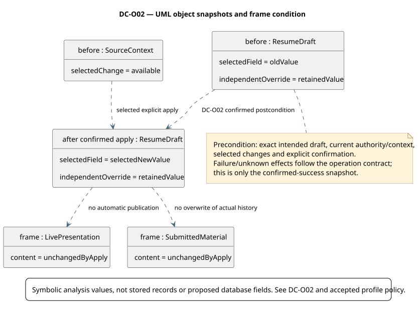

[Editable source](../diagrams/contract-apply-object-snapshots.puml) · [PNG](../diagrams/contract-apply-object-snapshots.png)
