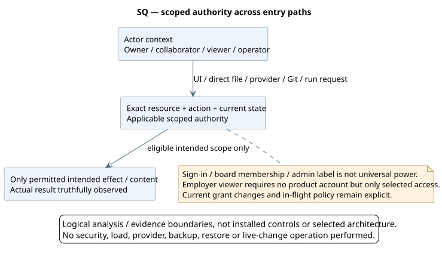
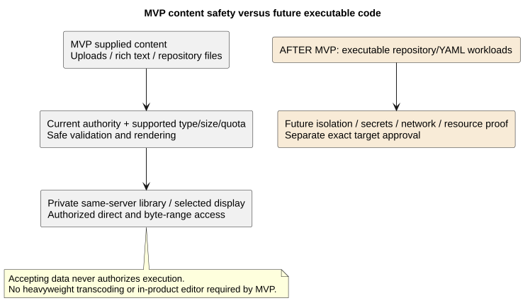
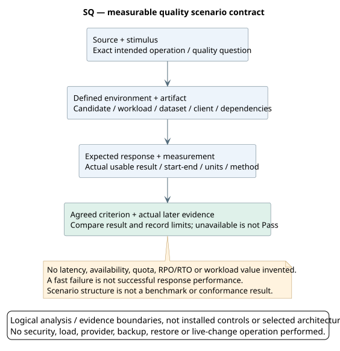
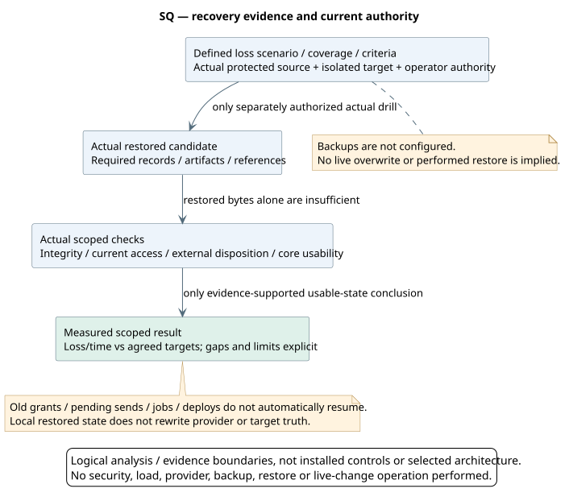
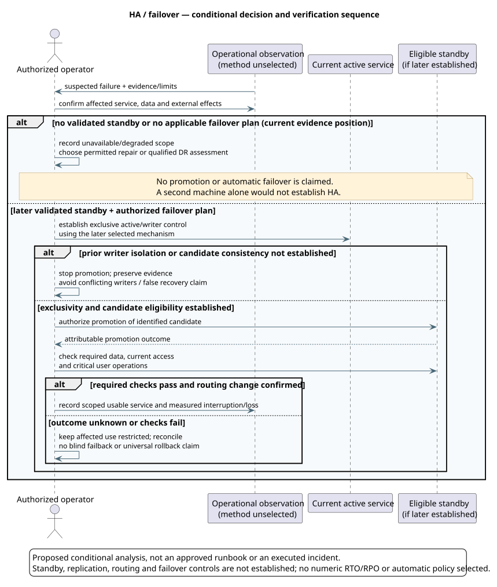
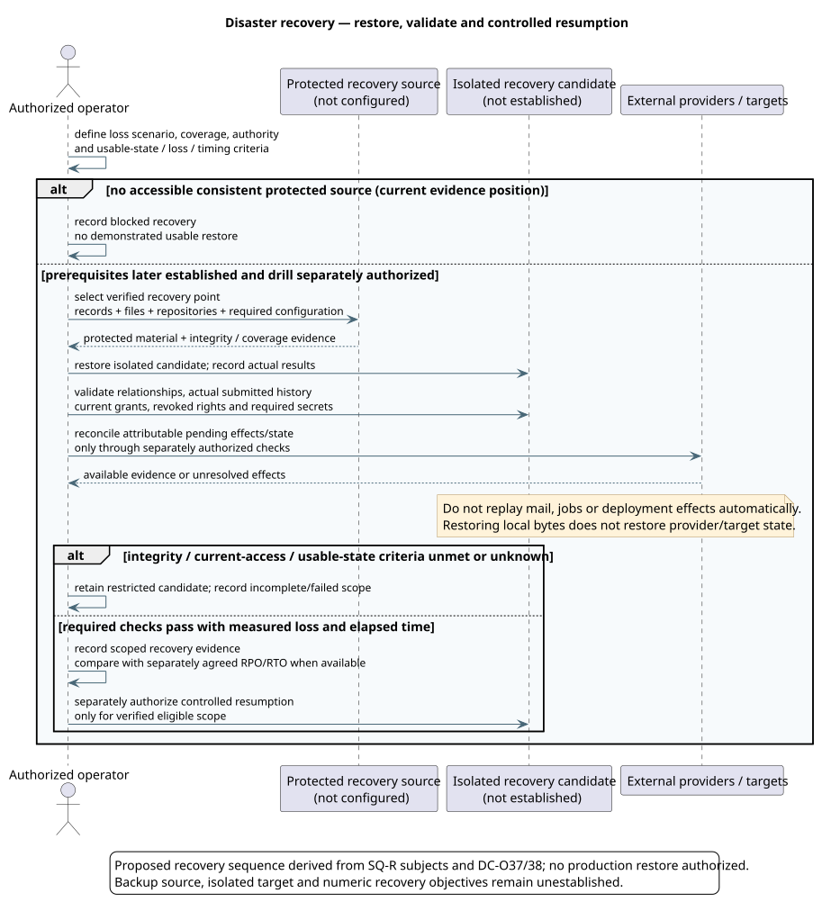
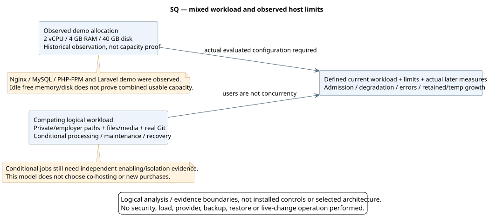
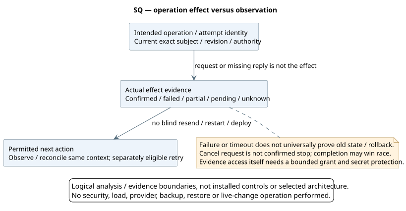
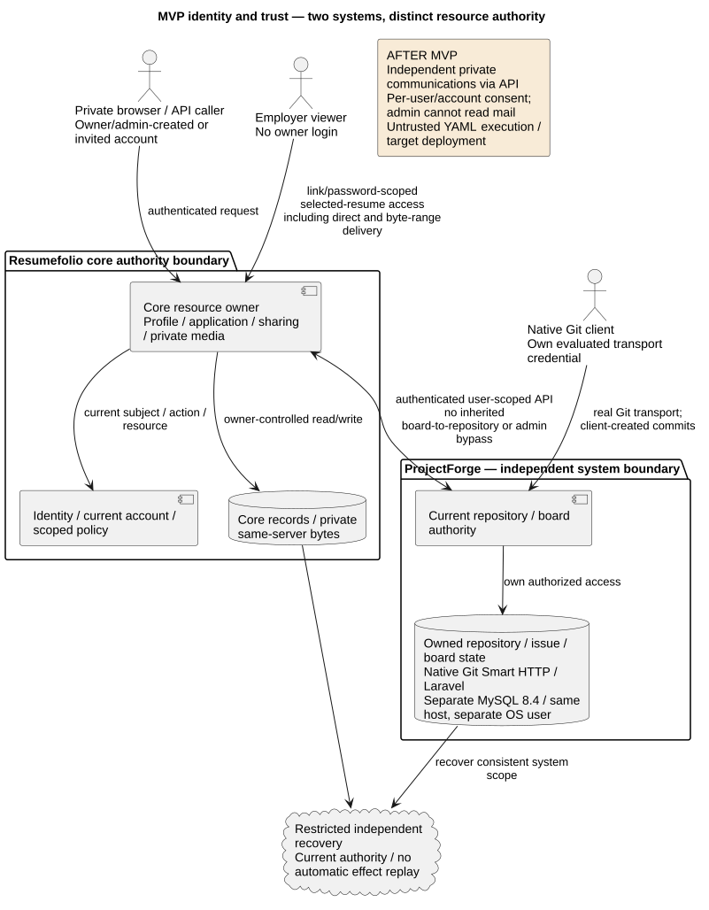
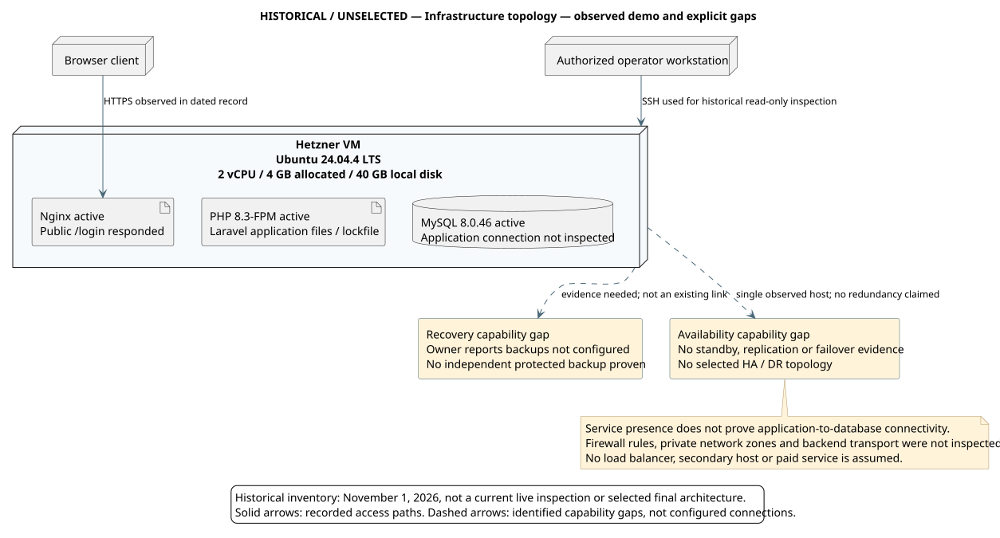

# Resumefolio — Security, Quality and Operational Analysis

**Quick navigation:** [Authority](#1-resources-and-authority) · [Trust cases](#2-trust-and-execution-boundaries) · [HA/DR and failover](#availability-disaster-recovery-and-failover-views) · [Threat model and infrastructure](#diagram-types-and-reading-guide).

[Diagram types and reading guide](#diagram-types-and-reading-guide) · [Full diagram catalog](../diagrams/README.md)

Owner: Farhad. Revision: November 1, 2026.

Status: Populated analysis working view: 24 conditional authority rows, 12 trust/failure cases, 14 quality scenarios, nine recovery-coverage subjects and ten focused diagrams. No security certification, load result, recovery proof or whole-phase acceptance is claimed.

## MVP analysis boundary and evidence applicability

The accepted system boundary separates the Resumefolio core from ProjectForge, joined by an authenticated user-scoped API. Logical responsibilities remain useful within each system; they do not authorize a shared core/ProjectForge process, database or transaction. Core owns dashboard, invited accounts, professional presentation, protected sharing, manual applications and same-server private My Files & Media. ProjectForge MVP owns real repositories/transfers/permissions, file/history browsing, issues and simple Kanban. Its engine, deployment and database remain open. The future communications system is independently private and API connected. Advanced Git review/releases, backlog/Sprints and execution/deployment remain deferred. My Files & Media is a core private library with optional per-resume selection. Supported uploads remain in private directories on the same Resumefolio server, with type/size/quota enforcement, safe serving and backup/recovery. Direct, preview and byte-range requests use current owner or selected-resume/viewer authority. Upload does not publish. External YouTube links use simple embedded playback; private uploads are not sent to YouTube. No extra media platform or heavyweight editor/transcoding is selected. Retained mail, advanced review/Sprint and execution models describe future behavior. Historical comparison/evidence results retain their original candidate/date and are not newly executed MVP checks.

Authority: [OWNER-MVP-2026-11-04](../../01-project-planning/owner-mvp-decision-2026-11-04.md).

## Authoritative Inputs

- [Scope](../../01-project-planning/02-scope.md), [quality/security/recovery requirements](../../02-requirements-engineering/03-requirements-specification/quality-security-and-recovery-requirements.md), [account permissions](../../02-requirements-engineering/03-requirements-specification/accounts-authentication-and-permissions.md), and [business/lifecycle rules](../../02-requirements-engineering/03-requirements-specification/business-rules-and-data-lifecycle.md).

- [Interface requirements](../../02-requirements-engineering/03-requirements-specification/external-interface-requirements.md), [administration/files](../../02-requirements-engineering/03-requirements-specification/administration-files-and-operational-behavior.md), [feasibility](../../02-requirements-engineering/01-process-and-approach/02-feasibility-study.md), [decisions/proposals](../../02-requirements-engineering/07-change-and-baseline/open-questions-and-decisions.md) and [shared findings](../../02-requirements-engineering/06-validation-and-traceability/review-plan-and-findings.md).

- [Domain/data/scenario models](../02-domain-and-information-analysis/03-domain-model-and-object-oriented-view.md), [states](../04-behavioral-and-scenario-analysis/07-state-based-view.md), [activities](../03-functional-and-process-analysis/08-control-flow-based-view.md), [rules](../05-business-rules-and-operation-contracts/09-rule-based-view.md), [operation contracts](../05-business-rules-and-operation-contracts/10-domain-constraints-and-operation-contracts.md), [bounded cross-view review](../07-review-and-design-handoff/11-model-consistency-traceability-and-review.md) and [interfaces](12-interfaces-and-external-interactions.md).

**Authority:** The [accepted profile-update core](../../02-requirements-engineering/07-change-and-baseline/open-questions-and-decisions.md#owner-accepted-profile-update-policy) remains accepted. The primary detailed QSR/permissions/quality/control/retention proposals retain their recorded status. SQ-A/T/Q/R/V references are local analysis locators, not new global requirements or new accepted role powers. This analysis describes required distinctions and later evidence; it does not select a runner, scanner, security product, monitoring facility, backup destination or cryptographic mechanism.

## 1. Resources and authority

An actor is evaluated against the exact resource, requested action and applicable current state. Product sign-in, board membership, owning a repository, being called an administrator or having a stored provider connection is not universal authority. Employer viewing without a product account remains limited to the intended protected selected content. Identity/control, business validity and observed completion are distinct predicates.

### Conditional actor/resource/action/state matrix

Each row below is a scoped analysis condition. It is not an approved full role/action matrix or evidence that the software enforces it. “Authorized” means the primary reviewed grant/policy actually permits that exact operation. Unknown scope or missing enabling evidence does not become an allowed result. Direct UI/reference/file/provider/Git/output paths must obey the same applicable resource rules.

| Record | Details |
| --- | --- |
| SQ-A01 — Profile owner | [Read record](#sq-a01) |
| SQ-A02 — Resume owner | [Read record](#sq-a02) |
| SQ-A03 — Resume owner | [Read record](#sq-a03) |
| SQ-A04 — Other private user / guessed reference | [Read record](#sq-a04) |
| SQ-A05 — Employer viewer without product account | [Read record](#sq-a05) |
| SQ-A06 — Resume/link owner | [Read record](#sq-a06) |
| SQ-A07 — Project collaborator | [Read record](#sq-a07) |
| SQ-A08 — Invitation recipient | [Read record](#sq-a08) |
| SQ-A09 — Explicit grant controller | [Read record](#sq-a09) |
| SQ-A10 — Permitted repository reader/client | [Read record](#sq-a10) |
| SQ-A11 — Permitted repository writer | [Read record](#sq-a11) |
| SQ-A12 — Permitted reviewer/integrator | [Read record](#sq-a12) |
| SQ-A13 — Connected mailbox user | [Read record](#sq-a13) |
| SQ-A14 — Reviewed message sender | [Read record](#sq-a14) |
| SQ-A15 — Local activity owner | [Read record](#sq-a15) |
| SQ-A16 — Connected calendar actor | [Read record](#sq-a16) |
| SQ-A17 — Authorized uploader | [Read record](#sq-a17) |
| SQ-A18 — Explicit policy administrator | [Read record](#sq-a18) |
| SQ-A19 — Restricted evidence viewer/operator | [Read record](#sq-a19) |
| SQ-A20 — Authorized workflow trigger | [Read record](#sq-a20) |
| SQ-A21 — Authorized run controller | [Read record](#sq-a21) |
| SQ-A22 — Authorized target deployer | [Read record](#sq-a22) |
| SQ-A23 — Authorized category controller/recovery operator | [Read record](#sq-a23) |
| SQ-A24 — Specifically authorized account actor | [Read record](#sq-a24) |

#### SQ-A01 — Profile owner

**Resource and action:**

Intended source profile/entries; Edit shared information

**Candidate permitted condition:**

Current own/source action authority and valid intended inputs.

**Negative / changed-state boundary:**

Source edit alone cannot update existing resume draft/live/history. **State:** Keep exact owner/source/current edit context; other resumes remain independent.

**Sources / selected models/contracts:**

[QSR-D05](../../02-requirements-engineering/03-requirements-specification/quality-security-and-recovery-requirements.md#qsr-d05-identity-resource-isolation-and-changed-access), [QSR-D08](../../02-requirements-engineering/03-requirements-specification/quality-security-and-recovery-requirements.md#qsr-d08-data-integrity-and-truthful-completion), [ACC-D03](../../02-requirements-engineering/03-requirements-specification/accounts-authentication-and-permissions.md#acc-d03-resource-and-operation-authorization), [ACC-D04](../../02-requirements-engineering/03-requirements-specification/accounts-authentication-and-permissions.md#acc-d04-cross-user-private-data-isolation), [PRP-D04](../../02-requirements-engineering/03-requirements-specification/profiles-resumes-and-portfolio.md#prp-d04-explicit-shared-source-update-rules); [IF-01](12-interfaces-and-external-interactions.md#if-01), [RB-D01](../05-business-rules-and-operation-contracts/09-rule-based-view.md#rb-d01), [RB-D02](../05-business-rules-and-operation-contracts/09-rule-based-view.md#rb-d02), [SM-M01](../04-behavioral-and-scenario-analysis/07-state-based-view.md#sm-m01); [DC-O01](../05-business-rules-and-operation-contracts/10-domain-constraints-and-operation-contracts.md#dc-o01)

#### SQ-A02 — Resume owner

**Resource and action:**

One intended tailored draft; Apply selected source changes

**Candidate permitted condition:**

Explicit selected apply, current source/resume authority and reviewed context.

**Negative / changed-state boundary:**

No automatic override loss, update of other resumes or publication. **State:** Recheck changed source/draft before permitted effect; failed/unknown is not saved.

**Sources / selected models/contracts:**

[QSR-D05](../../02-requirements-engineering/03-requirements-specification/quality-security-and-recovery-requirements.md#qsr-d05-identity-resource-isolation-and-changed-access), [QSR-D08](../../02-requirements-engineering/03-requirements-specification/quality-security-and-recovery-requirements.md#qsr-d08-data-integrity-and-truthful-completion), [PRP-D03](../../02-requirements-engineering/03-requirements-specification/profiles-resumes-and-portfolio.md#prp-d03-independent-selections-layouts-and-overrides), [PRP-D04](../../02-requirements-engineering/03-requirements-specification/profiles-resumes-and-portfolio.md#prp-d04-explicit-shared-source-update-rules); [IF-01](12-interfaces-and-external-interactions.md#if-01), [RB-D02](../05-business-rules-and-operation-contracts/09-rule-based-view.md#rb-d02), [CF-M01](../03-functional-and-process-analysis/08-control-flow-based-view.md#cf-m01); [DC-O02](../05-business-rules-and-operation-contracts/10-domain-constraints-and-operation-contracts.md#dc-o02)

#### SQ-A03 — Resume owner

**Resource and action:**

Intended presentation; Publish

**Candidate permitted condition:**

Separate confirmation and current eligible intended content/publication authority.

**Negative / changed-state boundary:**

Draft save alone is not publication; actual submitted material not rewritten. **State:** Actual confirmed publication differs from unavailable/unknown PDF generation.

**Sources / selected models/contracts:**

[QSR-D08](../../02-requirements-engineering/03-requirements-specification/quality-security-and-recovery-requirements.md#qsr-d08-data-integrity-and-truthful-completion), [PRP-D04](../../02-requirements-engineering/03-requirements-specification/profiles-resumes-and-portfolio.md#prp-d04-explicit-shared-source-update-rules), [PRP-D08](../../02-requirements-engineering/03-requirements-specification/profiles-resumes-and-portfolio.md#prp-d08-clear-presentation-and-rendition-boundaries), [PDF-D07](../../02-requirements-engineering/03-requirements-specification/pdf-and-controlled-sharing.md#pdf-d07-explicit-live-revision-and-rendition-behavior); [IF-01](12-interfaces-and-external-interactions.md#if-01), [RB-D02](../05-business-rules-and-operation-contracts/09-rule-based-view.md#rb-d02), [SM-M01](../04-behavioral-and-scenario-analysis/07-state-based-view.md#sm-m01); [DC-O03](../05-business-rules-and-operation-contracts/10-domain-constraints-and-operation-contracts.md#dc-o03)

#### SQ-A04 — Other private user / guessed reference

**Resource and action:**

Private resume/mail/application/file; Read or mutate

**Candidate permitted condition:**

No relevant scoped grant means no protected operation.

**Negative / changed-state boundary:**

Valid sign-in, guessed identifiers, navigation/search or direct path cannot expose unrelated private content. **State:** Current exact resource/action/state authority; no implicit universal administrator.

**Sources / selected models/contracts:**

[QSR-D05](../../02-requirements-engineering/03-requirements-specification/quality-security-and-recovery-requirements.md#qsr-d05-identity-resource-isolation-and-changed-access), [ACC-D03](../../02-requirements-engineering/03-requirements-specification/accounts-authentication-and-permissions.md#acc-d03-resource-and-operation-authorization), [ACC-D04](../../02-requirements-engineering/03-requirements-specification/accounts-authentication-and-permissions.md#acc-d04-cross-user-private-data-isolation), [ACC-D05](../../02-requirements-engineering/03-requirements-specification/accounts-authentication-and-permissions.md#acc-d05-limited-collaboration-authority), [EIF-D03](../../02-requirements-engineering/03-requirements-specification/external-interface-requirements.md#eif-d03-consistent-authorization-across-entry-paths); [IF-01](12-interfaces-and-external-interactions.md#if-01), [IF-02](12-interfaces-and-external-interactions.md#if-02), [IF-03](12-interfaces-and-external-interactions.md#if-03), [RB-D01](../05-business-rules-and-operation-contracts/09-rule-based-view.md#rb-d01); [DC-O06](../05-business-rules-and-operation-contracts/10-domain-constraints-and-operation-contracts.md#dc-o06), [DC-O11](../05-business-rules-and-operation-contracts/10-domain-constraints-and-operation-contracts.md#dc-o11)

#### SQ-A05 — Employer viewer without product account

**Resource and action:**

Intended selected published content; View/retrieve

**Candidate permitted condition:**

Exact eligible link/password plus selection/mode/actual representation availability.

**Negative / changed-state boundary:**

No private workspace/unselected evidence/disabled PDF or unrelated language fallback. **State:** Fresh disabled-link access denied after effective disable; delivered copies outside recall.

**Sources / selected models/contracts:**

[QSR-D05](../../02-requirements-engineering/03-requirements-specification/quality-security-and-recovery-requirements.md#qsr-d05-identity-resource-isolation-and-changed-access), [PDF-D03](../../02-requirements-engineering/03-requirements-specification/pdf-and-controlled-sharing.md#pdf-d03-per-resume-download-choices), [PDF-D04](../../02-requirements-engineering/03-requirements-specification/pdf-and-controlled-sharing.md#pdf-d04-scoped-password-protected-employer-access), [PDF-D05](../../02-requirements-engineering/03-requirements-specification/pdf-and-controlled-sharing.md#pdf-d05-direct-file-and-pdf-authorization), [PDF-D06](../../02-requirements-engineering/03-requirements-specification/pdf-and-controlled-sharing.md#pdf-d06-owner-password-and-link-controls); [IF-02](12-interfaces-and-external-interactions.md#if-02), [RB-D03](../05-business-rules-and-operation-contracts/09-rule-based-view.md#rb-d03), [RB-D04](../05-business-rules-and-operation-contracts/09-rule-based-view.md#rb-d04), [RB-D05](../05-business-rules-and-operation-contracts/09-rule-based-view.md#rb-d05); [DC-O06](../05-business-rules-and-operation-contracts/10-domain-constraints-and-operation-contracts.md#dc-o06)

#### SQ-A06 — Resume/link owner

**Resource and action:**

Exact protected link/download configuration; Change settings or disable/change credential

**Candidate permitted condition:**

Distinct current control power for exact requested action.

**Negative / changed-state boundary:**

PDF-mode save does not disable link; unrelated actor cannot change owner controls. **State:** Credential rotation and existing/in-flight session timing retain separate reviewed policy.

**Sources / selected models/contracts:**

[QSR-D05](../../02-requirements-engineering/03-requirements-specification/quality-security-and-recovery-requirements.md#qsr-d05-identity-resource-isolation-and-changed-access), [ACC-D08](../../02-requirements-engineering/03-requirements-specification/accounts-authentication-and-permissions.md#acc-d08-owner-control-of-employer-link-access), [ACC-D12](../../02-requirements-engineering/03-requirements-specification/accounts-authentication-and-permissions.md#acc-d12-end-of-access-and-lifecycle-enforcement), [PDF-D03](../../02-requirements-engineering/03-requirements-specification/pdf-and-controlled-sharing.md#pdf-d03-per-resume-download-choices), [PDF-D06](../../02-requirements-engineering/03-requirements-specification/pdf-and-controlled-sharing.md#pdf-d06-owner-password-and-link-controls); [IF-01](12-interfaces-and-external-interactions.md#if-01), [IF-02](12-interfaces-and-external-interactions.md#if-02), [SM-M04](../04-behavioral-and-scenario-analysis/07-state-based-view.md#sm-m04), [RB-D05](../05-business-rules-and-operation-contracts/09-rule-based-view.md#rb-d05); [DC-O04](../05-business-rules-and-operation-contracts/10-domain-constraints-and-operation-contracts.md#dc-o04), [DC-O05](../05-business-rules-and-operation-contracts/10-domain-constraints-and-operation-contracts.md#dc-o05)

#### SQ-A07 — Project collaborator

**Resource and action:**

Granted project/item/task/Sprint; Perform exact granted work action

**Candidate permitted condition:**

Current project/resource/action/state grant and subject rules.

**Negative / changed-state boundary:**

Board membership does not grant private email, unrelated resumes/repos or secrets. **State:** Readiness/progress/item acceptance/period outcome are distinct; current grant can change.

**Sources / selected models/contracts:**

[QSR-D05](../../02-requirements-engineering/03-requirements-specification/quality-security-and-recovery-requirements.md#qsr-d05-identity-resource-isolation-and-changed-access), [QSR-D08](../../02-requirements-engineering/03-requirements-specification/quality-security-and-recovery-requirements.md#qsr-d08-data-integrity-and-truthful-completion), [PKS-D06](../../02-requirements-engineering/03-requirements-specification/projects-kanban-and-sprints.md#pks-d06-scoped-collaboration-and-membership-changes), [PKS-D09](../../02-requirements-engineering/03-requirements-specification/projects-kanban-and-sprints.md#pks-d09-explicit-completion-and-sprint-end-outcomes), [ACC-D04](../../02-requirements-engineering/03-requirements-specification/accounts-authentication-and-permissions.md#acc-d04-cross-user-private-data-isolation); [IF-01](12-interfaces-and-external-interactions.md#if-01), [RB-D09](../05-business-rules-and-operation-contracts/09-rule-based-view.md#rb-d09), [RB-D10](../05-business-rules-and-operation-contracts/09-rule-based-view.md#rb-d10); [DC-O16](../05-business-rules-and-operation-contracts/10-domain-constraints-and-operation-contracts.md#dc-o16), [DC-O17](../05-business-rules-and-operation-contracts/10-domain-constraints-and-operation-contracts.md#dc-o17), [DC-O18](../05-business-rules-and-operation-contracts/10-domain-constraints-and-operation-contracts.md#dc-o18), [DC-O19](../05-business-rules-and-operation-contracts/10-domain-constraints-and-operation-contracts.md#dc-o19)

#### SQ-A08 — Invitation recipient

**Resource and action:**

Exact invitation/resource grant; Accept invitation

**Candidate permitted condition:**

Intended recipient and current invitation eligibility; actual scoped acceptance confirmed.

**Negative / changed-state boundary:**

Invitation/sign-in alone is not effective membership or unrelated private authority. **State:** Unconfirmed/expired invitation cannot claim active grant; no arbitrary expiry invented.

**Sources / selected models/contracts:**

[QSR-D05](../../02-requirements-engineering/03-requirements-specification/quality-security-and-recovery-requirements.md#qsr-d05-identity-resource-isolation-and-changed-access), [ACC-D03](../../02-requirements-engineering/03-requirements-specification/accounts-authentication-and-permissions.md#acc-d03-resource-and-operation-authorization), [ACC-D05](../../02-requirements-engineering/03-requirements-specification/accounts-authentication-and-permissions.md#acc-d05-limited-collaboration-authority), [ACC-D12](../../02-requirements-engineering/03-requirements-specification/accounts-authentication-and-permissions.md#acc-d12-end-of-access-and-lifecycle-enforcement); [IF-01](12-interfaces-and-external-interactions.md#if-01), [SM-M03](../04-behavioral-and-scenario-analysis/07-state-based-view.md#sm-m03), [RB-D01](../05-business-rules-and-operation-contracts/09-rule-based-view.md#rb-d01); [DC-O20](../05-business-rules-and-operation-contracts/10-domain-constraints-and-operation-contracts.md#dc-o20)

#### SQ-A09 — Explicit grant controller

**Resource and action:**

Exact membership/grant; Change/revoke rights

**Candidate permitted condition:**

Reviewed current grant-management power, not generic title.

**Negative / changed-state boundary:**

No widening to unrelated resources or recall of delivered data. **State:** Confirmed current grant governs applicable subsequent checks; in-flight policy scoped.

**Sources / selected models/contracts:**

[QSR-D05](../../02-requirements-engineering/03-requirements-specification/quality-security-and-recovery-requirements.md#qsr-d05-identity-resource-isolation-and-changed-access), [ACC-D10](../../02-requirements-engineering/03-requirements-specification/accounts-authentication-and-permissions.md#acc-d10-authorization-of-access-grant-changes), [ACC-D12](../../02-requirements-engineering/03-requirements-specification/accounts-authentication-and-permissions.md#acc-d12-end-of-access-and-lifecycle-enforcement); [IF-01](12-interfaces-and-external-interactions.md#if-01), [SM-M03](../04-behavioral-and-scenario-analysis/07-state-based-view.md#sm-m03), [RB-D01](../05-business-rules-and-operation-contracts/09-rule-based-view.md#rb-d01); [DC-O21](../05-business-rules-and-operation-contracts/10-domain-constraints-and-operation-contracts.md#dc-o21)

#### SQ-A10 — Permitted repository reader/client

**Resource and action:**

Intended real repository/ref; Clone/fetch/pull read

**Candidate permitted condition:**

Actually supported real client/transport and current read grant.

**Negative / changed-state boundary:**

Read/clone is not ref-write, merge, secret or target permission. **State:** Transfer incomplete/denied remains distinct; moving refs not evaluated immutable context.

**Sources / selected models/contracts:**

[QSR-D05](../../02-requirements-engineering/03-requirements-specification/quality-security-and-recovery-requirements.md#qsr-d05-identity-resource-isolation-and-changed-access), [GIT-D02](../../02-requirements-engineering/03-requirements-specification/git-hosting-and-collaboration.md#git-d02-repository-and-ref-authorization), [GIT-D03](../../02-requirements-engineering/03-requirements-specification/git-hosting-and-collaboration.md#git-d03-real-clone-fetch-pull-and-push), [EIF-D06](../../02-requirements-engineering/03-requirements-specification/external-interface-requirements.md#eif-d06-real-git-client-interoperability); [IF-06](12-interfaces-and-external-interactions.md#if-06), [CF-M11](../03-functional-and-process-analysis/08-control-flow-based-view.md#cf-m11), [RB-D01](../05-business-rules-and-operation-contracts/09-rule-based-view.md#rb-d01); [DC-O22](../05-business-rules-and-operation-contracts/10-domain-constraints-and-operation-contracts.md#dc-o22)

#### SQ-A11 — Permitted repository writer

**Resource and action:**

Exact protected/unprotected ref; Push/ref change

**Candidate permitted condition:**

Current ref-write/protection authority and expected actual current ref conditions.

**Negative / changed-state boundary:**

No unrelated ref change, inherited merge approval or deploy authority. **State:** Stale/conflicting/unknown actual ref result requires reconciliation.

**Sources / selected models/contracts:**

[QSR-D05](../../02-requirements-engineering/03-requirements-specification/quality-security-and-recovery-requirements.md#qsr-d05-identity-resource-isolation-and-changed-access), [QSR-D08](../../02-requirements-engineering/03-requirements-specification/quality-security-and-recovery-requirements.md#qsr-d08-data-integrity-and-truthful-completion), [GIT-D02](../../02-requirements-engineering/03-requirements-specification/git-hosting-and-collaboration.md#git-d02-repository-and-ref-authorization), [GIT-D04](../../02-requirements-engineering/03-requirements-specification/git-hosting-and-collaboration.md#git-d04-branches-files-and-history-browsing), [GIT-D07](../../02-requirements-engineering/03-requirements-specification/git-hosting-and-collaboration.md#git-d07-controlled-merge-and-conflict-outcomes); [IF-06](12-interfaces-and-external-interactions.md#if-06), [RB-D11](../05-business-rules-and-operation-contracts/09-rule-based-view.md#rb-d11), [SM-M13](../04-behavioral-and-scenario-analysis/07-state-based-view.md#sm-m13); [DC-O23](../05-business-rules-and-operation-contracts/10-domain-constraints-and-operation-contracts.md#dc-o23)

#### SQ-A12 — Permitted reviewer/integrator

**Resource and action:**

Exact request/source/target revisions; Review or merge

**Candidate permitted condition:**

Operation-specific current power and evaluated revision/check/review conditions.

**Negative / changed-state boundary:**

A comment or stale approval does not authorize integration/production deployment. **State:** Changed source/target re-evaluated; unknown merge does not prove unchanged target.

**Sources / selected models/contracts:**

[QSR-D05](../../02-requirements-engineering/03-requirements-specification/quality-security-and-recovery-requirements.md#qsr-d05-identity-resource-isolation-and-changed-access), [QSR-D08](../../02-requirements-engineering/03-requirements-specification/quality-security-and-recovery-requirements.md#qsr-d08-data-integrity-and-truthful-completion), [GIT-D05](../../02-requirements-engineering/03-requirements-specification/git-hosting-and-collaboration.md#git-d05-fork-provenance-and-permission-boundaries), [GIT-D06](../../02-requirements-engineering/03-requirements-specification/git-hosting-and-collaboration.md#git-d06-pull-requests-comments-and-review), [GIT-D07](../../02-requirements-engineering/03-requirements-specification/git-hosting-and-collaboration.md#git-d07-controlled-merge-and-conflict-outcomes); [IF-01](12-interfaces-and-external-interactions.md#if-01), [RB-D11](../05-business-rules-and-operation-contracts/09-rule-based-view.md#rb-d11), [CF-M12](../03-functional-and-process-analysis/08-control-flow-based-view.md#cf-m12); [DC-O25](../05-business-rules-and-operation-contracts/10-domain-constraints-and-operation-contracts.md#dc-o25), [DC-O26](../05-business-rules-and-operation-contracts/10-domain-constraints-and-operation-contracts.md#dc-o26)

#### SQ-A13 — Connected mailbox user

**Resource and action:**

Exact provider account/message context; Read/search

**Candidate permitted condition:**

Product-resource scope plus actual intended provider read capability.

**Negative / changed-state boundary:**

Project membership or product login is not private mailbox access. **State:** Lost/revoked access and retained stale copy differ from current fetch.

**Sources / selected models/contracts:**

[QSR-D05](../../02-requirements-engineering/03-requirements-specification/quality-security-and-recovery-requirements.md#qsr-d05-identity-resource-isolation-and-changed-access), [QSR-D06](../../02-requirements-engineering/03-requirements-specification/quality-security-and-recovery-requirements.md#qsr-d06-sensitive-information-and-secret-protection), [EGC-D01](../../02-requirements-engineering/03-requirements-specification/email-calendar-and-google-integration.md#egc-d01-authorized-connection-and-account-context), [EGC-D02](../../02-requirements-engineering/03-requirements-specification/email-calendar-and-google-integration.md#egc-d02-justified-permissions-and-private-resource-isolation), [EGC-D03](../../02-requirements-engineering/03-requirements-specification/email-calendar-and-google-integration.md#egc-d03-read-authorized-correspondence), [EGC-D11](../../02-requirements-engineering/03-requirements-specification/email-calendar-and-google-integration.md#egc-d11-disconnect-revocation-and-reconnect); [IF-04](12-interfaces-and-external-interactions.md#if-04), [SM-M08](../04-behavioral-and-scenario-analysis/07-state-based-view.md#sm-m08), [RB-D01](../05-business-rules-and-operation-contracts/09-rule-based-view.md#rb-d01); [DC-O11](../05-business-rules-and-operation-contracts/10-domain-constraints-and-operation-contracts.md#dc-o11)

#### SQ-A14 — Reviewed message sender

**Resource and action:**

Exact final send/reply attempt; Send/reply

**Candidate permitted condition:**

Current provider send power and final content confirmation; prior uncertain effect assessed.

**Negative / changed-state boundary:**

No stale confirmation, blind resend or recipient delivery/read claim. **State:** Acceptance/rejection/pending/unknown attributable to intended attempt.

**Sources / selected models/contracts:**

[QSR-D05](../../02-requirements-engineering/03-requirements-specification/quality-security-and-recovery-requirements.md#qsr-d05-identity-resource-isolation-and-changed-access), [QSR-D08](../../02-requirements-engineering/03-requirements-specification/quality-security-and-recovery-requirements.md#qsr-d08-data-integrity-and-truthful-completion), [EGC-D05](../../02-requirements-engineering/03-requirements-specification/email-calendar-and-google-integration.md#egc-d05-deliberate-send-and-truthful-outcome), [EGC-D06](../../02-requirements-engineering/03-requirements-specification/email-calendar-and-google-integration.md#egc-d06-reply-context-and-conversation-association), [EGC-D12](../../02-requirements-engineering/03-requirements-specification/email-calendar-and-google-integration.md#egc-d12-bounded-failures-recovery-and-feasibility-evidence); [IF-04](12-interfaces-and-external-interactions.md#if-04), [SM-M09](../04-behavioral-and-scenario-analysis/07-state-based-view.md#sm-m09), [RB-D07](../05-business-rules-and-operation-contracts/09-rule-based-view.md#rb-d07); [DC-O12](../05-business-rules-and-operation-contracts/10-domain-constraints-and-operation-contracts.md#dc-o12), [DC-O38](../05-business-rules-and-operation-contracts/10-domain-constraints-and-operation-contracts.md#dc-o38)

#### SQ-A15 — Local activity owner

**Resource and action:**

Local calendar object/mapping; Local edit/unlink

**Candidate permitted condition:**

Current local authority and intended association, not active provider-write prerequisite.

**Negative / changed-state boundary:**

Local unlink cannot delete provider event or trigger mail/reminder delivery. **State:** Exact association/current local state; disconnected provider does not make local unlink unauthorized.

**Sources / selected models/contracts:**

[QSR-D05](../../02-requirements-engineering/03-requirements-specification/quality-security-and-recovery-requirements.md#qsr-d05-identity-resource-isolation-and-changed-access), [EGC-D07](../../02-requirements-engineering/03-requirements-specification/email-calendar-and-google-integration.md#egc-d07-calendar-activities-and-time-meaning), [EGC-D09](../../02-requirements-engineering/03-requirements-specification/email-calendar-and-google-integration.md#egc-d09-application-relationships-preserve-boundaries), [EGC-D11](../../02-requirements-engineering/03-requirements-specification/email-calendar-and-google-integration.md#egc-d11-disconnect-revocation-and-reconnect); [IF-05](12-interfaces-and-external-interactions.md#if-05), [RB-D08](../05-business-rules-and-operation-contracts/09-rule-based-view.md#rb-d08), [SM-M10](../04-behavioral-and-scenario-analysis/07-state-based-view.md#sm-m10); [DC-O13](../05-business-rules-and-operation-contracts/10-domain-constraints-and-operation-contracts.md#dc-o13), [DC-O14](../05-business-rules-and-operation-contracts/10-domain-constraints-and-operation-contracts.md#dc-o14)

#### SQ-A16 — Connected calendar actor

**Release applicability:** future-domain design retained after MVP; core operating/deployment and recovery controls still apply to MVP where relevant.

**Resource and action:**

Selected account/calendar/event; Provider action/sync

**Candidate permitted condition:**

Actual intended capability, mapping/field authority and reviewed conflict handling.

**Negative / changed-state boundary:**

No silent last writer wins, provider delete by local unlink, or reconnect replay. **State:** Current versions/time; stale/conflict/unknown distinguished before further effects.

**Sources / selected models/contracts:**

[QSR-D05](../../02-requirements-engineering/03-requirements-specification/quality-security-and-recovery-requirements.md#qsr-d05-identity-resource-isolation-and-changed-access), [QSR-D08](../../02-requirements-engineering/03-requirements-specification/quality-security-and-recovery-requirements.md#qsr-d08-data-integrity-and-truthful-completion), [EGC-D08](../../02-requirements-engineering/03-requirements-specification/email-calendar-and-google-integration.md#egc-d08-explicit-synchronization-contract), [EGC-D09](../../02-requirements-engineering/03-requirements-specification/email-calendar-and-google-integration.md#egc-d09-application-relationships-preserve-boundaries), [EGC-D12](../../02-requirements-engineering/03-requirements-specification/email-calendar-and-google-integration.md#egc-d12-bounded-failures-recovery-and-feasibility-evidence); [IF-05](12-interfaces-and-external-interactions.md#if-05), [RB-D08](../05-business-rules-and-operation-contracts/09-rule-based-view.md#rb-d08), [SM-M10](../04-behavioral-and-scenario-analysis/07-state-based-view.md#sm-m10); [DC-O15](../05-business-rules-and-operation-contracts/10-domain-constraints-and-operation-contracts.md#dc-o15)

#### SQ-A17 — Authorized uploader

**Resource and action:**

Candidate/association/protected file; Upload/process/replace/retrieve

**Candidate permitted condition:**

Current action authority, effective content/policy/reference/capacity contract.

**Negative / changed-state boundary:**

Authorized upload does not make content trusted or allow history destruction. **State:** Candidate/admitted/usable and retained-reference state remain distinct.

**Sources / selected models/contracts:**

[QSR-D05](../../02-requirements-engineering/03-requirements-specification/quality-security-and-recovery-requirements.md#qsr-d05-identity-resource-isolation-and-changed-access), [QSR-D07](../../02-requirements-engineering/03-requirements-specification/quality-security-and-recovery-requirements.md#qsr-d07-safe-content-and-untrusted-execution-boundaries), [AFO-D03](../../02-requirements-engineering/03-requirements-specification/administration-files-and-operational-behavior.md#afo-d03-per-file-admission-limit), [AFO-D05](../../02-requirements-engineering/03-requirements-specification/administration-files-and-operational-behavior.md#afo-d05-supported-content-and-validation), [AFO-D06](../../02-requirements-engineering/03-requirements-specification/administration-files-and-operational-behavior.md#afo-d06-file-resource-authorization-and-isolation), [AFO-D07](../../02-requirements-engineering/03-requirements-specification/administration-files-and-operational-behavior.md#afo-d07-truthful-completion-and-interrupted-operation-handling); [IF-03](12-interfaces-and-external-interactions.md#if-03), [RB-D14](../05-business-rules-and-operation-contracts/09-rule-based-view.md#rb-d14), [SM-M05](../04-behavioral-and-scenario-analysis/07-state-based-view.md#sm-m05); [DC-O32](../05-business-rules-and-operation-contracts/10-domain-constraints-and-operation-contracts.md#dc-o32)

#### SQ-A18 — Explicit policy administrator

**Resource and action:**

Intended effective limit/setting; Change policy

**Candidate permitted condition:**

Exact reviewed management power and actual valid capacity/reference conditions.

**Negative / changed-state boundary:**

Uploader role/general operator title does not imply every setting/private evidence power. **State:** New limit effective only after actual confirmed change; lowering is not cleanup.

**Sources / selected models/contracts:**

[QSR-D05](../../02-requirements-engineering/03-requirements-specification/quality-security-and-recovery-requirements.md#qsr-d05-identity-resource-isolation-and-changed-access), [AFO-D01](../../02-requirements-engineering/03-requirements-specification/administration-files-and-operational-behavior.md#afo-d01-owner-configurable-upload-and-storage-policy), [AFO-D02](../../02-requirements-engineering/03-requirements-specification/administration-files-and-operational-behavior.md#afo-d02-policy-consistent-with-evaluated-infrastructure), [AFO-D10](../../02-requirements-engineering/03-requirements-specification/administration-files-and-operational-behavior.md#afo-d10-administrative-operation-evidence); [IF-01](12-interfaces-and-external-interactions.md#if-01), [IF-08](12-interfaces-and-external-interactions.md#if-08), [RB-D14](../05-business-rules-and-operation-contracts/09-rule-based-view.md#rb-d14); [DC-O31](../05-business-rules-and-operation-contracts/10-domain-constraints-and-operation-contracts.md#dc-o31)

#### SQ-A19 — Restricted evidence viewer/operator

**Resource and action:**

Exact logs/audit/diagnostic scope; Read operational evidence

**Candidate permitted condition:**

Explicit bounded evidence-read grant and sensitive-content policy.

**Negative / changed-state boundary:**

No ordinary exposure of secrets, unrelated private content or immutable-audit guarantee. **State:** Actual incomplete/unknown evidence not universal product health/security proof.

**Sources / selected models/contracts:**

[QSR-D05](../../02-requirements-engineering/03-requirements-specification/quality-security-and-recovery-requirements.md#qsr-d05-identity-resource-isolation-and-changed-access), [QSR-D06](../../02-requirements-engineering/03-requirements-specification/quality-security-and-recovery-requirements.md#qsr-d06-sensitive-information-and-secret-protection), [QSR-D13](../../02-requirements-engineering/03-requirements-specification/quality-security-and-recovery-requirements.md#qsr-d13-useful-restricted-operational-evidence), [AFO-D09](../../02-requirements-engineering/03-requirements-specification/administration-files-and-operational-behavior.md#afo-d09-operational-outcomes-and-capacity-warnings); [IF-08](12-interfaces-and-external-interactions.md#if-08), [RB-D01](../05-business-rules-and-operation-contracts/09-rule-based-view.md#rb-d01), [RB-D18](../05-business-rules-and-operation-contracts/09-rule-based-view.md#rb-d18); [DC-O33](../05-business-rules-and-operation-contracts/10-domain-constraints-and-operation-contracts.md#dc-o33)

#### SQ-A20 — Authorized workflow trigger

**Release applicability:** future-domain design retained after MVP; core operating/deployment and recovery controls still apply to MVP where relevant.

**Resource and action:**

Exact definition/code/run/secret scope; Admit/start eligible attempt

**Candidate permitted condition:**

Actual suitable isolation/resources/secret authority and supported exact context before execution.

**Negative / changed-state boundary:**

Push/definition validity does not grant host/network/arbitrary secret access. **State:** Current demo not proven safe runner; admission/start/success/output availability distinct.

**Sources / selected models/contracts:**

[QSR-D05](../../02-requirements-engineering/03-requirements-specification/quality-security-and-recovery-requirements.md#qsr-d05-identity-resource-isolation-and-changed-access), [QSR-D07](../../02-requirements-engineering/03-requirements-specification/quality-security-and-recovery-requirements.md#qsr-d07-safe-content-and-untrusted-execution-boundaries), [YML-D02](../../02-requirements-engineering/03-requirements-specification/yaml-workflows-and-cicd.md#yml-d02-explicit-triggers-and-run-authority), [YML-D04](../../02-requirements-engineering/03-requirements-specification/yaml-workflows-and-cicd.md#yml-d04-isolation-and-untrusted-code-boundary), [YML-D05](../../02-requirements-engineering/03-requirements-specification/yaml-workflows-and-cicd.md#yml-d05-scoped-secrets-and-credentials), [YML-D06](../../02-requirements-engineering/03-requirements-specification/yaml-workflows-and-cicd.md#yml-d06-resource-admission-and-limits), [YML-D12](../../02-requirements-engineering/03-requirements-specification/yaml-workflows-and-cicd.md#yml-d12-feasibility-operational-guidance-and-enabling-gate); [IF-07](12-interfaces-and-external-interactions.md#if-07), [RB-D12](../05-business-rules-and-operation-contracts/09-rule-based-view.md#rb-d12), [SM-M14](../04-behavioral-and-scenario-analysis/07-state-based-view.md#sm-m14); [DC-O27](../05-business-rules-and-operation-contracts/10-domain-constraints-and-operation-contracts.md#dc-o27)

#### SQ-A21 — Authorized run controller

**Resource and action:**

Exact admitted/running attempt; Cancel/observe or request new retry

**Candidate permitted condition:**

Current operation power and actual prior disposition/enabling gates.

**Negative / changed-state boundary:**

Cancel request not confirmed stop; retry not duplicate launch of uncertain possibly live work. **State:** Actual completion may win race; still-running, stop pending and unknown separate.

**Sources / selected models/contracts:**

[QSR-D07](../../02-requirements-engineering/03-requirements-specification/quality-security-and-recovery-requirements.md#qsr-d07-safe-content-and-untrusted-execution-boundaries), [QSR-D08](../../02-requirements-engineering/03-requirements-specification/quality-security-and-recovery-requirements.md#qsr-d08-data-integrity-and-truthful-completion), [YML-D07](../../02-requirements-engineering/03-requirements-specification/yaml-workflows-and-cicd.md#yml-d07-truthful-run-and-step-outcomes), [YML-D09](../../02-requirements-engineering/03-requirements-specification/yaml-workflows-and-cicd.md#yml-d09-cancellation-retry-and-runner-loss-recovery); [IF-07](12-interfaces-and-external-interactions.md#if-07), [SM-M14](../04-behavioral-and-scenario-analysis/07-state-based-view.md#sm-m14), [RB-D18](../05-business-rules-and-operation-contracts/09-rule-based-view.md#rb-d18); [DC-O28](../05-business-rules-and-operation-contracts/10-domain-constraints-and-operation-contracts.md#dc-o28), [DC-O29](../05-business-rules-and-operation-contracts/10-domain-constraints-and-operation-contracts.md#dc-o29), [DC-O38](../05-business-rules-and-operation-contracts/10-domain-constraints-and-operation-contracts.md#dc-o38)

#### SQ-A22 — Authorized target deployer

**Resource and action:**

Exact artifact/revision and target; Target deployment effect

**Candidate permitted condition:**

Separate current target approval plus valid artifact/data/recovery conditions.

**Negative / changed-state boundary:**

Merge/build/release success is insufficient; no universal rollback or blind redeploy. **State:** Actual target partial/unknown needs scoped reconciliation before further consequences.

**Sources / selected models/contracts:**

[QSR-D05](../../02-requirements-engineering/03-requirements-specification/quality-security-and-recovery-requirements.md#qsr-d05-identity-resource-isolation-and-changed-access), [QSR-D07](../../02-requirements-engineering/03-requirements-specification/quality-security-and-recovery-requirements.md#qsr-d07-safe-content-and-untrusted-execution-boundaries), [QSR-D14](../../02-requirements-engineering/03-requirements-specification/quality-security-and-recovery-requirements.md#qsr-d14-maintainable-verifiable-and-recoverable-changes), [YML-D10](../../02-requirements-engineering/03-requirements-specification/yaml-workflows-and-cicd.md#yml-d10-separate-controlled-deployment-stage); [IF-07](12-interfaces-and-external-interactions.md#if-07), [RB-D13](../05-business-rules-and-operation-contracts/09-rule-based-view.md#rb-d13), [SM-M15](../04-behavioral-and-scenario-analysis/07-state-based-view.md#sm-m15); [DC-O30](../05-business-rules-and-operation-contracts/10-domain-constraints-and-operation-contracts.md#dc-o30)

#### SQ-A23 — Authorized category controller/recovery operator

**Resource and action:**

Retained data / protected recovery source; Reclaim/restore/isolated recovery

**Candidate permitted condition:**

Exact category/reference/retention or protected source/isolated target/current access contract.

**Negative / changed-state boundary:**

No purge from space pressure, newer-live substitution, old-grant resurrection or provider replay. **State:** Eligibility, confirmed reclamation, restored bytes and demonstrated usable recovery differ.

**Sources / selected models/contracts:**

[QSR-D09](../../02-requirements-engineering/03-requirements-specification/quality-security-and-recovery-requirements.md#qsr-d09-deliberate-retention-and-reference-aware-removal), [QSR-D10](../../02-requirements-engineering/03-requirements-specification/quality-security-and-recovery-requirements.md#qsr-d10-defined-protected-and-observable-backups), [QSR-D11](../../02-requirements-engineering/03-requirements-specification/quality-security-and-recovery-requirements.md#qsr-d11-demonstrated-restoration-and-recovery-targets), [QSR-D12](../../02-requirements-engineering/03-requirements-specification/quality-security-and-recovery-requirements.md#qsr-d12-safe-restored-access-and-external-state-reconciliation), [BRL-D08](../../02-requirements-engineering/03-requirements-specification/business-rules-and-data-lifecycle.md#brl-d08-reference-aware-retirement); [IF-03](12-interfaces-and-external-interactions.md#if-03), [IF-08](12-interfaces-and-external-interactions.md#if-08), [RB-D15](../05-business-rules-and-operation-contracts/09-rule-based-view.md#rb-d15), [RB-D16](../05-business-rules-and-operation-contracts/09-rule-based-view.md#rb-d16); [DC-O35](../05-business-rules-and-operation-contracts/10-domain-constraints-and-operation-contracts.md#dc-o35), [DC-O36](../05-business-rules-and-operation-contracts/10-domain-constraints-and-operation-contracts.md#dc-o36), [DC-O37](../05-business-rules-and-operation-contracts/10-domain-constraints-and-operation-contracts.md#dc-o37)

#### SQ-A24 — Specifically authorized account actor

**Resource and action:**

Exact account eligibility; Activate/suspend/reinstate/closure request

**Candidate permitted condition:**

Current goal-specific account power and reviewed onboarding/closure policy.

**Negative / changed-state boundary:**

Authentication recovery does not bypass suspension; activation not universal grants; deletion-pending not physical purge. **State:** Current account/grant/session consequences remain scoped, not guessed.

**Sources / selected models/contracts:**

[QSR-D05](../../02-requirements-engineering/03-requirements-specification/quality-security-and-recovery-requirements.md#qsr-d05-identity-resource-isolation-and-changed-access), [ACC-D01](../../02-requirements-engineering/03-requirements-specification/accounts-authentication-and-permissions.md#acc-d01-individual-account-context), [ACC-D09](../../02-requirements-engineering/03-requirements-specification/accounts-authentication-and-permissions.md#acc-d09-explicit-administrative-powers), [ACC-D11](../../02-requirements-engineering/03-requirements-specification/accounts-authentication-and-permissions.md#acc-d11-no-authentication-bypass-on-deliveryprovider-failure), [ACC-D12](../../02-requirements-engineering/03-requirements-specification/accounts-authentication-and-permissions.md#acc-d12-end-of-access-and-lifecycle-enforcement); [IF-01](12-interfaces-and-external-interactions.md#if-01), [SM-M02](../04-behavioral-and-scenario-analysis/07-state-based-view.md#sm-m02), [RB-D01](../05-business-rules-and-operation-contracts/09-rule-based-view.md#rb-d01); [DC-O39](../05-business-rules-and-operation-contracts/10-domain-constraints-and-operation-contracts.md#dc-o39)

[Editable PlantUML](../diagrams/security-scoped-authority.puml) · [PNG](../diagrams/security-scoped-authority.png)

### Permission/state consequences

A confirmed effective link/grant/account change governs applicable subsequent checks. Existing sessions, cache, ranges and in-flight output need their own reviewed policy; already emitted or downloaded bytes cannot be recalled. Account suspension/closure eligibility is not physical data purge, and authentication recovery does not bypass suspension. Reinstatement or restored old records do not automatically grant unrelated powers.

The matrix preserves current source distinctions rather than inventing an owner/editor/viewer hierarchy, invitation expiry, authentication factor, credential lifetime, arbitrary admin access or hidden inheritance. Full goal-specific permission policy and actual negative tests remain acceptance work. Administrative root SSH previously used for host inspection is separate from application roles and product Git-client access; this file does not audit or change host SSH.

## 2. Trust and execution boundaries

### Information-handling applicability status

[DOM-D06](../../02-requirements-engineering/03-requirements-specification/domain-requirements-and-constraints.md#dom-d06-establish-information-handling-applicability) requires an actual applicability assessment before accepting affected operating requirements. The following is a source-derived investigation entry point, not a legal conclusion or a completed assessment of deployed data flows. Farhad owns the follow-up; that project responsibility does not determine a legal controller/processor role.

| Intended information | Purpose and recipient boundary |
| --- | --- |
| Profile, tailored resume and selected evidence | Owner preparation; employer receives only selected protected presentation |
| Application progress and actual submitted material | Manual tracking and independent actual history; no automatic external submission implied |
| Mail/calendar and provider account context | Selected authorized Google interactions; product login is not whole-account provider permission |
| Work, repository, execution and output records | Resource-specific collaboration; execution and target powers remain separate |
| Credentials, diagnostics and recovery material | Restricted operation and recovery; not ordinary public output or unrestricted logs |

Hosting/provider flows must be confirmed against the actual operating model, not inferred from the historical demo or target diagrams. For each category record retention/deletion decisions, backup inclusion/exclusion and access/revocation consequences. Current defaults, durations and backup coverage are not approved by this table.

For every asserted external obligation record authoritative source, date, applicability rationale and affected requirement. Actual controller/processor roles, user locations, contractual arrangements, notices/rights handling and jurisdiction questions remain unresolved. No obligation, compliance certification or legal conclusion is asserted here; server location alone does not settle applicability.

Trust is attached to specific information and powers, not simply to a signed-in actor. Uploaded/embedded/provider content and repository/workflow code remain untrusted for the relevant processing/display/execution boundary. Private records, credentials/keys, actual history, outputs, diagnostic evidence and recovery material have distinct confidentiality/integrity/access needs. No concrete data classification or legal applicability finding is newly approved here.

| Record | Details |
| --- | --- |
| Private professional/application/mail/work content | [Read record](#sq-detail-2-1) |
| Link/password/provider/Git/execution credentials and required recovery keys | [Read record](#sq-detail-2-2) |
| Uploaded rich/media/file/provider content | [Read record](#sq-detail-2-3) |
| Repository code and YAML definitions | [Read record](#sq-detail-2-4) |
| Run outputs/logs/artifacts and diagnostics | [Read record](#sq-detail-2-5) |
| Recovery point and restored state | [Read record](#sq-detail-2-6) |

#### Private professional/application/mail/work content

**Required logical distinction:**

Resource-specific authority; sharing/collaboration scope does not widen to unrelated private data

**Evidence or policy still needed:**

Complete relevant actor/action/state/direct-entry examples and actual enforcement

#### Link/password/provider/Git/execution credentials and required recovery keys

**Release applicability:** future-domain design retained after MVP; core operating/deployment and recovery controls still apply to MVP where relevant.

**Required logical distinction:**

Secret values excluded from ordinary logs/errors/repos/examples; legitimate access/renewal/revocation/recovery scoped

**Evidence or policy still needed:**

Selected transport/storage/credential/key lifecycle controls and actual configuration; no cipher/version invented

#### Uploaded rich/media/file/provider content

**Required logical distinction:**

Accepted input permission is not validation or safe rendering/serving

**Evidence or policy still needed:**

Supported meaning/types, validation depth, safe display/embedding and controlled cases; no assumed scanner/sanitizer

#### Repository code and YAML definitions

**Required logical distinction:**

A supported definition and repository grant do not permit arbitrary host/network/secret/target access

**Evidence or policy still needed:**

Actual supported execution contract and suitable isolation/resource/secret/network/output/cleanup evidence before enablement

#### Run outputs/logs/artifacts and diagnostics

**Required logical distinction:**

Result availability, scope, secret safety and evidence integrity differ from job success

**Evidence or policy still needed:**

Selected output access, events/retention/attribution and actual tests; no universal immutable audit

#### Recovery point and restored state

**Required logical distinction:**

Backup access/coverage, consistent candidate, current authority/external disposition and usable recovery differ

**Evidence or policy still needed:**

Actual protected source, isolated drill, scoped integrity/access/workflow/measurement evidence; no automatic replay

[Editable PlantUML](../diagrams/security-untrusted-content-execution.puml) · [PNG](../diagrams/security-untrusted-content-execution.png)

### Source-derived trust/failure cases

These are candidate failure paths to evaluate, not confirmed exploitable vulnerabilities in the current server. No attack, content execution, credential inspection or security control test was performed.

| Record | Details |
| --- | --- |
| SQ-T01 — Altered private reference | [Read record](#sq-t01) |
| SQ-T02 — Changed link/password/grant | [Read record](#sq-t02) |
| SQ-T03 — Untrusted content crossing display/processing | [Read record](#sq-t03) |
| SQ-T04 — Workflow input reaching host/secret/target | [Read record](#sq-t04) |
| SQ-T05 — Wrong/revoked provider account | [Read record](#sq-t05) |
| SQ-T06 — Ambiguous send and duplicate action | [Read record](#sq-t06) |
| SQ-T07 — Reference/usage race during replacement | [Read record](#sq-t07) |
| SQ-T08 — Stale Git integration context | [Read record](#sq-t08) |
| SQ-T09 — Sensitive result/diagnostic disclosure | [Read record](#sq-t09) |
| SQ-T10 — Old access/external effects after restore | [Read record](#sq-t10) |
| SQ-T11 — False health/audit confidence | [Read record](#sq-t11) |
| SQ-T12 — Competing workload saturation | [Read record](#sq-t12) |

#### SQ-T01 — Altered private reference

**Path and required boundary:**

A valid user/collaborator supplies another private resource identifier through UI/file/provider/Git entry. **Boundary:** Current exact resource/action authority is not implied by sign-in, guessed identifier or unrelated membership.

**Planned bounded evidence:**

Allowed/denied direct/list/search cases for reviewed scopes without disclosing protected content.

**Basis / model context:**

[QSR-D05](../../02-requirements-engineering/03-requirements-specification/quality-security-and-recovery-requirements.md#qsr-d05-identity-resource-isolation-and-changed-access), [ACC-D04](../../02-requirements-engineering/03-requirements-specification/accounts-authentication-and-permissions.md#acc-d04-cross-user-private-data-isolation), [ACC-D05](../../02-requirements-engineering/03-requirements-specification/accounts-authentication-and-permissions.md#acc-d05-limited-collaboration-authority), [EIF-D03](../../02-requirements-engineering/03-requirements-specification/external-interface-requirements.md#eif-d03-consistent-authorization-across-entry-paths); [IF-01](12-interfaces-and-external-interactions.md#if-01), [IF-02](12-interfaces-and-external-interactions.md#if-02), [IF-03](12-interfaces-and-external-interactions.md#if-03), [IF-06](12-interfaces-and-external-interactions.md#if-06), [RB-D01](../05-business-rules-and-operation-contracts/09-rule-based-view.md#rb-d01)

#### SQ-T02 — Changed link/password/grant

**Path and required boundary:**

A fresh or already-open request outlives a relevant confirmed rights change. **Boundary:** Fresh disabled-link denial is required; existing/in-flight/cached delivery requires its separately reviewed policy; no recall of delivered bytes.

**Planned bounded evidence:**

Controlled fresh/current-session/in-flight cases with actual effective change and explicit applicable policy.

**Basis / model context:**

[QSR-D05](../../02-requirements-engineering/03-requirements-specification/quality-security-and-recovery-requirements.md#qsr-d05-identity-resource-isolation-and-changed-access), [ACC-D12](../../02-requirements-engineering/03-requirements-specification/accounts-authentication-and-permissions.md#acc-d12-end-of-access-and-lifecycle-enforcement), [PDF-D06](../../02-requirements-engineering/03-requirements-specification/pdf-and-controlled-sharing.md#pdf-d06-owner-password-and-link-controls); [IF-02](12-interfaces-and-external-interactions.md#if-02), [SM-M04](../04-behavioral-and-scenario-analysis/07-state-based-view.md#sm-m04), [RB-D05](../05-business-rules-and-operation-contracts/09-rule-based-view.md#rb-d05)

#### SQ-T03 — Untrusted content crossing display/processing

**Path and required boundary:**

Authorized upload/embed or provider content is malformed/unsupported or interpreted outside permitted content meaning. **Boundary:** Authority to supply data is not proof of trusted/safe content or permission to execute code.

**Planned bounded evidence:**

Reviewed valid/invalid/unsafe content and safe serving/display cases; no live hostile test here.

**Basis / model context:**

[QSR-D06](../../02-requirements-engineering/03-requirements-specification/quality-security-and-recovery-requirements.md#qsr-d06-sensitive-information-and-secret-protection), [QSR-D07](../../02-requirements-engineering/03-requirements-specification/quality-security-and-recovery-requirements.md#qsr-d07-safe-content-and-untrusted-execution-boundaries), [AFO-D05](../../02-requirements-engineering/03-requirements-specification/administration-files-and-operational-behavior.md#afo-d05-supported-content-and-validation), [EIF-D04](../../02-requirements-engineering/03-requirements-specification/external-interface-requirements.md#eif-d04-protected-file-and-pdf-exchange); [IF-03](12-interfaces-and-external-interactions.md#if-03), [SM-M05](../04-behavioral-and-scenario-analysis/07-state-based-view.md#sm-m05), [RB-D14](../05-business-rules-and-operation-contracts/09-rule-based-view.md#rb-d14)

#### SQ-T04 — Workflow input reaching host/secret/target

**Release applicability:** future-domain design retained after MVP; core operating/deployment and recovery controls still apply to MVP where relevant.

**Path and required boundary:**

Repository/workflow content requests resources, credentials, network or deployment powers beyond reviewed contract. **Boundary:** Actual suitable isolation/permission/resource/secret/target evidence required before enablement; no arbitrary host authority.

**Planned bounded evidence:**

Later explicitly authorized isolated negative/positive execution cases only after enabling gates.

**Basis / model context:**

[QSR-D07](../../02-requirements-engineering/03-requirements-specification/quality-security-and-recovery-requirements.md#qsr-d07-safe-content-and-untrusted-execution-boundaries), [YML-D04](../../02-requirements-engineering/03-requirements-specification/yaml-workflows-and-cicd.md#yml-d04-isolation-and-untrusted-code-boundary), [YML-D05](../../02-requirements-engineering/03-requirements-specification/yaml-workflows-and-cicd.md#yml-d05-scoped-secrets-and-credentials), [YML-D06](../../02-requirements-engineering/03-requirements-specification/yaml-workflows-and-cicd.md#yml-d06-resource-admission-and-limits), [YML-D10](../../02-requirements-engineering/03-requirements-specification/yaml-workflows-and-cicd.md#yml-d10-separate-controlled-deployment-stage), [YML-D12](../../02-requirements-engineering/03-requirements-specification/yaml-workflows-and-cicd.md#yml-d12-feasibility-operational-guidance-and-enabling-gate); [IF-07](12-interfaces-and-external-interactions.md#if-07), [RB-D12](../05-business-rules-and-operation-contracts/09-rule-based-view.md#rb-d12), [RB-D13](../05-business-rules-and-operation-contracts/09-rule-based-view.md#rb-d13)

#### SQ-T05 — Wrong/revoked provider account

**Path and required boundary:**

A product login or retained connection record is treated as actual permission for another account/operation. **Boundary:** Selected current account and operation capability are independent of product grants; retained copies not necessarily fresh.

**Planned bounded evidence:**

Intended/wrong-account/revoked/denied capability cases when actual controlled access exists.

**Basis / model context:**

[QSR-D05](../../02-requirements-engineering/03-requirements-specification/quality-security-and-recovery-requirements.md#qsr-d05-identity-resource-isolation-and-changed-access), [EGC-D01](../../02-requirements-engineering/03-requirements-specification/email-calendar-and-google-integration.md#egc-d01-authorized-connection-and-account-context), [EGC-D02](../../02-requirements-engineering/03-requirements-specification/email-calendar-and-google-integration.md#egc-d02-justified-permissions-and-private-resource-isolation), [EGC-D11](../../02-requirements-engineering/03-requirements-specification/email-calendar-and-google-integration.md#egc-d11-disconnect-revocation-and-reconnect); [IF-04](12-interfaces-and-external-interactions.md#if-04), [IF-05](12-interfaces-and-external-interactions.md#if-05), [SM-M08](../04-behavioral-and-scenario-analysis/07-state-based-view.md#sm-m08)

#### SQ-T06 — Ambiguous send and duplicate action

**Path and required boundary:**

Response lost or final content changed but old confirmation/automatic retry is reused. **Boundary:** Exact final review and same-attempt reconciliation; acceptance not delivery/read and no blind resend.

**Planned bounded evidence:**

Changed final attachment and ambiguous acceptance cases using controlled future recipients after access setup.

**Basis / model context:**

[QSR-D08](../../02-requirements-engineering/03-requirements-specification/quality-security-and-recovery-requirements.md#qsr-d08-data-integrity-and-truthful-completion), [EGC-D05](../../02-requirements-engineering/03-requirements-specification/email-calendar-and-google-integration.md#egc-d05-deliberate-send-and-truthful-outcome), [EGC-D12](../../02-requirements-engineering/03-requirements-specification/email-calendar-and-google-integration.md#egc-d12-bounded-failures-recovery-and-feasibility-evidence), [EIF-D08](../../02-requirements-engineering/03-requirements-specification/external-interface-requirements.md#eif-d08-operation-specific-failure-and-repetition-semantics); [IF-04](12-interfaces-and-external-interactions.md#if-04), [SM-M09](../04-behavioral-and-scenario-analysis/07-state-based-view.md#sm-m09), [RB-D07](../05-business-rules-and-operation-contracts/09-rule-based-view.md#rb-d07)

#### SQ-T07 — Reference/usage race during replacement

**Path and required boundary:**

New admissions or cleanup rely on stale capacity/reference state and harm protected retained history. **Boundary:** Current effective policy/actual reference contract; eligibility/admission not usable completion or freed bytes.

**Planned bounded evidence:**

Concurrent growth, failed replacement, protected reference and partial cleanup cases under defined accounting.

**Basis / model context:**

[QSR-D02](../../02-requirements-engineering/03-requirements-specification/quality-security-and-recovery-requirements.md#qsr-d02-combined-capacity-and-bounded-resource-use), [QSR-D08](../../02-requirements-engineering/03-requirements-specification/quality-security-and-recovery-requirements.md#qsr-d08-data-integrity-and-truthful-completion), [QSR-D09](../../02-requirements-engineering/03-requirements-specification/quality-security-and-recovery-requirements.md#qsr-d09-deliberate-retention-and-reference-aware-removal), [AFO-D04](../../02-requirements-engineering/03-requirements-specification/administration-files-and-operational-behavior.md#afo-d04-aggregate-quota-and-concurrent-admission), [AFO-D07](../../02-requirements-engineering/03-requirements-specification/administration-files-and-operational-behavior.md#afo-d07-truthful-completion-and-interrupted-operation-handling), [AFO-D11](../../02-requirements-engineering/03-requirements-specification/administration-files-and-operational-behavior.md#afo-d11-bounded-cleanup-and-storage-reclamation); [IF-03](12-interfaces-and-external-interactions.md#if-03), [RB-D14](../05-business-rules-and-operation-contracts/09-rule-based-view.md#rb-d14), [RB-D15](../05-business-rules-and-operation-contracts/09-rule-based-view.md#rb-d15)

#### SQ-T08 — Stale Git integration context

**Path and required boundary:**

Source/target changes after review/check or prior ref effect is unknown. **Boundary:** Exact current evaluated revisions/authority and actual ref result govern integration, not moving names or stale approval.

**Planned bounded evidence:**

Changed-source/target/protected-ref/conflict/unknown integration cases in later supported isolated real-client environment.

**Basis / model context:**

[QSR-D05](../../02-requirements-engineering/03-requirements-specification/quality-security-and-recovery-requirements.md#qsr-d05-identity-resource-isolation-and-changed-access), [QSR-D08](../../02-requirements-engineering/03-requirements-specification/quality-security-and-recovery-requirements.md#qsr-d08-data-integrity-and-truthful-completion), [GIT-D04](../../02-requirements-engineering/03-requirements-specification/git-hosting-and-collaboration.md#git-d04-branches-files-and-history-browsing), [GIT-D07](../../02-requirements-engineering/03-requirements-specification/git-hosting-and-collaboration.md#git-d07-controlled-merge-and-conflict-outcomes); [IF-06](12-interfaces-and-external-interactions.md#if-06), [SM-M13](../04-behavioral-and-scenario-analysis/07-state-based-view.md#sm-m13), [RB-D11](../05-business-rules-and-operation-contracts/09-rule-based-view.md#rb-d11)

#### SQ-T09 — Sensitive result/diagnostic disclosure

**Path and required boundary:**

Run logs/artifacts, provider errors or ordinary diagnostics expose credentials/private content or allow unrelated read. **Boundary:** Explicit bounded output/evidence access and secret-safe representation; ownership of another context is insufficient.

**Planned bounded evidence:**

Synthetic sensitive markers and unauthorized output/reference cases; no real secret values printed.

**Basis / model context:**

[QSR-D06](../../02-requirements-engineering/03-requirements-specification/quality-security-and-recovery-requirements.md#qsr-d06-sensitive-information-and-secret-protection), [QSR-D13](../../02-requirements-engineering/03-requirements-specification/quality-security-and-recovery-requirements.md#qsr-d13-useful-restricted-operational-evidence), [YML-D08](../../02-requirements-engineering/03-requirements-specification/yaml-workflows-and-cicd.md#yml-d08-restricted-logs-and-artifacts), [AFO-D09](../../02-requirements-engineering/03-requirements-specification/administration-files-and-operational-behavior.md#afo-d09-operational-outcomes-and-capacity-warnings); [IF-07](12-interfaces-and-external-interactions.md#if-07), [IF-08](12-interfaces-and-external-interactions.md#if-08), [RB-D01](../05-business-rules-and-operation-contracts/09-rule-based-view.md#rb-d01)

#### SQ-T10 — Old access/external effects after restore

**Path and required boundary:**

Restored grants/mappings/pending actions differ from current rights/provider/ref/target state. **Boundary:** Current access and external disposition need explicit reconciliation; no old-right activation or blind replay.

**Planned bounded evidence:**

Later isolated old-grant/revocation/pending-send/job/deleted-data examples with defined expected dispositions.

**Basis / model context:**

[QSR-D11](../../02-requirements-engineering/03-requirements-specification/quality-security-and-recovery-requirements.md#qsr-d11-demonstrated-restoration-and-recovery-targets), [QSR-D12](../../02-requirements-engineering/03-requirements-specification/quality-security-and-recovery-requirements.md#qsr-d12-safe-restored-access-and-external-state-reconciliation), [BRL-D09](../../02-requirements-engineering/03-requirements-specification/business-rules-and-data-lifecycle.md#brl-d09-recovery-preserves-defined-business-consistency); [IF-08](12-interfaces-and-external-interactions.md#if-08), [SM-M17](../04-behavioral-and-scenario-analysis/07-state-based-view.md#sm-m17), [RB-D16](../05-business-rules-and-operation-contracts/09-rule-based-view.md#rb-d16)

#### SQ-T11 — False health/audit confidence

**Path and required boundary:**

A successful page, incomplete evidence or procedure output is treated as all-service health/security/recovery proof. **Boundary:** Actual bounded evidence with environment/coverage/result/limits; no immutable audit or generic security certification.

**Planned bounded evidence:**

Selected event/evidence-access and missing/partial-result cases; compare exact scoped success definition.

**Basis / model context:**

[QSR-D04](../../02-requirements-engineering/03-requirements-specification/quality-security-and-recovery-requirements.md#qsr-d04-observable-availability-and-controlled-degradation), [QSR-D13](../../02-requirements-engineering/03-requirements-specification/quality-security-and-recovery-requirements.md#qsr-d13-useful-restricted-operational-evidence), [QSR-D14](../../02-requirements-engineering/03-requirements-specification/quality-security-and-recovery-requirements.md#qsr-d14-maintainable-verifiable-and-recoverable-changes), [AFO-D12](../../02-requirements-engineering/03-requirements-specification/administration-files-and-operational-behavior.md#afo-d12-version-specific-operational-guidance-and-readiness); [IF-08](12-interfaces-and-external-interactions.md#if-08), [SM-M18](../04-behavioral-and-scenario-analysis/07-state-based-view.md#sm-m18), [RB-D18](../05-business-rules-and-operation-contracts/09-rule-based-view.md#rb-d18)

#### SQ-T12 — Competing workload saturation

**Path and required boundary:**

Uploads/media/Git/conditional processing compete with baseline services or recovery/maintenance work. **Boundary:** Actual mixed-workload/resource/limit/degradation contract required; no extrapolation from idle usage or user count.

**Planned bounded evidence:**

Later bounded mixed workload and saturation cases after exact environment/limits/stop conditions are authorized.

**Basis / model context:**

[QSR-D01](../../02-requirements-engineering/03-requirements-specification/quality-security-and-recovery-requirements.md#qsr-d01-response-performance-under-defined-workloads), [QSR-D02](../../02-requirements-engineering/03-requirements-specification/quality-security-and-recovery-requirements.md#qsr-d02-combined-capacity-and-bounded-resource-use), [QSR-D04](../../02-requirements-engineering/03-requirements-specification/quality-security-and-recovery-requirements.md#qsr-d04-observable-availability-and-controlled-degradation), [YML-D06](../../02-requirements-engineering/03-requirements-specification/yaml-workflows-and-cicd.md#yml-d06-resource-admission-and-limits), [AFO-D04](../../02-requirements-engineering/03-requirements-specification/administration-files-and-operational-behavior.md#afo-d04-aggregate-quota-and-concurrent-admission); [IF-03](12-interfaces-and-external-interactions.md#if-03), [IF-06](12-interfaces-and-external-interactions.md#if-06), [IF-07](12-interfaces-and-external-interactions.md#if-07), [IF-08](12-interfaces-and-external-interactions.md#if-08), [RB-D14](../05-business-rules-and-operation-contracts/09-rule-based-view.md#rb-d14)

## 3. Quality scenarios

All 14 primary QSR candidates have a source-aligned scenario below. Each identifies source/stimulus, environment/artifact, expected response, measure and remaining decision. These are planned evidence contracts, not benchmarks, stakeholder acceptance or a new set of approved quality targets. An unperformed or unresolved scenario is not Pass.

### Scenario inventory

| Scenario | Primary quality candidate | Current evidence state |
| --- | --- | --- |
| [SQ-Q01](#sq-q01) — Workflow response performance | [QSR-D01](../../02-requirements-engineering/03-requirements-specification/quality-security-and-recovery-requirements.md#qsr-d01-response-performance-under-defined-workloads) | Not performed by this analysis; no Pass |
| [SQ-Q02](#sq-q02) — Combined resource capacity | [QSR-D02](../../02-requirements-engineering/03-requirements-specification/quality-security-and-recovery-requirements.md#qsr-d02-combined-capacity-and-bounded-resource-use) | Not performed by this analysis; no Pass |
| [SQ-Q03](#sq-q03) — Operable accessible supported interaction | [QSR-D03](../../02-requirements-engineering/03-requirements-specification/quality-security-and-recovery-requirements.md#qsr-d03-operable-accessible-and-compatible-interaction) | Not performed by this analysis; no Pass |
| [SQ-Q04](#sq-q04) — Availability and bounded degradation | [QSR-D04](../../02-requirements-engineering/03-requirements-specification/quality-security-and-recovery-requirements.md#qsr-d04-observable-availability-and-controlled-degradation) | Not performed by this analysis; no Pass |
| [SQ-Q05](#sq-q05) — Resource isolation and changed access | [QSR-D05](../../02-requirements-engineering/03-requirements-specification/quality-security-and-recovery-requirements.md#qsr-d05-identity-resource-isolation-and-changed-access) | Not performed by this analysis; no Pass |
| [SQ-Q06](#sq-q06) — Sensitive information and secrets | [QSR-D06](../../02-requirements-engineering/03-requirements-specification/quality-security-and-recovery-requirements.md#qsr-d06-sensitive-information-and-secret-protection) | Not performed by this analysis; no Pass |
| [SQ-Q07](#sq-q07) — Untrusted content and execution boundary | [QSR-D07](../../02-requirements-engineering/03-requirements-specification/quality-security-and-recovery-requirements.md#qsr-d07-safe-content-and-untrusted-execution-boundaries) | Not performed by this analysis; no Pass |
| [SQ-Q08](#sq-q08) — Integrity and truthful completion | [QSR-D08](../../02-requirements-engineering/03-requirements-specification/quality-security-and-recovery-requirements.md#qsr-d08-data-integrity-and-truthful-completion) | Not performed by this analysis; no Pass |
| [SQ-Q09](#sq-q09) — Retention and reference-aware removal | [QSR-D09](../../02-requirements-engineering/03-requirements-specification/quality-security-and-recovery-requirements.md#qsr-d09-deliberate-retention-and-reference-aware-removal) | Not performed by this analysis; no Pass |
| [SQ-Q10](#sq-q10) — Protected observable covered backup | [QSR-D10](../../02-requirements-engineering/03-requirements-specification/quality-security-and-recovery-requirements.md#qsr-d10-defined-protected-and-observable-backups) | Not performed by this analysis; no Pass |
| [SQ-Q11](#sq-q11) — Demonstrated scoped usable restoration | [QSR-D11](../../02-requirements-engineering/03-requirements-specification/quality-security-and-recovery-requirements.md#qsr-d11-demonstrated-restoration-and-recovery-targets) | Not performed by this analysis; no Pass |
| [SQ-Q12](#sq-q12) — Restored access and external reconciliation | [QSR-D12](../../02-requirements-engineering/03-requirements-specification/quality-security-and-recovery-requirements.md#qsr-d12-safe-restored-access-and-external-state-reconciliation) | Not performed by this analysis; no Pass |
| [SQ-Q13](#sq-q13) — Useful restricted operational evidence | [QSR-D13](../../02-requirements-engineering/03-requirements-specification/quality-security-and-recovery-requirements.md#qsr-d13-useful-restricted-operational-evidence) | Not performed by this analysis; no Pass |
| [SQ-Q14](#sq-q14) — Version-specific maintainable/recoverable change | [QSR-D14](../../02-requirements-engineering/03-requirements-specification/quality-security-and-recovery-requirements.md#qsr-d14-maintainable-verifiable-and-recoverable-changes) | Not performed by this analysis; no Pass |

[Editable PlantUML](../diagrams/quality-scenario-measurement.puml) · [PNG](../diagrams/quality-scenario-measurement.png)

### SQ-Q01 — Workflow response performance

**Release applicability:** future-domain design retained after MVP; core operating/deployment and recovery controls still apply to MVP where relevant.

**Source requirement:** [QSR-D01](../../02-requirements-engineering/03-requirements-specification/quality-security-and-recovery-requirements.md#qsr-d01-response-performance-under-defined-workloads)

**Stimulus source / event:** Authorized supported user/client. Requests an agreed core interactive or transfer operation.

**Environment / artifact:** Defined client/network/dataset and concurrent/background mix; relevant warm/cold/processing state identified. **Artifact:** Selected private/employer/file workflow.

**Expected response:** Return actual permitted usable result or truthful degraded/error state; a fast failure is not successful latency.

**Measurement / comparison meaning:** Elapsed duration between declared request submission and defined usable-result boundary; separate successful/failed/partial counts. Time unit and aggregation recorded for each later run.

**Decision/evidence still needed:** Select exact workloads, start/end, aggregation, threshold and test environment before performance acceptance.

**Selected model/operation context:** [IF-01](12-interfaces-and-external-interactions.md#if-01), [IF-02](12-interfaces-and-external-interactions.md#if-02), [IF-03](12-interfaces-and-external-interactions.md#if-03); [DC-O02](../05-business-rules-and-operation-contracts/10-domain-constraints-and-operation-contracts.md#dc-o02), [DC-O03](../05-business-rules-and-operation-contracts/10-domain-constraints-and-operation-contracts.md#dc-o03), [DC-O06](../05-business-rules-and-operation-contracts/10-domain-constraints-and-operation-contracts.md#dc-o06). These are associations, not proof of complete criterion sufficiency.

**Actual result / authority:** Not performed by this analysis; no Pass. No new numerical target or policy acceptance allocated.

### SQ-Q02 — Combined resource capacity

**Source requirement:** [QSR-D02](../../02-requirements-engineering/03-requirements-specification/quality-security-and-recovery-requirements.md#qsr-d02-combined-capacity-and-bounded-resource-use)

**Stimulus source / event:** Concurrent users/processing/Git/jobs plus baseline services. Competing defined work approaches actual configured admission/resource envelope.

**Environment / artifact:** Identified configuration and workload mix including file/temp/retained data, repository growth and eligible background work; no user-count-to-concurrency equivalence. **Artifact:** Shared CPU/memory/disk/network and actual effective admission.

**Expected response:** Respect reviewed actual limits and defined other-workflow behavior; no false completed work under saturation.

**Measurement / comparison meaning:** Observed resource usage/admitted/rejected/pending/failed work by defined interval and accounting units; distinguish retained/temporary growth.

**Decision/evidence still needed:** Define actual workload/data/concurrency budgets, limits/accounting and measurement method; no capacity extrapolation from idle readings.

**Selected model/operation context:** [IF-03](12-interfaces-and-external-interactions.md#if-03), [IF-06](12-interfaces-and-external-interactions.md#if-06), [IF-07](12-interfaces-and-external-interactions.md#if-07), [RB-D14](../05-business-rules-and-operation-contracts/09-rule-based-view.md#rb-d14); [DC-O27](../05-business-rules-and-operation-contracts/10-domain-constraints-and-operation-contracts.md#dc-o27), [DC-O31](../05-business-rules-and-operation-contracts/10-domain-constraints-and-operation-contracts.md#dc-o31), [DC-O32](../05-business-rules-and-operation-contracts/10-domain-constraints-and-operation-contracts.md#dc-o32). These are associations, not proof of complete criterion sufficiency.

**Actual result / authority:** Not performed by this analysis; no Pass. No new numerical target or policy acceptance allocated.

### SQ-Q03 — Operable accessible supported interaction

**Source requirement:** [QSR-D03](../../02-requirements-engineering/03-requirements-specification/quality-security-and-recovery-requirements.md#qsr-d03-operable-accessible-and-compatible-interaction)

**Stimulus source / event:** User/employer using agreed client/input/language context. Attempts representative form/navigation/error and long/media-rich content tasks.

**Environment / artifact:** Explicit client/viewport/input matrix, manual English/German examples and selected assistive/keyboard cases. **Artifact:** Supported interface states and controls.

**Expected response:** Expose context/action/field error and distinguish loading, empty, invalid, denied, incomplete and successful states without color alone.

**Measurement / comparison meaning:** Actual task completion and observed keyboard/focus/label/layout/error defects against selected case criteria; record environment and unresolved cases.

**Decision/evidence still needed:** Choose supported clients, accessibility standard/level if adopted, task measures and exact criteria; no conformance or native-app claim.

**Selected model/operation context:** [IF-01](12-interfaces-and-external-interactions.md#if-01), [IF-02](12-interfaces-and-external-interactions.md#if-02); [DC-O04](../05-business-rules-and-operation-contracts/10-domain-constraints-and-operation-contracts.md#dc-o04), [DC-O06](../05-business-rules-and-operation-contracts/10-domain-constraints-and-operation-contracts.md#dc-o06), [DC-O07](../05-business-rules-and-operation-contracts/10-domain-constraints-and-operation-contracts.md#dc-o07). These are associations, not proof of complete criterion sufficiency.

**Actual result / authority:** Not performed by this analysis; no Pass. No new numerical target or policy acceptance allocated.

### SQ-Q04 — Availability and bounded degradation

**Source requirement:** [QSR-D04](../../02-requirements-engineering/03-requirements-specification/quality-security-and-recovery-requirements.md#qsr-d04-observable-availability-and-controlled-degradation)

**Stimulus source / event:** Dependency/local-path interruption. Covered required local/provider path becomes unavailable or returns uncertain effect.

**Environment / artifact:** Defined covered paths, observation interval, usable/degraded success meaning and maintenance treatment. **Artifact:** Product/provider operations and pending work.

**Expected response:** Expose reviewed unavailable/stale/pending/unknown state; reconcile effects without blind replay on return.

**Measurement / comparison meaning:** Actual observations by covered path/window and defined usable/degraded criteria; separately record outage and ambiguous operations.

**Decision/evidence still needed:** Agree availability target/window/maintenance/fallback/detection/restoration criteria before accepting a percentage or SLA.

**Selected model/operation context:** [IF-04](12-interfaces-and-external-interactions.md#if-04), [IF-05](12-interfaces-and-external-interactions.md#if-05), [IF-08](12-interfaces-and-external-interactions.md#if-08), [RB-D18](../05-business-rules-and-operation-contracts/09-rule-based-view.md#rb-d18); [DC-O11](../05-business-rules-and-operation-contracts/10-domain-constraints-and-operation-contracts.md#dc-o11), [DC-O15](../05-business-rules-and-operation-contracts/10-domain-constraints-and-operation-contracts.md#dc-o15), [DC-O38](../05-business-rules-and-operation-contracts/10-domain-constraints-and-operation-contracts.md#dc-o38). These are associations, not proof of complete criterion sufficiency.

**Actual result / authority:** Not performed by this analysis; no Pass. No new numerical target or policy acceptance allocated.

### SQ-Q05 — Resource isolation and changed access

**Source requirement:** [QSR-D05](../../02-requirements-engineering/03-requirements-specification/quality-security-and-recovery-requirements.md#qsr-d05-identity-resource-isolation-and-changed-access)

**Stimulus source / event:** Different actor, altered direct reference or changed grant. Requests protected UI/file/provider/Git/execution operation after or without applicable power.

**Environment / artifact:** Current intended account/grant/link state plus reviewed fresh-request and existing/in-flight policy. **Artifact:** Resource/action/entry-path permission boundary.

**Expected response:** Allow only exact current granted scope; protect private/unselected content and report denied/changed access without secrets.

**Measurement / comparison meaning:** Expected/actual results for each approved matrix row and direct path; distinguish unreviewed policy/unknown behavior from tested denial.

**Decision/evidence still needed:** Finalize applicable action/state/session/credential policy and controlled cases; matrix here is conditional, not blanket approval.

**Selected model/operation context:** [IF-01](12-interfaces-and-external-interactions.md#if-01), [IF-02](12-interfaces-and-external-interactions.md#if-02), [IF-03](12-interfaces-and-external-interactions.md#if-03), [IF-06](12-interfaces-and-external-interactions.md#if-06), [IF-07](12-interfaces-and-external-interactions.md#if-07), [RB-D01](../05-business-rules-and-operation-contracts/09-rule-based-view.md#rb-d01); [DC-O05](../05-business-rules-and-operation-contracts/10-domain-constraints-and-operation-contracts.md#dc-o05), [DC-O06](../05-business-rules-and-operation-contracts/10-domain-constraints-and-operation-contracts.md#dc-o06), [DC-O20](../05-business-rules-and-operation-contracts/10-domain-constraints-and-operation-contracts.md#dc-o20), [DC-O21](../05-business-rules-and-operation-contracts/10-domain-constraints-and-operation-contracts.md#dc-o21), [DC-O39](../05-business-rules-and-operation-contracts/10-domain-constraints-and-operation-contracts.md#dc-o39). These are associations, not proof of complete criterion sufficiency.

**Actual result / authority:** Not performed by this analysis; no Pass. No new numerical target or policy acceptance allocated.

### SQ-Q06 — Sensitive information and secrets

**Source requirement:** [QSR-D06](../../02-requirements-engineering/03-requirements-specification/quality-security-and-recovery-requirements.md#qsr-d06-sensitive-information-and-secret-protection)

**Stimulus source / event:** Ordinary output/diagnostic reader or unauthorized direct requester. Attempts to observe sensitive content/credential/configuration/recovery material.

**Environment / artifact:** Defined content classification, permitted recipients and selected actual transport/storage/credential controls. **Artifact:** Private records, tokens/passwords/keys, outputs/configuration and recovery material.

**Expected response:** Return only permitted bounded evidence; ordinary logs/errors/repository examples do not expose secrets or unrelated private content.

**Measurement / comparison meaning:** Controlled synthetic sensitive markers and authorized/denied access/output cases; actual configuration/protection/renewal evidence with real values excluded.

**Decision/evidence still needed:** Define classification, transport/storage/key/credential lifecycle and selected controls; no cipher/TLS version or legal certification is invented.

**Selected model/operation context:** [IF-03](12-interfaces-and-external-interactions.md#if-03), [IF-04](12-interfaces-and-external-interactions.md#if-04), [IF-07](12-interfaces-and-external-interactions.md#if-07), [IF-08](12-interfaces-and-external-interactions.md#if-08); [DC-O12](../05-business-rules-and-operation-contracts/10-domain-constraints-and-operation-contracts.md#dc-o12), [DC-O27](../05-business-rules-and-operation-contracts/10-domain-constraints-and-operation-contracts.md#dc-o27), [DC-O33](../05-business-rules-and-operation-contracts/10-domain-constraints-and-operation-contracts.md#dc-o33), [DC-O37](../05-business-rules-and-operation-contracts/10-domain-constraints-and-operation-contracts.md#dc-o37). These are associations, not proof of complete criterion sufficiency.

**Actual result / authority:** Not performed by this analysis; no Pass. No new numerical target or policy acceptance allocated.

### SQ-Q07 — Untrusted content and execution boundary

**Source requirement:** [QSR-D07](../../02-requirements-engineering/03-requirements-specification/quality-security-and-recovery-requirements.md#qsr-d07-safe-content-and-untrusted-execution-boundaries)

**Stimulus source / event:** Authorized uploader/client supplies untrusted content/code. Malformed/unsupported/unsafe content or workflow attempts cross content/host/secret/network/resource boundary.

**Environment / artifact:** Reviewed safe content cases; execution tests only in separately authorized suitable isolated environment after enabling gate. **Artifact:** Content validation/serving and conditional run/target boundaries.

**Expected response:** Reject or safely expose only permitted content; before job enablement actually demonstrate required isolation/authority/resource/cleanup; separate target approval.

**Measurement / comparison meaning:** Actual controlled content/isolated execution observations per declared boundary and required negative case; no test on live demo inferred.

**Decision/evidence still needed:** Define validation depth, safe rendering/embeds, isolation/network/packages/secrets/output/limits and evidence before enabling execution.

**Selected model/operation context:** [IF-03](12-interfaces-and-external-interactions.md#if-03), [IF-07](12-interfaces-and-external-interactions.md#if-07), [RB-D12](../05-business-rules-and-operation-contracts/09-rule-based-view.md#rb-d12), [RB-D13](../05-business-rules-and-operation-contracts/09-rule-based-view.md#rb-d13); [DC-O27](../05-business-rules-and-operation-contracts/10-domain-constraints-and-operation-contracts.md#dc-o27), [DC-O28](../05-business-rules-and-operation-contracts/10-domain-constraints-and-operation-contracts.md#dc-o28), [DC-O30](../05-business-rules-and-operation-contracts/10-domain-constraints-and-operation-contracts.md#dc-o30), [DC-O32](../05-business-rules-and-operation-contracts/10-domain-constraints-and-operation-contracts.md#dc-o32). These are associations, not proof of complete criterion sufficiency.

**Actual result / authority:** Not performed by this analysis; no Pass. No new numerical target or policy acceptance allocated.

### SQ-Q08 — Integrity and truthful completion

**Source requirement:** [QSR-D08](../../02-requirements-engineering/03-requirements-specification/quality-security-and-recovery-requirements.md#qsr-d08-data-integrity-and-truthful-completion)

**Stimulus source / event:** Concurrent edits, interruption or repeated consequential request. Attempts source/apply/capture/provider/ref/run changes while context/results may differ.

**Environment / artifact:** Identified exact subjects/revisions/actual historical material and relevant same-operation evidence. **Artifact:** Independent tailoring/history and actual effect state.

**Expected response:** Preserve accepted source/apply/publication/history boundaries; report definite failure/partial/pending/unknown truthfully without blind retries or global rollback claims.

**Measurement / comparison meaning:** Compare attributable before/actual-after effects and protected frame for selected cases; count missing/partial/unknown separately from complete.

**Decision/evidence still needed:** Define affected conflict/correction/source-of-truth/repetition contracts; no exactly-once or zero-data-loss mechanism is chosen.

**Selected model/operation context:** [SM-M01](../04-behavioral-and-scenario-analysis/07-state-based-view.md#sm-m01), [SM-M07](../04-behavioral-and-scenario-analysis/07-state-based-view.md#sm-m07), [SM-M18](../04-behavioral-and-scenario-analysis/07-state-based-view.md#sm-m18), [RB-D02](../05-business-rules-and-operation-contracts/09-rule-based-view.md#rb-d02), [RB-D06](../05-business-rules-and-operation-contracts/09-rule-based-view.md#rb-d06), [RB-D18](../05-business-rules-and-operation-contracts/09-rule-based-view.md#rb-d18); [DC-O01](../05-business-rules-and-operation-contracts/10-domain-constraints-and-operation-contracts.md#dc-o01), [DC-O02](../05-business-rules-and-operation-contracts/10-domain-constraints-and-operation-contracts.md#dc-o02), [DC-O03](../05-business-rules-and-operation-contracts/10-domain-constraints-and-operation-contracts.md#dc-o03), [DC-O09](../05-business-rules-and-operation-contracts/10-domain-constraints-and-operation-contracts.md#dc-o09), [DC-O38](../05-business-rules-and-operation-contracts/10-domain-constraints-and-operation-contracts.md#dc-o38). These are associations, not proof of complete criterion sufficiency.

**Actual result / authority:** Not performed by this analysis; no Pass. No new numerical target or policy acceptance allocated.

### SQ-Q09 — Retention and reference-aware removal

**Source requirement:** [QSR-D09](../../02-requirements-engineering/03-requirements-specification/quality-security-and-recovery-requirements.md#qsr-d09-deliberate-retention-and-reference-aware-removal)

**Stimulus source / event:** Authorized category controller or quota-pressure context. Requests archive/unlink/delete/reclaim/restore for information with possible required references.

**Environment / artifact:** Reviewed per-category authority, retention and actual reference/accounting state. **Artifact:** Actual submissions/shared sources/files/provider data and reclaimed usage.

**Expected response:** Perform only eligible intended action; do not silently erase required/unrelated content or claim full cleanup after partial failure.

**Measurement / comparison meaning:** Actual category/action/reference eligibility and result/usage accounting against defined policy; distinguish retained, removed and unresolved material.

**Decision/evidence still needed:** Define category duration/trigger/cascade/account-closure/provider/backup-expiry and restoration treatment; preservation is not forever.

**Selected model/operation context:** [SM-M16](../04-behavioral-and-scenario-analysis/07-state-based-view.md#sm-m16), [RB-D15](../05-business-rules-and-operation-contracts/09-rule-based-view.md#rb-d15); [DC-O34](../05-business-rules-and-operation-contracts/10-domain-constraints-and-operation-contracts.md#dc-o34), [DC-O35](../05-business-rules-and-operation-contracts/10-domain-constraints-and-operation-contracts.md#dc-o35), [DC-O36](../05-business-rules-and-operation-contracts/10-domain-constraints-and-operation-contracts.md#dc-o36). These are associations, not proof of complete criterion sufficiency.

**Actual result / authority:** Not performed by this analysis; no Pass. No new numerical target or policy acceptance allocated.

### SQ-Q10 — Protected observable covered backup

**Source requirement:** [QSR-D10](../../02-requirements-engineering/03-requirements-specification/quality-security-and-recovery-requirements.md#qsr-d10-defined-protected-and-observable-backups)

**Stimulus source / event:** Authorized backup procedure. Attempts to create actual protected recovery material for selected covered information.

**Environment / artifact:** Actually configured source/destination/access/separation/schedule/retention and defined consistency point; currently not configured. **Artifact:** Defined coverage subjects and required configuration/artifacts/relationships.

**Expected response:** Record actual covered point/material/access and failure/missed/incomplete outcome without secrets; backup existence alone not usable recovery.

**Measurement / comparison meaning:** Subject include/reconstruct/exclude dispositions and actual job/material/integrity/access findings with selected time/coverage boundaries.

**Decision/evidence still needed:** Choose actual coverage, consistency, protection/separation, schedule/retention/failure evidence and facility; no performed backup is claimed.

**Selected model/operation context:** [IF-08](12-interfaces-and-external-interactions.md#if-08), [SM-M17](../04-behavioral-and-scenario-analysis/07-state-based-view.md#sm-m17); [DC-O37](../05-business-rules-and-operation-contracts/10-domain-constraints-and-operation-contracts.md#dc-o37). These are associations, not proof of complete criterion sufficiency.

**Actual result / authority:** Not performed by this analysis; no Pass. No new numerical target or policy acceptance allocated.

### SQ-Q11 — Demonstrated scoped usable restoration

**Source requirement:** [QSR-D11](../../02-requirements-engineering/03-requirements-specification/quality-security-and-recovery-requirements.md#qsr-d11-demonstrated-restoration-and-recovery-targets)

**Stimulus source / event:** Authorized recovery operator. Defines loss event and requests eligible isolated restore assessment.

**Environment / artifact:** Actual protected source, identified covered recovery point and suitable isolated target with declared usable-state/measurement criteria. **Artifact:** Required records/artifacts/references and actual selected core workflows.

**Expected response:** Restore candidate, check integrity/current access/external effects and actual usable workflow outcome; report gaps, measured loss/time and limitations.

**Measurement / comparison meaning:** Actual recoverable loss relative to selected event/point and duration from declared start to defined usable state; compare with agreed RPO/RTO, not extraction time alone.

**Decision/evidence still needed:** Agree scenario coverage/RPO/RTO boundaries/values and actual isolated drill evidence; backups absent, so no readiness Pass.

**Selected model/operation context:** [IF-08](12-interfaces-and-external-interactions.md#if-08), [SM-M17](../04-behavioral-and-scenario-analysis/07-state-based-view.md#sm-m17), [RB-D16](../05-business-rules-and-operation-contracts/09-rule-based-view.md#rb-d16); [DC-O37](../05-business-rules-and-operation-contracts/10-domain-constraints-and-operation-contracts.md#dc-o37). These are associations, not proof of complete criterion sufficiency.

**Actual result / authority:** Not performed by this analysis; no Pass. No new numerical target or policy acceptance allocated.

### SQ-Q12 — Restored access and external reconciliation

**Source requirement:** [QSR-D12](../../02-requirements-engineering/03-requirements-specification/quality-security-and-recovery-requirements.md#qsr-d12-safe-restored-access-and-external-state-reconciliation)

**Stimulus source / event:** Old recovery point contains revoked rights or pending effects. Restored state disagrees with current access/provider/ref/run/target/deleted-data context.

**Environment / artifact:** Authorized isolated recovery with explicit current-vs-recovery-point authority/external-state policy. **Artifact:** Sharing grants/memberships/provider mappings/pending sends/jobs/deployments and deleted data.

**Expected response:** Reassess allowed current access/external disposition before resuming protected/consequential work; no automatic old-right activation or replay.

**Measurement / comparison meaning:** Expected/actual disposition of old grant, disabled share, later revocation, missing newer external event and pending operation cases; mark unresolved source of authority.

**Decision/evidence still needed:** Define current authority, credential invalidation/deleted-data and resume approval policy; do not pretend local restore rewrites Google/target truth.

**Selected model/operation context:** [SM-M08](../04-behavioral-and-scenario-analysis/07-state-based-view.md#sm-m08), [SM-M17](../04-behavioral-and-scenario-analysis/07-state-based-view.md#sm-m17), [SM-M18](../04-behavioral-and-scenario-analysis/07-state-based-view.md#sm-m18), [RB-D16](../05-business-rules-and-operation-contracts/09-rule-based-view.md#rb-d16), [RB-D18](../05-business-rules-and-operation-contracts/09-rule-based-view.md#rb-d18); [DC-O36](../05-business-rules-and-operation-contracts/10-domain-constraints-and-operation-contracts.md#dc-o36), [DC-O37](../05-business-rules-and-operation-contracts/10-domain-constraints-and-operation-contracts.md#dc-o37), [DC-O38](../05-business-rules-and-operation-contracts/10-domain-constraints-and-operation-contracts.md#dc-o38). These are associations, not proof of complete criterion sufficiency.

**Actual result / authority:** Not performed by this analysis; no Pass. No new numerical target or policy acceptance allocated.

### SQ-Q13 — Useful restricted operational evidence

**Source requirement:** [QSR-D13](../../02-requirements-engineering/03-requirements-specification/quality-security-and-recovery-requirements.md#qsr-d13-useful-restricted-operational-evidence)

**Stimulus source / event:** Selected health/error/capacity/sensitive change. Produces or requests operational evidence/feedback.

**Environment / artifact:** Defined event/context/time/outcome policy and permitted recipients/access; no configured monitoring job assumed. **Artifact:** Bounded health/error/audit/capacity and evidence access.

**Expected response:** Expose useful attributable actual result/limits only to permitted viewers without secret/private-content leakage.

**Measurement / comparison meaning:** Selected expected/actual event/context/outcome observations and unauthorized evidence-access cases; actual channels/recipient response if later adopted.

**Decision/evidence still needed:** Define event list/integrity/mutation/time/sampling/retention/channel/alert tolerance/operator action; no immutable log or paid tool implied.

**Selected model/operation context:** [IF-08](12-interfaces-and-external-interactions.md#if-08), [SM-M18](../04-behavioral-and-scenario-analysis/07-state-based-view.md#sm-m18), [RB-D18](../05-business-rules-and-operation-contracts/09-rule-based-view.md#rb-d18); [DC-O31](../05-business-rules-and-operation-contracts/10-domain-constraints-and-operation-contracts.md#dc-o31), [DC-O33](../05-business-rules-and-operation-contracts/10-domain-constraints-and-operation-contracts.md#dc-o33), [DC-O38](../05-business-rules-and-operation-contracts/10-domain-constraints-and-operation-contracts.md#dc-o38). These are associations, not proof of complete criterion sufficiency.

**Actual result / authority:** Not performed by this analysis; no Pass. No new numerical target or policy acceptance allocated.

### SQ-Q14 — Version-specific maintainable/recoverable change

**Source requirement:** [QSR-D14](../../02-requirements-engineering/03-requirements-specification/quality-security-and-recovery-requirements.md#qsr-d14-maintainable-verifiable-and-recoverable-changes)

**Stimulus source / event:** Sole authorized delivery/operations owner. Plans or performs an explicitly authorized future setup/update/maintenance/data change.

**Environment / artifact:** Identified candidate/environment/compatibility/dependencies and feasible effort within owner availability; project Laravel/OOP constraint retained. **Artifact:** Versioned non-secret procedures, verification and scoped failure/recovery paths.

**Expected response:** Record actual performed results/limits; review failed-change/data compatibility and irreversible limits rather than promise universal rollback.

**Measurement / comparison meaning:** Actual procedure steps/evidence/compatibility/recovery findings and measured operator effort when later performed; mark unperformed steps explicitly.

**Decision/evidence still needed:** Define supported versions/licenses, windows, change/recovery acceptance and workload; no architecture/upgrade/live-change is selected here.

**Selected model/operation context:** [IF-08](12-interfaces-and-external-interactions.md#if-08), [RB-D16](../05-business-rules-and-operation-contracts/09-rule-based-view.md#rb-d16); [DC-O30](../05-business-rules-and-operation-contracts/10-domain-constraints-and-operation-contracts.md#dc-o30), [DC-O31](../05-business-rules-and-operation-contracts/10-domain-constraints-and-operation-contracts.md#dc-o31), [DC-O37](../05-business-rules-and-operation-contracts/10-domain-constraints-and-operation-contracts.md#dc-o37). These are associations, not proof of complete criterion sufficiency.

**Actual result / authority:** Not performed by this analysis; no Pass. No new numerical target or policy acceptance allocated.

### Measurement discipline

Before accepting any quantitative result, identify the exact scenario/candidate/environment, workload/data/input mix, start/end boundaries, units, observation/aggregation method, applicable criterion and actual outcome. Count fast errors/partial work separately from successful usable results. Define availability coverage/window/maintenance treatment and recovery usable-state boundaries before interpreting a percentage or time. No response seconds, throughput, concurrency, quota, availability, retention, alert frequency or RPO/RTO value is invented.

Boolean/contextual security and integrity cases still need defined expected policy and actual observations; an empty test set or a syntactically valid diagram cannot prove every forbidden action is blocked. Accessibility/client criteria require an explicit supported matrix and adopted criteria before conformance is claimed.

## 4. Recovery and operation

A preserved submitted document is historical business evidence; a backup is recovery material. Neither replaces the other. Backup job/material existence, a restored candidate and demonstrated usable recovery are separate facts. Backups are known not configured; the table below is a coverage decision inventory, not evidence a backup exists or that all subjects are independent stored artifacts.

### Coverage and consistency subjects

| Record | Details |
| --- | --- |
| SQ-R01 — Accounts, grants and shares | [Read record](#sq-r01) |
| SQ-R02 — Profiles/resumes/evidence/PDFs | [Read record](#sq-r02) |
| SQ-R03 — Applications and actual submitted material | [Read record](#sq-r03) |
| SQ-R04 — Projects/backlogs/boards/Sprints | [Read record](#sq-r04) |
| SQ-R05 — Git hosting and collaboration | [Read record](#sq-r05) |
| SQ-R06 — Workflow execution and output | [Read record](#sq-r06) |
| SQ-R07 — Gmail/calendar local context | [Read record](#sq-r07) |
| SQ-R08 — Configuration and genuinely required keys | [Read record](#sq-r08) |
| SQ-R09 — Operational/audit evidence | [Read record](#sq-r09) |

#### SQ-R01 — Accounts, grants and shares

**Required relationship/coverage question:**

Required identity/resource relationships, ownership and protected link/grant context.

**Current-access/external consistency:**

Later revocations, disabled links, suspended/closed accounts and credential state must not be blindly reactivated.

**Current disposition / basis:**

Pending: explicit include/reconstruct/exclude with impact/rationale for selected recovery scenario. Backups not configured; no performed covered backup or usable restoration claim. [QSR-D10](../../02-requirements-engineering/03-requirements-specification/quality-security-and-recovery-requirements.md#qsr-d10-defined-protected-and-observable-backups), [QSR-D12](../../02-requirements-engineering/03-requirements-specification/quality-security-and-recovery-requirements.md#qsr-d12-safe-restored-access-and-external-state-reconciliation), [ACC-D12](../../02-requirements-engineering/03-requirements-specification/accounts-authentication-and-permissions.md#acc-d12-end-of-access-and-lifecycle-enforcement), [PDF-D06](../../02-requirements-engineering/03-requirements-specification/pdf-and-controlled-sharing.md#pdf-d06-owner-password-and-link-controls); [DM-C47](../02-domain-and-information-analysis/03-domain-model-and-object-oriented-view.md#dm-c47), [DM-C48](../02-domain-and-information-analysis/03-domain-model-and-object-oriented-view.md#dm-c48), [DM-C13](../02-domain-and-information-analysis/03-domain-model-and-object-oriented-view.md#dm-c13)

#### SQ-R02 — Profiles/resumes/evidence/PDFs

**Required relationship/coverage question:**

Required source/draft/live identities, selected associations/overrides/language and actual artifacts/provenance.

**Current-access/external consistency:**

Independent tailored/live meanings and artifact availability must remain truthful; a newer rendition cannot stand in for an actual historical copy.

**Current disposition / basis:**

Pending: explicit include/reconstruct/exclude with impact/rationale for selected recovery scenario. Backups not configured; no performed covered backup or usable restoration claim. [QSR-D10](../../02-requirements-engineering/03-requirements-specification/quality-security-and-recovery-requirements.md#qsr-d10-defined-protected-and-observable-backups), [QSR-D11](../../02-requirements-engineering/03-requirements-specification/quality-security-and-recovery-requirements.md#qsr-d11-demonstrated-restoration-and-recovery-targets), [PRP-D04](../../02-requirements-engineering/03-requirements-specification/profiles-resumes-and-portfolio.md#prp-d04-explicit-shared-source-update-rules), [PDF-D07](../../02-requirements-engineering/03-requirements-specification/pdf-and-controlled-sharing.md#pdf-d07-explicit-live-revision-and-rendition-behavior); [DM-C01](../02-domain-and-information-analysis/03-domain-model-and-object-oriented-view.md#dm-c01), [DM-C03](../02-domain-and-information-analysis/03-domain-model-and-object-oriented-view.md#dm-c03), [DM-C05](../02-domain-and-information-analysis/03-domain-model-and-object-oriented-view.md#dm-c05), [DM-C06](../02-domain-and-information-analysis/03-domain-model-and-object-oriented-view.md#dm-c06), [DM-C09](../02-domain-and-information-analysis/03-domain-model-and-object-oriented-view.md#dm-c09), [DM-C10](../02-domain-and-information-analysis/03-domain-model-and-object-oriented-view.md#dm-c10), [DM-C11](../02-domain-and-information-analysis/03-domain-model-and-object-oriented-view.md#dm-c11), [DM-C08](../02-domain-and-information-analysis/03-domain-model-and-object-oriented-view.md#dm-c08)

#### SQ-R03 — Applications and actual submitted material

**Required relationship/coverage question:**

Actual sent resume/letter components, event/provenance and application/material relationships.

**Current-access/external consistency:**

Do not reconstruct actual history from later live content; corrections/missing required components remain distinguishable.

**Current disposition / basis:**

Pending: explicit include/reconstruct/exclude with impact/rationale for selected recovery scenario. Backups not configured; no performed covered backup or usable restoration claim. [QSR-D10](../../02-requirements-engineering/03-requirements-specification/quality-security-and-recovery-requirements.md#qsr-d10-defined-protected-and-observable-backups), [QSR-D11](../../02-requirements-engineering/03-requirements-specification/quality-security-and-recovery-requirements.md#qsr-d11-demonstrated-restoration-and-recovery-targets), [APP-D06](../../02-requirements-engineering/03-requirements-specification/manual-application-management.md#app-d06-preserved-actual-submitted-copies), [APP-D07](../../02-requirements-engineering/03-requirements-specification/manual-application-management.md#app-d07-correction-and-repeated-submissions); [DM-C16](../02-domain-and-information-analysis/03-domain-model-and-object-oriented-view.md#dm-c16), [DM-C17](../02-domain-and-information-analysis/03-domain-model-and-object-oriented-view.md#dm-c17), [DM-C18](../02-domain-and-information-analysis/03-domain-model-and-object-oriented-view.md#dm-c18), [DM-C19](../02-domain-and-information-analysis/03-domain-model-and-object-oriented-view.md#dm-c19)

#### SQ-R04 — Projects/backlogs/boards/Sprints

**Release applicability:** future-domain design retained after MVP; core operating/deployment and recovery controls still apply to MVP where relevant.

**Required relationship/coverage question:**

Required work identities/order/state, item/task/Sprint Goal/selected-work/plan and memberships.

**Current-access/external consistency:**

Task completion, item acceptance, period result and current project rights remain distinct after recovery.

**Current disposition / basis:**

Pending: explicit include/reconstruct/exclude with impact/rationale for selected recovery scenario. Backups not configured; no performed covered backup or usable restoration claim. [QSR-D10](../../02-requirements-engineering/03-requirements-specification/quality-security-and-recovery-requirements.md#qsr-d10-defined-protected-and-observable-backups), [QSR-D11](../../02-requirements-engineering/03-requirements-specification/quality-security-and-recovery-requirements.md#qsr-d11-demonstrated-restoration-and-recovery-targets), [PKS-D07](../../02-requirements-engineering/03-requirements-specification/projects-kanban-and-sprints.md#pks-d07-sprint-goal-and-selected-backlog-items), [PKS-D08](../../02-requirements-engineering/03-requirements-specification/projects-kanban-and-sprints.md#pks-d08-one-coherent-sprint-backlog), [PKS-D09](../../02-requirements-engineering/03-requirements-specification/projects-kanban-and-sprints.md#pks-d09-explicit-completion-and-sprint-end-outcomes); [DM-C24](../02-domain-and-information-analysis/03-domain-model-and-object-oriented-view.md#dm-c24), [DM-C25](../02-domain-and-information-analysis/03-domain-model-and-object-oriented-view.md#dm-c25), [DM-C27](../02-domain-and-information-analysis/03-domain-model-and-object-oriented-view.md#dm-c27), [DM-C28](../02-domain-and-information-analysis/03-domain-model-and-object-oriented-view.md#dm-c28), [DM-C29](../02-domain-and-information-analysis/03-domain-model-and-object-oriented-view.md#dm-c29), [DM-C30](../02-domain-and-information-analysis/03-domain-model-and-object-oriented-view.md#dm-c30), [DM-C31](../02-domain-and-information-analysis/03-domain-model-and-object-oriented-view.md#dm-c31)

#### SQ-R05 — Git hosting and collaboration

**Required relationship/coverage question:**

Actual required repository objects/refs plus PR/review/issue/release metadata and access context.

**Current-access/external consistency:**

Consistent evaluated history/ref/metadata; current rights and newer external/client effects assessed, not just database startup.

**Current disposition / basis:**

Pending: explicit include/reconstruct/exclude with impact/rationale for selected recovery scenario. Backups not configured; no performed covered backup or usable restoration claim. [QSR-D10](../../02-requirements-engineering/03-requirements-specification/quality-security-and-recovery-requirements.md#qsr-d10-defined-protected-and-observable-backups), [QSR-D11](../../02-requirements-engineering/03-requirements-specification/quality-security-and-recovery-requirements.md#qsr-d11-demonstrated-restoration-and-recovery-targets), [QSR-D12](../../02-requirements-engineering/03-requirements-specification/quality-security-and-recovery-requirements.md#qsr-d12-safe-restored-access-and-external-state-reconciliation), [GIT-D10](../../02-requirements-engineering/03-requirements-specification/git-hosting-and-collaboration.md#git-d10-lifecycle-capacity-and-recovery); [DM-C32](../02-domain-and-information-analysis/03-domain-model-and-object-oriented-view.md#dm-c32), [DM-C33](../02-domain-and-information-analysis/03-domain-model-and-object-oriented-view.md#dm-c33), [DM-C34](../02-domain-and-information-analysis/03-domain-model-and-object-oriented-view.md#dm-c34), [DM-C35](../02-domain-and-information-analysis/03-domain-model-and-object-oriented-view.md#dm-c35), [DM-C36](../02-domain-and-information-analysis/03-domain-model-and-object-oriented-view.md#dm-c36), [DM-C37](../02-domain-and-information-analysis/03-domain-model-and-object-oriented-view.md#dm-c37), [DM-C39](../02-domain-and-information-analysis/03-domain-model-and-object-oriented-view.md#dm-c39)

#### SQ-R06 — Workflow execution and output

**Release applicability:** future-domain design retained after MVP; core operating/deployment and recovery controls still apply to MVP where relevant.

**Required relationship/coverage question:**

Required definition/evaluated revision/run/attempt/output context and explicitly scoped genuinely needed secret material.

**Current-access/external consistency:**

Pending jobs/unknown attempts/target effects and secret authority must not automatically resume/replay.

**Current disposition / basis:**

Pending: explicit include/reconstruct/exclude with impact/rationale for selected recovery scenario. Backups not configured; no performed covered backup or usable restoration claim. [QSR-D10](../../02-requirements-engineering/03-requirements-specification/quality-security-and-recovery-requirements.md#qsr-d10-defined-protected-and-observable-backups), [QSR-D12](../../02-requirements-engineering/03-requirements-specification/quality-security-and-recovery-requirements.md#qsr-d12-safe-restored-access-and-external-state-reconciliation), [YML-D03](../../02-requirements-engineering/03-requirements-specification/yaml-workflows-and-cicd.md#yml-d03-run-identity-and-reproducible-context), [YML-D08](../../02-requirements-engineering/03-requirements-specification/yaml-workflows-and-cicd.md#yml-d08-restricted-logs-and-artifacts), [YML-D10](../../02-requirements-engineering/03-requirements-specification/yaml-workflows-and-cicd.md#yml-d10-separate-controlled-deployment-stage); [DM-C40](../02-domain-and-information-analysis/03-domain-model-and-object-oriented-view.md#dm-c40), [DM-C41](../02-domain-and-information-analysis/03-domain-model-and-object-oriented-view.md#dm-c41), [DM-C42](../02-domain-and-information-analysis/03-domain-model-and-object-oriented-view.md#dm-c42), [DM-C43](../02-domain-and-information-analysis/03-domain-model-and-object-oriented-view.md#dm-c43), [DM-C44](../02-domain-and-information-analysis/03-domain-model-and-object-oriented-view.md#dm-c44), [DM-C45](../02-domain-and-information-analysis/03-domain-model-and-object-oriented-view.md#dm-c45), [DM-C46](../02-domain-and-information-analysis/03-domain-model-and-object-oriented-view.md#dm-c46)

#### SQ-R07 — Gmail/calendar local context

**Release applicability:** future-domain design retained after MVP; core operating/deployment and recovery controls still apply to MVP where relevant.

**Required relationship/coverage question:**

Required local data/notes/associations/mappings/account/calendar references under explicitly defined coverage.

**Current-access/external consistency:**

Not an assumed full Gmail/Google backup; current provider truth/capabilities/revocations and pending sends/reminders reconciled.

**Current disposition / basis:**

Pending: explicit include/reconstruct/exclude with impact/rationale for selected recovery scenario. Backups not configured; no performed covered backup or usable restoration claim. [QSR-D10](../../02-requirements-engineering/03-requirements-specification/quality-security-and-recovery-requirements.md#qsr-d10-defined-protected-and-observable-backups), [QSR-D12](../../02-requirements-engineering/03-requirements-specification/quality-security-and-recovery-requirements.md#qsr-d12-safe-restored-access-and-external-state-reconciliation), [EGC-D08](../../02-requirements-engineering/03-requirements-specification/email-calendar-and-google-integration.md#egc-d08-explicit-synchronization-contract), [EGC-D11](../../02-requirements-engineering/03-requirements-specification/email-calendar-and-google-integration.md#egc-d11-disconnect-revocation-and-reconnect), [EGC-D12](../../02-requirements-engineering/03-requirements-specification/email-calendar-and-google-integration.md#egc-d12-bounded-failures-recovery-and-feasibility-evidence); [DM-C20](../02-domain-and-information-analysis/03-domain-model-and-object-oriented-view.md#dm-c20), [DM-C21](../02-domain-and-information-analysis/03-domain-model-and-object-oriented-view.md#dm-c21), [DM-C22](../02-domain-and-information-analysis/03-domain-model-and-object-oriented-view.md#dm-c22), [DM-C23](../02-domain-and-information-analysis/03-domain-model-and-object-oriented-view.md#dm-c23)

#### SQ-R08 — Configuration and genuinely required keys

**Required relationship/coverage question:**

Version/environment-specific non-secret configuration, dependency references and protected recovery access to required secret material where explicitly needed.

**Current-access/external consistency:**

Restored old configuration/credentials are not proof of safe current validity; loss/invalidation and access policy require explicit handling.

**Current disposition / basis:**

Pending: explicit include/reconstruct/exclude with impact/rationale for selected recovery scenario. Backups not configured; no performed covered backup or usable restoration claim. [QSR-D06](../../02-requirements-engineering/03-requirements-specification/quality-security-and-recovery-requirements.md#qsr-d06-sensitive-information-and-secret-protection), [QSR-D10](../../02-requirements-engineering/03-requirements-specification/quality-security-and-recovery-requirements.md#qsr-d10-defined-protected-and-observable-backups), [QSR-D14](../../02-requirements-engineering/03-requirements-specification/quality-security-and-recovery-requirements.md#qsr-d14-maintainable-verifiable-and-recoverable-changes), [AFO-D12](../../02-requirements-engineering/03-requirements-specification/administration-files-and-operational-behavior.md#afo-d12-version-specific-operational-guidance-and-readiness); [DM-C50](../02-domain-and-information-analysis/03-domain-model-and-object-oriented-view.md#dm-c50), [DM-C44](../02-domain-and-information-analysis/03-domain-model-and-object-oriented-view.md#dm-c44), [DM-C48](../02-domain-and-information-analysis/03-domain-model-and-object-oriented-view.md#dm-c48)

#### SQ-R09 — Operational/audit evidence

**Required relationship/coverage question:**

Selected required history, outcome/context/time, retention and protected integrity/access needs.

**Current-access/external consistency:**

Actual missing/partial history and restored-deleted-data limitations disclosed; no immutable/all-events audit claim.

**Current disposition / basis:**

Pending: explicit include/reconstruct/exclude with impact/rationale for selected recovery scenario. Backups not configured; no performed covered backup or usable restoration claim. [QSR-D10](../../02-requirements-engineering/03-requirements-specification/quality-security-and-recovery-requirements.md#qsr-d10-defined-protected-and-observable-backups), [QSR-D12](../../02-requirements-engineering/03-requirements-specification/quality-security-and-recovery-requirements.md#qsr-d12-safe-restored-access-and-external-state-reconciliation), [QSR-D13](../../02-requirements-engineering/03-requirements-specification/quality-security-and-recovery-requirements.md#qsr-d13-useful-restricted-operational-evidence), [AFO-D09](../../02-requirements-engineering/03-requirements-specification/administration-files-and-operational-behavior.md#afo-d09-operational-outcomes-and-capacity-warnings); [DM-C51](../02-domain-and-information-analysis/03-domain-model-and-object-oriented-view.md#dm-c51), [DM-C50](../02-domain-and-information-analysis/03-domain-model-and-object-oriented-view.md#dm-c50), [DM-C48](../02-domain-and-information-analysis/03-domain-model-and-object-oriented-view.md#dm-c48)

[Editable PlantUML](../diagrams/recovery-scoped-usable-state.puml) · [PNG](../diagrams/recovery-scoped-usable-state.png)

For each selected loss scenario, explicitly decide include, reconstruct or exclude each applicable subject with impact/rationale and actual evidence. “Reconstruct” cannot mean substituting a later live resume for what was actually sent. Define a consistent recovery point across dependent records/files/repositories or a reviewed safe reconciliation process. A database restore alone cannot restore Google state, recall an employer copy or prove a deployment target matches the recovered code/data.

**RPO meaning:** permitted recoverable-data loss relative to the chosen event/recovery point. **RTO meaning:** permitted elapsed time to a defined usable recovered state, with declared start/end and actual required checks. Values are not decided here. Backup frequency, file timestamps, extraction duration or successful startup alone prove neither agreed target nor useful recovery.

### Logical operating/recovery route

1. Identify actual candidate/environment/operator powers and selected loss/change scenario; define required coverage, measurement and usable-state criteria.

2. Establish actual protected accessible source and suitable isolated target before any later separately authorized drill. No current drill is authorized or performed here.

3. Record actual restored candidate and required records/artifacts/references. Missing/corrupt material remains incomplete, not a complete recovery claim.

4. Evaluate current grants/shares/credentials, provider/ref/run/target state, pending effects and deleted-data reappearance under explicit policy before protected/consequential work resumes.

5. Verify actual scoped core outcomes and loss/time criteria, record gaps and limits and obtain applicable disposition. No automatic live overwrite, old-grant activation, send/job/deploy replay or universal rollback follows.

Maintenance and change recovery require identified version/data compatibility and irreversible-effect limits. The source project Laravel/OOP constraint is retained; observed demo package versions are not automatically the final supported release. No upgrade, migration, cleanup, backup schedule, alert process or extra service is configured by this analysis.

## Availability, Disaster Recovery and Failover Views

**Status:** conditional analysis sequences, not an implemented HA design, approved incident procedure or a performed recovery drill. The current evidence records one demo VM and the owner's statement that backups are not configured. No secondary node, replication, failover routing, independent backup destination or usable restore has been established.

- **High availability (HA):** continued or restored service through a separately justified availability design; a standby must be eligible and consistent before it can be used.

- **Failover:** a controlled move to an eligible alternative; losing contact with the old service is not proof it cannot still write. Exclusive active/writer authority must be established by a later selected mechanism before promotion.

- **Disaster recovery (DR):** recovery of a defined usable state after loss. It requires actual protected material, integrity and relationship checks, current access review and external-effect reconciliation.

These are different concerns. Replication would not replace an independent recoverable backup, and an old backup would not by itself establish HA. No new server, paid facility, automatic failover or recovery target is selected here. Unavailable prerequisites block the affected operation, not independent documentation work.

[Editable PlantUML](../diagrams/security-ha-failover-sequence.puml) · [PNG](../diagrams/security-ha-failover-sequence.png)

[Editable PlantUML](../diagrams/security-disaster-recovery-sequence.puml) · [PNG](../diagrams/security-disaster-recovery-sequence.png)

### Evidence needed before claiming readiness

1. Identify the actual failure/loss scenario, protected subjects and approved operational scope.

2. Establish the actual candidate/source, credentials, consistency and exclusive active/writer controls where relevant.

3. Perform a separately authorized bounded exercise with attributable results; a drawing is not evidence that promotion or restore works.

4. Check current grants, actual-history integrity, critical user operations and pending external effects before resumption.

5. Measure interruption and recoverable-data loss using declared boundaries. RTO/RPO values remain undecided; elapsed copy/startup time is not automatically usable recovery time.

Source authority remains [QSR-D10–D12](../../02-requirements-engineering/03-requirements-specification/quality-security-and-recovery-requirements.md), the recovery subjects in this document, [DC-O37](../05-business-rules-and-operation-contracts/10-domain-constraints-and-operation-contracts.md#dc-o37), [DC-O38](../05-business-rules-and-operation-contracts/10-domain-constraints-and-operation-contracts.md#dc-o38), and [the conditional handoff](../07-review-and-design-handoff/14-feasibility-dependencies-and-design-handoff.md). New sequence details are proposed refinements, not owner-approved operating instructions.

## 5. Operational evidence gaps

### What is known and how narrowly it may be used

| Record | Details |
| --- | --- |
| Owner availability | [Read record](#sq-detail-5-1) |
| Owner/provider setup | [Read record](#sq-detail-5-2) |
| Owner/recovery setup | [Read record](#sq-detail-5-3) |
| Demo allocation | [Read record](#sq-detail-5-4) |
| Dated read-only host record | [Read record](#sq-detail-5-5) |
| Guest/application observation | [Read record](#sq-detail-5-6) |
| Narrow scheduler/delivery observation | [Read record](#sq-detail-5-7) |

#### Owner availability

**Recorded observation:**

20 total project hours/week, including learning/documentation/testing

**Limit / implication:**

Planning input, not an on-call response SLA or extra operations budget

#### Owner/provider setup

**Recorded observation:**

OAuth not created

**Limit / implication:**

Conditional provider contracts can be modeled; no actual authorized provider capability is established

#### Owner/recovery setup

**Recorded observation:**

Backups not configured

**Limit / implication:**

No covered protected backup or usable restoration evidence is claimed

#### Demo allocation

**Recorded observation:**

2 vCPU, 4 GB RAM, 40 GB disk

**Limit / implication:**

Existing resource constraint; no user/concurrency/load/isolation/readiness extrapolation or purchase assumption

#### Dated read-only host record

**Recorded observation:**

2026-11-01T12:26:13+00:00; 3.7 Gi total / 2.8 Gi available observed memory; 38 G root filesystem / 30 G available

**Limit / implication:**

Historical snapshot only; not current free capacity or a combined workload test

#### Guest/application observation

**Recorded observation:**

Nginx/MySQL/PHP-FPM active; installed Laravel version recorded in lockfile in dated evidence

**Limit / implication:**

Service/lockfile/page observation is not full application health, security maintenance, licensing or supported-release proof

#### Narrow scheduler/delivery observation

**Recorded observation:**

Limited matching root cron/named units and a successful HTTPS response were recorded

**Limit / implication:**

Does not exclude other users/timers/process managers/external facilities; a login-page response is not identity recovery mail, queue, OAuth, load or recovery proof

[Original read-only observation and explicit limits](../../02-requirements-engineering/06-validation-and-traceability/evidence/server-readonly-check-2026-11-01.json) are retained. This task did not connect to the host, read credential/config secrets or refresh the observation. Owner-stated absence of backups is not inferred solely from the limited scheduler search.

[Editable PlantUML](../diagrams/operations-resource-envelope.puml) · [PNG](../diagrams/operations-resource-envelope.png)

### Scoped follow-up, not a competing decision register

| Record | Details |
| --- | --- |
| Q-D03–Q-D05 / QSR-D05–D06 | [Read record](#sq-detail-6-1) |
| Q-D15–Q-D17 / QSR-D04–D08 | [Read record](#sq-detail-6-2) |
| Q-D23 / QSR-D07 / YML-D12 | [Read record](#sq-detail-6-3)  **After MVP.** |
| Q-D24–Q-D25 / QSR-D01–D04/D09/D13 | [Read record](#sq-detail-6-4) |
| Q-D26 / QSR-D10–D12 | [Read record](#sq-detail-6-5) |
| Q-D27–Q-D28 / QSR-D14 | [Read record](#sq-detail-6-6) |

#### Q-D03–Q-D05 / QSR-D05–D06

**What remains to decide or demonstrate:**

Applicable account/action/state/session/credential/administration policy and actual controls

**Gate / next destination:**

Dependent security design/implementation and actual acceptance cases; no owner re-answer of settled core

#### Q-D15–Q-D17 / QSR-D04–D08

**What remains to decide or demonstrate:**

Actual provider access, capability/applicability, conflict/repetition and operational delivery distinction

**Gate / next destination:**

Before affected provider commitments and controlled operation verification

#### Q-D23 / QSR-D07 / YML-D12

**What remains to decide or demonstrate:**

Supported execution, actual isolation/resources/secrets/network/output/target controls

**Gate / next destination:**

Before enabling execution/target effects, not merely before writing this model

#### Q-D24–Q-D25 / QSR-D01–D04/D09/D13

**What remains to decide or demonstrate:**

Workload, capacity/content/accounting, supported client/accessibility, quality/retention/evidence/notification criteria

**Gate / next destination:**

Affected quality/lifecycle/operating acceptance, not fabricated numeric values

#### Q-D26 / QSR-D10–D12

**What remains to decide or demonstrate:**

Actual protected source, coverage/consistency, usable-state targets, current access and isolated evidence

**Gate / next destination:**

Design handoff conditions plus actual later restoration/readiness gate

#### Q-D27–Q-D28 / QSR-D14

**What remains to decide or demonstrate:**

Actual dependencies/procedures/compatibility/solo effort, tracked forecast and change impacts

**Gate / next destination:**

Qualified handoff in 14 and later procedure/release evidence

The [question register](../../02-requirements-engineering/07-change-and-baseline/open-questions-and-decisions.md), existing feasibility/ASM/DEP/GAP records and RF findings retain authority. No parent is closed by a populated scenario or diagram. Missing future executed code/security/restore evidence alone is not a reason to block drafting analysis, while dependent readiness claims require their actual scoped evidence.

## 6. Cross-view consistency

| Check | Required invariant / distinction |
| --- | --- |
| SQ-C01 Current scope | UI/direct file/provider/Git/run/output entry all use applicable current resource/action/state power; no blanket sign-in/admin access |
| SQ-C02 Accepted professional behavior | Source edit, selected draft apply, separate publication and actual historical content remain independent |
| SQ-C03 Representation availability | PDF mode/link eligibility/selection/actual artifact/language and direct serving remain separate |
| SQ-C04 Provider/local/operating powers | Read/draft/send/reply, local unlink, provider action and authentication/recovery notification delivery are distinct |
| SQ-C05 Evaluated effects | Source/target revisions and original operation/attempt identity remain attributable during conflicts/repetition |
| SQ-C06 Execution/target | Safe admission, actual start/output, cancellation/stop/new attempt and separate target authority are not conflated |
| SQ-C07 Retention/accounting | Eligible removal, required references, actual cleanup/usage release and restored content are distinct |
| SQ-C08 Recovery/quality evidence | Actual protected backup, restored bytes, scoped usable outcomes and measured target comparisons are separate; unknown is not Pass |

All QSR-D01–D14 have explicit source scenario associations here. That presence is not exhaustive semantic coverage of their acceptance criteria. Matrix rows and trust cases are proposed control-analysis boundaries; no implemented vulnerability finding, full approved role matrix, security certification or regulatory conclusion is created.

Scope association: SCP-01 → SQ-A04/08/09/24 and SQ-Q05/06; SCP-02 → SQ-A01–03 and SQ-Q08; SCP-03/SCP-04/SCP-05 → SQ-A05/06/17 and SQ-Q05/07/09; SCP-06 → SQ-Q08/09 and SQ-R03; SCP-07 → SQ-A13–16 and SQ-Q04/08/12; SCP-08 → SQ-A07 and SQ-Q08/SQ-R04; SCP-09 → SQ-A10–12 and SQ-R05; SCP-10 → SQ-A20–22 and SQ-Q07/08; SCP-11 → SQ-A17/18/23 and SQ-Q02/09; SCP-12 → SQ-A19/23 and SQ-Q10–14. All associations are scoped analysis context, not executed coverage.

[Editable PlantUML](../diagrams/operations-effect-evidence.puml) · [PNG](../diagrams/operations-effect-evidence.png)

## 7. Planned verification and evidence record

| Case | Intended later observation |
| --- | --- |
| SQ-V01 Altered private reference/current grant change | Applicable matrix row and direct path deny only under actual reviewed policy; no unrelated disclosure or stale universal grant |
| SQ-V02 Source update/apply/publish/history | Compare attributable intended effects and preserved frames; no automatic propagation or latest-live substitution |
| SQ-V03 Wrong/disabled/unavailable representation | Distinguish current access, selected mode/language/artifact and partial retrieval; no private fallback |
| SQ-V04 Malformed content or unsupported workflow | Reviewed safe rejection/display, or no execution without actual enabling evidence; no live hostile testing here |
| SQ-V05 Provider send loses response or content review becomes stale | Actual final review and same-attempt reconciliation; no blind resend/recipient receipt inference |
| SQ-V06 Local unlink while provider disconnected/conflicting | Local-only authority sufficient for unlink; provider mutation/conflict resolution separate |
| SQ-V07 Changed ref/review or uncertain push/merge | Actual current evaluated context and ref evidence; no false merge or inherited deploy permission |
| SQ-V08 Run completes during cancel; runner/result lost | Actual terminal/pending/unknown state; no request-equals-stop or duplicate relaunch |
| SQ-V09 Concurrent quota/replacement/protected reference | Actual admissible growth and reference-aware result; no usable/reclaimed claim without effect evidence |
| SQ-V10 Synthetic sensitive marker / restricted diagnostic reference | Ordinary output excludes secret/private material; only permitted bounded evidence accessible |
| SQ-V11 No backup, incomplete source or old revoked rights restored | Prerequisite block/incomplete evidence and explicit current authority/external reconciliation; no recovery Pass/replay |
| SQ-V12 Mixed workload/client/dependency outage | Evaluate defined workload/criteria/environment; fast errors/stale content not successful usable results |
| SQ-V13 Selected backup/restore or maintenance procedure | Record actual step/result/loss/time/compatibility/irreversible limits; no universal rollback guarantee |
| SQ-V14 Required observation absent or criterion not agreed | Mark unperformed/unresolved; no empty-set Pass, adopted standard, certification or invented numerical result |

A future run record must identify: scenario/criterion and source revision; candidate/environment/dependencies; authorized actor/grants and isolated scope if needed; initial state/input/workload; expected response and method/units/boundaries; actual result/measure/evidence; protected frame and known effects; limitations/next action and actual reviewer disposition. Use controlled synthetic/test data where appropriate and never publish real credential values. This is an evidence-definition contract, not authorization to execute tests or change production.

## 8. Review Status

The former scaffold is now a populated selected analysis with 24 conditional authority rows, 12 trust/failure cases, 14 source-aligned quality scenarios, nine recovery-coverage subjects and ten PlantUML views. Download the [authority matrix](../evidence/security-authority-matrix-2026-11-01.csv), [quality scenario matrix](../evidence/quality-scenario-matrix-2026-11-01.csv), [trust-case matrix](../evidence/trust-boundary-cases-2026-11-01.csv) and [recovery coverage matrix](../evidence/recovery-coverage-matrix-2026-11-01.csv). [Earlier review evidence](../evidence/security-quality-review-2026-11-01.json) retains its original snapshot. [This revision record](../evidence/security-document-fix-2026-11-01.json) records table preservation and the new diagrams.

The SA-RV02 report/matrices in 11 remain an identified earlier snapshot where 12/13 were scaffolds. This revision supersedes its file-13 placeholder statement only; it does not retroactively rewrite its source-association counts or close RF/Q-D parents. [12](12-interfaces-and-external-interactions.md) now supplies logical interface contracts; [04](../03-functional-and-process-analysis/04-function-oriented-view.md) and [14](../07-review-and-design-handoff/14-feasibility-dependencies-and-design-handoff.md) are now populated and require exact semantic review, and [15](../03-functional-and-process-analysis/15-current-processes-and-bottleneck-analysis.md) has no observed process study.

Proceed to qualified design handoff in 14 using these scoped scenarios/controls/evidence limits; later refresh cross-view sufficiency and actual owner disposition for the identified candidate. No missing OAuth/backups answer is requested again. Whole Requirements Engineering/System Analysis acceptance, product readiness, security assurance and demonstrated recovery are not established by document checks.

[Diagram catalog](../diagrams/README.md) · [System Analysis index](../README.md)

## Diagram Types and Reading Guide

The threat model links boundaries to the existing SQ-T01–SQ-T12 cases; the cases remain hypotheses to evaluate, not confirmed vulnerabilities. The topology separates dated observations from missing capabilities. The [HA/DR sequences](#availability-disaster-recovery-and-failover-views) describe conditional later actions, not configured failover or tested restoration.

### Trust Boundary and Threat Model

[Editable PlantUML](../diagrams/security-threat-boundary-model.puml) · [PNG](../diagrams/security-threat-boundary-model.png)

### Infrastructure and Deployment Topology

This view uses the [dated read-only server evidence](../../02-requirements-engineering/06-validation-and-traceability/evidence/server-readonly-check-2026-11-01.json). It does not certify current health, firewall rules, load capacity or security.

[Editable PlantUML](../diagrams/security-infrastructure-topology.puml) · [PNG](../diagrams/security-infrastructure-topology.png)
