# Resumefolio — Design Drivers and Solution Options

## Current implementation baseline — November 4, 2026

[BL-MVP-2026-11-04.1](../../../baseline/README.md) selects the MVP technical mechanisms, numerical policies, priorities and requirement/criterion dispositions under Farhad’s explicit delegation. It supersedes earlier Proposed/pending mechanism and whole-baseline statements below for MVP design input. Future clauses and dated evidence remain separate. Runtime/actor validation, credentials, Git isolation, capacity and backup/restore still require the named implementation/Release gates; this update reports no product test Pass.

### Prior source material and rationale (superseded where this Baseline selects a different MVP choice)

**Current direction:** retain modular core ownership and connect the separate ProjectForge through an authenticated user-scoped API. Core private media stays on the Resumefolio server. Advanced workflow execution is deferred; its isolation requirements are retained for later planning.

**Status:** proposed architecture candidate, November 2, 2026. Farhad retains decision authority. This assessment compares options against project evidence; it does not select every technology, establish capacity, approve spending or accept a design baseline.

[Drivers](#1-design-drivers) · [Options](#2-solution-options) · [Comparison](#3-comparative-assessment) · [Recommendation](#4-proposed-solution) · [Gates](#5-open-decisions-and-evidence-gates) · [Next steps](#6-decision-and-continuation) · [Context/use cases](#0-system-context-and-use-case-scope)

## Current MVP boundary figure

[Editable source](diagrams/mvp-system-boundaries.puml) · [PNG](diagrams/mvp-system-boundaries.png). Historical broader-product figures below retain earlier alternatives/detail; they do not define the current system boundary.

## MVP system allocation and design status

The accepted system boundary separates the Resumefolio core from ProjectForge, joined by an authenticated user-scoped API. Logical responsibilities remain useful within each system; they do not authorize a shared core/ProjectForge process, database or transaction. Core owns dashboard, invited accounts, professional presentation, protected sharing, manual applications and same-server private My Files & Media. ProjectForge MVP owns real repositories/transfers/permissions, file/history browsing, issues and simple Kanban. Its selected engine is native Git Smart HTTP behind the independent Laravel ProjectForge service, with its own MySQL 8.4 database and OS/storage boundaries on the existing host; BL-MVP-2026-11-04.1 governs implementation and evidence gates. The future communications system is independently private and API connected. Advanced Git review/releases, backlog/Sprints and execution/deployment remain deferred. Keep source, independent resume draft, explicit publication and actual submitted material identities distinct. Profile changes require preview/select/apply and cannot mutate publication or submitted history. Manual applications include status, next action and follow-up date without mail/calendar dependencies.

Authority: [OWNER-MVP-2026-11-04](../../01-project-planning/owner-mvp-decision-2026-11-04.md).

## 0. System context and use-case scope

The following package adds the requested context, utility, behavioral, option, deployment and decision views. They describe the same candidate at different abstraction levels, not additional selected technologies.

### C4 Level 1 — system context

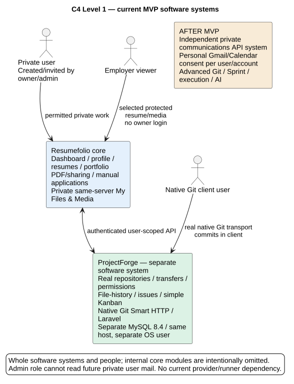

[Editable PlantUML](diagrams/drivers-c4-system-context.puml) · [PNG](diagrams/drivers-c4-system-context.png)

This view follows the official [C4 system-context abstraction](https://c4model.com/diagrams/system-context): people and whole software systems, with internal modules/stores omitted. It is a project-authored diagram, not a copied C4 example. External integration relationships do not certify their availability or permissions.

### UML use-case overview

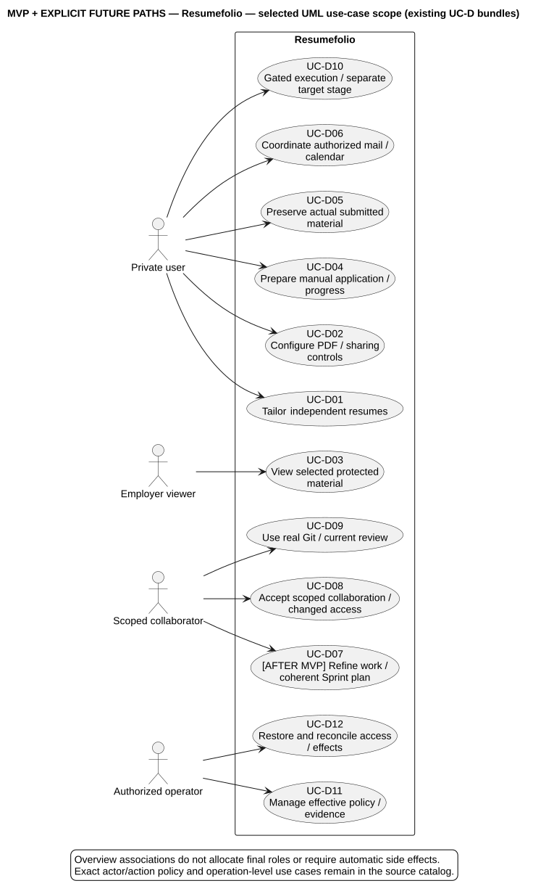

[Editable PlantUML](diagrams/drivers-uml-use-cases.puml) · [PNG](diagrams/drivers-uml-use-cases.png)

UC-D01–UC-D12 retain their meanings and source status in the [authoritative scenario catalog](../../02-requirements-engineering/04-scenarios-and-models/user-stories-and-scenarios.md). This is a selected actor association overview, not a new permission matrix or a replacement for the source's operation-specific use cases.

## 1. Design drivers

Architecture must preserve the agreed product behavior while remaining understandable and operable within the owner's resources. The following DD labels are local assessment locators, not new requirement identifiers.

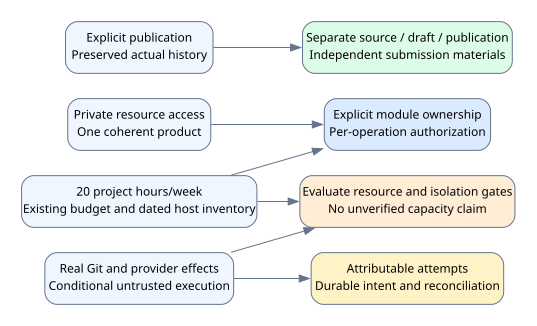

[Editable Graphviz](diagrams/drivers-to-architecture.dot) · [PNG](diagrams/drivers-to-architecture.png)

### Driver summary table

| Driver | Design implication | Decisive evaluation |
| --- | --- | --- |
| DD-01 — coherent private product | Explicit ownership and current scoped authority | Direct/cross-owner/changed-grant paths |
| DD-02 — independent content/history | Exact draft/publication/actual-material identity | Selected apply, separate publish, preserved actual copies |
| DD-03 — real Git and conditional execution | Native adapters and separate execution/target gates | Real client/ref behavior and demonstrated containment |
| DD-04 — remote effects | Durable intent, observation and reconciliation | Lost responses, partial effects and safe repetition limits |
| DD-05 — limited resources | Bounded dependency/runtime and operating burden | Actual combined workload and solo effort |
| DD-06 — recoverability | Consistent protected copy and isolated recovery | Usable records/bytes/refs/keys and current authority |

The DD records below retain exact source links and rationale. This table assigns no new priority or numerical acceptance target.

### DD-01 — One coherent product with private resource boundaries

**Source:** [Scope SCP-01–SCP-09](../../01-project-planning/02-scope.md); [accounts and permissions](../../02-requirements-engineering/03-requirements-specification/accounts-authentication-and-permissions.md).

Profiles/resumes, applications, communication, work and Git belong to one experience. Unified sign-in must not extend a board or repository grant to unrelated private information. A component boundary therefore needs explicit ownership and operation-specific authorization. Neither a shared database nor multiple services supplies this policy automatically.

### DD-02 — Independent drafts, explicit publication and actual history

**Source:** [accepted profile-update policy](../../02-requirements-engineering/07-change-and-baseline/open-questions-and-decisions.md#owner-accepted-profile-update-policy); [presentation requirements](../../02-requirements-engineering/03-requirements-specification/profiles-resumes-and-portfolio.md); [manual application requirements](../../02-requirements-engineering/03-requirements-specification/manual-application-management.md).

Source edits do not silently alter existing resumes. Selected application and publication are distinct operations. Resume overrides and actual submitted materials remain preserved. Architecture must represent these identities and consistency boundaries explicitly, rather than sharing one mutable content object across all workflows.

### DD-03 — Real Git and conditional execution

**Release applicability:** future-domain design retained after MVP; core operating/deployment and recovery controls still apply to MVP where relevant.

**Source:** Scope SCP-09/SCP-10; [Git requirements](../../02-requirements-engineering/03-requirements-specification/git-hosting-and-collaboration.md); [workflow requirements](../../02-requirements-engineering/03-requirements-specification/yaml-workflows-and-cicd.md).

Git means actual repository transfer and collaboration. Workflow execution means supported actual execution, subject to feasibility and safety gates; YAML validation alone is not a substitute. Repository operations, workflow attempts and target deployment need separate permissions and attributable outcomes. A successful merge does not authorize execution or deployment.

### DD-04 — Remote effects and honest failure states

**Source:** [mail/calendar requirements](../../02-requirements-engineering/03-requirements-specification/email-calendar-and-google-integration.md); [analysis interface contracts](../../03-system-analysis/06-interfaces-security-and-quality-analysis/12-interfaces-and-external-interactions.md).

Google operations, Git changes and deployment can have effects outside a local database transaction. Persist reviewed intent and attempt identity, distinguish pending/partial/unknown results and reconcile before consequential repetition. A timeout cannot establish that nothing happened remotely.

### DD-05 — Limited delivery and operating resources

**Source:** [resources and constraints](../../01-project-planning/05-resources-and-constraints.md); [confirmed capacity](../../01-project-planning/11-capacity-and-preliminary-sizing.md).

Plan against 20 total project hours/week, Laravel/OOP, existing resources and no assumed additional paid infrastructure. The November 1 demo observation reported 2 vCPU, 4 GB RAM and 40 GB disk. This is dated inventory, not representative-load proof or a final production topology. Ten initial users and possible growth toward roughly 1,000 are planning directions, not concurrency or capacity measurements.

### DD-06 — Recoverability and operational completeness

**Source:** [quality/recovery requirements](../../02-requirements-engineering/03-requirements-specification/quality-security-and-recovery-requirements.md); [qualified analysis handoff](../../03-system-analysis/07-review-and-design-handoff/14-feasibility-dependencies-and-design-handoff.md).

Backups were reported unconfigured and OAuth uncreated. The inspected demo did not establish working outbound delivery, workers or scheduling. The design must include their setup and verification paths without representing them as existing capabilities. Recoverable database/artifact/Git state matters more than a diagram labeled HA.

### Quality attribute utility tree

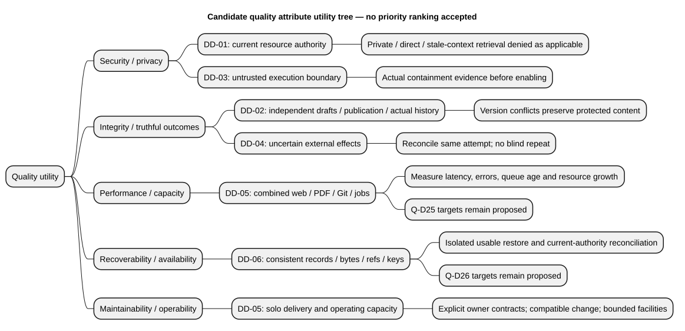

[Editable PlantUML](diagrams/drivers-quality-utility-tree.puml) · [PNG](diagrams/drivers-quality-utility-tree.png)

Leaves describe evaluation responses/measures, not demonstrated results. Stakeholder importance/difficulty rankings remain unassigned; Q-D25/Q-D26 target proposals retain their source status. See [quality scenarios](../06-design-quality-and-security-analysis/01-quality-attributes-and-design-trade-offs.md) for the full measurement contract.

## 2. Solution options

**Historical comparison, November 2:** the one-application/all-owner alternative is superseded in part by ADR-005. The options below remain rationale for core-internal modularity, not permission to combine core and ProjectForge.

Each option has a UML component view below. They compare responsibility/dependency organization, not selected runtime products or complete interface specifications. Shared external execution/target/recovery gates apply to all options; their omission from a schematic does not remove them. A C4 container is an application/data store, not a logical module; see the [official distinction](https://c4model.com/diagrams/container). No option view is mislabeled as a C4 Level 2 container diagram.

The options describe the organization of the trusted application. Executor isolation is evaluated separately because a process boundary alone is not a demonstrated security boundary. Layering and event-driven coordination can be used inside either a monolith or a service-based system; they are not mutually exclusive deployment options.

### Option A — Conventional monolith with weak internal boundaries

One application release and database support all features, with direct cross-feature access where convenient.

- **Strength:** smallest initial structural overhead; straightforward local calls and deployment.
- **Cost:** coupling and ownership become hard to reason about as publication, history, grants and external effects interact.
- **Failure risk:** a convenient shared model or global administrator check can bypass important product boundaries.
- **Assessment:** keep deployment simplicity, but reject weak internal ownership as the target design. A monolith can be disciplined; Option B makes that discipline explicit.

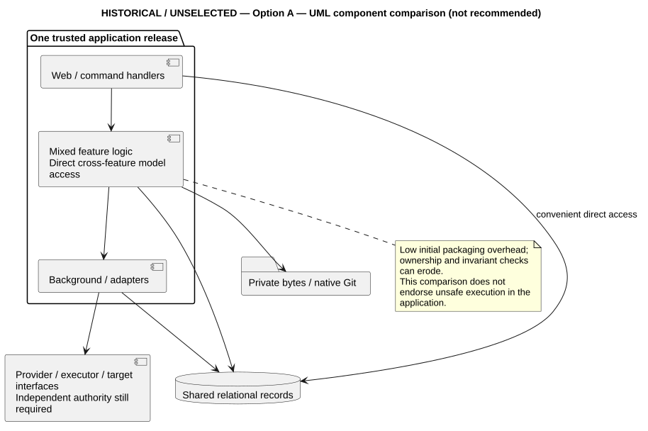

[Editable PlantUML](diagrams/drivers-option-a-components.puml) · [PNG](diagrams/drivers-option-a-components.png)

### Option B — Modular monolith with explicit adapters

Historical Option B proposed one coordinated trusted application release containing all modules. That common-system extent is superseded by ADR-005; a modular core remains a candidate. Web and supervised background processes can use the same compatible artifact. Provider/Git/storage/PDF/executor integrations sit behind explicit adapters.

- **Strength:** local transactional consistency, bounded operating complexity and visible ownership; supports incremental implementation.
- **Cost:** module boundaries require deliberate review and verification; shared infrastructure remains a contention/failure domain.
- **Failure risk:** nominal modules can still access each other's tables and become a distributed-looking folder arrangement without actual encapsulation.
- **Assessment:** preferred initial candidate, conditional on enforcement and actual feasibility findings.

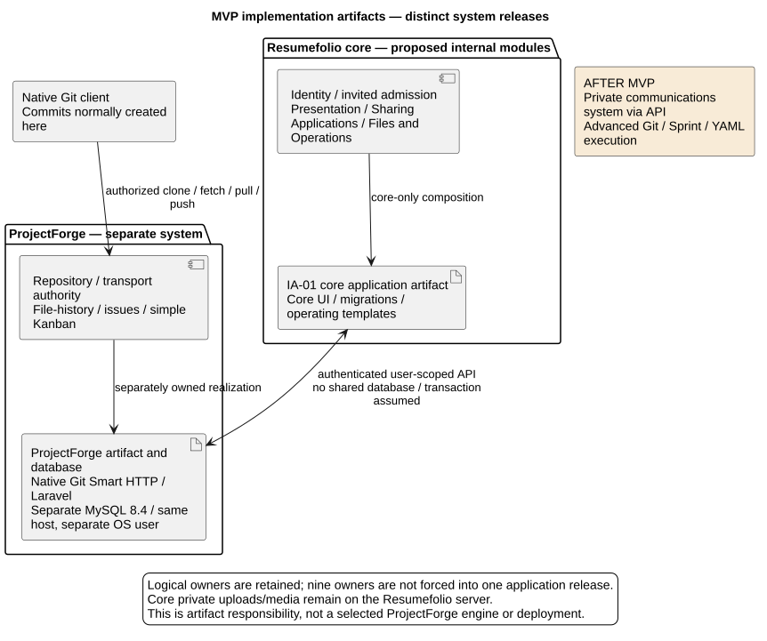

[Editable PlantUML](diagrams/drivers-option-b-components.puml) · [PNG](diagrams/drivers-option-b-components.png)

### Option C — Microservices from the beginning

Independently deployed services own their data and coordinate through network contracts.

- **Strength:** independent releases, scaling and failure containment can be useful when actual requirements justify them.
- **Cost:** distributed identity, consistency, compatibility, tracing, deployment and recovery add work across every scenario.
- **Failure risk:** additional processes on one undersized host do not establish HA; network and partial-result behavior expand the operating burden.
- **Assessment:** defer as the default architecture. Reconsider a specific extraction when measured resource, release, team or isolation needs outweigh its cost.

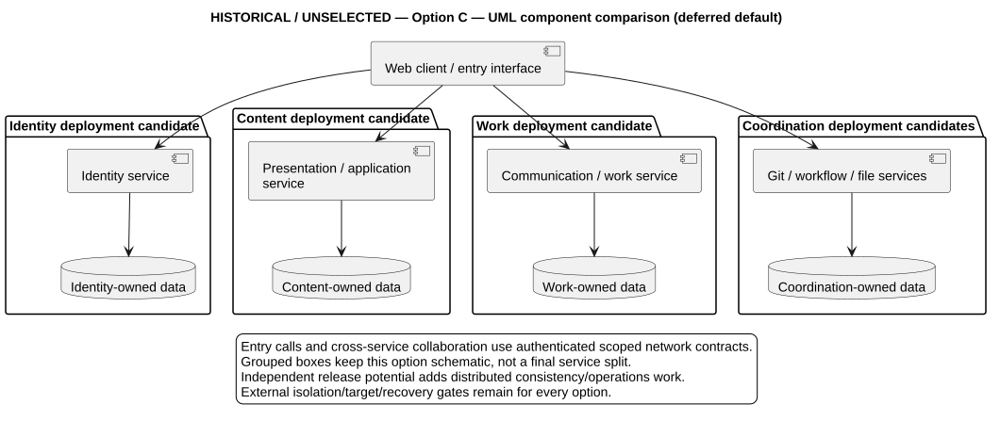

[Editable PlantUML](diagrams/drivers-option-c-components.puml) · [PNG](diagrams/drivers-option-c-components.png)

### Cross-option choice — Build, reuse or integrate

Implement product-specific ownership, publication and workflow coordination in the application. Evaluate existing engines/libraries for native Git, PDF rendering and execution facilities instead of rebuilding protocols or isolation primitives casually. Prior projects are behavioral references, not automatically approved dependencies. Exact packages, versions, licenses, maintenance, compatibility and costs need current authoritative checks at selection time.

## 3. Comparative assessment

This is qualitative engineering judgment grounded in the drivers, not benchmark evidence or a weighted numerical score. No arbitrary weights imply owner-agreed priorities.

| Criterion | A: weakly bounded monolith | B: modular monolith | C: initial microservices |
|---|---|---|---|
| Initial operating burden | Lower | Lower to moderate | Higher |
| Ownership visibility | Weak unless strengthened | Explicit by design | Explicit contracts required |
| Local consistency | Straightforward but easy to overcouple | Local transactions with module rules | Cross-service coordination needed |
| Independent release/scale | Limited | Limited; extraction possible | Stronger potential |
| Failure containment | Shared application | Shared trusted host; executor separate | Depends on actual deployment |
| Fit to current solo constraints | Simple initially; coupling risk | Best provisional balance | Additional burden not yet justified |

### Trade-off matrix and radar chart

The ordinal matrix below is an **illustrative author assessment requested for visual comparison**, not empirical scoring or owner-agreed weighting. Scale: 1 least favorable, 2 limited fit, 3 mixed/conditional, 4 favorable, 5 most favorable **for the stated criterion and option definitions**. Higher is more favorable; there is no total, average, winner calculation or decision meaning in polygon area.

| Criterion | A | B | C |
| --- | --- | --- | --- |
| Initial delivery simplicity | 5 | 4 | 1 |
| Ownership clarity | 1 | 4 | 4 |
| Local consistency | 4 | 4 | 2 |
| Independent release potential | 1 | 2 | 5 |
| Failure separation potential | 1 | 2 | 3 |
| Solo operations fit | 4 | 4 | 1 |

**Rationale:** A minimizes initial packaging but deliberately lacks enforced ownership; B adds contract work while retaining local deployment/transaction simplicity; C offers independent release potential but expands distributed state and solo operations. C's failure-separation score is conditional potential, not HA: independent services on one host may share failure/resource domains. None scores 5 for proven security, capacity or recovery, which are separate hard gates rather than compensable axes.

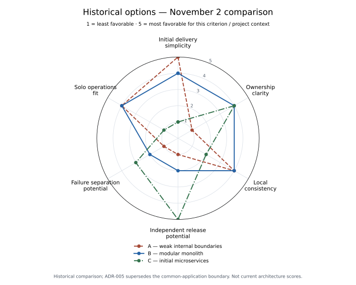

[Editable chart generator](diagrams/drivers-options-radar.py) · [Rubric/data](diagrams/drivers-options-radar.json) · [PNG](diagrams/drivers-options-radar.png)

These values make the existing qualitative rationale inspectable. They do not replace exact criteria or justify B by a weighted sum. Review/revise them if the option definition or evidence changes; retain the distinction between judgment and measurement.

**Scope correction:** the former all-owner modular-app recommendation does not satisfy the accepted separate ProjectForge boundary. Retain explicit modularity within the core while evaluating ProjectForge engine/placement/API and actual combined Git/media/recovery load. Deferred runner/provider workloads do not enter the MVP forecast.

**Evidence that would change the recommendation:** an actual safe/existing service offers materially better integration and operating cost; measured combined load requires independent placement; a component needs an independent release cadence; or accepted quality targets require demonstrable failure separation. These findings may justify a targeted hybrid rather than converting every component to a service.

## 4. Proposed solution

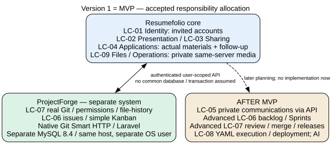

[Editable Graphviz](diagrams/proposed-solution-boundaries.dot) · [PNG](diagrams/proposed-solution-boundaries.png)

**Responsibility allocation:** core owns Identity/Access, Presentation, Sharing, Applications and Files/Operations. ProjectForge owns basic Git/Work in MVP. Communication/Calendar and advanced Workflow/Deployment are future responsibilities. See the [component catalog](../03-component-and-module-design/README.md). This diagram groups responsibilities; it does not select concrete packages, network protocols or a physically separate host for each box.

**Local mutation:** authorize the exact operation, validate expected revision, apply the bounded local transaction and record the result. Use relational persistence for transactional records as a recommendation; final engine/schema selection remains in [Data Design](../04-data-design/README.md).

**Durable asynchronous work:** record pending external intent and a stable attempt identity before dispatch. A durable outbox or equivalent mechanism closes the commit/dispatch gap. Workers recheck relevant current authority and reconcile ambiguous remote effects. PDF generation, synchronization and cleanup need explicit resource limits and observable progress.

**Native Git boundary:** the product coordinates an evaluated Git implementation and native repository state. Compare expected refs using Git semantics; an SQL transaction cannot make a filesystem/ref update atomic by itself. Git credentials and browser sessions have distinct contracts.

**Execution boundary:** never run untrusted jobs as the web identity with application secrets or unrestricted application storage. Isolation, networking, credentials, quotas, cleanup and cancel/stop behavior must be demonstrated before enabling jobs. No facility has been selected or verified by this document.

**Deployment authority:** release of an evaluated artifact to a target is a separate reviewed action. A workflow result is evidence about that attempt, not implicit permission to mutate a target.

**Recovery:** retain consistent database, private artifact, repository and configuration/key coverage in an independent recoverable backup set. A single-node candidate is not HA. Final recovery targets/destination and an actual isolated restore demonstration remain prerequisites at their applicable gates.

### UML deployment candidate

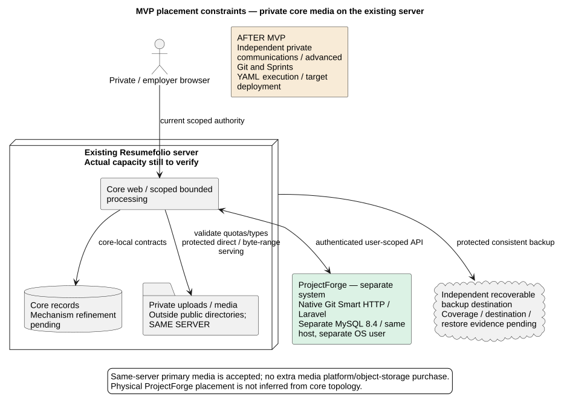

[Editable PlantUML](diagrams/drivers-uml-deployment.puml) · [PNG](diagrams/drivers-uml-deployment.png)

This is the preferred option's candidate placement, not the observed server or accepted physical topology. Same-release web/background artifacts do not imply separate hosts. No backup destination or safe executor has been established. Detailed [deployment design](04-deployment-topology-nodes-and-networks.md) remains authoritative for placement and access-zone refinement.

### Critical UML sequence — selected apply and publication

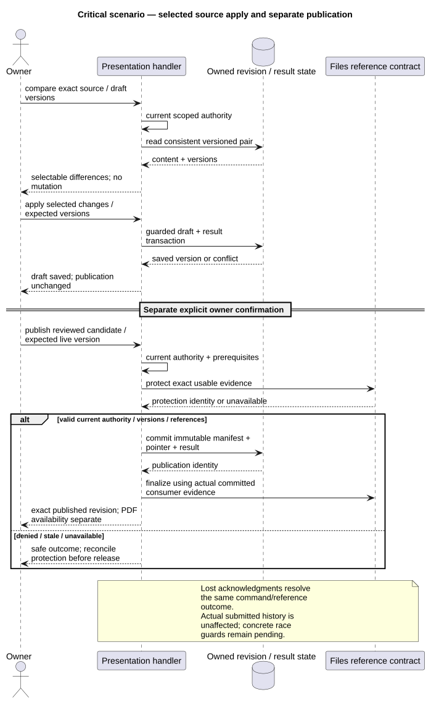

[Editable PlantUML](diagrams/drivers-critical-publication-sequence.puml) · [PNG](diagrams/drivers-critical-publication-sequence.png)

This scenario was chosen because it exercises the accepted independence rule, current authority, version guards, local persistence and cross-owner artifact protection. It refines [UC-D01](../../02-requirements-engineering/04-scenarios-and-models/user-stories-and-scenarios.md#uc-d01); the [Presentation component](../03-component-and-module-design/components/professional-presentation.md) owns the detailed contract. Exact synchronization/reference protocols remain implementation work.

## 5. Open decisions and evidence gates

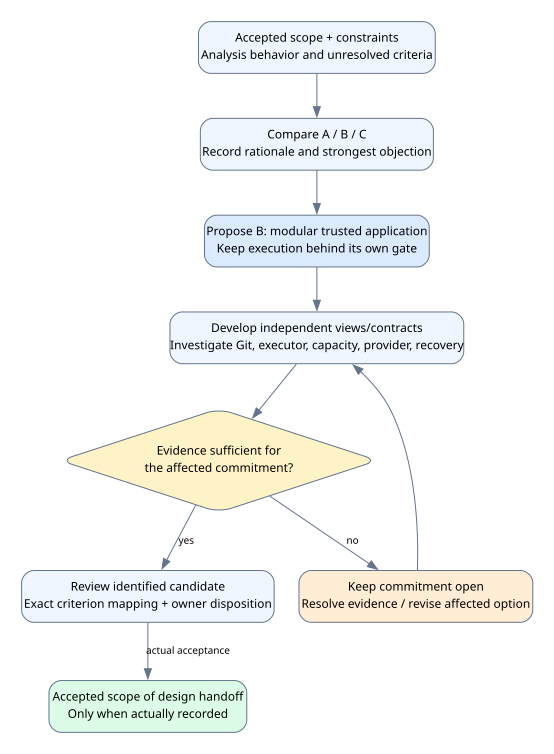

[Editable Graphviz](diagrams/architecture-decision-route.dot) · [PNG](diagrams/architecture-decision-route.png)

### G1 — Git implementation and repository contract

Compare reusable engines/integration methods against required real transfer, authorization, ref/review behavior, recovery, resource use and operating effort. **Completion evidence:** controlled transfer/denial/conflict cases, supported feature boundaries and an attributable compatibility/license assessment. Owner: Farhad, with Codex preparing the assessment.

### G2 — Workflow language and safe execution facility

**Release applicability:** future-domain design retained after MVP; core operating/deployment and recovery controls still apply to MVP where relevant.

Define supported syntax/triggers and compare feasible executor facilities without assuming new spending. **Completion evidence:** actual isolated admission, limits, secrets, cancellation, lost-runner reconciliation and cleanup checks. Drafting the interface can proceed; enabling execution cannot rely on these diagrams alone.

### G3 — Persistence and combined capacity

Evaluate engine/version, artifact/repository growth, transaction needs and simultaneous web/background workloads. **Completion evidence:** justified storage choice, explicit workload, measured bottlenecks and enforceable admission/retention policies. No numerical default or capacity Pass is assigned here.

### G4 — Provider and operating prerequisites

Create/configure permitted OAuth and delivery facilities, configure workers/scheduler and verify required operations. **Completion evidence:** scoped provider access, actual controlled send/sync behavior, attributable job processing and operating observations. Do not repeat the already answered setup-existence questions.

### G5 — Recovery and measurable quality

Determine independent backup/key coverage and applicable quality targets. **Completion evidence:** suitable isolated restoration, integrity/current-authority checks and measured comparisons to agreed targets. A successful backup command alone does not establish recoverability.

### G6 — Exact traceability and delivery agreement

Reconcile affected requirement criteria and analysis contracts against this candidate, then refine full engineering effort and tracking against 20 hours/week. **Completion evidence:** identified source/design candidate, actual review findings, resolved or explicitly scoped gates and actual owner disposition. Requested dates are not accepted forecasts.

## 6. Decision and continuation

### Architecture Decision Record

The concrete record is [ADR-001 — Modular Application Boundaries](../07-design-decisions/ADR-001-modular-application-boundaries.md). It already contains context, three alternatives, proposed decision, consequences, validation and revisit conditions; reuse it rather than create a duplicate ADR for these diagrams. **Status remains Proposed; Farhad's actual scoped disposition is pending.** The new matrix/radar is qualitative supporting rationale, not acceptance evidence or a new ADR allocation.

The recommendation is represented in [ADR-001](../07-design-decisions/ADR-001-modular-application-boundaries.md). Publication/history identity and durable external attempts are supported by [ADR-002](../07-design-decisions/ADR-002-explicit-publication-and-history.md) and [ADR-003](../07-design-decisions/ADR-003-durable-external-attempts.md). ADR-001 is superseded in part by ADR-005; ADR-002/003 technical mechanisms remain proposed.

1. Review B's responsibility boundaries and the strongest objection against accepted scope.
2. Develop [logical decomposition](02-system-decomposition-and-boundaries.md), [runtime coordination](03-process-view-concurrency-and-runtime-behavior.md) and [deployment options](04-deployment-topology-nodes-and-networks.md) consistently with the data/interface/security records.
3. Investigate the decisive G1–G5 questions before accepting the commitments they affect; continue independent technical refinement in parallel.
4. Record exact criterion/contract mappings and actual review in the [design review and handoff](../06-design-quality-and-security-analysis/05-design-review-traceability-and-handoff.md).
5. Obtain the scoped owner decision for an identified candidate before the agreed implementation handoff.

**Review limits:** the comparison is a source-based design assessment, not a current dependency audit, live server check, benchmark, security test or recovery exercise. Advisor consultation was unavailable in this environment; no independent advisor endorsement is claimed. Diagram/link checks establish document integrity only.

## 7. FAU basis and diagram reading guide

FAU V07 slides 3–5 and 15–20 motivate solution alternatives, rationale, quality and a consistent extension of analysis. Slides 21–34 supply viewpoints and decomposition/cross-cutting principles. V08 distinguishes architecture from component-level prescriptions. This document adapts those teaching concepts to Resumefolio; the six-topic filenames and DD/G locators are project conventions.

The original three overview diagrams remain. The added C4 context, utility tree, UML use cases, three UML option component views, UML deployment, critical UML sequence and qualitative radar/matrix serve distinct purposes. All source/export links are below their owning figures. The ADR is maintained once in the shared decision folder. None of these views establishes configured facilities, measured quality or acceptance. See the [reference map](../01-reference-and-coverage-map.md) and [diagram catalog](diagrams/README.md).
