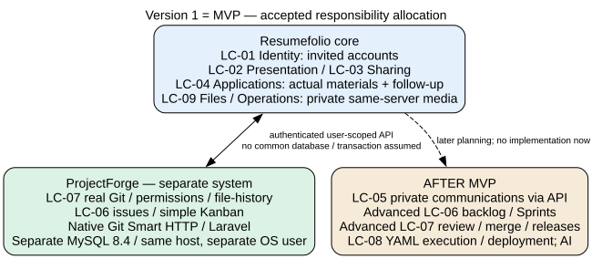
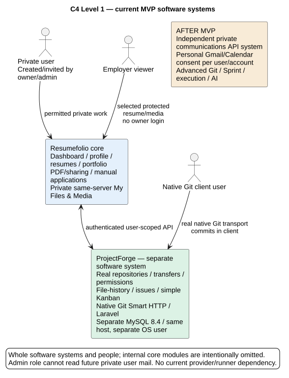
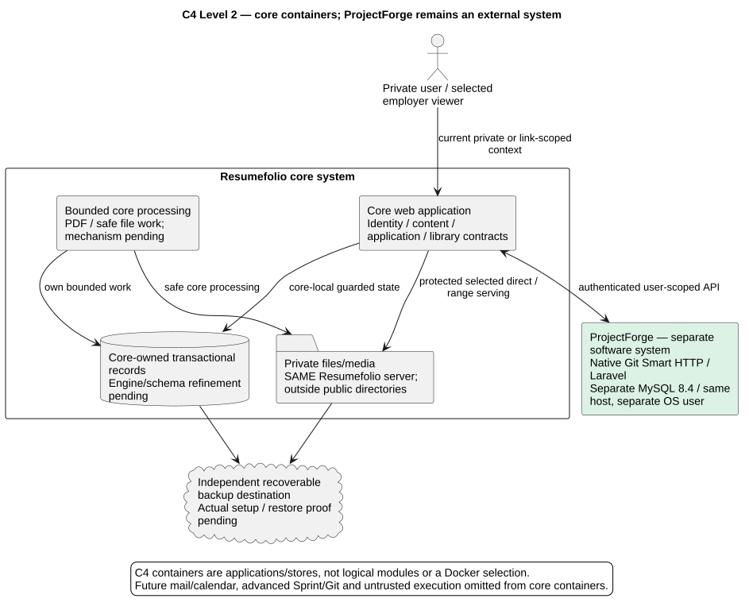
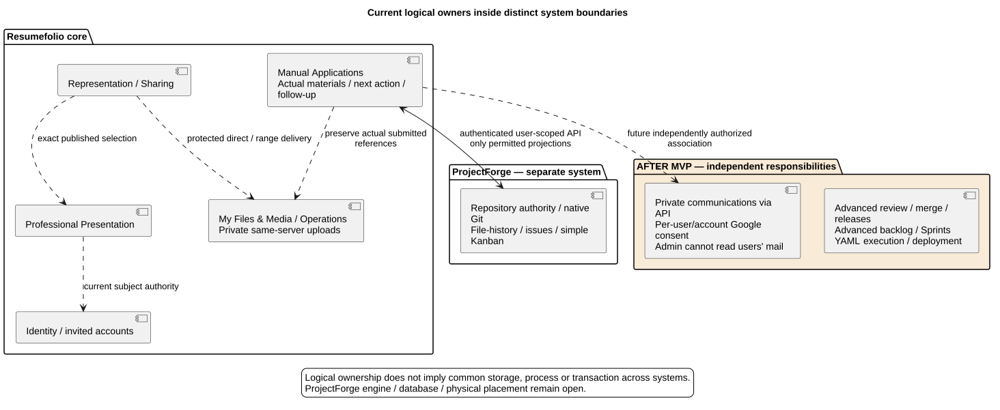
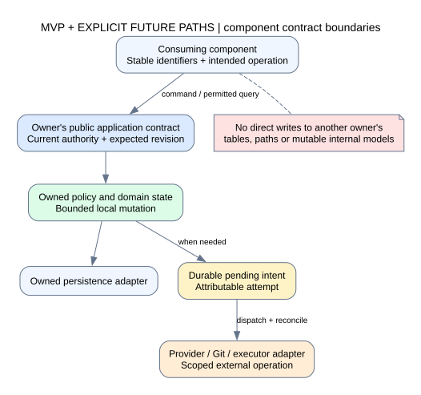
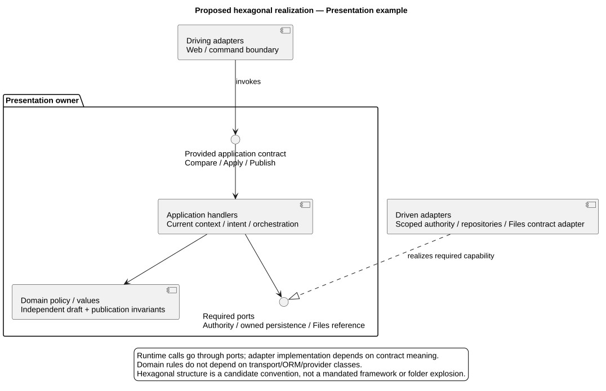
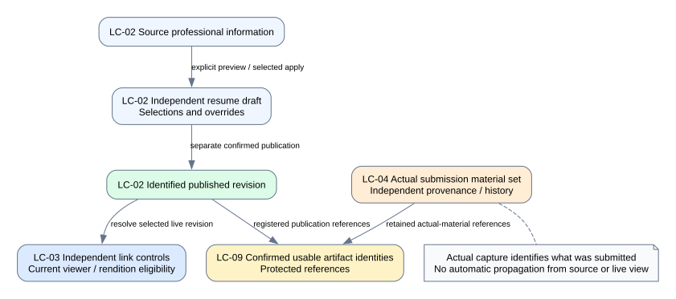
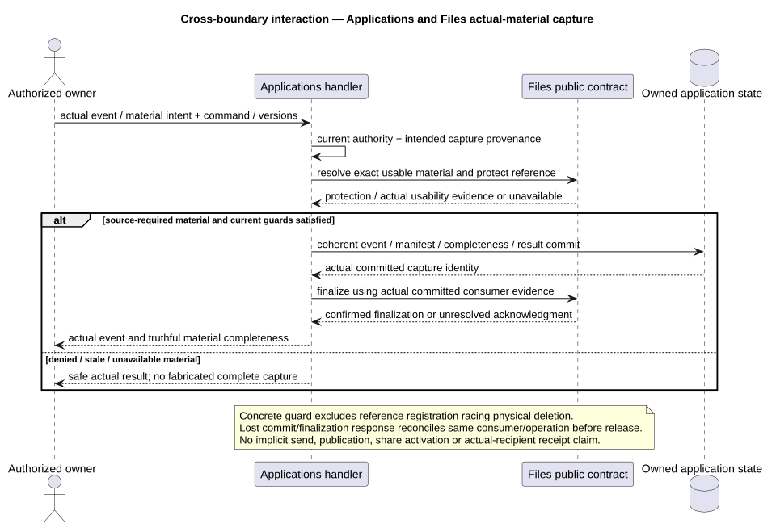
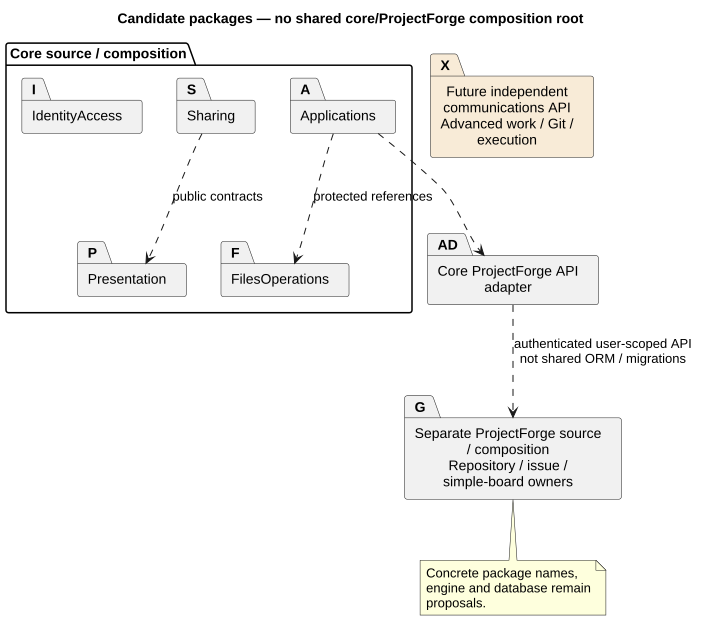
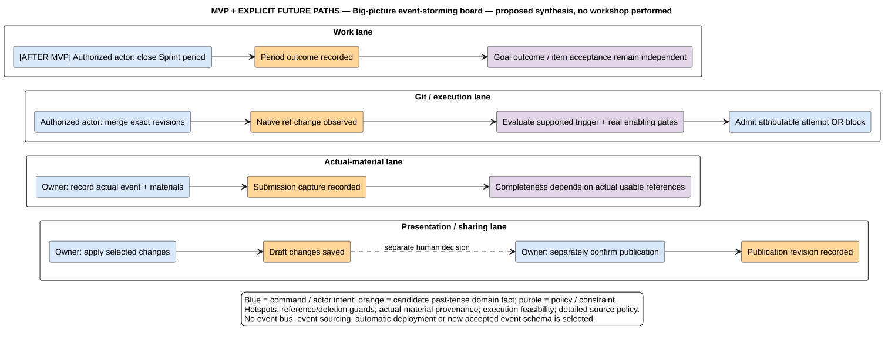

# Resumefolio — System Decomposition and Boundaries

## Current implementation baseline — November 4, 2026

[BL-MVP-2026-11-04.1](../../../baseline/README.md) selects the MVP technical mechanisms, numerical policies, priorities and requirement/criterion dispositions under Farhad’s explicit delegation. It supersedes earlier Proposed/pending mechanism and whole-baseline statements below for MVP design input. Future clauses and dated evidence remain separate. Runtime/actor validation, credentials, Git isolation, capacity and backup/restore still require the named implementation/Release gates; this update reports no product test Pass.

### Prior source material and rationale (superseded where this Baseline selects a different MVP choice)

**Proposed structure:** logical components allocated across the Resumefolio core, separate ProjectForge system and deferred communications/execution responsibilities, with explicit interfaces to native Git, providers, artifact storage and a conditionally enabled execution facility.

**Status:** proposed logical architecture, November 2, 2026. These are responsibility and information boundaries, not nine microservices, nine databases or an accepted physical deployment. Farhad retains decision authority.

[Overview](#1-system-and-component-boundaries) · [Catalog](#2-component-responsibility-catalog) · [Interfaces](#3-public-interfaces-and-dependency-rules) · [Consistency](#4-information-and-consistency-boundaries) · [Access](#5-access-and-trust-boundaries) · [Review](#7-review-and-continuation) · [DDD/context views](#6-ddd-interpretation-and-implementation-mapping)

## Current MVP boundary figure

[Editable source](diagrams/mvp-system-boundaries.puml) · [PNG](diagrams/mvp-system-boundaries.png). Historical broader-product figures below retain earlier alternatives/detail; they do not define the current system boundary.

## MVP system allocation and design status

The accepted system boundary separates the Resumefolio core from ProjectForge, joined by an authenticated user-scoped API. Logical responsibilities remain useful within each system; they do not authorize a shared core/ProjectForge process, database or transaction. Core owns dashboard, invited accounts, professional presentation, protected sharing, manual applications and same-server private My Files & Media. ProjectForge MVP owns real repositories/transfers/permissions, file/history browsing, issues and simple Kanban. Its selected engine is native Git Smart HTTP behind the independent Laravel ProjectForge service, with its own MySQL 8.4 database and OS/storage boundaries on the existing host; BL-MVP-2026-11-04.1 governs implementation and evidence gates. The future communications system is independently private and API connected. Advanced Git review/releases, backlog/Sprints and execution/deployment remain deferred. Keep source, independent resume draft, explicit publication and actual submitted material identities distinct. Profile changes require preview/select/apply and cannot mutate publication or submitted history. Manual applications include status, next action and follow-up date without mail/calendar dependencies.

Authority: [OWNER-MVP-2026-11-04](../../01-project-planning/owner-mvp-decision-2026-11-04.md).

## 1. System and component boundaries

This view realizes the [architecture recommendation](01-design-drivers-and-solution-options.md) under [accepted scope](../../01-project-planning/02-scope.md). Existing [analysis context](../../03-system-analysis/01-foundations-and-system-context/02-system-context-and-boundaries.md), [domain model](../../03-system-analysis/02-domain-and-information-analysis/03-domain-model-and-object-oriented-view.md) and [interface analysis](../../03-system-analysis/06-interfaces-security-and-quality-analysis/12-interfaces-and-external-interactions.md) remain authoritative about required meaning and behavior.

[Editable DOT](diagrams/logical-component-ownership.dot) · [PNG](diagrams/logical-component-ownership.png)

Browser/employer users access the core through their own scoped contexts. Git clients access ProjectForge through repository grants. Core and ProjectForge communicate through authenticated user-scoped API, not shared module/database access. Internal core modules may use an evaluated common artifact/store without transferring ownership. Future provider/deployment targets remain separate deferred responsibilities.

The overview groups components for readability. It deliberately omits a mesh of possible calls; the contract catalog and interaction view specify actual dependencies. Execution is an external trust boundary even if a later feasible facility uses colocated hardware. Colocation alone does not establish isolation.

### C4 Level 1 — whole-system context

[Editable PlantUML](diagrams/drivers-c4-system-context.puml) · [PNG](diagrams/drivers-c4-system-context.png) · [Owning context record](01-design-drivers-and-solution-options.md#0-system-context-and-use-case-scope)

Reuse the same C4 Level 1 view rather than create a competing context boundary. It shows people and external systems, not internal modules.

### C4 Level 2 — applications and data stores

[Editable PlantUML](diagrams/boundaries-c4-containers.puml) · [PNG](diagrams/boundaries-c4-containers.png)

This proposed container view follows [C4's application/data-store abstraction](https://c4model.com/diagrams/container). Logical modules are not containers; a C4 container is not necessarily a Docker container. Web and background applications may share one release, while physical host multiplicity and mechanisms remain in deployment design. Conditional execution is shown as an unevaluated separate trust domain, not an enabled facility.

## 2. Component responsibility catalog

LC identifiers are local architecture locators, not newly allocated requirements. Requirement families establish source context, not complete criterion coverage. Concrete component records refine these responsibilities into implementation prescriptions.

### LC-01 — Identity and Access

**Owns:** Accounts, invitations, sessions and resource-grant records.

**Provides:** AuthenticateContext; EvaluateAuthority; ChangeGrant; RevokeAccess.

**Consumers and dependencies:** All private components consume scoped identity/authority. The resource owner still checks its lifecycle, operation and effective policy.

**Boundary invariant:** No universal permission follows from login, collaboration membership or an administrative label. Do not expose credential material to consumers.

**Source context:** ACC. [Component design](../03-component-and-module-design/components/identity-and-access.md).

### LC-02 — Professional Presentation

**Owns:** Profiles, resume drafts, independent overrides, evidence selections and publication revision identities.

**Provides:** CompareSource; ApplySelectedChanges; SaveDraft; PublishRevision; ResolvePublication.

**Consumers and dependencies:** Sharing requests the selected published presentation; Applications may associate preparation references and capture exact actual material identities.

**Boundary invariant:** A source change cannot publish. Apply selected differences and separately confirm publication; preserve overrides and actual submitted history.

**Source context:** PRP. [Component design](../03-component-and-module-design/components/professional-presentation.md).

### LC-03 — Representation and Sharing

**Owns:** Per-resume download configuration, sharing links and link-scoped viewer authorization.

**Provides:** ConfigureDownloads; ChangeLinkPassword; DisableLink; RetrieveRepresentation.

**Consumers and dependencies:** Consumes current authority, published selection and confirmed artifact availability. PDF rendering is an adapter operation owned by this boundary; Files manages artifact admission/lifecycle.

**Boundary invariant:** Link eligibility, PDF mode, representation availability and viewer authority are distinct. Recheck direct retrieval; never silently substitute unavailable language/content.

**Source context:** PDF / ACC. [Component design](../03-component-and-module-design/components/representation-and-sharing.md).

### LC-04 — Manual Applications

**Owns:** Company/opportunity preparation, manual progress, actual submission events and their material manifests.

**Provides:** SavePreparation; RecordProgress; CaptureActualSubmission; CorrectSubmissionRecord.

**Consumers and dependencies:** Associates explicit resume, correspondence and calendar identifiers without acquiring their private access. Uses Files to retain protected actual artifacts.

**Boundary invariant:** Progress is not evidence of external submission. Actual materials have stable provenance independent of the latest draft/live view.

**Source context:** APP. [Component design](../03-component-and-module-design/components/applications.md).

### LC-05 — Communication and Calendar

**Current placement:** After MVP: independent private communications system via API.

**Release applicability:** future-domain design retained after MVP; core operating/deployment and recovery controls still apply to MVP where relevant.

**Owns:** Provider capability/connection state, local drafts/activities, send attempts and synchronization mappings.

**Provides:** PrepareSend; DispatchReviewedIntent; ReconcileSend; ReconcileCalendarMapping.

**Consumers and dependencies:** Uses scoped provider adapters, current capability and durable work dispatch. Applications can link permitted correspondence/activity summaries.

**Boundary invariant:** Local unlink differs from provider deletion. Provider acceptance is not receipt; uncertain sends require reconciliation rather than blind resend.

**Source context:** EGC. [Component design](../03-component-and-module-design/components/communication-and-calendar.md).

### LC-06 — Work Management

**Current placement:** MVP ProjectForge simple Kanban/issues; advanced backlog/Sprints deferred.

**Owns:** Projects, boards, items/tasks, scoped membership and Sprint Goal/selection/plan aggregates.

**Provides:** MoveWork; RefineItem; PlanSprint; CloseSprintPeriod; ChangeMembership.

**Consumers and dependencies:** Links permitted repository/revision context through Git contracts and stable identifiers. Uses current resource-grant context.

**Boundary invariant:** One coherent Sprint Backlog per Sprint. Period end, work completion, review/merge and actual acceptance remain different facts.

**Source context:** PKS. [Component design](../03-component-and-module-design/components/work-management.md).

### LC-07 — Git Collaboration

**Current placement:** MVP ProjectForge basic repositories/transfers/permissions/file-history/issues; advanced review/releases deferred.

**Owns:** Repository metadata and native-store identity, ref/review context, issues, milestones, tags and releases.

**Provides:** TransferGit; ForkRepository; ReviewRevision; MergeExpectedRefs; CreateRelease.

**Consumers and dependencies:** Native Git backend implements actual object/ref/transport semantics. Work can reference permitted summaries; Workflow Coordination evaluates eligible revision notifications.

**Boundary invariant:** Recheck exact repository/ref grants and expected source/target revisions. Merge grants neither execution eligibility nor deployment authority.

**Source context:** GIT. [Component design](../03-component-and-module-design/components/git-collaboration.md).

### LC-08 — Workflow and Deployment Coordination

**Current placement:** After MVP: no product YAML execution/deployment.

**Release applicability:** future-domain design retained after MVP; core operating/deployment and recovery controls still apply to MVP where relevant.

**Owns:** Supported workflow definitions, admitted attempts, bounded result/output references and separate deployment attempts.

**Provides:** ValidateSupportedDefinition; AdmitAttempt; RequestCancel; ReconcileAttempt; DeployApprovedArtifact.

**Consumers and dependencies:** Consumes exact Git revision and supported definition; requests an evaluated executor through a narrow adapter. Files owns admitted artifact storage; target access is separately authorized.

**Boundary invariant:** Execution stays gated until isolation/resource/secret/cleanup behavior is demonstrated. Cancel requested is not stopped; run success is not target authorization.

**Source context:** YML. [Component design](../03-component-and-module-design/components/workflow-and-deployment.md).

### LC-09 — Files and Operations

**Owns:** Artifact identity/availability, quota reservations, effective file policy, protected reference accounting and recovery records.

**Provides:** ReserveGrowth; FinalizeArtifact; ReplaceReference; CollectUnreferencedBytes; AssessRecovery.

**Consumers and dependencies:** Other owners register attributable references and request permitted artifacts through contracts. Operating adapters manage actual storage and recovery facilities.

**Boundary invariant:** Reference retirement is not proof of reclaimed bytes. Replacement retains prior usable state until confirmed. Recovery rechecks authority and does not replay remote effects.

**Source context:** AFO / QSR. [Component design](../03-component-and-module-design/components/files-and-operations.md).

### UML component view

[Editable PlantUML](diagrams/boundaries-uml-components.puml) · [PNG](diagrams/boundaries-uml-components.png)

This is explicitly a UML logical component view. [C4 Level 3](https://c4model.com/diagrams/component) decomposes one container; the selected collaborations here span logical owners whose code can be reused by web/worker artifacts, so no false single-container Level 3 claim is made. The existing detailed component catalog remains authoritative for operations.

### Data ownership matrix — logical owners, not nine services

| Owner | Authoritative logical data | Other consumers use |
| --- | --- | --- |
| Identity / Access | Account/session/verifier/grant and authority changes | Current scoped context; no secrets or universal role bypass |
| Presentation | Source/draft/override/selection and publication manifests | Exact permitted revision projections |
| Sharing | Link/viewer generation, download configuration, rendition associations | Current eligible representation contract |
| Applications | Preparation/progress and actual submission/material completeness | Permitted application/history summaries |
| Communication / Calendar | Provider capability, local intent/associations and effect/mapping observations | Independently authorized summaries; provider truth stays external |
| Work | Project/board/item/task, membership relationships, coherent Sprint plan/outcomes | Permitted work projections; no implied Git grant |
| Git | Repository/ref/review policy, native storage association and actual observations | Exact permitted repository/revision context |
| Workflow / Deployment | Definition/run/attempt/output/cleanup and separate target approval/effects | Attributable permitted attempt/result projection |
| Files / Operations | Artifact usability, quota/reservation, protected references and reclamation | Scoped usable identity and reference/admission contracts |

Within one system, evaluated local relational storage may enforce cross-record integrity without transferring ownership. No core/ProjectForge shared store or cross-system transaction is selected. Provider state, native Git refs and stored bytes remain actual external/store facts; metadata alone does not control them. See [shared data design](../04-data-design/01-analysis-to-logical-and-physical-data-models.md).

### Responsibility table — CRC-style at component scale

| Component | Responsibilities | Principal collaborators |
| --- | --- | --- |
| Identity / Access | Establish current attributable context and scoped authority lifecycle | Every protected resource owner |
| Presentation | Compare/select/apply, preserve independent drafts, separately publish | Identity; Files; Sharing/Applications as consumers |
| Sharing | Manage links/variants and admit exact protected retrieval | Identity; Presentation; Files |
| Applications | Record deliberate progress and actual-material provenance/completeness | Identity; Files; permitted Presentation/Communication contracts |
| Communication / Calendar | Coordinate authorized provider/local operations and uncertain effects | Identity; Files; provider adapters |
| Work | Maintain coherent work/Sprint meaning and scoped collaboration | Identity; permitted Git projections |
| Git | Coordinate real native transfer/ref/review authority and observations | Identity; Files; native Git adapter |
| Workflow / Deployment | Gate attempts and separately approved target effects | Identity; Git; Files; executor/target adapters |
| Files / Operations | Admit growth, protect exact references and reconcile reclamation/recovery | Identity; resource consumers; storage/operating adapters |

CRC-style means responsibilities/collaborators are summarized at component scale; these are not implementation class cards or a complete bidirectional dependency graph.

## 3. Public interfaces and dependency rules

[Editable DOT](diagrams/component-contract-boundaries.dot) · [PNG](diagrams/component-contract-boundaries.png)

1. A component changes only its own domain state. Consumers call its public application contract; they do not update its tables, construct internal ORM objects or use a storage path to bypass policy.
2. Contracts carry stable resource/actor/operation identities and expected revisions where appropriate. Return permitted data projections and attributable outcomes instead of unrestricted mutable entities.
3. The owning component authorizes the requested operation using current context. A caller's earlier check cannot replace this check, especially after a grant, link or account change.
4. Framework integration, logging, clocks, dispatch and persistence adapters are technical dependencies. Keep shared types small; do not create a universal shared business model or circular module service calls.
5. Read models may combine independently permitted projections. Aggregating information does not transfer ownership or grant access to linked resources.
6. Cross-boundary reactions are explicit. A stored event such as a confirmed Git revision is input to eligibility evaluation, not automatic authority to launch a job or deploy.

**Provided/required contract examples:** Sharing requires ResolvePublication and ResolveUsableArtifact; Applications requires permitted presentation/material capture references; Git requires authority evaluation and its native repository adapter; Workflow Coordination requires evaluated revision context, artifact admission and executor control. The final signatures/types belong in the [component packages](../03-component-and-module-design/README.md) and [interface design](../05-interface-and-api-design/README.md).

**Dependency-cycle rule:** separate orchestration from ownership. For example, Applications stores a correspondence identifier; Communication exposes an independently authorized summary. Neither requires the other to construct its internal model. For multi-owner lifecycle changes, use an explicit coordinating command and attributable pending work, rather than recursive callbacks between resource owners.

### Module dependency direction

[Editable PlantUML](diagrams/boundaries-module-dependencies.puml) · [PNG](diagrams/boundaries-module-dependencies.png)

Consumer-to-provider arrows describe selected code/contract dependencies, not event-flow direction. Current authority is common to protected owners; omitted mesh edges do not waive it. Interface definitions remain owned by the provider; no shared unrestricted ORM model or recursive owner callback is introduced.

### Hexagonal realization example

[Editable PlantUML](diagrams/boundaries-hexagonal-module.puml) · [PNG](diagrams/boundaries-hexagonal-module.png)

The example separates driving adapters, owner application/domain logic and required ports/driven adapters. Composition wires actual implementations; transport/ORM/provider details do not acquire domain ownership. It is a candidate convention, not a new framework choice.

## 4. Information and consistency boundaries

### Source, draft, publication and actual materials

[Editable DOT](diagrams/presentation-history-boundaries.dot) · [PNG](diagrams/presentation-history-boundaries.png)

Presentation compares identified source and draft versions, applies only selected changes, and saves the draft. A separate publication confirmation creates an identified publication revision and changes the live pointer atomically within the chosen persistence mechanism. Link controls remain owned by Sharing. Files confirms artifact usability and protected reference identity; Applications retains actual submitted material manifests independently.

No arrow in this diagram means automatic propagation. An actual submission record must identify actual material/provenance, not merely copy whichever live revision exists when a later job executes. Physical artifact deduplication is possible only while ownership, immutability and reference-preservation semantics remain intact.

### Local atomicity versus external effects

Within a bounded local command, validate current authority/version and commit intended state plus durable pending intent together where required. A queued handler rechecks relevant capability and reconciles an existing attempt before consequential repetition. Remote mail, Git refs, runner state and deployment targets are not made atomic by a relational transaction.

Quota reservation/finalization belongs to Files; published-pointer changes to Presentation; sharing-link version changes to Sharing; actual-material capture to Applications; Sprint Goal/selection/plan consistency to Work. Git performs expected-ref comparison through Git semantics. Workflow and deployment each retain independent attempt and authority context. See [runtime design](03-process-view-concurrency-and-runtime-behavior.md) for coordination and [data design](../04-data-design/README.md) for logical/physical realization.

### Lifecycle across owners

Deletion/unlink/retirement is an operation on a particular owner and reference, not permission for universal cascade deletion. Before physical reclamation, Files checks registered protected references, including publications and actual submissions. Disconnection does not delete retained local correspondence/calendar state or replay external actions. Restoration records current authority and external reconciliation explicitly. Exact lifecycle decisions remain in the [source register](../../02-requirements-engineering/07-change-and-baseline/open-questions-and-decisions.md).

### Cross-boundary UML sequence — actual material capture

[Editable PlantUML](diagrams/boundaries-cross-context-capture.puml) · [PNG](diagrams/boundaries-cross-context-capture.png)

This refines the [Applications capture contract](../03-component-and-module-design/components/applications.md) and [Files reference protocol](../03-component-and-module-design/components/files-and-operations.md). The same capture event may be recorded with incomplete material according to its actual source contract; the diagram's unavailable branch must not fabricate a nonexistent event or a complete usable set. Exact consumer/reference/transaction guards remain implementation work.

## 5. Access and trust boundaries

**Private product access:** account/session identity establishes who is acting. Resource-specific grants, lifecycle and operation policy determine what may happen. Administrative powers must follow the source matrix rather than an inferred global bypass.

**Employer access:** link-scoped viewer authorization does not become a private product session. Current account/link eligibility, password-derived scope, revocation version and requested publication/rendition are evaluated before delivery admission. Disabled links prevent later eligible retrieval but cannot retract already emitted bytes or legitimate downloaded copies.

**Provider and Git access:** credentials are scoped to the intended capability and operation. Browser authentication does not automatically provide Git transport credentials. A provider connection's existence is not proof of actual permission or current freshness.

**Untrusted execution:** repository content and workflow definitions are data until admitted into an evaluated executor. The web process must not execute arbitrary user code with application credentials or unrestricted private storage. Secret scope, resource limits, network/filesystem isolation, cancellation and cleanup require actual evidence before enablement. Deployment remains separately authorized.

## 6. DDD interpretation and implementation mapping

These logical components are candidate bounded contexts, chosen because vocabulary, ownership and invariants differ. This does not mandate a full DDD framework, event sourcing, separate services or one aggregate per database table.

Treat draft/publication, actual submission, Sprint Backlog, repository-ref integration and workflow attempt as explicit consistency subjects. Refine aggregate boundaries only where their invariants justify local atomicity. For external state, keep an attributable observation/attempt model rather than pretending local entities control the provider's truth.

The implementation view maps logical components to module packages and artifacts. Multiple components can share an application artifact; native Git storage, private artifact bytes and an executor facility need their own technical contracts. The deployment view subsequently maps artifacts/processes to actual facilities. See [implementation mapping](../03-component-and-module-design/02-implementation-view-and-artifacts.md) and [deployment view](04-deployment-topology-nodes-and-networks.md).

### Candidate bounded contexts

[Editable PlantUML](diagrams/boundaries-ddd-contexts.puml) · [PNG](diagrams/boundaries-ddd-contexts.png)

[DDD bounded-context guidance](https://martinfowler.com/bliki/BoundedContext.html) informs explicit model/vocabulary boundaries and their relationships. Here the nine LC owners are candidates, not validated workshop outcomes, team assignments or mandatory service splits. “Project” in professional presentation, work and Git remains deliberately different; “completion” in a task, provider attempt and deployment is not interchangeable.

### DDD context map

[Editable PlantUML](diagrams/boundaries-ddd-context-map.puml) · [PNG](diagrams/boundaries-ddd-context-map.png)

U/D labels name upstream model-provider and downstream model-consumer relationships for selected contracts. They do not assert team customer/supplier negotiations, Shared Kernel or organizational partnership. Candidate published contracts/projections keep models separate; provider/native-Git adapters translate external meaning rather than letting it overwrite internal invariants. No DDD framework is selected.

### UML package view

[Editable PlantUML](diagrams/boundaries-uml-packages.puml) · [PNG](diagrams/boundaries-uml-packages.png)

Package names are illustrative, not inspected production namespaces. See [implementation/artifact design](../03-component-and-module-design/02-implementation-view-and-artifacts.md) for the owning package-to-release responsibilities. Multiple packages can share a process/store, and a package boundary alone is not containment.

### Big-picture event-storming board

[Editable PlantUML](diagrams/boundaries-big-picture-events.puml) · [PNG](diagrams/boundaries-big-picture-events.png)

This is a **proposed desk synthesis** of existing scenarios, not a facilitated workshop, stakeholder agreement or observed production event log. Blue commands, orange past-tense domain facts and purple policy constraints preserve deliberate human actions and eligibility gates. Hotspots identify unresolved questions rather than claim resolution. No event bus, event-sourced persistence or automatic side-effect trigger is adopted. Exact event schemas and subscription policy remain component-owned design work.

## 7. Review and continuation

### Required boundary walkthroughs

- Edit a profile: existing resume overrides, publication and actual history remain unchanged until their explicit operations occur.
- Disable a link or change a grant: subsequent retrieval/commands use current authority; another component's cached context cannot bypass revocation.
- Capture actual materials, then retire a source artifact: required historical references remain protected.
- Link a work item to a repository: do not extend either membership or repository authority.
- Merge a changed ref: stale reviewed context produces a conflict/re-evaluation; no implied run/deployment permission.
- Lose a provider/runner response: retain attributable unknown state and reconcile before repeating consequential effects.
- Race two file admissions: effective reservation/accounting and confirmed usability stay consistent.
- Restore an earlier backup: validate current access and external effects; do not resurrect grants or replay sends/deployments automatically.

### Remaining decisions and evidence

Exact public signatures, implementation class diagrams, schema mappings and exact criterion-to-contract links require further component/data/interface refinement. Native Git engine, executor facilities, combined capacity, OAuth/delivery setup and independent recovery remain gated as identified in [the options assessment](01-design-drivers-and-solution-options.md#5-open-decisions-and-evidence-gates). No new technology choice, numerical target or owner approval is inferred here.

The nine LC records provide architecture responsibility coverage, not semantic completion of all 157 candidate requirements or 470 criteria. Use the [review record](../06-design-quality-and-security-analysis/05-design-review-traceability-and-handoff.md) to record actual candidate-specific findings and scoped disposition. The existing ADRs remain proposed.

### FAU basis and verification limits

FAU V07 covers logical decomposition, components/interfaces, interactions, artifacts, deployment and encapsulation; V08 refines architecture into component-level models. The component names and LC locators are project adaptations. The original ownership/contract/identity views remain, supplemented by explicitly labeled C4 context/container, UML component/package, DDD candidate/context-map, hexagonal/dependency, event-storming synthesis and cross-boundary sequence views. The abstraction and proposal limits are stated with each view. None is a physical schema, completed workshop or measured runtime behavior.

Document checks cover local file references and readable generated outputs. No live provider access, Git transfer, untrusted execution, capacity/security test, restoration or phase acceptance is established by this update.

[Architecture index](README.md) · [Diagram catalog](diagrams/README.md) · [FAU reference map](../01-reference-and-coverage-map.md)
