# Resumefolio — Process View Concurrency and Runtime Behavior

## Current implementation baseline — November 4, 2026

[BL-MVP-2026-11-04.1](../../../baseline/README.md) selects the MVP technical mechanisms, numerical policies, priorities and requirement/criterion dispositions under Farhad’s explicit delegation. It supersedes earlier Proposed/pending mechanism and whole-baseline statements below for MVP design input. Future clauses and dated evidence remain separate. Runtime/actor validation, credentials, Git isolation, capacity and backup/restore still require the named implementation/Release gates; this update reports no product test Pass.

### Prior source material and rationale (superseded where this Baseline selects a different MVP choice)

**Proposed runtime:** short authorized web operations, durable pending work, supervised bounded workers, scheduled reconciliation and an independently controlled executor boundary. Local database commits and external effects have distinct outcomes.

**Status:** proposed technical design, November 2, 2026. No queue/backend, executor, workload limit or timeout value is accepted or verified by this document. Farhad retains decision authority.

[Processes](#1-runtime-responsibilities) · [Commands](#2-local-command-and-transaction-protocol) · [Concurrency](#3-shared-state-and-concurrency-rules) · [Workers](#4-durable-work-dispatch-and-reconciliation) · [Cancellation](#5-cancellation-and-external-execution) · [Recovery](#6-failure-recovery-and-observability) · [Verification](#7-verification-and-open-decisions) · [Full diagram package](#8-runtime-diagram-package)

## Current MVP boundary figure

[Editable source](diagrams/mvp-system-boundaries.puml) · [PNG](diagrams/mvp-system-boundaries.png). Historical broader-product figures below retain earlier alternatives/detail; they do not define the current system boundary.

## MVP system allocation and design status

The accepted system boundary separates the Resumefolio core from ProjectForge, joined by an authenticated user-scoped API. Logical responsibilities remain useful within each system; they do not authorize a shared core/ProjectForge process, database or transaction. Core owns dashboard, invited accounts, professional presentation, protected sharing, manual applications and same-server private My Files & Media. ProjectForge MVP owns real repositories/transfers/permissions, file/history browsing, issues and simple Kanban. Its selected engine is native Git Smart HTTP behind the independent Laravel ProjectForge service, with its own MySQL 8.4 database and OS/storage boundaries on the existing host; BL-MVP-2026-11-04.1 governs implementation and evidence gates. The future communications system is independently private and API connected. Advanced Git review/releases, backlog/Sprints and execution/deployment remain deferred. Keep source, independent resume draft, explicit publication and actual submitted material identities distinct. Profile changes require preview/select/apply and cannot mutate publication or submitted history. Manual applications include status, next action and follow-up date without mail/calendar dependencies.

Authority: [OWNER-MVP-2026-11-04](../../01-project-planning/owner-mvp-decision-2026-11-04.md).

## Authoritative context

Use the [architecture assessment](01-design-drivers-and-solution-options.md), [logical component boundaries](02-system-decomposition-and-boundaries.md), [analysis states](../../03-system-analysis/04-behavioral-and-scenario-analysis/07-state-based-view.md), [activities](../../03-system-analysis/03-functional-and-process-analysis/08-control-flow-based-view.md), [operation contracts](../../03-system-analysis/05-business-rules-and-operation-contracts/10-domain-constraints-and-operation-contracts.md) and [interface analysis](../../03-system-analysis/06-interfaces-security-and-quality-analysis/12-interfaces-and-external-interactions.md). This view realizes their behavior technically; it does not replace their domain state vocabulary or source policy.

## 1. Runtime responsibilities

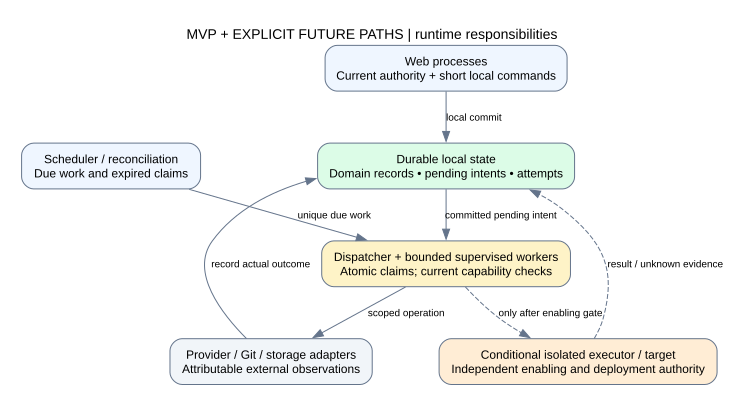

[Editable DOT](diagrams/runtime-responsibilities.dot) · [PNG](diagrams/runtime-responsibilities.png)

### Web request processes

Authenticate the actor, authorize the exact resource/action, validate input, read current versions and perform short local commands or permitted queries. Return an attributable completed/conflicting/denied/pending outcome. Do not wait for long PDF rendering, full mailbox synchronization or workflow completion while holding database locks. Protected retrieval evaluates current eligibility before releasing the selected representation.

### Durable local state

Persist domain records, operation identities, expected/current revisions, outbox or equivalent pending intents, attempt observations and worker-claim state. These are responsibilities, not a selected queue product or physical table definition. Local domain changes and their required pending intent must be committed atomically where they belong to one local operation.

### Dispatcher and bounded workers

The dispatcher makes committed pending work available for processing. Workers handle separately bounded PDF generation, provider operations/synchronization, artifact processing, cleanup and reconciliation. Logical job classes allow independent limits and pause controls; they do not require a separate server or process pool for every class. The actual queue backend and supervisor need compatibility/resource evaluation.

### Scheduler and reconciliation

Schedule due work, discover expired claims and initiate reconciliation under the same durable uniqueness/authority rules. Overlapping scheduler ticks cannot create duplicate operation identities. A missed tick should become overdue work, not an invented completed action. The demo observations did not establish configured workers/scheduler; setup and actual execution checks remain required.

### Git and conditional execution facilities

**Release applicability:** future-domain design retained after MVP; core operating/deployment and recovery controls still apply to MVP where relevant.

Git operations use an evaluated backend with native repository/ref semantics and bounded resource handling. Workflow workers submit only admitted exact attempts to an evaluated isolated execution facility. Neither untrusted code nor unbounded subprocesses may run under the web identity with application secrets. Deployment has a separate target authority and attempt record. A process diagram does not demonstrate isolation.

## 2. Local command and transaction protocol

### Request envelope

Carry a stable command identity, actor and resource context, intended operation, expected version when conflicts matter, and validated input. Bind a duplicate-suppression identity to its actor, operation, resource and canonical intent; reusing it with different input must not execute another mutation. Record sufficient bounded evidence to identify the previous result without logging sensitive payloads.

### Local mutation sequence

1. Resolve current identity and policy; validate input shape and intended resource.
2. Start a short transaction and obtain the operation-specific lock or compare/version guard.
3. Recheck the current grant/lifecycle/version under the chosen synchronization protocol. A stale prior browser check is insufficient.
4. Apply the exact permitted mutation, preserve protected state and record its attributable result. If remote/background work is required, persist its pending intent and unique attempt identity in the same local transaction.
5. Commit before dispatching external work. Respond with the actual local result or pending operation reference. A failure to send the HTTP response after commit does not imply rollback.

Duplicate commands resolve their recorded result under current permitted disclosure; they do not blindly rerun. Conflicting expected revisions produce an explicit compare/reload/reapply path. Deadlocks and transient local failures may retry the bounded local transaction only while no external effect has occurred and the same operation identity/invariants remain protected.

### Consistency scope

Use local transactions for invariants actually governed by the selected database. Do not hold locks while calling a provider, performing long Git transfer, rendering a PDF or waiting for a runner. A transaction cannot roll back an accepted email, a Git ref update or a target deployment. Exact isolation level, lock/version implementation, uniqueness constraints and retry policy belong to the evaluated persistence design and subsequent concurrency tests.

## 3. Shared state and concurrency rules

### Resume draft and publication

Presentation commands carry expected source/draft versions. Selected source application saves only the draft; publication separately confirms the intended draft version. Serialize live-pointer changes or use an atomic compare-and-update. Concurrent publication/edit must publish the explicitly confirmed version or return conflict, never silently include unreviewed changes. Previously submitted materials remain independent.

### Link, account and resource authority

Sharing-link changes increment or otherwise invalidate the relevant authorization version. Commands and new retrieval admissions re-evaluate current eligibility rather than caching a permanent grant. Define synchronization with in-flight operations at the owning boundary: completed revocation prevents subsequent admissions, but cannot retract already emitted bytes or necessarily undo a remote effect admitted before revocation. Long-running tasks recheck authority at consequential stages and record actual effects when access changes.

### Quota and artifact replacement

Reserve growth atomically against the same effective quota and current outstanding reservations. Two parallel requests cannot both consume the same remaining capacity. Record reservation identity; finalize actual confirmed usage, release unused reservation and reconcile abandoned work. A new replacement becomes referenced only after confirmed usability; keep the prior usable reference until the switch. Physical reclamation checks all protected references and is not inferred from a logical delete.

### Repository refs and work state

Use Git-native expected-old-ref comparison for mutation, binding reviewed source/target revisions to integration eligibility. A changed target invalidates the old evaluation context as required by the source rules. Work-item movement uses current board/item versions and applicable transition rules. Sprint period end does not implicitly accept unfinished items or change repository permissions.

### Provider mappings and shared workers

Calendar synchronization compares attributable local/provider revisions and source field-authority rules. Do not impose last-write-wins or bidirectional replay by default. Per-resource ordering is used only where required; unrelated resources may proceed concurrently within measured limits. Distinct workers cannot claim the same pending attempt without an atomic ownership check.

## 4. Durable work dispatch and reconciliation

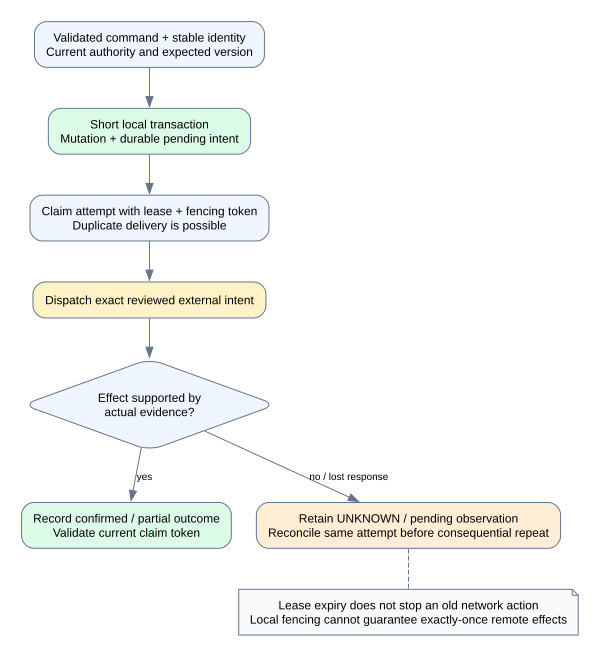

[Editable DOT](diagrams/durable-attempt-protocol.dot) · [PNG](diagrams/durable-attempt-protocol.png)

### Commit and dispatch

A local transaction commits intended state plus a pending outbox/operation record. Dispatch and queue delivery may be repeated; handlers therefore treat delivery as potentially duplicated. A dispatch acknowledgment is not remote success. Unique operation/attempt identity and atomic claim logic prevent duplicate local completion; they do not guarantee exactly-once external execution.

### Claim ownership and fencing

Claim work with a bounded lease and monotonically changing claim token or equivalent fencing identity. Persist claim owner, expiration and attempt identity. Heartbeat extension is conditional on continued ownership. Every local result commit validates the current claim token so an expired worker cannot overwrite a successor's observations.

A lease prevents indefinite local ownership; it does not stop an old worker already performing a network action. Lease expiry after possible dispatch therefore triggers reconciliation, not automatic resend. If an external facility supports a stable idempotency/reconciliation identity, verify its actual retention/scope semantics before relying on it. Otherwise retain unknown effect and require bounded investigation or explicit user disposition rather than inventing safety.

### Result classification

Use the operation's source contract to distinguish confirmed completion, confirmed no-effect failure, pending, denied, conflict, partial and unknown effects. Record actual evidence, current observation time and provenance. UI polling or notifications read a permitted operation projection; a successful queue job is not proof that the business goal or external receipt occurred.

### Retry and backpressure

Separate retryable local/read failures from consequential mutations with uncertain outcome. Use bounded delays, attempt limits and diagnostic references once justified; no numeric defaults are adopted here. Exhausted/unreconciled work becomes visible for intervention. Stop admitting additional heavy work when evaluated resource/storage policy requires it. Queue depth, oldest pending age and per-class saturation guide later measurements; they do not themselves establish capacity.

## 5. Cancellation and external execution

**Release applicability:** future-domain design retained after MVP; core operating/deployment and recovery controls still apply to MVP where relevant.

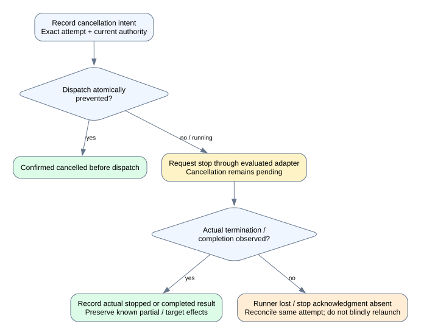

[Editable DOT](diagrams/cancellation-reconciliation.dot) · [PNG](diagrams/cancellation-reconciliation.png)

Store cancellation intent against the exact attempt. If work is still unclaimed and atomically preventable, record confirmed cancellation without dispatch. If running, request stop through the evaluated adapter and keep the result pending until actual evidence establishes termination or completion. Completion can win a cancellation race; retain the real terminal result and known effects rather than overwriting it with the request label.

Runner loss, lost stop acknowledgment or an expired lease produces a reconciliation requirement. Query the same attributable attempt where the facility permits it, restrict new dependent actions and report unknown/partial status honestly. A rerun is a new explicitly eligible attempt after prior effects are assessed. Cancellation does not automatically undo stored artifacts or deployments.

The execution admission gate checks supported definition/revision, current authority, feasible isolation, secret scope, workspace/network policy and resource limits. Target deployment additionally binds approved artifact/revision and target authority. Cleanup records actual workspace/secret handling and retained restricted evidence, including failure limits. No executor or stop capability is verified by this document.

## 6. Failure recovery and observability

**Web process dies before commit:** no local committed mutation is claimed; inspect transaction outcome and command identity before repeating. **Commit succeeds but response is lost:** the same command identity resolves the prior permitted result.

**Commit succeeds but dispatcher dies:** committed pending work remains discoverable. **Worker dies before known external dispatch:** reclaim only after ownership/dispatch evidence supports safe continuation. **Worker dies during/after possible dispatch:** reconcile the existing attempt; do not infer no effect from absence of a result record.

**Stale worker returns:** reject local completion under an obsolete claim token, retain attributable evidence for reconciliation and avoid overwriting a newer observation. Fencing local writes does not reverse an external effect.

**Queue/provider unavailable:** record unavailable/pending work and bounded retry/reconciliation status, protect interactive core state, and enforce admission limits. **Storage full:** reject or suspend growth safely, preserve the prior usable representation and record actual reservation/cleanup outcomes.

**Application restart or restoration:** resume durable pending state through the same authority, claim and reconciliation rules. Restored historical grants are not automatically valid; restored pending sends or deployments are not replayed automatically. Follow [recovery design](../06-design-quality-and-security-analysis/03-operations-backup-recovery-and-resilience.md).

Observe command/attempt identity, claim generation, state transitions, timing, bounded error category, queue age, resource pressure and cleanup/reconciliation disposition. Exclude passwords, tokens, private email bodies and unrestricted artifact content from ordinary logs. Alert criteria and numeric thresholds require actual operating target decisions. A running process/healthy HTTP endpoint does not prove scheduler or job progress.

## 7. Verification and open decisions

### Required focused checks

- Run duplicate commands with identical and changed intent; verify one attributable local mutation and explicit mismatched-intent handling.
- Race draft editing/publication, grant/link changes, parallel quota admission and stale Git refs; verify the source invariant or explicit conflict.
- Interrupt before commit, after commit/before dispatch, before external send, and after possible external acceptance/before observation; require evidence-supported outcomes and no blind repetition.
- Expire a worker lease and let the old worker finish; verify fencing and external reconciliation limitations.
- Race cancellation with start/completion and lose the stop acknowledgment; distinguish request, actual stop, completion and unknown outcome.
- Disconnect providers, pause workers/scheduler and fill storage under controlled conditions; verify bounded degradation, recovery and honest UI state.
- Restore isolated pending-operation state; verify current authority and that consequential effects are not automatically replayed.

These are verification specifications, not executed tests. Each later run needs an identified candidate/environment, permitted scope, initial data/state, expected result, actual observation and protected-state comparison.

### Decisions still required

Evaluate queue/backend and supervisor compatibility, database isolation/locking and uniqueness behavior, worker/scheduler arrangement, per-class concurrency, leases/deadlines/retry limits, provider reconciliation facilities, executor admission/stop/isolation, storage admission and actual workload targets. Use existing resources and budget; no new infrastructure purchase or numeric service promise is implied. Exact physical schema and signatures remain component/data/interface refinement work.

### FAU basis and continuation

FAU V07 process/runtime viewpoints explain processes and communication; component interactions, operating states and deployment must agree. V08 refines these into component-level technical scenarios. This file adapts those concepts to the existing analysis; workflow/operation states remain governed by source contracts.

Continue with [deployment topology](04-deployment-topology-nodes-and-networks.md), [data strategy](../04-data-design/README.md), [component prescriptions](../03-component-and-module-design/README.md) and [exact traceability/review](../06-design-quality-and-security-analysis/05-design-review-traceability-and-handoff.md). [ADR-003](../07-design-decisions/ADR-003-durable-external-attempts.md) records the proposed durable-attempt choice.

Document checks establish link/render integrity only. No live job, provider send, Git mutation, load/cancellation test, security validation, restoration or owner baseline approval was performed. Advisor transport remains unavailable as recorded for this design candidate; no independent endorsement is claimed.

## 8. Runtime diagram package

These views refine the same proposed runtime from distinct perspectives. UML interaction/activity/state/timing notation, process topology and DFD/wait-for notation serve different questions; they are not interchangeable proofs. Each has editable PlantUML source and SVG/PNG exports. No process, thread pool, actor framework, queue product, timeout or observed runtime result is selected by adding the views.

| Requested view | Included realization |
| --- | --- |
| Key runtime sequences | Guarded local command and lost external-response scenarios |
| Swimlane activity with fork/join | Local commit followed by independent response/background branches |
| State machine / communication / timing | Coordinator knowledge, numbered collaboration and illustrative claim/effect timeline |
| Process/thread and concurrency views | Bounded scoped process workers; threading/event-loop/actor alternatives remain unselected |
| Message/queue topology and process deployment | Logical eligible-work lanes and candidate process-to-node mapping |
| Resource contention / logical DFD | Invariant guards/shared resources and actual intent/observation data flows |
| Optional deadlock analysis | Hypothetical wait-for cycle, with explicit assumptions and no formal proof claim |

### 8.1 Sequence — guarded local command

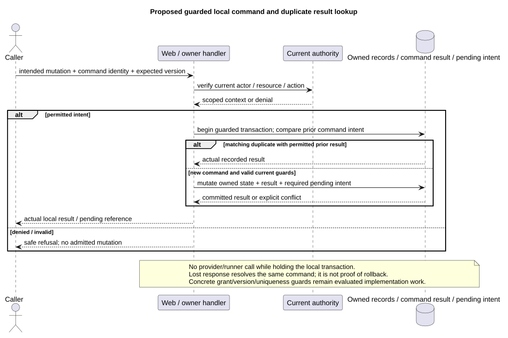

[Editable PlantUML](diagrams/runtime-local-command-sequence.puml) · [PNG](diagrams/runtime-local-command-sequence.png)

The local scenario separates current authorization, duplicate intent, guarded local mutation and actual result. Exact lock/version/uniqueness semantics belong to the selected persistence implementation; a failure to return a response is not proof of rollback.

### 8.2 Sequence — lost external response

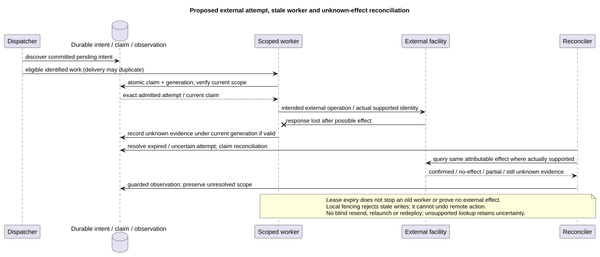

[Editable PlantUML](diagrams/runtime-remote-effect-sequence.puml) · [PNG](diagrams/runtime-remote-effect-sequence.png)

This scenario covers a lost response after possible external dispatch. Local claim fencing protects observations, not remote execution. Actual provider/executor lookup may be unavailable; preserve Unknown rather than inventing a safe repeat. See [ADR-003](../07-design-decisions/ADR-003-durable-external-attempts.md).

### 8.3 UML activity — lanes and fork/join

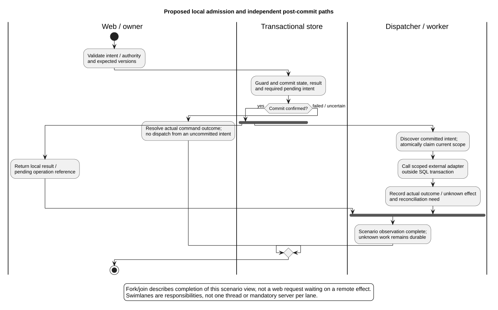

[Editable PlantUML](diagrams/runtime-swimlane-fork-join.puml) · [PNG](diagrams/runtime-swimlane-fork-join.png)

The lanes allocate responsibilities. After commit, response delivery and background processing proceed independently. The join is the end of the illustrated scenario observation, not a synchronous web request waiting for remote work; the observation branch can finish with durable unresolved state. No one-thread-per-lane or selected thread API is implied.

### 8.4 UML state machine — attempt knowledge

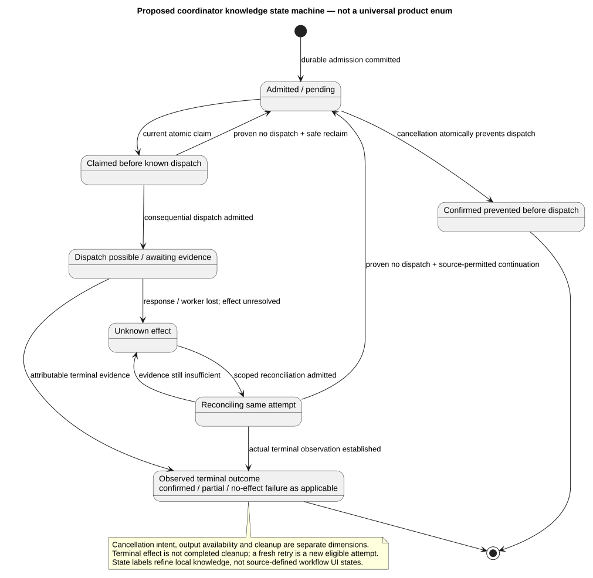

[Editable PlantUML](diagrams/runtime-attempt-state-machine.puml) · [PNG](diagrams/runtime-attempt-state-machine.png)

This is a proposed **coordinator-knowledge model**, not a replacement for source workflow/product enums. Cancellation request, output capture, cleanup and deployment effect are orthogonal dimensions. Only actual evidence enables terminal/no-dispatch transitions. A retry after possible effect requires the reviewed distinct-attempt policy.

### 8.5 UML communication — numbered collaboration

**Release applicability:** future-domain design retained after MVP; core operating/deployment and recovery controls still apply to MVP where relevant.

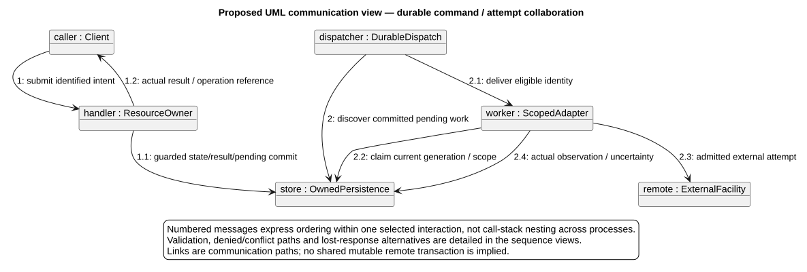

[Editable PlantUML](diagrams/runtime-communication-diagram.puml) · [PNG](diagrams/runtime-communication-diagram.png)

Numbered messages describe one collaboration over communication links. The sequence diagrams own detailed alternatives. Numbers show scenario ordering, not a distributed transaction or guaranteed single delivery.

### 8.6 UML timing — lease versus effect knowledge

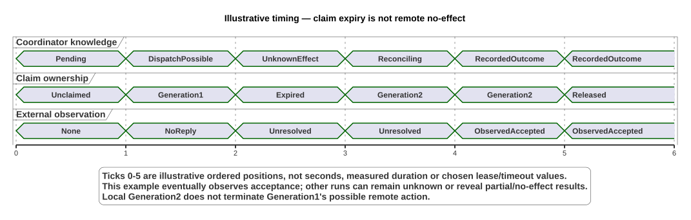

[Editable PlantUML](diagrams/runtime-claim-timing.puml) · [PNG](diagrams/runtime-claim-timing.png)

Ticks are synthetic ordered positions, **not elapsed seconds, accepted lease values or benchmark data**. The example eventually obtains acceptance evidence; unresolved/partial alternatives remain possible. Lease expiry never proves that a remote action did not happen.

### 8.7 Process/thread view — bounded execution units

**Release applicability:** future-domain design retained after MVP; core operating/deployment and recovery controls still apply to MVP where relevant.

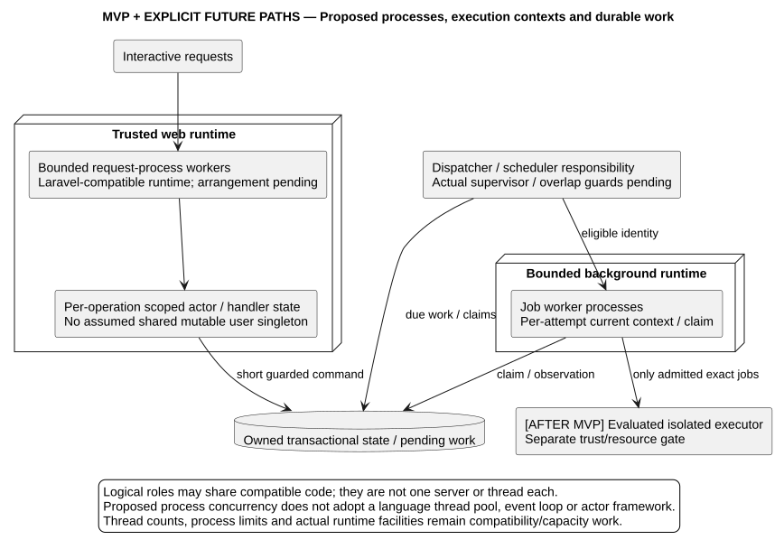

[Editable PlantUML](diagrams/runtime-process-thread-view.puml) · [PNG](diagrams/runtime-process-thread-view.png)

The candidate uses short request-process work and bounded background process work. It does not assume that PHP request workers are a language-level thread pool, or that logical roles require distinct hosts. Exact runtime/threading, pool sizes, supervisor and scheduler remain evaluated facilities.

### 8.8 Concurrency model — bounded processes and scoped work

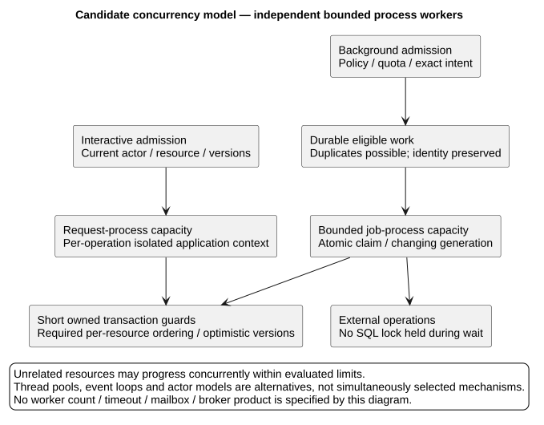

[Editable PlantUML](diagrams/runtime-concurrency-model.puml) · [PNG](diagrams/runtime-concurrency-model.png)

The current candidate is bounded process concurrency with scoped per-operation context, local guards and durable work. Event-loop/async I/O, thread pools and actor systems are alternatives to evaluate if justified, **not three simultaneously selected frameworks**. No numeric concurrency or timeout default is adopted.

### 8.9 Message flow and logical queue topology

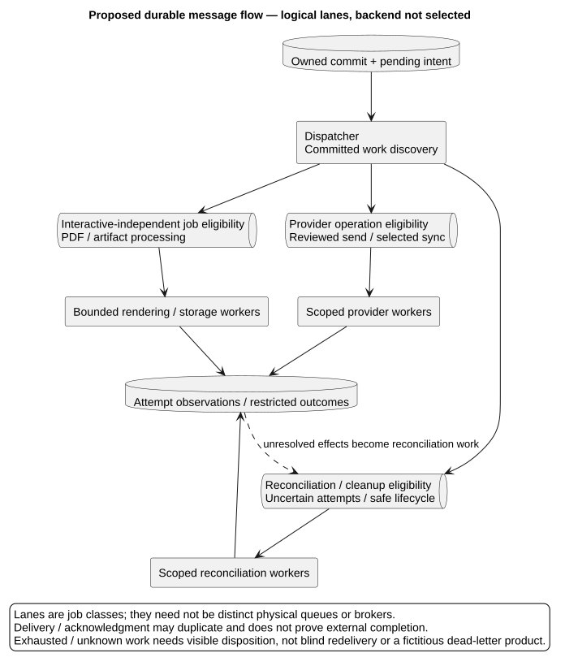

[Editable PlantUML](diagrams/runtime-queue-topology.puml) · [PNG](diagrams/runtime-queue-topology.png)

These are logical eligible-work classes, not an adopted broker or mandatory physical queue count. Unknown effects route to reconciliation/disposition, not unconditional re-execution. Actual acknowledgment, visibility, scheduler overlap and failure-lane mechanisms require compatible implementation and evidence.

### 8.10 UML deployment — runtime processes on candidate nodes

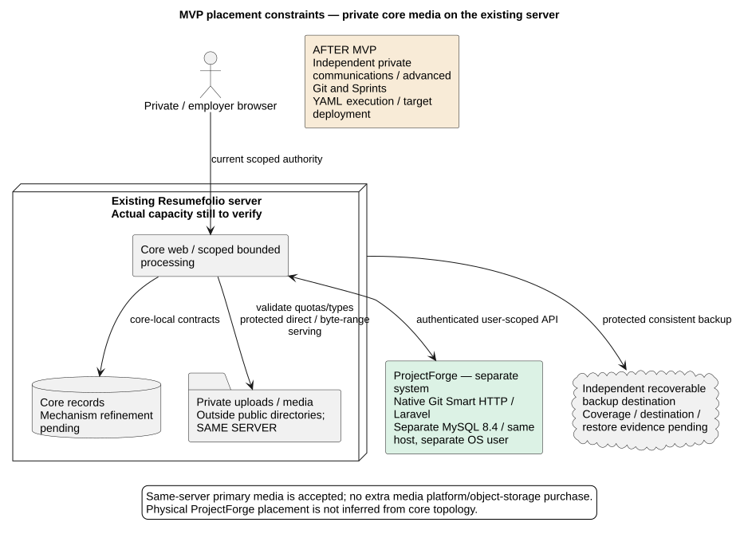

[Editable PlantUML](diagrams/runtime-process-deployment.puml) · [PNG](diagrams/runtime-process-deployment.png)

This view maps proposed runtime roles to a candidate environment and separate conditional executor boundary. Artifacts can share one compatible release. It is neither an observed service inventory nor evidence of resource fit, working scheduling or HA; see [deployment design](04-deployment-topology-nodes-and-networks.md).

### 8.11 Resource contention — guards and shared capacity

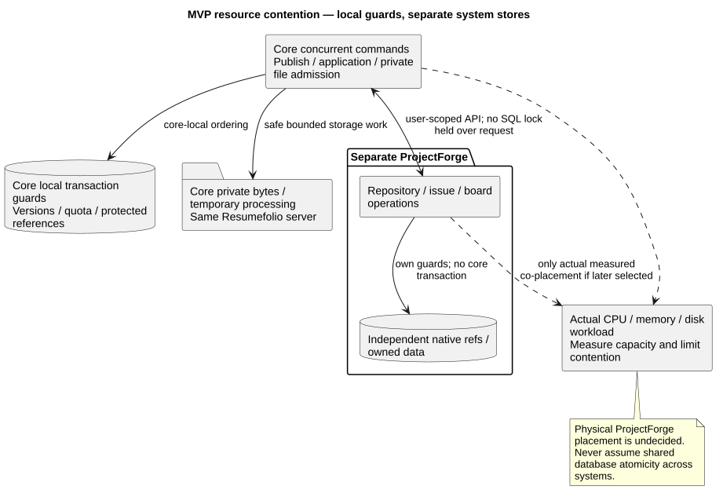

[Editable PlantUML](diagrams/runtime-resource-contention.puml) · [PNG](diagrams/runtime-resource-contention.png)

The guard subjects express invariants to protect: revisions, aggregate quota and reference/deletion exclusion. They do not select a global lock, isolation level or acquisition algorithm. Actual SQL/native-Git/storage races and combined resource pressure need integration checks.

### 8.12 DFD — intent and observation data

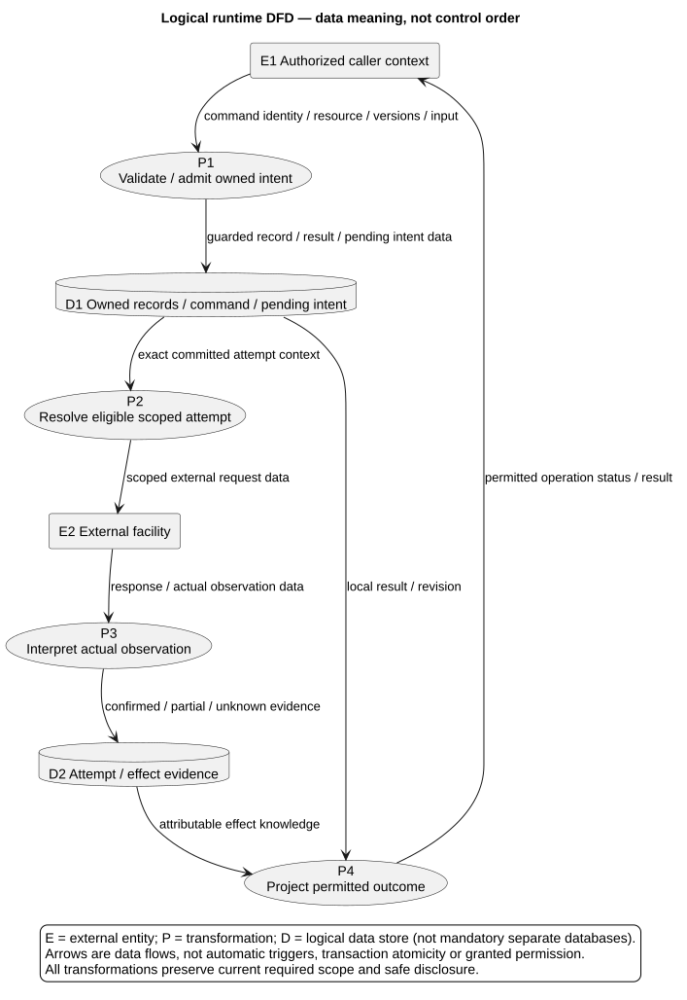

[Editable PlantUML](diagrams/runtime-dataflow.puml) · [PNG](diagrams/runtime-dataflow.png)

This DFD uses external entities, transformations and logical stores. It deliberately shows input/intent/observation/result **data**, not thread scheduling or automatic triggers. Logical stores may share a database. Current authority and exact external identities remain mandatory at applicable transformations.

### 8.13 Optional wait-for graph — hypothetical deadlock

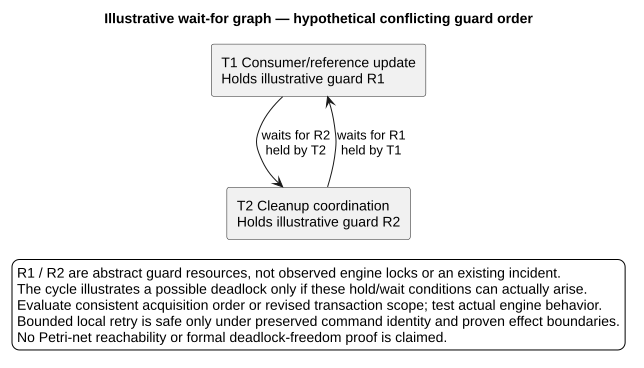

[Editable PlantUML](diagrams/runtime-wait-for-example.puml) · [PNG](diagrams/runtime-wait-for-example.png)

This optional graph demonstrates how opposite abstract guard acquisition could form a wait cycle. It is not an observed defect, actual engine lock graph or proof that the selected design deadlocks. Define real transaction/guard order and test under the chosen engine before making deadlock-freedom claims.

### Reading and verification limits

Cross-check these views with the [component catalog](../03-component-and-module-design/README.md), [data guards](../04-data-design/01-analysis-to-logical-and-physical-data-models.md), [API outcomes](../05-interface-and-api-design/01-api-protocols-contracts-and-compatibility.md) and [security/operating designs](../06-design-quality-and-security-analysis/README.md). A state/claim change, queue acknowledgment, process exit and actual remote completion are separate observations.

Verify actual interleavings, duplicate intent, stale claims, callback identity, lock order, resource admission, cancellation/cleanup and restored pending state against the identified implementation. The diagrams do not establish current setup, safe execution, numeric timing, formal liveness or product-test Pass. Existing source-policy/feasibility gates and ADR statuses remain unchanged.

[Architecture index](README.md) · [Diagram catalog](diagrams/README.md)
