# Resumefolio — Deployment Topology Nodes and Networks

Current implementation choices and scope: [Baseline](../../../baseline/README.md). Runtime verification remains subject to its gates.

**Current deployment constraint:** core uploads/media stay in private directories on the Resumefolio server. Core runtime/database mechanisms remain design work; ProjectForge is a distinct API-connected system whose engine, physical placement and database are undecided. Independent recoverable backups and least privilege remain required. Untrusted workflow execution is deferred.

**Status:** proposed deployment candidate, November 2, 2026. This is not the current server configuration, a demonstrated capacity result, an infrastructure purchase or an accepted production baseline. Farhad is the delivery/operations owner and decision authority.

[Evidence](#1-observed-inputs-and-design-boundaries) · [Topology](#2-proposed-nodes-and-runtime-environments) · [Networks](#3-network-zones-and-communication-paths) · [Artifacts](#4-artifacts-storage-and-secrets) · [Release](#5-deployment-and-maintenance-procedure) · [Recovery](#6-availability-backup-and-disaster-recovery) · [Validation](#7-capacity-validation-and-open-decisions) · [Diagram/sizing package](#9-deployment-diagram-and-sizing-package)

## Current MVP boundary figure

[Editable source](diagrams/mvp-system-boundaries.puml) · [PNG](diagrams/mvp-system-boundaries.png). Historical broader-product figures below retain earlier alternatives/detail; they do not define the current system boundary.

## 1. Observed inputs and design boundaries

Use [resources and constraints](../../01-project-planning/05-resources-and-constraints.md), [capacity planning](../../01-project-planning/11-capacity-and-preliminary-sizing.md), [analysis handoff](../../03-system-analysis/07-review-and-design-handoff/14-feasibility-dependencies-and-design-handoff.md), [architecture options](01-design-drivers-and-solution-options.md) and [runtime design](03-process-view-concurrency-and-runtime-behavior.md).

The November 1 demo observation reported a Hetzner guest with 2 vCPU, 4 GB RAM, 40 GB disk and Ubuntu 24.04.4 LTS, with Nginx, PHP 8.3-FPM, MySQL and an existing Laravel application. That inventory is dated evidence, not a fresh inspection, final runtime version selection or proof of the combined product workload.

The owner reported OAuth uncreated and backups unconfigured. Inspected delivery declarations and worker/scheduler observations did not establish functioning outbound mail or background operation. Certificate/timer observations do not prove every future renewal succeeds. Do not turn these findings into installed/configured facilities in the diagram.

Use existing resources and 20 total project hours/week; no extra paid host/service is assumed. Ten initial accounts and growth direction toward roughly 1,000 are not workload or concurrent-job specifications. Preserve the existing demo and reference projects; installing or testing this candidate on them requires separate scoped operational work.

## 2. Proposed nodes and runtime environments

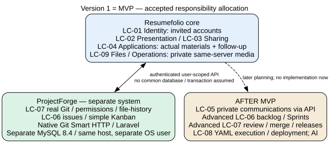

[Editable DOT](diagrams/logical-component-ownership.dot) · [PNG](diagrams/logical-component-ownership.png)

### DN-01 — Client environment

Private users and employer viewers use supported browsers. Private product sessions and employer link-scoped viewer authorization remain separate. Actual Git clients use the evaluated Git transport contract; they do not automatically consume browser credentials. Client devices are outside application trust and backup boundaries.

### DN-02 — Trusted application environment

The candidate initially colocates HTTPS termination, Laravel web runtime, bounded workers/scheduler, relational persistence and private application storage within a managed environment where feasibility permits. This reduces initial operating complexity but shares a failure/resource domain. Individual services/processes use only necessary privileges and interfaces.

Web and worker processes use compatible versioned application artifacts. A supervisor controls restart and graceful drain; scheduling is explicitly configured. Database/storage bind to local or restricted internal access, not unrestricted public exposure. A process being on the same host does not make all local users trusted.

### DN-03 — Native Git facility

ProjectForge is a separate system, reached through authenticated user-scoped API. Do not place its repository/database/worker responsibilities inside the core environment by inference. Physical placement and engine remain open.

An evaluated native Git implementation owns repository object/ref operations behind the Git Collaboration contract. Its physical placement, transport service, operating identity and storage permissions depend on engine selection and combined-load evidence. Neither a raw public repository directory nor arbitrary shell-command forwarding is a product transport design.

### DN-04 — Conditional execution facility

**Release applicability:** future-domain design retained after MVP; core operating/deployment and recovery controls still apply to MVP where relevant.

An executor is a distinct trust boundary with scoped code/input/output and secret delivery. No local facility is demonstrated safe, and no remote paid executor is assumed approved. Evaluate eligible local or external arrangements against escape resistance, network/filesystem/process separation, resource limits, termination, cleanup and operating cost before enabling jobs.

Do not grant an untrusted job the application operating identity, unrestricted database/private-storage access, broad host control or inherited deployment credentials. A container/process label alone is not isolation evidence. If acceptable facilities cannot be established within constraints, record a blocking execution commitment and options; do not silently relabel validation as execution.

### DN-05 — Independent recovery destination

Backup storage must survive the applicable application-host failure scenario and support protected recovery of required data/keys. The destination is not currently configured or selected. Another directory on the same disk is not independent recovery for disk/host loss. Provider/account/key arrangements and actual restoration are dependent evidence, not diagram facts.

### DN-06 — External providers and deployment targets

**Release applicability:** future-domain design retained after MVP; core operating/deployment and recovery controls still apply to MVP where relevant.

Google, outbound delivery facilities and any separately managed deployment target have independent authority, availability and effects. Provider/target credentials and permitted operations are narrowly scoped. Their actual endpoint/version/access obligations require current official documentation checks when selecting/configuring them.

## 3. Network zones and communication paths

**Release applicability:** future-domain design retained after MVP; core operating/deployment and recovery controls still apply to MVP where relevant.

[Editable DOT](diagrams/logical-component-ownership.dot) · [PNG](diagrams/logical-component-ownership.png)

**Public application ingress:** expose only intended HTTPS routes and evaluated Git transport. Serve public static assets separately from protected artifact/repository storage. Reject directory/path bypasses and enforce current permission before protected delivery. TLS termination and any proxy-to-application link need an explicit trusted forwarding configuration.

**Restricted administration:** use controlled administrator access with managed credentials/keys and minimal operating privilege. Keep database, supervisor, scheduler controls, diagnostic panels and internal endpoints off unrestricted public ingress. Select actual ports/firewall rules after the transport/services are chosen; this document does not open or assume a port.

**Internal data/process zone:** web/workers access only their required database/storage/queue facilities. Process/user permissions constrain private files and secrets even on a single host. An evaluated network service introduced later needs authenticated protected communication and recovery coverage.

**Provider egress:** allow only justified external operations and restrict credentials to the selected account/capability. Connection success is not permission or operation completion. DNS/timeout/provider failures map to the runtime result/reconciliation model.

**Execution zone:** separate executor input/output and credential paths from general private application access. Evaluate network egress, metadata/internal-service access, workspace isolation and artifact validation. A deployment stage needs independent target authorization; a successful workflow cannot manufacture a grant.

**Backup/restore zone:** protect transfer and stored backup access, separate recovery credentials and define restore access controls. A recovery environment initially isolates provider sends, workflow admission and deployment effects until explicit reconciliation/disposition.

Every component interaction crossing a physical boundary must map to an actual permitted communication path. Arrow labels in the diagrams describe intended exchanges, not accepted firewall configuration or a claim that every exchange uses HTTP.

## 4. Artifacts storage and secrets

### Application and operating artifacts

The application release manifest identifies source revision, dependency lock/build outputs, required runtime compatibility, migrations and configuration keys without secret values. The same compatible release can realize multiple logical components and worker commands. Supervisor/scheduler/web configuration templates are reviewed alongside the release, with effective configuration verified during deployment.

Native repository storage, uploaded/generated files, publication/submission manifests, database state and durable pending/attempt records are operating data. Do not overwrite them when replacing an application release. A runtime queue may contain reconstructible dispatch state, but committed operation identity and intent must remain recoverable under the chosen mechanism.

### Protected storage layout

Separate public static assets from private files, native repositories, restricted diagnostics, temporary processing and any executor workspace. Use opaque identifiers and canonical permitted paths; user filenames and repository refs cannot become unchecked filesystem/shell instructions. Artifact metadata records availability/provenance and protected references. Replacement/cleanup follows quota/reference rules in [data design](../04-data-design/README.md).

Keep enough operating space for transactional growth, Git/PDF temporary work, logs, update artifacts and recovery procedures. A free-space snapshot is not an upload quota. Define reservations/admission and bounded cleanup against representative workload and measured capacity before committing numeric limits.

### Secrets and effective configuration

Supply application/database/provider/deployment credentials through controlled operating configuration outside source control. Use distinct scope and revocation paths; restrict process access to required secrets. Document rotation and backup/key recovery without storing real values in diagrams, examples or logs. Restoring encrypted database records without the required keys is not usable recovery.

## 5. Deployment and maintenance procedure

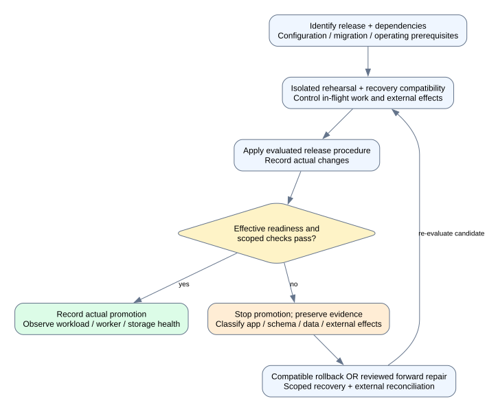

[Editable DOT](diagrams/release-and-recovery-route.dot) · [PNG](diagrams/release-and-recovery-route.png)

1. **Identify the candidate:** record source/build/dependency identities, runtime requirements, migration impact, configuration prerequisites, relevant tests and owner-authorized scope. A documentation candidate is not a deployable application artifact.
2. **Prepare an isolated rehearsal:** use controlled data and separate secrets/addresses/credentials. Disable consequential provider/executor/target actions unless explicitly in scope. A separate database name alone does not demonstrate adequate environment isolation.
3. **Check recovery and compatibility:** identify an actually usable recovery source and the compatible app/schema/data versions. Evaluate migrations for backward compatibility, lock/disk needs, interruption and irreversible effects. Do not assume restoring an older database is an acceptable response to new real user data.
4. **Control in-flight work:** pause admission/drain selected workers where needed, preserve attributable pending operations and reconcile work that may already have external effects. Avoid running incompatible old/new workers against changed contracts.
5. **Apply the release deliberately:** install the identified artifact/configuration/migrations using the evaluated procedure. Switch serving version only when prerequisites and compatibility checks permit it. No zero-downtime or atomic filesystem-switch guarantee is inferred.
6. **Verify the effective environment:** test authorized/denied private retrieval, current published rendition, database/storage connectivity, worker/scheduler progress, Git boundary and scoped enabled integrations. Verify absence of unintended public storage/administrative exposure. Readiness probes must distinguish basic liveness from business operation readiness.
7. **Observe and record:** collect bounded health/resource/error/queue evidence, actual outcomes and remaining issues. Record the effective release/configuration identities and actual promotion decision.
8. **Handle failed promotion:** stop further effects, preserve evidence and identify which app/schema/data/external changes occurred. Revert code only where compatibility permits; otherwise perform reviewed forward repair or scoped recovery. Reconcile unknown external effects instead of assuming rollback reversed them.

Routine maintenance follows the same candidate/impact/recovery discipline for OS/runtime/dependency changes, certificate renewal, storage cleanup and credential rotation. Choose maintenance windows and user communication from actual availability requirements rather than inventing a guaranteed schedule.

## 6. Availability backup and disaster recovery

### Single-environment availability

The initial candidate has a shared host/data/storage failure domain. Process supervision can recover some process failures; it cannot fix host/disk loss or guarantee availability during incompatible migrations. HA requires evaluated redundant facilities, data consistency/failover behavior and actual operational ownership. None is installed or funded by this proposal.

### Consistent backup set

Define coverage for relational state, protected artifacts, native Git repositories, publication/submission identities, required configuration and recovery keys. Coordinate a recoverable point across these resources, or document a mechanism that reconstructs their valid relationships. Database-only backup misses files/Git; file-only copying misses transactional state. Retention, cadence, capacity and RPO/RTO depend on actual source decisions and measured restoration.

### Recovery sequence

Identify incident and permitted scope; select an attributable recovery point; restore in a suitable isolated target; verify schema/version, ownership, references, artifact/repository integrity and usable keys; reassess current grants and secrets; reconcile pending provider/runner/target effects; measure actual loss and time; record disposition before restoring traffic. Do not replay historical sends/deployments or automatically reactivate revoked grants.

Use [operations and recovery design](../06-design-quality-and-security-analysis/03-operations-backup-recovery-and-resilience.md) as the shared procedure owner. This deployment view owns placement/path prerequisites and links that procedure rather than creating competing recovery policies.

## 7. Capacity validation and open decisions

### Representative evaluation

Define interactive workflows and concurrent mix, source/data sizes, Git transfer/repository growth, PDF demand, provider sync backlog, storage churn and any admitted execution. Measure CPU/memory/storage/I/O, response correctness/latency, queue age, timeout/unknown outcomes and cleanup/recovery overhead. First verify on suitable controlled facilities; do not stress or run untrusted jobs on the demo to manufacture evidence.

Results may justify tighter admission, sequential heavy work, targeted facility extraction or a resource proposal. Material scope/cost/date changes need explicit impact and owner decision. Shared resources cannot be accepted as sufficient simply because each capability works alone.

### Decisions before dependent acceptance

- Actual application runtime, relational engine/version, web/Git transport and compatible dependencies.
- Effective host/environment separation and least-privilege operating identities.
- Queue/supervisor/scheduler configuration and justified process/job limits.
- Storage layout, reservations, quotas, reference-safe cleanup and recovery overhead.
- Feasible executor isolation, networking, credentials, stopping and workspace cleanup.
- Google/outbound delivery setup and bounded actual operation results.
- Independent backup destination, key management, consistency and isolated restore evidence.
- Applicable response/availability/recovery targets and an evidence-based delivery forecast.

These are dependent engineering tasks, not requests to repeat already answered facts. No infrastructure command, purchase, service setup or deployment is authorized merely by this document.

## 8. Verification and continuation

**Document review:** map logical components to application/Git/executor artifacts and actual nodes; map every cross-node interaction to a permitted path; distinguish observed facts, proposals and unresolved facilities. Inspect diagram labels, links and remaining ownership gaps.

**Later operational checks:** test public-versus-private routing, restricted administration/data listeners, effective credentials/scopes, worker/scheduler progress, interrupted deployment/migration, storage pressure, lost executor/provider observations, backup consistency and isolated usable restoration. Record exact candidate/environment and actual results; no such live checks were performed in this authoring update.

FAU V07 deployment modeling maps artifacts to nodes and communication links, while separating logical layers from physical tiers. The DN locators, process grouping and release route here are project adaptations, not a mandated university topology. See [FAU reference map](../01-reference-and-coverage-map.md), [implementation artifacts](../03-component-and-module-design/02-implementation-view-and-artifacts.md) and [design review/handoff](../06-design-quality-and-security-analysis/05-design-review-traceability-and-handoff.md).

## 9. Deployment diagram and sizing package

The package below separates the proposed starting topology, optional infrastructure/orchestration/resilience alternatives and dated observations. No box provisions a facility. No cloud feature, namespace, region, rule, listener or sizing value is accepted through a diagram. Sources for provider/orchestration terminology were reviewed November 2, 2026; actual account/runtime compatibility remains unverified.

### 9.1 Optional C4 Level 1 anchor

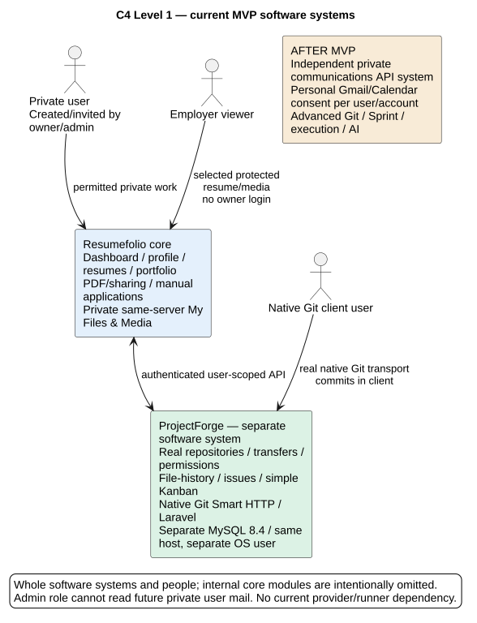

[Editable PlantUML](diagrams/drivers-c4-system-context.puml) · [PNG](diagrams/drivers-c4-system-context.png) · [Owning context assessment](01-design-drivers-and-solution-options.md#0-system-context-and-use-case-scope)

The same context anchor is reused; deployment nodes, subnets and optional infrastructure belong in the views below, not in C4 Level 1.

### 9.2 UML deployment — nodes, artifacts and environments

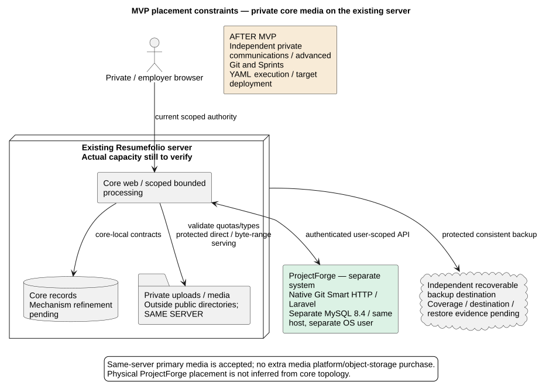

[Editable PlantUML](diagrams/drivers-uml-deployment.puml) · [PNG](diagrams/drivers-uml-deployment.png)

This view distinguishes physical/environment nodes, UML execution environments, deployable release artifacts and retained operating data. It is a proposed mapping, not a fresh inventory or configured runtime.

### 9.3 Network topology — subnets and routing concepts

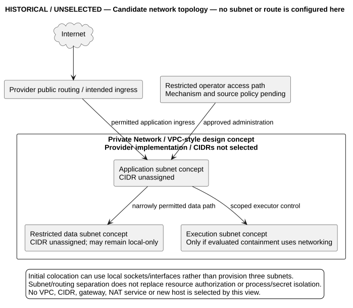

[Editable PlantUML](diagrams/deployment-network-topology.puml) · [PNG](diagrams/deployment-network-topology.png)

Subnet/VPC terminology describes a design concept, not an assigned address space or an adopted product. The initial colocated candidate may use local interfaces/sockets instead. Actual CIDRs, route/gateway rules, private interface placement and administration paths remain decisions.

### 9.4 Infrastructure — provider context and optional components

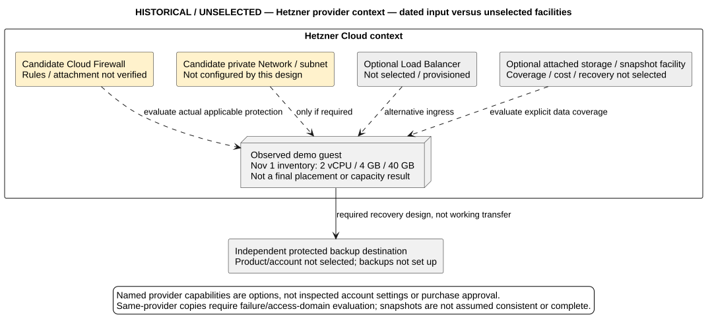

[Editable PlantUML](diagrams/deployment-provider-infrastructure.puml) · [PNG](diagrams/deployment-provider-infrastructure.png)

The provider input is the dated Hetzner guest observation. Official [Hetzner Networks](https://docs.hetzner.com/networking/networks/overview/) describe private server links/subnets, and [Cloud Firewalls](https://docs.hetzner.com/cloud/firewalls/overview/) describe traffic rules. Their existence in provider documentation is not account configuration evidence. No load balancer, attached volume, network, snapshot or paid option is adopted here; verify actual coverage and effective protection at selection time.

### 9.5 Container/orchestration — optional cluster design

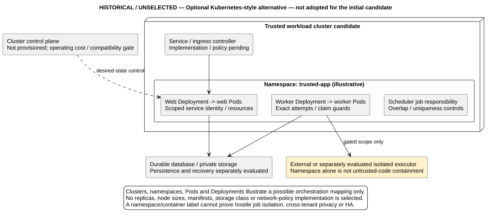

[Editable PlantUML](diagrams/deployment-orchestration-alternative.puml) · [PNG](diagrams/deployment-orchestration-alternative.png)

This fulfills the orchestration view as a clearly unelected alternative. Official [Kubernetes multi-tenancy guidance](https://kubernetes.io/docs/concepts/security/multi-tenancy/) discusses isolation controls beyond namespace naming. A namespace is not proof of hostile-code containment. The proposed initial topology does not require Kubernetes; any adoption needs resource/operating, storage/recovery, identity and network evidence.

### 9.6 Network segmentation — logical security zones

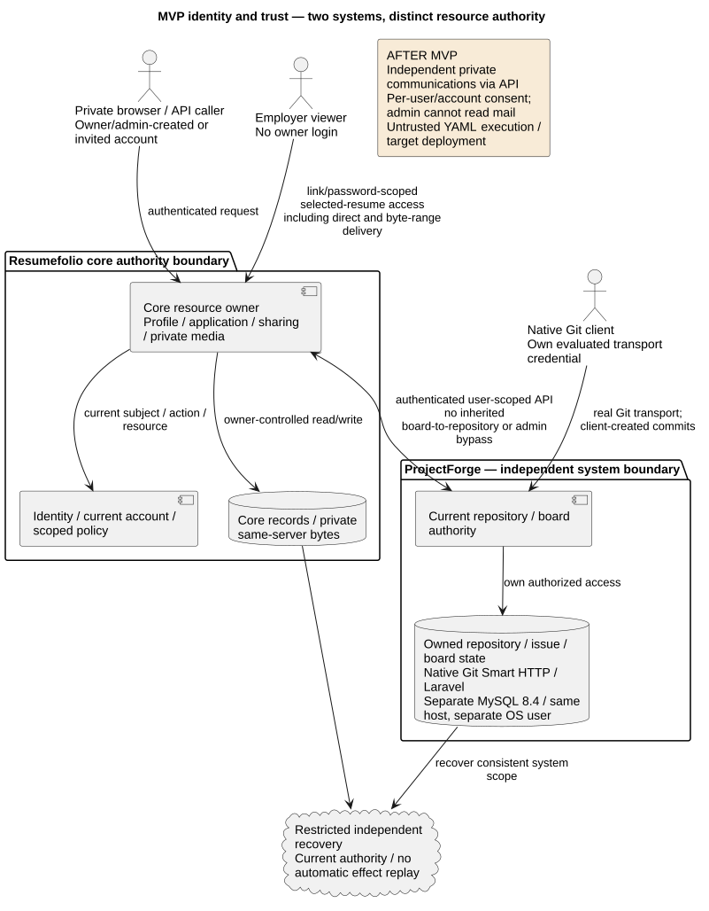

[Editable PlantUML](../06-design-quality-and-security-analysis/diagrams/security-trust-boundaries.puml) · [PNG](../06-design-quality-and-security-analysis/diagrams/security-trust-boundaries.png)

DMZ is a logical public-facing edge role here, not an installed physical subnet. Evaluate actual provider/host/local-process rules and ingress/egress behavior. Do not infer private-network encryption, firewall coverage or user-level authorization from a colored zone. Detailed controls remain in the [security design](../06-design-quality-and-security-analysis/02-security-threat-modeling-and-trust-boundaries.md).

### 9.7 Traffic flow — proxy and optional balancing

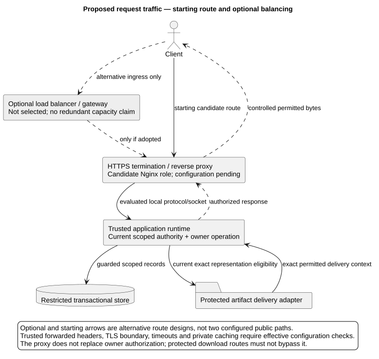

[Editable PlantUML](diagrams/deployment-traffic-flow.puml) · [PNG](diagrams/deployment-traffic-flow.png)

The initial direct reverse-proxy route and optional balancing route are alternatives. Gateways/load balancers are not silently added to the starting infrastructure. Actual trusted headers, TLS termination/hops, timeouts, private cache and controlled-byte serving need configuration/interoperability checks.

### 9.8 Multi-region / failure-zone alternative

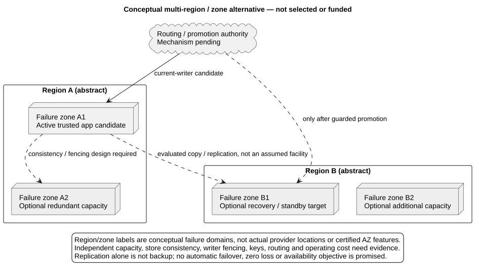

[Editable PlantUML](diagrams/deployment-multiregion-alternative.puml) · [PNG](diagrams/deployment-multiregion-alternative.png)

Abstract regions/zones illustrate a possible future failure-domain design, not actual purchased regions or a claim that a provider offers a specific AZ abstraction. Independent live capacity, consistent data/ref/artifact state, writer fencing, recovery keys, routing and solo operating cost are prerequisites. Replication cannot replace an independent protected backup.

### 9.9 Failover and disaster recovery

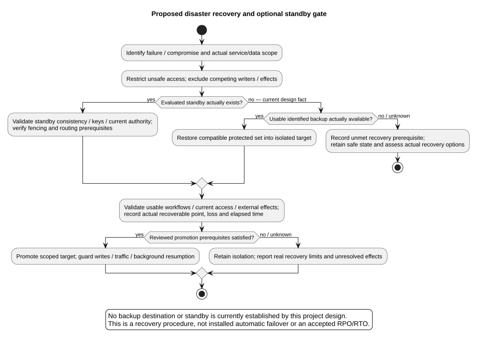

[Editable PlantUML](diagrams/deployment-failover-dr-route.puml) · [PNG](diagrams/deployment-failover-dr-route.png)

A missing standby takes the backup/isolated-restoration route only when a usable backup actually exists. Backups are not set up, so this remains an unmet recovery prerequisite, not a currently runnable DR capability. Current authority and external-effect reconciliation remain required before resumption; no automatic failover or numerical recovery promise is created.

### 9.10 Environment topology — dev, staging, production

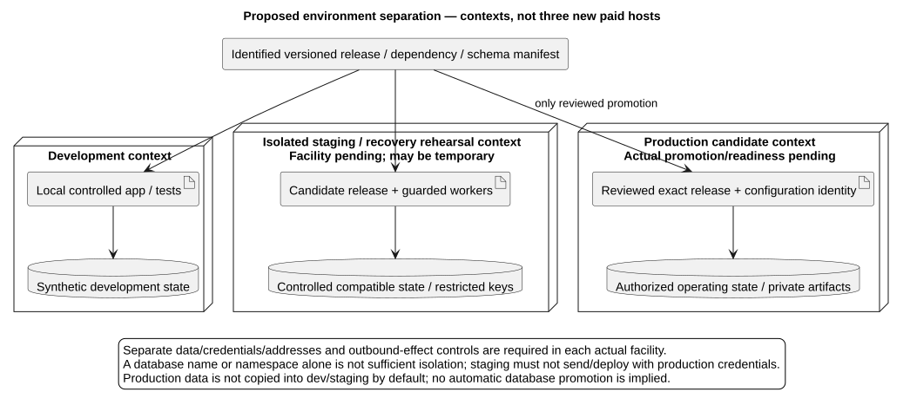

[Editable PlantUML](diagrams/deployment-environment-topology.puml) · [PNG](diagrams/deployment-environment-topology.png)

Dev/staging/prod name isolated execution/data/credential contexts, not three authorized hosts or databases to create now. A temporary staging/recovery target may be evaluated within constraints. No default production-data copying, production-secret reuse or outbound effect is permitted by this diagram.

### 9.11 CI/CD — exact artifact to target mapping

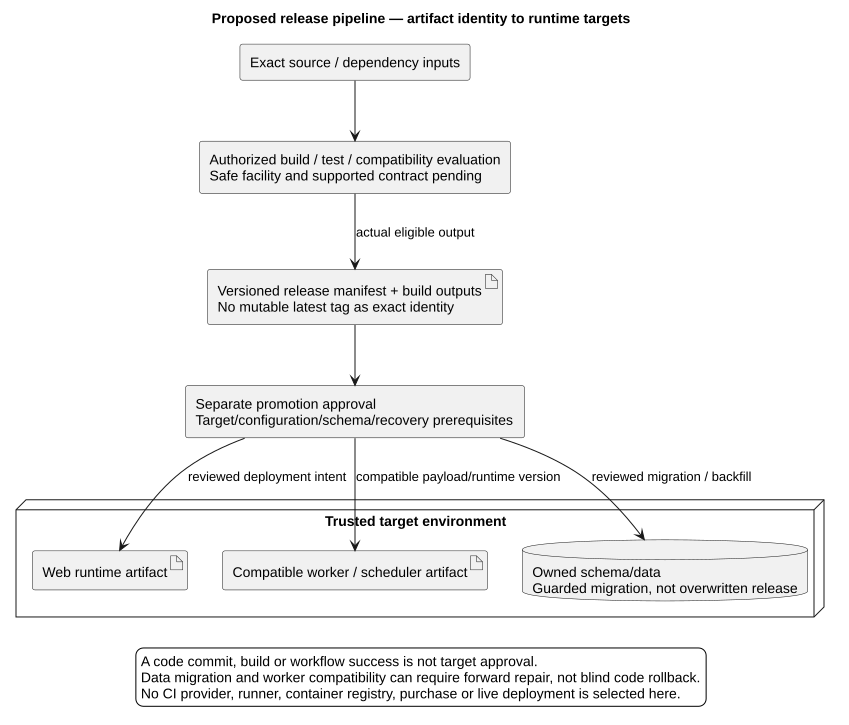

[Editable PlantUML](diagrams/deployment-cicd-artifact-nodes.puml) · [PNG](diagrams/deployment-cicd-artifact-nodes.png)

This is artifact promotion and schema/runtime compatibility, not a claim of configured CI. Web and workers use compatible exact release identity; migrations operate on retained data and can be irreversible. A workflow result supplies no deployment permission. See [Workflow/Deployment](../03-component-and-module-design/components/workflow-and-deployment.md) and [operating procedure](../06-design-quality-and-security-analysis/03-operations-backup-recovery-and-resilience.md).

### 9.12 Sequence — protected request across tiers

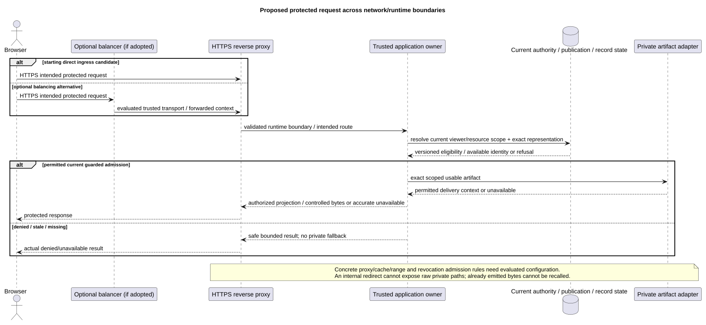

[Editable PlantUML](diagrams/deployment-network-request-sequence.puml) · [PNG](diagrams/deployment-network-request-sequence.png)

This is one protected request through the candidate tiers, with the optional balancer expressed as an alternative. The private adapter may use evaluated streaming or internal delivery, but may not bypass current eligibility or expose raw paths. It is not a measured latency trace or a promise of one selected serving mechanism.

### 9.13 Communication protocol and port table

**Release applicability:** future-domain design retained after MVP; core operating/deployment and recovery controls still apply to MVP where relevant.

This is a **candidate link contract**, not scanned listeners, open-firewall rules or permission to configure ports. Conventional ports identify proposed protocols only. Local sockets can remove TCP listeners; final addresses, endpoints, allowlists, encryption, authentication and timeouts require evaluated configuration. No implicit public exposure follows from a table row.

| Link | Candidate protocol / port | Exposure and remaining decision |
| --- | --- | --- |
| DN-01 client → application edge | HTTPS / TCP 443 proposed | Intended public ingress; actual TLS/proxy/routing configuration pending |
| Optional balancer → reverse proxy | Protected compatible transport / port TBD | Only if balancing is adopted; trusted-hop/header policy required |
| Reverse proxy → PHP/application runtime | Evaluated FastCGI/local socket or compatible runtime path | Local/restricted only; no arbitrary public runtime port |
| Web/worker → transactional store | Local socket or engine-specific restricted protocol / port TBD | Engine/bind/TLS/access policy pending; not public |
| Client → native Git interface | Evaluated Git-over-HTTPS or SSH transport / final port TBD | HTTPS conventionally 443; SSH choice, credentials and endpoint require actual Git contract |
| Worker → Google provider | HTTPS / TCP 443 proposed | Required authorized capability only; OAuth/setup and exact APIs pending |
| Coordinator → executor | Authenticated scoped control/observation protocol / port TBD | Only evaluated execution boundary; no public admin/host interface |
| Trusted deploy adapter → target | Target-supported protected protocol / port TBD | Separate exact artifact/target approval and restricted credential |
| Backup sender → independent destination | Evaluated protected transfer / port TBD | Destination/keys/coverage not configured; no raw unrestricted copy path |
| Authorized operator → management interface | Evaluated restricted administration protocol / port TBD | Restricted source/identity; no assumed SSH/public control-plane exposure |

DNS, certificate renewal, proxy-to-proxy paths and any later queue/storage service also need explicit entries once actual facilities are selected. Record effective listeners/rules separately after authorized inspection; diagram labels are not inventory evidence.

### 9.14 Capacity and sizing table — per node / failure domain

Only the demo guest has a dated numeric allocation. Rows sharing a candidate host **share its budget**; do not add the same CPU/RAM/disk allocation once per process/store. No unmeasured spare capacity, throughput, upload quota, replica count or worker concurrency is assigned.

| Node / placement subject | Allocation status | Sizing evidence required |
| --- | --- | --- |
| Existing demo guest (dated Nov 1 observation) | 2 vCPU / 4 GB RAM / 40 GB local disk; inventory, not final production selection | Existing/proposed simultaneous workloads, actual CPU/memory/I/O/disk/network and safe headroom |
| DN-02 trusted web/background environment | Candidate colocation; no additional allocation selected | Request mix, worker/scheduler demand, queue age, deployment/migration and operating overhead |
| Relational/private-artifact/native-Git stores if colocated | Share DN-02 resources; no separately additive node budget | Transactions/locks, retained/protected bytes, repository growth, temporary generation, logs and restore space |
| DN-03 Git facility if extracted | Placement and allocation TBD; no paid host assumed | Real transfer/ref workload, operating identity/storage and recovery/combined-load comparison |
| DN-04 conditional executor | Mechanism, location and safe resource envelope TBD | Containment, bounded process/CPU/memory/temp/output/network, termination/cleanup and actual build fit |
| DN-05 independent recovery destination | Not selected/configured; capacity TBD | Consistent protected data size, reviewed retention/base dependencies, encryption/key access, transfer and usable restore |
| Staging/recovery rehearsal context | Isolated facility TBD; may be temporary | Compatible dataset/runtime, no unsafe production effects, actual restore/test and disposal needs |
| Optional balancer/cluster/standby/region | Not adopted or provisioned; no budget allocated | Justified requirement plus capacity/consistency/fencing/cost/solo-operations evaluation |

Use the exact proposed Q-D24/Q-D25/Q-D26 policies only with their recorded status and workload/measurement contract. Ten accounts and a quiet-server snapshot cannot determine combined capacity. If safe facilities cannot meet agreed scope/resources, record the explicit conflict/options; do not silently buy infrastructure or relabel missing capability as complete.

### Package verification limits

Cross-check exact release/schema/worker compatibility, physical paths, effective routing/firewall/private serving, independent recovery/key coverage and execution/target trust gates. Test suitable authorized candidates before accepting operational claims. These diagrams/tables do not install Kubernetes, add hosts, open ports, create backups, provide HA, execute a pipeline or establish measured capacity. Existing source/ADR status remains unchanged.

[Architecture index](README.md) · [Diagram catalog](diagrams/README.md)
