# Resumefolio — Cross-Cutting Concerns Overview

## Current implementation baseline — November 4, 2026

[BL-MVP-2026-11-04.1](../../../baseline/README.md) selects the MVP technical mechanisms, numerical policies, priorities and requirement/criterion dispositions under Farhad’s explicit delegation. It supersedes earlier Proposed/pending mechanism and whole-baseline statements below for MVP design input. Future clauses and dated evidence remain separate. Runtime/actor validation, credentials, Git isolation, capacity and backup/restore still require the named implementation/Release gates; this update reports no product test Pass.

### Prior source material and rationale (superseded where this Baseline selects a different MVP choice)

**Purpose:** make shared architectural obligations visible, identify their authoritative design owners and explain how components coordinate changes. Detailed rules remain in their owning documents; this overview is their navigation and integration map.

**Status:** proposed coordination view, November 2, 2026. The owners below are logical design responsibilities, not separate staffed teams. Farhad remains the project decision-maker. No new permission, numerical target, infrastructure choice or accepted baseline is established here.

[Ownership](#1-ownership-and-scope) · [Concern catalog](#2-shared-concern-catalog) · [Coordination](#3-cross-component-coordination-examples) · [Change route](#4-change-and-decision-route) · [Review](#5-review-and-completion) · [Full realization package](#7-cross-cutting-realization-package)

## Current MVP boundary figure

[Editable source](diagrams/mvp-system-boundaries.puml) · [PNG](diagrams/mvp-system-boundaries.png). Historical broader-product figures below retain earlier alternatives/detail; they do not define the current system boundary.

## MVP system allocation and design status

The accepted system boundary separates the Resumefolio core from ProjectForge, joined by an authenticated user-scoped API. Logical responsibilities remain useful within each system; they do not authorize a shared core/ProjectForge process, database or transaction. Core owns dashboard, invited accounts, professional presentation, protected sharing, manual applications and same-server private My Files & Media. ProjectForge MVP owns real repositories/transfers/permissions, file/history browsing, issues and simple Kanban. Its selected engine is native Git Smart HTTP behind the independent Laravel ProjectForge service, with its own MySQL 8.4 database and OS/storage boundaries on the existing host; BL-MVP-2026-11-04.1 governs implementation and evidence gates. The future communications system is independently private and API connected. Advanced Git review/releases, backlog/Sprints and execution/deployment remain deferred. Keep source, independent resume draft, explicit publication and actual submitted material identities distinct. Profile changes require preview/select/apply and cannot mutate publication or submitted history. Manual applications include status, next action and follow-up date without mail/calendar dependencies.

Authority: [OWNER-MVP-2026-11-04](../../01-project-planning/owner-mvp-decision-2026-11-04.md).

## 1. Ownership and scope

A concern is cross-cutting when the same source obligation affects several components, runtime paths or deployment artifacts. It does not automatically require a new component, shared database table or framework layer. For example, authorization spans the product, but resource owners must still enforce operation-specific authority.

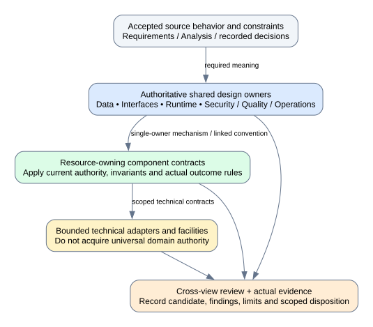

[Editable DOT](diagrams/cross-cutting-ownership.dot) · [PNG](diagrams/cross-cutting-ownership.png)

**Source authority:** [accepted scope](../../01-project-planning/02-scope.md), [requirements specification](../../02-requirements-engineering/03-requirements-specification/requirements-specification.md), [source questions/decisions](../../02-requirements-engineering/07-change-and-baseline/open-questions-and-decisions.md) and [analysis quality/security view](../../03-system-analysis/06-interfaces-security-and-quality-analysis/13-security-quality-and-operational-analysis.md). Design refines mechanisms; it must not silently change a source rule.

**Shared design owner:** one topic document owns each mechanism’s rationale and shared convention. Other views link that record and describe their specific application. The concern locators below are navigation labels, not new requirements or a completed verification checklist.

**Implementation owner:** the affected component implements its invariant and contract, while infrastructure adapters provide bounded technical capabilities. A central middleware/helper cannot replace the checks required inside a resource-owning command or protected retrieval path.

**Operating owner:** actual configuration, process supervision, backups and incident response need identified procedures and observations. A design document or named facility does not prove it is installed, enabled or usable.

## 2. Shared concern catalog

### CC-01 — Identity access and revocation

**Authoritative design:** [Identity access and revocation](../06-design-quality-and-security-analysis/02-security-threat-modeling-and-trust-boundaries.md).

**Ownership:** Identity supplies actor/grant context; each resource owner applies its exact current operation/lifecycle policy.

**Component integration:** Private commands, employer retrieval, jobs, Git and target deployment must identify their own authority boundary. A resource association or prior successful login cannot extend permission.

**Focused review cases:** Grant/link/account changes; direct artifact retrieval; revoked access during pending work.

### CC-02 — Persistence integrity and data lifecycle

**Authoritative design:** [Persistence integrity and data lifecycle](../04-data-design/01-analysis-to-logical-and-physical-data-models.md).

**Ownership:** Data design owns identity, relationships, integrity and physical mapping; domain components own their invariants.

**Component integration:** Identify source/draft/publication/actual-material boundaries, protected references and local transaction scope. Cross-owner changes use public contracts instead of direct table writes.

**Focused review cases:** Concurrent publication; actual-history preservation; retirement with remaining protected references.

### CC-03 — Caching and representation availability

**Authoritative design:** [Caching and representation availability](../04-data-design/03-persistence-caching-and-data-lifecycle.md).

**Ownership:** Data design owns cache/freshness and reference policy; Sharing and Files own current authorization and usable rendition selection.

**Component integration:** Cache keys and eligibility cannot turn a stale grant, missing language or unavailable PDF into a permitted result. Artifact availability and effective download mode remain distinct.

**Focused review cases:** Disable a link after caching; replace an artifact; request a missing rendition.

### CC-04 — Concurrency and durable external effects

**Authoritative design:** [Concurrency and durable external effects](03-process-view-concurrency-and-runtime-behavior.md).

**Ownership:** Runtime design owns operation identity, expected-version coordination, local commit/dispatch and attempt reconciliation.

**Component integration:** Web and workers use the same authority/result semantics. An expired claim or network timeout does not prove that an external effect did not occur.

**Focused review cases:** Duplicate dispatch; stale worker completion; unknown send/deploy result; cancel/complete race.

### CC-05 — Contracts provider integration and compatibility

**Authoritative design:** [Contracts provider integration and compatibility](../05-interface-and-api-design/01-api-protocols-contracts-and-compatibility.md).

**Ownership:** Interface design owns shared contract conventions; each provider/consumer owns its implementation and exact operations.

**Component integration:** Identify payload/version/time/language/provenance, errors and safe repetition. Provider connection, permitted capability, freshness and observed outcome are separate.

**Focused review cases:** Revoked consent; calendar conflicts; contract change; Git transport versus browser session.

### CC-06 — Untrusted content secrets and execution

**Release applicability:** future-domain design retained after MVP; core operating/deployment and recovery controls still apply to MVP where relevant.

**Authoritative design:** [Untrusted content secrets and execution](../06-design-quality-and-security-analysis/02-security-threat-modeling-and-trust-boundaries.md).

**Ownership:** Security design owns trust/control rationale; Files, Git, Workflow and Deployment implement their scoped boundaries.

**Component integration:** Treat uploads/repository/workflow/provider content as untrusted. Verify isolation and credential restrictions before enabling execution; separate target authority from workflow success.

**Focused review cases:** Malicious path/content; runner workspace escape; secret leakage; unintended target mutation.

### CC-07 — Capacity admission and bounded work

**Authoritative design:** [Capacity admission and bounded work](../06-design-quality-and-security-analysis/01-quality-attributes-and-design-trade-offs.md).

**Ownership:** Quality design owns workload/criteria; runtime, Files and deployment own enforceable admission and resource mechanisms.

**Component integration:** Compare combined web, PDF, sync, Git, storage and admitted execution demand against actual resources. Numeric limits require evidence; account count alone is not a load model.

**Focused review cases:** Parallel quota admission; storage pressure; heavy-job contention; growing queue age.

### CC-08 — Observability operating recovery and resilience

**Authoritative design:** [Observability operating recovery and resilience](../06-design-quality-and-security-analysis/03-operations-backup-recovery-and-resilience.md).

**Ownership:** Operations owns procedure/evidence; runtime supplies attributable outcomes and deployment supplies placement/access prerequisites.

**Component integration:** Record bounded operation identity and actual effects without exposing secrets/private content. Restore consistent data/artifact/Git/key coverage and reconcile external effects before re-enabling traffic/actions.

**Focused review cases:** Missed scheduler work; lost provider response; isolated restore; revoked grants in recovered data.

### CC-09 — Shared interaction accessibility and language

**Authoritative design:** [Shared interaction accessibility and language](../06-design-quality-and-security-analysis/04-user-interface-accessibility-and-interaction-quality.md).

**Ownership:** Interaction design owns shared UI behavior; each feature realizes its source scenario and permitted state.

**Component integration:** Keep draft/apply/publish distinct, expose truthful pending/conflict/unknown results and avoid silent language/content fallback. Keep navigation, forms, keyboard/focus and responsive behavior consistent.

**Focused review cases:** Unsaved conflict; unknown send; inaccessible confirmation; unavailable English/German content.

### CC-10 — Modularity dependencies and evolution

**Authoritative design:** [Modularity dependencies and evolution](../03-component-and-module-design/01-modularity-dependencies-and-encapsulation.md).

**Ownership:** Module design owns dependency direction; detailed OO design owns conventions/refactoring and component packages own implementation prescriptions.

**Component integration:** Keep technical shared services narrow. No universal Shared domain model, service locator or cross-module mutable entity. Review affected contracts and artifacts when a shared mechanism changes.

**Focused review cases:** Dependency cycle; another owner’s table writes; incompatible schema/interface migration.

## 3. Cross-component coordination examples

### Profile change to published presentation

Presentation compares identified source/draft versions and applies selected changes without overwriting independent overrides. Separate publication updates the intended live revision. Sharing resolves current eligible publication/rendition; Files confirms artifact usability and protected references. Applications retains actual submitted identity independently. This engages persistence, concurrency, authorization, cache freshness and UI confirmation, without copying their detailed rules into every component.

### Link disablement and protected retrieval

Sharing changes the exact link’s eligibility/version. Subsequent delivery admissions check current account/link/grant policy before releasing the permitted representation. A cached artifact or an earlier viewer session cannot create permanent permission. Already emitted bytes and legitimate downloads cannot be retracted by a new link state. Runtime, security and data-cache design must agree on that boundary.

### Reviewed message with an uncertain outcome

Communication binds reviewed account/recipient/content/attachments to an attempt. Runtime durably records intent and coordinates worker ownership. The provider adapter returns attributable acceptance/rejection/unknown evidence; Operations exposes bounded diagnostic status and UI shows the honest result. A queue retry or recovered backup must not silently send again. Actual application submission capture remains a separate attributable operation.

### Git revision to workflow and deployment

**Release applicability:** future-domain design retained after MVP; core operating/deployment and recovery controls still apply to MVP where relevant.

Git verifies exact current refs and grants. Workflow Coordination evaluates supported trigger/definition and enabling conditions before creating an attempt. An evaluated executor uses scoped inputs/secrets and bounded outputs. Deployment separately verifies target authority and artifact/revision. A work-item association, merge, completed run or permissive shared service cannot collapse these authority boundaries.

These are integration walkthroughs, not observed executions. See [component boundaries](02-system-decomposition-and-boundaries.md), [runtime behavior](03-process-view-concurrency-and-runtime-behavior.md) and [interface realizations](../05-interface-and-api-design/03-use-case-realizations-and-interactions.md) for their owning technical views.

## 4. Change and decision route

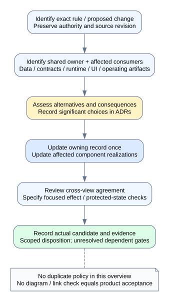

[Editable DOT](diagrams/cross-cutting-change-route.dot) · [PNG](diagrams/cross-cutting-change-route.png)

1. Identify the exact source rule, proposed change and its authority. If required behavior is unclear or changes, refine the authoritative requirement/analysis record first.
2. Identify the shared mechanism owner, component consumers, runtime operations, data/artifacts, UI flows and operating procedures affected.
3. Evaluate alternatives, compatibility, privacy/security, concurrency, resources, recoverability and cost/schedule consequences. Keep consequential technical choices in an [ADR](../07-design-decisions/README.md).
4. Update the owning shared design once. Update each consumer’s application of that design and its contract where actually affected. Do not copy the policy into this overview or a universal helper.
5. Review agreement across component, data, interaction, process and deployment views. Define focused verification for both intended effects and protected state, including denied, conflicting, partial and unknown paths where applicable.
6. Record the actual identified candidate, evidence, remaining gates and scoped decision. Refresh operating/recovery guidance when configuration, keys, storage or external effects change.

An independent design proposal can proceed while related feasibility evidence is pending. Accepting a dependent execution, resource or recovery commitment requires its own evidence. OAuth-not-created and backups-not-configured remain known setup facts; this route is not a reason to ask those questions again.

### Minimum integration record

For each substantive shared mechanism, record source locator/revision; authoritative design location; owner and consumers; concrete invariants and operation boundaries; compatibility/version implications; current proposal/decision status; planned verification and actual evidence separately; unresolved conditions and next gate. Use the existing [review record](../06-design-quality-and-security-analysis/05-design-review-traceability-and-handoff.md), not a competing findings register here.

## 5. Review and completion

**Document checks:** each concern has a reachable owning record; no concern silently selects a technical facility; component contracts and deployment/runtime assumptions agree; explicit source/apply/publication/history and authority boundaries remain intact. Keep this file as the map, not a second persistence/security/operations specification.

**Later semantic checks:** trace relevant source criteria to actual component contracts and cross-view walkthroughs. A family citation, CC entry or healthy link is not semantic coverage of every acceptance criterion. Preserve the existing analysis/requirements review limits and unresolved source choices.

**Later operating checks:** verify current authority under concurrency, provider/runner uncertainty, storage/admission behavior, restricted diagnostics and consistent usable recovery in suitable controlled environments. No live test, security assurance, restored backup or accepted capacity result is claimed by this update.

**Completion boundary:** the overview is ready as a coordination/navigation document when ownership, consumer responsibilities, decision route and evidence limits are explicit. That does not complete the detailed owning designs or approve the whole phase. Final component signatures, schemas/class diagrams, feasible executor/provider/recovery facilities and exact criterion mappings remain their designated follow-up work.

## 6. FAU basis and related records

FAU V07 presents cross-cutting concerns, with persistence as an example, alongside abstraction, modularity, cohesion/coupling and encapsulation. V08 connects model conventions and component design to consistency and change management. The CC catalog is a Resumefolio adaptation of those ideas, not a prescribed university taxonomy or formal standards conformance statement.

- [Architecture drivers](01-design-drivers-and-solution-options.md)
- [Deployment and network boundaries](04-deployment-topology-nodes-and-networks.md)
- [Shared ownership and component packages](../03-component-and-module-design/README.md)
- [Design evolution and technical debt](../02-detailed-and-object-oriented-design/05-design-evolution-refactoring-and-technical-debt.md)
- [FAU reference map](../01-reference-and-coverage-map.md)
- [Architecture diagram catalog](diagrams/README.md)

Advisor consultation remains unavailable as previously recorded; no independent advisor endorsement is implied. All diagrams are proposed coordination/realization views, not runtime traces or proof of configured controls.

## 7. Cross-cutting realization package

This package supplies the requested shared views without replacing their authoritative design owners. All mechanisms are proposals or evaluation examples; no library, collector, sidecar, breaker, cache, secret store or control is installed by a diagram. Supporting official guidance was reviewed November 2, 2026; actual compatibility/effectiveness remains unverified.

### 7.1 Concern-to-component matrix

Codes: **ID** Identity/Access; **PP** Presentation; **RS** Representation/Sharing; **AP** Applications; **CM** Communication/Calendar; **WM** Work; **GT** Git; **WF** Workflow/Deployment; **FO** Files/Operations. **R** = direct realization/enforcement responsibility; **S** = supplies a supporting contract; **—** = no primary realization assigned by this summary. A dash does not waive applicable security/privacy or operating obligations. Shared policy authority remains in the CC catalog, not in a single universal module.

| Concern | ID | PP | RS | AP | CM | WM | GT | WF | FO |
| --- | --- | --- | --- | --- | --- | --- | --- | --- | --- |
| CC-01 Authority / revocation | S | R | R | R | R | R | R | R | R |
| CC-02 Integrity / lifecycle | R | R | R | R | R | R | R | R | S |
| CC-03 Cache / representation | S | S | R | — | — | — | — | — | S |
| CC-04 Concurrency / effects | R | R | R | R | R | R | R | R | R |
| CC-05 Contracts / compatibility | R | R | R | R | R | R | R | R | R |
| CC-06 Untrusted content / secrets | R | R | R | R | R | R | R | R | R |
| CC-07 Resource admission | — | R | R | R | R | R | R | R | S |
| CC-08 Evidence / recovery / resilience | R | R | R | R | R | R | R | R | S |
| CC-09 Interaction / language | R | R | R | R | R | R | R | R | R |
| CC-10 Modularity / evolution | R | R | R | R | R | R | R | R | R |

This is a responsibility map, not criterion closure or a service deployment matrix. Configuration and bounded diagnostics apply to every actual runtime/adapter under CC-08/CC-10; actual counts/limits and implementation signatures remain owner work. Resource owners enforce their own policy even when Identity or Files supplies a contract.

### 7.2 Hexagonal architecture with concern overlays

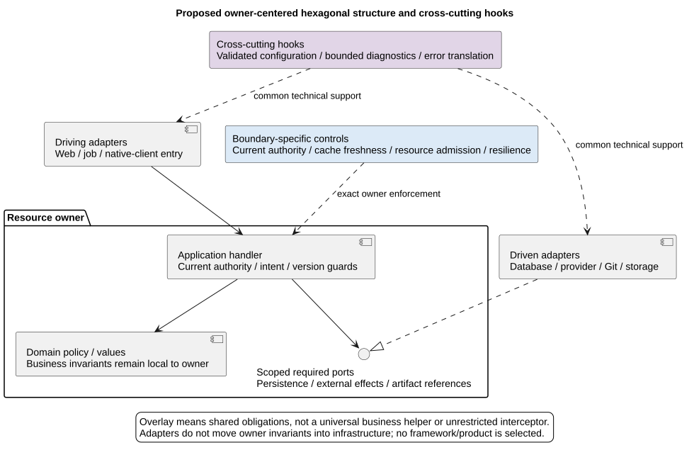

[Editable PlantUML](diagrams/concerns-hexagonal-overlay.puml) · [PNG](diagrams/concerns-hexagonal-overlay.png)

The overlay identifies shared hooks and owner-side enforcement, not a universal layer that can authorize every operation. Domain invariants stay with each owner; common libraries must not pull private models into a global shared service.

### 7.3 Security architecture and trust crossings

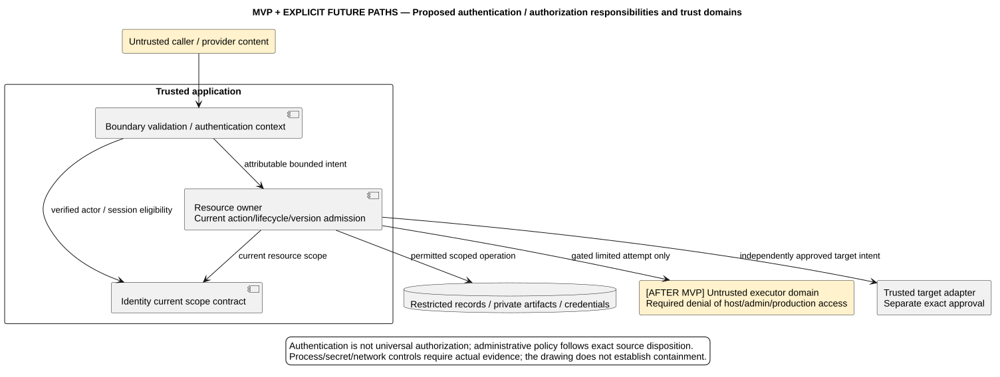

[Editable PlantUML](diagrams/concerns-security-architecture.puml) · [PNG](diagrams/concerns-security-architecture.png)

Authentication, current scoped authority and resource/lifecycle validity are distinct. Existing administrative-policy reconciliation remains pending. Neither a network boundary nor a diagram label demonstrates implemented controls or untrusted-code isolation.

### 7.4 Authentication and authorization sequence

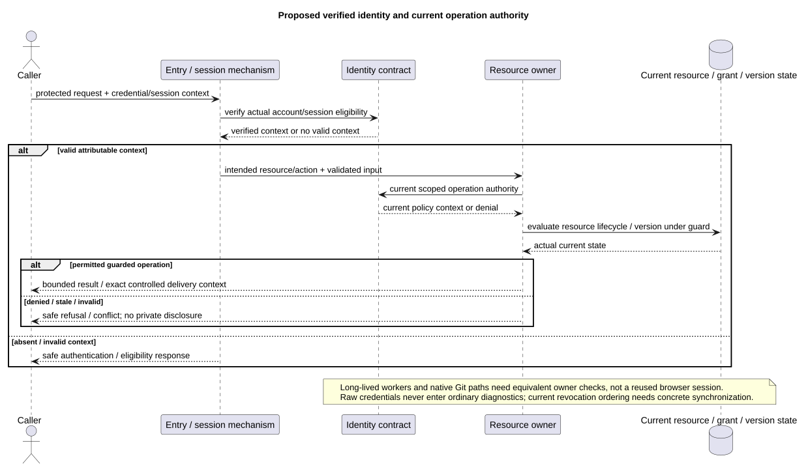

[Editable PlantUML](diagrams/concerns-authn-authz-sequence.puml) · [PNG](diagrams/concerns-authn-authz-sequence.png)

This is a selected protected account request; employer links, Git credentials, callbacks and jobs use their own actual contexts. The owner must synchronize consequential admission with current grant/state changes. No authentication library, factor mechanism or timeout is selected.

### 7.5 Observability — logs, metrics and tracing

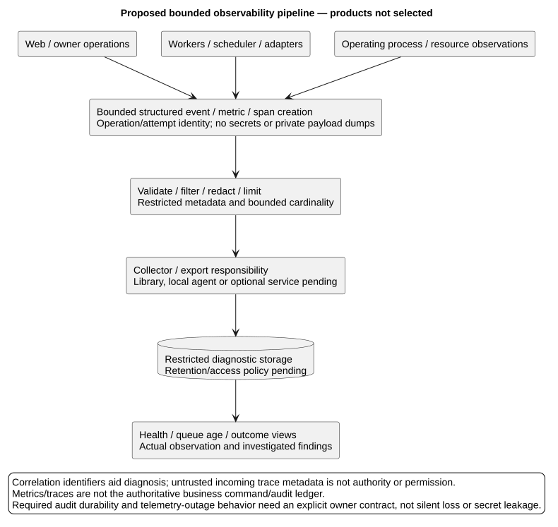

[Editable PlantUML](diagrams/concerns-observability-pipeline.puml) · [PNG](diagrams/concerns-observability-pipeline.png)

Official [OpenTelemetry signal concepts](https://opentelemetry.io/docs/concepts/signals/) distinguish logs, metrics and traces; [OWASP Logging guidance](https://cheatsheetseries.owasp.org/cheatsheets/Logging_Cheat_Sheet.html) informs restricted diagnostic design. No collector/backend/sidecar is adopted. Define actual coverage, sampling/retention, secret filtering, cardinality, access, outage behavior and tested alert routing before operation. Correlation is not authorization.

### 7.6 Activity — error and exception outcomes

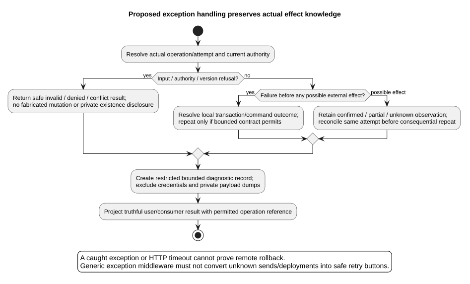

[Editable PlantUML](diagrams/concerns-error-flow.puml) · [PNG](diagrams/concerns-error-flow.png)

Classify the actual operation and effect boundary, not merely the thrown exception. A timeout may leave an effect unknown; retry/cancellation/compensation must follow the owner contract. Safe UI/API feedback and restricted diagnostics retain actual state without private fallback or secrets.

### 7.7 Configuration management and effective identity

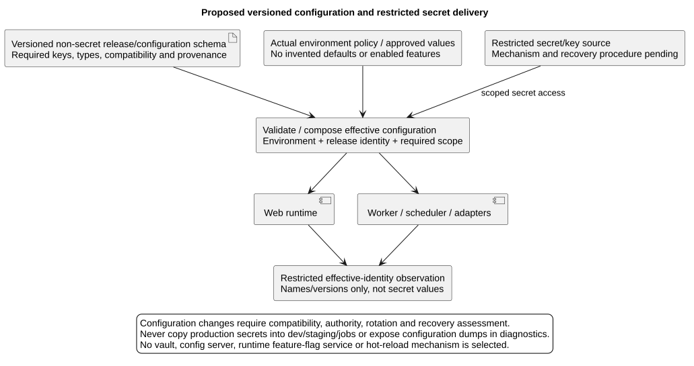

[Editable PlantUML](diagrams/concerns-configuration-management.puml) · [PNG](diagrams/concerns-configuration-management.png)

Validate exact environment/release configuration and required secret scope. Effective identity observations contain version/provenance, not values. Source-controlled non-secret templates and protected recoverable secret access have different lifecycles. No configuration service, vault or automatic production flag enabling is selected.

### 7.8 Caching strategy and current authority

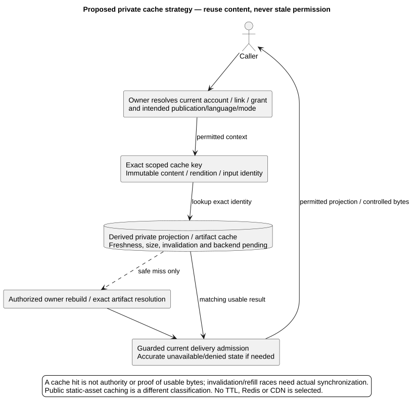

[Editable PlantUML](diagrams/concerns-cache-strategy.puml) · [PNG](diagrams/concerns-cache-strategy.png)

Cache payload, key scope, freshness/invalidation, concurrent fill, size and fallback need an owning record. Current authority and exact representation availability remain separate from a hit. See [persistence/cache policy](../04-data-design/03-persistence-caching-and-data-lifecycle.md) for shared rules; no new TTL or backend is invented.

### 7.9 Local transaction and external effect boundaries

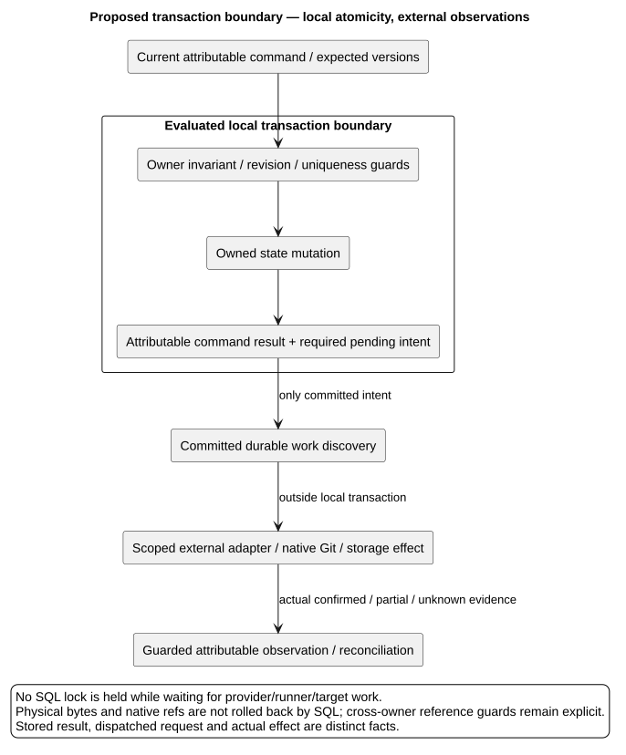

[Editable PlantUML](diagrams/concerns-transaction-boundary.puml) · [PNG](diagrams/concerns-transaction-boundary.png)

The illustrated local boundary commits only state within the evaluated transaction mechanism. Consumer/artifact protection and provider/Git/executor/target effects need their own coordination/reconciliation. Sharing one SQL store does not authorize another module to mutate internal records. See [ADR-003](../07-design-decisions/ADR-003-durable-external-attempts.md).

### 7.10 Resilience — bounded protection and safe repetition

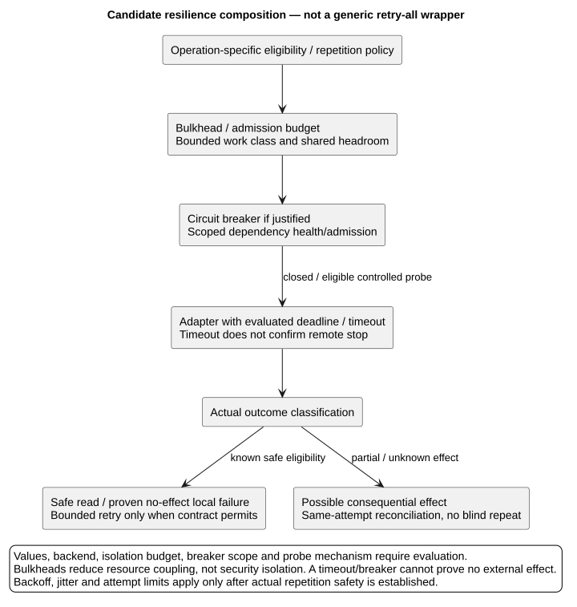

[Editable PlantUML](diagrams/concerns-resilience-patterns.puml) · [PNG](diagrams/concerns-resilience-patterns.png)

Official [Retry](https://learn.microsoft.com/en-us/azure/architecture/patterns/retry) and [Circuit Breaker](https://learn.microsoft.com/en-us/azure/architecture/patterns/circuit-breaker) guidance informs pattern evaluation, not an Azure service choice. Evaluate operation-specific repeat safety before backoff/retry, and actual resource separation before bulkhead claims. A deadline bounds waiting; it cannot by itself terminate a remote process or prove no effect.

### 7.11 UML circuit-breaker state machine

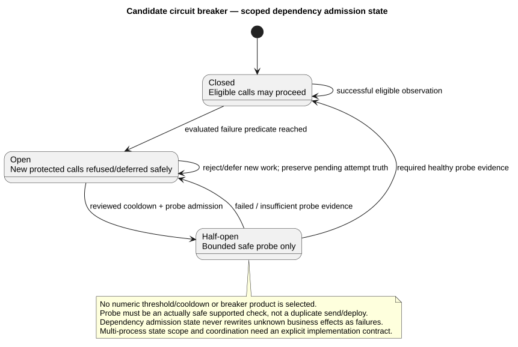

[Editable PlantUML](diagrams/concerns-circuit-breaker-states.puml) · [PNG](diagrams/concerns-circuit-breaker-states.png)

Closed/Open/Half-open are proposed dependency-admission states, not business attempt outcomes. No numerical predicate, cooldown, probe count, state store or fleet-wide synchronization is selected. Half-open probes must be actually safe and supported; do not probe with an ambiguous consequential send/deploy.

### 7.12 Interceptor / middleware chain

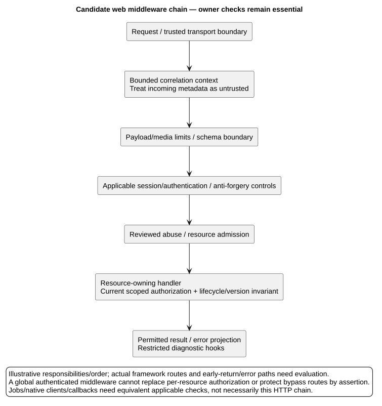

[Editable PlantUML](diagrams/concerns-middleware-chain.puml) · [PNG](diagrams/concerns-middleware-chain.png)

This is responsibility ordering, not inspected Laravel configuration or a complete interceptor API. Verify early denial, exception unwinding, body limits, current authority, anti-forgery scope and safe result handling for actual routes. Equivalent checks must cover non-HTTP entry paths.

### 7.13 Shared libraries and optional sidecar responsibilities

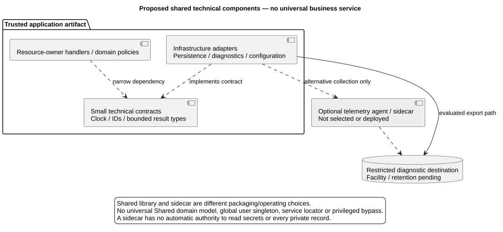

[Editable PlantUML](diagrams/concerns-shared-components.puml) · [PNG](diagrams/concerns-shared-components.png)

The preferred candidate starts with narrow technical contracts/adapters; the sidecar illustrates an optional packaging alternative. Libraries, collector processes and sidecars have different lifetime/resource/credential implications. No universal domain model or additional privileged process is justified solely by cross-cutting concerns.

### 7.14 DFD with trust boundaries

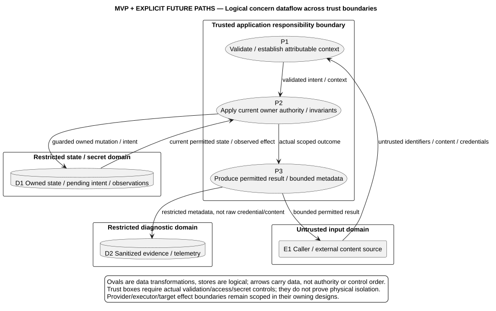

[Editable PlantUML](diagrams/concerns-trust-dfd.puml) · [PNG](diagrams/concerns-trust-dfd.png)

The DFD shows what crosses a logical trust boundary: raw input, verified context, current state, actual outcomes and bounded diagnostics. It does not prove physical segmentation, encryption or authorization. Actual secret/content leakage, forged metadata and restored authority cases remain in the [threat register](../06-design-quality-and-security-analysis/02-security-threat-modeling-and-trust-boundaries.md).

### 7.15 Quality attribute scenario table

These are selected applications of the [owning quality scenarios](../06-design-quality-and-security-analysis/01-quality-attributes-and-design-trade-offs.md), not new accepted NFRs or measured results. Exact Q-D25/Q-D26 target proposals retain source status.

| Stimulus / environment | Required response and measure | Owner / evidence gate |
| --- | --- | --- |
| Link/grant changes during private retrieval | Current guarded eligibility; no unauthorized later bytes or private fallback; observe actual admission order | Identity + Sharing + Files; actual serving/invalidation integration |
| Concurrent draft apply/publish/capture | Exact intended revisions; protected independent history or explicit conflict; inspect committed state | Presentation + Applications + Files; real transaction/reference race checks |
| Remote response lost after possible effect | Attributable unknown/partial knowledge and same-attempt reconciliation; count actual effects | Communication / Workflow / target owner; real adapter evidence |
| Heavy PDF/Git/upload work contends with web | Bounded admission/degradation; report correctness, latency/errors, queue age and resource pressure separately | Runtime + Files; agreed workload and combined-load evaluation |
| Telemetry/configuration dependency fails | Safe actual outcome without secret exposure, false business success or unreviewed default enabling | Owning runtime + Operations; configuration/audit/telemetry failure contract |
| Identified recovery point restored | Usable records/bytes/keys, current authority and no unsafe external replay; measure actual loss/time | Operations + affected owners; isolated restoration before readiness |

### 7.16 Policy and enforcement table

Each row is a proposed shared approach linked to an existing owner, not a new accepted permission, runtime product or numerical policy. Farhad remains actual decision authority; logical owners below are responsibilities, not staffed teams.

| Concern | Approach | Owner | Enforcement point |
| --- | --- | --- | --- |
| Identity / authority | Verified current context plus exact resource/action/lifecycle checks | Identity + resource owner | Every protected command/query/delivery/native/job boundary |
| Private content / cache | Exact scoped identity and current eligibility; no silent stale fallback | Sharing / consumer + Files | Lookup, rebuild and guarded byte admission |
| Transactions / references | Coherent owned local state; protected reference/deletion coordination | Data guidance + owning components | Conditional update/transaction and actual storage/reference guard |
| External effects / errors | Durable intent, attributable observations and unknown-result reconciliation | Effect owner + runtime | Before dispatch and every guarded result/reconciliation commit |
| Configuration / secrets | Versioned schema, validated effective values, narrow secret access | Operations + consuming adapter | Composition/startup/change/rotation/recovery boundary |
| Observability | Bounded structured metadata, restricted access and tested progress views | Operations + event owner | Instrumentation, export, storage, query and incident handling |
| Retry / timeout / breaker | Repetition-safe eligibility; bounded resource/dependency admission | Operation owner + runtime | Actual adapter/claim/probe and current effect boundary |
| UI / compatibility | Truthful outcomes, explicit confirmation and reviewed transition semantics | UI/API guidance + feature owner | Consumer projection, form/action and version coexistence |
| Evolution / recovery | Scoped impact review, compatible change and isolated usable restoration | Design owner + Operations | Migration/promotion/resumption and exact handoff review |

### Verification and consistency limits

Trace the selected concern to exact source/design criteria, affected owners, normal/denied/concurrent/partial/unknown/recovery paths and protected unchanged state. Test the actual candidate's authority, configuration, cache, transaction, diagnostics, adapter and process mechanisms. Rendering diagrams cannot establish control effectiveness, actual trace propagation, safe retries, operating capacity or recovery readiness. Existing proposal statuses, source-policy conflicts and feasibility gates remain unchanged.
