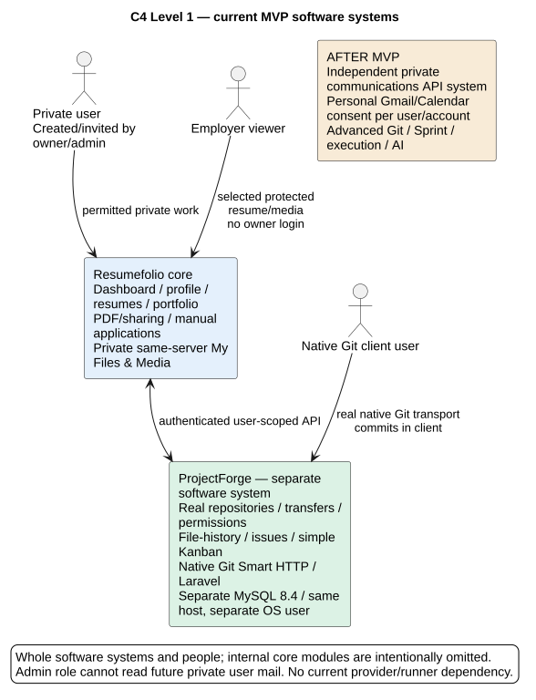
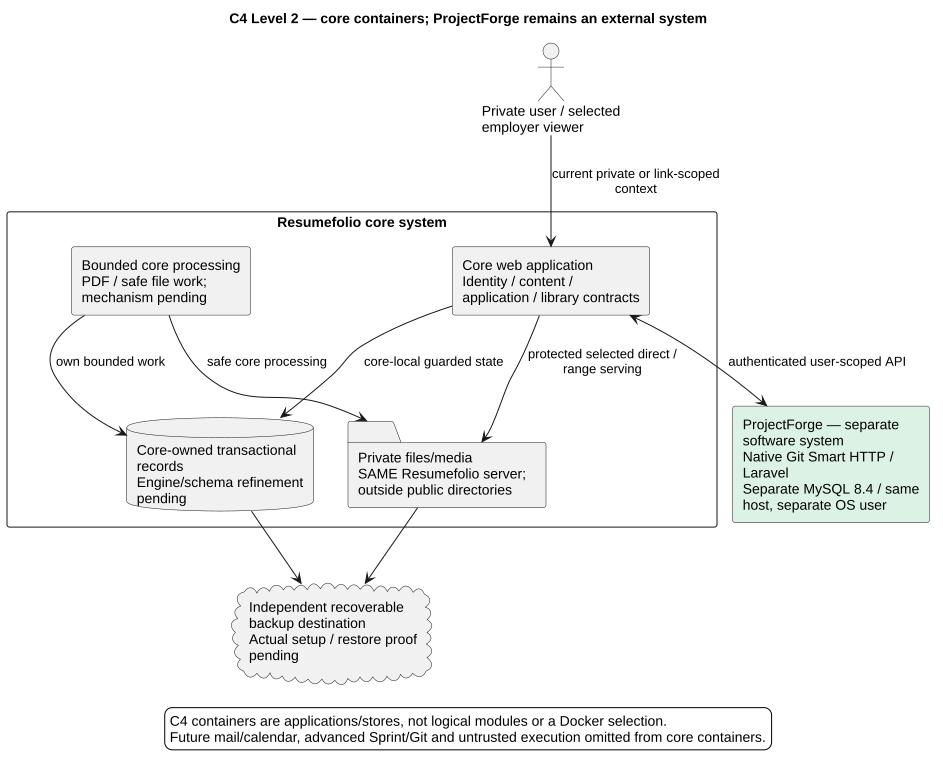

# Resumefolio — Software Architecture

Current implementation choices and scope: [Baseline](../../../baseline/README.md). Runtime verification remains subject to its gates.

**Start here to understand the proposed technical solution:** its drivers and alternatives, responsibility boundaries, runtime behavior, deployment possibilities and shared concerns.

Owner and decision authority: Farhad. Updated November 2, 2026.

**Current position:** all five architecture documents are populated and now include expanded visual packages. The diagram directory contains **69 distinct views**: 54 PlantUML diagrams, 14 Graphviz diagrams and one qualitative radar chart, each with SVG/PNG exports. This inventory describes documentation, not configured infrastructure, verified runtime behavior or accepted architecture. Final mechanisms, exact criterion closure and owner baseline disposition remain pending.

[Reading route](#1-reading-route) · [View guide](#2-find-the-right-document-and-view) · [Diagrams](#3-diagram-gallery-and-catalog) · [Abstractions](#4-reading-the-abstraction-levels) · [Candidate](#5-current-recommendation-and-evidence-gates) · [Review](#6-review-and-maintenance)

## Current MVP boundary figure

[Editable source](diagrams/mvp-system-boundaries.puml) · [PNG](diagrams/mvp-system-boundaries.png). Historical broader-product figures below retain earlier alternatives/detail; they do not define the current system boundary.

## 1. Reading route

1. [Design Drivers and Solution Options](01-design-drivers-and-solution-options.md): six drivers, three alternatives, system context/use cases, quality utility tree, option diagrams, critical scenario and qualitative decision support.
2. [System Decomposition and Boundaries](02-system-decomposition-and-boundaries.md): nine logical owners, candidate DDD contexts/relationships, C4 container shape, contracts, dependencies, package/hexagonal views and ownership/responsibility tables.
3. [Process View, Concurrency and Runtime Behavior](03-process-view-concurrency-and-runtime-behavior.md): guarded commands, durable work, actual effect knowledge, cancellation, process/queue/concurrency views and shared-resource risks.
4. [Deployment Topology, Nodes and Networks](04-deployment-topology-nodes-and-networks.md): dated observations versus candidate nodes/artifacts, routing/security zones, alternative cloud/orchestration/resilience layouts, environments, promotion and port/sizing contracts.
5. [Cross-Cutting Concerns Overview](05-cross-cutting-concerns-overview.md): concern ownership, component matrix, authn/authz, diagnostics/configuration/cache/transactions/resilience, middleware/shared components and quality/policy tables.

Read each figure with its owning caption and evidence limits. Follow [purpose/scope/approach](../00-design-purpose-scope-and-approach.md) for source authority and the [reference map](../01-reference-and-coverage-map.md) for FAU provenance and project adaptations.

## 2. Find the right document and view

| Question or requested view | Owning record |
| --- | --- |
| Why the modular candidate rather than weak boundaries or early services? | [01 — Drivers/options](01-design-drivers-and-solution-options.md) |
| C4 Level 1, utility tree, UML use cases, per-option components, decision matrix/radar and ADR? | [01 — Visual comparison package](01-design-drivers-and-solution-options.md) |
| Candidate bounded contexts, DDD context map, C4 Level 2 or logical component/package structure? | [02 — Decomposition](02-system-decomposition-and-boundaries.md) |
| Who owns data and responsibilities; which contracts/dependencies cross boundaries? | [02 — Ownership/CRC and dependency views](02-system-decomposition-and-boundaries.md) |
| Sequence, swimlane fork/join, state, communication or illustrative timing? | [03 — Runtime diagram package](03-process-view-concurrency-and-runtime-behavior.md#8-runtime-diagram-package) |
| Processes, concurrency, logical queues, contention, DFD or hypothetical deadlock? | [03 — Runtime diagram package](03-process-view-concurrency-and-runtime-behavior.md#8-runtime-diagram-package) |
| Nodes/artifacts, subnets/zones, optional clusters/regions, DR, environments or CI/CD mapping? | [04 — Deployment package](04-deployment-topology-nodes-and-networks.md#9-deployment-diagram-and-sizing-package) |
| Candidate node-to-node protocols/ports and per-node resource evidence? | [04 — Link and sizing tables](04-deployment-topology-nodes-and-networks.md#913-communication-protocol-and-port-table) |
| Shared concerns, security/telemetry/configuration/cache/transaction/resilience views? | [05 — Realization package](05-cross-cutting-concerns-overview.md#7-cross-cutting-realization-package) |
| Concern-to-component, quality-scenario and enforcement-policy tables? | [05 — Matrices and policies](05-cross-cutting-concerns-overview.md#7-cross-cutting-realization-package) |

For final operation signatures/classes/algorithms, use the [component catalog](../03-component-and-module-design/README.md). Shared [data](../04-data-design/README.md), [API](../05-interface-and-api-design/README.md) and [quality/security](../06-design-quality-and-security-analysis/README.md) records remain the detailed policy/mechanism owners.

## 3. Diagram gallery and catalog

### Shared whole-system anchor

[Owning context assessment](01-design-drivers-and-solution-options.md#0-system-context-and-use-case-scope) · [PlantUML](diagrams/drivers-c4-system-context.puml) · [PNG](diagrams/drivers-c4-system-context.png)

The same context is reused by decomposition and deployment. People and whole external systems belong here; modules, private stores and subnets belong at other levels.

### Candidate applications and stores

[Owning decomposition](02-system-decomposition-and-boundaries.md) · [PlantUML](diagrams/boundaries-c4-containers.puml) · [PNG](diagrams/boundaries-c4-containers.png)

This is a proposed application/store shape, not a selected physical topology or safe executor. Web/background applications may share a compatible release; logical owners are not automatically separate containers.

### View inventory by owner

| Owning document | Distinct views | Key coverage |
| --- | --- | --- |
| 01 — Drivers/options | 12 | Original overviews, context/tree/use cases, three option diagrams, deployment/sequence and radar |
| 02 — Decomposition | 12 | Original boundaries plus DDD/C4/UML/package/hexagonal/dependency/event/sequence views |
| 03 — Runtime | 16 | Original runtime routes plus interaction/state/timing/process/queue/contention/dataflow/wait-for views |
| 04 — Deployment | 14 | Original topology/routes plus infrastructure, zones, alternatives, environments, pipeline and request sequence |
| 05 — Cross-cutting | 15 | Original ownership/change routes plus thirteen shared realization views |

Counts total 69 unique SVG/PNG pairs; reused anchors are not counted again. The [full diagram catalog](diagrams/README.md) links all editable sources and exports. The [radar generator](diagrams/drivers-options-radar.py) and [rubric/data](diagrams/drivers-options-radar.json) make its unweighted ordinal judgments inspectable. Those scores are qualitative author assessments, not benchmarks, accepted priorities or a weighted decision total.

## 4. Reading the abstraction levels

- **DDD:** bounded contexts and context-map arrows describe candidate model/vocabulary relationships. They do not assert separate teams, approved services or completed discovery workshops.
- **C4:** Level 1 shows the whole system's context; Level 2 shows applications/data stores. A C4 container is not a Docker container. The logical component view is explicitly UML rather than a falsely scoped C4 Level 3 view.
- **UML/code organization:** component/package, activity, state, sequence, communication, timing and deployment views answer different questions. Packages are not database schemas or process-isolation controls.
- **Process/data analysis:** DFD arrows carry data; dependency arrows point consumer-to-provider; numbered communication messages order an interaction. A wait-for cycle is a hypothetical example, not an observed defect or formal liveness proof.
- **Alternatives and synthesis:** the event-storming board is a proposed desk synthesis. Kubernetes/sidecar/balancer/multi-region/standby views are optional alternatives, not adopted infrastructure. Timing ticks are illustrative positions, not measured durations or selected timeouts.

FAU's architecture viewpoints span several topics: implementation/artifacts are owned by [Component and Module Design](../03-component-and-module-design/02-implementation-view-and-artifacts.md), use-case realization by [Interface Design](../05-interface-and-api-design/03-use-case-realizations-and-interactions.md), persistence by [Data Design](../04-data-design/README.md), and quality/operating detail by topic 06. The topical directory tree and supplemental techniques are project conventions; see the reference map for exact provenance.

## 5. Current recommendation and evidence gates

The candidate retains explicit logical ownership inside the core and ProjectForge, with a separate authenticated user-scoped API between systems. Core preserves independent draft/publication/actual-submission identities and private same-server artifacts. ProjectForge MVP supports native Git, issues and simple Kanban. Provider, Sprint, advanced review/release and execution models are deferred.

[ADR-001 — Boundaries](../07-design-decisions/ADR-001-modular-application-boundaries.md), [ADR-002 — Publication/history](../07-design-decisions/ADR-002-explicit-publication-and-history.md) and [ADR-003 — External attempts](../07-design-decisions/ADR-003-durable-external-attempts.md) remain **Proposed**. Accepted product behavior remains accepted independently of those technical mechanisms.

Remaining evidence includes actual Git/provider compatibility, execution containment/resource fit, final database/schema/guard mechanisms, working mail/worker/scheduler facilities, independent backup/key recovery, reviewed quality/client targets and representative combined capacity. OAuth is not created and backups are not set up under the existing source facts. The dated 2-vCPU/4-GB/40-GB guest observation is inventory, not available production capacity; colocation shares that budget rather than multiplying it per diagram box.

No diagram opens ports, assigns subnets, provisions pods/regions, configures a collector/breaker/cache, establishes HA or demonstrates usable restoration. Independent design work can continue where a gate does not apply, while affected readiness remains conditional on evidence. All delivery/operations work fits the sole owner's 20 total project hours/week; no extra service spending is authorized here.

## 6. Review and maintenance

For any actual review, identify exact source/design revisions, claimed criterion/scenario scope, reviewer/method, observed evidence, limitations/findings and actual disposition. Use [review/handoff](../06-design-quality-and-security-analysis/05-design-review-traceability-and-handoff.md) and [evidence guidance](../06-design-quality-and-security-analysis/review-and-traceability/evidence/README.md). A populated view, valid file link or successful render does not establish semantic coverage, security, performance or implementation readiness.

When changing a model, update its owning record, source and exports together; reconcile consumers, data/runtime/deployment consequences and ADRs; preserve historical evidence and actual proposal/acceptance status. Use [design evolution](../02-detailed-and-object-oriented-design/05-design-evolution-refactoring-and-technical-debt.md). Reuse anchors rather than create competing context diagrams or duplicated policies.

[Project Planning](../../01-project-planning/README.md), [Requirements Engineering](../../02-requirements-engineering/README.md) and [System Analysis](../../03-system-analysis/README.md) retain their authority and review limits. The agreed pre-implementation baseline sequence and actual owner disposition remain required; no coding authorization, purchase, test Pass or phase acceptance is created by this index.

[System Design home](../README.md) · [Purpose and approach](../00-design-purpose-scope-and-approach.md) · [FAU reference map](../01-reference-and-coverage-map.md) · [Diagram catalog](diagrams/README.md)
