# Resumefolio — Design Principles and Object-Oriented Approach

**Proposed approach:** cohesive resource-owning modules, explicit use-case handlers, small invariant-preserving domain objects and adapters at external-effect boundaries. Use OO principles to make accepted behavior understandable and verifiable, not to maximize the number of classes or patterns.

**Status:** proposed detailed-design guidance, November 2, 2026. Class/interface names below illustrate technical responsibilities; they are not implemented production code, final signatures or newly accepted requirements.

[Responsibilities](#1-responsibilities-and-dependency-direction) · [Principles](#2-design-principles-in-this-project) · [Model](#3-class-and-object-modeling) · [Patterns](#4-pattern-selection-and-consequences) · [Behavior](#5-operation-contracts-and-object-lifetime) · [Review](#6-review-and-component-handoff) · [OO visual package](#8-object-oriented-visual-and-responsibility-package)

Current MVP scope and selected mechanisms: [Baseline](../../../baseline/README.md). Deferred provider, advanced collaboration and workflow-execution designs are not MVP prerequisites.

## Source and design authority

Follow the [accepted scope](../../01-project-planning/02-scope.md), [source decisions](../../02-requirements-engineering/07-change-and-baseline/open-questions-and-decisions.md), [analysis domain model](../../03-system-analysis/02-domain-and-information-analysis/03-domain-model-and-object-oriented-view.md), [operation contracts](../../03-system-analysis/05-business-rules-and-operation-contracts/10-domain-constraints-and-operation-contracts.md) and [logical component boundaries](../01-software-architecture/02-system-decomposition-and-boundaries.md). Conceptual domain classes are inputs; technical controllers, handlers, adapters and persistence mappings are design refinements, not additional business concepts.

## 1. Responsibilities and dependency direction

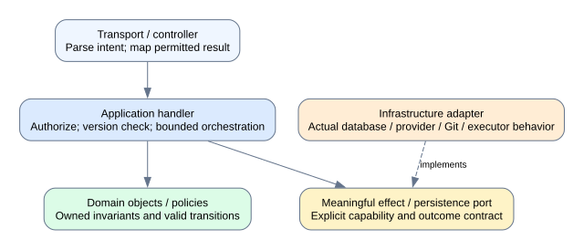

[Editable DOT](diagrams/oo-responsibility-direction.dot) · [PNG](diagrams/oo-responsibility-direction.png)

**Transport/controller:** validate transport shape, establish request identity, invoke the appropriate use case and map permitted outcomes into responses. Controllers must not directly publish, update another module’s tables or infer external success from a queue acknowledgment.

**Application handler:** orchestrate one explicit command/query, current authority, expected-version checks, bounded local transaction and attributable outcome. It coordinates domain objects and ports without hiding remote effects inside getters, ORM hooks or unrelated save operations.

**Domain object/policy:** protect owned invariants and meaningful transitions, such as selected source application, separate publication and protected actual-material identity. Keep policies independent of HTTP/session globals and provider response formats. A policy must receive enough current context; an object is not safe merely because its constructor ran once.

**Infrastructure adapter:** implement persistence, provider, native Git, rendition, artifact and executor contracts. Translate actual results into the application outcome vocabulary without inventing rollback, receipt or termination. Interfaces are justified where substitutability, volatile dependencies, verification seams or effect boundaries matter.

**Composition root:** Laravel’s dependency container wires implementations to required contracts. Do not resolve arbitrary dependencies throughout domain logic or retain a user/session identity in a shared singleton. Runtime lifetime and authority freshness remain explicit.

## 2. Design principles in this project

### Single responsibility

Keep comparison/application, publication, protected retrieval and actual submission capture as distinct use cases. A class called ResumeManager must not silently combine source updates, PDF generation, link controls and external submission. Cohesion is defined by the invariant or reason to change, not an arbitrary maximum method count.

### Open/closed design

Introduce a small adapter or strategy when a real variation exists: generated versus uploaded representation, provider operations, storage or executor control. Add an implementation without rewriting the consumer’s invariant logic where feasible. Do not anticipate unlimited providers or create extension points for hypothetical features excluded from Version 1.

### Liskov substitution

Implementations of a port must preserve its documented input, outcome, failure and protected-state semantics. An uploaded-rendition adapter cannot return another language because the requested file is absent. A provider adapter cannot classify an unknown send as confirmed failure merely to fit a boolean return type.

### Interface segregation

Consumers require only the operations and permitted projections they need. Split read-only publication resolution from mutation or administrative contracts where authority differs. An executor consumer must not gain unrestricted host administration through a convenient general-purpose interface.

### Dependency inversion

Use-case handlers depend on meaningful contracts at external boundaries; infrastructure realizes them. This does not require wrapping every Laravel utility or introducing a repository interface for each trivial table. Preserve clear domain ownership and make actual side effects substitutable in focused verification.

### DRY without policy confusion

One authoritative policy owner prevents inconsistent grant, quota or lifecycle rules. Similar-looking validation in two domains is not automatically the same rule: link revocation and provider consent are different authority boundaries. Share stable technical primitives, not a universal mutable business object.

### KISS and YAGNI

Start with the smallest design that realizes accepted scenarios and exceptional outcomes. Do not add a general event bus, event sourcing, generic workflow framework or a class per field by default. Simplicity cannot remove real Git, conditional execution, history preservation or required recovery from agreed scope.

## 3. Class and object modeling

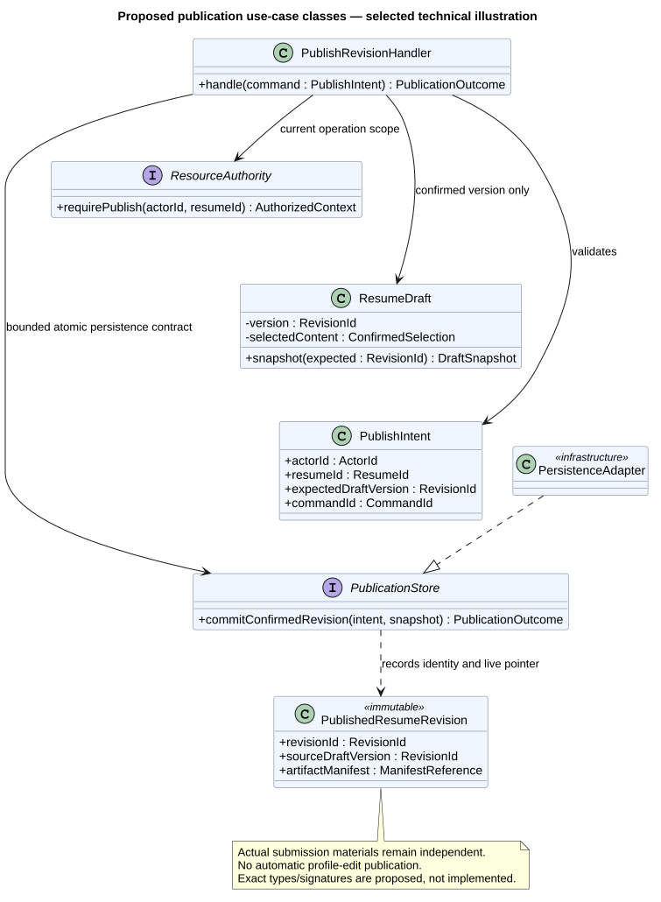

[Editable PlantUML](diagrams/publication-use-case-classes.puml) · [PNG](diagrams/publication-use-case-classes.png)

This selected technical model illustrates Presentation responsibility; it is not the complete component class model. Type and operation names remain proposals pending implementation-level signature/schema refinement.

### Meaningful identities and values

Represent actor/resource/command identity, expected revision, content language and attempt identity using validated types or equivalent explicit constraints. Avoid passing interchangeable unvalidated strings through every boundary. Keep time meaning explicit: an instant, local scheduled time and provider timezone mapping need different interpretation even if their physical representation is later shared.

### Entities aggregates and immutable records

ResumeDraft owns selected editable state and independent overrides. PublishedResumeRevision identifies the separately confirmed presentation; later edits create a different revision rather than mutate its historical identity. SubmissionMaterialSet records actual material/provenance independently. Shared bytes may be deduplicated only while reference, immutability and retention rules remain preserved.

An aggregate boundary groups state whose invariant needs local atomicity. It does not automatically mean one database table, one service or one giant object graph. Keep provider/runner/target truth outside local aggregates; represent attributable attempts and observations instead of pretending a local object controls the remote state.

### Visibility and collaboration

Expose public application contracts and permitted projections. Keep domain mutation operations internal to the owning component. Avoid handing a mutable ORM entity to another module and relying on convention not to save it. Mapping persistence records into domain/query objects may be direct or explicit depending on actual complexity; do not mandate duplication for its own sake.

## 4. Pattern selection and consequences

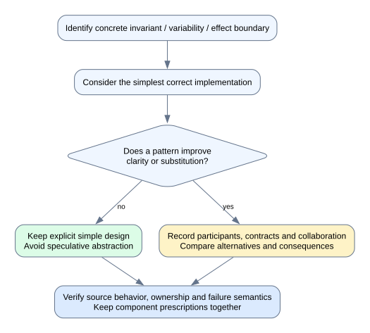

[Editable DOT](diagrams/pattern-selection-route.dot) · [PNG](diagrams/pattern-selection-route.png)

### Adapter — external systems and persistence

**Problem:** provider/Git/storage/executor mechanics vary independently from product invariants. **Participants:** application port, infrastructure implementation and consumer handler. **Consequence:** consumers retain domain meaning while adapters require compatibility and error/uncertainty mapping. Do not mask different capabilities behind a misleading common success contract.

### Strategy — selected representation resolution

**Problem:** generated/uploaded rendition handling differs while the caller requests a specific permitted representation. **Participants:** selected resolution policy and eligible representation implementations. **Consequence:** selection remains explicit; no implementation may silently bypass language, current eligibility or availability. A simple branch is acceptable when a strategy hierarchy would add no useful separation.

### Factory — constructing valid revisions or attempts

**Problem:** creation must bind a confirmed draft version or reviewed operation intent to attributable identity. **Participants:** creation operation/factory and validated inputs. **Consequence:** consistent construction without side effects hidden in constructors. A factory does not authorize publication, send or deployment by itself.

### Facade — a bounded application use case

**Problem:** one deliberate user action coordinates several internal steps. **Participants:** public handler/contract and owned collaborators. **Consequence:** a clear entry point and test seam; avoid a universal facade that centralizes all resource authority and lifecycle behavior.

### Observer or domain event — explicit committed reactions

Use a committed event only for a named reaction with clear authority and durable dispatch needs. In-process notification is not durable delivery. A listener must not silently publish, send mail or deploy because an unrelated model was saved. Where consequential external work exists, use the [runtime attempt protocol](../01-software-architecture/03-process-view-concurrency-and-runtime-behavior.md).

### Singleton and generic abstractions — default caution

Do not use a singleton to hold actor/session/transaction state, or a universal repository/service locator to bypass ownership. Stateless immutable shared configuration can have a suitable framework lifetime after compatibility evaluation. Reuse is justified by an actual contract and consumers, not a pattern checklist.

## 5. Operation contracts and object lifetime

For each concrete command define actor/resource context, preconditions, expected revision, admitted inputs, intended effects, protected frame, actual outcome classes and repetition/concurrency behavior. Denied/conflicting requests preserve protected state; partial/unknown external results require evidence rather than an invented unchanged-state assertion.

**Publication example:** authorize the intended resume; verify confirmed draft version; construct the intended revision; atomically update the permitted publication pointer; record attributable result. Source changes alone cannot call this operation. PDF rendering and external sending are separate explicit work. A response lost after commit resolves the same command identity rather than publishing again blindly.

Inject the clock and effect ports into handlers that need deterministic behavior. Keep transaction/unit-of-work lifetime bounded to the command. Jobs carry stable references and reviewed intent, then reconstruct current authority/capability at execution; they do not serialize an indefinitely privileged session or stale mutable ORM graph.

Release resources on completion/failure, distinguish cancellation request from confirmed stop and keep logging bounded. Do not retain credentials, provider response bodies or private artifacts inside long-lived shared service objects.

## 6. Review and component handoff

### Focused design checks

- Every class has a coherent responsibility tied to a source invariant or technical mechanism.
- Public/internal visibility and component dependency direction are explicit; no consumer writes another owner’s state.
- Substituted adapters preserve denied, unavailable, partial and unknown results as well as success.
- Source/draft/publication/actual-history identities and independent link/PDF controls remain distinct.
- Constructors/getters/observers do not hide consequential mutations or remote operations.
- Command version/identity, object lifetime, transaction scope and protected state are verifiable under races and failures.
- Patterns reduce a concrete problem; unnecessary indirection, god objects and cyclic dependencies are challenged.

These are planned review criteria, not completed product tests. Later component checks use deterministic domain/handler cases, actual database transaction/concurrency integration and controlled external-boundary verification where applicable. A mock-only test cannot establish real Git semantics, provider idempotency, executor isolation or usable recovery.

### Where concrete prescriptions belong

Use the [complete component package template](../03-component-and-module-design/README.md) and [actual component catalog](../03-component-and-module-design/README.md) for signatures, computational data/classes, algorithms and technical scenarios. Link shared [data](../04-data-design/README.md), [interface](../05-interface-and-api-design/README.md) and [security](../06-design-quality-and-security-analysis/README.md) choices instead of duplicating policy.

Record significant alternatives and consequences in [design decisions](../07-design-decisions/README.md). Use [evolution and debt](05-design-evolution-refactoring-and-technical-debt.md) for actual smells/compatibility/refactoring work, and [design review/handoff](../06-design-quality-and-security-analysis/05-design-review-traceability-and-handoff.md) for identified candidate findings and disposition.

## 7. FAU basis and current limits

FAU V08 distinguishes architecture from implementation-level component models, including computational data, classes, fine-grained behavior and technical scenarios. It presents GoF/POSA patterns, examples, anti-patterns, smells and modeling conventions. SOLID/DRY/KISS/YAGNI here are supplementary project guidance, not a claim that the supplied lectures mandate every named technique. DDD remains selective and optional.

This document provides a project-specific OO approach and a selected illustrative class design. Final component-wide signatures/types, schemas, complete class diagrams, exact criterion mappings and external compatibility/feasibility remain further design work. No production class, live test, technical baseline acceptance or advisor endorsement is established by this authoring update.

[Detailed Design index](README.md) · [Diagram catalog](diagrams/README.md) · [FAU reference map](../01-reference-and-coverage-map.md)

## 8. Object-oriented visual and responsibility package

These are selected **proposed design examples**, not implemented classes, detected code defects, complete domain coverage or accepted signatures. The existing [publication UML class diagram](#3-class-and-object-modeling) supplies attributes, operations, associations and interface realization. The following views explain complementary design questions. Read arrows according to each diagram type; source dependencies, runtime messages and conceptual relationships are different.

### 8.1 Before and after: separate reasons to change

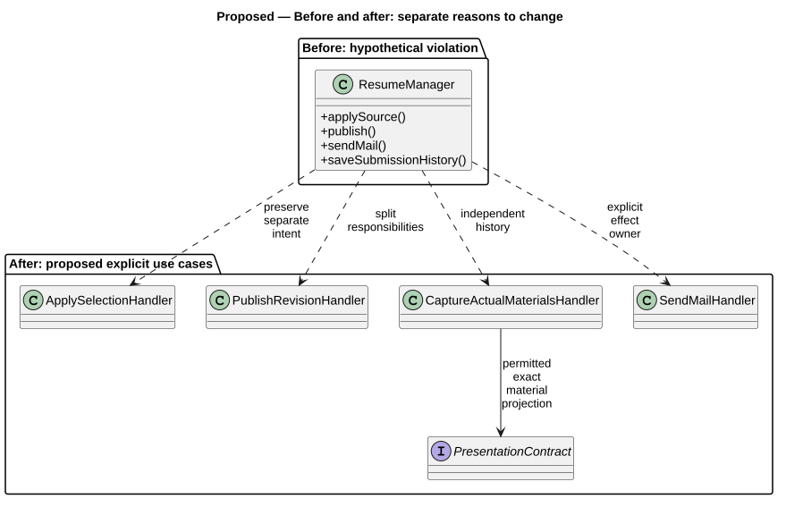

[Editable PlantUML](diagrams/oo-before-after.puml) · [PNG](diagrams/oo-before-after.png)

The before design is a teaching counterexample, not an observed production defect. Splitting preserves explicit source application, publication, actual history and send intent; it does not make the handlers separate services.

### 8.2 Object diagram: one illustrative publication collaboration

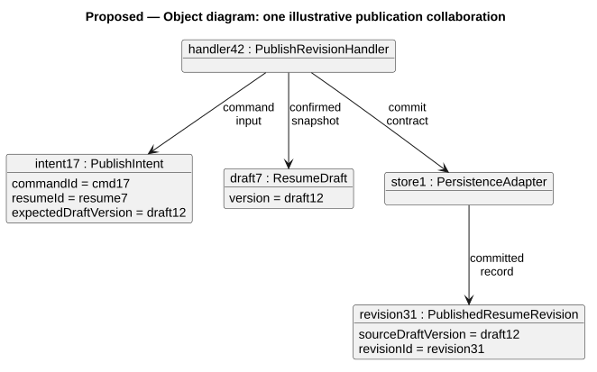

[Editable PlantUML](diagrams/oo-runtime-objects.puml) · [PNG](diagrams/oo-runtime-objects.png)

Invented identities illustrate a successful post-commit snapshot. Links represent collaboration/record relationships, not ownership of a live ORM graph or an actual runtime trace. Revision creation and pointer/result recording require the coherent guarded commit described below.

### 8.3 Package diagram: acyclic source dependencies

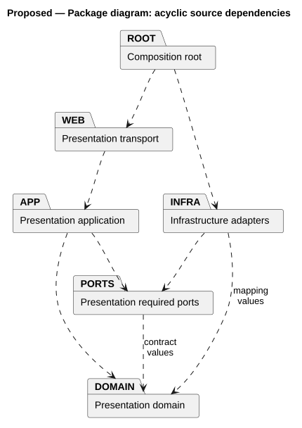

[Editable PlantUML](diagrams/oo-packages.puml) · [PNG](diagrams/oo-packages.png)

Arrows mean source dependencies. This proposed graph has no cycles; wiring belongs at the composition root. These are illustrative packages inside the modular application, not proof that current imports have been audited.

### 8.4 Dependency inversion at the persistence boundary

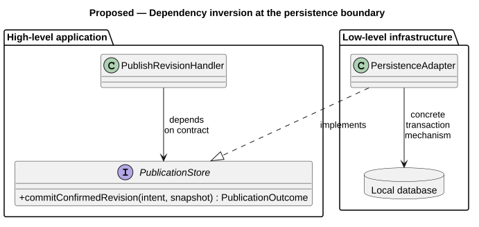

[Editable PlantUML](diagrams/oo-dependency-inversion.puml) · [PNG](diagrams/oo-dependency-inversion.png)

The consumer owns the meaning of the required port. Runtime calls reach an adapter, while source dependency points toward the abstraction. The port must preserve current guards, coherent local commit and repeat-command outcomes; its name alone provides no atomicity.

### 8.5 Inheritance versus composition: rendition variation

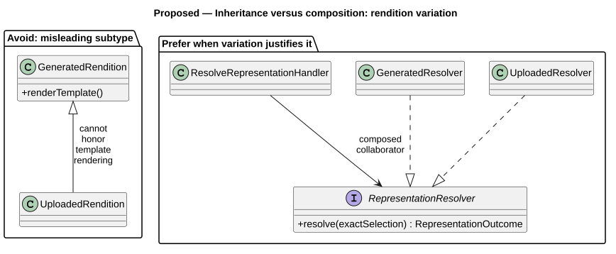

[Editable PlantUML](diagrams/oo-composition.puml) · [PNG](diagrams/oo-composition.png)

Uploaded material is not a behavioral subtype of template-generated material. Composition permits independent implementations of an exact-selection contract. Neither may silently substitute a language, rendition or unavailable file; a simple branch can be clearer when polymorphism adds no value.

### 8.6 Interface realization and narrow consumer access

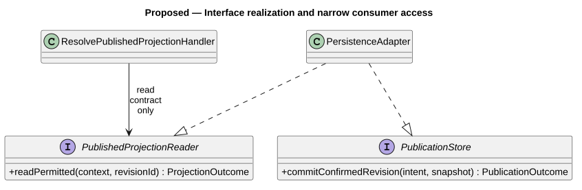

[Editable PlantUML](diagrams/oo-realization.puml) · [PNG](diagrams/oo-realization.png)

The read consumer receives only its required interface, not mutation access. Implementing both interfaces does not authorize callers; exact current resource and lifecycle checks remain required. Names are proposed design roles, not framework bindings already configured.

### 8.7 Coupling and cohesion: compare responsibility shapes

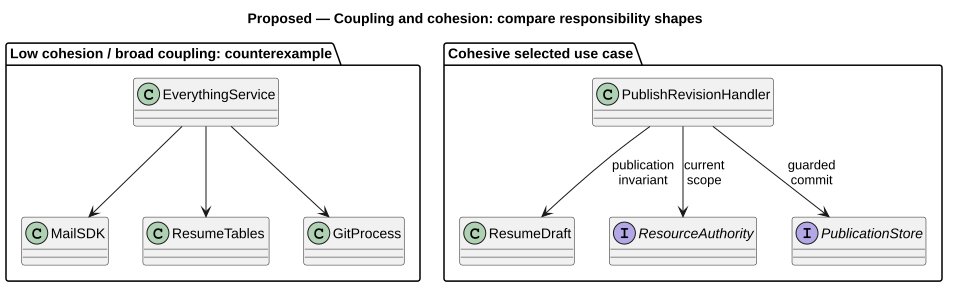

[Editable PlantUML](diagrams/oo-coupling-cohesion.puml) · [PNG](diagrams/oo-coupling-cohesion.png)

Cohesion follows one invariant and reason to change. Necessary authority and commit dependencies are deliberate coupling. Arrow count alone is not a quality score; no coupling/cohesion metrics were measured, and splitting every method into a class would not establish good design.

### 8.8 Sequence: explicit publication object collaboration

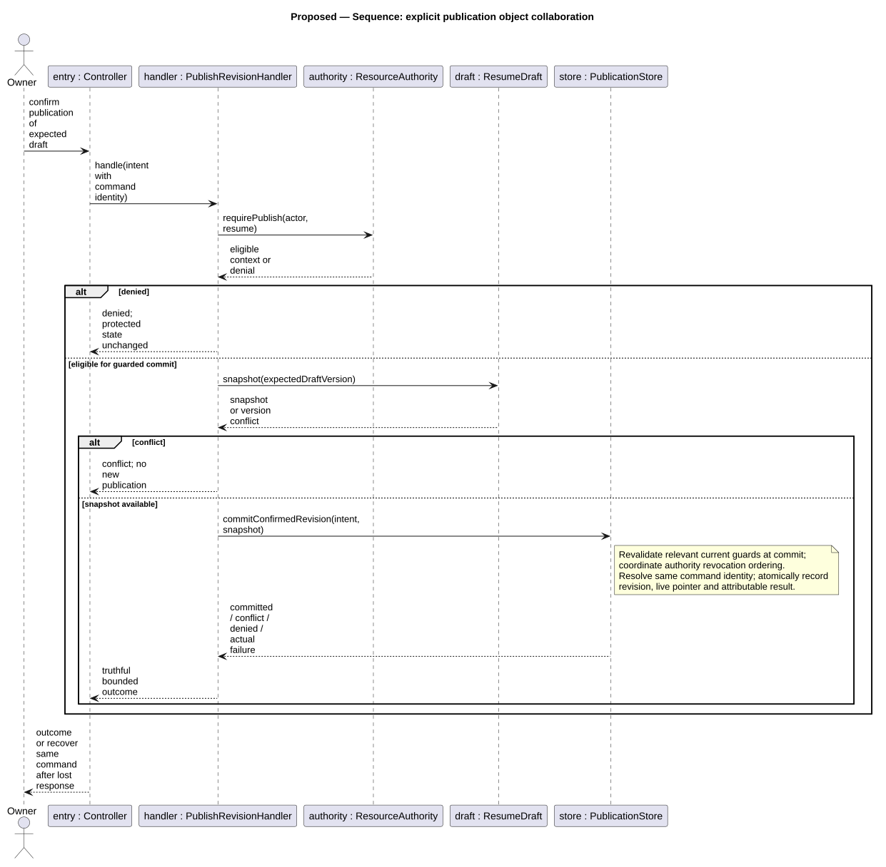

[Editable PlantUML](diagrams/oo-publication-sequence.puml) · [PNG](diagrams/oo-publication-sequence.png)

An early authority check is insufficient under races. The persistence/authority mechanism must establish the relevant admission order and expected-version guard. A lost response after a possible commit is resolved using the same command identity. No PDF generation, mail send or deployment is implicit.

### 8.9 Conceptual domain model: independent identities

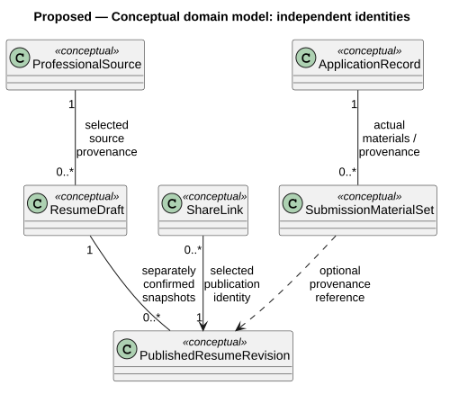

[Editable PlantUML](diagrams/oo-conceptual-domain.puml) · [PNG](diagrams/oo-conceptual-domain.png)

Selected conceptual excerpt, not the complete analysis model or physical schema. Multiplicities express this illustrative relationship shape and need exact scenario/schema refinement. Source provenance does not trigger propagation; submitted actual materials remain independently protected if later draft/publication/link state changes. No composition diamond implies cascade deletion.

### 8.10 Law of Demeter: request an intention, avoid navigation chains

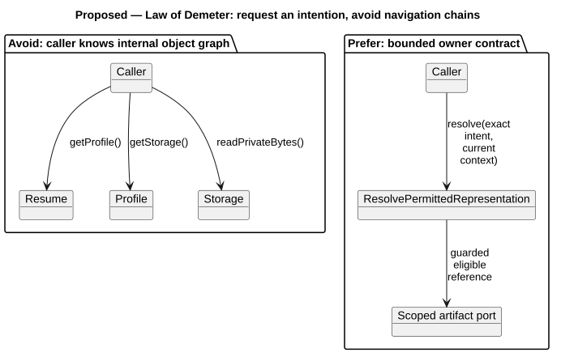

[Editable PlantUML](diagrams/oo-demeter.puml) · [PNG](diagrams/oo-demeter.png)

The counterexample shows caller navigation, not a justified byte-access route. An intention-revealing owner contract reduces knowledge of internal structure. Law of Demeter is a collaboration guideline; shortening a call chain cannot replace authority checks or safe artifact-reference lifetime coordination.

### 8.11 Optional Strategy preview: exact representation resolution

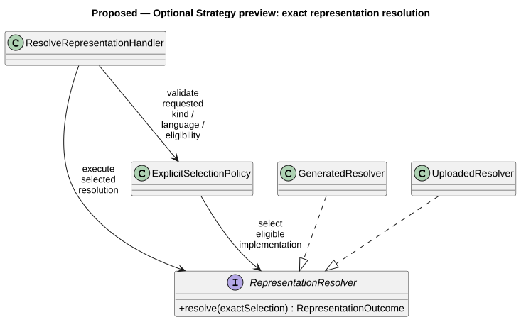

[Editable PlantUML](diagrams/oo-strategy-preview.puml) · [PNG](diagrams/oo-strategy-preview.png)

Optional design pattern preview, not a mandatory hierarchy. Strategy separates real generation/upload variation while the handler preserves exact selection and current eligibility. Unknown rendering/storage results must remain truthful; no strategy may silently publish or select a fallback.

### 8.12 Responsibility table — CRC-style cards

Responsibilities describe proposed roles rather than final class counts. Collaborators are bounded contracts; a listed collaborator confers no blanket permission.

| Class / role | Responsibilities | Collaborators |
| --- | --- | --- |
| PublishRevisionHandler | Orchestrate explicit confirmed publication; preserve truthful outcome and command identity | ResourceAuthority, ResumeDraft, PublicationStore |
| ResumeDraft | Preserve selected editable state/overrides; supply exact expected-version snapshot | Validated intent/value objects |
| PublishedResumeRevision | Identify immutable confirmed content and provenance | PublicationStore; permitted projection contracts |
| ResourceAuthority | Supply current scoped eligibility and coordinate required admission semantics | Identity/resource policy owner; current grant state |
| PublicationStore | Guard current state and commit revision, live pointer and attributable result coherently; resolve repeated identity | PersistenceAdapter and actual local transaction mechanism |
| ResolveRepresentationHandler | Resolve the exact eligible representation without silent substitution | ExplicitSelectionPolicy, narrow resolver/artifact contracts |
| CaptureActualMaterialsHandler | Preserve independent actual submission evidence and provenance | Presentation projection contract; Files reference protection; Applications store |

### 8.13 SOLID — violation and proposed correction

| Principle | Illustrative violation | Proposed correction and limit |
| --- | --- | --- |
| Single responsibility | ResumeManager applies source, publishes, sends and changes submission history | Separate explicit handlers and owners; keep each invariant cohesive |
| Open/closed | Every representation variation rewrites publication invariants | Introduce a narrow resolver only for real variation; avoid speculative frameworks |
| Liskov substitution | Uploaded resolver returns another language or reports unknown as failed | Preserve exact selection and documented outcome semantics across implementations |
| Interface segregation | Read consumer receives mutation and unrestricted host operations | Inject only required projection/control contracts; check current authority separately |
| Dependency inversion | Publication handler instantiates provider/database details | Depend on meaningful required ports; wire concrete adapters at composition root |

### 8.14 Use-case-to-class mapping

These scenario labels are design cross-references, **not newly assigned requirement IDs or exact criterion closure**. Follow the analysis operation contracts and component documents for authoritative identities and full paths.

| User intention / scenario | Proposed application entry | Domain roles / values | Important collaborators and boundary |
| --- | --- | --- | --- |
| Preview and apply selected source changes | ApplySelectionHandler | ResumeDraft, confirmed selection, expected revision | Presentation owner; preserve independent overrides and other resumes |
| Separately confirm publication | PublishRevisionHandler | PublishIntent, ResumeDraft, PublishedResumeRevision | Current ResourceAuthority and guarded PublicationStore |
| Resolve a permitted exact representation | ResolveRepresentationHandler | Exact selection, language, revision reference | Sharing eligibility and Files protection; no silent unavailable fallback |
| Capture actual submitted materials | CaptureActualMaterialsHandler | ApplicationRecord, SubmissionMaterialSet, provenance | Applications-owned commit coordinated with protected Files references |
| Explicitly send external communication | SendMailHandler | Reviewed intent and durable attempt identity | Communication owner and provider adapter; reconcile unknown effects before repetition |

### 8.15 Review and implementation follow-through

Refine each selected role into the owning component's exact signatures, invariants, visibility, types and outcome vocabulary. Check dependency cycles against actual imports, substitution against failure/unknown outcomes, and publication against real transaction/revocation/version races. Verify reference protection before committing consumers and preserve actual submission evidence independently. Rendering these examples establishes readable documentation only; it does not establish runtime behavior, safe persistence, real external compatibility or measured coupling/cohesion.
