# Resumefolio — Design Evolution Refactoring and Technical Debt

**Approach:** evolve the design through explicit source impact, small compatible changes and fresh verification. Preserve accepted product behavior, private authority, publication/submission identity and attributable external effects across every revision.

**Status:** proposed engineering procedure, November 2, 2026. Product implementation has not been established by this document. No code smell, accepted shortcut, measured debt cost or completed refactoring is invented here. Farhad remains the decision and delivery owner.

[Classification](#1-change-risk-defect-and-debt) · [Impact](#2-change-impact-and-decision-route) · [Refactoring](#3-incremental-refactoring-procedure) · [Compatibility](#4-data-interface-and-runtime-evolution) · [Debt records](#5-debt-records-prioritization-and-review) · [Evidence](#6-verification-and-completion) · [Visual package](#8-evolution-and-debt-visual-package)

Current MVP scope and selected mechanisms: [Baseline](../../../baseline/README.md). Deferred provider, advanced collaboration and workflow-execution designs are not MVP prerequisites.

## Authoritative inputs

Follow the [working method and change control](../../01-project-planning/09-working-method-and-change-control.md), [source questions and decisions](../../02-requirements-engineering/07-change-and-baseline/open-questions-and-decisions.md), [architecture options](../01-software-architecture/01-design-drivers-and-solution-options.md), [component boundaries](../01-software-architecture/02-system-decomposition-and-boundaries.md), [OO principles](01-design-principles-and-object-oriented-approach.md) and [design review/handoff](../06-design-quality-and-security-analysis/05-design-review-traceability-and-handoff.md).

## 1. Change risk defect and debt

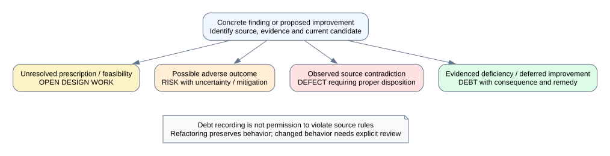

[Editable DOT](diagrams/design-finding-classification.dot) · [PNG](diagrams/design-finding-classification.png)

**Open design work:** a prescription, comparison or evidence task remains unresolved. Examples are executor isolation, Git engine integration, combined capacity, independent recovery facilities and exact criterion reconciliation. These are not automatically technical debt or approved omissions.

**Risk:** a possible future adverse outcome with uncertainty, impact and mitigation. Keep authoritative risk ownership in the project risk register; link relevant component/operating records rather than maintain conflicting risk scores here.

**Defect:** observed behavior or design contradicts an applicable source obligation. A broken authority check or loss of actual submitted materials is not made acceptable merely by labeling it debt. Fix or explicitly resolve the affected requirement/change decision under actual authority.

**Technical debt:** an evidenced design/implementation deficiency or deliberately deferred improvement whose ongoing consequences and remediation are identifiable. It can be deliberate or discovered; do not claim a trade-off was accepted unless the actual decision exists. Debt recording does not authorize scope reduction or bypass an execution/security/recovery gate.

**Refactoring:** change internal structure while preserving the applicable observable behavior and contracts. A changed permission policy, publication rule, API outcome or retention behavior is a behavioral change even when implemented during cleanup. Split those decisions and verification from the structural refactoring.

## 2. Change impact and decision route

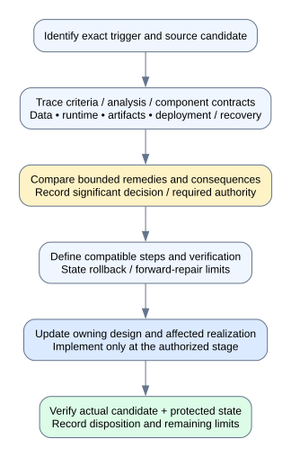

[Editable DOT](diagrams/design-change-impact-route.dot) · [PNG](diagrams/design-change-impact-route.png)

1. Identify the triggering requirement, observed defect, environment/dependency change or concrete smell. Record the current source/design revision and affected operation; avoid an unspecific “improve architecture” task.
2. Trace required behavior and protected state through analysis contracts, component responsibilities, interfaces, schemas/artifacts, jobs and deployment/recovery procedures. Determine whether the proposal is structural, behavioral, operating or a mixture.
3. Compare the smallest viable remedies and the consequences of leaving the condition unchanged. Consider compatibility, private access, concurrency, resource demand, historical identity, external effects, operational burden and full engineering time.
4. Record a consequential technical choice in an [ADR](../07-design-decisions/README.md). Material scope, spending, date or source-policy changes need the appropriate owner disposition; they are not implicit in an engineering recommendation.
5. Define bounded changes, expected outcomes, protected-state checks, compatibility/migration plan and actual rollback/forward-repair limits before consequential execution.
6. Update the authoritative owning design and affected component realizations. Execute permitted implementation/verification only at the agreed stage and record the actual candidate/evidence/disposition.

### Impact questions specific to Resumefolio

- Could the change automatically propagate a source edit into a draft, publication or actual-history record?
- Does a cache, read model, queued identity or module helper bypass current account/link/grant authority?
- Can new retry/dispatch behavior repeat a send, Git mutation, workflow or deployment with uncertain prior effect?
- Are artifact/repository identities, protected references, quotas and recoverable key/data relationships preserved?
- Do old/new web and worker versions interpret the same command payload, state and result consistently?
- Does a component extraction add network failures, operational identities or a distributed consistency problem not represented in the existing contracts?

## 3. Incremental refactoring procedure

### Establish the actual starting point

Identify the current code/design candidate and evidence. Record existing contract behavior with focused checks and justified limitations. Characterization checks describe what is observed; they must not silently bless an observed defect that contradicts requirements. Where no implementation exists, review/refine the design instead of claiming a code refactoring.

### Make a bounded structural change

Examples include separating a publication handler from a broad manager, introducing a real provider adapter seam, removing forbidden cross-module table writes or replacing mutable shared request state. Keep each step small enough to assess and reverse where technically possible. Do not create a service hierarchy or interfaces for hypothetical variation.

### Preserve explicit boundaries

Keep application orchestration separate from resource invariants and external adapters. Preserve denied/conflict/partial/unknown outcomes as well as success. Moving code into an observer or generic helper must not hide publication, send or deployment effects. A changed transaction boundary requires concurrency review even if method signatures remain unchanged.

### Verify and reconcile

Run checks proportional to the changed contract and risk: domain/handler behavior, dependency direction, actual persistence/transaction races and controlled external integration where applicable. Update diagrams, operation signatures, artifact mappings and operating guidance to the same candidate. Do not close the work merely because a file rename or unit-only suite passes.

## 4. Data interface and runtime evolution

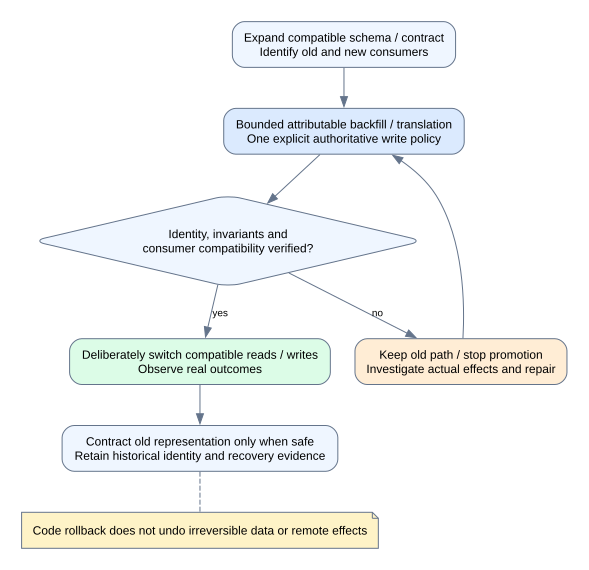

[Editable DOT](diagrams/compatible-design-evolution.dot) · [PNG](diagrams/compatible-design-evolution.png)

### Expand validate and contract

Prefer additive compatible structures/contracts when practical. Introduce a new representation behind a defined boundary; backfill or translate in bounded attributable work; validate identity/count/invariants and actual consumers; switch reads/writes deliberately; remove the old representation only after compatibility and recovery conditions permit it.

This is a pattern to evaluate, not a guarantee that dual writing is atomic. If old/new writes coexist, specify one authoritative write path, conflict/reconciliation behavior, backfill checkpoints and failure handling. Avoid deleting old data simply because a deployment succeeded.

### Published and submitted identity

Preserve intended publication revision, artifact language/provenance and actual submission manifests through schema/storage changes. A backfill must not substitute current live content for historical sent material. Physical deduplication may share bytes only when protected-reference and lifecycle semantics remain intact.

### API adapter and job compatibility

Version or translate external/persisted contracts deliberately. Identify old clients, provider results, queued payloads and pending attempts that may outlive a release. Drain, translate or retain a compatible handler as justified; do not discard unresolved consequential attempts. Current authority is reconstructed at use, not inherited indefinitely from an old serialized job.

### Component extraction

Keep Git, provider, PDF/storage and executor integration at explicit adapters. Extract a component into an independent facility only when measured resource/isolation needs, release cadence or actual operating value justify the added cost. Define new network/credential/failure/recovery contracts first. Earlier proposed modular boundaries do not authorize a paid host or automatically make distributed operations safe.

### Rollback and forward repair

Reverting application code may be possible only while schema/data/contract compatibility holds. An irreversible migration, sent message, ref update or target deployment cannot be undone by checking out an older commit. Stop further effects, retain evidence, assess what changed and select compatible rollback, reviewed forward repair or scoped recovery. Follow [deployment procedures](../01-software-architecture/04-deployment-topology-nodes-and-networks.md) and [runtime reconciliation](../01-software-architecture/03-process-view-concurrency-and-runtime-behavior.md).

## 5. Debt records prioritization and review

### Current register position

No product implementation debt item is allocated by this document. Existing execution, provider, capacity, recovery and criterion gaps remain open engineering/evidence work in their authoritative records. The following fields define how to record an actual later debt finding; they are not invented findings or accepted deferrals.

### Required fields for an actual debt item

- Stable local identifier/title, actual discovery date, source candidate and affected components/contracts.
- Concrete evidence: code/model locator, observed dependency/smell or actual accepted trade-off; distinguish observation from prediction.
- Consequences of leaving it unchanged, affected source criteria, security/privacy/data-loss implications and uncertainty.
- Proposed remedies, alternatives, migration/compatibility needs, verification and realistic full engineering effort.
- Responsible owner, decision authority, actual state and review trigger; link the authoritative work tracker and ADR where applicable.
- Closure evidence identifying the remedied candidate, actual checks and remaining limitations; retain superseded history.

Keep work descriptions and current scheduling in the [product backlog](../../../Project-Management/product-backlog.md) and actual tracker. The shared [review record](../06-design-quality-and-security-analysis/05-design-review-traceability-and-handoff.md) owns findings/disposition. This document owns the method, not a second live backlog.

### Prioritization

First identify source violations and gates that block the affected commitment. Then compare actual exposure, recurrence/change cost, coupling/blast radius, remediation effort and dependency timing. Prefer risk reduction and verified user value over cosmetic uniformity. Use 20 total project hours/week without treating documentation/testing/operations as free extra time. No fixed debt percentage, numeric score or universal threshold is adopted here.

### Smell indicators and review triggers

Review dependency cycles, forbidden internal imports, oversized interfaces, repeated authority/lifecycle rules, hidden external effects, long-lived mutable user state, transaction scopes around network calls and difficult-to-isolate scenarios. Coupling/cohesion metrics or change history can support a finding but cannot alone prove a design is wrong.

Reassess when a requirement changes, provider/runtime compatibility changes, combined-load evidence contradicts assumptions, an incident exposes a boundary failure, a migration touches protected history or repeated work demonstrates actual maintenance cost. A periodic checkpoint may be chosen in real planning; no fabricated calendar deadline is assigned here.

## 6. Verification and completion

**Structural evidence:** allowed dependency direction, exported/internal boundaries, class/contract consistency and diagrams match the actual candidate.

**Behavior evidence:** source invariants and protected state remain valid for normal, denied, conflict, duplicate, partial and unknown-effect paths where applicable. Include explicit publication/history and revoked-access cases for affected changes.

**Operating evidence:** compatible app/worker/schema versions, attributable pending work, resource behavior, private storage/keys and restore/reconciliation limits are assessed where changed. Mocks alone cannot prove provider idempotency, Git refs, executor isolation or usable recovery.

**Closure:** record actual change scope, source/design/code candidate, verification method/results, debt/defect disposition and remaining limits. Supersede ADRs explicitly; do not erase historical decisions or present old source hashes as current. Whole-phase acceptance remains a separate actual owner decision.

## 7. FAU basis and related records

FAU V07 treats architecture as an input to implementation/testing, change impact and controlled evolution. V08 discusses anti-patterns, design smells, model refactoring and conventions. This procedure adapts that teaching to Resumefolio’s accepted boundaries; the debt field set and compatibility route are project conventions, not a university-prescribed ledger.

- [OO principles and pattern guidance](01-design-principles-and-object-oriented-approach.md)
- [Shared concern ownership](../01-software-architecture/05-cross-cutting-concerns-overview.md)
- [Component implementation packages](../03-component-and-module-design/README.md)
- [Data ownership and physical refinement](../04-data-design/README.md)
- [Operating recovery design](../06-design-quality-and-security-analysis/03-operations-backup-recovery-and-resilience.md)
- [FAU reference map](../01-reference-and-coverage-map.md)

This update performs document and generated-diagram checks only. It executes no refactoring, migration, recovery, live security/capacity test or product release. Advisor transport remains unavailable as recorded for this candidate; no independent endorsement is claimed.

[Detailed Design index](README.md) · [Diagram catalog](diagrams/README.md)

## 8. Evolution and debt visual package

All comparisons below are **hypothetical design examples** unless an exact inspected candidate is explicitly identified. No implementation debt, actual architecture erosion, migration, measured hotspot or completed release is established. Legacy replacement is a conditional engineering pattern, not added product scope.

### 8.1 Before/after class responsibilities

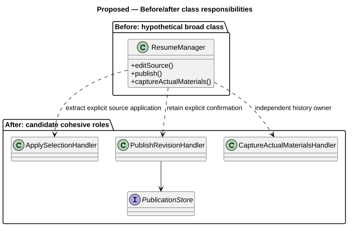

[PlantUML](diagrams/evolution-class-change.puml) · [PNG](diagrams/evolution-class-change.png)

A hypothetical original, not a detected code smell. Extracting roles must preserve observable contracts; changing publication or history behavior is a separate behavioral decision.

### 8.2 Step-by-step transformation and verification

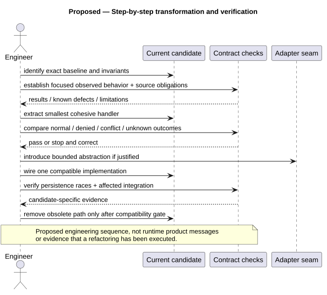

[PlantUML](diagrams/evolution-refactoring-sequence.puml) · [PNG](diagrams/evolution-refactoring-sequence.png)

Each step has a reviewable candidate and a stop/correct route. Characterization does not legitimize known requirement violations; code reversal remains conditional on data and effect compatibility.

### 8.3 Hypothetical dependency cycle and hotspot

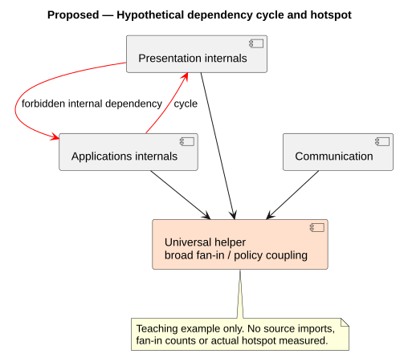

[PlantUML](diagrams/evolution-dependency-hotspots.puml) · [PNG](diagrams/evolution-dependency-hotspots.png)

Red edges depict an invented cycle to investigate, not actual repository dependencies. A central technical utility is not automatically debt; shared mutable business authority and change propagation require concrete evidence.

### 8.4 Before/after package dependency direction

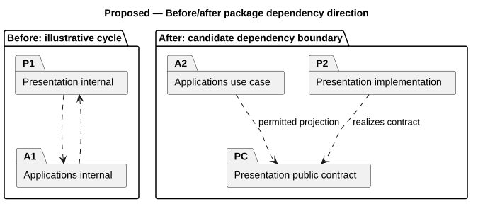

[PlantUML](diagrams/evolution-package-direction.puml) · [PNG](diagrams/evolution-package-direction.png)

The target removes this selected source cycle through an owner-controlled public contract. It does not permit cross-module writes or prove that the entire application is acyclic. Runtime requests and source dependency arrows must be reviewed separately.

### 8.5 Intended versus eroded architecture

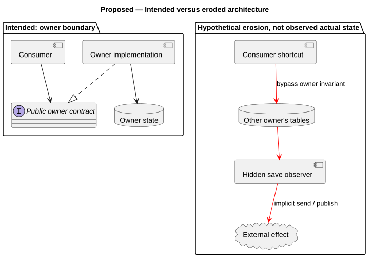

[PlantUML](diagrams/evolution-erosion.puml) · [PNG](diagrams/evolution-erosion.png)

An actual-versus-intended comparison requires an identified source candidate and inspected imports/effects. No actual architecture audit is asserted here; the erosion half shows the kinds of divergence to look for.

### 8.6 Design evolution timeline and ADR history

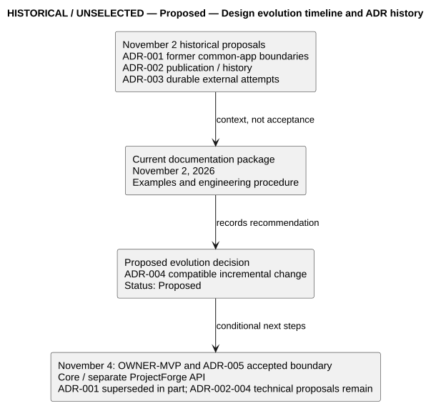

[PlantUML](diagrams/evolution-history.puml) · [PNG](diagrams/evolution-history.png)

This is a documentation/proposal sequence, not a fabricated release/version history. Existing ADRs remain Proposed. Future implementation and acceptance have no invented date.

### 8.7 Strangler facade: conditional future replacement

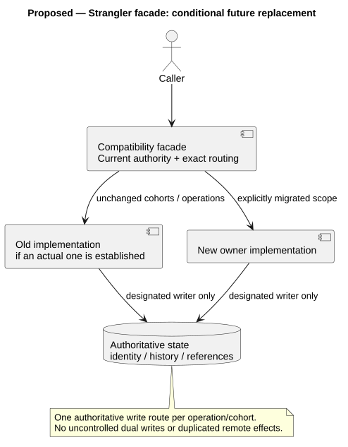

[PlantUML](diagrams/evolution-strangler.puml) · [PNG](diagrams/evolution-strangler.png)

A conditional pattern, not a new legacy-migration feature or authorized migration. Define routing, compatible contracts, pending work, reference protection, reconciliation and cutover evidence before any real use. Do not shadow consequential sends or deployments.

### 8.8 Branch by abstraction inside one application

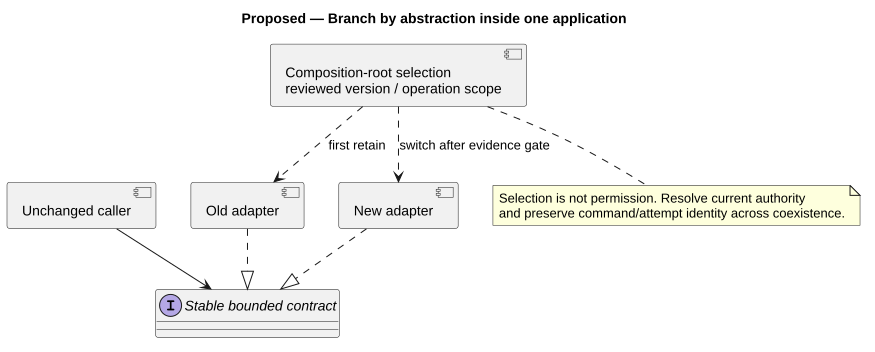

[PlantUML](diagrams/evolution-branch-abstraction.puml) · [PNG](diagrams/evolution-branch-abstraction.png)

Introduce abstraction, retain behavior through the old adapter, verify the new adapter, switch the designated route, then retire only when old consumers/pending work permit. This is independent of creating a long-lived source-control branch.

### 8.9 Legacy-shaped versus target component state

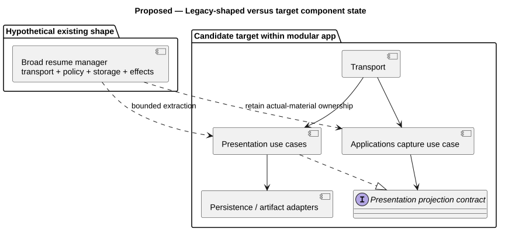

[PlantUML](diagrams/evolution-component-target.puml) · [PNG](diagrams/evolution-component-target.png)

Legacy-shaped is a hypothetical structural comparison, not an established running legacy system. The target remains a modular application; this view neither selects microservices nor authorizes moving private data.

### 8.10 Refactoring/migration work lifecycle

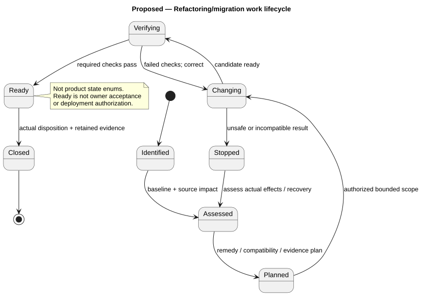

[PlantUML](diagrams/evolution-lifecycle.puml) · [PNG](diagrams/evolution-lifecycle.png)

Proposed engineering-work states, not implementation enums. Stopping work cannot undo irreversible data or remote effects; reassess before compatible rollback, forward repair or recovery.

### 8.11 Contract-oriented verification safety net

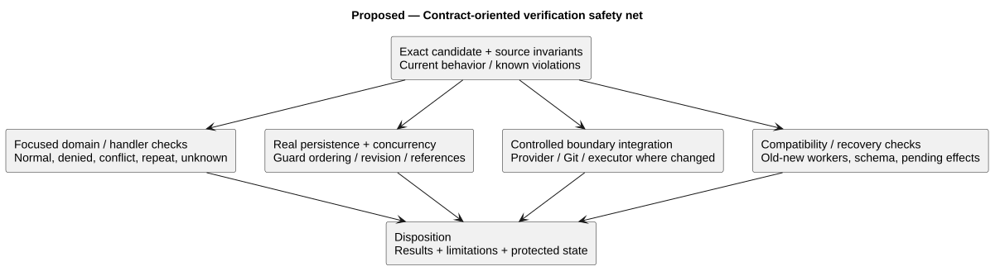

[PlantUML](diagrams/evolution-safety-net.puml) · [PNG](diagrams/evolution-safety-net.png)

A coverage plan rather than a measured coverage percentage. Choose checks for affected risks; unit mocks alone do not establish persistence races, actual external idempotency, executor isolation or usable recovery.

### 8.12 Smell-to-refactoring mapping

| Indicator to investigate | Candidate remedy | Evidence and preservation check |
| --- | --- | --- |
| Broad manager with unrelated reasons to change | Extract cohesive handlers | Inspect actual callers; preserve explicit confirmation and owned invariants |
| Cyclic internal imports / cross-owner table access | Introduce owner public contract; relocate misplaced responsibility | Inspect actual import/write graph; prevent mutation bypass |
| Repeated authority logic diverges | Consolidate rule at authoritative owner | Compare exact semantics; do not merge distinct grant/consent rules |
| Long navigation chains expose private internals | Intention-revealing owner operation | Preserve exact eligibility and protected reference lifetime |
| Network call inside local transaction | Separate durable intent and attributable effect attempt | Review atomicity changes; reconcile uncertain results before repetition |
| Mutable actor/session retained in shared service | Bound context lifetime and reconstruct current authority | Exercise concurrent callers and revocation; no stale privileged identity |
| Oversized adapter interface | Split consumer-specific ports | Preserve capability and failure semantics for all affected consumers |

### 8.13 Technical debt register format and current position

This is a register **template**, not a second live backlog. No evidenced implementation debt item is allocated here. Link real future entries to the authoritative tracker and review record; open feasibility/design work remains in its owning record.

| Item / evidence | Impact if retained | Full cost to fix | Priority / disposition | Owner / closure |
| --- | --- | --- | --- | --- |
| No actual debt item established by this update | Not assessed | Not estimated | Unassigned; no accepted deferral | Farhad; requires actual finding and evidence |
| Template: stable ID + candidate + code/model locator + observed deficiency | Source criteria, exposure, recurrence and uncertainty | Analysis, implementation, migration, verification, docs and operations; estimate only after inspection | Actual urgency, rationale, authority and review trigger; link tracker/ADR | Responsible owner; exact remedied candidate, checks and remaining limits |

### 8.14 Classification, prioritization and measurement aids

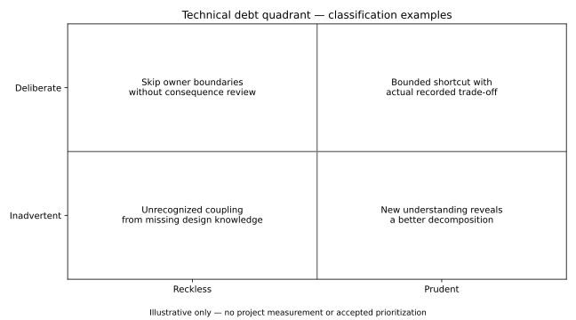

[SVG](diagrams/evolution-debt-quadrant.svg) · [PNG](diagrams/evolution-debt-quadrant.png)

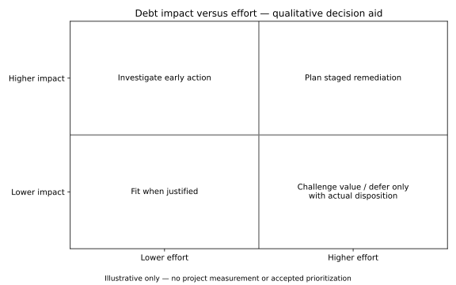

[SVG](diagrams/evolution-impact-effort.svg) · [PNG](diagrams/evolution-impact-effort.png)

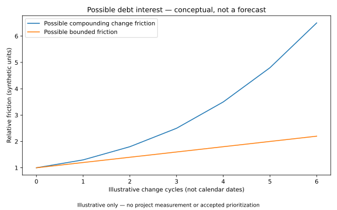

[SVG](diagrams/evolution-interest-curve.svg) · [PNG](diagrams/evolution-interest-curve.png)

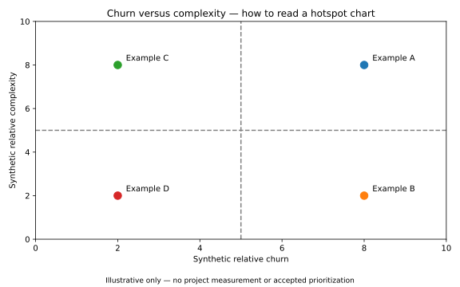

[SVG](diagrams/evolution-churn-complexity.svg) · [PNG](diagrams/evolution-churn-complexity.png)

Quadrant labels classify how a deficiency arose, not whether it is acceptable. Impact/effort is qualitative: source violations and commitment-blocking security, privacy, history or recovery gates take precedence over convenience. Neither chart allocates work or authorizes deferral.

The interest curves show possible maintenance-friction shapes, not forecast hours, money, deadlines or a claim that all debt compounds. The hotspot chart contains **four invented points**, not file names or project measurements. For a real chart, fix the candidate/history window, define churn (including rename/generated-file handling), choose a compatible complexity measure and inspect the high-churn/high-complexity candidates before recording findings. High values alone do not establish debt; small frequently changed files and complex stable algorithms can be legitimate.

[Synthetic chart data](diagrams/evolution-chart-data.json) · [Reproducible package generator](diagrams/evolution-visuals-generator.py). The generator defaults to staging; its explicit publish option checks saved target hashes before writing. No measurement collection or product execution occurs.

### 8.15 Evolution decision record

See [ADR-004 — Compatible incremental design evolution](../07-design-decisions/ADR-004-compatible-incremental-design-evolution.md). **Status: Proposed.** It records the recommended procedure and alternatives; it does not accept a debt item, authorize a migration, change product behavior or establish owner approval.
