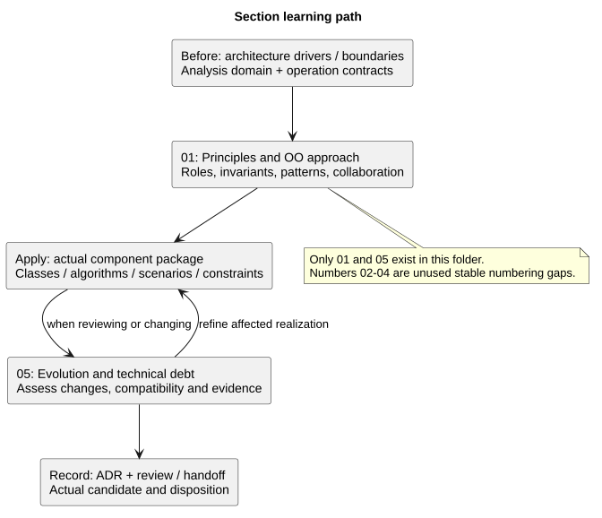
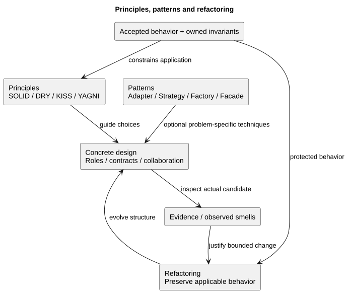
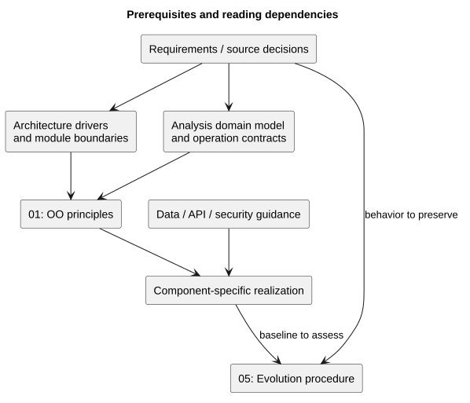
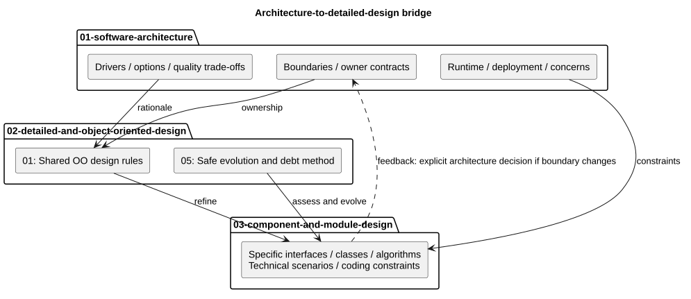
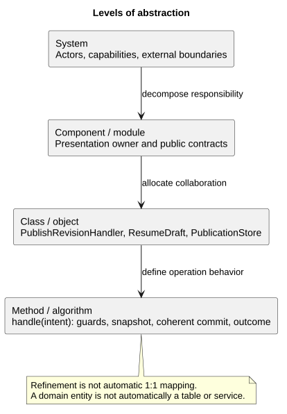
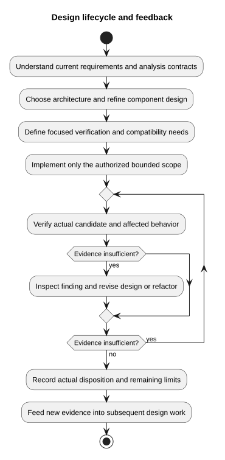
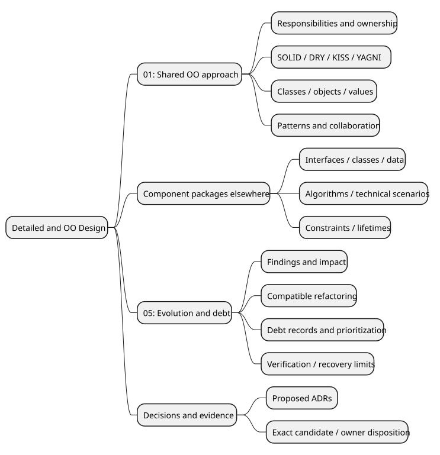
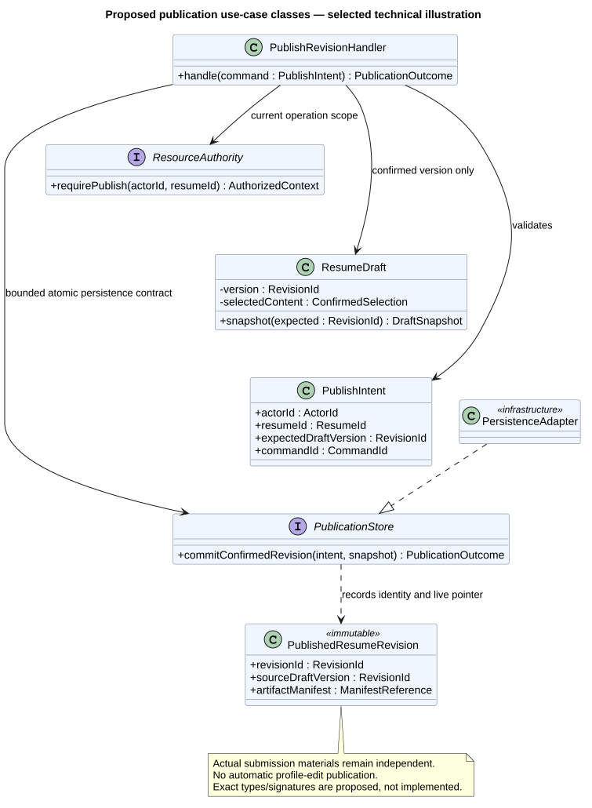

# Resumefolio — Detailed and Object-Oriented Design

## Current implementation baseline — November 4, 2026

[BL-MVP-2026-11-04.1](../../../baseline/README.md) selects the MVP technical mechanisms, numerical policies, priorities and requirement/criterion dispositions under Farhad’s explicit delegation. It supersedes earlier Proposed/pending mechanism and whole-baseline statements below for MVP design input. Future clauses and dated evidence remain separate. Runtime/actor validation, credentials, Git isolation, capacity and backup/restore still require the named implementation/Release gates; this update reports no product test Pass.

### Prior source material and rationale (superseded where this Baseline selects a different MVP choice)

**Start here to turn architecture responsibilities into understandable component designs and evolve those designs safely.** This section owns shared OO guidance and refactoring/debt procedures; actual component packages own concrete interfaces, classes, algorithms and technical scenarios.

Owner and decision authority: Farhad. Updated November 2, 2026.

**Status:** proposed design guidance. This folder has **two numbered documents, 01 and 05**; 02–04 are unused numbering gaps, not missing mandatory files. The numbering preserves stable existing links. No implementation, measured debt, migration or accepted technical baseline is established by the illustrations.

[Contents](#1-contents-and-reading-order) · [Maps](#2-reading-and-concept-maps) · [Example](#3-shared-publication-example) · [Glossary](#4-glossary) · [Cheat sheet](#5-design-cheat-sheet) · [Review](#6-review-and-maintenance)

## MVP system allocation and design status

The accepted system boundary separates the Resumefolio core from ProjectForge, joined by an authenticated user-scoped API. Logical responsibilities remain useful within each system; they do not authorize a shared core/ProjectForge process, database or transaction. Core owns dashboard, invited accounts, professional presentation, protected sharing, manual applications and same-server private My Files & Media. ProjectForge MVP owns real repositories/transfers/permissions, file/history browsing, issues and simple Kanban. Its selected engine is native Git Smart HTTP behind the independent Laravel ProjectForge service, with its own MySQL 8.4 database and OS/storage boundaries on the existing host; BL-MVP-2026-11-04.1 governs implementation and evidence gates. The future communications system is independently private and API connected. Advanced Git review/releases, backlog/Sprints and execution/deployment remain deferred. Keep source, independent resume draft, explicit publication and actual submitted material identities distinct. Profile changes require preview/select/apply and cannot mutate publication or submitted history. Manual applications include status, next action and follow-up date without mail/calendar dependencies.

Authority: [OWNER-MVP-2026-11-04](../../01-project-planning/owner-mvp-decision-2026-11-04.md).

## 1. Contents and reading order

| File / location | Topic | One-line summary |
| --- | --- | --- |
| [01 — Design Principles and OO Approach](01-design-principles-and-object-oriented-approach.md) | Shared detailed-design guidance | Allocate responsibilities, apply principles/patterns, and specify object collaboration and lifetime. |
| [05 — Design Evolution, Refactoring and Technical Debt](05-design-evolution-refactoring-and-technical-debt.md) | Assess and evolve a design | Classify findings, plan compatible changes, record actual debt and verify preserved contracts. |
| [Component packages](../03-component-and-module-design/README.md) | Concrete realization | Keep each component's signatures, classes, algorithms, scenarios and constraints together. |
| [Diagram catalog](diagrams/README.md) | Editable visual sources and exports | Find each figure with its owner, source and readable SVG/PNG. |

Before 01, read [architecture drivers](../01-software-architecture/01-design-drivers-and-solution-options.md), [module boundaries](../01-software-architecture/02-system-decomposition-and-boundaries.md), the [analysis domain model](../../03-system-analysis/02-domain-and-information-analysis/03-domain-model-and-object-oriented-view.md) and [operation contracts](../../03-system-analysis/05-business-rules-and-operation-contracts/10-domain-constraints-and-operation-contracts.md). Requirements retain required meaning; technical design cannot silently change permissions, publication or history rules.

Use the [component template](../03-component-and-module-design/component-template/README.md) to realize a component. Consult shared [data](../04-data-design/README.md), [API](../05-interface-and-api-design/README.md) and [quality/security](../06-design-quality-and-security-analysis/README.md) guidance at affected boundaries. Use 05 before changing an established candidate, then link actual findings to [review/handoff](../06-design-quality-and-security-analysis/05-design-review-traceability-and-handoff.md) and significant choices to [ADRs](../07-design-decisions/README.md).

## 2. Reading and concept maps

### 2.1 Section learning path

[Editable PlantUML](diagrams/oo-index-reading-path.puml) · [PNG](diagrams/oo-index-reading-path.png)

Read 01 for shared guidance; use the component package for concrete realization; use 05 when assessing or changing a design. The loop represents iterative work, not a source dependency cycle.

### 2.2 Principles, patterns and refactoring

[Editable PlantUML](diagrams/oo-index-concept-map.puml) · [PNG](diagrams/oo-index-concept-map.png)

Principles guide judgment, patterns solve specific recurring problems, and refactoring changes structure. None replaces source obligations or verification; an observed defect may require a separately reviewed behavior correction.

### 2.3 Prerequisites and reading dependencies

[Editable PlantUML](diagrams/oo-index-prerequisites.puml) · [PNG](diagrams/oo-index-prerequisites.png)

Arrows mean reading inputs, not runtime calls or code imports. Review shared data/API/security decisions alongside the affected component; an evolution proposal requires an identified baseline rather than an invented implementation.

### 2.4 Architecture-to-detailed-design bridge

[Editable PlantUML](diagrams/oo-index-architecture-bridge.puml) · [PNG](diagrams/oo-index-architecture-bridge.png)

Architecture assigns system responsibilities and operating constraints. Detailed component design refines their realization. If refinement changes boundaries or quality trade-offs, update the architecture/ADR explicitly instead of silently diverging.

### 2.5 Levels of abstraction

[Editable PlantUML](diagrams/oo-index-abstraction-levels.puml) · [PNG](diagrams/oo-index-abstraction-levels.png)

Use the level needed by the question. System/module views do not specify method algorithms, while a class diagram cannot establish deployment isolation or actual transaction correctness.

### 2.6 Design lifecycle and feedback

[Editable PlantUML](diagrams/oo-index-design-lifecycle.puml) · [PNG](diagrams/oo-index-design-lifecycle.png)

A proposed workflow, not evidence of completed implementation. Refactoring preserves applicable behavior; changed source policy or externally visible contracts need their own disposition. Failed reverification does not close the work.

### 2.7 Topic mind map

[Editable PlantUML](diagrams/oo-index-topic-mindmap.puml) · [PNG](diagrams/oo-index-topic-mindmap.png)

This map groups topics rather than prescribing dependencies. Component-specific details remain in the owning component package; ADRs and review evidence retain their own owners.

## 3. Shared publication example

[PlantUML](diagrams/publication-use-case-classes.puml) · [PNG](diagrams/publication-use-case-classes.png)

Use this existing small model as the running example: PublishRevisionHandler coordinates current authority, an exact draft version and PublicationStore; PublishedResumeRevision preserves the separately confirmed identity. [01](01-design-principles-and-object-oriented-approach.md#8-object-oriented-visual-and-responsibility-package) develops its objects, dependencies and collaboration. [05](05-design-evolution-refactoring-and-technical-debt.md#8-evolution-and-debt-visual-package) uses the same publication responsibility to illustrate bounded extraction and compatibility. These are related teaching views, not snapshots of implemented classes or a measured before/after refactoring.

Source edits do not automatically apply to independent resumes or publish them. Actual submitted materials remain independently protected. Early authorization alone cannot settle a race: current admission ordering, expected-version checks and coherent local commit need concrete mechanisms and verification. No mail send, PDF generation or deployment is implicit in publication.

## 4. Glossary

| Term | Meaning in this section |
| --- | --- |
| OO / UML | Object-oriented design / Unified Modeling Language; model responsibility and collaboration at the stated level. |
| Component / module | Logical resource-owning boundary; not automatically an independently deployed service. |
| Class / object | A defined type and a particular runtime instance of that type. |
| Entity / value object | Identity-bearing domain concept / value defined by its content and validation rules. |
| Aggregate | State grouped for an invariant requiring local consistency; not automatically one table. |
| Port / adapter | Meaningful required or provided contract / infrastructure implementation that preserves its semantics. |
| Cohesion / coupling | How closely responsibilities belong together / the dependencies between design elements. |
| SOLID | Single responsibility, open/closed, Liskov substitution, interface segregation and dependency inversion. |
| DRY / KISS / YAGNI | Avoid duplicated authoritative knowledge / keep the solution simple / avoid speculative functionality. |
| CRC | Class–Responsibility–Collaborator summary of roles and required cooperation. |
| Refactoring | Structural change preserving applicable observable behavior and contracts. |
| Technical debt | Evidenced deficiency or actual deferred improvement with identifiable ongoing consequences and remediation. |
| ADR | Architecture Decision Record; records context, alternatives, consequences and actual decision status. |
| Characterization check | Records observed behavior; does not legitimize an observed requirement violation. |

## 5. Design cheat sheet

| Category / cue | Practical response | Caution / owner |
| --- | --- | --- |
| Single responsibility / broad manager | Separate coherent use cases and resource owners | Avoid a class per method; [01](01-design-principles-and-object-oriented-approach.md) |
| Open/closed and substitution | Isolate real variation; preserve exact input/outcome semantics | Never convert unknown effects into convenient failure or substitute unavailable content |
| Interface segregation / dependency inversion | Inject narrow meaningful contracts; wire adapters at composition root | An interface alone does not enforce authority or atomicity |
| DRY / repeated policy | Keep one authoritative owner for the same rule | Similar-looking consent and link grants may be distinct rules |
| Adapter | Translate provider, storage, Git or executor mechanics | Preserve actual capabilities, failures and uncertainty |
| Strategy | Separate real eligible representation variation | A simple branch can suffice; no silent fallback |
| Factory / Facade | Construct valid identities / expose one bounded use case | Construction does not authorize effects; avoid a universal manager |
| Observer / committed event | Use only a named authorized reaction with explicit dispatch semantics | In-process notification is not durable delivery or permission to send/publish |
| Cycle / hidden external effect / shared actor state | Inspect evidence; restore ownership and bounded lifetime | Actual finding and verification belong in [05](05-design-evolution-refactoring-and-technical-debt.md) and review records |
| Compatibility / debt remediation | Stage bounded changes; preserve pending attempts and historical identities | No uncontrolled dual writes; code rollback cannot undo remote effects |

## 6. Review and maintenance

Each component package should state responsibilities, exported/internal contracts, computational data and classes, algorithms/transaction guards, technical failure/recovery scenarios, and justified patterns/coding constraints. Shared guidance owns conventions; component records own their specific realization. Cross-link shared policy rather than copying it into competing sources.

The gallery contains proposed illustrations and synthetic teaching charts, not comprehensive implementation coverage. Verify actual dependency direction, behavior, persistence races, compatible workers/schema and affected external boundaries against an exact candidate. No measured code smell, accepted debt item, completed migration, security/capacity result or owner baseline acceptance is created by this index. [ADR-004](../07-design-decisions/ADR-004-compatible-incremental-design-evolution.md) remains Proposed.

FAU V08 motivates computational data/classes, detailed dynamics, technical scenarios, patterns, smells and conventions. SOLID, the debt templates and this folder organization are supplementary project adaptations; see the [reference map](../01-reference-and-coverage-map.md). Maintain diagrams, sources/exports, component consumers and ADRs together when shared guidance changes. Rendering and link checks establish document consistency only.

[System Design home](../README.md) · [Software Architecture](../01-software-architecture/README.md) · [Diagram catalog](diagrams/README.md)
