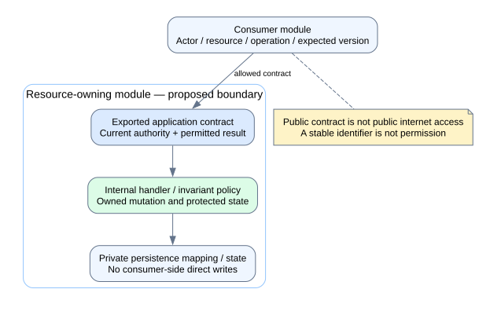
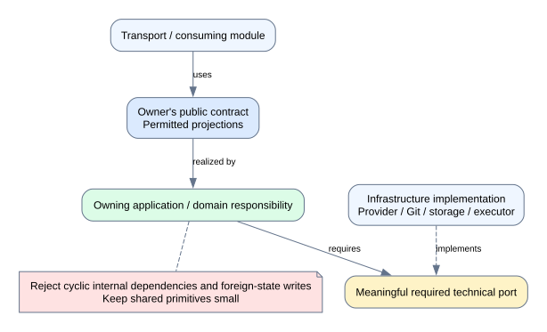
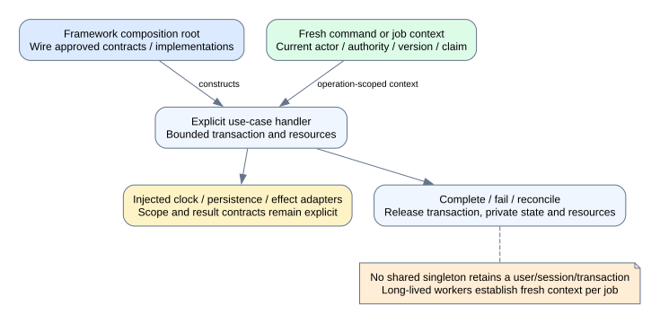
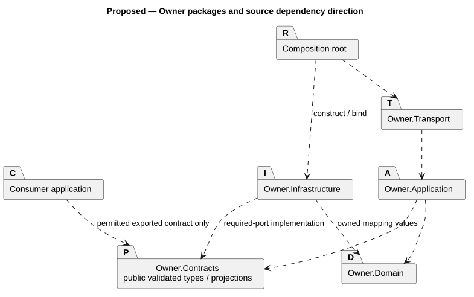
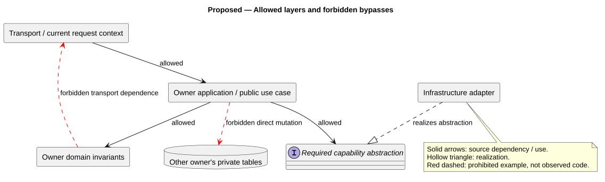
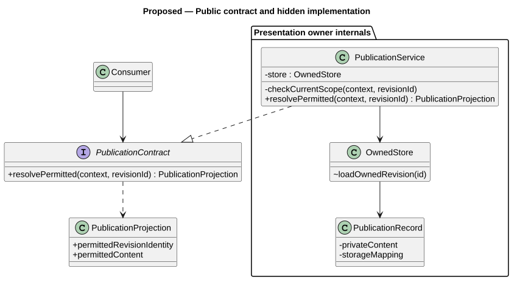
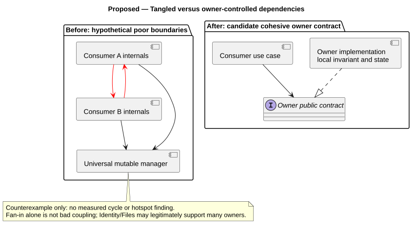

# Resumefolio — Modularity Dependencies and Encapsulation

**Proposed rule:** each logical module owns its domain state and invariant-enforcing operations. Consumers use explicit public contracts and permitted projections; infrastructure realizes technical ports without acquiring universal business authority.

**Status:** proposed implementation organization, November 2, 2026. No code package, selected dependency-checking tool, measured metric or accepted baseline is created here. Farhad retains decision authority.

[Boundaries](#1-module-boundaries-and-owned-responsibilities) · [Contracts](#2-public-contracts-and-internal-encapsulation) · [Dependencies](#3-dependency-direction-and-coordination) · [Injection](#4-dependency-injection-and-object-lifetime) · [Evaluation](#5-cohesion-coupling-and-boundary-review) · [Handoff](#6-implementation-handoff-and-current-limits) · [Essential views](#8-essential-modularity-and-encapsulation-views)

Current MVP scope and selected mechanisms: [Baseline](../../../baseline/README.md). Deferred provider, advanced collaboration and workflow-execution designs are not MVP prerequisites.

## Source context

This document refines the [logical component catalog](../01-software-architecture/02-system-decomposition-and-boundaries.md), [runtime protocol](../01-software-architecture/03-process-view-concurrency-and-runtime-behavior.md) and [OO principles](../02-detailed-and-object-oriented-design/01-design-principles-and-object-oriented-approach.md). Required meanings remain in the [analysis domain model](../../03-system-analysis/02-domain-and-information-analysis/03-domain-model-and-object-oriented-view.md), [operation contracts](../../03-system-analysis/05-business-rules-and-operation-contracts/10-domain-constraints-and-operation-contracts.md) and [source decisions](../../02-requirements-engineering/07-change-and-baseline/open-questions-and-decisions.md).

## 1. Module boundaries and owned responsibilities

[Editable DOT](diagrams/module-public-and-private-boundary.dot) · [PNG](diagrams/module-public-and-private-boundary.png)

**Logical component:** a coherent architectural responsibility, such as Presentation or Sharing. **Code module:** the package structure that realizes that responsibility and makes exported/internal elements identifiable. **Deployment unit:** an artifact/process arrangement that can be installed or run. These concepts are related but are not interchangeable: several modules can share one release and database.

The nine candidate responsibility owners are Identity/Access, Presentation, Representation/Sharing, Applications, Communication/Calendar, Work, Git Collaboration, Workflow/Deployment Coordination and Files/Operations. Their [component records](README.md) own concrete prescriptions. Do not copy a shared user/resume model into every module merely to simulate service boundaries.

Within a module, identify application contracts/handlers, invariant-enforcing domain policy, infrastructure mappings/adapters and permitted query projections. Use structure appropriate to actual complexity; folders named Domain or Application do not by themselves enforce encapsulation.

### Ownership examples

- Presentation owns draft mutation, overrides and publication identity; another module cannot update its live pointer directly.
- Sharing owns link eligibility/version and viewer authorization; PDF mode changes do not implicitly disable a link.
- Applications owns actual submission manifests; a new live revision cannot overwrite actual historical materials.
- Files owns usable-artifact admission, reservation accounting and protected-reference-aware reclamation; a consumer's logical unlink does not prove freed storage.
- Git owns native ref/review integration semantics; Work links do not extend grants, and a merge does not supply execution/deployment permission.

DDD bounded contexts can help explain vocabulary and invariant ownership. They remain candidate design boundaries, not an instruction to adopt event sourcing, a DDD framework or independent microservices.

## 2. Public contracts and internal encapsulation

### What a module exports

Export named application operations, validated request/value types, stable identifiers and permitted result projections that an actual consumer needs. Record current authority, expected version where relevant, input meaning, intended effect, protected state, result classifications and safe repetition/concurrency behavior.

Examples are ResolvePublication, RetrieveRepresentation, CaptureActualSubmission and MergeExpectedRefs. They describe responsibilities, not final language signatures. Public means consumable by another authorized module; it does not mean internet-accessible or exempt from policy.

### What remains internal

Keep mutation-capable domain objects, ORM mappings, internal repositories, storage paths, provider credentials and transaction implementation private to their owner. A consumer cannot instantiate an internal handler to skip the public command boundary, reach into another module's database tables, or treat a file path as authorization.

Do not expose a mutable ORM entity across modules and rely on callers not to save it. Return a projection containing only permitted fields and explicit identity/version/provenance. A shared identifier establishes a reference, not access to the referenced content.

### Owner-side enforcement

The resource owner verifies current actor/resource/action/lifecycle policy at the actual operation boundary. Gateway middleware can enforce common admission requirements, but cannot replace operation-specific checks. The same contract applies when called from a web controller, a worker, an administrative action or another module. Jobs reconstruct current context; an old session snapshot cannot grant indefinite authority.

## 3. Dependency direction and coordination

[Editable DOT](diagrams/module-dependency-direction.dot) · [PNG](diagrams/module-dependency-direction.png)

### Allowed dependency rules

1. Transport code invokes its owning module’s public use-case entry point; domain mutation and cross-module storage access do not belong in controllers.
2. A module consumes another module’s exported contract and permitted projection, never its internal persistence or mutable domain implementation.
3. Application/domain responsibilities depend on meaningful capability contracts where separation is useful. Provider/storage/Git/executor infrastructure implements those contracts.
4. Shared primitives stay small: explicit identifiers, outcome/clock abstractions and justified common technical capabilities. Business lifecycle/authority remains at the actual owner, not a universal Shared service.
5. Cross-module dependency cycles are a review finding. Resolve them through clearer ownership, a permitted projection or an explicit coordinating use case, rather than mutual internal service calls.
6. Technical credentials are not human authority. A worker's ability to reach storage or an executor does not authorize the requested product operation.

### Coordinating multiple owners

Applications may store a correspondence identifier while Communication supplies an independently authorized summary. Neither imports the other's ORM entity. Work may associate a repository/revision without acquiring Git write access. Sharing asks Presentation for the intended publication and Files for an eligible usable artifact; each owner preserves its contract.

For changes spanning local owners, define the application orchestration, actual local consistency boundary and explicit pending work. A shared transaction may coordinate a justified local invariant, but must not become permission for arbitrary cross-module table writes. Remote mutations remain outside a local database rollback. See [runtime coordination](../01-software-architecture/03-process-view-concurrency-and-runtime-behavior.md).

### Events and asynchronous dependencies

An event is a named observation with identity/provenance, not automatic permission for every consumer. A confirmed Git change can be input to workflow eligibility; it cannot itself authorize execution or deployment. A saved profile cannot trigger implicit publication. Durable consequential reactions need pending-intent/attempt handling and reconciliation rather than fire-and-forget observers.

Avoid using a generic event bus to conceal a required synchronous invariant or a dependency cycle. Each reaction needs an identified owner, source rule, current authority, result/failure contract and verification path.

## 4. Dependency injection and object lifetime

[Editable DOT](diagrams/module-composition-and-lifetimes.dot) · [PNG](diagrams/module-composition-and-lifetimes.png)

Use the framework composition root to register approved implementations and construct explicit dependencies. Controllers/handlers receive needed collaborators rather than finding arbitrary services through global lookups. Introduce a port when actual variability, effect control or verification warrants it, not simply to wrap every framework method.

**Command/request scope:** actor context, expected revision, transaction/unit of work and sensitive intent belong to the bounded operation. Do not hold them in shared static state or a singleton that can serve another user or job.

**Worker scope:** a long-lived process may reuse suitable stateless infrastructure, but each job establishes fresh command/claim/authority context and releases/reset resource state. No prior job’s credentials, ORM identity map, transaction or private payload may leak into the next operation.

**External adapters:** inject provider/native Git/storage/executor clients with explicit scope and result semantics. Keep clocks and operation identities controllable where deterministic checks need them. Replacing a client with a mock does not verify the real protocol, isolation or recovery facility.

**Lifetime verification:** evaluate actual framework/runtime lifecycle before selecting concrete registration lifetimes. Request-scoped assumptions from traditional HTTP execution must not silently carry into persistent workers. Secrets and cancellation/resource cleanup require explicit ownership on successful and exceptional paths.

## 5. Cohesion coupling and boundary review

### Cohesion questions

Do the module’s state and operations protect a common responsibility or invariant? Can publication, link controls, actual history and file lifecycle be explained without an ambiguous all-purpose manager? Does a technical adapter change for different reasons from domain policy? A small module count or method count alone proves none of these properties.

### Coupling indicators

Review forbidden internal imports/table access, cyclic dependencies, broad interfaces, excessive consumer knowledge of another owner's internals, shared mutable models and scattered policy duplication. Record actual imports/consumers/scenarios and their consequences when implementation exists. No universal coupling/cohesion score or threshold is adopted here.

A dependency count can support a diagnosis, but a shared authority contract may legitimately have many consumers. Conversely one generic service can hide extensive informal coupling. Examine semantic dependence and change impact rather than maximizing interfaces or minimizing counts mechanically.

### Planned enforcement

Once a concrete source layout/toolchain exists, configure boundary checks to allow public contracts and reject forbidden internal imports/cycles. Add focused handler/domain tests, real persistence/concurrency integration and controlled external adapter checks where applicable. The dependency-checking tool and package rules are not selected or executed in this authoring task.

### Required review walkthroughs

- A consumer attempts to mutate another owner’s state: only the public authorized operation is permitted.
- A background task executes after a grant/link/account change: current authority and actual prior effects are reassessed.
- Presentation changes draft/publication internals: Applications retains actual history and Sharing retains its independent controls.
- A provider/renderer adapter changes: source outcome, language, denial and unknown-effect semantics remain compatible.
- A long-lived worker handles different actors: no mutable identity/credential/transaction state crosses job boundaries.
- A new event reaction is proposed: confirm it does not silently send, publish, execute or deploy without the required intent/authority.

These are review/check specifications, not observed tests or proven module enforcement.

## 6. Implementation handoff and current limits

For each actual module package, document exported/internal elements, provided/required operations, owned records/invariants, consumer projections, dependency/transaction boundaries, adapter contracts and construction/lifetime rules. Keep exact types/classes/algorithms and technical scenarios together using the [component package template](README.md).

Map the package to the [implementation artifacts](02-implementation-view-and-artifacts.md), [shared data design](../04-data-design/README.md), [interface contracts](../05-interface-and-api-design/README.md) and [security/quality](../06-design-quality-and-security-analysis/README.md). A physical schema, shared database or common release artifact must not erase logical ownership.

Significant dependency changes need [ADR rationale](../07-design-decisions/README.md) and targeted impact assessment. Record actual findings/debt under the [evolution procedure](../02-detailed-and-object-oriented-design/05-design-evolution-refactoring-and-technical-debt.md) and [design review/handoff](../06-design-quality-and-security-analysis/05-design-review-traceability-and-handoff.md). Do not label unresolved evidence as accepted debt.

Final language namespaces, framework lifetimes, allowed-import configuration, exact public signatures, complete class models and physical transaction mappings remain implementation-level design follow-up. This guide does not claim that production modules exist or that boundaries have been tested.

## 7. FAU basis and diagram reading

FAU V07 introduces abstraction, modularization, cohesion/coupling, encapsulation and component interfaces; V08 refines components into implementation classes/contracts with conventions and review. The module conventions here adapt those ideas to Resumefolio, rather than prescribe nine deployable services or a mandatory framework package tree.

The diagrams show ownership, dependency and lifetime relationships. Arrows do not mean a temporal call chain or automatic permission inheritance. Editable DOT and SVG/PNG outputs are linked in the [diagram catalog](diagrams/README.md). See the [FAU reference map](../01-reference-and-coverage-map.md) for source/adaptation limits.

No production source change, provider operation, migration, live security/capacity check or baseline approval is performed by this document update. Advisor transport remains unavailable as previously recorded; no independent endorsement is claimed.

[Component and Module Design index](README.md) · [Architecture boundaries](../01-software-architecture/02-system-decomposition-and-boundaries.md)

## 8. Essential modularity and encapsulation views

This focused package adds **four diagrams and four reference tables**. Reuse the existing boundary, dependency and lifetime views above and the [architecture module dependency view](../01-software-architecture/02-system-decomposition-and-boundaries.md). It does not fabricate a measured whole-code dependency graph, hotspot score or populated import DSM before actual implementation/import inspection. Several logical owners can share one deployable application.

### 8.1 Owner packages and source dependency direction

[Editable PlantUML](diagrams/modularity-essential-packages.puml) · [PNG](diagrams/modularity-essential-packages.png)

Proposed acyclic source graph, not actual namespaces or a measured import audit. Ports belong in the actual owning contract/application location selected for the codebase; the package label is illustrative. Composition root wires concrete adapters rather than domain code locating arbitrary services.

### 8.2 Allowed layers and forbidden bypasses

[Editable PlantUML](diagrams/modularity-essential-layers.puml) · [PNG](diagrams/modularity-essential-layers.png)

Combines layering, public boundary and dependency inversion in one essential view. Runtime calls may reach an injected adapter while source dependency points toward an abstraction. A shared database or process does not relax another owner’s write boundary.

### 8.3 Public contract and hidden implementation

[Editable PlantUML](diagrams/modularity-essential-encapsulation.puml) · [PNG](diagrams/modularity-essential-encapsulation.png)

Plus marks public, minus private; tilde denotes package visibility conceptually, not a PHP access modifier. Actual module-internal visibility needs namespaces/import rules and review beyond language member visibility. Return a scoped projection rather than mutable ORM entity, credentials or raw private path. Interface access itself is not permission.

### 8.4 Tangled versus owner-controlled dependencies

[Editable PlantUML](diagrams/modularity-essential-before-after.puml) · [PNG](diagrams/modularity-essential-before-after.png)

Illustrates information hiding and cohesion without claiming production smells. Removing a source cycle requires actual ownership/import analysis; a generic event bus cannot conceal an invariant dependency or authorize hidden effects. Do not split every method into an interface merely to lower arrow count.

### 8.5 Information hiding and module secrets

“Secret” here means a change-prone implementation detail, not only a credential. Public examples are proposed contracts, not final signatures. Hiding internals never means hiding actual failure/unknown outcomes from consumers.

| Owner | Hidden implementation / decision | Public responsibility |
| --- | --- | --- |
| Identity | Verifiers, session backend, grant storage/invalidation mechanism | Current context and exact scoped evaluation; no raw secrets |
| Presentation | Draft/override persistence, comparison algorithm and manifest mapping | Explicit compare/apply/preview/publish; exact permitted revision projection |
| Sharing | Verifier/viewer storage, serving/invalidation mechanism | Link controls and current exact representation eligibility |
| Applications | Preparation/progress/correction mapping and consumer commit internals | Attributable actual event/material capture and permitted history |
| Communication | Provider client formats, credential handling and correlation mechanism | Explicit reviewed operations with truthful supported observations |
| Work | Ordering/mapping/persistence and cross-item Sprint guard | Coherent work mutation, explicit acceptance and period outcome |
| Git | Native backend integration, canonical storage and ref/SQL reconciliation details | Actual permitted native transfer and exact-revision review/merge |
| Workflow | Dispatch/claim/observation mechanics, workspace/secret implementation | Evidence-gated execution coordination and separate exact target intent |
| Files | Storage keys, accounting/reference/reclamation guards | Usable exact artifacts, protected-reference protocol and real accounting evidence |

### 8.6 Dependency kinds to review

| Kind | Project example | Design / verification implication |
| --- | --- | --- |
| Source / compile-time | Applications imports Presentation's exported projection contract | Inspect actual namespace/import graph; no internal ORM/domain import |
| Runtime | Sharing invokes Files to resolve exact usable bytes | Actual authority, usability and unavailable/unknown semantics still apply |
| Data | Submission manifest retains opaque artifact and provenance identity | Cross-owner references do not grant CRUD; pin/finalize protocol must exclude cleanup races |
| Temporal | Protect exact bytes before consumer commit; finalize against actual result | Ordered steps and unknown-commit reconciliation cannot be replaced by a package diagram |
| Deployment / resource | Modules share web/worker/database/storage budgets | Logical isolation is not executor containment, independent capacity or separate failure domains |

For PHP, “compile-time” is often better described as source/load dependency: actual autoloading and runtime binding determine mechanics. A source dependency graph/DSM must state which kind its edges represent. Runtime callbacks and temporal handshakes do not automatically mean source import cycles.

### 8.7 Public API surface and stability

| Surface | Export status | Stability / evolution obligation |
| --- | --- | --- |
| Named owner operations, validated intent/value types | Export only where an actual consumer needs them | Proposed now; actual compatibility and protected-frame semantics must be versioned/reviewed |
| Permitted result/projection and opaque identity | Export only allowed fields with actual outcome/provenance | No mutable ORM, secret or unrestricted path; identity alone conveys no access |
| Required effect/persistence port | Visible to its justified consumer/adapter/composition scope | Preserve substitution, denial, conflict, partial and unknown semantics |
| Domain mutation objects / ORM mappings / transaction helpers | Owner internal | May evolve internally while actual observable contracts/invariants remain preserved |
| Adapter credentials / storage locators / native workspace | Restricted infrastructure implementation | Never exposed through convenience DTOs/logs or broad service locator |
| Stable shared technical primitive | Shared only with named justified consumers | Keep small; no universal mutable business lifecycle/authority model |

### 8.8 Planned architecture fitness checks

No analyzer, CI job or accepted threshold is installed/selected by this document. Choose tools compatible with actual manifests/runtime: ArchUnit is Java-specific and dependency-cruiser targets JavaScript/TypeScript, so neither is assumed to enforce this proposed PHP/Laravel codebase.

| Rule | Tool / method to select | Planned CI / review evidence |
| --- | --- | --- |
| Consumers import only allowed owner contracts | Actual stack-compatible import/dependency analyzer or inspected graph | Check actual namespace allowlist and prohibited internal edges |
| Source dependencies remain acyclic | Actual source-kind graph / DSM and cycle analysis | Report exact participating packages; record actual exception disposition if any |
| Public contracts preserve actual types and outcomes | Selected type/static analysis plus focused contract checks | Signature compatibility alone insufficient for behavioral substitution |
| No foreign state write or hidden consequential effect | Call/write-path review and affected persistence/integration checks | Actual code/transaction/reference evidence; text matching alone not enough |
| No mutable actor/session leaks across jobs | Actual framework binding/lifetime review and concurrent worker cases | Fresh per-operation current scope and released/reset resources |
| Diagram and implementation boundaries agree | Identified candidate import map, public API catalog and source/export checks | Reconcile drift explicitly; document renders are not runtime enforcement |

### Deliberately omitted duplicates

Component provided/required interfaces and boundary sequences already live in the actual [component records](README.md) and [complete template](README.md); do not copy their contracts into a second source here. The layered view combines dependency inversion with allowed/prohibited direction; the before/after view explains coupling/cohesion without another nearly identical diagram. Populate a code DSM only after selecting actual packages, dependency kind and inspected candidate. Intended architecture links are not measured implementation imports or proof of no cycles.

No source module, dependency tool/configuration, CI check, import analysis or production mutation is created by this authoring update. Exact package/visibility enforcement, actual source graph, compatibility and owner-policy checks remain implementation/evidence work.
