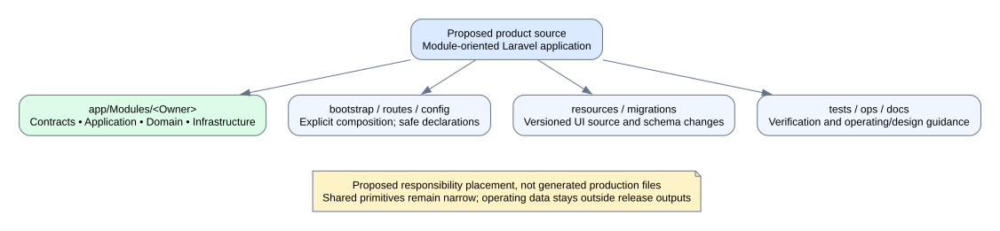
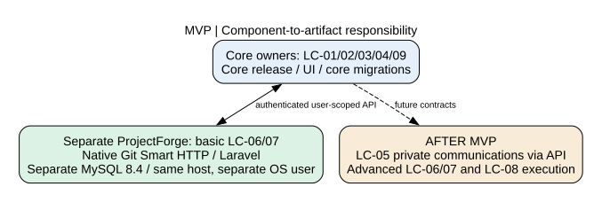
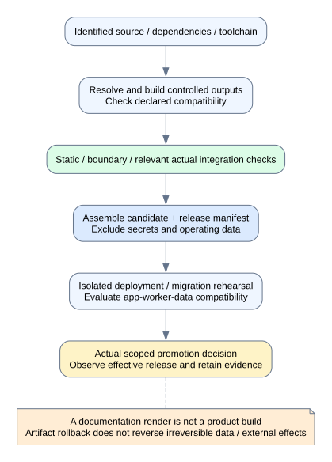
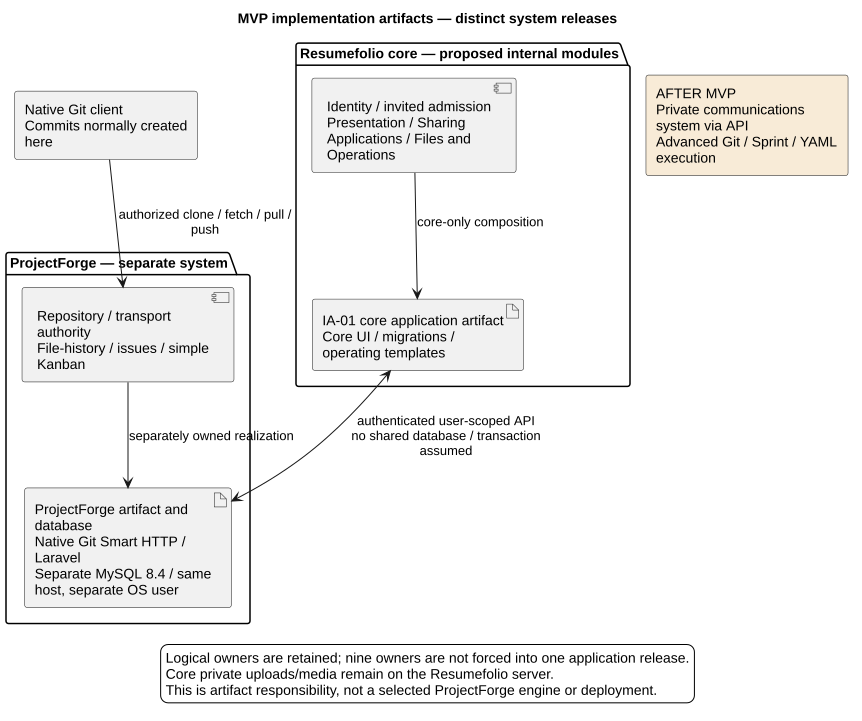
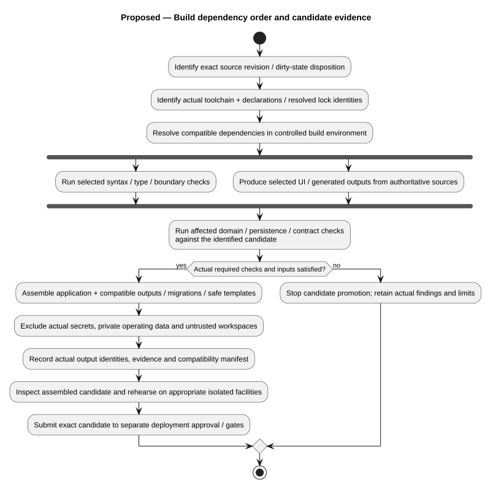

# Resumefolio — Implementation View and Artifacts

**Proposed organization:** module-oriented Laravel source, explicit exported contracts and internal implementation, a coordinated trusted application release, separately controlled operating data and evaluated external facilities.

**Status:** proposed implementation view, November 2, 2026. The source tree and artifact names below are design conventions, not files claimed to exist or a generated product implementation. Final toolchain, versions, dependency licenses, Git engine, queue and executor remain subject to evaluation and applicable acceptance gates.

[Source layout](#1-proposed-source-organization) · [Mappings](#2-component-to-artifact-mapping) · [Build](#3-dependency-and-build-organization) · [Configuration](#4-configuration-operating-data-and-generated-content) · [Release](#5-release-manifest-and-promotion) · [Review](#6-verification-and-completion) · [Essential views](#8-essential-implementation-and-artifact-views)

## MVP system allocation and design status

The accepted system boundary separates the Resumefolio core from ProjectForge, joined by an authenticated user-scoped API. Logical responsibilities remain useful within each system; they do not authorize a shared core/ProjectForge process, database or transaction. Core owns dashboard, invited accounts, professional presentation, protected sharing, manual applications and same-server private My Files & Media. ProjectForge MVP owns real repositories/transfers/permissions, file/history browsing, issues and simple Kanban. Its selected engine is native Git Smart HTTP behind the independent Laravel ProjectForge service, with its own MySQL 8.4 database and OS/storage boundaries on the existing host; BL-MVP-2026-11-04.1 governs implementation and evidence gates. The future communications system is independently private and API connected. Advanced Git review/releases, backlog/Sprints and execution/deployment remain deferred. Keep source, independent resume draft, explicit publication and actual submitted material identities distinct. Profile changes require preview/select/apply and cannot mutate publication or submitted history. Manual applications include status, next action and follow-up date without mail/calendar dependencies.

Authority: [OWNER-MVP-2026-11-04](../../01-project-planning/owner-mvp-decision-2026-11-04.md).

## Source context

Follow [logical component boundaries](../01-software-architecture/02-system-decomposition-and-boundaries.md), [module dependency rules](01-modularity-dependencies-and-encapsulation.md), [runtime responsibilities](../01-software-architecture/03-process-view-concurrency-and-runtime-behavior.md), [deployment nodes](../01-software-architecture/04-deployment-topology-nodes-and-networks.md) and [OO guidance](../02-detailed-and-object-oriented-design/01-design-principles-and-object-oriented-approach.md). Components are logical owners; artifacts are physical development/release outputs; nodes are operating facilities. One-to-one mapping is not assumed.

## 1. Proposed source organization



[Editable DOT](diagrams/implementation-source-structure.dot) · [PNG](diagrams/implementation-source-structure.png)

The following illustrates responsibility placement. Adapt concrete names to the evaluated framework conventions and actual component complexity before implementation. Do not create empty architectural layers merely to mirror the tree.

```text
app/
  Modules/
    IdentityAccess/
    Presentation/
    Sharing/
    Applications/
    CommunicationCalendar/
    Work/
    GitCollaboration/
    WorkflowDeployment/
    FilesOperations/
  Shared/                  # narrowly justified technical primitives
bootstrap/                 # application composition and initialization
config/                    # non-secret configuration declarations
routes/                    # HTTP/console route composition
resources/                 # shared UI assets and view source
database/migrations/       # ordered module-attributable schema changes
tests/                     # module and cross-boundary verification
ops/                       # reviewed operating/configuration templates
docs/                      # authoritative project documentation
```

### Inside a substantive module

```text
<Module>/
  Contracts/               # exported operations and permitted projections
  Application/             # explicit use-case orchestration
  Domain/                  # owned invariants and meaningful transitions
  Infrastructure/          # persistence and external adapters
  Http/                    # module-owned transport mapping, if needed
```

Make public/internal visibility and permitted imports enforceable through the selected toolchain/conventions. Module Contracts are not automatically public network APIs. Other modules may depend on explicit contracts, never on internal ORM mappings, storage paths or mutation-capable domain graphs. Shared must not become a universal domain model or broad service locator.

Keep framework composition registrations explicit. Route composition delegates to module-owned transport/application entry points. Shared UI infrastructure can serve several features while permission and domain state remain with their owners. Persistent worker scope must not retain another command's actor, transaction or private intent.

## 2. Component-to-artifact mapping



[Editable DOT](diagrams/component-artifact-placement.dot) · [PNG](diagrams/component-artifact-placement.png)

### IA-01 — Trusted application release

Realizes Identity/Access, Presentation, Sharing, Applications, Communication/Calendar, Work, Git Coordination, Workflow/Deployment Coordination and Files/Operations through their module code and contracts. Web and bounded workers/scheduler can run compatible entry points from the same application release. This does not authorize untrusted jobs inside the application identity.

The release includes application source or an evaluated deployable package, dependency resolution/lock identities, required migrations, UI build outputs and configuration/operating template identities. No final packaging technology or immutable-image mechanism is selected here.

### IA-02 — UI/static outputs

Shared UI/view source and evaluated frontend tooling produce the actual public assets or server-side templates needed by the application. Bind outputs to the application release and compatibility manifest. Public assets exclude private resume files, repository objects, credentials and restricted diagnostic content. A frontend framework or build pipeline is not selected by this diagram.

### IA-03 — Schema migration artifacts

Ordered migrations realize the evaluated physical data design, identifying component ownership and compatibility with active web/worker contracts. They are release artifacts, while the actual database contents are operating data. A downgrade script is not proof that historical data or external effects can be safely reversed.

### IA-04 — Native Git integration artifacts

Product coordination code belongs in the application release. Any selected native Git engine/package/service needs a separately identified version, configuration, transport contract and compatibility/recovery procedure. Repository objects/refs and review identities are operating data. Do not embed live repositories or real credentials in build packages.

### IA-05 — Executor/control artifacts

**Release applicability:** future-domain design retained after MVP; core operating/deployment and recovery controls still apply to MVP where relevant.

Workflow coordination and its adapter belong in the trusted application. Any evaluated executor image/package/control service has its own identity, supported definition contract, admission/secret/output policy and operating verification. Its existence and safe configuration are not established. Deployment target artifacts are attributable job outputs, not automatically authorized product releases.

### IA-06 — Operating templates and release metadata

Review web/process-supervision/scheduling, private-storage, configuration and backup/recovery templates with the release. Templates identify required keys and prerequisites without real secret values. Actual effective configuration, permission grants and facilities require deployment verification.

These IA labels are local design locators, not product requirements. Physical placement is owned by the [deployment view](../01-software-architecture/04-deployment-topology-nodes-and-networks.md): the trusted environment may host several artifacts/processes; native Git/executor placement remains evaluated separately; independent recovery needs its own failure-domain coverage.

## 3. Dependency and build organization

### Dependency declarations

Declare direct application/runtime and development dependencies explicitly with resolved lock identities where supported. Review source, maintenance, compatibility, license obligations, required operating privileges, resource costs and release implications before adopting a package/version. Existing demo installations or prior project usage are not automatic approval. No current package/version support claim is made by this document.

Application/domain consumers depend on meaningful ports or public module contracts; infrastructure packages realize them. A package installed globally on a developer machine must not become an undocumented production prerequisite. Separate build-only tools from operating dependencies and identify generated output ownership.

### Proposed build sequence

1. Identify source revision, intended environment/toolchain and dependency declarations/locks.
2. Resolve dependencies in a suitable controlled build environment; verify that declared compatibility and required inputs actually hold.
3. Perform static/syntax and module-boundary checks, then build selected UI/generated outputs as required.
4. Run relevant unit/domain/handler checks and real persistence/contract integration for the affected candidate. External facilities need controlled scoped evidence rather than fabricated mock-only assurance.
5. Assemble the candidate release and manifest, excluding real secrets, private data, caches tied to another environment and untrusted runtime workspaces.
6. Inspect the actual assembled output and rehearse its deployment/migrations on suitable isolated facilities before promotion.

The sequence describes required evidence, not a CI pipeline that already exists. Build determinism should be tested by comparing identified inputs/outputs under the chosen toolchain; this proposal does not claim reproducible binaries merely because lock files are present.

## 4. Configuration operating data and generated content

### Configuration boundary

Version safe key declarations, defaults that are actually accepted, format/schema and templates. Supply environment-specific values and secrets through reviewed operating mechanisms outside source control. Record effective configuration identities without leaking values. Changing a template does not change the running process; process restart/cache behavior must follow the evaluated deployment procedure.

Never commit real OAuth/client credentials, database passwords, encryption/recovery keys, deployment tokens, private correspondence or actual user artifacts. An example file can document required key names and expected meaning without providing working secrets. A schema migration or generated configuration artifact must not manufacture privileged accounts or grants implicitly.

### Operating data boundary

Preserve transactional domain state, command/attempt identities, committed pending intent, native repository state, private artifact bytes, publication/submission manifests and restricted operational evidence outside replaceable application release directories. Do not clear them through a generic clean/build script.

Runtime dispatch state may be reconstructible only if the chosen durable intent/identity design supports it. Do not classify all queues as disposable when unresolved sends/workflows/deployments depend on their records. Backup coverage and restoration retain actual authority/external reconciliation as defined in [operating recovery](../06-design-quality-and-security-analysis/03-operations-backup-recovery-and-resilience.md).

### Generated/manual ownership

Each generated artifact needs an authoritative source, generator/toolchain identity, regeneration instructions, expected consumers and review policy. Avoid manually patching generated interface/build files while leaving their source inconsistent. Do not adopt code generation merely because FAU illustrates model-driven workflows; choose it only when useful and verifiable.

Documentation diagrams are generated from editable DOT/PlantUML sources and retained as readable SVG/PNG exports. Those are documentation outputs, not application build or product capability evidence.

## 5. Release manifest and promotion



[Editable DOT](diagrams/implementation-release-route.dot) · [PNG](diagrams/implementation-release-route.png)

For an actual release record: source revision and dirty-state disposition; relevant dependency/toolchain identities; built artifact identities/integrity; component-to-artifact mapping; schema migration set and compatible app/worker/data versions; configuration key requirements; external engine/executor compatibility; actual verification/evidence; operating prerequisites; known risks; and rollback/forward-repair/recovery limits.

No manifest field should claim a hash, passing test or approval that was not actually produced. Final manifest format and signing/provenance mechanism need a justified implementation decision. Record what the selected mechanism actually verifies, rather than treating a checksum as authorization or origin assurance.

Promote only the identified evaluated artifact through [deployment procedures](../01-software-architecture/04-deployment-topology-nodes-and-networks.md). Control incompatible in-flight workers/jobs, preserve operating data and reconcile external effects. An application artifact rollback is not an automatic database restore or an undo of sent mail, updated refs or a target deployment.

## 6. Verification and completion

### Required implementation-view checks

- Each logical component maps to actual source/package elements and realizing artifacts, with exported/internal dependencies identifiable.
- Each running artifact maps to an operating environment/node and required communication/configuration path.
- Web, workers, scheduler, schema and external-adapter versions agree on active contracts and pending work.
- Build output contains required assets/migrations and excludes secrets, private operating data and untrusted workspaces.
- Actual assembled-output boot/route/module-boundary checks and relevant persistence/integration results identify the same candidate.
- Deployment, compatibility, migration and recovery limits are explicit and supported at their applicable acceptance gates.

These are future verification requirements, not tests executed by this document update. Exact namespace conventions, package definitions, build commands, chosen tools/versions, manifest format and concrete artifact hashes remain implementation-level follow-up. The existing documentation-only repository is not represented as an already built product source tree.

Use [component packages](README.md), [data design](../04-data-design/README.md), [interface design](../05-interface-and-api-design/README.md), [evolution guidance](../02-detailed-and-object-oriented-design/05-design-evolution-refactoring-and-technical-debt.md) and [design review/handoff](../06-design-quality-and-security-analysis/05-design-review-traceability-and-handoff.md) to maintain a coherent candidate. Source families or artifact counts are not exact criterion completion.

## 7. FAU basis and diagram reading

FAU V07’s implementation view relates components/modules to source files and development outputs; its artifact/deployment model maps logical components to physical artifacts and nodes. V08 carries architecture inputs into component implementation prescriptions. This proposed layout is a project adaptation, not a mandatory framework filesystem or an assertion that one component equals one binary/service.

The diagrams illustrate source responsibility, artifact placement and the release evidence route. They do not select queue/Git/executor products, install facilities or prove runtime behavior. See [FAU reference map](../01-reference-and-coverage-map.md) and [diagram catalog](diagrams/README.md).

No production source generation, dependency installation, build, migration, deployment, provider/Git mutation or baseline approval is performed in this authoring update. Advisor transport remains unavailable as previously recorded; no independent endorsement is claimed.

[Component and Module Design index](README.md) · [Module boundary rules](01-modularity-dependencies-and-encapsulation.md)

## 8. Essential implementation and artifact views

Only **three complementary diagrams** are added here; no new tables. Reuse the existing [source structure](#1-proposed-source-organization), [component/artifact placement](#2-component-to-artifact-mapping) and [release route](#5-release-manifest-and-promotion). These represent the proposed implementation candidate, not an inspected product code tree or completed build.

### 8.1 Implementation view: logical owners to physical outputs


[Editable PlantUML](diagrams/implementation-essential-overview.puml) · [PNG](diagrams/implementation-essential-overview.png)

4+1 implementation-view refinement: logical responsibilities map to source elements and physical outputs, not one service or binary per owner. IA locators reuse section 2; actual source/package names, toolchain and compatibility remain proposed.

### 8.2 UML-style artifacts and manifestation boundaries



[Editable PlantUML](diagrams/implementation-essential-artifacts.puml) · [PNG](diagrams/implementation-essential-artifacts.png)

The «manifest» dependency denotes UML artifact manifestation, distinct from the release-manifest document identifying output/provenance. Git/executor artifacts are conditional evaluated prerequisites, not installed products. A checksum alone is not authorization or origin assurance.

### 8.3 Build dependency order and candidate evidence



[Editable PlantUML](diagrams/implementation-essential-build-order.puml) · [PNG](diagrams/implementation-essential-build-order.png)

Essential build-input/order flow, not installed CI or actual commands. PHP modules are not automatically separately compiled build targets; no fabricated inter-module compilation order is imposed. Parallel branches show independent candidate tasks only where actual tooling permits; affected checks must use the intended outputs. Packaging does not publish to a selected registry or authorize deployment.

The [modularity guide](01-modularity-dependencies-and-encapsulation.md#8-essential-modularity-and-encapsulation-views) already supplies package direction, layers and hidden implementation. The [deployment view](../01-software-architecture/04-deployment-topology-nodes-and-networks.md) owns node placement; the [Git design](components/git-collaboration.md#7-essential-git-and-collaboration-views) owns its candidate branching/review views. Duplicating them here would create competing diagrams without a new implementation question.

No monorepo/multi-repo split, third-party package graph, registry, release version scheme or separate module build target is selected. Populate actual dependency identities and code structure only after inspecting the real candidate. Unresolved Git/executor/runtime/secret/recovery mechanisms remain evidence gates; these diagrams perform no install, build, publish, migration or deployment.
