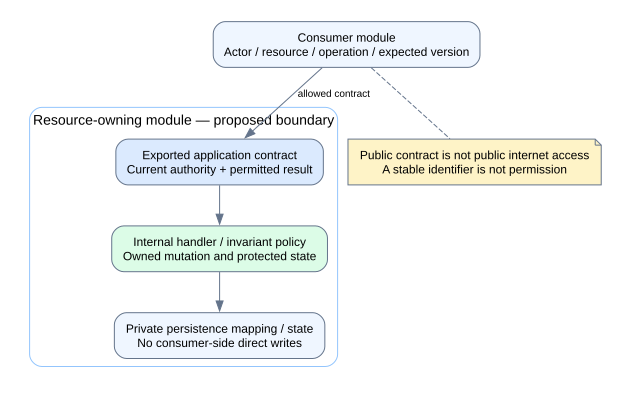
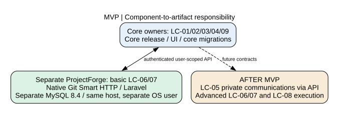

# Resumefolio — Component and Module Design

## Current implementation baseline — November 4, 2026

[BL-MVP-2026-11-04.1](../../../baseline/README.md) selects the MVP technical mechanisms, numerical policies, priorities and requirement/criterion dispositions under Farhad’s explicit delegation. It supersedes earlier Proposed/pending mechanism and whole-baseline statements below for MVP design input. Future clauses and dated evidence remain separate. Runtime/actor validation, credentials, Git isolation, capacity and backup/restore still require the named implementation/Release gates; this update reports no product test Pass.

### Prior source material and rationale (superseded where this Baseline selects a different MVP choice)

**Use this folder to connect architectural responsibilities to cohesive code modules, explicit contracts and development artifacts.** Keep each component’s concrete implementation prescriptions together, referencing shared data/interface/security policy rather than duplicating it.

Owner and decision authority: Farhad. Updated November 2, 2026.

**Current position:** the two shared guides and all nine component records are populated with proposed contracts, models, behavior and visual packages. There are **181 distinct views** across this section: 13 shared-guide views, 105 component views and 63 reusable-template views, each with editable source and SVG/PNG exports. The records remain proposed designs requiring implementation-level refinement and actual evidence; the reusable package remains a template. No product module, build or accepted baseline is created by this documentation.

[Reading route](#1-reading-route) · [Guide](#2-shared-module-and-implementation-guidance) · [Components](#3-proposed-component-catalog) · [Template](#4-completing-one-component-package) · [Diagrams](#5-diagram-gallery-and-catalog) · [Readiness](#6-review-and-current-limits)

## MVP system allocation and design status

The accepted system boundary separates the Resumefolio core from ProjectForge, joined by an authenticated user-scoped API. Logical responsibilities remain useful within each system; they do not authorize a shared core/ProjectForge process, database or transaction. Core owns dashboard, invited accounts, professional presentation, protected sharing, manual applications and same-server private My Files & Media. ProjectForge MVP owns real repositories/transfers/permissions, file/history browsing, issues and simple Kanban. Its selected engine is native Git Smart HTTP behind the independent Laravel ProjectForge service, with its own MySQL 8.4 database and OS/storage boundaries on the existing host; BL-MVP-2026-11-04.1 governs implementation and evidence gates. The future communications system is independently private and API connected. Advanced Git review/releases, backlog/Sprints and execution/deployment remain deferred. Keep source, independent resume draft, explicit publication and actual submitted material identities distinct. Profile changes require preview/select/apply and cannot mutate publication or submitted history. Manual applications include status, next action and follow-up date without mail/calendar dependencies.

Authority: [OWNER-MVP-2026-11-04](../../01-project-planning/owner-mvp-decision-2026-11-04.md).

## 1. Reading route

1. Read the [architecture decomposition](../01-software-architecture/02-system-decomposition-and-boundaries.md) for the nine LC responsibility boundaries and source invariants.
2. Read [Modularity, Dependencies and Encapsulation](01-modularity-dependencies-and-encapsulation.md) for public/internal contracts, ownership, dependency direction, injection/lifetime and boundary review.
3. Read [Implementation View and Artifacts](02-implementation-view-and-artifacts.md) for proposed module-oriented source placement, component/artifact mapping, build/configuration boundaries and release evidence.
4. Open the relevant component record below. Refine its signatures, types, classes, owned data, algorithms and failure/concurrency behavior using the [complete template](component-template/README.md).
5. Link shared mechanisms and exact source criteria, record significant [ADRs](../07-design-decisions/README.md), and review the identified candidate through [Design Review and Handoff](../06-design-quality-and-security-analysis/05-design-review-traceability-and-handoff.md).

Logical components, code packages, application artifacts, operating processes and deployment nodes are related but not interchangeable. Nine components do not imply nine services or databases. A shared application artifact/database does not permit another module to bypass ownership.

## 2. Shared module and implementation guidance

| Question | Primary document |
|---|---|
| What may a module expose, own or consume? | [01 — Modularity](01-modularity-dependencies-and-encapsulation.md) |
| How do DI, object lifetimes and long-lived workers remain scoped? | [01 — Injection and lifetime](01-modularity-dependencies-and-encapsulation.md#4-dependency-injection-and-object-lifetime) |
| How do components map to source, builds and release artifacts? | [02 — Implementation view](02-implementation-view-and-artifacts.md) |
| Which data/configuration must stay outside replaceable release outputs? | [02 — Configuration and operating data](02-implementation-view-and-artifacts.md#4-configuration-operating-data-and-generated-content) |
| Where are full OO principles and evolution procedures? | [Detailed and OO Design](../02-detailed-and-object-oriented-design/README.md) |

These are shared design owners. Component records explain their specific realization and link the applicable rules instead of creating competing policies.

## 3. Proposed component catalog

LC locators come from the architecture catalog. Each entry below is a populated proposed component design with its own visual package, not implemented code or exact criterion-coverage evidence.

### LC-01 — Identity and Access

[Component record](components/identity-and-access.md). Owns accounts, invitations, sessions and scoped grant context. Resource owners still apply current operation/lifecycle rules; successful sign-in or a membership never supplies universal access.

### LC-02 — Professional Presentation

[Component record](components/professional-presentation.md). Owns profiles, independent drafts/overrides, selected evidence and identified publication revisions. Selected source application and separate publication preserve independent resume content and actual history.

### LC-03 — Representation and Sharing

[Component record](components/representation-and-sharing.md). Owns download settings, independent links and viewer authorization. Current eligibility, selected publication/language/rendition and artifact availability remain distinct; direct retrieval cannot bypass them.

### LC-04 — Manual Applications

[Component record](components/applications.md). Owns opportunity/preparation, manual progress and actual submission material manifests. Progress, provider acceptance and actual submitted evidence are different facts; current live content does not replace historical material.

### LC-05 — Communication and Calendar

**Release applicability:** future-domain design retained after MVP; core operating/deployment and recovery controls still apply to MVP where relevant.

[Component record](components/communication-and-calendar.md). Owns provider capability, local drafts/activities, attributable send attempts and synchronization mappings. Disconnect/unlink/provider mutation and uncertain effects need explicit handling rather than replay or silent conflict resolution.

### LC-06 — Work Management

[Component record](components/work-management.md). Owns projects, boards, items/tasks, memberships and a coherent Sprint Goal/selection/plan. Period end does not automatically accept work, and repository links do not extend grants.

### LC-07 — Git Collaboration

[Component record](components/git-collaboration.md). Owns repository/native-store identity, ref/review integration and collaboration/release metadata. Actual transfers and expected-ref semantics depend on an evaluated Git backend; merge does not authorize execution or deployment.

### LC-08 — Workflow and Deployment Coordination

**Release applicability:** future-domain design retained after MVP; core operating/deployment and recovery controls still apply to MVP where relevant.

[Component record](components/workflow-and-deployment.md). Owns supported workflow definitions, admitted attempts, restricted output references and separately authorized target attempts. Execution requires actual enabling evidence; cancellation intent is not confirmed termination.

### LC-09 — Files and Operations

[Component record](components/files-and-operations.md). Owns admitted artifact identity/usability, quota reservations, protected-reference accounting and recovery records. Replacement, retirement, physical reclamation and usable recovery require their actual attributable outcomes.

## 4. Completing one component package

Use the [component-template folder](component-template/README.md) as a coherent package when further refining a component beyond its existing single-file design. Keep related records together; link or deliberately migrate the existing component entry instead of leaving two contradictory designs. Do not instantiate additional empty packages merely to fill a checklist.

1. **Responsibilities and contracts:** provided/required operations, consumers, owned state, current authority and compatibility.
2. **Data/classes:** validated identities/types, visibility, relationships, invariants, construction/lifetime and persistence mapping references.
3. **Detailed behavior:** operation algorithms, expected revisions, local transaction/concurrency boundaries, protected state and result classifications.
4. **Technical scenarios:** initialization, background work, interruption, duplicate delivery, partial/unknown effects, cancellation and recovery where applicable.
5. **Patterns/constraints:** justified alternatives, dependency direction, test seams, framework integration and implementation conventions.
6. **Diagrams/evidence:** editable sources with synchronized readable exports and exact candidate-specific review/verification records.

Shared inputs are [Data Design](../04-data-design/README.md), [Interface and API Design](../05-interface-and-api-design/README.md), [Quality/Security](../06-design-quality-and-security-analysis/README.md), [runtime behavior](../01-software-architecture/03-process-view-concurrency-and-runtime-behavior.md) and [deployment placement](../01-software-architecture/04-deployment-topology-nodes-and-networks.md).

For example, Sharing resolves an eligible publication through Presentation and usable artifact context through Files. It cannot mutate their tables or return a private fallback. Its package must specify both that public collaboration and the denied/stale/unavailable paths, rather than only list class names.

## 5. Diagram gallery and catalog

### Public and internal boundaries

[Owning modularity guide](01-modularity-dependencies-and-encapsulation.md) · [DOT](diagrams/module-public-and-private-boundary.dot) · [PNG](diagrams/module-public-and-private-boundary.png)

### Artifacts and operating placement

[Owning implementation view](02-implementation-view-and-artifacts.md) · [DOT](diagrams/component-artifact-placement.dot) · [PNG](diagrams/component-artifact-placement.png)

### Find the owning visual package

The [shared-guide catalog](diagrams/README.md) contains **13 views**: six existing DOT views and seven complementary PlantUML views. The [modularity package](01-modularity-dependencies-and-encapsulation.md#8-essential-modularity-and-encapsulation-views) covers package direction, layering, encapsulation and hypothetical tangled-versus-modular structure. The [implementation package](02-implementation-view-and-artifacts.md#8-essential-implementation-and-artifact-views) connects logical owners, source structure, physical artifacts and build order. Reuse these views instead of copying another near-identical diagram into a component.

The [component catalog of diagrams](components/diagrams/README.md) contains **105 views**. Follow each component's owning section for captions and proposal limits:

- [LC-01 Identity — essential views](components/identity-and-access.md#7-essential-identity-and-access-views): authentication, current authorization, scoped access, session lifecycle and trust boundaries; existing domain model reused.
- [LC-02 Presentation — essential views](components/professional-presentation.md#7-essential-presentation-views): owner/component boundaries, user intentions, publication dimensions, visitor resolution and rendering; existing source/draft/publication model and update sequence reused.
- [LC-03 Sharing — essential views](components/representation-and-sharing.md#7-essential-representation-and-sharing-views): exact representation routes, link lifecycle and viewer admission; existing model/protected retrieval sequence reused.
- [LC-04 Applications — context and landscape](components/applications.md#7-application-context-and-landscape-package): manual job-application capability, neighboring owners, whole-system C4 anchors and actual-material capture; not a portfolio of independently deployed applications.
- [LC-05 Communication/Calendar — expanded views](components/communication-and-calendar.md#8-communication-calendar-and-delivery-view-package): scoped provider access, reviewed sends, local/provider events, time/recurrence and uncertainty; unselected channels/protocols remain alternatives.
- [LC-06 Work — essential views](components/work-management.md#7-essential-work-management-views): canonical work state, current mutation scope, board projections and coherent Sprint planning; completion, acceptance and period outcome remain distinct.
- [LC-07 Git — essential views](components/git-collaboration.md#7-essential-git-and-collaboration-views): native objects/refs, commit topology, candidate branching, revision-bound review and guarded merge.
- [LC-08 Workflow/Deployment — execution and target views](components/workflow-and-deployment.md#8-workflow-executor-and-deployment-views): separate execution/approval/target states, containment, promotion and recovery; strategies and topology remain conditional.
- [LC-09 Files/Operations — storage and reference views](components/files-and-operations.md#8-files-storage-and-operations-view-package): actual usability/accounting, protected consumers, replacement/reclamation and recovery; optional backend/folder/processing mechanisms remain unselected.

The [template package guide](component-template/README.md) and [template diagram catalog](component-template/diagrams/README.md) contain **63 reusable views** across responsibilities/interfaces, data/classes, algorithms, failures and patterns/constraints. Copy only what answers an actual component question. Replace placeholders, example identities and source locators; adjust relative links and retain actual decision status. Template examples and synthetic traces are not implemented classes or performed tests.

Every counted view has matching source, SVG and PNG identities; the total counts unique files within these three catalogs, not repeated image links. Existing shared gallery images above are reused rather than generated again. **No new diagram or table is added by this index update.**

### Read diagrams at their stated level

C4 system/container views, logical components, code packages, native Git objects, runtime messages, state observations and physical deployment artifacts answer different questions. Use each caption's arrow/notation meaning. A source dependency is not a temporal call order; a state label is not evidence of completed effects; an artifact diagram is not an installed deployment.

Do not infer new scope from generic examples: chat/SMS, broad social export/embed, generic workflow engines, independent microservices, CDN/tiered storage, a third-party identity provider and alternate protocol products remain unselected unless exact source decisions say otherwise. The earlier expanded packages retain their illustrative/conditional labels; subsequent additions favor essential diagrams and links over duplicated views or new tables.

## 6. Review and current limits

### Required candidate review

- Every public operation and owned invariant has an actual source/criterion relationship and coherent component ownership.
- Consumers use explicit permitted contracts/projections; foreign-state writes, hidden effects, cycles and shared mutable actor state are challenged.
- Source/draft/publication/actual-history identities, current revocation and independent execution/deployment authority remain preserved.
- Component classes/types, algorithms, transaction/attempt behavior and interface outcomes agree with data/runtime/deployment views.
- Build/release artifacts identify compatibility, configuration and operating prerequisites without private data or real secrets.
- Focused checks cover intended effects and protected state under relevant denied, conflict, duplicate, failure, partial and unknown paths.

### Remaining work

The nine records need full implementation-level signatures/types, complete applicable class/collaboration prescriptions beyond selected illustrative models, physical schema and framework lifetime choices, exact criterion mapping and targeted review before dependent coding. Git/queue/provider/executor compatibility, resource suitability, recovery facilities and numeric targets remain their existing evidence gates.

No source package tree, dependency enforcement, actual build, migration, Git/provider operation, executor test or restored backup is created by these documents. Template completion, diagram count and valid links do not imply implementation readiness. Advisor consultation was unavailable as previously recorded; no independent endorsement is claimed.

## 7. FAU basis and maintenance

FAU V07 links components/interfaces to implementation artifacts and deployment nodes. V08 refines architecture into component-level computational data/classes, detailed behavior, technical scenarios and coding constraints. The proposed module/source/package conventions here adapt those concepts to Resumefolio; they are not a mandated university filesystem or a one-component/one-service rule.

When ownership or a public contract changes, assess source behavior, consumers, data/runtime/artifact compatibility and operating consequences. Update the owning component and shared records, regenerate relevant diagrams, record significant ADRs and retain actual review/evidence scope. Use the [evolution procedure](../02-detailed-and-object-oriented-design/05-design-evolution-refactoring-and-technical-debt.md) and [FAU reference map](../01-reference-and-coverage-map.md).

[System Design home](../README.md) · [Software Architecture](../01-software-architecture/README.md) · [Diagram catalog](diagrams/README.md)
