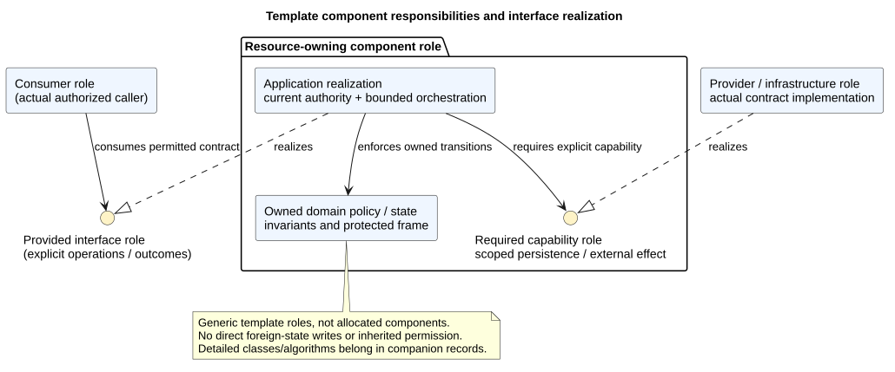
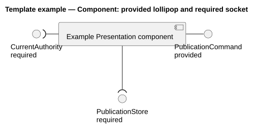
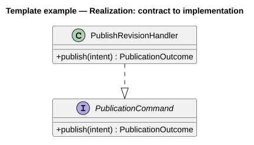
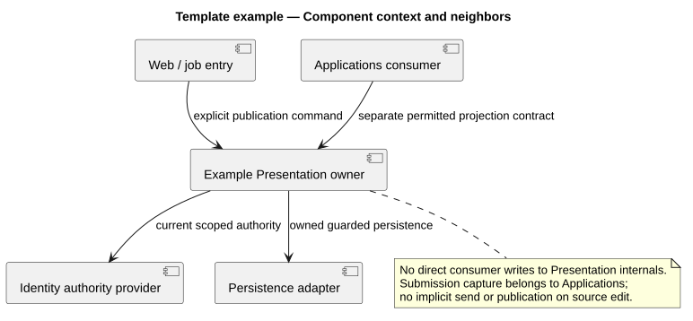
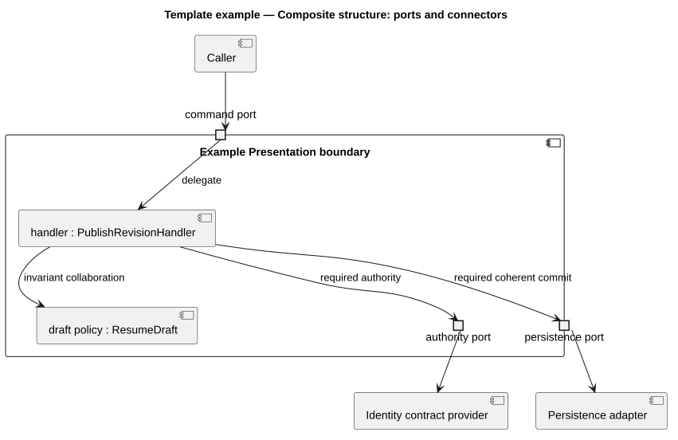
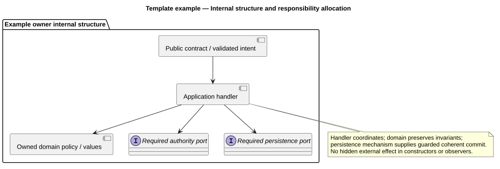
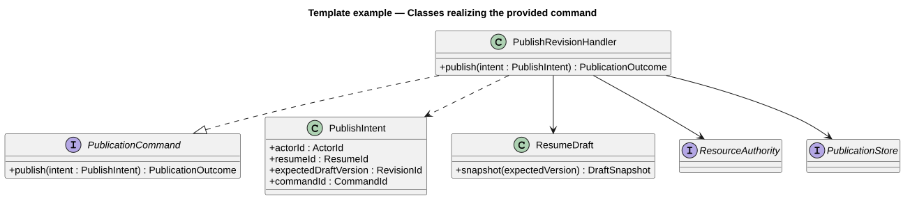
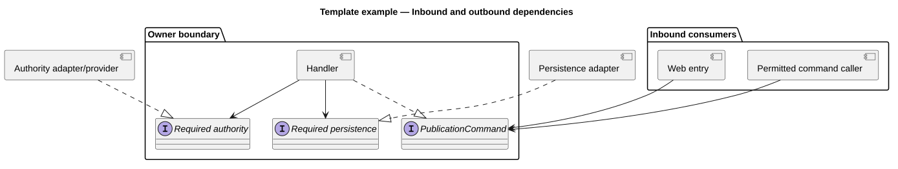
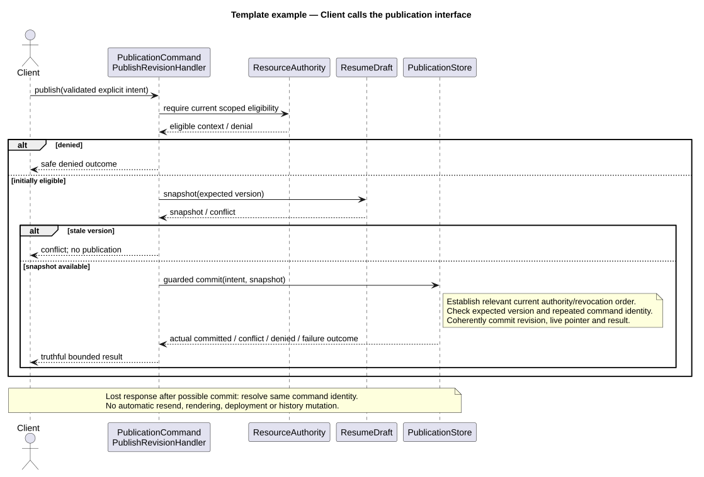
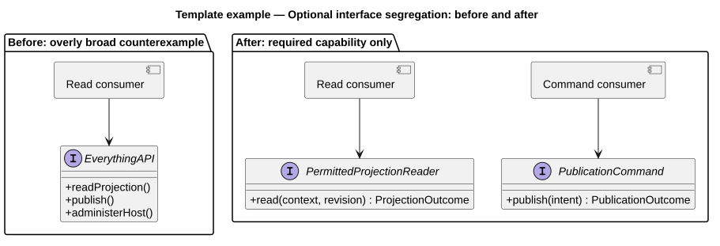

# Component Template — Responsibilities and Interface Realization

**Status: reusable template only.** This file allocates no actual component, operation identifier, technical decision, accepted permission or verification result. Copy it into an identified component package, replace brace placeholders with sourced design and remove inapplicable sections with rationale.

**Purpose:** connect one architectural component’s responsibilities and exported/required interfaces to implementation-level contracts, concrete ownership and planned verification. Keep data/classes, algorithms and technical failure scenarios in the companion records rather than duplicate them here.

[Identity](#1-component-identity-and-source-authority) · [Ownership](#2-responsibilities-and-encapsulation) · [Interfaces](#3-provided-and-required-interface-catalog) · [Operations](#4-operation-contract-record) · [Realization](#5-interface-realization-and-dependencies) · [Example](#6-worked-example-publication) · [Review](#7-review-and-completion) · [Visual contracts](#9-visual-contract-and-responsibility-package)

## 1. Component identity and source authority

| Field | Value to complete |
|---|---|
| Component identity/name | `{actual architecture locator and stable name}` |
| Candidate and owner | `{source/design revision; responsible owner; actual decision authority}` |
| Design status | `{actual proposed/reviewed/accepted status and source; no default acceptance}` |
| Architectural responsibility | `{exact architecture component and boundary locator}` |
| Source obligations | `{exact requirement/criterion locators and applicable source status}` |
| Analysis inputs | `{domain concepts, scenarios, state/rule/operation/interface contracts}` |
| Related decisions | `{actual ADR references, status, assumptions and enabling conditions}` |

Reference source obligations rather than copying a new specification. A family name or same-title document alone does not establish exact criterion coverage. Where design exposes a source ambiguity, link the authoritative question/finding and affected commitment; do not invent an accepted behavior in the template.

Shared guidance: [logical boundaries](../../01-software-architecture/02-system-decomposition-and-boundaries.md), [modularity rules](../01-modularity-dependencies-and-encapsulation.md), [API conventions](../../05-interface-and-api-design/README.md) and [source decisions](../../../02-requirements-engineering/07-change-and-baseline/open-questions-and-decisions.md).

## 2. Responsibilities and encapsulation

### Purpose and user/domain value

**Purpose:** `{one coherent reason this component exists; user/domain outcome and boundary}`.

**Owned responsibilities:** `{operations and invariants this component must enforce}`.

**Explicit exclusions:** `{related behavior owned elsewhere, with the owning contract/record}`.

**Owned information:** `{record/aggregate/value identities, provenance, lifecycle and permitted mutation authority; link the data/class record}`.

**Protected frame:** `{state, references, history and external resources that each operation must preserve}`.

### Public and internal boundary

**Exported elements:** `{public operations, validated request types and permitted result projections; distinguish module export from network exposure}`.

**Internal elements:** `{domain mutation objects, persistence mappings, repositories/adapters and sensitive operating details not exposed to consumers}`.

**Consumers:** `{actual consuming components/entry points and their justified needs}`.

**Authority boundary:** `{where current actor/resource/action/lifecycle policy is checked; source rules, administrative exceptions and revocation semantics}`.

A stable identifier or an earlier caller/middleware check cannot supply universal authority. Do not pass mutable internal ORM objects or raw storage paths across owners merely to simplify a call. Public contract access remains subject to its own disclosure and operation policy.

[Editable PlantUML](diagrams/component-interface-realization-template.puml) · [PNG](diagrams/component-interface-realization-template.png)

The diagram is a generic template illustration. Replace role names with actual component/interface identities when copied. Its arrows describe dependencies and realization, not automatic permission, transaction scope or deployment placement.

## 3. Provided and required interface catalog

Repeat the following records for actual interfaces. Allocate identifiers only under the project’s actual convention; brace examples are not allocated IDs. Separate interfaces where consumer responsibility, authority, capability or compatibility differs materially.

### Provided interface record

**Identity and purpose:** `{actual interface identity; coherent capability}`.

**Architectural interface:** `{exact provided-interface locator and realizing component}`.

**Consumers and exposure:** `{components or external clients; in-process/transport exposure as selected}`.

**Operations:** `{actual public operation names; links to the records in section 4}`.

**Visibility and compatibility:** `{public/internal projection, versioning, supported consumer contract and evolution rules}`.

**Implementation realization:** `{concrete interface/type/adapter/handler locator once defined; proposed versus actual distinction}`.

### Required interface record

**Identity and reason:** `{required capability and why it belongs to another owner/facility}`.

**Provider and contract:** `{actual owner/interface locator, operations consumed and permitted projections}`.

**Assumptions and prerequisites:** `{current capability/access, compatibility, feasibility and applicable evidence gate}`.

**Failure/result mapping:** `{provider outcomes translated without losing denial/conflict/partial/unknown meaning}`.

**Substitution and verification:** `{test seam, limits of substitutes and later actual integration evidence}`.

**Construction/lifetime:** `{how the dependency is injected, scoped and released; no hidden user/session singleton}`.

## 4. Operation contract record

Repeat this record for each actual exported operation. Include read-only operations as such; do not force a transaction/mutation onto a query. Actual signature syntax and concrete types depend on the selected implementation conventions.

### Identity and signature

**Operation:** `{actual stable identity and descriptive verb}`.

**Interface/handler:** `{provided contract and realizing entry point}`.

**Signature:** `{parameters and result types; identifiers, intent/version/time/language context made explicit}`.

**Source mapping:** `{exact criteria and analysis contract/scenario/state/rule locators; applicable source revision}`.

### Inputs and admission

**Caller and resource:** `{actor/capability, resource and intended action}`.

**Input validation:** `{required/optional fields, valid ranges/representations, canonicalization and sensitive handling; no invented default limits}`.

**Current authorization:** `{owner-side authority/grant/lifecycle check and permitted disclosure}`.

**Preconditions:** `{actual domain state, available dependencies and expected revisions; distinguish guaranteed setup from checked conditions}`.

**Command identity:** `{duplicate/repeated-intent binding and mismatched-input behavior where relevant}`.

### Execution boundary and effects

**Local consistency boundary:** `{owned invariant, transaction/compare guard, related owner contracts and expected-version handling}`.

**Confirmed success:** `{observable result, changed state and evidence sufficient to claim it}`.

**Protected state:** `{unchanged unrelated data, independent link/PDF controls, overrides, publications or actual history as applicable}`.

**External effects:** `{exact reviewed provider/Git/executor/target intent; attributable attempt and evidence boundary; none if no remote effect}`.

**Ordering and concurrency:** `{conflicting operations, lock/version/claim protocol and stale-result handling; link algorithm/runtime details}`.

### Non-success outcomes and repetition

**Invalid or denied:** `{safe result, protected state and information-disclosure boundary}`.

**Conflict or unavailable:** `{expected-version/representation/capability issue; permitted compare/reload/reconcile path}`.

**Pending, partial or unknown:** `{what is actually known, operation identity, observed effects and user-visible status}`.

**Retry and idempotency:** `{which same-operation repeats are safe, identity/result lookup, external reconciliation and required evidence; do not claim exactly-once remote effects from a local transaction}`.

**Cancellation:** `{request-versus-confirmed-stop distinction and race/known-effect handling where applicable}`.

### Response observation and verification

**Result representation:** `{typed outcome/projection and transport mapping, version/language/provenance where relevant}`.

**Diagnostics:** `{bounded operation identity/timing/error category; secrets and private payload exclusions}`.

**Planned checks:** `{normal/denied/conflict/duplicate/interrupted/partial/unknown/concurrent cases that apply; expected effects and protected frame}`.

**Actual evidence:** `{unperformed until a real identified review/run; link candidate/environment/method/observed result and limits}`.

## 5. Interface realization and dependencies

Connect every provided architecture interface to its actual implementation-level operation/type and owning handler. Connect every required operation to an identified provider or evaluated adapter. A declaration with no realization or consumer relationship is an unresolved design element, not a completed interface.

The public entry point coordinates current authorization, validation and intended result; the domain policy preserves owned invariants; infrastructure realizes persistence/external capabilities. Do not hide a send, publication, ref mutation or deployment inside a constructor/getter or unrelated observer.

Keep detailed classes and types in [data/class structure](02-data-model-and-class-structure.md), operation steps in [behavior/algorithms](03-detailed-behavior-and-algorithms.md), interruption/recovery in [technical scenarios](04-technical-scenarios-and-failure-handling.md), and dependency/lifetime conventions in [patterns/coding constraints](05-design-patterns-and-coding-constraints.md). Record one authoritative contract here and link its realizations; do not create competing definitions.

For a long-lived worker, re-establish current authority/claim context for each job. A stored reviewed intent may be needed to identify what was requested, but it cannot act as an indefinitely valid privilege. Local completion and external result observation remain separate when the remote effect cannot be made transactional.

## 6. Worked example publication

**Illustration only — not an allocated operation record or final signature.** The example applies the existing accepted source/apply/separate-publication policy; it does not accept every remaining publication detail.

**Owner/operation:** Professional Presentation / PublishRevision.

**Proposed input:** actor identity, intended resume identity, expected draft version, explicit publication confirmation and stable command identity.

**Admission:** resolve current publish authority and eligible resource lifecycle, validate the expected draft version and intended publication context. Reject denied/stale intent without silently publishing another version.

**Confirmed outcome:** create an identified publication revision and update the permitted live pointer within the chosen local consistency mechanism; return an attributable result. Preserve independent resume overrides, sharing-link controls and actual submitted materials.

**Dependencies:** authority evaluation and persistence/revision facilities; usable-artifact requirements apply only where the actual source contract makes them prerequisites. Rendering or sending is not implicitly performed by this example.

**Lost response/repeat:** resolve the same command's permitted recorded outcome before a consequential repeat; response loss after commit is not proof of rollback. Exact identity retention, signature/types, schema and synchronization need actual implementation-level design.

**Focused verification:** concurrent draft change/publication, denied owner, duplicate confirmation, commit/response interruption and protected history/link controls. These are proposed checks, not executed evidence. See the [shared OO publication illustration](../../02-detailed-and-object-oriented-design/01-design-principles-and-object-oriented-approach.md).

## 7. Review and completion

- [ ] Component identity, actual source revision and decision status are explicit; placeholders are removed or marked genuinely unresolved before actual review.
- [ ] Owned responsibility/invariants and exclusions identify the right source and neighboring owner.
- [ ] Every exported/required interface has justified consumers/provider, operations and implementation realization or explicit gap.
- [ ] Signatures, authority, preconditions, observable outcomes and protected frame agree across data/algorithm/scenario records.
- [ ] Concurrent, denied, stale, unavailable, pending/partial/unknown and repeat/cancel behavior are specified where applicable.
- [ ] Mutable internal models, raw private paths and broad credentials do not bypass another owner's public boundary.
- [ ] Compatibility, lifetime, operating prerequisites and external-effect limits are explicit.
- [ ] Planned verification is distinct from actual results; actual review identifies candidate, method, findings and disposition.

Unchecked items are authoring prompts, not claims of failure or acceptance. Whole-component/phase completion and permission to implement still require the agreed actual review/baseline process.

## 8. Provenance and maintenance

FAU V07 components/interfaces and V08 component-model refinement motivate architecture-to-operation realization. This field set is a Resumefolio template convention, not a mandated FAU record format or formal interface certification.

When copying, keep the complete component package together, adjust relative links for its actual location, replace generic role names in any copied diagram and maintain source/model/contract consistency. Do not allocate IDs or mark owner decisions simply by filling the template. No live product operation or verification is performed by this template update.

[Component template index](README.md) · [Component and Module Design](../README.md) · [Template diagrams](diagrams/README.md)

## 9. Visual contract and responsibility package

**Reusable template with a selected publication example.** Replace role names, source locators, signatures and rules with the copied component’s actual sourced design. No ID, permission, interface implementation, transport, persistence mechanism or accepted decision is allocated here. The first figure explicitly distinguishes provided circles from required sockets; remaining figures use dependency and realization notation with their own stated meaning.

### 9.1 Component: provided lollipop and required socket

[Editable PlantUML](diagrams/contract-provided-required.puml) · [PNG](diagrams/contract-provided-required.png)

The attached circle denotes a provided interface; the open socket denotes a required interface. These are logical in-process capabilities unless actual transport exposure is separately selected. Replace all example names when copying; neither interface attachment nor access to a port grants permission.

### 9.2 Realization: contract to implementation

[Editable PlantUML](diagrams/contract-realization.puml) · [PNG](diagrams/contract-realization.png)

The dashed line with hollow triangle points from implementation to the interface it realizes. Proposed role/signature only; realization requires actual operation and outcome compatibility, not just matching method names.

### 9.3 Component context and neighbors

[Editable PlantUML](diagrams/contract-context.puml) · [PNG](diagrams/contract-context.png)

Arrows mean required capability/use direction. Applications consumes a separate projection contract, not publication privileges. Physical deployment, raw table access and cross-owner transaction atomicity are not implied.

### 9.4 Composite structure: ports and connectors

[Editable PlantUML](diagrams/contract-ports-connectors.puml) · [PNG](diagrams/contract-ports-connectors.png)

UML-style composite-structure view: boundary ports delegate to parts and connect to required capabilities. Parts are design roles, not automatically processes, pods or separate services. Connector labels are logical contracts, not network addresses.

### 9.5 Internal structure and responsibility allocation

[Editable PlantUML](diagrams/contract-internal-parts.puml) · [PNG](diagrams/contract-internal-parts.png)

This view allocates roles inside the boundary; the port/connector view shows how they are reached. Detailed attributes, types and algorithms remain in companion records 02 and 03.

### 9.6 Classes realizing the provided command

[Editable PlantUML](diagrams/contract-class-realization.puml) · [PNG](diagrams/contract-class-realization.png)

Selected proposed class refinement, not a complete component model. Explicit confirmation is part of the validated command context; the actual signature, current-guard coordination and result vocabulary require sourced refinement in the copied package.

### 9.7 Inbound and outbound dependencies

[Editable PlantUML](diagrams/contract-dependencies.puml) · [PNG](diagrams/contract-dependencies.png)

Solid arrows show source use/dependency; dashed hollow triangles show realization. Outbound runtime calls reach adapters, while adapter source dependencies point toward required abstractions. No cycle is needed; actual imports must later be checked.

### 9.8 Client calls the publication interface

[Editable PlantUML](diagrams/contract-command-sequence.puml) · [PNG](diagrams/contract-command-sequence.png)

The initial authority call is not sufficient under races. Copying this example requires a concrete synchronization mechanism and actual persistence checks. The sequence specifies no exactly-once remote guarantee and contains no remote product effect.

### 9.9 Optional interface segregation: before and after

[Editable PlantUML](diagrams/contract-segregation.puml) · [PNG](diagrams/contract-segregation.png)

Hypothetical violation, not an observed code defect. Interface segregation reduces accidental capability exposure; current authorization remains necessary. Host administration is not relocated into either contract and must not be smuggled through publication.

### 9.10 Responsibility table — CRC style

| Role / class | Responsibility | Collaborators |
| --- | --- | --- |
| `{component public entry}` | Accept validated bounded intent and map truthful permitted outcomes | `{caller, handler, result mapping}` |
| Example PublishRevisionHandler | Coordinate explicit publication of the intended version | ResourceAuthority, ResumeDraft, PublicationStore |
| Example ResumeDraft | Preserve editable selection/overrides; expose exact version snapshot | Validated values and owned state |
| Example PublicationStore | Guard current state, resolve command identity and coherently record revision/live pointer/result | Persistence implementation; authority-ordering mechanism |
| `{required adapter}` | Preserve contract capabilities, failure and uncertainty semantics | `{actual provider and narrow consumed operations}` |

### 9.11 Interface specification table

Use linked operation records in section 4 for full detail; this table is a compact index, not a competing contract. Errors below are domain outcomes, not selected HTTP status codes or exception classes.

| Operation / status | Inputs | Outputs | Errors / non-success | Preconditions / admission | Postconditions |
| --- | --- | --- | --- | --- | --- |
| `{actual operation; proposed or implemented}` | `{validated fields; authority/resource/version/identity context}` | `{permitted typed result}` | `{invalid, denied, conflict, unavailable, partial/unknown where applicable}` | `{checked current conditions and required setup}` | `{confirmed effect, protected frame, actual result evidence}` |
| Example PublicationCommand.publish — illustrative | Actor, intended resume, expected draft version, explicit confirmation, command identity | Attributable publication outcome and permitted revision reference | Invalid / denied / stale conflict / actual commit failure; response loss resolved by same identity | Valid intent; current scoped authority and eligible lifecycle at guarded admission; expected version | On committed success, revision/live pointer/result agree; unrelated resumes, links and actual submission materials preserved |
| `{required operation}` | `{exact projection or effect intent}` | `{provider result mapped without loss}` | `{actual provider capabilities and uncertain outcomes}` | `{current capability and scoped access}` | `{what provider evidence actually establishes; no invented rollback}` |

### 9.12 Contract summary table

Preconditions are checked or established explicitly; they are not assumptions that let the implementation skip denial/race handling. Repeat this summary for each actual operation and link the detailed behavior/scenario records.

| Contract dimension | Template obligation | Publication example / limit |
| --- | --- | --- |
| Preconditions | State actual required setup and currently checked admission | Explicit intent, current publish scope, eligible resource and expected draft version |
| Success postconditions | Define confirmed state/result with sufficient evidence | One attributable intended publication result; coherent revision and permitted live pointer |
| Denied / invalid / conflict postconditions | State safe outcome, disclosure and protected frame | No newly committed publication from refused intent; no unauthorized private projection |
| Invariants | Identify owned rules that remain true on applicable paths | Source/application/publication remain separate; independent overrides and actual history preserved |
| Repetition / interruption | Define identity binding, mismatched-input handling and actual result lookup | Same identity resolves prior outcome; lost response is not proof of rollback |
| Concurrency | Specify current authority/version ordering and related owner coordination | Early middleware check insufficient; concrete guard/revocation ordering still to design |
| External effects | Name actual effect boundary or explicitly state none | No implicit render/send/deploy; local transaction cannot make remote effects atomic |

### 9.13 Requirements-to-responsibility-to-interface traceability

The following rows are **traceability prompts**, not allocated requirement IDs or proof of coverage. Replace every brace field with an exact authoritative requirement and criterion locator, source revision/status, analysis contract and actual design locator. The example themes must not be treated as exact criterion closure.

| Exact source locator / status | Responsibility / invariant | Provided or required interface | Planned verification / realization |
| --- | --- | --- | --- |
| `{criterion for explicit separate publication; exact source}` | Presentation: publish only intended confirmed version | Example PublicationCommand.publish | Guarded version/authority, denied/conflict and source-edit non-publication checks; link actual handler |
| `{criterion for independent actual materials; exact source}` | Applications owns actual capture; Presentation preserves independent evidence | Separate permitted projection contract; not implicit publication mutation | Cross-owner protected-reference/history checks; link Applications capture design |
| `{criterion for current resource authority; exact source}` | Identity/resource owner admits only current permitted scope | Required ResourceAuthority | Actual revocation/admission ordering and protected disclosure checks |
| `{actual additional requirement and criterion}` | `{coherent owning responsibility}` | `{actual operation and realizing type}` | `{normal/failure/concurrency checks, candidate and evidence status}` |

When copying, reconcile the table against the authoritative review mapping and record unresolved rows as design gaps. The component template cannot resolve source-policy conflicts or accept behavior by example. Link [data/classes](02-data-model-and-class-structure.md), [algorithms](03-detailed-behavior-and-algorithms.md) and [technical scenarios](04-technical-scenarios-and-failure-handling.md) instead of duplicating detailed prescriptions. Rendering these diagrams and checking links performs no live operation or product verification.
