# Component Template — Data Model and Class Structure

**Status: reusable template only.** No actual entity, physical schema, class signature, multiplicity or accepted technology is allocated here. Copy into an identified component package, replace brace placeholders with sourced prescriptions and explain justified omissions.

**Purpose:** refine the component’s analysis concepts and public contracts into implementation-level identity, classes, invariants, relationships and owned persistence. Keep one coherent model without copying another component’s private data or confusing an analysis concept with a database table.

[Sources](#1-model-identity-and-source-mapping) · [Classes](#2-class-and-value-type-catalog) · [Relationships](#3-relationships-and-consistency-boundaries) · [Persistence](#4-logical-and-physical-persistence-mapping) · [Lifecycle](#5-lifecycle-serialization-and-sensitive-data) · [Example](#6-worked-example-draft-and-publication) · [Review](#7-review-and-completion) · [Model package](#9-data-and-class-model-package)

## 1. Model identity and source mapping

| Field | Value to complete |
|---|---|
| Component/candidate | `{actual architecture locator, component name and source/design revision}` |
| Responsible owner/status | `{actual owner, proposed/reviewed/accepted status and disposition reference}` |
| Analysis concepts | `{domain/data model identities and exact relevant source locators}` |
| Source invariants | `{exact requirement/criterion, rule/state/operation contracts and authority}` |
| Public contracts | `{operations/types defined in companion record 01}` |
| Shared data decisions | `{actual persistence/storage/identity/retention decisions and their status}` |

For each analysis concept, identify whether it becomes an entity, value object, immutable record, association, projection, service responsibility or no independent technical class, and explain why. Preserve meaning rather than force a one-to-one concept/class/table mapping.

Link [analysis concepts](../../../03-system-analysis/02-domain-and-information-analysis/03-domain-model-and-object-oriented-view.md), [conceptual data](../../../03-system-analysis/02-domain-and-information-analysis/05-data-oriented-view.md), [shared data design](../../04-data-design/README.md) and [OO conventions](../../02-detailed-and-object-oriented-design/01-design-principles-and-object-oriented-approach.md). Source status remains authoritative; family-name association alone is not exact criterion coverage.

## 2. Class and value type catalog

Repeat this record for each substantive implementation-level type. Allocate actual identifiers only under the adopted project convention. Avoid creating a class for every primitive unless identity, validation or behavior justifies it.

### Type identity and role

**Name/namespace and visibility:** `{actual type and exported/internal boundary}`.

**Kind and rationale:** `{entity/value object/immutable record/request/result/projection/policy/adapter or justified alternative}`.

**Responsibility:** `{one coherent owned invariant, behavior or technical role}`.

**Identity/equality:** `{stable entity identity versus value equality; uniqueness/ownership scope; identity assignment and persistence semantics}`.

**Source and contract links:** `{exact analysis concept and operation/type realizations}`.

### Fields and constraints

**Field record — repeat per field:** `{name; concrete proposed type; meaning; requiredness/nullability; units/timezone/language/revision; allowed values and actual sourced limits; sensitivity; validation owner}`.

**Defaults:** `{actual accepted defaults and authority, or explicitly unresolved; distinguish missing, empty, unknown and intentionally cleared}`.

**Visibility/mutability:** `{private/internal/exported; immutable versus controlled mutation; how invalid state is prevented}`.

**Derived values:** `{source data, calculation, freshness/recomputation and persistence choice; do not create a second conflicting authority}`.

### Operations construction and lifetime

**Construction/factory:** `{valid creation inputs, identity/version assignment and invariant checks; no hidden consequential external effect}`.

**Methods:** `{actual signatures/visibility, domain transitions and operation-contract links; algorithms belong in record 03}`.

**Invariants:** `{conditions that must hold before/after each relevant mutation, including protected frame}`.

**Lifetime and resource scope:** `{request/command/job/long-lived scope, disposal and reset behavior}`.

**Substitution boundaries:** `{interfaces implemented/required and behavior preserved by alternatives}`.

## 3. Relationships and consistency boundaries

### Relationship record — repeat as needed

**Endpoints and meaning:** `{source/target types and named relationship; source authority}`.

**Multiplicity and optionality:** `{actual justified cardinality at each end; creation/lifecycle exceptions; proposals distinguished from accepted source rules}`.

**Ownership and navigation:** `{who owns the association and may change it; reference versus embedded ownership; permitted navigation/projection}`.

**Reference lifecycle:** `{creation, unlink/retirement/deletion, required retained evidence and recovery consequences}`.

**Integrity enforcement:** `{domain/database/adapter responsibilities and race behavior; no unsupported cascade assumption}`.

### Aggregate and transaction interpretation

**Consistency subject:** `{owned invariant and state requiring a bounded local atomic change}`.

**Aggregate/root if adopted:** `{why this boundary is useful; what is internal and what is referenced by stable identity}`.

**Version/concurrency:** `{expected version, uniqueness or lock/compare rule; conflicting updates and protected state}`.

**Cross-owner references:** `{public contracts and opaque identities; no shared mutable ORM graph or direct foreign-state writes}`.

DDD is optional. A database foreign key, object composition arrow, aggregate boundary and service boundary express different concerns. Do not add cascade deletion or a large object graph because a UML composition symbol looks convenient. External provider/runner truth remains outside local transaction control.

## 4. Logical and physical persistence mapping

Complete only if the component owns persistence. Otherwise identify the actual provider and permitted query/command contracts; do not allocate duplicate tables.

### Store/schema identity

**Logical structures:** `{owned record families and relationship mapping}`.

**Physical representation:** `{selected/proposed table/collection/file/store and engine/version decision reference}`.

**Key/constraint design:** `{primary and unique keys, foreign relationships, nullability, check/domain constraints and identity scope}`.

**Field conversion record — repeat:** `{class/value field → stored representation; exact type/length/encoding/precision/collation where chosen; validation/round-trip behavior}`.

**Normalization:** `{normal form rationale and any deliberate denormalization; source-of-truth, update/freshness and consistency consequences}`.

**Indexes/access patterns:** `{actual lookup/filter/order/uniqueness/concurrency need, expected workload and cost; no invented benchmark}`.

### Persistence behavior

**Load/save boundary:** `{mapping ownership, version check, transaction scope, persistence failures and partial outcomes}`.

**Artifact/reference mapping:** `{metadata versus external bytes/native repositories, confirmed availability, provenance and protected references}`.

**Cache mapping:** `{identity/version key, freshness/invalidation and current authorization; link shared cache policy}`.

**Migration/compatibility:** `{old/new readers/writers/jobs, bounded backfill, identity validation and actual rollback/forward-repair limits}`.

An SQL transaction does not make provider calls, native Git refs or artifact bytes atomically reversible. Define the attributable attempt/reference protocol and companion failure scenarios where these effects cross persistence boundaries. Follow [runtime design](../../01-software-architecture/03-process-view-concurrency-and-runtime-behavior.md) and [evolution guidance](../../02-detailed-and-object-oriented-design/05-design-evolution-refactoring-and-technical-debt.md).

## 5. Lifecycle serialization and sensitive data

### Lifecycle record

**Creation and valid initial state:** `{source conditions and identity/version provenance}`.

**Change/publication/capture:** `{permitted transitions and explicit confirmations; source versus draft versus published versus actual-history distinctions where applicable}`.

**Retirement/deletion:** `{source-defined trash/retention, unlink/cascade restrictions, all protected reference owners and physical reclamation evidence}`.

**Restoration:** `{covered data/artifact/key consistency and current authority reassessment; external reconciliation without implicit replay}`.

### Serialization and projections

Define request/result/job formats from the [public contracts](01-responsibilities-and-interface-realization.md). Include stable identity, required version and explicit time/language/provenance semantics. Do not expose private persistence fields, secrets or mutation-capable ORM models through a convenient serializer.

Jobs should carry attributable reviewed intent and stable references, not an indefinitely privileged session or stale domain object snapshot. Reconstruction must obey current authority and the actual operation contract; do not silently substitute the newest live content for actual submitted material.

### Sensitivity and diagnostics

Identify private fields, credentials, encrypted material, redaction and permitted projection/logging rules. Record actual encryption/key requirements through shared security/operations design; naming an encrypted field does not establish key recoverability. Keep bounded diagnostic identities instead of private payload dumps. Define safe invalid-input/error reporting without revealing unrelated resource existence.

## 6. Worked example draft and publication

**Illustration only.** The following class diagram and names refine the existing explicit apply/separate-publication behavior. They allocate no final schema, class signature, cardinality, artifact requirement or retention policy.

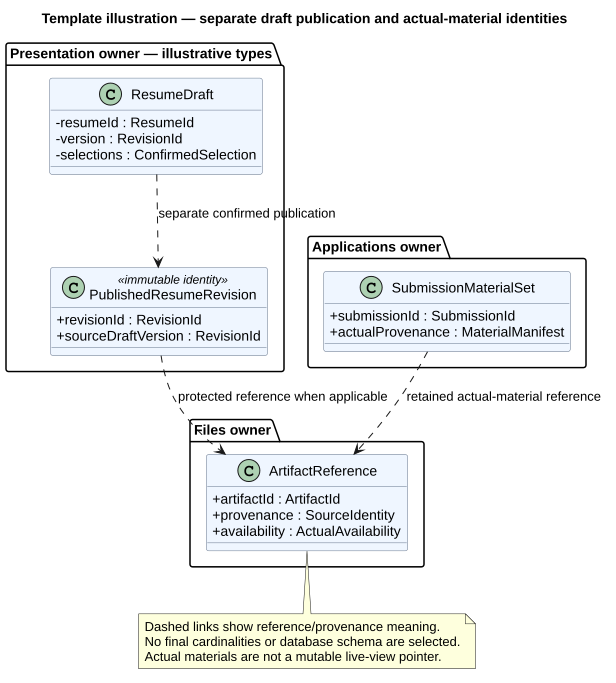

[Editable PlantUML](diagrams/component-data-class-template.puml) · [PNG](diagrams/component-data-class-template.png)

**ResumeDraft:** identified editable resume state and expected version, with controlled selections/overrides. A source edit alone does not mutate it. Applying selected source differences and saving a draft do not publish.

**PublishedResumeRevision:** an identified separately confirmed presentation. Publication binds the intended draft version and changes a live pointer under the chosen local consistency rule; later edits do not redefine that revision’s identity.

**ArtifactReference:** stable metadata/provenance pointing to confirmed usable bytes when the selected representation requires an artifact. The Files owner controls usability and protected-reference lifecycle; a public path or metadata row is not proof of availability or permission.

**SubmissionMaterialSet:** Applications-owned actual material/provenance, independent of a subsequent live revision. If bytes are shared physically, preserve the separate identity/reference and retention semantics. Do not infer that every publication is submitted or that a current live pointer identifies what was actually sent.

**Mapping questions to resolve in a real component:** selected immutable/snapshot representation, final class/value types, per-owner key/relationship constraints, stored manifest format, integrity checks, version compare, protected references and exact criterion links. These remain actual design work; the example is not a ready migration.

## 7. Review and completion

- [ ] Types and fields have explicit meaning, identity/equality, visibility, mutability, validation and source/contract mappings.
- [ ] Proposed cardinalities and physical choices are distinguished from accepted conceptual rules.
- [ ] Relationship ownership, aggregate/transaction boundaries, concurrency and protected frame agree with actual operations.
- [ ] Physical keys/types/constraints/indexes and normalization choices have justified access/integrity needs where selected.
- [ ] Source/draft/publication/actual material, language, availability and permission distinctions remain preserved.
- [ ] Serializers/jobs/projections do not expose private internals or carry permanent stale privilege.
- [ ] Deletion, migration, caching, reclamation and restoration preserve references/provenance and current authority.
- [ ] Class/ER diagrams and companion contracts/algorithms/scenarios describe the same candidate; pending choices are visible.
- [ ] Planned checks remain separate from actual review/run evidence and owner disposition.

Actual verification should include invalid construction, equality/identity, field round-trips, key/invariant enforcement, conflicting updates, protected-history/reference preservation, serialization privacy and migration/recovery consistency where applicable. A mock-only model test cannot prove actual database isolation, storage usability or recoverable keys.

## 8. Provenance and maintenance

FAU V08 component design includes computational data and class structures; architecture interfaces and dynamics provide the inputs. This template’s field set is a project convention, not a mandated university schema or a statement that every conceptual entity requires a class/table.

Keep the [complete package](README.md) together: operation contracts in [01](01-responsibilities-and-interface-realization.md), algorithms in [03](03-detailed-behavior-and-algorithms.md), failures/recovery in [04](04-technical-scenarios-and-failure-handling.md) and shared implementation constraints in [05](05-design-patterns-and-coding-constraints.md). Adjust links and replace illustrative diagram roles when copying. Record actual source/candidate changes without rewriting historical evidence as current.

[Component and Module Design](../README.md) · [Template diagram catalog](diagrams/README.md)

## 9. Data and class model package

**Reusable template illustrations, not an allocated schema or implemented model.** These views refine the selected publication example at different levels. Replace all example names, physical types, cardinalities and rules with actual sourced choices when copying. Keep conceptual relationships, logical records, physical constraints and runtime objects distinct. Artifact bytes, command-result identity storage, full authorization data and complete component fields are intentionally outside this selected excerpt and must be designed where applicable.

### 9.1 Class structure: visibility, types and operations

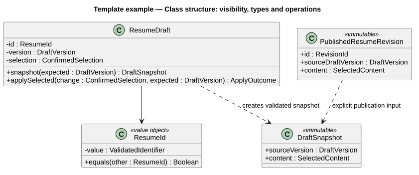

[Editable PlantUML](diagrams/model-classes.puml) · [PNG](diagrams/model-classes.png)

Proposed typed roles, not implemented signatures. Plus denotes public, minus private. Mutation remains owned and guarded; constructing a snapshot or revision does not itself authorize publication or update the live pointer.

### 9.2 ERD: selected persisted relationships

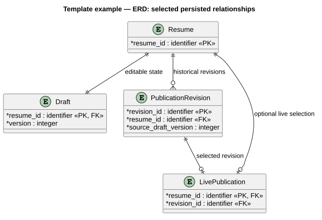

[Editable PlantUML](diagrams/model-erd.puml) · [PNG](diagrams/model-erd.png)

Illustrative crow-foot ERD. These proposed cardinalities are not source allocations: a real component must settle creation/trash/unpublished states. A live selection must refer to a revision belonging to the same resume; plain independent foreign keys would not enforce that invariant.

### 9.3 Logical model: identity and independent history

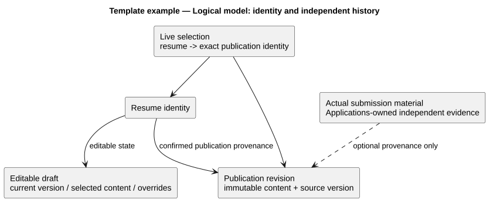

[Editable PlantUML](diagrams/model-logical.puml) · [PNG](diagrams/model-logical.png)

Logical record responsibilities, without engine types or indexes. Actual materials do not derive their retained content from a mutable live selection. An optional provenance reference does not transfer Applications ownership or permit cascade deletion.

### 9.4 Physical schema example: keys and candidate indexes

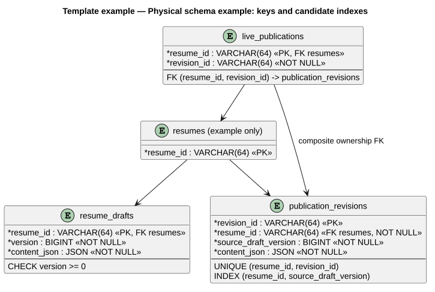

[Editable PlantUML](diagrams/model-physical.puml) · [PNG](diagrams/model-physical.png)

Non-executable candidate SQL-style schema, not a ready migration. VARCHAR(64), BIGINT and JSON are illustrative choices only; identity encoding/collation, engine/version support, content constraints, command-result storage and complete access patterns remain unresolved. Composite ownership FK prevents a live pointer selecting another resume’s revision. Historical source version is provenance, not an FK to the mutable draft version. Index usefulness and redundancy require actual workload evaluation; no delete cascade is selected.

### 9.5 Domain model: entities, values and aggregate candidates

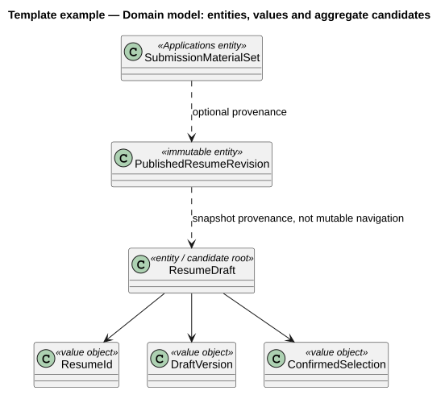

[Editable PlantUML](diagrams/model-domain.puml) · [PNG](diagrams/model-domain.png)

Selected conceptual excerpt, not the complete analysis model. DDD is optional. Entities have stable identity; value objects compare by validated value. Neither stereotypes nor association arrows allocate tables or a deployment unit.

### 9.6 Aggregate boundary: root, members and invariant

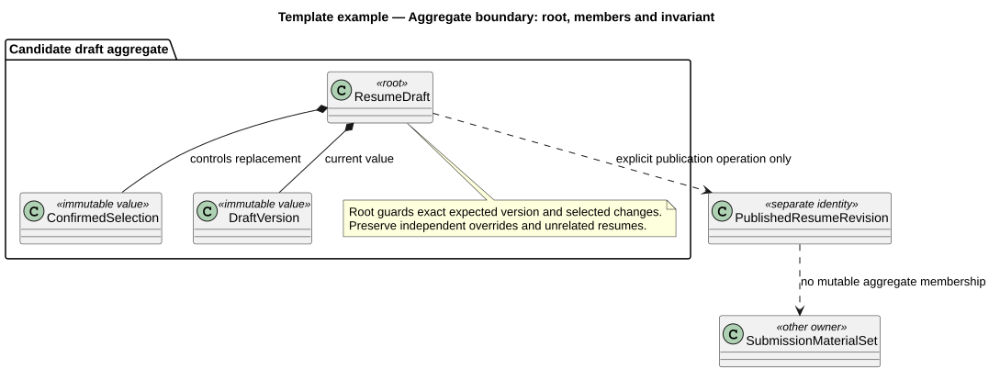

[Editable PlantUML](diagrams/model-aggregate.puml) · [PNG](diagrams/model-aggregate.png)

Composition here describes value containment in an in-memory candidate aggregate, not SQL cascade deletion. Publication revision/live-pointer/result consistency is an application persistence boundary requiring its own guarded transaction; it is not established by this aggregate picture. Applications history remains outside.

### 9.7 Relationship notation and multiplicity

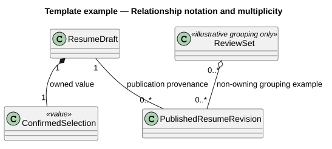

[Editable PlantUML](diagrams/model-multiplicity.puml) · [PNG](diagrams/model-multiplicity.png)

Filled diamond: exclusive value containment; plain line: association; hollow diamond: non-owning shared grouping, whose semantics must be stated. ReviewSet exists only to explain notation and is not a new product feature. None of these arrows instructs a database to cascade-delete revisions or actual history; cardinalities remain illustrative.

### 9.8 Object diagram: proposed sample instances

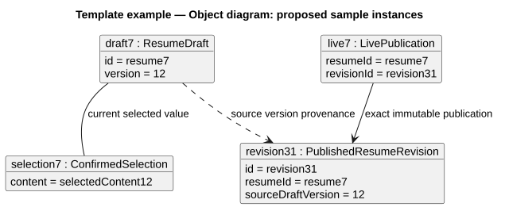

[Editable PlantUML](diagrams/model-objects.puml) · [PNG](diagrams/model-objects.png)

Invented identifiers show a post-commit example, not a runtime trace or serialized payload. Later draft changes must not redefine revision31. The object named live7 is a logical pointer record, not proof of a final domain class.

### 9.9 Inheritance hierarchy: justified alternative results

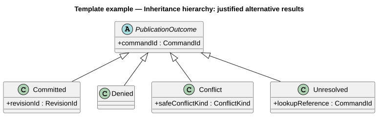

[Editable PlantUML](diagrams/model-inheritance.puml) · [PNG](diagrams/model-inheritance.png)

Optional outcome hierarchy, not a requirement for entity inheritance or one table per subtype. A discriminated result can be simpler. Unresolved describes coordinator knowledge after possible commit/observation loss; it must be reconciled rather than relabeled failure. Only permitted metadata is exposed.

### 9.10 Publication revision lifecycle and observation

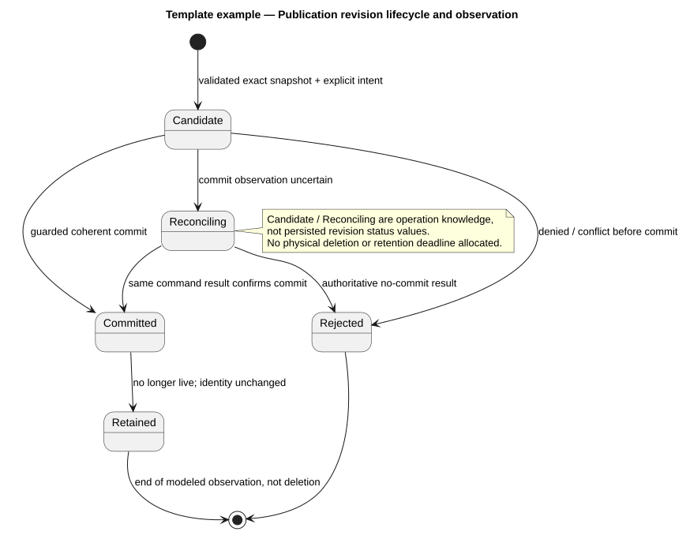

[Editable PlantUML](diagrams/model-lifecycle.puml) · [PNG](diagrams/model-lifecycle.png)

A mixed operation-and-entity lifecycle view with explicitly distinguished knowledge states: only a confirmed commit establishes a published revision. Retained does not select a retention duration or authorize reclamation. Live selection is separate from revision identity; exact source-defined lifecycle states belong in the copied component.

### 9.11 DTO versus entity versus value object mapping

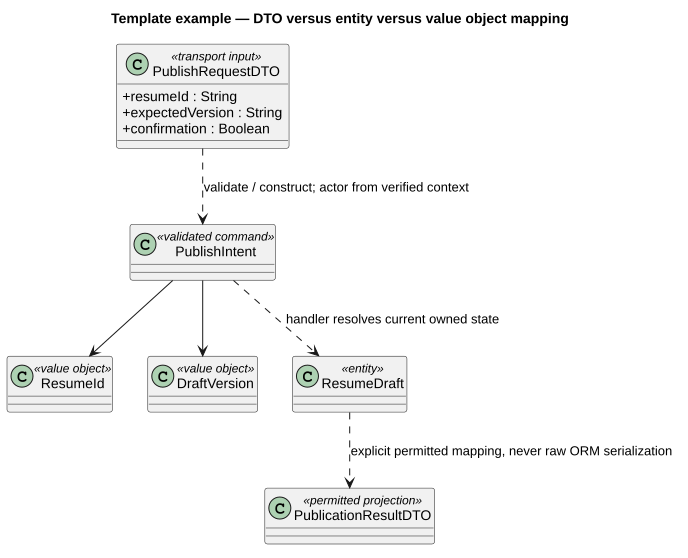

[Editable PlantUML](diagrams/model-dto-values.puml) · [PNG](diagrams/model-dto-values.png)

DTOs carry a boundary shape, entities carry identity/invariants, and values carry validated value semantics. A DTO is untrusted input until validated. The handler maps an actual authorized outcome into the result; no entity method should leak private fields or obtain authority from a request-supplied actor string.

### 9.12 Class-to-table mapping template

| Class / role | Proposed persistence mapping | Identity / conversion | Important limit |
| --- | --- | --- | --- |
| ResumeDraft | resume_drafts | ResumeId to resume_id; expected-version conditional update | Load/save via owner; do not expose mutable ORM model to another component |
| ConfirmedSelection | Illustrative validated content_json projection | Explicit round-trip of selected content and overrides | Value need not have its own table; nested fields and constraints still require definition |
| PublishedResumeRevision | publication_revisions | Stable revision_id; resume_id; source_draft_version; immutable content | Historical source version is provenance, not a foreign key to current mutable draft version |
| LivePublication logical role | live_publications | One selected revision per resume; composite ownership FK | A row does not necessarily require an independent domain entity class |
| ResumeId / DraftVersion | Scalar conversions in owned columns | Validate identity encoding and version bounds in mapper/domain | No automatic one-table-per-value-object mapping |
| SubmissionMaterialSet | Applications-owned mapping defined elsewhere | Opaque reference and independent actual-material identity | Not placed into this component's private tables or cascade tree |
| `{actual class}` | `{actual table/embedded/projection/no persistence}` | `{key, conversion, nullability and round-trip rule}` | `{transaction and lifecycle owner}` |

### 9.13 Data dictionary template and selected example fields

Types below describe the physical **example only**. Real key encoding, engine limits, collation, maximum content size and validated JSON structure must be sourced and selected before implementation; this table does not impose a new product limit.

| Field / logical meaning | Example type | Constraints / validation owner | Description / sensitivity |
| --- | --- | --- | --- |
| resumes.resume_id | VARCHAR(64) | PK; validated nonempty identifier; exact encoding/collation TBD | Stable resume identity; identifier possession grants no access |
| resume_drafts.resume_id | VARCHAR(64) | PK/FK to resumes; same encoding | Identifies owned current draft |
| resume_drafts.version | BIGINT | NOT NULL, nonnegative; checked increment/bounds and expected-version guard | Concurrency token, not wall-clock time |
| resume_drafts.content_json | JSON | NOT NULL; actual shape/field rules and privacy filtering required | Private selected content and overrides; no ordinary payload logging |
| publication_revisions.revision_id | VARCHAR(64) | PK; stable immutable identity; source encoding policy TBD | Exact confirmed presentation identity |
| publication_revisions.resume_id | VARCHAR(64) | NOT NULL/FK; composite UNIQUE with revision_id for ownership reference | Identifies owning resume |
| publication_revisions.source_draft_version | BIGINT | NOT NULL; validated snapshot provenance; nonnegative invariant | Historical version; does not track subsequent edits |
| publication_revisions.content_json | JSON | NOT NULL; validated snapshot; controlled immutability | Private confirmed content, not a live projection of draft |
| live_publications.resume_id / revision_id | VARCHAR(64) / VARCHAR(64) | PK resume_id; NOT NULL revision_id; composite FK to same-resume publication | Optional current selection; atomically coordinated with revision/result |
| `{actual field}` | `{concrete selected type, units/time semantics}` | `{nullability, bounds, uniqueness, default authority, owner}` | `{meaning, sensitivity, provenance}` |

### 9.14 Invariants and validation rules

| Invariant / rule | Proposed enforcement point | Verification needed / protected state |
| --- | --- | --- |
| Apply only selected confirmed changes; preserve overrides and other resumes | Owned draft method plus guarded persistence | Concurrent apply/version conflict and exact selected-field comparison |
| Publication binds intended draft version and explicit confirmation | Validated intent and coherent commit mechanism | Stale version, denied intent and source-edit non-publication checks |
| Live pointer selects revision of the same resume | Domain owner and composite ownership FK in physical example | Attempt mismatched resume/revision and concurrent pointer updates |
| Historical revision content/provenance is not redefined by later edits | Immutable model contract, controlled writer/mapper and persistence permissions | Read old revision after draft/source changes; no accidental overwrite |
| Actual submitted material remains independently protected | Applications owner plus Files reference protocol where used | Deletion/reference races, current-live changes and actual-history retrieval |
| Values validate meaning; DTOs do not supply permanent authority | Boundary validation, verified context and current owner admission | Invalid construction, serialization privacy, revocation/concurrency ordering |
| No automatic cascade deletion or assumed artifact usability | Explicit lifecycle policy and Files owner contract | Reference pinning before consumer commit; reclamation race and usable-byte checks |
| Repeated command resolves attributable prior result | Actual command identity/result mechanism; not shown in schema excerpt | Response loss and mismatched-input reuse; do not blindly publish twice |

Copying checklist: reconcile every view/table with companion [interface contracts](01-responsibilities-and-interface-realization.md), [algorithms](03-detailed-behavior-and-algorithms.md) and [failure scenarios](04-technical-scenarios-and-failure-handling.md). Extend the physical excerpt with complete command/result, privacy, key/reference and compatibility design as needed; do not execute it as a migration. Planned checks are not actual evidence. Rendering and link checks establish document consistency only.
