# Component Template — Detailed Behavior and Algorithms

**Status: reusable template only.** This file allocates no actual command, algorithm, runtime limit, technical choice or passing test. Copy into an identified component package, replace brace placeholders with sourced design, and explain justified omissions.

**Purpose:** specify how each public operation realizes its contract through ordered steps, decisions, state changes and collaborations. Preserve actual authority, protected state and external-effect boundaries. Contracts remain in record 01, types/invariants in record 02 and wider technical failure scenarios in record 04.

[Inputs](#1-behavior-identity-and-source-inputs) · [Steps](#2-operation-algorithm-record) · [Decisions](#3-branches-state-and-collaboration) · [Concurrency](#4-transactions-concurrency-and-resources) · [Repeats](#5-duplicates-retries-and-asynchronous-work) · [Example](#6-worked-example-separate-publication) · [Review](#7-verification-and-completion) · [Behavior package](#9-behavior-and-algorithm-visual-package)

## 1. Behavior identity and source inputs

| Field | Value to complete |
|---|---|
| Component and candidate | `{actual component/architecture identity and source/design revision}` |
| Public operation | `{exact provided-interface contract and implementation entry point from record 01}` |
| Analysis behavior | `{exact scenario/state/activity/rule/operation-contract locators and source status}` |
| Types/invariants | `{actual input/result/value/domain identities from record 02}` |
| Dependencies | `{required provider/adapter contracts, current capability and enabling conditions}` |
| Responsibility/status | `{actual owner, proposed/reviewed/accepted state and disposition source}` |

Use [analysis contracts](../../../03-system-analysis/05-business-rules-and-operation-contracts/10-domain-constraints-and-operation-contracts.md), [activities](../../../03-system-analysis/03-functional-and-process-analysis/08-control-flow-based-view.md), [state models](../../../03-system-analysis/04-behavioral-and-scenario-analysis/07-state-based-view.md) and [runtime design](../../01-software-architecture/03-process-view-concurrency-and-runtime-behavior.md). Design adds technical steps without silently changing required behavior or treating a family citation as exact criterion sufficiency.

## 2. Operation algorithm record

Repeat for each substantive command/query. Do not force persistence, mutation or background processing onto an operation that is only an authorized read.

### Operation intent and conditions

**Name/signature:** `{actual operation and types, linked to record 01}`.

**Intent:** `{one deliberate user/domain action and expected observable outcome}`.

**Inputs and initial state:** `{validated payload, actor/resource context, current lifecycle, expected revision and command identity where relevant}`.

**Preconditions and checks:** `{which assumptions are guaranteed by the caller and which must be checked by the owner at use}`.

**Protected frame:** `{unrelated records, grants, overrides, publication, history and external targets that must remain unchanged}`.

### Step record — repeat in execution order

**Step identity and responsible object:** `{stable local step reference; owning handler/domain policy/adapter}`.

**Input/state read:** `{exact data/version/capability and its freshness/authority source}`.

**Action or decision:** `{unambiguous transformation or branch guard; concrete type/method references when selected}`.

**Output/state write:** `{intended result and owned state; no change if read-only}`.

**Consistency boundary:** `{inside/outside transaction or claim; lock/version/uniqueness condition; remote call if any}`.

**Exception branch:** `{invalid/denied/conflict/unavailable/interrupted/partial/unknown result and next action}`.

**Evidence/observation:** `{what allows the algorithm to claim completion, failure-with-no-effect or uncertainty}`.

Use explicit conditional steps rather than phrases such as “handle errors” or “sync data.” Link detailed supporting algorithms when genuinely reusable; do not hide consequential behavior in constructors, getters, generic save hooks or observers.

### Result and termination

**Terminal outcomes:** `{actual contract outcomes, output projection and attributable operation reference}`.

**Postconditions and frame:** `{changed state and preserved state for each relevant outcome; partial/unknown effects not falsely declared rolled back}`.

**Termination/progress:** `{finite work, bounded batch/checkpoint, cancellation observation and pending continuation where applicable}`.

**Complexity/resource rationale:** `{data structures and growth behavior where material; measured versus estimated claims and unknown limits}`.

## 3. Branches state and collaboration

### Branch and state record

**Decision:** `{guard input and actual branch meaning}`.

**Alternatives:** `{normal, denied, stale, unavailable and exceptional outcomes that apply}`.

**Completeness:** `{why applicable conditions are covered and conflicting branches cannot both commit incompatible outcomes}`.

**State transition:** `{source subject/state, triggering event, current guard, actual effect and target observation; link analysis source}`.

Do not collapse business progress, operation result, artifact usability and external acceptance into one “success” state. For example, a Sprint period ending is not item acceptance; mail provider acceptance is not recipient receipt; a cancel request is not confirmed runner termination.

### Collaboration record

For each cross-owner/adapter call, identify exact public operation, validated identifiers, current authorization responsibilities, permitted projection, expected result classes and failure mapping. A caller may coordinate contracts, but cannot mutate another owner's tables or assume an identifier conveys access.

Use an activity diagram for branches and a sequence diagram when collaborator order/message boundaries matter. Diagrams must agree with the step records and public contracts; arrow order alone does not prove transaction atomicity or safe repetition.

## 4. Transactions concurrency and resources

**Local transaction record:** `{owned invariant and exact reads/writes, begin/commit boundary, uniqueness/lock/version checks and conflict handling}`.

**Concurrent operation record:** `{competing actor/job/action, expected versions, interleaving, valid winner/conflict result and protected state}`.

**Cross-owner coordination:** `{public contracts and attributable pending work; why chosen local coordination does not bypass ownership}`.

**External effect boundary:** `{provider/Git/executor/target request, reviewed intent and attempt identity, evidence and reconciliation; no network wait under long-held database locks}`.

**Resource record:** `{memory/storage/CPU/connection/workspace needs, admission/reservation ownership, batch bounds, cleanup and actual sourced limits or unresolved gate}`.

**Cancellation/checkpoint:** `{where request is observed, safe stop condition, completed/partial effect capture and continuation identity}`.

Local transactions protect selected local invariants only. They do not roll back sent mail, native Git refs, file bytes or target deployments automatically. Recheck current authority at consequential boundaries as required, while retaining evidence of effects that may already have occurred before access changed.

No thread count, lease duration, retry delay, quota or timeout is supplied by this template. Define such values from actual resource/quality decisions and verify their behavior later.

## 5. Duplicates retries and asynchronous work

### Duplicate and repeat policy

Bind command identity to actor/resource/action and intended input. Define same-intent result lookup and changed-intent rejection, permitted result disclosure and identity retention semantics. “Idempotent” must describe the actual operation/effect contract, not merely an HTTP verb or queue setting.

Distinguish a local/read failure known to be safe to repeat from an external mutation with uncertain effect. A response lost after local commit does not prove rollback. A provider timeout, expired worker lease or missing runner acknowledgment cannot justify blind consequential replay.

### Pending work and worker ownership

For asynchronous effects define atomic local state-plus-intent persistence, delivery/claim identity, current capability checks, duplicate delivery, lease/fencing, result observation and reconciliation. A local fencing token prevents stale local commits only if enforced; it does not stop an old network action or guarantee exactly-once remote effects.

Record confirmed/pending/partial/unknown outcomes honestly. Exhausted or unresolved work needs an actual intervention/reconciliation path. Backpressure/admission and cleanup must preserve quotas and protected references rather than mark data usable or reclaimed prematurely.

### Technical scenario links

Use [record 04](04-technical-scenarios-and-failure-handling.md) for process restart, lost response, runner/provider loss, partial cleanup and isolated recovery cases. This record owns the main algorithm and local branches; avoid maintaining two inconsistent retry or cancellation policies.

## 6. Worked example separate publication

**Illustration only — not an allocated implementation contract.** This example preserves the existing explicit source/apply/separate-publication policy. Actual persistence APIs, authorization serialization and concrete types remain implementation decisions.

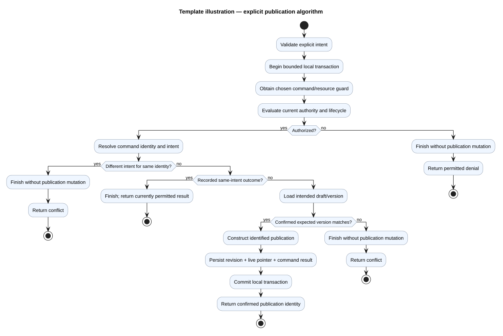

[Editable PlantUML](diagrams/component-publication-algorithm-template.puml) · [PNG](diagrams/component-publication-algorithm-template.png)

```text
publish(intent):
    validate intent shape and explicit confirmation
    begin bounded local transaction
    obtain the chosen command/resource coordination guard
    evaluate current publish authority and eligible lifecycle
    if denied:
        finish without publication mutation; return permitted denial
    resolve command identity bound to this actor/resource/intent
    if identity belongs to different intent:
        finish without publication mutation; return conflict
    if same intent has a recorded outcome:
        finish; return its currently permitted result projection
    load the intended draft under the chosen version/coordination rule
    if draft version differs from confirmed expected version:
        finish without publication mutation; return conflict
    construct identified publication from the confirmed intended draft
    persist revision, live-pointer change and attributable command result
    commit local transaction
    return confirmed publication identity and permitted result
```

**Preserved frame:** independent overrides remain as selected; sharing-link controls and actual submitted material records are not implicitly changed. A profile save cannot invoke publication merely because a source changed.

**Lost response:** a client repeats the same identity and obtains a permitted recorded result, rather than blindly publishing again. Denial and historical result disclosure are still governed by current policy. Exact ordering/locking must address concurrent duplicate commands and grant/version changes in the actual implementation.

**External work:** PDF rendering, email send and deployment are not hidden in this example. If the accepted publication contract requires background work, specify whether publication is pending or confirmed and atomically record the needed intent; do not claim artifact availability before actual confirmation.

**Focused checks:** stale draft, denied actor, duplicate same/different intent, two simultaneous publications, interrupted commit/response and untouched link/history state. No test result is populated here.

## 7. Verification and completion

- [ ] Every substantive operation maps to the actual public contract, types/invariants and exact source behavior.
- [ ] Ordered steps identify responsible objects, inputs, state changes, guards and attributable outcomes.
- [ ] Applicable branches and lifecycle/result dimensions remain explicit and consistent across text/diagrams.
- [ ] Transaction/version/authority/uniqueness boundaries protect the invariant under defined competing operations.
- [ ] External effects, pending work, duplicate/retry/cancel behavior and unknown-result reconciliation are specified honestly.
- [ ] Resource admission, finite/batched progress, checkpoint and cleanup behavior are justified where applicable.
- [ ] Protected frame is verified alongside the intended effect, including denied/conflict/interruption paths.
- [ ] Companion contracts/data/scenarios and diagrams describe the same candidate; pending values/choices have owners/gates.
- [ ] Planned verification is separated from actual candidate/environment/results and owner disposition.

Actual verification combines deterministic domain/handler checks, real persistence concurrency/transaction checks and controlled external integration where appropriate. Mocks cannot prove Git ref semantics, provider idempotency, executor isolation or usable restoration. Record limitations and do not mark review complete because the diagram renders.

## 8. Provenance and package maintenance

FAU V08 component design includes fine-grained dynamics, computational structures, coding constraints and technical scenarios; FAU V07 connects component interactions/processes to architecture. This operation/step format is a project adaptation, not mandated pseudocode or an accepted signature convention.

Keep [responsibilities/contracts](01-responsibilities-and-interface-realization.md), [data/classes](02-data-model-and-class-structure.md), [technical scenarios](04-technical-scenarios-and-failure-handling.md) and [patterns/coding constraints](05-design-patterns-and-coding-constraints.md) in the same copied component package. Update the example/diagram to actual roles and source policy when used; do not allocate IDs or adopt numerical defaults merely by copying.

[Template index](README.md) · [Component and Module Design](../README.md) · [Template diagram catalog](diagrams/README.md)

## 9. Behavior and algorithm visual package

**Template examples only.** These views elaborate the publication pseudocode in section 6; they allocate no actual signature, lock, timeout, retry budget or executed verification. Replace roles and source/criterion locators in a copied package. Distinguish business state, durable local result and coordinator knowledge. PDF generation, provider sends, Git mutation and deployment are not implicit steps.

### 9.1 Publication collaboration: alt, opt and loop

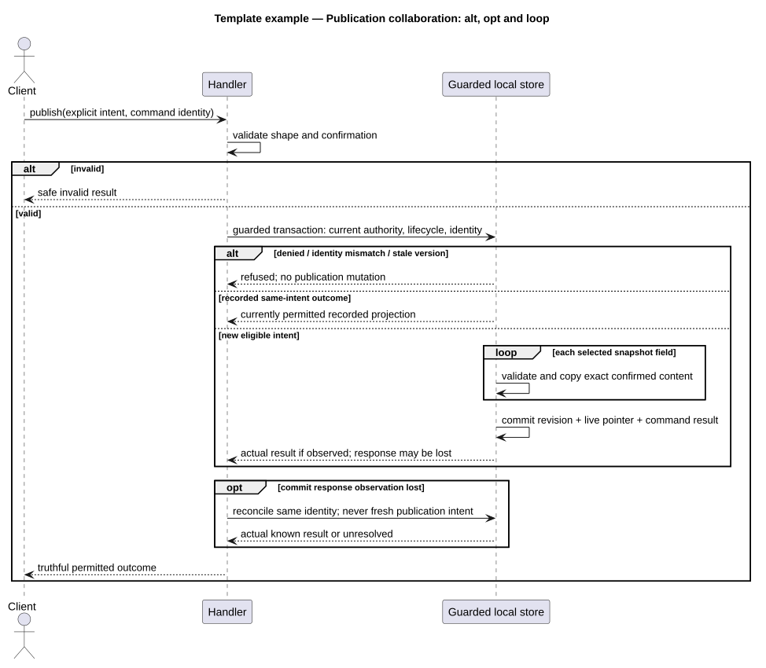

[Editable PlantUML](diagrams/behavior-sequence.puml) · [PNG](diagrams/behavior-sequence.png)

The loop covers local snapshot processing, not automatic retries. The optional observation-loss path resolves the same identity. A reconciliation failure stays unresolved; it is not converted to rollback or a new command. Current authority and expected version are checked inside the actual guarded admission mechanism.

### 9.2 Activity: guarded work and post-commit fork/join

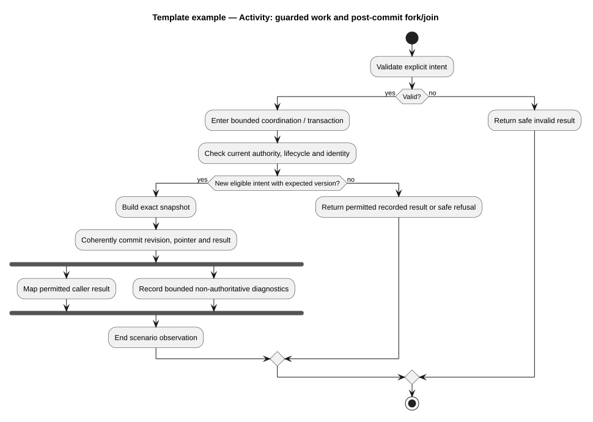

[Editable PlantUML](diagrams/behavior-activity.puml) · [PNG](diagrams/behavior-activity.png)

Fork/join illustrates independent post-commit observation activities, not a mandatory parallel runtime or an HTTP response blocked on telemetry. Diagnostics cannot redefine the committed outcome; durable business audit requirements must be handled at their actual consistency boundary.

### 9.3 Step-by-step publication algorithm

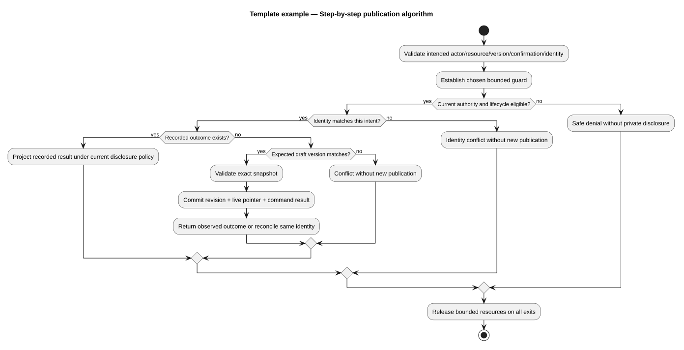

[Editable PlantUML](diagrams/behavior-flowchart.puml) · [PNG](diagrams/behavior-flowchart.png)

Compact flowchart notation rendered using UML activity shapes. A real implementation must specify guard acquisition failure, rollback/commit observation and result disclosure; use the error flow and companion technical scenarios for those paths.

### 9.4 Event-driven command knowledge states

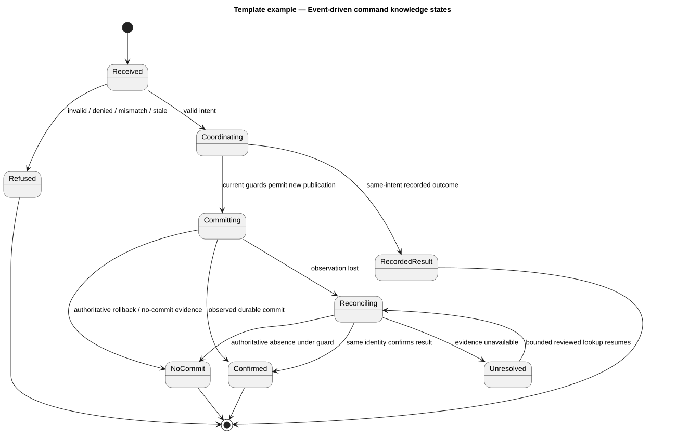

[Editable PlantUML](diagrams/behavior-state.puml) · [PNG](diagrams/behavior-state.png)

Proposed command/coordinator knowledge, not entity lifecycle enums or an adopted retry policy. An absent lookup outside a serialized identity/commit protocol cannot prove no commit; no-commit requires authoritative guarded evidence. Refused paths may also be discovered during coordination; the full branch contract remains authoritative.

### 9.5 Branching decision tree with precedence

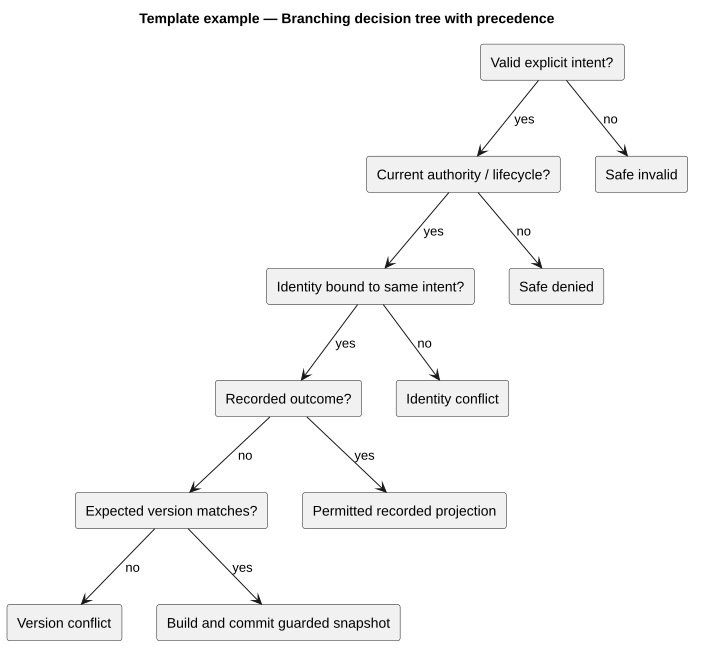

[Editable PlantUML](diagrams/behavior-decision-tree.puml) · [PNG](diagrams/behavior-decision-tree.png)

Evaluate in the shown order: current authority precedes historical outcome disclosure, and recorded same-intent results are resolved before comparing today’s draft version. All decisions after validation require the actual chosen coordination mechanism.

### 9.6 Communication diagram: numbered object messages

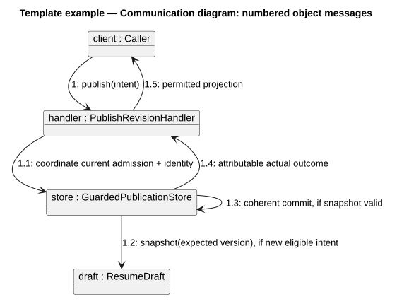

[Editable PlantUML](diagrams/behavior-communication.puml) · [PNG](diagrams/behavior-communication.png)

Numbered UML communication-style view of the successful collaboration. The sequence and decision table define alternate paths; these arrows are object messages rather than source dependency direction or network topology.

### 9.7 Optional timing: commit and lost response

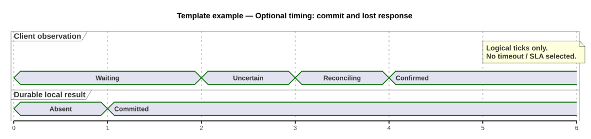

[Editable PlantUML](diagrams/behavior-timing.puml) · [PNG](diagrams/behavior-timing.png)

Synthetic logical ticks illustrate durable commit preceding client certainty. Loss of response does not reverse the result. Actual timing, timeout, admission waits and backoff require selected mechanisms and evidence; this chart sets no numerical runtime policy.

### 9.8 Algorithm data structures and identities

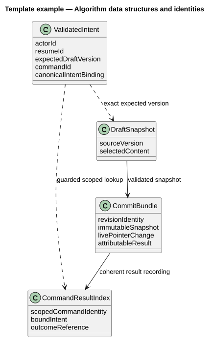

[Editable PlantUML](diagrams/behavior-structures.puml) · [PNG](diagrams/behavior-structures.png)

Logical structures, not a selected hash map, physical schema or adopted hashing algorithm. Define command scope, canonical intent comparison, uniqueness, retention and collision handling in actual design. Do not log the private snapshot or expose the index as an authorization bypass.

### 9.9 Error and exception handling

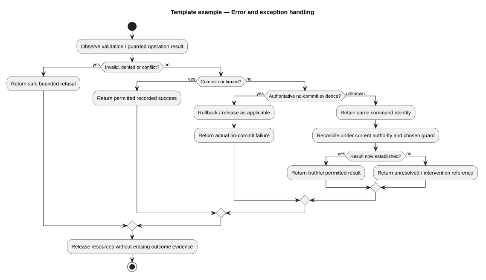

[Editable PlantUML](diagrams/behavior-errors.puml) · [PNG](diagrams/behavior-errors.png)

Exception type alone may not prove rollback. Once commit may have happened, a diagnostics or response error must not report “nothing changed.” Reconciliation is bounded by actual capabilities; this diagram prescribes no automatic retry count or endless polling.

### 9.10 Optional concurrency: guarded competing publications

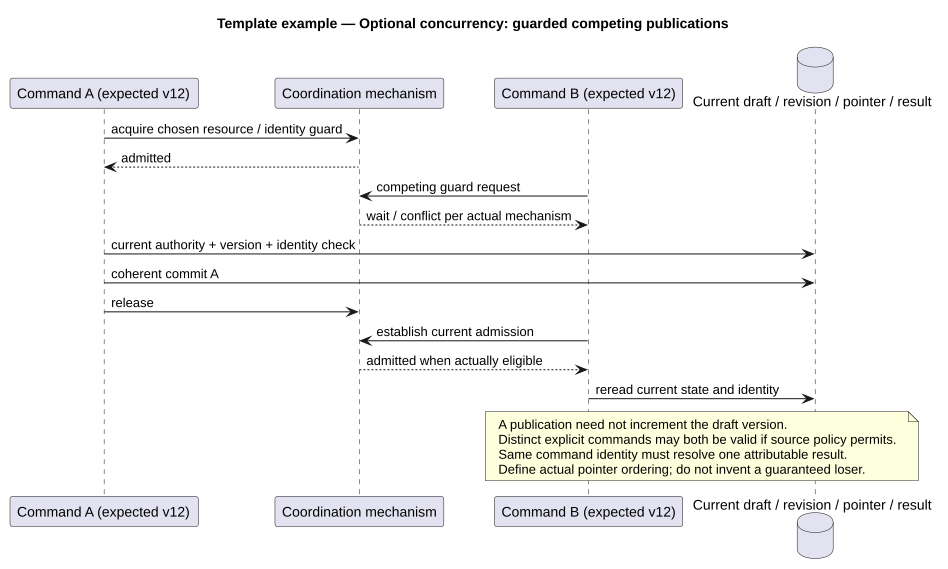

[Editable PlantUML](diagrams/behavior-concurrency.puml) · [PNG](diagrams/behavior-concurrency.png)

Illustrative serialization, not selected lock APIs or a claim that all publication races return conflict. Guard authority revocation as well as version/identity, use consistent acquisition order, and avoid network work inside local transactions. Local guards cannot fence remote effects.

### 9.11 Core algorithm and interruption pseudocode

The main algorithm remains authoritative in [section 6](#6-worked-example-separate-publication). This supporting pseudocode makes uncertainty handling explicit. `lookupUnderGuard` is a required semantic contract, not an implemented helper; it must serialize against in-flight same-identity commits before asserting no result.

```text
resolveObservationLoss(intent):
    preserve the original scoped command identity and bound intent
    establish current result-disclosure authority
    if disclosure is denied: return safe denial without private details
    observed = lookupUnderGuard(intent.identity, intent.binding)
    if identity is bound to different intent: return identity conflict
    if a recorded outcome is confirmed: return permitted projection(outcome)
    if authoritative no-commit evidence exists:
        return known no-commit outcome
        # Re-execution, if allowed, re-enters the main guarded algorithm
        # using the same identity and rechecks all current preconditions.
    return unresolved(original identity, safe reconciliation reference)
```

### 9.12 Decision table — first matching row wins

`—` means not evaluated for that row. “Eligible” includes current authority and lifecycle; evaluation and result disclosure must use the actual chosen admission ordering.

| Valid intent | Eligible | Identity mismatch | Recorded same-intent outcome | Expected version matches | Action |
| --- | --- | --- | --- | --- | --- |
| No | — | — | — | — | Safe invalid; no publication mutation |
| Yes | No | — | — | — | Safe denied; do not disclose private prior result |
| Yes | Yes | Yes | — | — | Identity conflict; no new publication |
| Yes | Yes | No | Yes | — | Return currently permitted recorded outcome |
| Yes | Yes | No | No | No | Version conflict; no new publication |
| Yes | Yes | No | No | Yes | Validate snapshot and attempt coherent guarded commit; report actual result |

### 9.13 Algorithm trace — synthetic example

Sample: resume7, draft version 12, command17, explicit publish confirmation and an eligible actor. Identities are invented. This trace illustrates a possible successful commit with lost response, not an executed test.

| Step | Input / observation | Action | Result / protected frame |
| --- | --- | --- | --- |
| 1 | Valid command17, expected version 12 | Validate and establish guarded current admission | No publication yet |
| 2 | No prior bound result; current version 12 | Validate exact snapshot | Overrides remain as selected; unrelated resumes unchanged |
| 3 | All current guards satisfied | Commit revision31, live pointer and command17 result coherently | Exact publication established; link controls and actual materials unchanged |
| 4 | Response lost after commit | Preserve command17; classify observation as uncertain | Do not infer rollback or issue command18 |
| 5 | Caller repeats command17 with same binding; still permitted | Look up guarded recorded outcome | Return revision31; no second revision created |
| 6 | Caller instead changes input under command17 | Reject mismatched binding | Existing revision/result and protected history unchanged |

### 9.14 Complexity and resource analysis

Let `s` be the number of visited selected fields, `b` the serialized snapshot size and `n` the relevant indexed record count. Costs below are analytical examples, not measured latency or capacity. Database plan, isolation, contention, storage I/O, indexing and actual comparison rules can dominate. Copying must replace assumptions with selected structures.

| Operation | Best / worst time under stated assumptions | Extra space | Qualification |
| --- | --- | --- | --- |
| Validate/copy exact selected snapshot | O(s + b) / O(s + b) for full validation/copy | O(b) materialized snapshot | Early invalid input can exit sooner; no accepted maximum size implied |
| Scoped command lookup using balanced index | O(log n) / O(log n) index comparisons | Engine-dependent; bounded application result | Assumes suitable index; I/O, locking and intent-binding comparison additional |
| Compare full canonical intent binding | O(b) / O(b) when scanning full binding | O(b) if materialized; representation-dependent | Not assumed O(1); collision-safe exact binding needs design |
| Guarded fixed-record commit | Fixed logical write count; illustrative O(log n + b) index/serialization work | O(b) app snapshot plus engine state | Not a wall-clock bound; actual indexes and durability matter |
| Lock/guard admission | No contention: mechanism overhead; worst wait unspecified | Queue/connection usage mechanism-dependent | Requires finite configured admission/timeout policy before implementation |
| Reconciliation attempt | One guarded lookup plus result mapping; repeated total unspecified | Bounded per-attempt result | Define actual progress/budget; no endless loop or guessed retry count |

### 9.15 Algorithm alternatives and trade-offs

| Alternative | Benefit | Trade-off / condition | Current template position |
| --- | --- | --- | --- |
| Optimistic version compare + atomic command uniqueness | Short guarded writes and explicit conflicts | Must coordinate authority ordering and coherent result/pointer writes; actual retry/conflict semantics required | Candidate mechanism, not selected implementation |
| Pessimistic scoped row/resource locking | Can serialize competing owned mutations clearly | Contention, lock order, timeouts/deadlocks and current authority coordination need design | Candidate mechanism, no chosen lock product/API |
| Snapshot before guarded commit with version recheck | May reduce time spent holding guard | Validate exact snapshot provenance again; stale snapshot must not commit | Evaluate only with protected-frame and memory analysis |
| Durable asynchronous continuation | Supports genuinely required long work | Pending state, intent dispatch, claims, uncertainty and user-visible semantics add complexity | Not implicit publication behavior; use only if sourced need exists |
| Unguarded read-then-write / blind retry | Superficially simple | Can lose updates, bypass current authority or duplicate publication/effects | Unsuitable where it violates stated contracts |

When copying, reconcile all branches with [contracts](01-responsibilities-and-interface-realization.md), [types/invariants](02-data-model-and-class-structure.md) and [technical scenarios](04-technical-scenarios-and-failure-handling.md). Specify actual acquisition order, transaction APIs, admission budgets, command identity retention and result evidence. Planned checks must exercise normal, denied, stale, duplicate/mismatched identity, interruption and concurrent paths plus protected state. Diagram rendering and link validation establish document consistency only.
