# Component Template — Technical Scenarios and Failure Handling

**Status: reusable template only.** Copy into an identified component package and replace brace placeholders with sourced design. No real scenario ID, operational authority, retry limit, recovery target or passing test is allocated here.

**Purpose:** define technical interactions and failure responses that support the component’s public behavior: initialization, configuration, transaction/dispatch interruption, cancellation, reconciliation, shutdown and recovery. Main operation algorithms remain in record 03; this record explains the surrounding technical conditions and exceptional paths.

[Scope](#1-scenario-scope-and-source-authority) · [Record](#2-technical-scenario-record) · [Classification](#3-failure-classification-and-allowed-responses) · [Lifecycle](#4-runtime-lifecycle-and-dependency-scenarios) · [Recovery](#5-reconciliation-retry-and-recovery) · [Example](#6-worked-example-lost-send-response) · [Review](#7-verification-and-completion) · [Failure package](#9-failure-and-resilience-visual-package)

## 1. Scenario scope and source authority

| Field | Value to complete |
|---|---|
| Component and candidate | `{actual component/architecture identity and source/design revision}` |
| Operation or technical responsibility | `{public contract/algorithm or initialization/shutdown/maintenance responsibility}` |
| Source behavior | `{exact requirement/criterion, analysis scenario/state/operation/interface locators and status}` |
| Dependencies | `{provider, persistence, scheduler/worker, storage, Git, executor/target contracts as applicable}` |
| Authority and scope | `{actor/operator, permitted environment/data/effects and existing enabling conditions}` |
| Owner and decision status | `{actual owner, review/acceptance record or genuinely unresolved condition}` |

Use the [analysis scenario view](../../../03-system-analysis/04-behavioral-and-scenario-analysis/06-scenario-based-view.md), [operation contracts](../../../03-system-analysis/05-business-rules-and-operation-contracts/10-domain-constraints-and-operation-contracts.md), [interface analysis](../../../03-system-analysis/06-interfaces-security-and-quality-analysis/12-interfaces-and-external-interactions.md), [runtime design](../../01-software-architecture/03-process-view-concurrency-and-runtime-behavior.md) and [operating recovery](../../06-design-quality-and-security-analysis/03-operations-backup-recovery-and-resilience.md).

Technical paths refine required behavior; they cannot silently add a permissive fallback, change source policy or claim full criterion coverage from a scenario title alone. Mark inapplicable categories with rationale rather than invent every possible failure for every operation.

## 2. Technical scenario record

Repeat for each substantive technical path. Allocate actual IDs under the adopted convention only after identifying the component and source relationships.

### Identity and setup

**Scenario:** `{actual identity/title and responsibility}`.

**Trigger and source:** `{request/event/process condition; source actor/facility; exact point in the operation}`.

**Initial state:** `{identified candidate, data/resource/attempt/version, actual grants/capability, claimed job and applicable configuration}`.

**Preconditions versus checks:** `{what setup actually guarantees and what the operation must verify at use}`.

**Fault/change introduced:** `{dependency failure, configuration absence, stale version, concurrent change, process loss or uncertain external observation}`.

**Permitted scope:** `{controlled environment and allowed effects; source authorization if execution/testing is later performed}`.

### Interaction steps — repeat in order

**Actor/object:** `{actual handler, domain policy, adapter, worker, operator or external facility}`.

**Action/message:** `{exact contract call/state read/write and identity/version carried}`.

**Observation:** `{actual evidence available at this step; distinguish local records from provider truth}`.

**Decision/branch:** `{guard, possible outcomes and responsible owner}`.

**Result/protected frame:** `{allowed change, response and unchanged/private state; partial/unknown effects stated honestly}`.

### Outcome and follow-up

**Classification:** `{denied/invalid/conflict/unavailable/pending/confirmed no-effect failure/partial/unknown/confirmed completion as applicable}`.

**Retry/cancel/reconcile:** `{permitted next action, same/new operation identity, authority/capability rechecks and evidence required}`.

**Recovery/compensation:** `{actual owned scope, explicit authorization and irreversible limits; not an assumed universal undo}`.

**User/operator feedback:** `{truthful state, permitted diagnostic reference, retained input and action that will not create hidden repeated effects}`.

**Diagnostics and privacy:** `{bounded IDs/timing/category and redaction; no secret/private-content dump}`.

**Planned verification:** `{initial setup, fault injection point, expected outcome/protected-state comparison, method and dependency limits}`.

**Actual evidence/disposition:** `{unperformed until a real candidate/environment/method/result/reviewer is recorded}`.

## 3. Failure classification and allowed responses

### Invalid denied or stale

Invalid input and denied authority must not trigger the prohibited mutation or leak unrelated private existence/content. A stale revision produces the operation-specific conflict/compare/reload route, not silent overwriting or automatic acceptance of new content. Record current source policy rather than treating every error as retryable.

### Dependency unavailable or work pending

A dependency may be unavailable before a consequential operation was dispatched. Distinguish evidence of no dispatch from mere absence of a response/result. Durable pending work remains attributable; queue acknowledgment or a running process does not establish business completion. Avoid an authentication/access fallback when mail/provider facilities are unavailable.

### Confirmed local failure without external effect

Claim unchanged local state only when the actual transaction/operation evidence supports it. A local rollback can protect its own writes; it cannot prove an external send/ref update/runner action did not occur. A retry policy needs the operation’s identity/invariant and the actual effect boundary.

### Partial or unknown effect

Partial means known effects are incomplete; unknown means available evidence cannot establish the relevant effect. Preserve these distinctions in the attempt record, interface mapping and UI. A timeout, lost acknowledgment, expired lease or missing database result cannot become “safe failure” merely because that simplifies retries.

### Confirmed completion versus user goal

Keep subject-specific meaning: provider acceptance is not receipt, runner completion is not deployment authority, cancellation intent is not termination, artifact metadata is not confirmed usable content, and recovery success requires usable consistent state/current authority rather than a completed copy command.

## 4. Runtime lifecycle and dependency scenarios

### Initialization and configuration

Specify required configuration/key names without secret values, capability checks, compatibility and readiness conditions. If a required facility is absent, fail/degrade only as the source contract allows and expose bounded status. A successful process boot cannot claim working mail delivery, scheduler progress or execution isolation.

### Transaction commit and response loss

Cover interruption before commit, after possible commit and before/after response delivery. Resolve a stable command identity and current permitted result before repeating. Do not infer rollback from a lost HTTP response. Map conflict/authority changes to the exact current operation, preserving protected state.

### Pending dispatch and worker ownership

Cover committed intent before dispatch, duplicate deliveries, worker claim/lease changes, stale worker completion and restart. Reconstruct current authority/capability; fence local result writes against obsolete claims. An expired local lease does not terminate a network action already in flight.

### Provider Git storage and executor failures

Use the actual adapter contract and observable identity. Provider/target timeout requires reconciliation where effect is uncertain. Native Git ref failure/success needs Git-native evidence. Artifact interruption/replacement must preserve usable prior references and quota accounting. Executor/stop/cleanup claims require actual facility results and enabling evidence; no permissive fallback into the web process is allowed.

### Shutdown cancellation and cleanup

Specify admission pause, graceful drain/checkpoint, request-versus-confirmed-stop, completed/partial effects and resource release. Completion may win a cancellation race. Do not erase known terminal evidence to make the request appear successful. Cleanup failure remains visible; logical retirement does not prove reclaimed bytes or removed secrets.

### Restart and isolated restoration

Resume durable work through the same identity/authority/reconciliation rules. Restoration must preserve data/artifact/repository/key relationships and reassess current permissions. Do not automatically replay restored sends/deployments or reactivate revoked grants. Identify the actual shared recovery procedure and its limits instead of duplicating a competing policy here.

## 5. Reconciliation retry and recovery

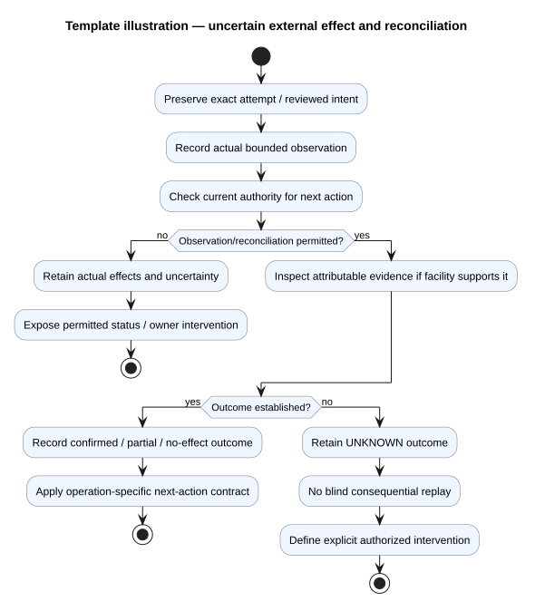

[Editable PlantUML](diagrams/component-failure-reconciliation-template.puml) · [PNG](diagrams/component-failure-reconciliation-template.png)

The diagram is a generic decision aid. Actual operation/facility contracts determine available evidence, permitted actions and terminal outcomes; its branches do not authorize a live retry or state update.

1. Preserve command/attempt identity, reviewed intent and bounded observations. Record what is known without overwriting partial/unknown effects.
2. Recheck current capability/authority and whether the proposed observation or mutation is allowed. Changed access does not erase effects that may already have happened.
3. Observe the same attributable external attempt where actual facilities permit. Do not query unrelated private state or claim that a provider offers a reconciliation API before verification.
4. Record evidence-supported completion, partial outcome or confirmed no-effect. If evidence is insufficient, keep the uncertainty visible and define bounded intervention rather than infer permission to repeat.
5. Repeat only when the actual operation contract, same/new identity rules and external idempotency/no-effect evidence support it. A compensation is a separate authorized operation with its own failure/uncertainty semantics.

Numeric delays, retention, retry limits, deadlines, recovery targets and escalation schedules must come from actual justified decisions. The template supplies none. State who owns unresolved work and its next gate; elapsed time is not approval or proof of no effect.

## 6. Worked example lost send response

**Illustration only — no allocated case, actual provider capability or executed test.**

**Initial intent:** Communication has an explicitly reviewed account/recipient/content/attachment set and stable send-attempt identity. Relevant current send capability and operating prerequisites must actually hold before dispatch.

**Failure point:** the adapter may have sent the request, but the response is lost before attributable provider acceptance is recorded. The worker/queue may later redeliver the same work item.

**Required response:** record an unknown/pending effect for that same attempt rather than label it safe failure. Preserve reviewed intent and restricted diagnostic identity. Do not automatically resend because the response was absent or the lease expired.

**Reconciliation:** use actual authorized provider evidence and supported correlation semantics if available. If those cannot establish the effect, retain uncertainty and an explicit owner/user intervention path. Do not invent a provider lookup/idempotency guarantee or classify elapsed time as no delivery.

**Protected frame:** unrelated correspondence, application progress/actual submission records, credentials and private attachments remain protected. Provider acceptance alone does not establish recipient receipt or actual application submission.

**Verification plan:** interrupt at the selected dispatch/response boundary, redeliver the same attempt and compare attributable state with provider evidence where authorized. Verify the absence of blind resend, truthful UI, permitted diagnostics and current access handling. This is a plan, not a passing result.

## 7. Verification and completion

- [ ] Scenario identity, candidate, exact source and actual owner/status are explicit.
- [ ] Setup separates assumed conditions from current operation checks and permitted fault/effect scope.
- [ ] Ordered interactions identify actual collaborators, evidence and state/authority boundaries.
- [ ] Denied/stale/unavailable/partial/unknown and subject-specific completion meanings are not collapsed.
- [ ] Repeat, cancellation, compensation and recovery have explicit authorization, identity and evidence requirements.
- [ ] Current authority, historical materials, usable artifacts, protected references and unrelated resources remain preserved where applicable.
- [ ] Diagnostics/UI truthfully represent the outcome without exposing secrets or hidden repeated actions.
- [ ] Contracts, data, main algorithms and diagrams agree; unresolved values/facilities have explicit owners/gates.
- [ ] Planned cases remain distinct from actual environment/method/results, limitations and reviewer disposition.

Actual verification may combine deterministic adapter/handler fault cases, real persistence/claim/concurrency checks and controlled external facility observation. Mocks cannot establish provider acceptance, Git ref state, runner termination/isolation, physical cleanup or usable recovery. Record what the selected method can and cannot prove.

## 8. Package maintenance and provenance

FAU V08 component models include technical scenarios such as initialization and transaction handling; FAU V07 runtime/interaction modeling relates those scenarios to components/processes. This record structure is a project adaptation, not a mandated incident protocol or proof that every theoretical failure must be simulated.

Keep [responsibilities/contracts](01-responsibilities-and-interface-realization.md), [data/classes](02-data-model-and-class-structure.md), [main algorithms](03-detailed-behavior-and-algorithms.md) and [patterns/constraints](05-design-patterns-and-coding-constraints.md) together. Update relative links and generic diagram roles when copying. Use shared [review/handoff](../../06-design-quality-and-security-analysis/05-design-review-traceability-and-handoff.md) for actual findings and [evolution guidance](../../02-detailed-and-object-oriented-design/05-design-evolution-refactoring-and-technical-debt.md) for consequential changes.

No live failure injection, provider send, executor action, restore, migration or baseline acceptance is performed by this template update.

[Template index](README.md) · [Component and Module Design](../README.md) · [Template diagram catalog](diagrams/README.md)

## 9. Failure and resilience visual package

**Reusable template examples only.** Replace roles and source/criterion locators in a copied component. No actual fault, incident, error-code allocation, retry delay/budget, circuit-breaker threshold, capacity, recovery target or passing test is established. Optional patterns are candidates to justify, not mandatory deployed controls. Local command uncertainty and remote-effect uncertainty require their respective actual evidence.

### 9.1 Happy and failure paths for one external attempt

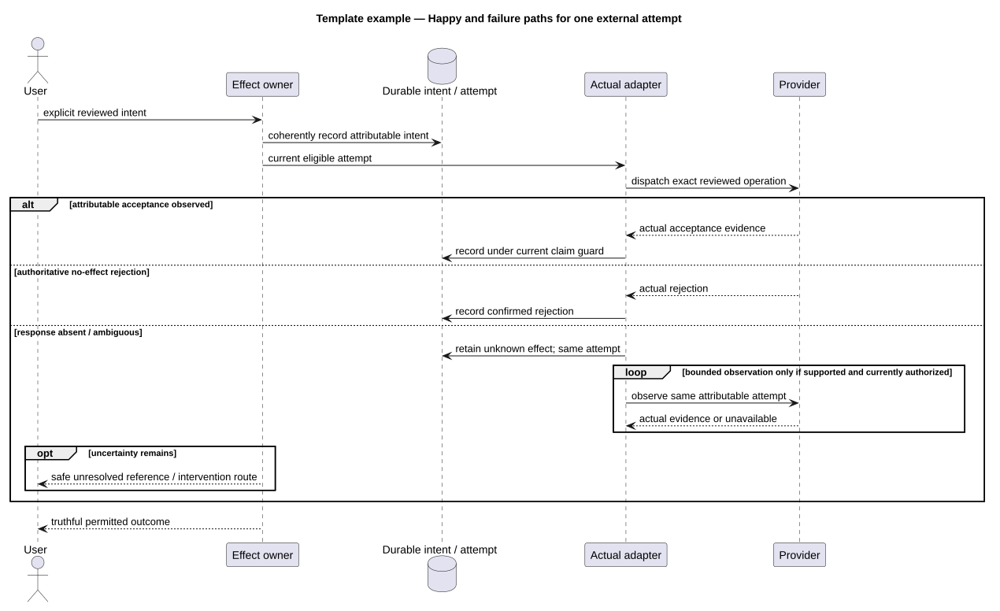

[Editable PlantUML](diagrams/failure-sequence.puml) · [PNG](diagrams/failure-sequence.png)

The loop is conditional observation, not blind resend or a claim that the provider has a lookup API. Provider acceptance is not recipient receipt or actual application submission. No numeric retry budget is selected.

### 9.2 Failure classification and safe next action

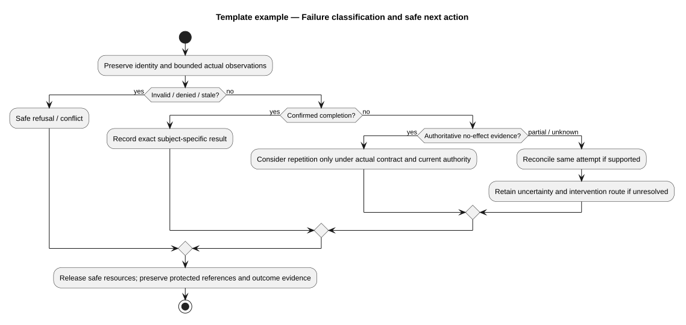

[Editable PlantUML](diagrams/failure-error-flow.puml) · [PNG](diagrams/failure-error-flow.png)

Exception categories guide response; they do not establish whether an effect occurred. Known partial effects must be preserved separately from unknown portions. A refusal cannot be used to erase an earlier external effect.

### 9.3 Proposed error vocabulary hierarchy

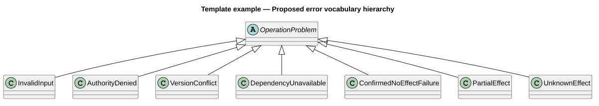

[Editable PlantUML](diagrams/failure-exception-types.puml) · [PNG](diagrams/failure-exception-types.png)

Illustrative result/error types, not implemented exception classes. Pending and uncertainty can be normal typed outcomes rather than thrown exceptions. Do not classify a timeout as ConfirmedNoEffectFailure without authoritative evidence.

### 9.4 Conditional retry and backoff timeline

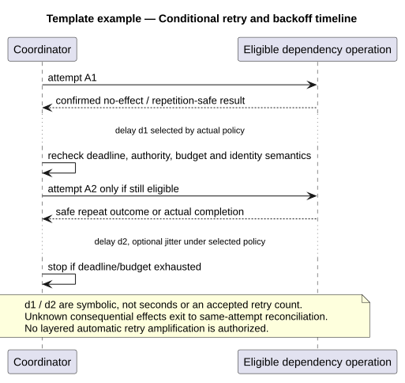

[Editable PlantUML](diagrams/failure-retry-backoff.puml) · [PNG](diagrams/failure-retry-backoff.png)

Example attempts do not select a two-attempt policy. Evaluate capped backoff/jitter against actual operation semantics and one overall budget. A Retry-After hint may be used only when actually supported and compatible with the remaining deadline; it never proves effect absence.

### 9.5 Optional circuit breaker state machine

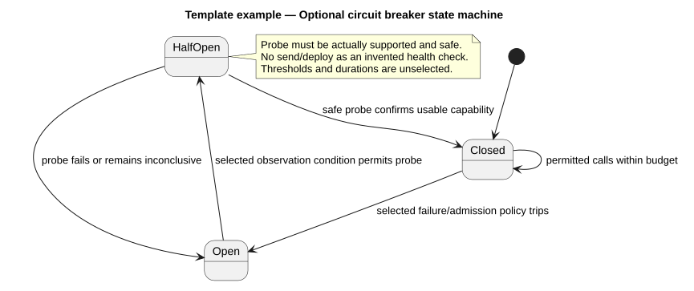

[Editable PlantUML](diagrams/failure-circuit-breaker.puml) · [PNG](diagrams/failure-circuit-breaker.png)

Breaker state controls dependency admission, not the business outcome of prior attempts. Opening a breaker cannot cancel an already dispatched effect or resolve its uncertainty. Use only for a justified dependency; no library or threshold is adopted.

### 9.6 Deadline and remaining-budget propagation

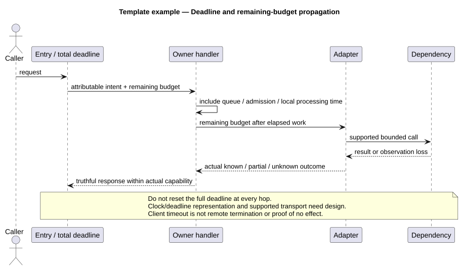

[Editable PlantUML](diagrams/failure-deadlines.puml) · [PNG](diagrams/failure-deadlines.png)

Logical budget propagation, not a selected timeout value or provider guarantee. Cancellation requests and remote deadlines are honored only to the extent actually supported; preserve effects that outlive caller observation.

### 9.7 Optional resilience controls at admission boundaries

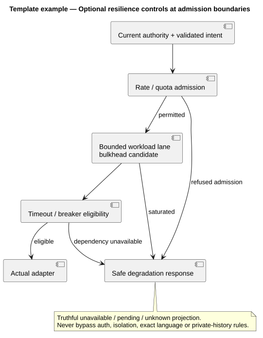

[Editable PlantUML](diagrams/failure-resilience.puml) · [PNG](diagrams/failure-resilience.png)

Candidate controls, not configured infrastructure. Bulkhead can mean bounded local resource admission rather than new hosts. Fallback is only source-permitted behavior; no silent stale private content, alternate recipient, web-process execution or fake success is allowed.

### 9.8 Identity binding and deduplication flow

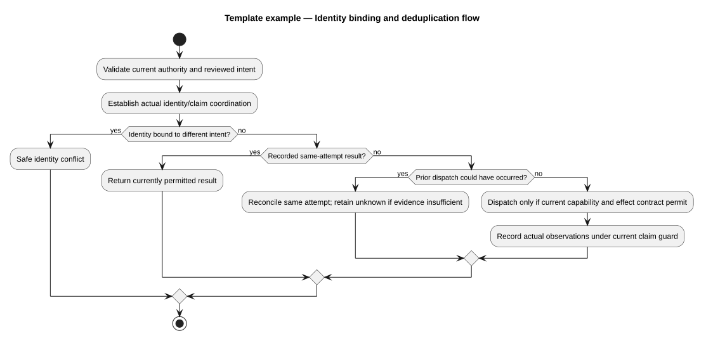

[Editable PlantUML](diagrams/failure-idempotency.puml) · [PNG](diagrams/failure-idempotency.png)

Local uniqueness/deduplication cannot by itself guarantee exactly-once remote effect. Absence of a result is not absence of dispatch. Identity retention, input binding, atomic intent persistence and provider capability require actual design.

### 9.9 Conditional saga compensation and irreversible limits

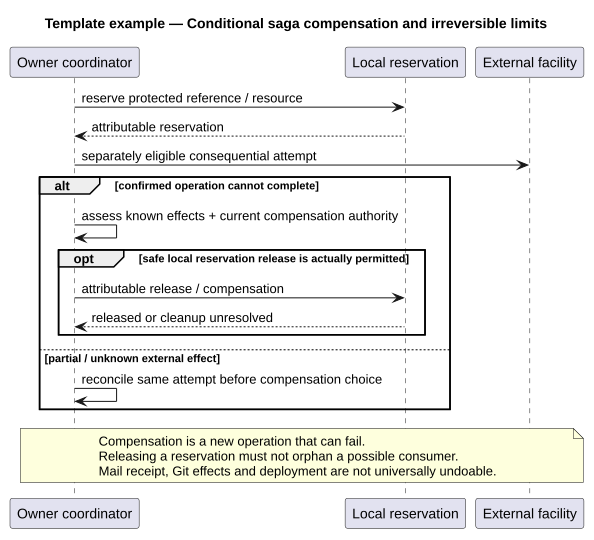

[Editable PlantUML](diagrams/failure-compensation.puml) · [PNG](diagrams/failure-compensation.png)

Saga-style pattern illustration, not adoption of a saga framework or an authorized rollback. Protect references until unknown consumers/effects are resolved. Any remote compensating action needs its own reviewed intent, authority, identity and evidence.

### 9.10 Local transaction versus external consistency

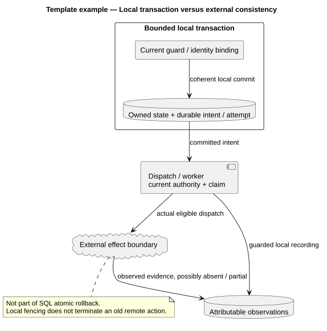

[Editable PlantUML](diagrams/failure-transactions.puml) · [PNG](diagrams/failure-transactions.png)

No distributed transaction is presumed. Queue acknowledgment is not completion. Define atomic state-plus-intent persistence, duplicate delivery, claim freshness and reconciliation with actual provider/Git/executor/target evidence where relevant.

### 9.11 Capability degraded, recovering and failed states

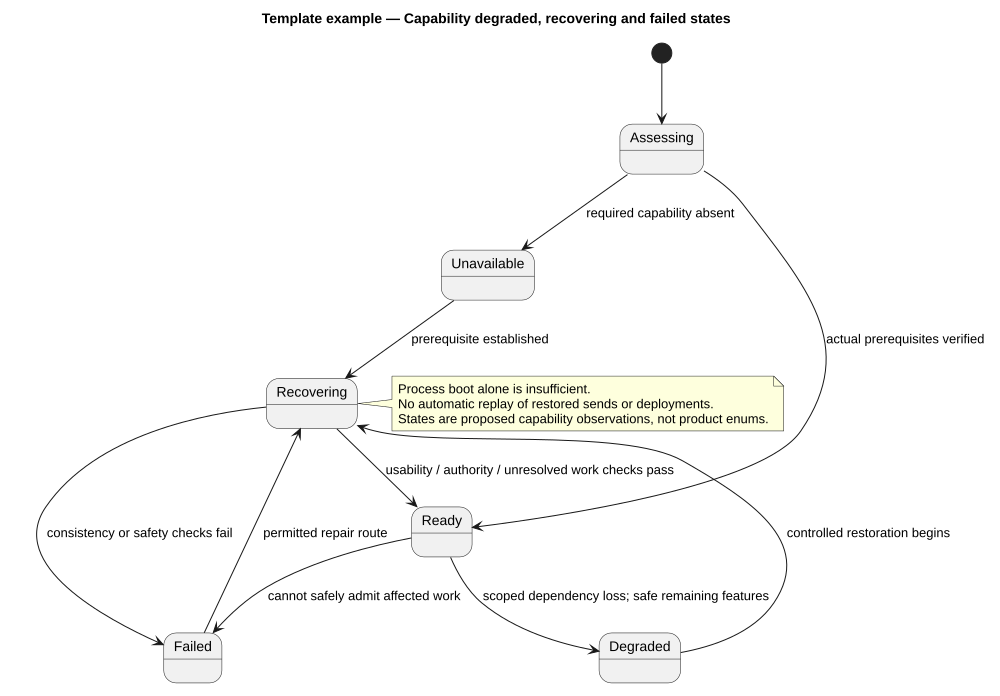

[Editable PlantUML](diagrams/failure-service-states.puml) · [PNG](diagrams/failure-service-states.png)

A scoped capability model, not a single global “system down” flag. Recovery must verify actual usable data/keys/bytes and current authority. Ready does not erase unresolved prior effects or assert an accepted availability target.

### 9.12 Dependency failure and affected capability

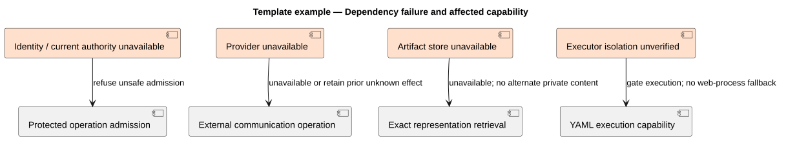

[Editable PlantUML](diagrams/failure-dependency-impact.puml) · [PNG](diagrams/failure-dependency-impact.png)

Impact examples must be scoped to actual dependencies in the copied component. Existing public content can continue only where its required policy/storage checks remain valid; this graph supplies no general cached-authorization exception.

### 9.13 Optional race: expired claim and stale completion

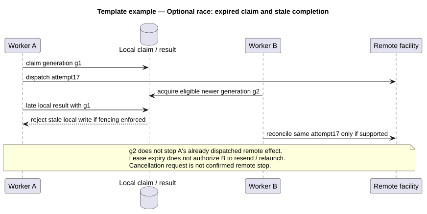

[Editable PlantUML](diagrams/failure-claim-race.puml) · [PNG](diagrams/failure-claim-race.png)

Illustrative interleaving, not an implemented lease/fencing scheme. A late observation can still be relevant evidence, but recording it needs current guarded authority and provenance rather than allowing a stale worker to overwrite state.

### 9.14 Optional corruption detection and isolated recovery

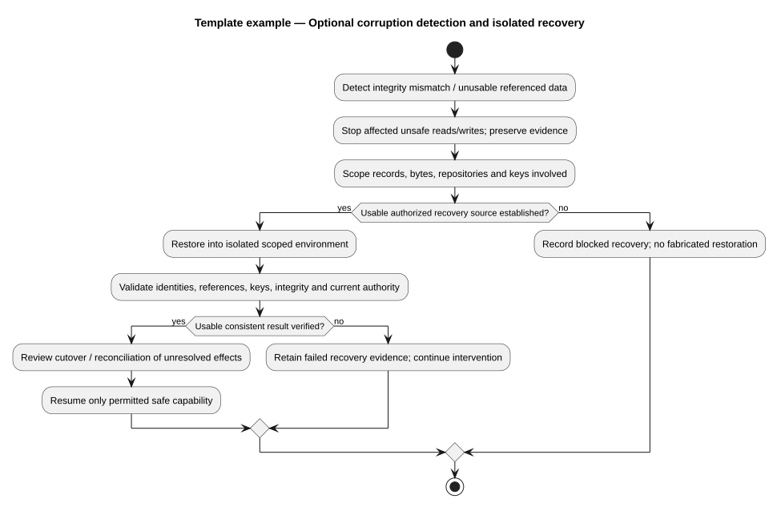

[Editable PlantUML](diagrams/failure-corruption.puml) · [PNG](diagrams/failure-corruption.png)

Backups were not established by the documented project inventory; this is a conditional recovery route. Do not overwrite the only evidence or replay restored sends/deployments. Restore completion requires usable state, not a successful copy command; RPO/RTO remain unselected.

### 9.15 Optional fault tree: duplicate consequential effect

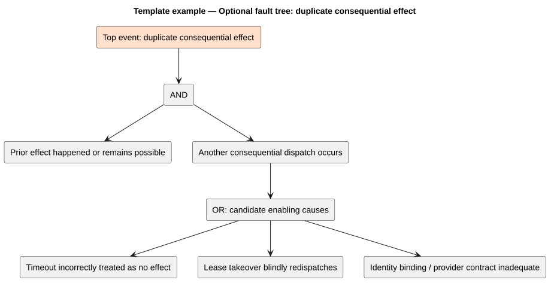

[Editable PlantUML](diagrams/failure-fault-tree.puml) · [PNG](diagrams/failure-fault-tree.png)

Qualitative fault-tree-style causal hypothesis, not a quantified probability model, complete safety analysis or observed incident. Gates describe this selected hypothesis; actual causes and mitigations require an inspected candidate and evidence.

### 9.16 FMEA — qualitative template examples

No severity/occurrence/detection score or risk-priority number is invented. Assess real exposure and exact source obligations before prioritizing an actual finding.

| Failure mode | Possible cause | Effect | Detection evidence | Proposed mitigation / limit |
| --- | --- | --- | --- | --- |
| External response lost | Connection/process interruption after dispatch | Unknown effect; blind repetition may duplicate it | Attributable attempt and actual provider evidence, if supported | Preserve same attempt; reconcile; retain unresolved route |
| Stale worker records result | Claim changes while prior action is in flight | Local state may be overwritten | Claim generation / guarded update outcome | Enforce local fencing; do not assume it stops remote action |
| Protected artifact unavailable | Interrupted write, integrity mismatch or storage loss | Exact material cannot be served safely | Actual usable-byte/reference/integrity check | Keep prior protected references; truthful unavailable result |
| Authority changes during operation | Revocation concurrent with cached/early check | Prohibited admission or disclosure | Current guard ordering and actual integration observation | Define synchronization; no permanent cached privilege |
| Recovery source unusable | Missing backup, key or inconsistent artifact set | Restoration blocked or misleading | Isolated restore and identity/key/reference checks | Establish usable recovery source; do not assert restore readiness |
| `{actual failure}` | `{observed or hypothesized cause}` | `{scope and protected criteria}` | `{actual signal and limits}` | `{owner, control, evidence gate}` |

### 9.17 Failure scenarios and recovery

| Trigger | Expected behavior | Recovery / next gate |
| --- | --- | --- |
| Invalid or denied request | Safe refusal; preserve protected state and disclosure boundary | Correct input / obtain actual current permission; no automatic effect retry |
| Stale expected version | Explicit conflict; no silent overwrite | Compare/reload and deliberately reconfirm changed intent |
| Local commit response lost | Preserve command identity and unknown observation | Guarded same-command result lookup; no fresh publication identity |
| Provider response lost | Record same-attempt unknown effect | Supported authorized reconciliation or explicit intervention |
| Cancel overlaps completion | Report actual known effect and stop status separately | Observe actual facility; preserve terminal outcome and cleanup state |
| Storage corruption or restart | Scope admission; preserve references and unresolved work | Isolated usable restoration and current authority reassessment |

### 9.18 Error contract vocabulary

Codes below are **illustrative symbolic labels**, not allocated API codes, HTTP statuses or provider error translations. “Conditional” is never automatic retry authorization. Each real operation must define its exact outcomes and permitted projection in record 01.

| Example code | Meaning | Retryable? | Client / coordinator action |
| --- | --- | --- | --- |
| INVALID | Intent fails current input contract | No unchanged request | Correct permitted input |
| DENIED | Current operation/disclosure is not permitted | No unchanged authority | Safe refusal; do not probe private state |
| CONFLICT | Expected revision or identity binding differs | No blind repeat | Compare/reconfirm; never reuse identity for different intent |
| UNAVAILABLE | Required capability absent; effect knowledge stated separately | Conditional | Respect actual budget and capability; check dispatch/effect evidence |
| NO_EFFECT_CONFIRMED | Authoritative evidence supports no consequential effect | Conditional | Re-enter actual repetition contract with current checks |
| PARTIAL | Some effects known; intended completion incomplete | No blind repeat | Reconcile known/remaining scope; separately authorize compensation |
| UNKNOWN | Relevant effect cannot be established | No blind repeat | Preserve same identity; supported observation or intervention |
| PENDING | Attributable admitted work not yet complete | Observe, do not duplicate | Follow permitted status reference; no success claim |

### 9.19 Technical scenario and quality table

No workload, latency, availability, RPO/RTO or alert target is accepted here. Replace brace values with an agreed workload and actual environment before executing tests.

| Scenario | Load / setup to define | Expected result | Quality attribute / evidence |
| --- | --- | --- | --- |
| Response loss after possible send | `{authorized account, one attributable attempt, exact fault point}` | No blind resend; actual known/unknown projection | Reliability / effect count and adapter evidence |
| Duplicate deliveries and claim race | `{actual worker concurrency and queue/claim mechanism}` | Stale local result fenced; remote effect reconciled | Consistency / real claim interleaving |
| Heavy artifact work with web requests | `{agreed mix, sizes, concurrency and total resource budget}` | Bounded admission; correct truthful outcomes | Performance / latency, errors, queue age and resource pressure |
| Dependency unavailable | `{exact down facility and allowed isolation}` | Only affected capabilities degrade; no unsafe fallback | Resilience / protected-state and user-flow checks |
| Isolated restore | `{usable source, data/bytes/keys, scope and actual targets}` | Consistent usable identities and current authority | Recoverability / actual restore and reconciliation evidence |

### 9.20 Observability and runbook mapping

Signals and alerts below are proposed categories, not installed telemetry or accepted thresholds. Logs/metrics are supporting observations, not authoritative proof that a send or deployment did not occur. Use bounded IDs and categories; exclude credentials, private message bodies and attachment contents.

| Failure / condition | Proposed log | Proposed metric | Alert condition to select | Procedure / runbook route |
| --- | --- | --- | --- | --- |
| Unknown external effect | Attempt ID, stage, observation category | Unresolved count / age | Actual unresolved work needing action; threshold TBD | [Reconciliation procedure](#5-reconciliation-retry-and-recovery) |
| Stale local claim write | Attempt ID, generation, refused result | Stale-write refusals / claim churn | Sustained loss of progress under selected policy | [Lifecycle scenarios](#4-runtime-lifecycle-and-dependency-scenarios) |
| Dependency unavailable / saturated | Facility category, admission result, bounded duration | Unavailability, queue age, refusal rate | Actual capability loss / resource pressure; threshold TBD | [Lifecycle scenarios](#4-runtime-lifecycle-and-dependency-scenarios) |
| Unusable protected artifact | Opaque reference, integrity/result category | Failed usable-reference checks | Affected protected retrieval or consistency fault | [Recovery design](../../06-design-quality-and-security-analysis/03-operations-backup-recovery-and-resilience.md) |
| Recovery validation fails | Recovery candidate ID and failed check category | Recovery readiness/check outcomes | Failed actual recovery gate | [Recovery design](../../06-design-quality-and-security-analysis/03-operations-backup-recovery-and-resilience.md) |

These links lead to design procedures, not tested production runbooks. A real component must identify the operational owner, actual commands/access, diagnostic queries, safe stop/reconcile steps and evidence of the runbook's usability.

### 9.21 Graceful degradation matrix

| Dependency down / unsafe | Affected feature behavior | Safe remaining behavior / constraint |
| --- | --- | --- |
| Current identity/authority facility | Refuse operations whose current authority cannot be established | Other independently valid operations only; no stale-authority bypass |
| Mail/calendar provider capability | New affected operations unavailable/pending only under actual contract; previous unknown attempts stay unknown | Local permitted drafts/records if independent dependencies work; no fake external acceptance |
| Exact artifact storage | Requested material unavailable if usable bytes cannot be established | Independently available permitted content only; no silent language/rendition substitution |
| Executor isolation or target capability | Gate real execution/deployment; report truthful unavailable state | Source/YAML editing or review only where independently permitted; no unsafe execution fallback |
| Required persistence | Affected authoritative reads/writes unavailable | Static non-private information only if its actual serving/authority requirements remain valid |
| Telemetry exporter | Apply actual diagnostics/audit failure policy; do not rewrite committed effect as failure | Non-authoritative diagnostics may degrade only if required audit/progress evidence remains satisfied |

Before copying into a real component, replace placeholders, confirm actual capability/identity/repetition semantics, source-policy status and quality targets, and synchronize [contracts](01-responsibilities-and-interface-realization.md), [data](02-data-model-and-class-structure.md) and [algorithms](03-detailed-behavior-and-algorithms.md). No live fault injection, retry, compensation, restore or external operation is executed by this authoring update.
