# Component Template — Design Patterns and Coding Constraints

**Status: reusable template only.** Copy into an identified component package and replace brace placeholders with sourced prescriptions. This file selects no actual pattern, framework/package version, formatter, numerical quality threshold or accepted technical decision.

**Purpose:** explain the component’s justified structural/behavioral choices and the constraints implementation must respect. Shared conventions remain authoritative in their owning records; this file records their component-specific application, alternatives and verifiable exceptions.

[Context](#1-component-context-and-rule-authority) · [Patterns](#2-pattern-decision-record) · [Constraints](#3-component-coding-and-dependency-constraints) · [Safety](#4-concurrency-security-and-operating-constraints) · [Examples](#5-illustrative-pattern-applications) · [Review](#6-review-and-completion) · [Pattern package](#8-pattern-and-coding-rule-package)

## 1. Component context and rule authority

| Field | Value to complete |
|---|---|
| Component/candidate | `{actual architecture identity, component name and source/design revision}` |
| Source contracts | `{exact requirement/criterion and analysis operation/state/rule/interface references}` |
| Public/internal model | `{companion record 01 contracts and record 02 types/visibility/invariants}` |
| Shared design conventions | `{actual applicable module, OO, data, interface and security records}` |
| Owner/status | `{actual responsible owner, proposal/review/acceptance source and conditions}` |
| Related decisions/exceptions | `{actual ADRs, unresolved questions or justified scoped exceptions}` |

Start from [OO principles](../../02-detailed-and-object-oriented-design/01-design-principles-and-object-oriented-approach.md), [module boundaries](../01-modularity-dependencies-and-encapsulation.md), [runtime rules](../../01-software-architecture/03-process-view-concurrency-and-runtime-behavior.md) and [source decisions](../../../02-requirements-engineering/07-change-and-baseline/open-questions-and-decisions.md). Patterns serve required behavior; they cannot change its authority or invent a missing permission.

## 2. Pattern decision record

Repeat for each substantive actual choice. A small explicit implementation with no named pattern is acceptable when it solves the problem more clearly. Do not require one creational, structural and behavioral pattern merely to fill categories.

### Problem and alternatives

**Problem/forces:** `{actual repeated variation, coupling, invariant, lifecycle or effect boundary that needs a solution}`.

**Source context:** `{exact operations/types/scenarios affected and accepted/proposed constraints}`.

**Simplest viable option:** `{direct implementation and its consequences}`.

**Alternatives:** `{relevant pattern or non-pattern options, evidence/assumptions and trade-offs}`.

### Selected or proposed pattern

**Name/category and status:** `{actual pattern or explicit non-pattern choice; proposed/reviewed/accepted authority}`.

**Intent and applicability:** `{why the choice fits this specific component and when it should not be used}`.

**Participants:** `{actual classes/interfaces/value types; roles, ownership and visibility}`.

**Collaboration:** `{specific contracts/messages, state/effect/transaction boundaries and failure outcomes; link algorithms/scenarios}`.

**Dependencies and lifetime:** `{construction/injection, allowed imports, ownership of mutable context and resources}`.

**Consequences:** `{benefits, cost/indirection, capability limits, concurrency/security implications and rejected alternatives}`.

**Verification and reconsideration:** `{checks that support the intended benefit and contract compatibility; actual evidence separate; trigger for changing the choice}`.

Use an [ADR](../../07-design-decisions/README.md) for consequential cross-component choices rather than treating a completed pattern record as owner approval.

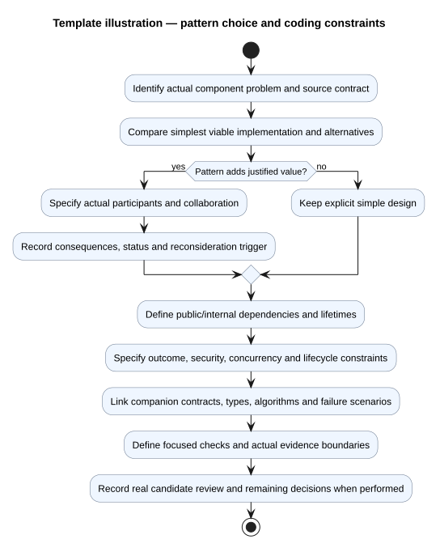

[Editable PlantUML](diagrams/component-pattern-selection-template.puml) · [PNG](diagrams/component-pattern-selection-template.png)

This is an authoring/review route, not proof that a pattern or implementation has been selected. The actual component owns participant names and collaboration diagrams.

## 3. Component coding and dependency constraints

### Public contracts types and visibility

**Exported elements:** `{actual operations/request/result types and justified consumers}`.

**Internal elements:** `{invariant policy, mutation-capable models, persistence mappings and technical adapters not exposed to consumers}`.

**Type/identity rules:** `{validated identifiers, equality, requiredness/nullability, version/time/language/provenance and sensitive-data representation}`.

**Naming and signatures:** `{actual language/framework conventions and source; descriptive intent and side-effect visibility; unresolved choices explicit}`.

Do not export mutable ORM models, raw protected paths or broad credentials as convenient shared abstractions. Different outcome meanings must survive the chosen result/error representation.

### Dependency direction and composition

**Allowed dependencies:** `{specific public module contracts and justified technical packages}`.

**Forbidden coupling:** `{foreign internal imports/table writes, cycles, shared mutable actor/session state or capability bypasses}`.

**Injection/composition:** `{actual composition-root registration, dependencies/implementations and scope rules}`.

**Resource lifetime:** `{command/job/worker/shared lifetime, cleanup/reset behavior and actual framework compatibility assumptions}`.

A port is justified by meaningful capability variation, effect control or verification, not a universal interface-per-class rule. Avoid service-locator lookups that conceal dependencies. A singleton must not retain actor, private payload, claim or transaction state across requests/jobs.

### Domain and infrastructure separation

**Domain invariants:** `{actual policy/type ownership; no HTTP/session/provider response format dependence unless justified}`.

**Application orchestration:** `{explicit use-case entry points coordinating permission, version and local/remote effect boundaries}`.

**Infrastructure realization:** `{persistence/provider/Git/storage/executor adapters with actual supported capabilities and result mapping}`.

**Error/result convention:** `{typed or equivalent denied/invalid/conflict/unavailable/pending/partial/unknown/confirmed classifications as applicable}`.

Do not hide publication, send, native ref mutation or deployment in constructors/getters, generic persistence hooks or unrelated observers. A caught exception cannot automatically become “no effect”; inspect what the operation actually knows.

### Formatting static checks and generated code

**Tooling:** `{actual selected formatter/static analyzer/dependency checks, configuration/source version and scope; no fabricated installed tool or passing result}`.

**Generated ownership:** `{authoritative model/source, generator identity, regeneration instructions, manual-edit policy and review}`.

**Review evidence:** `{actual candidate/check output and limitations when performed}`.

Follow the [implementation artifact view](../02-implementation-view-and-artifacts.md). Keep toolchain/dependency selections and required compatibility/license checks explicit. Code generation is optional; generated files must not drift from their authoritative source.

## 4. Concurrency security and operating constraints

### Transaction and asynchronous rules

**Consistency contract:** `{owned state/invariant, current authority, expected revision, local transaction and uniqueness/claim rules}`.

**External effect boundary:** `{reviewed intent, stable attempt, capability checks, result evidence and reconciliation}`.

**Repeated/cancelled work:** `{duplicate identity rules, safe retry conditions, request-versus-confirmed-stop and known-effect handling}`.

Do not hold long database locks while waiting for external work. Local fencing cannot guarantee exactly-once remote effects. A queue acknowledgment, provider acceptance or runner completion has its own meaning and cannot stand in for receipt, usable artifact or target authorization.

### Security and private information

**Authorization enforcement:** `{owner-side current actor/resource/action/lifecycle checks and direct path protection}`.

**Untrusted input/content:** `{validation/display/path/command boundaries and adapter restrictions}`.

**Secrets/diagnostics:** `{credential scope, process lifetime, redaction, permitted evidence and recovery-key dependencies}`.

**Operating access:** `{required least privilege and actual enabling conditions; no inherited broad host/target access}`.

No pattern or generic middleware creates a universal administrator grant. Follow shared [security design](../../06-design-quality-and-security-analysis/02-security-threat-modeling-and-trust-boundaries.md), preserving accepted administrative boundaries and source policy.

### Resource and lifecycle constraints

**Admission/limits:** `{actual policy/measurement basis or unresolved gate; reservation, bounded work and backpressure where applicable}`.

**Reference/cleanup:** `{usable replacement, protected publication/submission references, logical versus physical reclamation and sensitive workspace cleanup}`.

**Recovery/compatibility:** `{old/new code-data-job contracts, actual rollback/forward-repair limits and current authority/external reconciliation}`.

Never add unsupported timeout/quota/retry defaults to fill this template. A cleanup method returning does not prove bytes were freed or secrets removed; an encrypted database field does not prove usable key recovery.

## 5. Illustrative pattern applications

### Adapter for a provider boundary

**Illustration only:** a Communication handler consumes a provider port; a concrete adapter translates actual authorized provider results into attributable acceptance/rejection/pending/unknown outcomes. The handler remains responsible for reviewed intent and application meaning.

The adapter must not convert an uncertain send into safe failure or claim recipient receipt from provider acceptance. A substituted implementation must preserve contract semantics, including denied/unavailable paths. Actual provider capabilities and reconciliation/idempotency behavior need independent evidence.

### Strategy for selected representation

**Illustration only:** generated and uploaded rendition handling can share a narrow selected-representation contract if actual variation justifies it. Current link/account eligibility, requested language/revision and confirmed availability remain explicit inputs/guards. No strategy may silently choose unrelated private or unavailable content. A simple explicit branch is preferable if a hierarchy adds no useful separation.

### Factory and committed reaction

**Illustration only:** a creation operation may bind a valid confirmed draft snapshot to publication identity, or reviewed intent to an attempt. Construction alone does not grant publication/send/deployment authority. A committed notification may schedule explicitly authorized pending work, but an observer must not silently mutate unrelated lifecycle state.

These examples allocate no component-level pattern decision or class signatures. Concrete participants, algorithms and tests belong in the actual component package.

## 6. Review and completion

- [ ] Each pattern addresses an actual problem and includes the simplest viable alternative, participants/collaboration and consequences.
- [ ] Source authority/status and exact contract/type/scenario links are explicit; no invented acceptance or threshold is present.
- [ ] Public/internal boundaries and permitted dependencies prevent foreign-state mutation and hidden authority.
- [ ] DI/composition and command/job/worker lifetimes avoid shared mutable identity, transaction or private-payload leakage.
- [ ] Actual outcome semantics survive substitution, serialization, errors, duplicates and uncertain external effects.
- [ ] Concurrency/resource/security/lifecycle constraints agree with companion records and shared owners.
- [ ] Tooling/generated-content ownership is explicit; planned checks remain distinct from actual results.
- [ ] Design smells and meaningful exceptions have evidence, owner and review trigger rather than cosmetic rule enforcement.
- [ ] Candidate-specific review/disposition and remaining choices are recorded only when performed.

Review for god objects, cyclic/hidden dependencies, interface bloat, duplicated policy, mutable global state, misleading common result contracts and speculative abstractions. Metrics may support a finding, but method/class/import counts alone do not establish a defect or debt.

Actual verification combines deterministic policy/handler/substitution checks, actual persistence/concurrency integration and controlled external-boundary verification where applicable. Mock success cannot establish a real provider/Git/executor capability or usable recovery. Use [evolution/debt guidance](../../02-detailed-and-object-oriented-design/05-design-evolution-refactoring-and-technical-debt.md) and [review/handoff](../../06-design-quality-and-security-analysis/05-design-review-traceability-and-handoff.md) for actual findings and disposition.

## 7. Package provenance and maintenance

FAU V08 covers design-pattern descriptions/examples, anti-patterns, smells and model conventions; V07 supplies modularity and encapsulation principles. SOLID/DRY/KISS/YAGNI, coding-rule records and the diagram route are project guidance, not a prescribed university checklist or mandatory use of every GoF/DDD technique.

Keep [responsibilities/contracts](01-responsibilities-and-interface-realization.md), [data/classes](02-data-model-and-class-structure.md), [algorithms](03-detailed-behavior-and-algorithms.md) and [technical scenarios](04-technical-scenarios-and-failure-handling.md) consistent in the same copied component package. Adjust links, replace illustrative roles and reference authoritative shared policies. No production code, package installation, executed test, live external action or baseline acceptance is created by this update.

[Template index](README.md) · [Component and Module Design](../README.md) · [Template diagrams](diagrams/README.md)

## 8. Pattern and coding-rule package

**Reusable template illustrations only.** No pattern is applied to actual production code by this document. The following participant diagrams describe candidates for the existing examples; replace names with actual component classes only after inspecting/defining their realization. Optional State/Repository-like roles are evaluations, not adopted mechanisms. Tools, versions, APIs and enforcement are unselected unless an actual authoritative record establishes them.

### 8.1 Strategy participants

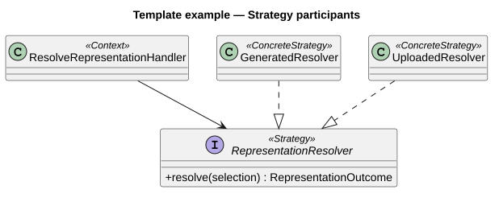

[Editable PlantUML](diagrams/pattern-strategy.puml) · [PNG](diagrams/pattern-strategy.png)

Candidate only: real generated/uploaded variation may justify Strategy. Selection must remain exact, eligible and truthful; a simple branch is acceptable if clearer.

### 8.2 Adapter participants

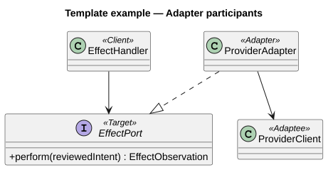

[Editable PlantUML](diagrams/pattern-adapter.puml) · [PNG](diagrams/pattern-adapter.png)

Illustrative external boundary; no provider capability is invented. Adapter translation preserves confirmed, rejected, partial and unknown meaning; it cannot manufacture safe repetition.

### 8.3 Factory participants

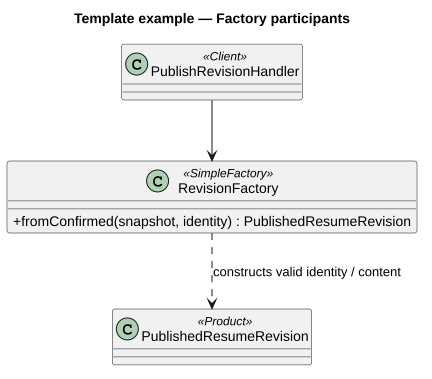

[Editable PlantUML](diagrams/pattern-factory.puml) · [PNG](diagrams/pattern-factory.png)

Simple factory, not GoF Factory Method or an adopted hierarchy. Construction has no external effect and does not authorize publication or atomically change a live pointer.

### 8.4 Facade participants

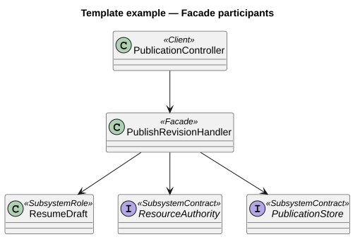

[Editable PlantUML](diagrams/pattern-facade.puml) · [PNG](diagrams/pattern-facade.png)

One bounded use-case facade, not a universal manager. Domain invariants stay with the owner and guarded persistence retains current admission/commit semantics.

### 8.5 Optional Repository-like persistence port

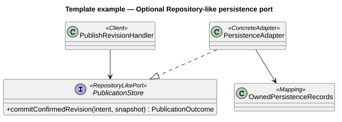

[Editable PlantUML](diagrams/pattern-repository.puml) · [PNG](diagrams/pattern-repository.png)

A use-case-oriented persistence contract, not generic CRUD per table or a claim that it is a canonical collection Repository. Introduce only if meaningful semantics/testing separation justify it; no ORM implementation is selected.

### 8.6 Without versus with justified Strategy

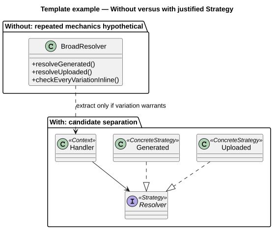

[Editable PlantUML](diagrams/pattern-before-after.puml) · [PNG](diagrams/pattern-before-after.png)

Before is a teaching example, not an observed defect. One short conditional is often simpler than this hierarchy. Keep shared exact-selection/authority policy coherent across implementations.

### 8.7 Strategy runtime collaboration

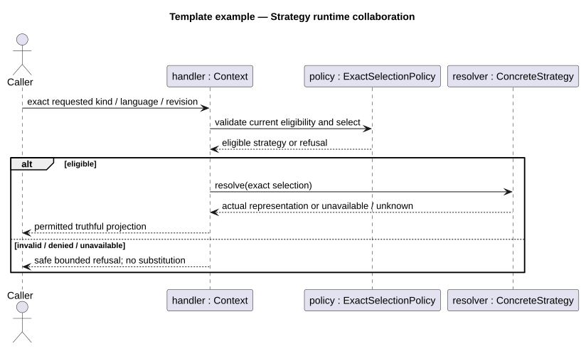

[Editable PlantUML](diagrams/pattern-sequence.puml) · [PNG](diagrams/pattern-sequence.png)

Pattern collaboration is subordinate to the actual owner contract. Strategy selection is not authority, and a resolver may not silently choose another language, rendition or current live artifact.

### 8.8 Patterns across logical component roles

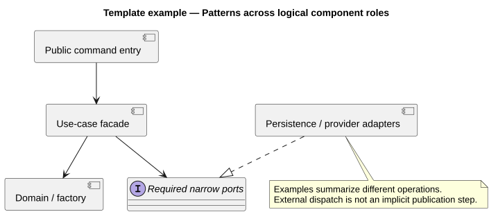

[Editable PlantUML](diagrams/pattern-components.puml) · [PNG](diagrams/pattern-components.png)

Patterns describe collaboration roles inside the modular application, not deployment units. The provider and persistence examples are not collapsed into one shared transaction or one privileged global service.

### 8.9 Optional Strategy object instances

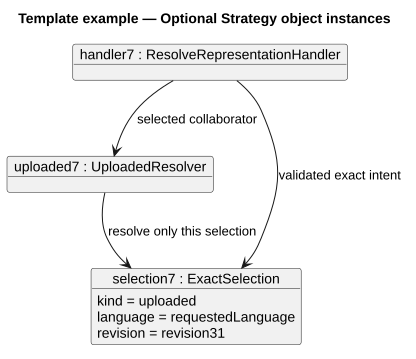

[Editable PlantUML](diagrams/pattern-objects.puml) · [PNG](diagrams/pattern-objects.png)

Invented runtime instances, not an actual trace or payload. Values are symbolic; requestedLanguage does not allocate a language policy. No shared singleton carries the caller identity.

### 8.10 Optional State pattern evaluation

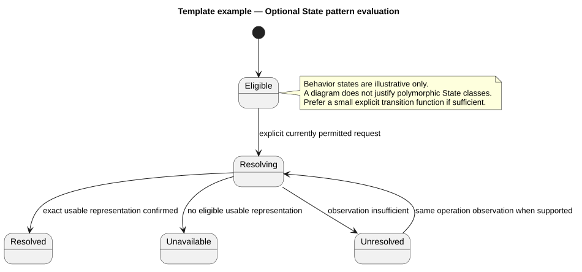

[Editable PlantUML](diagrams/pattern-state-option.puml) · [PNG](diagrams/pattern-state-option.png)

State pattern is not selected. This optional state sketch illustrates when state-dependent behavior might warrant evaluation; it is not an entity enum, retry policy or capability proof.

### 8.11 Dependency inversion through the adapter seam

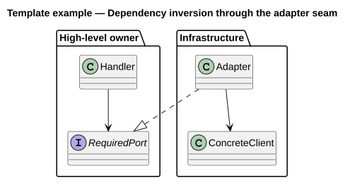

[Editable PlantUML](diagrams/pattern-dependency-inversion.puml) · [PNG](diagrams/pattern-dependency-inversion.png)

Source dependency points toward the required abstraction, while runtime calls reach an injected adapter. Composition root binds implementations. Do not wrap every trivial framework utility merely to add an interface.

### 8.12 Allowed versus forbidden dependencies

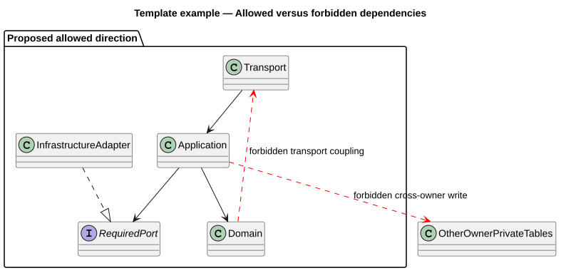

[Editable PlantUML](diagrams/pattern-layers.puml) · [PNG](diagrams/pattern-layers.png)

Black edges are proposed allowed source dependencies; red dashed edges are violations to prohibit, not observed imports. The actual component must identify namespace boundaries, permitted exported contracts and scoped exceptions.

### 8.13 Illustrative package and folder conventions

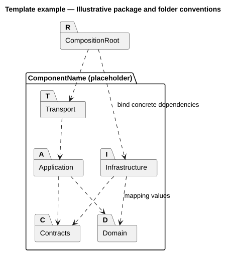

[Editable PlantUML](diagrams/pattern-packages.puml) · [PNG](diagrams/pattern-packages.png)

Illustrative namespaces/folders, not an instruction to restructure an existing Laravel app. Map to actual autoloading, package conventions and ownership after inspecting implementation. Keep public contracts narrow; no relative cross-owner internal imports.

### 8.14 Pattern-to-problem mapping

| Problem | Candidate pattern | Rationale | Consequences |
| --- | --- | --- | --- |
| Real generated/uploaded resolution variation | Strategy | Separate mechanics behind exact-selection contract | Extra types; prevent semantic drift and silent fallback |
| Provider/storage mechanics differ from owner vocabulary | Adapter | Preserve owner contract despite volatile external format | Actual capability/error/uncertainty mapping needs verification |
| Valid revision/attempt construction repeats | Simple Factory | Centralize validated identity/provenance creation | Construction grants no authority and commits no effect |
| One user action coordinates owned collaborators | Facade | Expose bounded entry and truthful outcome | Avoid god object or hidden consequential observer |
| Meaningful guarded persistence boundary | Repository-like port | Isolate coherent commit semantics when justified | Not generic CRUD; real transaction/race checks still needed |

### 8.15 Selection and alternatives

| Choice to evaluate | Simpler alternative | Choose when | Reject / postpone when |
| --- | --- | --- | --- |
| Strategy | Explicit local branch | Real independent mechanics and substitution contract justify separation | One short stable branch is clearer |
| Adapter | Direct SDK use in infrastructure | Owner needs stable outcome/capability boundary | Wrapping trivial utilities adds no useful semantics |
| Factory | Named constructor | Multiple inputs/callers need coherent construction | A valid constructor already suffices |
| Repository-like port | Direct owned ORM mapping | Coherent transaction contract and test seam help | Per-table generic wrapper merely mirrors ORM |
| Polymorphic State | Explicit transition function | Substantial verified state-dependent behavior warrants it | A small lifecycle enum/guard is sufficient; not selected here |
| Observer / domain event | Explicit direct call or durable intent | Named authorized committed reaction exists | Hidden publish/send/deploy or in-process-only durability assumption |

### 8.16 Pattern role-to-class realization

“Example” names are proposed roles, **not actual class locators**. Fill the final column in a real copied component before claiming realization.

| Pattern role | Example class / interface | Actual component locator / status |
| --- | --- | --- |
| Strategy Context | ResolveRepresentationHandler | `{actual namespace/file; proposal or inspected implementation}` |
| Strategy / ConcreteStrategy | RepresentationResolver / GeneratedResolver / UploadedResolver | `{actual types or explicit branch alternative}` |
| Adapter Target / Adapter / Adaptee | EffectPort / ProviderAdapter / ProviderClient | `{actual provider capability and supported client}` |
| Factory / Product | RevisionFactory / PublishedResumeRevision | `{actual construction and validation ownership}` |
| Facade | PublishRevisionHandler | `{actual bounded command implementation}` |
| Repository-like port / adapter | PublicationStore / PersistenceAdapter | `{actual guarded persistence realization}` |

### 8.17 Categorized candidate catalog

| Category | Example pattern | Where evaluated / use status |
| --- | --- | --- |
| Creational | Simple Factory | Revision/attempt construction example; no mandatory factory hierarchy |
| Structural | Adapter | Actual provider, storage, Git or executor boundary when needed |
| Structural | Facade | Bounded public use-case handler; proposed |
| Behavioral | Strategy | Exact eligible representation resolution; proposed |
| Behavioral | State / Observer | Optional evaluations only; no implicit durable bus or side effect |
| Enterprise persistence | Repository-like port | Owned coherent persistence contract; not a GoF category |

### 8.18 Anti-patterns and smells

| Avoid / inspect | Why | Candidate alternative |
| --- | --- | --- |
| Universal manager / generic business helper | Mixed authority and unrelated reasons to change | Cohesive owner/use-case contracts |
| Mutable actor/session singleton | Cross-user leakage and stale privilege | Per-operation validated context and fresh admission |
| Service locator inside domain | Hidden dependencies and uncontrolled capabilities | Explicit constructor/operation dependencies |
| Implicit send/publish/deploy in save observer | Unreviewed consequential action and duplicate risks | Explicit authorized command and durable attributable intent where needed |
| Provider boolean “success” for unknown effect | Loses uncertainty and encourages blind replay | Typed actual observations and same-attempt reconciliation |
| Interface/type per primitive or speculative provider | Adds indirection without actual value | Small explicit implementation; validated values where meaningful |

### 8.19 Coding standards to complete

These are authoring fields, not adopted formatter/linter settings. Inspect repository conventions before selecting actual enforcement.

| Area | Proposed convention / record | Enforcement tool / status |
| --- | --- | --- |
| Naming | Intention-revealing operations/types; actual namespace/autoload convention recorded | `{actual language standard and static check; unselected}` |
| Formatting | One repository-owned formatting configuration | `{actual compatible formatter/version; unselected}` |
| Structure | Public/internal owner boundaries; one coherent class responsibility | `{actual import/dependency check plus review}` |
| Types / outcomes | Explicit identity/version and truthful result semantics | `{actual type/static analysis configuration; unselected}` |
| Generated code | Identify generator, source of truth and regeneration procedure | `{actual generation consistency check}` |
| Documentation | Contract comments explain invariants and unusual constraints | Review against companion records; no copied stale policy |

### 8.20 Coding constraints

| Constraint | Rationale | Scope | Verification |
| --- | --- | --- | --- |
| No foreign-owner internal writes | Preserve invariant authority | All component commands/adapters | Import/write review and actual integration |
| No hidden consequential effect | Preserve explicit intent and attribution | Constructors/getters/hooks/observers | Inspect call paths and effect counts |
| Preserve exact selection and actual outcomes | Avoid wrong content and fabricated completion | Resolvers/provider adapters | Substitution, unavailable, partial/unknown cases |
| Guard authority/version/identity at actual admission | Early checks race with revocation and changes | Protected state mutation/delivery | Actual synchronized persistence/delivery races |
| No raw private path / secret in public projection | Prevent accidental disclosure | DTOs, errors, logs, job payloads | Serialization/redaction and access checks |
| Bound resources and object lifetime | Avoid starvation and cross-operation leakage | Workers, adapters, native operations | Combined workload and lifecycle checks; limits must be selected |

### 8.21 Architecture fitness functions — planned enforcement

No CI check is installed or passing by this template. Select tools for the actual stack; **ArchUnit is a Java-specific example, not a Laravel/PHP selection**. Structural rules cannot alone establish semantic authority or remote safety.

| Rule | Candidate tool / method | Proposed CI check / limit |
| --- | --- | --- |
| Allowed imports and no owner cycles | Stack-compatible dependency analyzer or explicit import graph | Fail prohibited edges; record actual allowlist/exceptions |
| Public contracts realized with compatible signatures | Actual language type/static analysis | Check selected types; behavioral substitution still needs focused tests |
| No mutable request context in shared lifetime | Framework lifetime review plus focused concurrent cases | Inspect bindings and exercise actual long-lived workers |
| No private data in projections/diagnostics | Focused serializer/redaction checks and review | Assert actual forbidden fields; avoid fragile text-only rules |
| Guarded publication preserves history/repetition | Real database transaction/concurrency cases | Exact candidate results and protected frame, not mock-only claims |
| Generated sources/exports agree | Existing diagram/generation checks | Validate source/render pairs and local references |

### 8.22 Language and framework constraints

| Area | Allowed / candidate position | Version or restriction status | Required evidence |
| --- | --- | --- | --- |
| Application language/framework | Proposed Laravel/OOP approach | Exact supported PHP/Laravel versions unselected by this template | Inspect actual manifests/lockfiles/runtime and record compatibility |
| Runtime inventory | Earlier demo inspection observed PHP 8.3 and existing Laravel | Dated observation, not a final support baseline | Reinspect actual intended environment before use |
| ORM / libraries | Use actual owned persistence and bounded adapters | No package/version allowlist allocated | Actual dependency policy, lockfile and capability review |
| Native Git / executor / provider SDK | Only actual required capability with established controls | No replacement of real Git/execution by simulation | Controlled compatibility/isolation/effect evidence |
| APIs disallowed by design constraint | Direct foreign-owner writes, hidden effects, unsafe host access, permanent shared actor state | Semantic prohibitions; no invented list of banned library functions | Inspect actual call sites and relevant mechanisms |
| Formatting / analysis tools | Select stack-compatible tools | No installation or tool adoption in this update | Actual config, supported runtime and recorded check result |

### 8.23 Errors and logging conventions

| Situation | Error / result convention | Logging convention |
| --- | --- | --- |
| Invalid / denied / conflict | Safe bounded typed outcome; no private existence leakage | Opaque permitted operation ID and category |
| External timeout / ambiguous response | Preserve unknown/partial effect, same attributable attempt | Stage and observation category; never claim no effect from timeout |
| Local commit observation loss | Resolve same command identity under current disclosure policy | Identity and actual commit-observation category |
| Confirmed committed result then telemetry failure | Do not rewrite business success as rollback | Distinguish exporter failure from authoritative outcome |
| Provider exception | Map actual capabilities without leaking raw payload | Redact tokens, private bodies and attachments; bounded metadata |

### 8.24 Concurrency and thread-safety rules

| Rule | Scope / rationale | Planned verification |
| --- | --- | --- |
| No shared mutable actor/resource/session context | Web handlers and long-lived workers; isolation across operations | Concurrent identity/lifetime and reset checks |
| Recheck current authority and exact expected version | Protected commands/delivery; define actual synchronization order | Revocation and competing-update interleavings |
| Same identity cannot bind different intent | Commands/attempts; preserve attributable results | Duplicate and mismatched-intent persistence cases |
| Local fencing does not stop remote work | Lease/claim generation and external adapters | Reject stale writes; reconcile existing remote attempt before repetition |
| No network call held inside an assumed reversible SQL transaction | External effects are not local atomic state | Inspect boundary and interruption evidence |
| Runtime concurrency model remains explicit | PHP request/worker behavior is not automatically a threaded model | Record actual process/lifetime and resource admission design |

### 8.25 Code review prompts

- [ ] Exact component, source contract, status and actual participant locators are identified.
- [ ] Simplest viable option and pattern consequences are documented; unnecessary hierarchy is removed.
- [ ] Public/internal dependencies and current authority remain explicit.
- [ ] Pattern substitution preserves exact selection, privacy and denied/conflict/partial/unknown outcomes.
- [ ] Construction, serialization and observers hide no consequential action.
- [ ] Transaction/identity/claim/lifetime and resource rules agree with records 01–04.
- [ ] Tool/version choices and performed checks have actual evidence; unperformed checks remain planned.
- [ ] Significant accepted exceptions and future changes link to real decision/review records.

These prompts are not completed checks or evidence of defects.

### 8.26 Short Strategy pseudocode

Language-neutral pseudocode, **not production PHP or a complete authorization/storage implementation**. Concrete names correspond to the participant diagram. Safe reference usability/lifetime and caller-authority ordering must be established by the actual component mechanism.

```text
interface RepresentationResolver:
    resolve(exactSelection, admittedContext) -> RepresentationOutcome

class UploadedResolver implements RepresentationResolver:
    resolve(selection, context):
        return files.resolveExactPermittedReference(selection, context)
        # Contract preserves unavailable / denied / unknown; no language fallback.

class ResolveRepresentationHandler:
    resolve(request, verifiedContext):
        admitted = policy.admitExactSelection(request, verifiedContext)
        if admitted is refused: return safeRefusal(admitted)
        resolver = selectEligibleResolver(admitted.exactKind)
        return resolver.resolve(admitted.selection, admitted.context)
```

### 8.27 Pattern decision record — reusable ADR form

**Unallocated proposal template, not a new accepted ADR.** Create an actual record from the [ADR template](../../07-design-decisions/ADR-template.md) only for a substantive identified decision; link [ADR-001 boundaries](../../07-design-decisions/ADR-001-modular-application-boundaries.md) and [ADR-004 evolution](../../07-design-decisions/ADR-004-compatible-incremental-design-evolution.md) where relevant, preserving their Proposed status.

| ADR field | Value to complete |
| --- | --- |
| Identity / status / authority | `{actual allocated ID, proposal/disposition, owner and source}` |
| Problem and forces | `{actual variation, boundary, source criteria and inspected candidate}` |
| Alternatives | `{simple branch/direct construction versus justified pattern; actual consequences}` |
| Proposed or accepted decision | `{specific participant locators, selected scope and actual decision evidence}` |
| Validation and review trigger | `{substitution, lifetime, concurrency and adapter checks; actual results or planned status}` |

Keep actual language choices, interfaces/types, algorithms and failures synchronized with records 01–04. This document authoring installs no tools, changes no production code, executes no concurrency/provider test and accepts no technical baseline.
