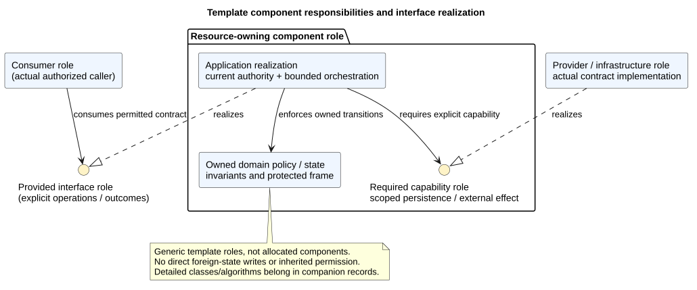

# Resumefolio — Component Design Package Template

**Use this package to develop one coherent implementation-level component design.** Keep responsibilities, contracts, types/classes, algorithms, technical scenarios, constraints and diagrams together; link shared policies instead of duplicating them.

**Status: reusable template package, updated November 2, 2026.** All five records contain authoring fields, guidance, expanded visual packages and reference tables. The diagram catalog now contains **63 distinct PlantUML views**, each with SVG and PNG exports. They allocate no actual component, signature, schema, permission, accepted pattern or passing result. Brace placeholders and unchecked checklists are prompts, not decisions.

[Records](#1-records-and-reading-order) · [Copying](#2-copying-and-instantiating-a-package) · [Ownership](#3-consistency-and-source-ownership) · [Diagrams](#4-illustrative-diagrams) · [Readiness](#5-package-review-and-completion)

## 1. Records and reading order

### 01 — Responsibilities and Interface Realization

[Open the contract template](01-responsibilities-and-interface-realization.md).

Identify actual component/source authority, owned responsibilities, public/internal boundaries, provided/required interfaces and exact operation contracts. Include current authority, expected revisions, result/protected-state semantics, repeat/failure behavior and concrete realization links. Its publication example is illustrative, not an allocated final operation.

### 02 — Data Model and Class Structure

[Open the data/class template](02-data-model-and-class-structure.md).

Refine source concepts and contracts into justified technical types, identity/equality, fields, visibility, invariants, relationships and persistence mapping. Distinguish conceptual relationships from physical keys and aggregate/transaction boundaries. Preserve source/draft/publication/actual-material identity and reference lifecycle.

### 03 — Detailed Behavior and Algorithms

[Open the algorithm template](03-detailed-behavior-and-algorithms.md).

Specify ordered steps, responsible objects, guard/state changes, collaboration, local/external consistency, concurrency, resources and duplicate/retry behavior. Keep actual effect evidence distinct from assumptions. The publication pseudocode is a labeled illustration requiring actual implementation choices.

### 04 — Technical Scenarios and Failure Handling

[Open the scenario template](04-technical-scenarios-and-failure-handling.md).

Specify initialization/configuration, interruption, pending work, uncertain effects, cancellation, shutdown and recovery cases as applicable. Record initial conditions, fault points, actual observations, allowed next actions and protected state. Its lost-send-response example is not an executed test or provider capability claim.

### 05 — Design Patterns and Coding Constraints

[Open the pattern/constraint template](05-design-patterns-and-coding-constraints.md).

Justify patterns against concrete problems and simpler alternatives. Record actual participants/collaboration, dependency direction, DI/lifetimes, type/error/security/concurrency rules and planned tooling. No GoF category, DDD technique, framework/tool version or numeric threshold becomes mandatory by copying it.

The five records are complementary, not a rigid waterfall. Refine them together as contracts, data and failure cases expose inconsistencies. Keep the source requirement/analysis authoritative when required behavior needs clarification.

## 2. Copying and instantiating a package

1. Identify an actual architectural component and its existing [catalog entry](../README.md). Confirm the responsibility boundary before creating another package.
2. Choose the actual package location and stable name under the component-design area. A logical component is not automatically a separately deployed service.
3. Copy the applicable records together. If an initial single-file component proposal already exists, link or deliberately migrate it; do not leave two conflicting authoritative designs.
4. Adjust every relative link for the actual destination depth, especially shared topic/source links and diagram catalog backlinks. Copying deeper into a `components/<name>/` directory requires different relative paths from this template folder.
5. Replace brace placeholders, generic roles and examples with actual component-specific prescriptions and exact source locators. Mark genuine unknowns with owner/next action/gate; explain justified omissions.
6. Allocate identifiers only under the actual project convention. Do not claim source acceptance or create numerical defaults merely to fill a field.
7. Replace or omit illustrative diagrams as appropriate, keeping actual sources/exports synchronized. Record significant choices in an [ADR](../../07-design-decisions/README.md).
8. Review all records as one identified candidate. Actual implementation permission and baseline acceptance remain the agreed separate disposition.

No copy, product package instantiation or component acceptance is performed by completing this template itself. Do not create empty folders for every potential future feature.

## 3. Consistency and source ownership

| Question | Owning record |
|---|---|
| What operation is provided and what must it preserve? | 01 — Responsibilities/contracts |
| Which types, state and relationships realize it? | 02 — Data/classes |
| How does the operation execute and branch? | 03 — Detailed behavior |
| What happens around interruption, uncertain effects and recovery? | 04 — Technical scenarios |
| Which structural choices and implementation constraints apply? | 05 — Patterns/constraints |

**Shared architecture:** use [component boundaries](../../01-software-architecture/02-system-decomposition-and-boundaries.md), [runtime design](../../01-software-architecture/03-process-view-concurrency-and-runtime-behavior.md) and [deployment](../../01-software-architecture/04-deployment-topology-nodes-and-networks.md).

**Shared technical policy:** link [OO guidance](../../02-detailed-and-object-oriented-design/README.md), [module rules](../01-modularity-dependencies-and-encapsulation.md), [Data Design](../../04-data-design/README.md), [Interface/API Design](../../05-interface-and-api-design/README.md) and [Quality/Security](../../06-design-quality-and-security-analysis/README.md).

**Required meaning and authority:** source requirements, analysis concepts/contracts and actual decisions remain in their original phase folders. Do not duplicate or quietly alter an access, publication, history, retention or external-effect rule inside a component template. A source-family reference or valid link is not exact acceptance-criterion coverage.

**Actual evidence:** record identified reviews/runs and their scope/limits in the actual component/review package. Planned verification remains a plan; a mock-only check cannot establish actual provider/Git/executor/storage/recovery behavior.

## 4. Illustrative diagrams

### Contract and ownership roles

[Owning record](01-responsibilities-and-interface-realization.md) · [PlantUML](diagrams/component-interface-realization-template.puml) · [PNG](diagrams/component-interface-realization-template.png)

### Expanded package inventory and view guide

Counts include the original illustration in each record. Each view has one editable PlantUML source and matching SVG/PNG exports; linked reuse is not an additional view.

| Record | Views | Main diagrams | Reference material |
| --- | --- | --- | --- |
| [01 — Responsibilities/interfaces](01-responsibilities-and-interface-realization.md#9-visual-contract-and-responsibility-package) | 10 | Provided lollipop/required socket, realization, context, ports/connectors, internal parts, classes, dependencies, sequence and interface segregation | CRC, interface specification, contract summary and source-to-interface traceability |
| [02 — Data/classes](02-data-model-and-class-structure.md#9-data-and-class-model-package) | 12 | UML classes, ERD, logical/physical models, domain/aggregate boundaries, multiplicity, objects, inheritance, lifecycle and DTO mapping | Class-to-table mapping, data dictionary and invariants |
| [03 — Behavior/algorithms](03-detailed-behavior-and-algorithms.md#9-behavior-and-algorithm-visual-package) | 11 | Sequence fragments, activity fork/join, algorithm flow, command state, decision tree, communication, timing, structures, errors and concurrency | Main/reconciliation pseudocode; decision, trace, analytical complexity and comparison tables |
| [04 — Scenarios/failures](04-technical-scenarios-and-failure-handling.md#9-failure-and-resilience-visual-package) | 16 | Happy/failure paths, errors, retry timeline, breaker, deadlines, resilience, deduplication, compensation, transactions, capability state, dependency loss, claim race, corruption and fault tree | Qualitative FMEA, scenarios, symbolic errors, quality/load prompts, observability and degradation matrix |
| [05 — Patterns/constraints](05-design-patterns-and-coding-constraints.md#8-pattern-and-coding-rule-package) | 14 | Labeled Strategy/Adapter/Factory/Facade/persistence-port participants, before/after, sequence, components, objects, optional state, dependency/layer/package rules | Selection/role/catalog tables; coding, fitness, language, logging and concurrency rules; review checklist, pseudocode and unallocated ADR form |
| **Total** | **63** | **63 sources, 63 SVGs and 63 PNGs** | **Reusable guidance; no product verification implied** |

Open the [complete diagram catalog](diagrams/README.md) for individual sources and exports. Read every figure with its owning caption: some views show conceptual relationships, some show source dependencies, and others show runtime messages or coordinator knowledge. A diagram arrow does not itself establish permission, physical schema, local atomicity or installed facilities.

### Shared examples and important boundaries

Publication is the running **local command** example across contracts, classes and algorithms. Current authority, expected draft version and command identity must be coordinated by an actual mechanism; confirmed revision, live pointer and attributable result must agree. A source edit/save does not implicitly publish. Independent overrides, link controls and actual submitted material remain protected.

The lost-send-response scenario illustrates an **external effect boundary**, not another step in publication. Provider acceptance is not receipt or actual submission. Unknown effect remains attributable to the same attempt; timeout, lease expiry or absence of a result does not justify blind resend, relaunch or redeployment. Local rollback/fencing cannot undo or terminate remote work.

Pattern participants and physical column types are examples, not actual class locators or selected schema. Symbolic delays, error labels, synthetic traces and analytical complexity are explanatory aids, not adopted limits, measurements or allocated IDs. Optional State, breaker, bulkhead, compensation and recovery views require an actual need and supporting capability evidence. The ADR form in 05 is unallocated; filling it is not owner approval.

### Adapting diagrams and tables when copying

1. Select views that answer the component's real questions; explain omitted categories rather than copying every hypothetical pattern.
2. Replace example roles, identifiers, cardinalities, fields and error vocabulary with sourced actual prescriptions. Define real namespace/file locators and current decision status.
3. Link exact requirement/criterion and analysis-contract locators. Do not convert example traceability themes into claimed coverage.
4. Refine complete persistence/command-result/reference protection, current authority ordering, external capability and compatibility details at their owning records. The example schema is not executable migration input.
5. Choose actual tool/runtime versions, enforcement configuration, admission/retry/deadline budgets and quality targets only through justified applicable decisions.
6. Regenerate and inspect the selected source/export pairs; check all relative links at the destination depth. Preserve actual review/run evidence with its candidate and limitations.

## 5. Package review and completion

- [ ] Actual component identity, source/design candidate and owner/status are stated consistently.
- [ ] Responsibilities and provided/required operations map to exact source obligations and architecture contracts.
- [ ] Classes/types, relationships, persistence and lifecycle preserve identity, invariants and protected state.
- [ ] Ordered algorithms and technical scenarios agree on authority, versions, transactions, external effects and outcomes.
- [ ] Applicable denied/conflict/duplicate/unavailable/partial/unknown/cancellation/recovery paths are explicit.
- [ ] Patterns, dependencies, object lifetimes and coding/tool constraints have concrete rationale and source status.
- [ ] Shared policies have one owning record; copied content does not create conflicting truth.
- [ ] Placeholders/examples are replaced or clearly retained as explanatory material; unknowns have owners/gates.
- [ ] Actual diagrams, relative links and companion references describe the same candidate and are checked.
- [ ] Planned checks and real evidence/results/disposition remain distinct; no checkbox supplies approval.

Use [Design Review and Handoff](../../06-design-quality-and-security-analysis/05-design-review-traceability-and-handoff.md) for candidate-specific findings and [evolution guidance](../../02-detailed-and-object-oriented-design/05-design-evolution-refactoring-and-technical-debt.md) when changing existing contracts/data/operating behavior. Security, recovery, compatibility and capacity evidence gates remain at their applicable stage.

## 6. FAU basis and current limits

FAU V08 describes component design inputs from architecture and contents including computational data/classes, fine-grained dynamics, coding constraints and technical scenarios. V07 supplies component/interface, interaction, artifact and deployment relationships. The five-file package, field names, checklists and examples are Resumefolio adaptations, not a mandated university record format or universal component template standard.

The template package is populated as reusable authoring guidance. It does not establish final code signatures, physical schema, selected toolchain/facilities, complete criterion mapping, live verification or an accepted implementation baseline. No code generation, provider action, migration, recovery or product test is performed by this README update.

[Component and Module Design](../README.md) · [System Design home](../../README.md) · [FAU reference map](../../01-reference-and-coverage-map.md)
