# Resumefolio — Manual Applications Component Design

**Responsibility:** manage private application preparation and explicitly recorded progress while preserving identifiable material actually submitted. A current resume, a live sharing link, provider acceptance and historical submitted content are different facts.

**Status:** proposed LC-04 component design, November 2, 2026. The accepted manual-application scope is preserved. Detailed fields/progress/capture/retention proposals remain subject to their source disposition; technical names and schema below are proposals, not implemented code or accepted product refinements.

[Sources](#1-source-authority-and-boundaries) · [Contracts](#2-public-operations) · [Model](#3-owned-classes-and-logical-data) · [Algorithms](#4-submission-capture-and-correction-algorithms) · [Failures](#5-concurrency-failure-and-lifecycle-scenarios) · [Review](#6-verification-and-open-decisions) · [Landscape package](#7-application-context-and-landscape-package)

## MVP system allocation and design status

Manual job application management belongs to the Resumefolio core; ApplyFlow is its former name, not a separate branded platform. Each application preserves actual submitted materials, status, next action and follow-up date, together with its company/opportunity and selected resume/cover letter. Later source edits cannot change the recorded submitted set. Recording a submission is manual. APP-D08 requires manual follow-up fields in MVP; correspondence/calendar/provider links are deferred and cannot be required for tracking.

Authority: [OWNER-MVP-2026-11-04](../../../01-project-planning/owner-mvp-decision-2026-11-04.md).

## 1. Source authority and boundaries

Use [APP-D01–APP-D09](../../../02-requirements-engineering/03-requirements-specification/manual-application-management.md), [Q-D12](../../../02-requirements-engineering/03-requirements-specification/manual-application-management.md#resolution-q-d12), [Q-D13](../../../02-requirements-engineering/03-requirements-specification/manual-application-management.md#resolution-q-d13) and [Q-D14](../../../02-requirements-engineering/03-requirements-specification/manual-application-management.md#resolution-q-d14). Those answer sections are proposed, not blanket accepted field/state/retention policy. Exact criteria retain their original wording/status.

The [analysis interaction](../../../03-system-analysis/04-behavioral-and-scenario-analysis/06-scenario-based-view.md), [data](../../../03-system-analysis/02-domain-and-information-analysis/05-data-oriented-view.md) and [operation contracts](../../../03-system-analysis/05-business-rules-and-operation-contracts/10-domain-constraints-and-operation-contracts.md) govern meaning. Follow [architecture boundaries](../../01-software-architecture/02-system-decomposition-and-boundaries.md) and [module rules](../01-modularity-dependencies-and-encapsulation.md).

**Own:** application/opportunity context, private preparation and cover-letter revisions, manual progress history, actual submission events/material manifests and attributable corrections.

**Do not own:** mutable source profile/resume internals, sharing-link controls, provider mailbox/calendar truth, physical artifact storage or automatic external job-portal submission. AI drafting/analysis is outside Version 1. Associations to other components carry references, not inherited grants or universal administrative access.

**Required capabilities:** Presentation exposes permitted identified preparation/source revisions; Files provides usable artifact identity and protected-reference retention; Communication/Calendar exposes permitted correspondence/activity summaries; Identity supplies context while Applications evaluates current resource-operation policy. No other component mutates Applications tables directly.

## 2. Public operations

Signatures below are implementation-level proposals. `CommandContext` means current actor/resource policy plus stable command identity where mutating; `ExpectedVersion` protects conflicting changes. Results use permitted confirmed/pending/invalid/denied/conflict/unavailable/partial/unknown meanings as applicable. Exact transport/type syntax remains tied to the evaluated language/data conventions.

### SavePreparation(context, applicationId?, expectedVersion?, preparationInput)

Create or edit the intended private application preparation. Validate ownership, company/opportunity identity, manually authored cover-letter input and explicitly selected resume reference. The Q-D12 candidate requires title/company/role for a usable record but permits incomplete private drafts; preserve that proposal status rather than treat draft save as submission readiness.

Within a short local transaction, check current authority/version, persist only this application’s intended edits and an attributable command outcome. Do not mutate shared company data, the associated resume, publication or history implicitly. Missing reference permission and duplicate-company/role context require explicit handling; no global unique company/role constraint silently forbids distinct applications.

### RecordProgress(context, applicationId, expectedVersion, transitionInput)

Record a deliberate progress event using the reviewed state/transition policy, actor and effective time/reason. Reject invalid/stale transitions or return a defined unresolved-policy condition. Do not infer status from an email subject, calendar invite, provider send result or the existence of a sharing link.

Q-D12 proposes Preparing, Ready, Submitted, Interview, Offer, Rejected and Withdrawn, with separate actual-submission recording before Submitted and attributable correction. These remain source proposals; do not turn them into fixed accepted implementation enums here. Submitted progress and material-set completeness remain separate dimensions even when one command coordinates their source-required relationship.

### CaptureActualSubmission(context, applicationId, expectedVersion, actualEventInput, materialInput)

Identify a real submission event and the material actually sent through that route. Input distinguishes actual event metadata, selected actual resume/cover-letter artifacts or other source-permitted material, provenance and completeness. A manual external-portal submission can be recorded without the product sending anything. User assertion and provider observation retain distinct provenance.

Do not reconstruct actual materials from whatever live resume exists later. Return complete/partial/unavailable/pending classification according to the source contract and actual capture evidence. Do not label a historical event nonexistent merely because its material capture is incomplete; do not label a material set complete without its required usable references.

### CorrectSubmissionRecord(context, submissionId, expectedVersion, correctionInput)

Correct metadata with attributable prior/new values, actor/time/reason. An erroneous material replacement creates a version/correction relationship under the proposed Q-D14 rule; it must not erase the original recorded evidence silently. Distinguish correction from a genuinely new submission event. Current permission and lifecycle rules apply to the exact application/submission.

### Queries and related lifecycle operations

Provide permitted list/detail/history projections with revision and material-completeness provenance. Resolve linked correspondence/calendar summaries through their owners under current access. Archive/trash/restore/purge commands require the reviewed source lifecycle policy and reference-safe Files collaboration; no hard retention duration or automatic cascading behavior is newly adopted here.

## 3. Owned classes and logical data

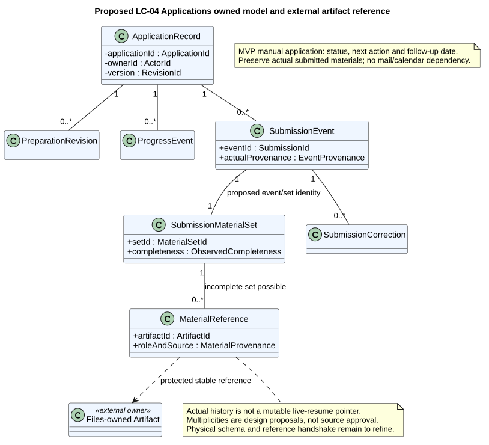

[Editable PlantUML](diagrams/applications-owned-model.puml) · [PNG](diagrams/applications-owned-model.png)

**ApplicationRecord:** stable application/owner identity, version, lifecycle, company/opportunity context and deliberate associations. Proposed optional fields include URL/contact/location/description/source/notes/deadline per Q-D12; exact types/limits remain physical refinement. Time-sensitive values preserve precision and timezone meaning rather than a misleading universal date string.

**PreparationRevision:** manually authored cover-letter content and identified intended resume reference, independently versioned as needed by source behavior. Preparation is not actual-history evidence. Reusing a company context must not unexpectedly change another application.

**ProgressEvent:** append-attributable actor/time/from/to/reason/context, with a projection of current progress. Corrections preserve provenance instead of rewriting the fact that an earlier event was recorded. The accepted transition policy, not class naming, governs valid changes.

**SubmissionEvent:** stable event/application identity, actual route/effective time and provenance. Repeated real submissions are distinct events; retries of recording the same command are not automatically new submissions.

**SubmissionMaterialSet and MaterialReference:** identified actual material manifest, completeness/availability observation, role/language/source version and Files-owned artifact reference where required. Physical sharing/deduplication must preserve independent actual-material identity and protected references. Missing/expired material is visible, not substituted with a new current resume.

**SubmissionCorrection:** attributable correction identity, prior/new version/reference relationship and reason. Exact retention/erasure handling follows reviewed policy and applicable evidence, not an invented immutable-forever rule.

### Logical persistence prescription

Use owner/application identity and version constraints; separate preparation, progress events, actual events, material membership and correction relationships. Enforce non-null/unique/reference integrity appropriate to actual selected fields, command identities and material roles. Index private owner/application lookup, attributable history order and unresolved capture work where justified. Avoid a uniqueness rule that collapses confirmed distinct applications or resubmissions.

External artifact ownership remains with Files; store permitted stable references and provenance, not unrestricted paths or other modules’ ORM objects. Exact engine-specific types, key sizes, collation, indexes, schema migration SQL and deletion constraints require [shared physical data refinement](../../04-data-design/README.md). The diagram’s multiplicities describe this proposal, not new accepted source cardinalities.

## 4. Submission capture and correction algorithms

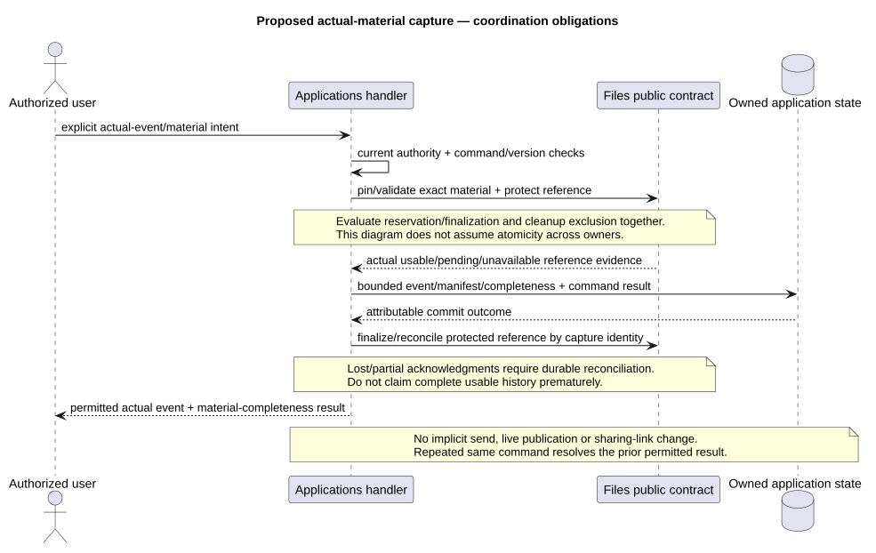

[Editable PlantUML](diagrams/applications-capture-sequence.puml) · [PNG](diagrams/applications-capture-sequence.png)

1. Validate explicit actual-event intent, actor/application context, expected version and command identity. Check current authority before exposing prior outcome or referenced private material.
2. Bind command identity to the intended recording request. Same-intent repetition resolves the prior permitted result; changed intent under that identity conflicts rather than overwrites history.
3. Resolve exact actual material/provenance. Do not defer this by asking a worker to copy the latest live resume. If material processing is asynchronous, persist the pinned intended identity and a truthful pending/incomplete observation.
4. Establish Files-owned usable artifact/protected-reference guarantees through its evaluated public protocol. Coordinate reference reservation/finalization and local commit so cleanup cannot delete material between eligibility check and durable protection. The concrete cross-module transaction/handshake requires joint Applications/Files/data design; an unprotected read-then-insert is insufficient.
5. Under the selected local consistency guard, recheck application authority/version/lifecycle and persist the attributable submission event/material manifest/completeness plus command result. Persist any required reconciliation work durably. If the source policy coordinates progress, apply its exact rule; material completeness does not silently invent submission or progress.
6. Commit the local result, reconcile reference finalization/abandoned reservations and return permitted attributable state. Lost client response resolves the same command identity; storage/provider effects are not assumed rolled back.

Correction follows the same authority/version/identity protocol, retains the original relationship/evidence as required and records the correction separately. New actual submissions receive new event identities. Do not repurpose a correction endpoint to delete protected material or change sharing links.

**Protected frame:** source profiles/resumes/overrides/publications, independent sharing controls, unrelated applications, mailbox/calendar state, other actors’ private data and target/execution state remain unaffected unless a separate permitted command explicitly owns that effect.

## 5. Concurrency failure and lifecycle scenarios

**Concurrent preparation/progress edits:** compare expected versions and return explicit conflict rather than silently overwriting another action. Preserve entered intent for an authorized compare/reapply path.

**Actual event with incomplete material:** report known event/provenance and actual completeness separately. Do not infer false completion or silently replace unavailable bytes with the latest source. Proposed material requirements and incomplete handling remain Q-D13 review work.

**Capture versus cleanup:** enforce the evaluated protected-reference handshake. A confirmed historical reference must survive eligible source retirement. Reconcile abandoned reservations using attributable capture identity, not age alone where commit/effect is uncertain.

**Commit succeeds/response lost:** return the same permitted command result when repeated; do not create duplicate real submission history. Two deliberately distinct submissions are different events even when content matches.

**Provider send unknown or disconnected:** Communication owns attempt reconciliation. Applications can retain a permitted association/provenance but cannot translate send acceptance/unknown into receipt, Submitted progress or complete actual evidence automatically.

**Correction or deletion races:** verify current version/lifecycle and retained reference constraints. Archive removes active-list presence under policy without erasing historical identity. Trash/restore/purge, backup expiry and hard-erasure conflicts remain exact source/applicability decisions. Do not newly accept the proposed 30-day period here.

**Recovery:** restore application/events/manifests and referenced artifacts consistently; reapply current authority/deletion decisions and report missing material. Do not reactivate links/collaborators, resend mail or construct history from a different live revision.

Ordinary diagnostics use bounded actor/operation/application/event identities and result categories. Do not log cover-letter text, private artifacts, provider tokens or unrelated correspondence. User feedback distinguishes draft saved, progress recorded, actual event captured and material set pending/incomplete/complete.

## 6. Verification and open decisions

### Requirement-to-design responsibility map

| Source | Primary design responsibility |
|---|---|
| APP-D01–D03 | Explicit opportunity/context, selected resume and manual preparation |
| APP-D04–D05 | Reviewed manual progress and attributable actual-event recording |
| APP-D06–D07 | Independent actual materials, new events and correction provenance |
| APP-D08 | Deliberate permitted correspondence/calendar associations |
| APP-D09 | Current private access, archive/retirement/recovery and protected references |

This maps candidate intent, not completion of every source acceptance criterion. Exact criterion/path evidence and unresolved proposals must be reconciled before acceptance.

### Planned focused checks

- Valid/incomplete preparation, denied cross-user reference, distinct same-company applications and stale edits.
- Progress changes versus actual submission/material completeness, including denied/invalid transitions and corrections.
- Capture pinned materials, then edit/publish/retire the source; actual history remains correct.
- Duplicate same/different-intent commands, distinct resubmissions and commit/response interruption.
- Concurrent file cleanup/reservation/finalization, interrupted capture and unusable/missing artifacts.
- Metadata/material correction preserving attributable prior relationships under current policy.
- Provider unknown/disconnection and linked calendar/email changes without inferred progress or receipt.
- Isolated restore with current grants/deletion decisions and explicit missing-material status.

Use deterministic policy/handler checks and actual persistence/reference/concurrency integration. Controlled provider/storage/recovery verification is separate where authorized. No checks are executed or marked passed by this document update.

### Remaining decisions

Q-D12/13/14 detailed field/state/capture/correction/retention dispositions; physical types/limits and constraints; exact operation signatures; Files reference handshake and local atomicity; usable material/provenance evidence; criterion-level comparison and actual review. These remain visible engineering/source decisions rather than default values.

Follow the [component template](../component-template/README.md), [runtime protocol](../../01-software-architecture/03-process-view-concurrency-and-runtime-behavior.md), [interface design](../../05-interface-and-api-design/README.md), [security/quality](../../06-design-quality-and-security-analysis/README.md) and [review/handoff](../../06-design-quality-and-security-analysis/05-design-review-traceability-and-handoff.md). The class/sequence diagrams are proposed technical views, not full physical schema or implemented runtime traces. No live application send/capture, migration, restoration or baseline acceptance is performed.

[Component catalog](../README.md) · [Application diagram catalog](diagrams/README.md)

## 7. Application context and landscape package

**Terminology:** this document owns LC-04, the **manual job-application management component**. “Application landscape” below means its place among logical Resumefolio capabilities, not a newly selected portfolio of independently deployed applications. C4 Level 1/2 retain the whole-system/application-runtime scope; module-level UML views retain logical ownership. All proposed source dispositions and feasibility gates above remain unchanged.

### 7.1 Provided and required component interfaces

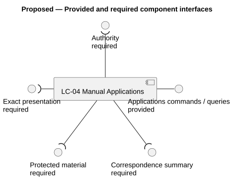

[Editable PlantUML](diagrams/applications-interfaces.puml) · [PNG](diagrams/applications-interfaces.png)

Provided circle and required sockets denote logical contracts, not allocated network APIs. Applications owns resource-operation policy; current Identity context does not give blanket access. Command families require exact signature refinement.

### 7.2 C4 Level 1: Resumefolio system context

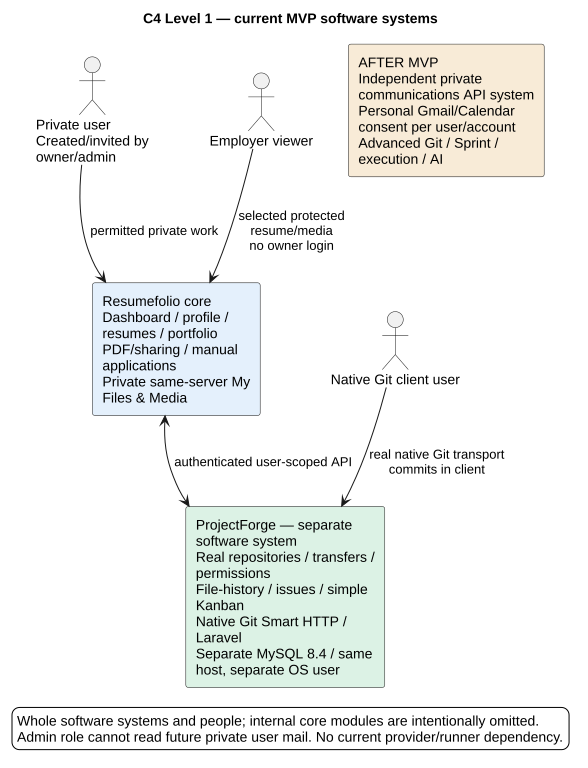

[Editable PlantUML](diagrams/applications-system-context.puml) · [PNG](diagrams/applications-system-context.png)

C4-style Level 1 scope is the whole software system; LC-04 is not promoted to a separate system. Public viewers have no Applications access merely because they can view a published resume. No internal module boxes appear at this level.

### 7.3 C4 Level 2: modular application and stores

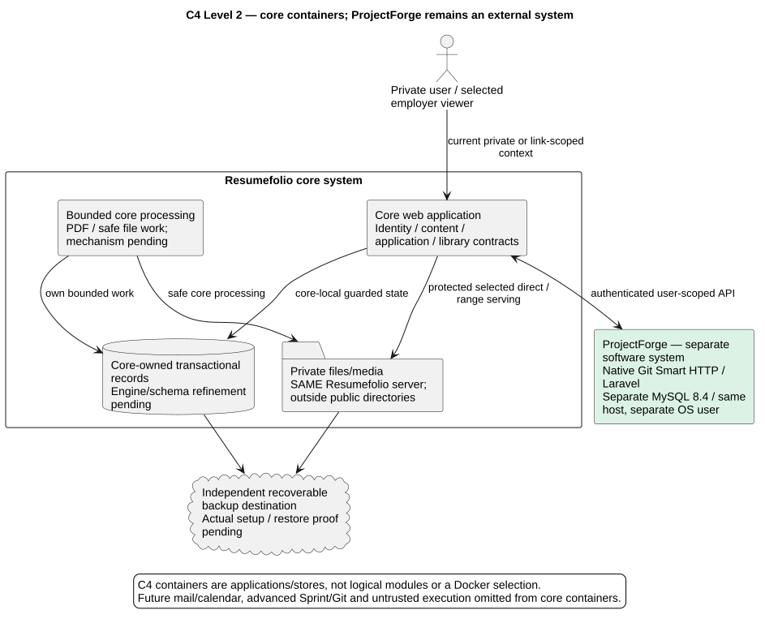

[Editable PlantUML](diagrams/applications-containers.puml) · [PNG](diagrams/applications-containers.png)

C4-style containers are applications/runtimes and data stores, not Docker units or nine services. Worker and provider facilities remain subject to enabling evidence. Sharing one database does not allow another module to write Applications state.

### 7.4 Logical capability landscape

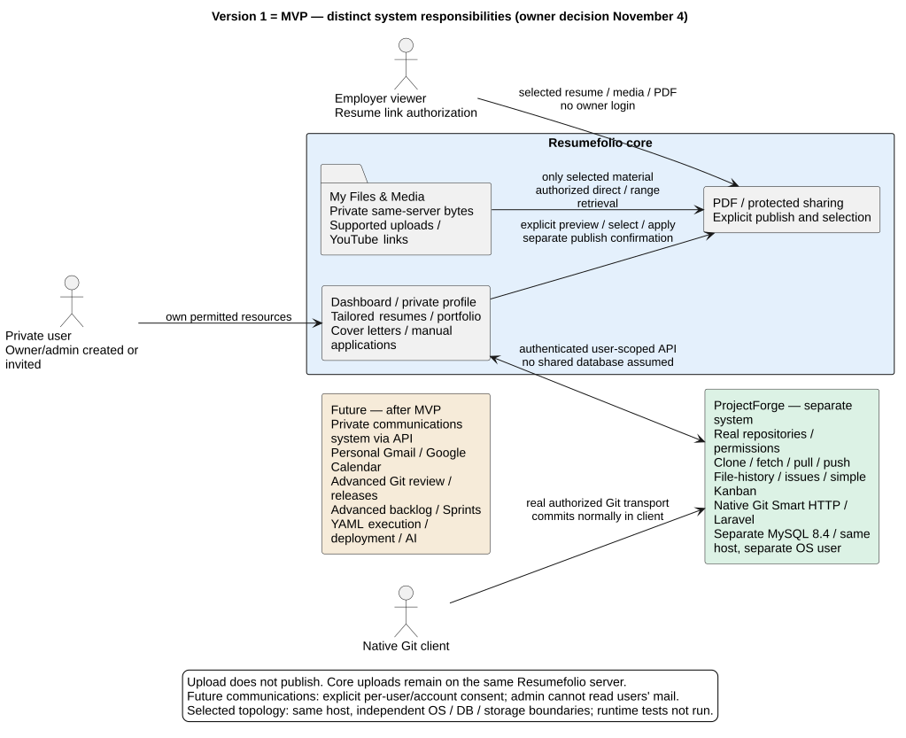

[Editable PlantUML](diagrams/applications-portfolio.puml) · [PNG](diagrams/applications-portfolio.png)

Portfolio-style map of nine logical modules grouped for navigation, not separate deployed applications, teams or enterprise systems. Grouping does not create new integration requirements; Work/Git/Workflow have no implied Applications lifecycle authority.

### 7.5 Applications inbound and outbound dependencies

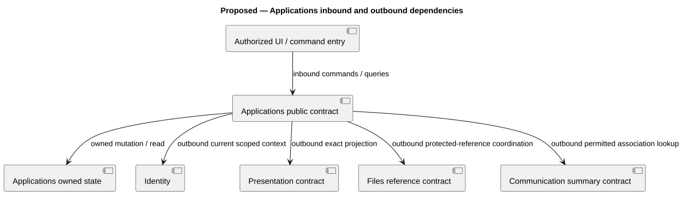

[Editable PlantUML](diagrams/applications-dependencies.puml) · [PNG](diagrams/applications-dependencies.png)

Use/dependency direction, not bidirectional state access. No consumer obtains mutable Applications ORM records. A permitted correspondence association is not automatic progress or submission capture.

### 7.6 Applications layered architecture

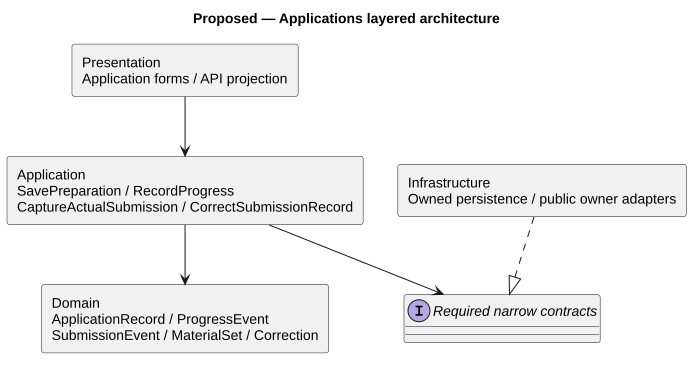

[Editable PlantUML](diagrams/applications-layers.puml) · [PNG](diagrams/applications-layers.png)

Proposed role allocation, not implemented classes or selected REST routes. Domain rules must retain proposal status where Q-D12/13/14 remain unresolved. Infrastructure does not gain authority to alter another owner’s tables.

### 7.7 Internal responsibility areas within LC-04

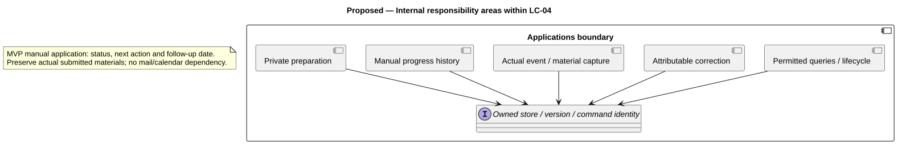

[Editable PlantUML](diagrams/applications-internal-structure.puml) · [PNG](diagrams/applications-internal-structure.png)

Internal design areas, not independently deployed sub-applications. Progress, event existence and material completeness are distinct facts; correcting one must not silently rewrite another or manufacture submitted status.

### 7.8 Candidate package dependencies

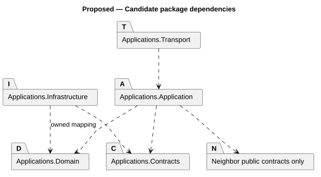

[Editable PlantUML](diagrams/applications-packages.puml) · [PNG](diagrams/applications-packages.png)

Proposed namespaces; actual Laravel autoloading/folder conventions remain to inspect/select. Source dependencies must be acyclic and cross-owner access limited to exported contracts. Runtime coordination direction is not inferred from package names alone.

### 7.9 Integration types and evidence boundaries

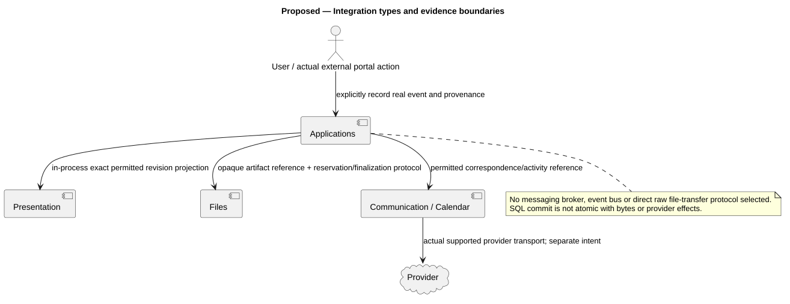

[Editable PlantUML](diagrams/applications-integration.puml) · [PNG](diagrams/applications-integration.png)

File integration is through Files-owned usable identity/reference protection, not raw private paths. Any asynchronous reconciliation needs durable attributable work; no messaging product or provider lookup guarantee is adopted.

### 7.10 Actual submission capture across owner contracts

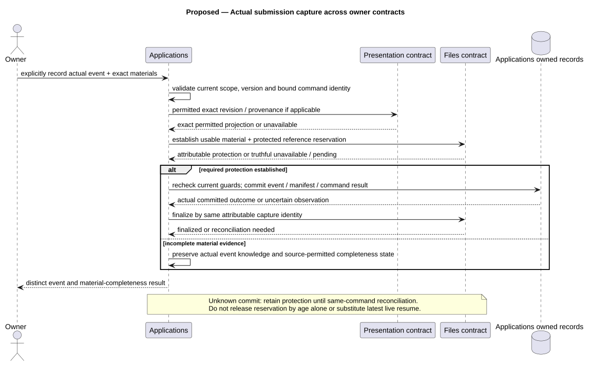

[Editable PlantUML](diagrams/applications-cross-owner-sequence.puml) · [PNG](diagrams/applications-cross-owner-sequence.png)

Logical public-contract collaboration, not a proven cross-module atomic handshake. Actual reservation, consumer commit, finalization and cleanup ordering remains joint Applications/Files/data design. New real submissions differ from repeats of one recording command.

### 7.11 UML use cases for the manual Applications capability

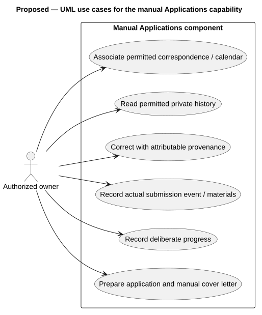

[Editable PlantUML](diagrams/applications-use-cases.puml) · [PNG](diagrams/applications-use-cases.png)

Design-level use-case summary, not allocated new use-case IDs or exact criterion coverage. No automatic job-portal submission, AI drafting, universal admin access or email-inferred progress is introduced.

### 7.12 Optional deployment mapping of logical roles

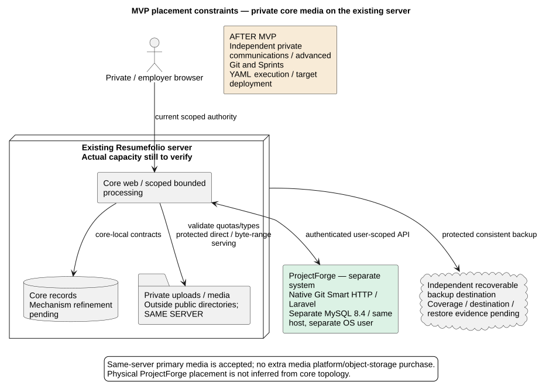

[Editable PlantUML](diagrams/applications-deployment.puml) · [PNG](diagrams/applications-deployment.png)

Optional candidate mapping, not an installed topology or assertion that one host meets capacity/recovery needs. Refer to the owning deployment document; dated demo allocations are not production sizing guarantees.

### 7.13 Application / module inventory

Technology is the shared proposed Laravel/OOP modular-app approach unless the owning design specifies otherwise. Criticality is a qualitative consequence classification, not accepted availability tiers. Responsible delivery/decision owner is Farhad; domain owners below are logical responsibilities, not separate staffed teams.

| Name / level | Purpose | Logical owner | Technology / status | Criticality consequence |
| --- | --- | --- | --- | --- |
| Resumefolio / software system | Full accepted V1 capabilities | Farhad | Proposed modular Laravel application | Cross-capability availability/privacy impact |
| Manual Applications / LC-04 module | Private preparation, progress and actual-material history | Applications | Same modular app; not a separate service | Wrong or lost actual history affects evidence integrity |
| Professional Presentation / module | Source, independent resumes and explicit publication | Presentation | Same candidate app | Wrong revision/content can misrepresent intent |
| Representation / Sharing / module | Exact permitted representation/link controls | Sharing | Same candidate app | Unauthorized disclosure or wrong representation |
| Communication / Calendar / module | Actual supported account/provider interactions | Communication | App adapters + conditional provider access | Duplicate/unknown effects and private correspondence exposure |
| Identity / Access / module | Current scoped context and access policy | Identity + resource owner | Actual session/auth mechanisms to refine | Protected-operation admission and privacy |
| Files / Operations / module | Usable artifact identity, protection and operations | Files | App capability + selected storage/runtime TBD | Missing/corrupt protected actual material / recovery loss |

This focused inventory lists the system, LC-04 and its relevant neighbors; the landscape diagram and component catalog include Work, Git and Workflow as separate logical owners. External job portals are outside the product boundary and are not inventoried as owned apps.

### 7.14 Capability mapping

`O` owns the capability; `S` supplies a required supporting contract; `—` means no primary role in this selected mapping, not a privacy exemption or exhaustive integration claim.

| Logical module | Private preparation | Manual progress | Actual event / material manifest | Current admission | Usable bytes / references | Mail/calendar truth |
| --- | --- | --- | --- | --- | --- | --- |
| Applications | O | O | O | O (resource action) | S (consumer protection) | — |
| Presentation | S (exact revision) | — | S (exact provenance) | S (owned access) | S (its consumers) | — |
| Identity | S | S | S | O (identity/scope contract) | S (current scope) | — |
| Files | S | — | S (artifact protection) | S (owned access) | O | — |
| Communication | S (permitted association) | — | S (attributable observation only) | S (owned access) | S (its attachments) | O (provider evidence, not invented receipt) |

### 7.15 Interface catalog

Operation names remain proposed. No REST route, broker topic, provider protocol version or public endpoint is allocated by this table.

| Application / logical owner | Interface / operation family | Protocol / exposure | Consumers |
| --- | --- | --- | --- |
| Applications | SavePreparation, RecordProgress, CaptureActualSubmission, CorrectSubmissionRecord | Proposed in-process application contracts; transport mapping TBD | Authorized UI/entry paths |
| Applications | Permitted list/detail/history and reviewed lifecycle operations | Owned query/command contracts | Authorized user flow; other consumers only if justified |
| Presentation | Exact permitted preparation/source revision projection | Public owner contract; not raw ORM/table access | Applications preparation/capture |
| Files | Usable artifact identity, reservation/finalization and safe lifecycle | Evaluated public reference protocol; concrete handshake pending | Applications material consumers |
| Identity | Current identity/scope context | Actual selected mechanism TBD | Applications owner admission |
| Communication / Calendar | Permitted correspondence/activity summary | Public owner contract; external provider handled by that owner | Explicit Applications association |

### 7.16 Technology stack

| Layer | Proposed / observed position | Version status | Evidence needed |
| --- | --- | --- | --- |
| Application | Proposed Laravel / PHP OOP modular app | Final supported PHP/Laravel versions not selected here | Inspect actual manifests, lockfile and intended runtime |
| Demo inventory | Earlier inspected PHP 8.3 / existing Laravel / Nginx / MySQL on Ubuntu 24.04.4 | Dated observation, not accepted production baseline | Confirm actual environment and compatibility |
| Applications persistence | Owned records with version/identity guards | Engine-specific schema/types/indexes pending | Actual persistence design and concurrency checks |
| Files storage | Usable protected artifact/reference capability | Placement, keys, recovery and concrete protocol pending | Real byte/reference lifecycle and isolated restore evidence |
| Provider integration | Communication-owned mail/calendar adapter | OAuth/prerequisites and supported operations pending | Actual provider capability and authorized integration evidence |

### 7.17 Data ownership / CRUD matrix

CRUD permissions below describe **logical write ownership**, not SQL grants or unconstrained deletion. `C/R/U/D*` means owner-controlled lifecycle only; `R(contract)` means permitted projection through the owner, not direct database access. Actual retention, correction and erasure policy remains sourced/proposed as stated above.

| Logical module | Applications records/events/manifests | Presentation records/revisions | Files bytes/reference ledger | Communication records | Identity state |
| --- | --- | --- | --- | --- | --- |
| Applications | C/R/U/D* under reviewed policy | R(contract) | R(contract) + explicit reservation/finalization requests | R(contract) | R(contract) |
| Presentation | No direct access | C/R/U/D* | Public reference requests for own consumers | No implied access | R(contract) |
| Files | No direct access | No direct access | C/R/U/D*; protected references gate reclamation | No direct access | R(contract) |
| Communication | No direct mutation | No direct mutation | Public reference requests for own attachments | C/R/U/D* plus actual provider semantics | R(contract) |
| Identity | No blanket business-data access | No blanket business-data access | No blanket private-byte access | No blanket correspondence access | C/R/U/D* under actual identity policy |

SQL/shared-host placement does not merge these owners. A request to reserve a Files reference is an owned command, not permission for Applications to CRUD the Files ledger itself. Administrative access remains subject to exact source-policy reconciliation, not a universal bypass.

### 7.18 Quality / NFR scenarios

No numeric availability, latency, concurrency, retention or RPO/RTO target is accepted here. Q-D25/26 and owning quality/recovery records retain their proposal/evidence status.

| Application / module | Quality attribute | Required design behavior / scenario | Target / verification status |
| --- | --- | --- | --- |
| Applications | Integrity / consistency | Preserve actual event/material identity through source edits, correction, repeat and races | Exact contracts and real persistence/reference checks pending |
| Applications + Identity | Security / privacy | Current scoped admission and permitted history projection under revocation | Actual synchronization and access checks required |
| Applications + Files | Recoverability / availability | Report missing material truthfully; restore consistent usable references/bytes/keys | Usable backups/recovery not established by this document |
| Whole modular app | Performance / capacity | Bound combined web/artifact/Git/worker demand without false completion | Agreed workload and real combined-load evidence pending; account count is not concurrency |
| Applications + Communication | Reliability | No progress or actual submission inferred from unknown send / provider acceptance | Controlled adapter/association evidence required |
| Applications UI | Usability / accessibility | Distinguish saved preparation, recorded progress, actual event and material completeness | Actual UI and agreed accessibility/browser targets need verification |

### 7.19 Lifecycle and ownership

| Item | Status / version | Responsible owner / support | Retirement / change plan |
| --- | --- | --- | --- |
| LC-04 design | Proposed design candidate; no software release version allocated | Farhad; actual operating support route to establish | Compatible change with source-policy disposition and exact evidence |
| Application records/history | Source-governed lifecycle; Q-D12/13/14 detailed proposals unresolved | Applications owner | Archive/trash/correction/erasure by reviewed policy; no new 30-day default |
| Referenced actual materials | Independent protected identities; usable-byte state distinct | Applications consumer + Files owner | No cascade/age-only reservation release across unknown commit; reconcile protection |
| Linked correspondence/provider account | Owned by Communication under actual access/lifecycle | Communication + current user authority | Disconnection does not rewrite prior actual facts or authorize resend |

### 7.20 Application-level decision note

**Proposed application of existing ADRs, not a new accepted decision:** retain LC-04 within the modular application and access neighbors through public contracts ([ADR-001](../../07-design-decisions/ADR-001-modular-application-boundaries.md)); preserve separate publication and actual-history identities ([ADR-002](../../07-design-decisions/ADR-002-explicit-publication-and-history.md)); keep consequential external attempts under their owning durable reconciliation protocol ([ADR-003](../../07-design-decisions/ADR-003-durable-external-attempts.md)). All retain their Proposed status.

The simplest alternative to separate deployment avoids adding network/operating/consistency costs before actual evidence justifies extraction. A future independent Applications service requires a new explicit ADR covering contracts, migration, identity, protected references, resource/recovery cost and operating support; this package does not select that alternative. Refer to the [ADR template](../../07-design-decisions/ADR-template.md) and [deployment owner](../../01-software-architecture/04-deployment-topology-nodes-and-networks.md).

These views/tables complement the detailed class/capture algorithms above. They do not close exact acceptance criteria, accept Q-D12/13/14, select a physical topology, establish capacity or execute capture/send/recovery. Verify the actual candidate through the owning review/handoff process.
