# Resumefolio — Communication and Calendar Component Design

**Responsibility:** coordinate private mail/calendar intent with explicitly authorized provider capabilities, preserve attributable outcomes and distinguish local records from provider truth. A message accepted by a provider is not proven delivered/read, and a local calendar association is not a provider mutation.

**Status:** proposed LC-05 component design, November 2, 2026. Q-D15 access remains evidence-gated; Q-D16/Q-D17 detailed behavior remains proposed in the source specification. OAuth was reported uncreated. No provider account, token, supported API/version, scope approval or actual send/synchronization result is established here.

[Authority](#1-source-authority-and-ownership) · [Operations](#2-public-operations-and-result-contracts) · [Data](#3-owned-classes-and-logical-data) · [Send](#4-reviewed-send-and-uncertain-outcome-protocol) · [Calendar](#5-calendar-authority-and-reconciliation) · [Recovery](#6-security-failure-and-recovery-boundaries) · [Review](#7-verification-and-open-decisions) · [Communication package](#8-communication-calendar-and-delivery-view-package)

## MVP system allocation and design status

The entire mail/calendar feature is after MVP. Retain the requirements for a future independent private communications system connected through API, with Gmail and Google Calendar provider connections. Each user may consent to connecting their own personal Google accounts, potentially multiple. Authority is explicit per user/account/operation. Owner/admin role never grants reading user mail. Other provider support remains unresolved. Provider OAuth/read/send/sync evidence is a future gate, not an MVP dependency.

Authority: [OWNER-MVP-2026-11-04](../../../01-project-planning/owner-mvp-decision-2026-11-04.md).

## 1. Source authority and ownership

Use [EGC-D01–EGC-D12](../../../02-requirements-engineering/03-requirements-specification/email-calendar-and-google-integration.md), [Q-D15](../../../02-requirements-engineering/03-requirements-specification/email-calendar-and-google-integration.md#resolution-q-d15), [Q-D16](../../../02-requirements-engineering/03-requirements-specification/email-calendar-and-google-integration.md#resolution-q-d16) and [Q-D17](../../../02-requirements-engineering/03-requirements-specification/email-calendar-and-google-integration.md#resolution-q-d17). Provider scopes listed there are proposals whose current applicability, audience/verification, costs/quotas and actual capability need official-source assessment at configuration time; this design does not independently certify them.

Follow [analysis interfaces](../../../03-system-analysis/06-interfaces-security-and-quality-analysis/12-interfaces-and-external-interactions.md), [states](../../../03-system-analysis/04-behavioral-and-scenario-analysis/07-state-based-view.md), [operation contracts](../../../03-system-analysis/05-business-rules-and-operation-contracts/10-domain-constraints-and-operation-contracts.md), [runtime protocol](../../01-software-architecture/03-process-view-concurrency-and-runtime-behavior.md) and [security design](../../06-design-quality-and-security-analysis/02-security-threat-modeling-and-trust-boundaries.md).

**Own:** user/provider identity and capability state; local correspondence projections and compose intent; attributable remote-draft/send operations; local activities/private notes; selected provider-event mappings and synchronization observations/conflicts.

**Do not own:** all provider mailbox/calendar state, application progress/actual submitted manifests, private artifact byte storage, user-wide permission grants or an assumed working delivery infrastructure. Application/work references remain explicit associations with independently checked access.

**Dependencies:** current actor/resource authority; evaluated mail/calendar adapters; protected artifact access; durable local pending-operation/claim mechanism; clock/time representation and actual reminder delivery capability. No product-wide service account or Codex connector is assumed to provide personal Gmail access.

## 2. Public operations and result contracts

The signatures below name proposed responsibilities, not final language/API syntax. Mutating operations carry current context, resource/expected version, stable command identity and intended input where appropriate. Return permitted confirmed/pending/invalid/denied/conflict/unavailable/partial/unknown outcomes with attributable references, never a boolean that hides remote uncertainty.

### Connection and capability operations

**ConnectSelectedAccount(context, authorizationResult):** bind verified provider identity to the intended product owner and evaluated consent/capabilities. Validate account selection and applicable callback/security protocol in the actual adapter; do not accept unverified client-supplied identity as account proof.

**DisconnectConnection(context, connectionId, expectedVersion):** stop new dependent dispatch/fetch/push work, invalidate locally usable credentials and mark retained copies/mappings disconnected/stale under source rules. Provider revocation is an actual external result, distinct from successful local disconnect. Already admitted effects may need reconciliation.

**ReconnectAndReconcile(context, connectionId, authorizationResult):** reassess actual identity/capability, then reconcile existing mappings/attempts. A different provider identity cannot silently inherit the prior mailbox context. Never replay old sends or recreate mapped events merely because access returns.

### Mail read compose draft and reply

**SearchReadCorrespondence(context, connectionId, queryOrMessageReference):** authorize selected mailbox capability, bounded search/page/read and any retained local projection. Preserve provider message/thread identity, observation time and freshness/disconnection state. Render untrusted content safely; attachments require protected access.

**SaveComposeDraft(context, draftId?, expectedVersion?, content):** preserve current local edit intent and report actual save state. Remote draft persistence, if requested/supported, is a separate versioned provider operation with its own outcome. An out-of-order autosave cannot overwrite a newer edit silently.

**PrepareSend(context, draftId, expectedVersion, reviewedRecipientsAndArtifacts):** validate selected sender/account and bind exact To/Cc/Bcc, subject/body, reply/thread context and attachment identities to a reviewed intent. Content/recipient/attachment changes invalidate the prior review as required by the source policy. Reply-all is not inferred automatically.

**DispatchReviewedIntent(context, reviewedIntentId, commandId):** create/admit the attributable attempt under current authority/capability and durable dispatch rules; sending remains deliberate. **ReconcileSend(context, attemptId):** inspect only actually supported attributable provider evidence and record what is known. Do not invent a query/idempotency guarantee or infer delivery from acceptance.

### Local activities provider mappings and reminders

**SaveLocalActivity(context, activityId?, expectedVersion?, activityInput):** create/edit local time/notes/associations without publishing remotely by default.

**PublishSelectedActivity(context, activityId, expectedVersion, selectedCalendar):** explicitly request a permitted provider event and record its attributable result/mapping. **ReconcileCalendarMapping(context, mappingId, versionContext):** apply the source field-authority/conflict rules, not implicit whole-account mirroring.

**UnlinkLocalMapping(context, mappingId, expectedVersion):** remove the local association where permitted without a provider deletion. **DeleteProviderEvent(context, mappingId, expectedVersion, explicitConfirmation):** a distinct authorized consequential operation with unknown-effect handling where needed.

**PlanOrDeliverReminder(context, activityId, versionContext):** requires the actual selected delivery facility and current eligibility. Scheduling, provider acceptance and delivery are separate facts; disconnected capability or unavailable delivery must not be labeled notified.

## 3. Owned classes and logical data

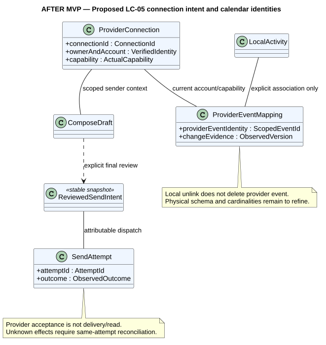

[Editable PlantUML](diagrams/communication-owned-model.puml) · [PNG](diagrams/communication-owned-model.png)

**ProviderConnection:** stable product-owner/connection identity, verified provider-account identity, capability/consent observations, locally usable credential reference, lifecycle/version and relevant timestamps. Sensitive credentials remain restricted and recoverable through evaluated key procedures, not exposed through public projections.

**CorrespondenceProjection / ComposeDraft:** provider message/thread references and observed freshness, or private editable recipient/body/attachment/reply intent with version. Local projection retention/disconnected availability follows reviewed policy; a retained copy is not proof of current provider access or freshness.

**ReviewedSendIntent / SendAttempt:** exact reviewed sender/content/recipient/artifact version, command/attempt identity, current claim/dispatch evidence, provider references where supplied and acceptance/pending/partial/unknown observations. Review identity must not point to a later mutable draft version.

**LocalActivity / ProviderEventMapping:** local private fields and time semantics, selected provider/calendar/event/recurrence identity, last observed provider change evidence, field authority, sync status/conflict and connection context. Local association and provider event lifecycles remain distinct.

**ReminderIntent:** actual intended channel, subject/version/time, pending/delivery-attempt identity and attributable result. Do not add a second silent sending system that bypasses authority or uncertain-effect handling.

### Logical persistence and types

Scope all private records and lookups to actual owner/connection context. Uniqueness for provider message/event identities must include the actual account/calendar namespace; identical provider-looking strings across accounts are not interchangeable. Protect command/attempt identity and expected local versions against duplicate/stale updates. Persist source/observation provenance and pending intents needed for reconciliation.

Timed events retain unambiguous instant and source/display timezone. All-day calendar dates and exclusive end semantics follow the source proposal, not arbitrary midnight conversion; recurrence/exception identity is preserved. Physical engine/types, field lengths, token storage/key handling, indexes, pagination limits and concrete provider version/change facilities remain evaluated refinements, not invented schema details.

## 4. Reviewed send and uncertain outcome protocol

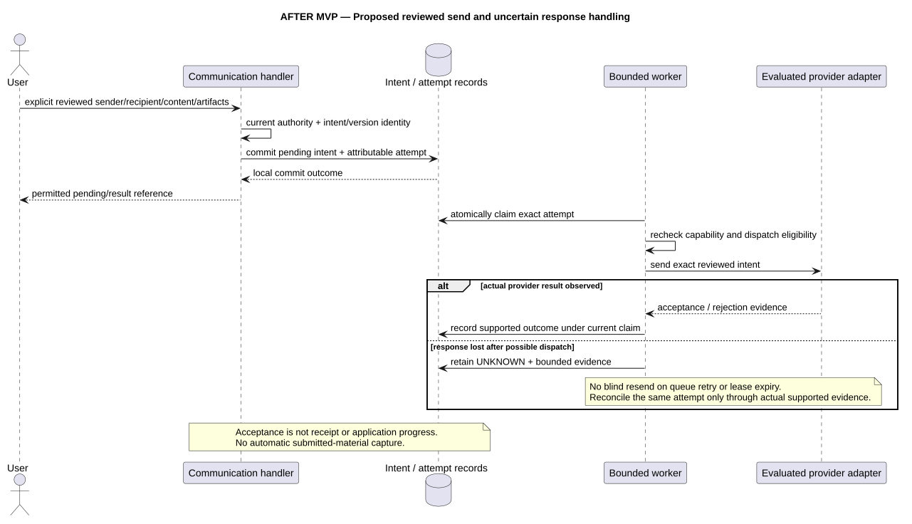

[Editable PlantUML](diagrams/communication-send-sequence.puml) · [PNG](diagrams/communication-send-sequence.png)

1. Resolve current owner/connection/send authority and intended draft version. Validate the final selected sender/recipient/thread/content/artifact set and bind it to an immutable reviewed intent or equivalent stable snapshot.
2. Under the selected local guard, bind a unique command identity to that intent, record an attributable pending attempt and durable dispatch state. Same-intent repeat resolves the previous permitted result; changed intent conflicts.
3. A bounded worker claims the attempt, checks relevant current authority/capability and dispatch eligibility, and sends the exact reviewed intent through the evaluated adapter outside a long database transaction. Attachment usability/authorization must match the reviewed identities; unavailable changes require explicit handling, not silent substitution.
4. Record evidence-supported provider acceptance/rejection or pending/partial/unknown outcome with a current claim check. Local fencing does not stop an old network action or establish exactly-once remote delivery.
5. If a response is lost after possible dispatch, retain unknown and reconcile the same attempt through actual authorized provider evidence. Generic queue redelivery or lease expiry must not send blindly. Further explicit retry requires the source contract’s duplication warning/decision and evidence/identity rules.
6. Show truthful status to the user. Product admission, provider acceptance, delivery, recipient read and application submission/progress remain separate facts. Applications may explicitly associate permitted correspondence; it must not receive automatic progress changes or fabricated actual-material evidence.

The send adapter must report capability and actual result semantics, not suppress uncertainty behind success/failure. Provider operations/scopes/version/quotas, duplicate detection and reconciliation mechanisms require current actual evidence before dependent acceptance.

## 5. Calendar authority and reconciliation

**Release applicability:** future-domain design retained after MVP; core operating/deployment and recovery controls still apply to MVP where relevant.

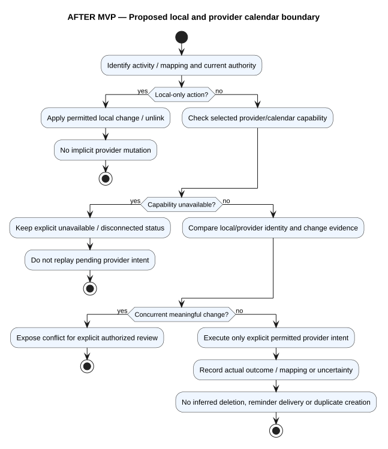

[Editable PlantUML](diagrams/calendar-reconciliation-route.puml) · [PNG](diagrams/calendar-reconciliation-route.png)

**Local-only activity:** save local intent without provider effect. Explicit publish establishes a new attributable mapping only when permitted provider creation is observed. Unknown creation cannot become a fresh create on reconnect automatically.

**Imported provider event:** provider-owned fields remain authoritative under the Q-D17 proposal until an explicit permitted update succeeds. Local private notes/application associations remain local. A provider scope that technically reaches many events does not authorize indiscriminate product disclosure.

**Mapped updates:** compare local and actually available provider version/change evidence. A concurrent meaningful change becomes an explicit conflict/review, not silent last-write-wins. Resolve by an authorized choice against identified versions and record actual effect/uncertainty. No universal bidirectional policy is introduced.

**Unlink and delete:** permitted local unlink does not require silently deleting the external event. Provider deletion needs a separate explicit confirmed intent and current target-calendar authority. An external deletion marks retained local mapping state removed/unavailable according to source rules, without inventing a new local business outcome.

**Disconnect and reconnect:** stop new connection-dependent work; mark retained data stale/disconnected and invalidate local credential usability. Reconnect re-evaluates identity/capability and reconciles pending state. Do not duplicate event creation, old sends or reminder delivery. Dates/timezones/recurrence exceptions retain their actual source meaning.

## 6. Security failure and recovery boundaries

**Private isolation:** connection/message/event references are verified under current owner/resource policy, including any actual accepted administrative rules. Associations with Applications or Work never grant whole-mailbox/calendar access. Return safe denied projections without unrelated private existence/content.

**Untrusted content:** sanitize display and protect attachments; do not execute email HTML or automatically load tracking resources under the source proposal. Attachment/reference paths and filenames are not authorization. Tokens, message bodies and private attachments do not enter ordinary logs or diagrams.

**Credential failure:** refresh/revocation/consent loss changes usable capability explicitly. A stale local token record or installed package cannot establish access. Do not bypass identity or send using another connected account as a fallback.

**Concurrency:** stale autosave, changed reviewed recipients, simultaneous send clicks, expired worker claims and local/provider edits have explicit version/intent/claim behavior. An observed remote effect is retained even when local access changes before the acknowledgment arrives; current permission still controls further action/disclosure.

**Operating recovery:** restart/resume pending state under current authority and the same attempt identities. Isolated restore checks connection/credential/key state, marks copies appropriately and reconciles effects before any new send/event/deployment-like action. Historical credentials/capabilities and restored queued work are not automatically valid. Local data deletion, provider deletion and backup expiry follow distinct reviewed policies.

**User feedback:** distinguish local draft saved, remote draft saved, send pending/accepted/unknown, local activity, mapped provider state, conflict and reminder delivery observation. Unavailable capabilities or missing artifacts are visible; never silently substitute identity, content or language.

## 7. Verification and open decisions

| Source | Primary component responsibility |
|---|---|
| EGC-D01–D02 | Selected identity/capability, explicit consent and private-resource isolation  **After MVP.** |
| EGC-D03–D06 | Read/compose/draft/send/reply and truthful attributable outcomes  **After MVP.** |
| EGC-D07–D08 | Time/recurrence meaning, local activity and explicit mapping/conflicts  **After MVP.** |
| EGC-D09–D10 | Permitted application associations and actual reminder outcomes  **After MVP.** |
| EGC-D11–D12 | Disconnect/reconnect, bounded failures/recovery and feasibility evidence  **After MVP.** |

This map associates candidate intent; it does not close every source criterion. Exact mapping and Q-D15–Q-D17 disposition remain review work.

### Planned focused verification

- Wrong-owner message/event/account references, changed grants and target-calendar authority.
- Local/remote drafts, stale autosave and changed content/recipient/artifact after final review.
- Double send, response loss before/after possible acceptance, duplicate delivery, stale worker completion and reconnect without replay.
- Explicit reply/thread/To/Cc behavior without inferred reply-all or receipt.
- Local-only publish, imported field authority, concurrent local/provider change, provider deletion versus local unlink and unknown event creation.
- Timed/all-day/timezone/recurrence cases and unavailable reminder delivery.
- Untrusted HTML/tracking/attachments, restricted diagnostics and credential privacy.
- Isolated restart/restore/disconnect handling with actual pending-effect reconciliation and current authority.

Use deterministic policy/adapter cases plus real persistence/claim concurrency and controlled provider operations when authorized. No send, account connection, scope grant, event mutation or restore test is performed here; mocks cannot certify provider access or idempotency.

### Remaining prescriptions and evidence

Actual OAuth project/audience/consent/redirect/security handling, current scopes/verification/quota/cost, concrete provider versions/paging/change tokens and correlation facilities; exact class/signature/schema/type and resource limits; credential/key recovery; actual delivery/scheduler/worker operation; Q-D16/Q-D17 detailed source acceptance; exact criterion review and candidate disposition. Known OAuth setup absence is not a request for an existing project ID.

Follow [component templates](../component-template/README.md), [shared data](../../04-data-design/README.md), [API contracts](../../05-interface-and-api-design/README.md), [operations/recovery](../../06-design-quality-and-security-analysis/03-operations-backup-recovery-and-resilience.md) and [review/handoff](../../06-design-quality-and-security-analysis/05-design-review-traceability-and-handoff.md). These technical views refine FAU component/data/dynamic modeling; they are not an accepted physical schema, complete current provider integration or baseline approval.

[Component catalog](../README.md) · [Component diagram catalog](diagrams/README.md)

## 8. Communication, calendar and delivery view package

**Release applicability:** future-domain design retained after MVP; core operating/deployment and recovery controls still apply to MVP where relevant.

These **proposed LC-05 views** preserve Google-oriented accepted scope and Q-D15 capability gates / Q-D16–17 proposal status. Requested chat, SMS, push, Microsoft Graph and alternate protocols are shown as unselected alternatives, not new V1 commitments. Conditional invitation/free-busy/recurrence/notification behavior needs exact source disposition and actual provider capability evidence. Diagrams allocate no endpoint, scope, library, event enum or service topology.

### 8.1 Communication and calendar interfaces

**Release applicability:** future-domain design retained after MVP; core operating/deployment and recovery controls still apply to MVP where relevant.

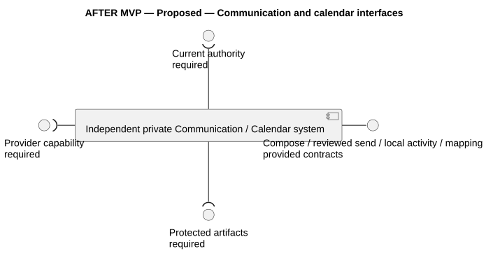

[Editable PlantUML](diagrams/comm-interfaces.puml) · [PNG](diagrams/comm-interfaces.png)

Logical contracts with provided circle and required sockets. Mail/calendar responsibilities are parts of LC-05, not newly selected services. Exact operations/signatures remain proposals as defined above.

### 8.2 C4 Level 1: users and external provider

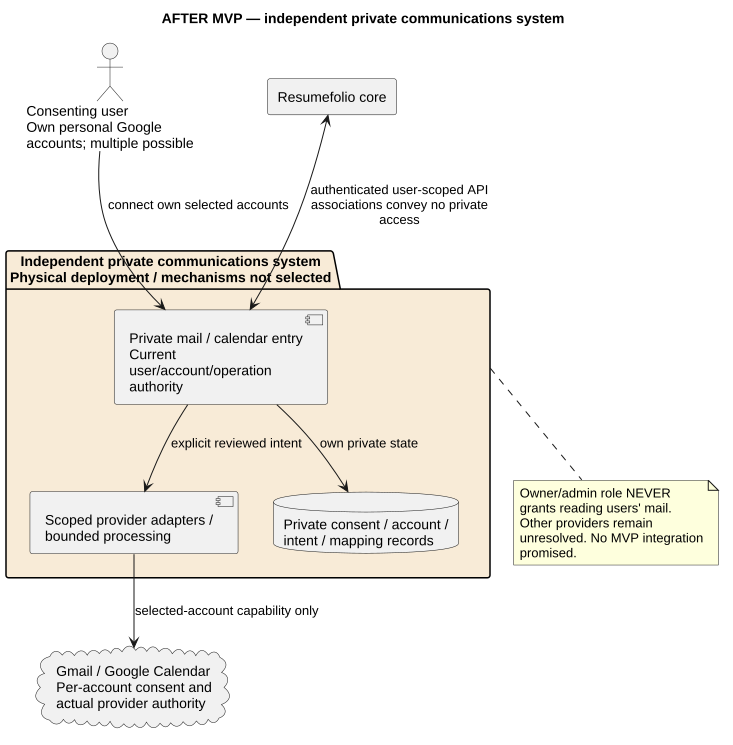

[Editable PlantUML](diagrams/comm-context.puml) · [PNG](diagrams/comm-context.png)

Whole-system C4-style context, not LC-05 as a separate software system. External correspondent interaction belongs to the provider; the product cannot infer receipt/read from its own request outcome.

### 8.3 C4 Level 2: actual proposed runtime boundaries

[Editable PlantUML](diagrams/comm-containers.puml) · [PNG](diagrams/comm-containers.png)

C4-style containers are web/runtime/store boundaries. Chat and separate notification services are not promoted into scope. Scheduler/worker/provider access is a pending operating capability, not configured infrastructure.

### 8.4 Owner communication and calendar use cases

**Release applicability:** future-domain design retained after MVP; core operating/deployment and recovery controls still apply to MVP where relevant.

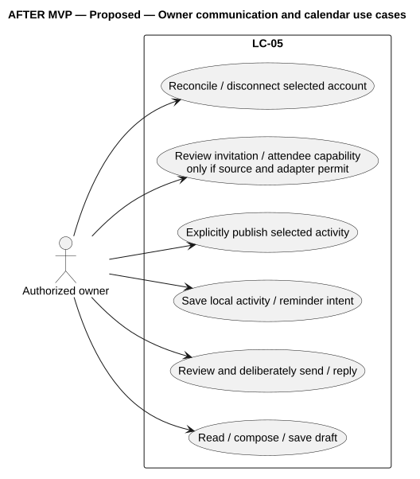

[Editable PlantUML](diagrams/comm-use-cases.puml) · [PNG](diagrams/comm-use-cases.png)

Scenario summary, not new allocated use cases. Scheduling a local activity is not inviting attendees. Invitation creation/response, conflict lookup and reminder delivery require actual source disposition and provider capability before implementation.

### 8.5 Domain classes and optional requested concepts

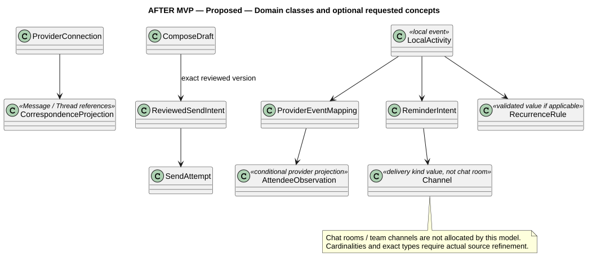

[Editable PlantUML](diagrams/comm-domain.puml) · [PNG](diagrams/comm-domain.png)

Message and Thread are provider-scoped projection identities, not claims of owned provider truth. Attendee and recurrence roles are conditional refinements. Channel denotes an explicitly selected delivery kind; the diagram creates no chat feature or push/SMS entitlement.

### 8.6 Logical ERD: owned and observed records

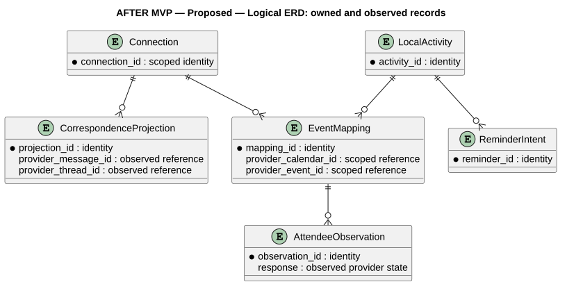

[Editable PlantUML](diagrams/comm-erd.puml) · [PNG](diagrams/comm-erd.png)

Selected logical ERD with proposed multiplicities, not migration SQL or complete schema. Calendars/messages/threads remain provider-scoped references/projections; private local notes and mappings remain owned. Exact uniqueness, attendee retention and mapping cardinality need refinement; no cascade deletion implied.

### 8.7 Reviewed send and delivery observations

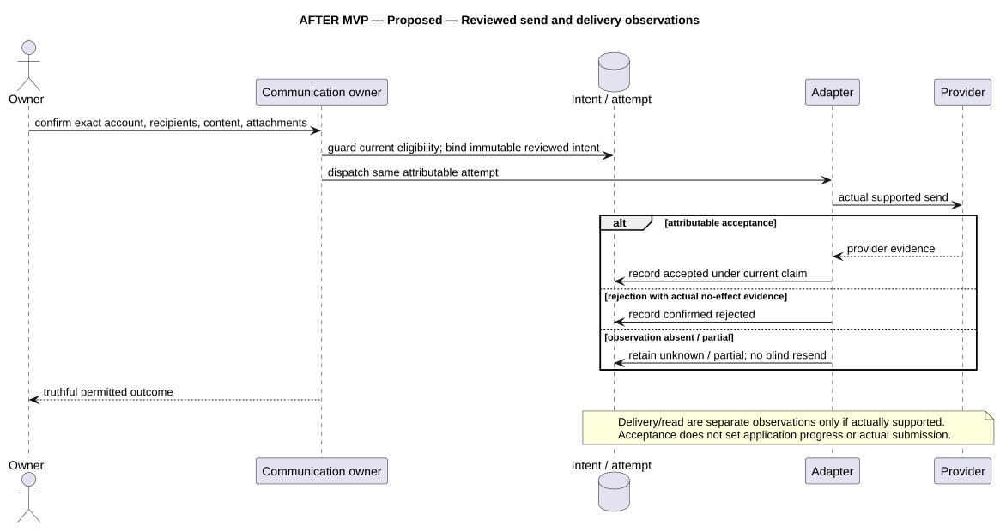

[Editable PlantUML](diagrams/comm-send.puml) · [PNG](diagrams/comm-send.png)

No delivery/read guarantee or provider lookup/idempotency API is invented. Reviewed content cannot refer to a later mutable draft. Exact attachment identity and current usable capability must hold at actual dispatch.

### 8.8 Conditional event creation and attendee response

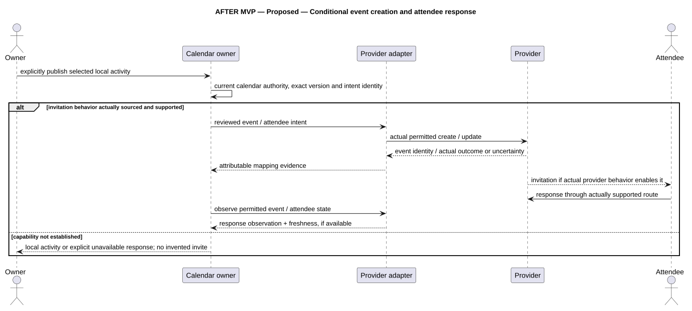

[Editable PlantUML](diagrams/comm-invitation.puml) · [PNG](diagrams/comm-invitation.png)

Conditional interaction, not newly accepted attendee workflow. Event mutation, invitation dispatch and attendee response are separate effects/facts. Unknown create/update must reconcile the same intent; no recreate-on-reconnect.

### 8.9 Reminder trigger and actual notification outcome

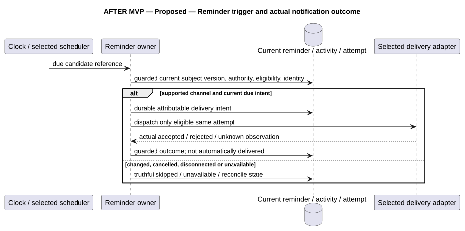

[Editable PlantUML](diagrams/comm-reminder.puml) · [PNG](diagrams/comm-reminder.png)

Scheduler/delivery facilities are not established by this drawing. Due detection does not prove notification. Edits/cancellation and duplicate triggers need current guard/identity handling; no implicit second mail sender or unsupported fallback channel.

### 8.10 Message and send knowledge: distinct dimensions

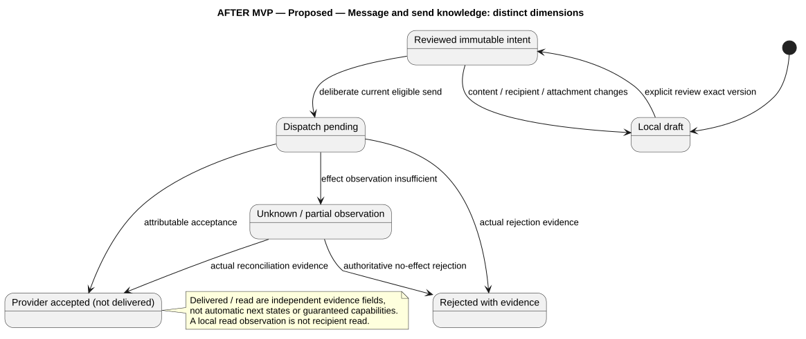

[Editable PlantUML](diagrams/comm-message-state.puml) · [PNG](diagrams/comm-message-state.png)

Avoid a misleading draft→sent→delivered→read chain. Product admission, provider acceptance, receipt and read are different facts. No actual enum or unsupported delivery-tracking feature is adopted.

### 8.11 Event status and attendee response dimensions

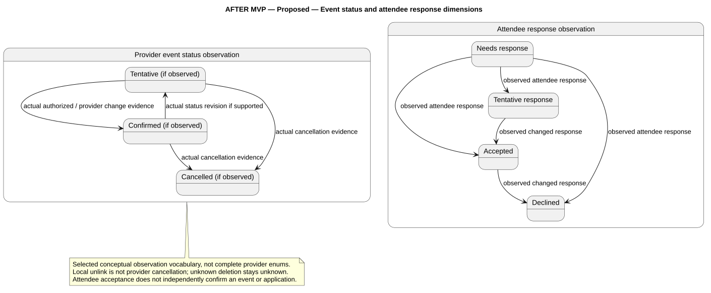

[Editable PlantUML](diagrams/comm-event-state.puml) · [PNG](diagrams/comm-event-state.png)

Orthogonal subjects shown separately. Actual supported states/transitions and field authority must be mapped from current provider evidence; no automatic authoritative transition from local notes or associations.

### 8.12 Conditional scheduling and conflict detection

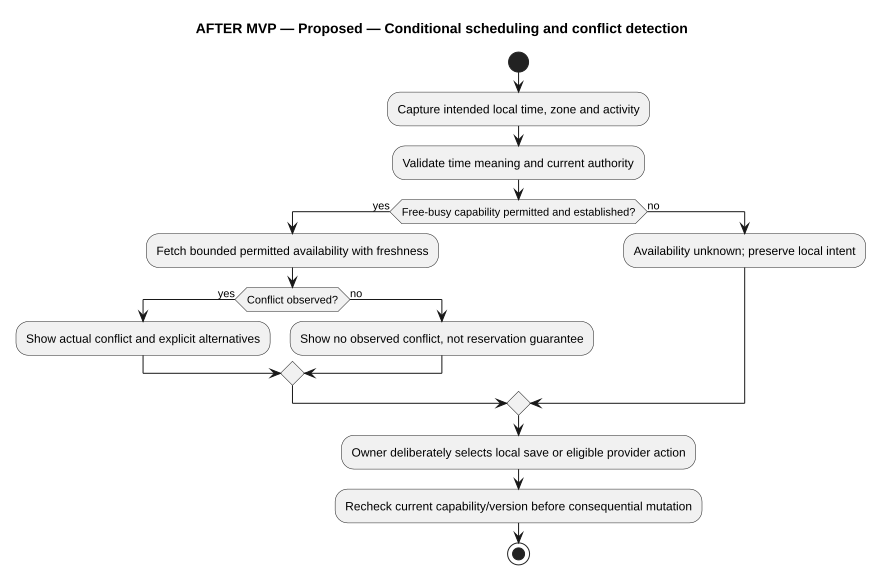

[Editable PlantUML](diagrams/comm-scheduling.puml) · [PNG](diagrams/comm-scheduling.png)

Conflict detection/free-busy is conditional, not an established requirement or adapter feature. Lookup results are time-bounded observations and cannot reserve a slot; avoid silently moving meetings or inviting attendees.

### 8.13 Bounded recurrence expansion and exception identity

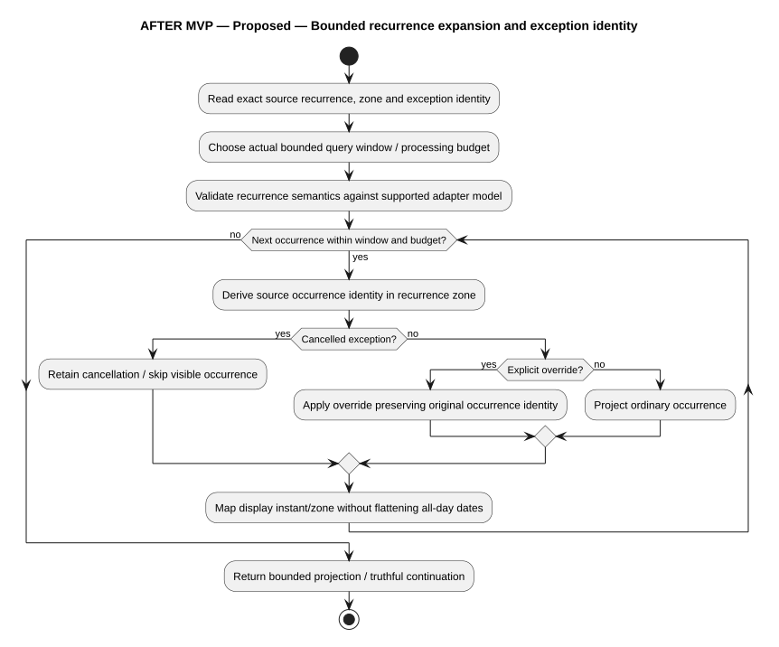

[Editable PlantUML](diagrams/comm-recurrence.puml) · [PNG](diagrams/comm-recurrence.png)

Proposed projection algorithm, not an adopted recurrence library or new provider behavior. Do not infinitely expand an unbounded rule, erase original occurrence identity or convert a series wall-clock rule into a fixed UTC offset. Exact DST/exception semantics need actual source/provider evaluation.

### 8.14 Logical work flow and channel eligibility

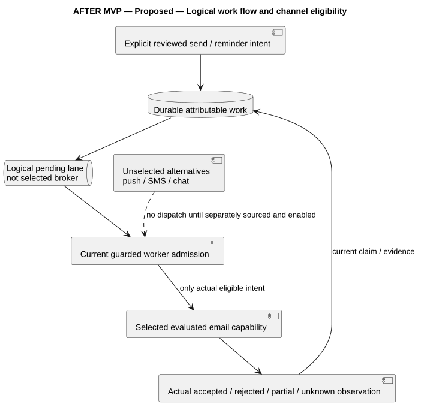

[Editable PlantUML](diagrams/comm-notification-flow.puml) · [PNG](diagrams/comm-notification-flow.png)

Queues denote logical durable work, not a messaging product. Retry requires operation-specific repetition evidence and a selected budget; unknown effects reconcile first. No automatic fallback from email to push/SMS/chat is selected.

### 8.15 Selected scope versus protocol alternatives

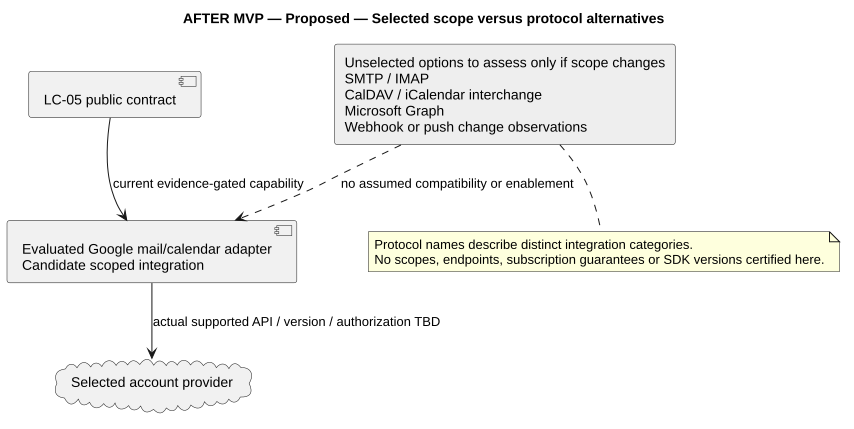

[Editable PlantUML](diagrams/comm-integration-options.puml) · [PNG](diagrams/comm-integration-options.png)

Requested integration vocabulary is inventoried as unselected alternatives. This document does not assert that Google uses CalDAV/SMTP for the proposed design or that Microsoft access exists. Current official capability/security/quotas must be verified at selection/configuration time.

### 8.16 Conditional free-busy lookup

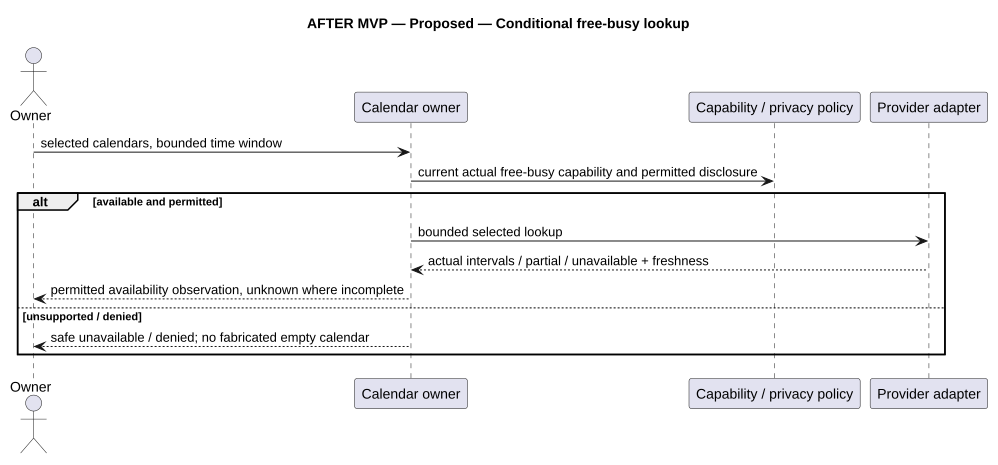

[Editable PlantUML](diagrams/comm-free-busy.puml) · [PNG](diagrams/comm-free-busy.png)

No free-busy API or scope is certified. Disclosure of detailed titles/attendees is not justified by availability access. “No observed conflict” under partial results must not be represented as guaranteed free.

### 8.17 Conditional calendar reconciliation and conflict resolution

**Release applicability:** future-domain design retained after MVP; core operating/deployment and recovery controls still apply to MVP where relevant.

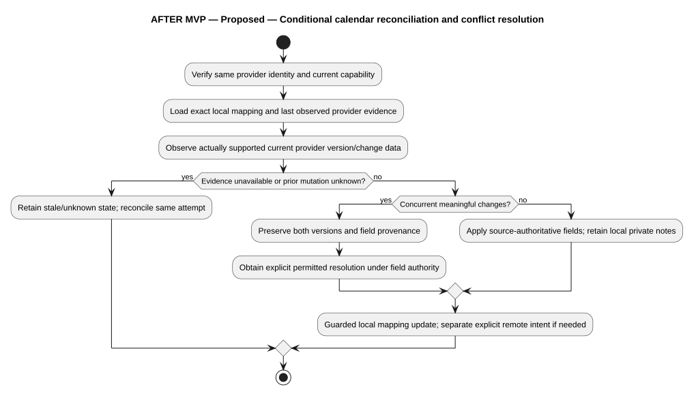

[Editable PlantUML](diagrams/comm-sync.puml) · [PNG](diagrams/comm-sync.png)

No universal last-write-wins, full-account mirror or sync-token mechanism is adopted. Source field authority remains Q-D17 proposed; actual provider version/change facilities require evaluation. Reconnect cannot automatically create duplicate events or replay sends.

### 8.18 Optional trusted runtime placement

[Editable PlantUML](diagrams/comm-deployment.puml) · [PNG](diagrams/comm-deployment.png)

Optional candidate mapping, not configured hosts/services or verified delivery. No dedicated notification server, SMS gateway or chat service is selected. Secrets remain restricted and ordinary logs exclude tokens/content.

### 8.19 Timezone and daylight-saving semantics

| Case | Proposed representation / handling | Required verification / unresolved detail |
| --- | --- | --- |
| Timed one-off activity | Preserve unambiguous instant and source/display timezone, not only display string | Round-trip source intent and provider representation; exact schema pending |
| Ambiguous local time at clock rollback | Require explicit supported disambiguation; do not guess silently | Selected timezone library/provider policy and actual source behavior |
| Nonexistent local time at clock advance | Reject or obtain explicit supported adjustment under reviewed policy | No arbitrary automatic hour shift allocated |
| All-day event | Preserve date range and source-proposed exclusive end; do not convert to arbitrary UTC midnight | Date-only round-trip and display across zones |
| Recurring event | Preserve recurrence zone, rule and original occurrence identity | DST transition, exception and override cases under actual supported semantics |
| Reminder due / changed event | Derive intended due observation from exact current subject version and time meaning | Duplicate trigger, delayed worker, cancelled/changed event and current authority |

### 8.20 Interface catalog

| API / contract | Protocol / exposure | Consumer / boundary | Current selection status |
| --- | --- | --- | --- |
| LC-05 connect/read/draft/review/send/reconcile | Proposed public in-process owner contracts; transport routes TBD | Authorized UI / eligible worker | Signatures and actual adapter mapping pending |
| LC-05 local activity / mapping / reminder | Proposed owner commands/queries | Authorized local flows and actual selected scheduler | Local save separate from remote mutation and delivery |
| Selected Google adapter | Actual API/version/auth protocol to evaluate | LC-05 only under current selected-account capability | OAuth/scopes/quotas/evidence gates pending |
| Files exact protected attachment contract | Public owner reference protocol | Compose/review/send consumers | Usability, pinning and lifetime protocol requires joint refinement |
| Identity current context | Actual selected authority mechanism | LC-05 resource-operation admission | No whole-mailbox access inherited by association |
| SMTP/IMAP, CalDAV, iCalendar, Graph, webhooks | Distinct unselected integration categories | No allocated consumer or live endpoint | Evaluate only if actual source need and capability justify |

### 8.21 Notification channels and delivery policy

No numerical retry, fallback, rate, deadline or retention policy is adopted by this table.

| Channel / path | Status | Retry / uncertainty policy | Fallback | Rate / admission |
| --- | --- | --- | --- | --- |
| Explicit reviewed provider email | Source capability with actual setup still gated | Same-attempt reconciliation after uncertain effect; repeat only under actual contract | No silent other account/recipient/channel | Actual provider limits and one operation budget to evaluate |
| Reminder delivery | Source capability; actual channel/facility selection pending | Due intent, subject version and stable attempt; accepted is not delivered | Truthful unavailable/pending; no fabricated notified state | Actual scheduler/channel budget pending |
| In-product status projection | Current truthful operation/reminder state, not guaranteed push notification | Read actual recorded observation under current access | No conversion of unknown to success | Bounded permitted query policy to define |
| Push / SMS / chat | Unselected alternatives | No retry implementation or permission allocated | No automatic cross-channel fallback | No gateway/service/cost selected |

### 8.22 Data ownership and CRUD

`Owner C/R/U/D*` means owner-controlled lifecycle under actual policy, not unconstrained deletion or a SQL grant. Consumers request public operations/projections; they do not CRUD another owner's tables. Provider-side mutation requires separate exact current capability and intent.

| Data / resource | LC-05 | Other local owner / consumer | Provider boundary |
| --- | --- | --- | --- |
| Local compose / reviewed intent / attempts | Owner C/R/U/D*; retained evidence rules apply | Applications/Work get only explicit permitted associations | Provider copy/effect is separately observed |
| Message/thread projection | Owner-controlled permitted retained projection | No blanket mailbox access | Actual provider state authoritative where specified |
| Local activity / private notes | Owner C/R/U/D* | Explicit permitted association only | Local save does not publish private notes |
| Event mapping / sync observation | Owner-controlled mapping and conflict state | No direct foreign mutation | Selected event/calendar identity and field authority respected |
| Actual submission manifest / progress | No direct mutation | Applications owns C/R/U/D* | Email/event evidence never auto-creates submitted status |
| Artifact bytes / reference ledger | Public Files requests and own consumer protection | Files owns physical state/lifecycle | Provider attachment copy is separate effect |
| Credentials / key material | Restricted connection/secret handling | Identity/Operations responsibilities as actually designed | Actual revocation/consent is not assumed from local disconnect |

### 8.23 Privacy and permission matrix

| Subject | Visibility / access | Sharing / delegation limit | Enforcement evidence |
| --- | --- | --- | --- |
| Mailbox message/thread | Current selected owner and actual scoped capability | Application association gives no whole-mailbox disclosure | Wrong-owner IDs, current access and sanitized projection checks |
| To/Cc/Bcc and body | Exact reviewed private send intent | No recipient expansion, reply-all inference or raw payload logging | Changed recipients/content invalidate reviewed intent as sourced |
| Local private notes | Local permitted access only | Do not silently publish as provider description | Field-authority and serialization checks |
| Calendar/event | Actual selected calendar and product resource scope | Technical account scope does not imply product-wide sharing | Current calendar authority and same-account mapping checks |
| Attendee/free-busy | Conditional supported projection with freshness | Availability does not authorize titles, private notes or delegation | Exact consent/capability and safe unknown/partial handling |
| Delegated/admin access | Only exact accepted source policy and actual provider rights | No universal admin bypass or implied delegation; unresolved source conflict stays visible | Criterion-level policy reconciliation before implementation |
| Untrusted mail/attachments | Sanitized display and protected byte access | No automatic tracking-resource load or executable content trust | Actual content-handling and reference checks |

### 8.24 Failure and reconciliation table

| Failure / trigger | Required behavior | Recovery / protected state |
| --- | --- | --- |
| Send rejected with actual evidence | Record exact rejection; distinguish from uncertainty | Repeat only if actual repetition contract permits and current intent still eligible |
| Send/event-create response lost | Retain same attempt unknown/partial effect | Actual supported reconciliation; no blind resend/recreate on reconnect |
| Duplicate invite / reminder trigger | Resolve bound identity and current subject version | Do not dispatch twice merely due to duplicate local delivery; provider evidence still needed |
| Local/provider sync conflict | Preserve identified versions and field authority | Explicit permitted resolution; no whole-record last-write-wins |
| Disconnected / revoked account | Stop new dependent work; mark retained copies stale as sourced | Reconnect verifies same identity/capability; no replay of old effects |
| Expired worker claim | Fence stale local writes with actual guard | Local fence cannot stop remote effect; reconcile before repetition |
| DST ambiguity / recurrence exception mismatch | Preserve intent and source identity; show explicit unresolved/invalid state | Actual supported disambiguation and bounded projection; no guessed occurrence |
| Missing delivery infrastructure / attachment | Truthful unavailable/pending; no success or silent substitute | Establish actual capability/usable reference before affected work |

### 8.25 Quality / NFR scenarios

| Attribute | Scenario / required observation | Target / status |
| --- | --- | --- |
| Delivery latency | Separate local admission, queue age, provider acceptance and any supported delivery observation | Numerical target unselected; actual supported timestamps/evidence needed |
| Availability | Degrade only affected capability; no unsafe account/channel fallback | No accepted availability target or HA facility established |
| Consistency | Same-intent duplicate, stale compose, local/provider conflict and restored pending work | Actual persistence/claim/provider evidence required |
| Privacy/security | Current account isolation, protected attachments, sanitized content and restricted secrets | Exact policy/access mechanisms and controlled verification pending |
| Time correctness | Timed/all-day/DST/recurrence exceptions round-trip as intended | Library/provider compatibility and source-policy disposition pending |
| Retention/recovery | Distinguish local projection deletion, provider deletion, attempt evidence and recoverable keys | No retention duration, backup readiness or RPO/RTO adopted |
| Capacity | Combined send/sync/reminder work remains bounded within total project resources | Workload, provider quotas, scheduler/worker and resource budgets to evaluate |

All views and tables are documentation proposals, not actual provider capability assessment, exact criterion closure or live operations. No account consent, send, event/invite mutation, reminder dispatch, sync, deployment or restore is performed. Keep Q-D15–17 status, current official-provider assessment at configuration time and actual review evidence visible.
