# Resumefolio — Files and Operations Component Design

**Responsibility:** admit and identify usable private artifacts, account for concurrent growth, preserve protected references, replace/reclaim safely and assess recoverable operating state. Metadata creation, stored bytes, permitted retrieval and actual reclaimed capacity are different facts.

**Status:** proposed LC-09 component design, November 2, 2026. No storage backend, quota number, backup destination, recovery target or accepted physical schema is selected here. Farhad retains policy/operations decision authority within source permissions and actual resource limits.

[Authority](#1-source-authority-and-ownership) · [Contracts](#2-public-operations) · [Model](#3-owned-data-and-state-dimensions) · [Admission](#4-admission-and-accounting-protocol) · [References](#5-protected-reference-replacement-and-reclamation) · [Recovery](#6-operating-recovery-and-failure-scenarios) · [Review](#7-verification-and-open-decisions) · [Storage package](#8-files-storage-and-operations-view-package)

Current MVP scope and selected mechanisms: [Baseline](../../../../baseline/README.md). Deferred provider, advanced collaboration and workflow-execution designs are not MVP prerequisites.

## 1. Source authority and ownership

Use [AFO-D01–AFO-D12](../../../02-requirements-engineering/03-requirements-specification/administration-files-and-operational-behavior.md), [Q-D24 proposed accounting/limits](../../../02-requirements-engineering/03-requirements-specification/administration-files-and-operational-behavior.md#resolution-q-d24), [quality/recovery requirements](../../../02-requirements-engineering/03-requirements-specification/quality-security-and-recovery-requirements.md), [source decisions](../../../02-requirements-engineering/07-change-and-baseline/open-questions-and-decisions.md) and [analysis data/contracts](../../../03-system-analysis/05-business-rules-and-operation-contracts/10-domain-constraints-and-operation-contracts.md).

Q-D24 contains numeric starting proposals, not measured safe allocations or accepted defaults. Preserve their source status rather than implementing those values automatically. Actual workload, temporary/Git/log growth, policy ownership and operating capacity still require evaluation. Backups were reported unconfigured.

**Own:** effective file-policy versions, admission/reservation identities and accounting, private artifact metadata/usability/provenance, attributable protected-reference records, replacement/reclamation attempts and recovery assessments.

**Do not own:** Presentation publication intent, Applications actual-history meaning, Git object/ref semantics, provider truth or an unconstrained administrator bypass. Native repository storage and operating backup facilities require evaluated adapters/coordination; a file policy UI cannot safely allocate unsupported capacity.

**Consumers:** Presentation/Sharing request eligible representations; Applications registers actual-material protection; Communication/Workflow register permitted attachments/outputs; Git supplies native storage/temporary-use evidence; operating procedures consume bounded health/recovery records. All calls use current resource/action authority and permitted projections, not raw public paths or foreign table writes.

## 2. Public operations

Proposed signatures name responsibilities rather than final language/transport types. Mutations carry current actor/resource context, stable command identity and expected versions where needed. Outcomes retain confirmed/pending/denied/invalid/conflict/unavailable/partial/unknown meaning and actual evidence.

### UpdateEffectivePolicy(context, expectedPolicyVersion, proposedPolicy)

Authorize the actual policy owner, validate types/units/categories and the evaluated infrastructure envelope, then record an attributable effective version. Changing limits must not silently delete existing data, fabricate headroom or bypass protected-history rules. Evaluate outstanding reservations consistently when policy changes; exact effective-time/over-limit behavior follows the reviewed source decision.

### ReserveGrowth(context, quotaContext, category, intendedSize, policyVersion, commandId)

Atomically evaluate applicable per-file, account/category/global and operating-headroom guards under one consistent policy/usage view. Reserve identified capacity before making growth available. Multiple concurrent requests cannot spend the same remaining allocation. Unknown final-size work needs bounded staged admission rather than an unlimited reservation.

### FinalizeArtifact(context, reservationId, attemptId, actualArtifactEvidence)

Confirm canonical storage identity, actual size/type/processing result and usable state under source policy. Reconcile actual versus reserved growth and retain attributable accounting. A completed upload transport or metadata row alone cannot certify usable content. Failed validation/processing keeps the candidate unavailable and schedules bounded cleanup/reconciliation.

### ResolveUsableArtifact(context, artifactId, intendedRepresentation)

Return a permitted identity/projection or controlled delivery capability only after current authority, protected-reference context, actual availability and requested language/revision/type are checked. Sharing separately owns link eligibility; Files cannot grant access just because bytes exist. Unavailable representations never become private fallback content.

### ProtectReference / FinalizeReference / ReleaseReference

Register attributable consumer/resource/version purpose against exact artifact identity. Protection must exclude concurrent physical deletion before another owner commits a reference. Finalization/release use stable reference/operation identity and actual consumer evidence, not an unverified notification. Uncertain reservations remain protected until reconciliation can establish a safe outcome; age alone cannot prove an abandoned reference.

### ReplaceReference(context, expectedReferenceVersion, newArtifactId)

Confirm new artifact usability/authority and protection before changing the owning association through its contract. Preserve the prior usable association until the intended switch is confirmed. Release an old reference only if its exact owner/version is no longer required; other publication/submission references continue protecting the artifact.

### CollectUnreferencedBytes(context, candidateId, expectedArtifactVersion)

Acquire an exclusive reclamation claim compatible with the reference-registration protocol. Recheck all relevant protected references/reservations and lifecycle policy before deletion. Record actual storage deletion outcome and only then reconcile reclaimed capacity. A logical row delete, queued cleanup or request acknowledgment is not reclaimed-byte evidence.

### AssessRecovery(context, sourceIdentity, isolatedTarget, coveredScope)

Evaluate an identified consistent recovery set, actual storage/keys/configuration coverage, integrity, current authority and external-effect reconciliation. Distinguish prerequisites missing, incomplete/failed assessment and demonstrated usable results. No restore/purchase/production switch is authorized simply by this contract.

## 3. Owned data and state dimensions

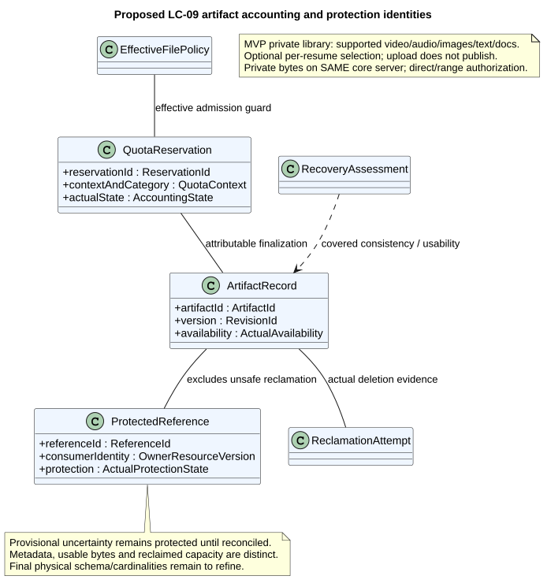

[Editable PlantUML](diagrams/files-owned-model.puml) · [PNG](diagrams/files-owned-model.png)

**EffectiveFilePolicy:** versioned scope/category, units and actual proposed/accepted limits/envelope rationale. **QuotaLedger/Reservation:** responsible context, category, attributable intended growth, outstanding/finalized/released/reconciliation status and actual accounting evidence. Physical deduplication does not erase semantic charging for responsible contexts.

**ArtifactRecord:** stable private storage identity, owner/provenance, content classification, actual byte size, expected/observed validation, usable/unavailable state and version. Canonical paths are internal implementation details. Language/rendition/source revision remain explicit when relevant.

**ProtectedReference:** exact artifact and consumer/resource/version/purpose, provisional/finalized/released/reconciliation state and command identity. **StorageAttempt/ReclamationAttempt:** actual external write/delete observations and claim/version context. **RecoveryAssessment:** identified source/target/scope, checks, measured facts, limitations and actual disposition.

Keep artifact usability, reference protection, lifecycle/trash eligibility and physical presence/accounting as separate dimensions. A retired source may still have protected published/submitted references; a failed cleanup can leave bytes even after logical unlink; a recovered metadata row may reference missing bytes.

Logical persistence needs scoped unique command/reservation/reference identities, version/claim checks, authoritative accounting updates and indexes for owner/artifact/reference/reconciliation lookup. Concrete engine/types/collation/indexes, physical storage layout and consistent DB/storage write protocol remain [data design](../../04-data-design/README.md) refinement. The class diagram does not adopt final source cardinalities or schema.

## 4. Admission and accounting protocol

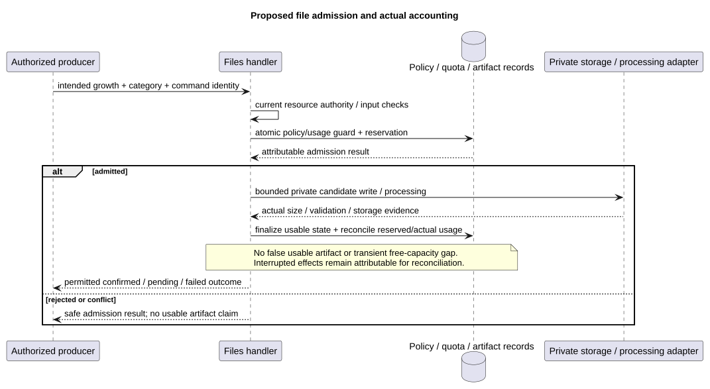

[Editable PlantUML](diagrams/files-admission-sequence.puml) · [PNG](diagrams/files-admission-sequence.png)

1. Validate explicit upload/generated-output intent, resource authority, declared category/type and applicable policy version. Check real content/size through the evaluated processing path, not the filename alone.
2. Under the chosen local accounting guard, calculate applicable committed usage plus outstanding reservations and reserve attributable growth only if all relevant limits/headroom conditions permit. Record command/result identity atomically. Avoid double charging same-intent retries or undercounting shared artifacts across quota contexts.
3. Write/process into a private bounded candidate area outside long-held database locks. Restrict content/path handling; do not expose candidate bytes through a public static route. Record actual attempt identity and known byte/processing outcomes.
4. Reconcile actual size and applicable policy before usability/finalization. If actual work exceeds admitted bounds, apply the reviewed rejection/extension protocol rather than consuming unreserved capacity silently. Confirm the intended stored artifact and mark usable only on actual evidence.
5. Convert reserved to confirmed usage without a transient free-capacity window; release only genuinely unused reservation. Persist required consumer/reference work durably. Return attributable confirmed/pending/rejected/unknown state without false completion.
6. Reconcile interrupted writes, failed processing and abandoned work using evidence/identity. Physical leftover bytes and outstanding reservations count in the actual operating envelope until safely resolved. Never purge unrelated user/history/database content to recover headroom automatically.

Generated PDFs, uploads, workflow artifacts, native Git packs and diagnostics have different producers and temporary-growth behavior. They need explicit category/adapter contracts rather than a misleading one-size-fits-all byte counter. Git-native accounting/cleanup remains coordinated with the Git owner, not a raw file deletion routine.

## 5. Protected reference replacement and reclamation

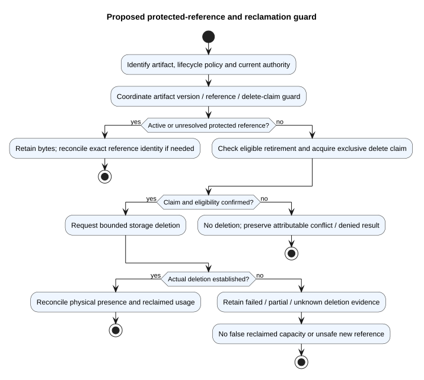

[Editable PlantUML](diagrams/files-reclamation-route.puml) · [PNG](diagrams/files-reclamation-route.png)

The joint Applications/Presentation/Files protocol must serialize reference admission against physical deletion. One proposed approach is an artifact-version/state guard plus attributable provisional protection: reference registration refuses an artifact already exclusively claimed for deletion; cleanup cannot claim an artifact with unresolved or active protection. Finalize consumer identity after its commit through a durable handshake or equivalent evaluated local transaction design.

If consumer commit succeeds but acknowledgment is lost, retain protection and reconcile the same identity. If the consumer definitively did not commit, release only the corresponding provisional protection. Uncertainty must not turn into an automatic expiry that deletes actual history. This design obligation needs concrete schema/locking tests; naming a handshake does not prove it implemented.

Replacement protects/validates the new artifact first, switches the intended owner/version association, then reconciles release of the old association. Any other active publication, submission, attachment or allowed operating reference still protects the old bytes. A failed switch preserves the old usable representation; a lost result triggers reference reconciliation rather than blind swap/release.

Reclamation requires source lifecycle eligibility, current permission, no remaining active/provisional protection and an exclusive delete claim. Record actual deletion evidence, then update physical presence/usage; reconcile partial/unknown storage results without granting a new reference to an artifact whose presence is uncertain. Deduplicated storage requires reference checks across every responsible owner, not only one user's visible list.

## 6. Operating recovery and failure scenarios

**Quota race/policy change:** simultaneous admissions share a serialized effective view. Changing a limit evaluates existing usage/reservations without silent deletion or unsupported headroom. Preserve allowed read/delete/recovery behavior under actual source rules.

**Interrupted candidate write:** distinguish no confirmed usable artifact from actual leftover bytes. Keep private unavailable state and reconcile reservation/cleanup. Metadata rollback does not delete external storage bytes automatically.

**Replacement or capture uncertainty:** protect actual prior/new references until attributable owner results establish safe release. Source retirement must not delete actual application history or published evidence merely because a live draft changed.

**Cleanup failure/storage full:** record known residual bytes or unknown deletion outcome; no false reclaimed capacity. Apply bounded admission/degradation and operator feedback. Do not claim that free-space observations alone guarantee safe concurrent processing.

**Sensitive content and paths:** validate canonical permitted identifiers, restrict active content display, protect download/delivery paths and redact diagnostics. Secret/key/workspace cleanup has actual evidence/limits; a method return or container name is not proof of complete erasure/isolation.

**Recovery:** coverage includes relational state, private artifacts, native repositories where required, publication/submission manifests, operating configuration and usable keys. Restore into a suitable isolated environment, verify references/usability/current authority and reconcile external operations before promotion. Backups are not configured by this document; no RPO/RTO or destination is invented.

Follow [operations/recovery](../../06-design-quality-and-security-analysis/03-operations-backup-recovery-and-resilience.md), [deployment placement](../../01-software-architecture/04-deployment-topology-nodes-and-networks.md) and [runtime reconciliation](../../01-software-architecture/03-process-view-concurrency-and-runtime-behavior.md) as shared procedure owners. Files coordinates actual record/artifact/recovery evidence rather than duplicating all operating policy.

## 7. Verification and open decisions

| Source | Primary design responsibility |
|---|---|
| AFO-D01–D04 | Versioned owner policy, evaluated limits, per-file and concurrent aggregate admission |
| AFO-D05–D07 | Content validation, resource isolation and truthful usable/failed/interrupted state |
| AFO-D08–D11 | Reference-safe replacement, operating evidence and actual bounded cleanup/reclamation |
| AFO-D12 / QSR | Version-specific operating readiness and attributable recovery/quality evidence |

This maps source intent, not completion of every acceptance criterion. Numeric Q-D24 proposals and lifecycle/source dispositions retain their actual status.

### Planned checks

- Duplicate/simultaneous reservations at account/global boundaries and policy changes with active work.
- Invalid content, declared/actual size mismatch, generated/temporary growth and interrupted write/finalization.
- Direct private path/foreign artifact access, stale link/grant context and missing selected rendition.
- Capture/publication reference registration racing cleanup; lost consumer acknowledgments and stale delete claims.
- Replacement failure, retained older publication/submission, cross-owner deduplicated references and unknown deletion result.
- Storage pressure, bounded diagnostics/cleanup and native Git temporary/reclamation coordination.
- Isolated backup/restore with missing keys/bytes/references, current authority and no replay of remote effects.

Use actual persistence/accounting/concurrency tests and suitable storage/recovery observation alongside deterministic policy checks. No upload, deletion, backup, restore, stress test or product mutation is executed here.

### Remaining prescriptions

Review Q-D24 numeric limits/charging/envelope and supported formats; select/evaluate storage/backend and actual resource facilities; specify concrete quota/reference/deletion guard/transaction schemas and signatures; reconcile native Git/output/log accounting; establish independent backup/key recovery; complete exact criterion mapping and actual candidate review. The protected-reference handshake is a decisive joint Applications/Files/data-model design task, not a completed mechanism.

Use [component templates](../README.md), [interface contracts](../../05-interface-and-api-design/README.md), [security](../../06-design-quality-and-security-analysis/02-security-threat-modeling-and-trust-boundaries.md) and [review/handoff](../../06-design-quality-and-security-analysis/05-design-review-traceability-and-handoff.md). These component/data/dynamic views follow the FAU refinement approach but allocate no accepted physical schema, arbitrary cleanup permission or phase approval.

[Component catalog](../README.md) · [Component diagram catalog](diagrams/README.md)

## 8. Files, storage and operations view package

These **proposed LC-09 views** refine private artifact/accounting/reference responsibilities. General folders, resumable chunks, malware scanner, thumbnails/indexing, object-storage protocols, hot/warm/cold tiers, replication, CDN and sync clients are conditional options, not newly accepted features or configured facilities. Sharing, consumer version/history, provider effects and native Git retain their own owners. Q-D24 numbers and recovery targets remain unaccepted proposals/choices.

### 8.1 Files provided and required interfaces

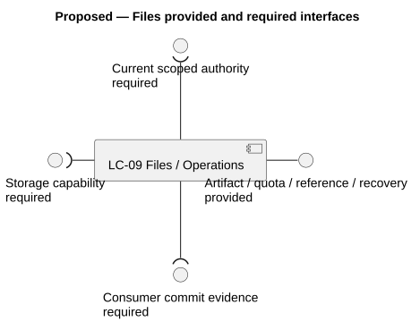

[Editable PlantUML](diagrams/files-interfaces.puml) · [PNG](diagrams/files-interfaces.png)

Logical provided circle and required sockets; exact signatures remain proposals. Files cannot grant sharing access merely because bytes exist, nor claim a consumer committed merely from a queued notification.

### 8.2 C4 Level 1: artifact-related system context

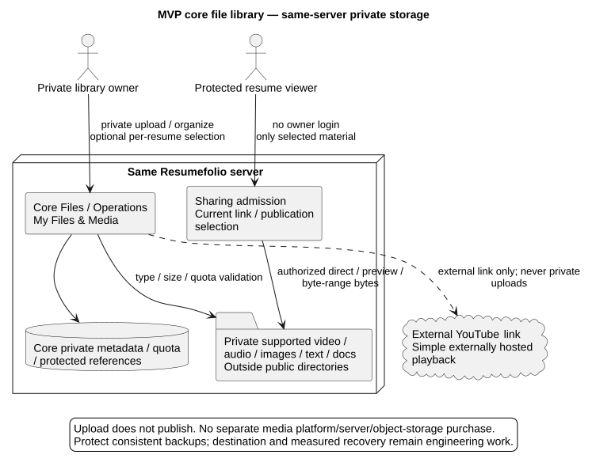

[Editable PlantUML](diagrams/files-context.puml) · [PNG](diagrams/files-context.png)

C4-style whole-system context. Internal Files/Git/Applications modules belong below Level 1. Local storage may remain inside the system boundary; external facility placement is conditional, not a selected S3/backup architecture.

### 8.3 C4 Level 2: modular runtime and storage

[Editable PlantUML](diagrams/files-context.puml) · [PNG](diagrams/files-context.png)

C4-style application/runtime/store boundaries, not a separately deployed file microservice. Object storage is a possible backend rather than an adopted product. Worker readiness, keys and recovery facilities need actual evidence.

### 8.4 Artifact operations and separately owned sharing

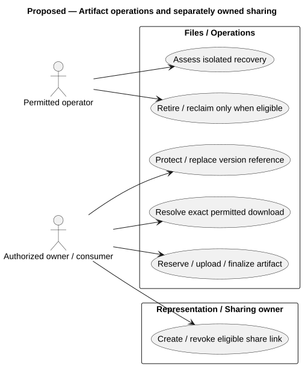

[Editable PlantUML](diagrams/files-use-cases.puml) · [PNG](diagrams/files-use-cases.png)

Use-case summary, not allocated IDs or a new generic folder/version browser. Share creation is owned elsewhere; Files supplies exact usable artifacts and guarded delivery. Restore/purge requires actual scoped authority and policy, not a universal operator role.

### 8.5 Artifact, reference and operation classes

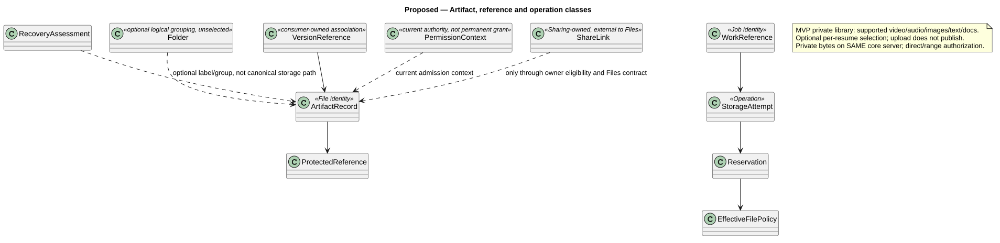

[Editable PlantUML](diagrams/files-domain.puml) · [PNG](diagrams/files-domain.png)

Selected roles are proposals, not final types/cardinalities. VersionReference belongs to the relevant consumer; ShareLink is not Files-owned. Folder is notation for a conditional future grouping, not an accepted general file-manager feature.

### 8.6 Logical artifact and ledger relationships

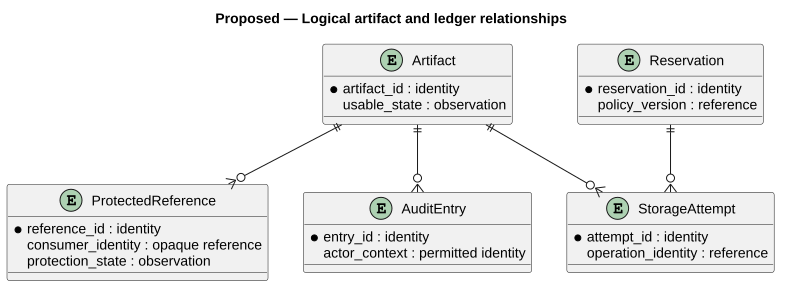

[Editable PlantUML](diagrams/files-erd.puml) · [PNG](diagrams/files-erd.png)

Selected logical ERD, not a full schema or accepted cardinality allocation. Actual folder/version/permission persistence is not invented; those may be labels, consumer-owned references and current policy contracts. Command uniqueness, quota accounting and reclamation guards still need concrete design.

### 8.7 Upload with conditional resumable transport

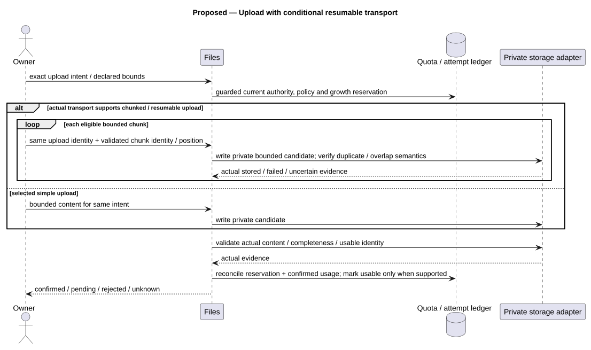

[Editable PlantUML](diagrams/files-upload.puml) · [PNG](diagrams/files-upload.png)

Resumable chunks are an unselected option, not a chosen endpoint/part-size policy. Define ownership, ranges, integrity, expiration and restart semantics before use. Transport completion or metadata row alone does not make an artifact usable; leftover bytes still consume actual space.

### 8.8 Exact download and current access admission

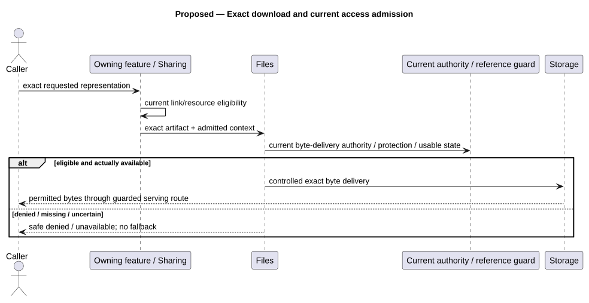

[Editable PlantUML](diagrams/files-download.puml) · [PNG](diagrams/files-download.png)

The concrete delivery route and revocation/admission ordering remain to select. A controlled delivery capability must not become an indefinitely reusable raw public path. Do not substitute another language, private file or newer live revision.

### 8.9 Share link creation and access through its owner

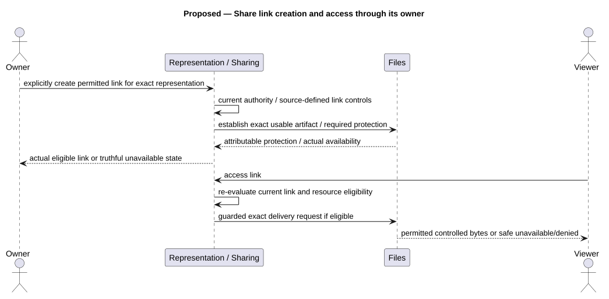

[Editable PlantUML](diagrams/files-share.puml) · [PNG](diagrams/files-share.png)

Logical collaboration, not an allocated bearer-token format, expiration policy or raw storage URL. Sharing owns link lifecycle; Files owns usability/reference/delivery guards. Link creation does not automatically publish or change submitted evidence.

### 8.10 Artifact usability, lifecycle and presence dimensions

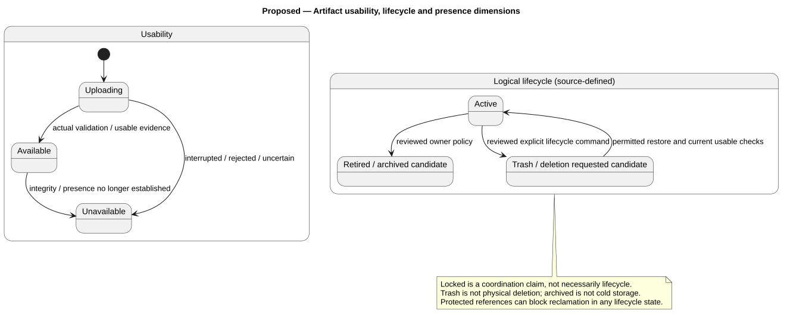

[Editable PlantUML](diagrams/files-artifact-state.puml) · [PNG](diagrams/files-artifact-state.png)

Illustrative dimensions, not accepted enums or a new trash period. Physical presence/accounting and reference protection are separate; do not flatten them into a single file status. Actual deletion requires an exclusive guard and storage evidence.

### 8.11 Operation and job knowledge states

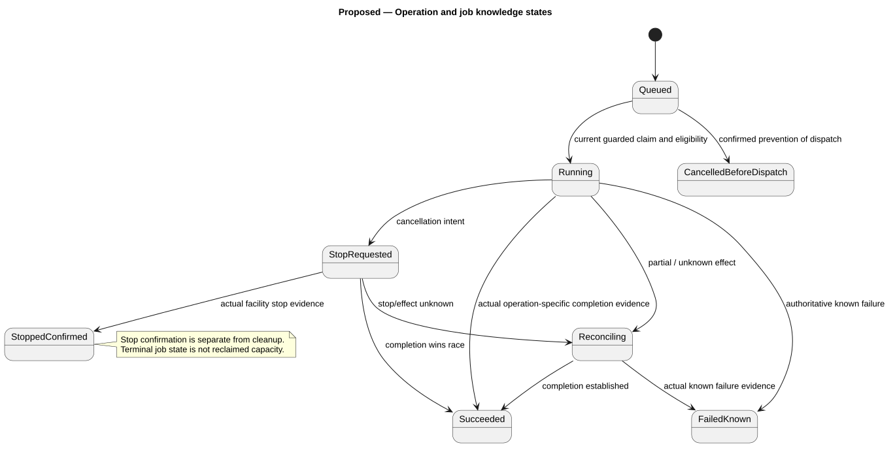

[Editable PlantUML](diagrams/files-job-state.puml) · [PNG](diagrams/files-job-state.png)

Proposed operation/coordinator knowledge, not a selected queue enum. Queue acknowledgment and worker exit do not prove content usability or byte deletion. A cancellation request is not a confirmed stopped or cleaned job.

### 8.12 Private candidate processing pipeline

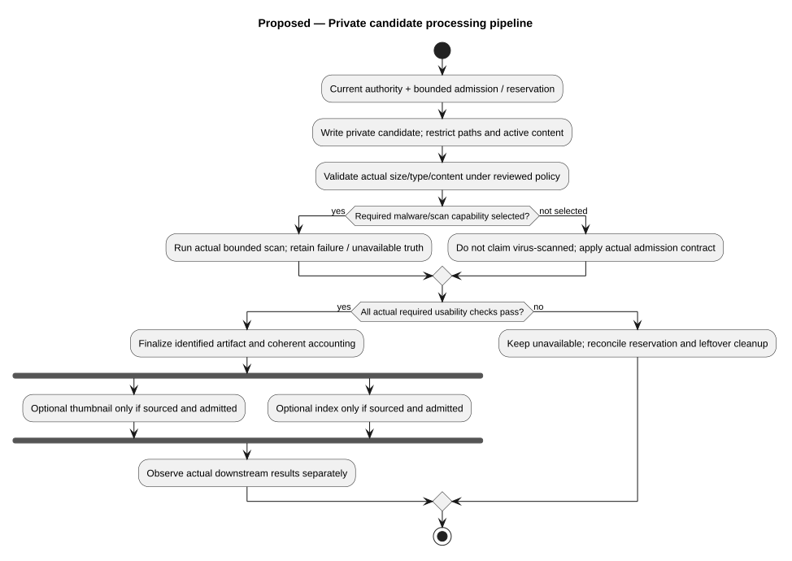

[Editable PlantUML](diagrams/files-pipeline.puml) · [PNG](diagrams/files-pipeline.png)

Scanning, thumbnailing and indexing are conditional, not installed features or proof of safety. If a required scanner is unavailable, do not bypass it. Fork/join is a logical view; optional derivative failure must not silently alter original usability/accounting semantics.

### 8.13 Concurrent reference replacement conflict resolution

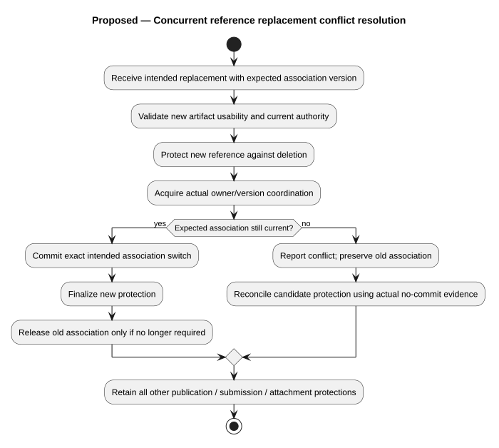

[Editable PlantUML](diagrams/files-concurrent-edits.puml) · [PNG](diagrams/files-concurrent-edits.png)

This is association/version conflict handling, not collaborative binary-file editing or automatic content merge. Unknown switch outcome retains protection until same-command reconciliation; neither age nor conflict alone proves a reference safe to release.

### 8.14 Storage architecture options and unselected tiers

[Editable PlantUML](diagrams/files-context.puml) · [PNG](diagrams/files-context.png)

Options diagram, not a selected tier/replication/CDN topology. Replication is not by itself a usable independent backup. Hot/warm/cold costs, keys, protected references, privacy and retrieval behavior require an explicit decision and evidence.

### 8.15 Logical hierarchy versus canonical storage identity

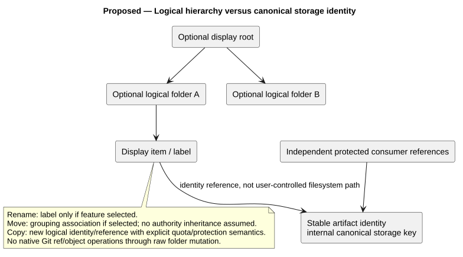

[Editable PlantUML](diagrams/files-paths.puml) · [PNG](diagrams/files-paths.png)

Conditional folder notation, not an accepted file-manager scope. Stable identity must survive display labels where selected. Canonicalization, traversal protection, copy charging and permission propagation need actual contracts; physical paths stay internal.

### 8.16 Version, trash, restore and physical reclaim flow

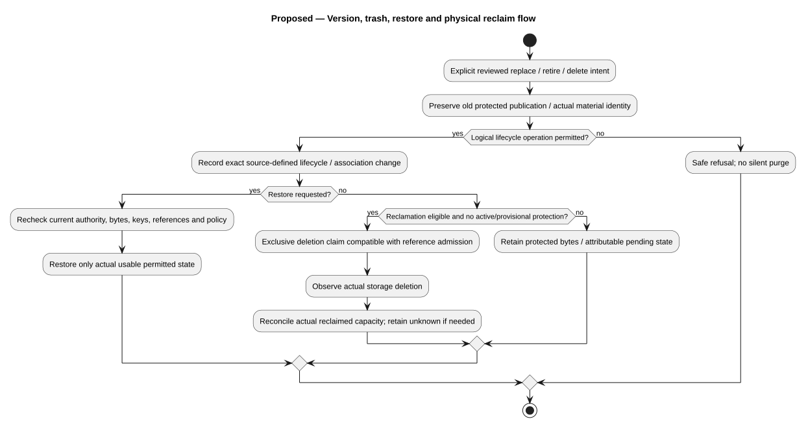

[Editable PlantUML](diagrams/files-trash.puml) · [PNG](diagrams/files-trash.png)

No version count, retention duration or 30-day default allocated. Trash does not prove reclaimed bytes. Restoring metadata cannot create missing bytes or reactivate old permissions/links; a restore of a whole backup is a separate controlled procedure.

### 8.17 Logical job lanes, reconciliation and intervention

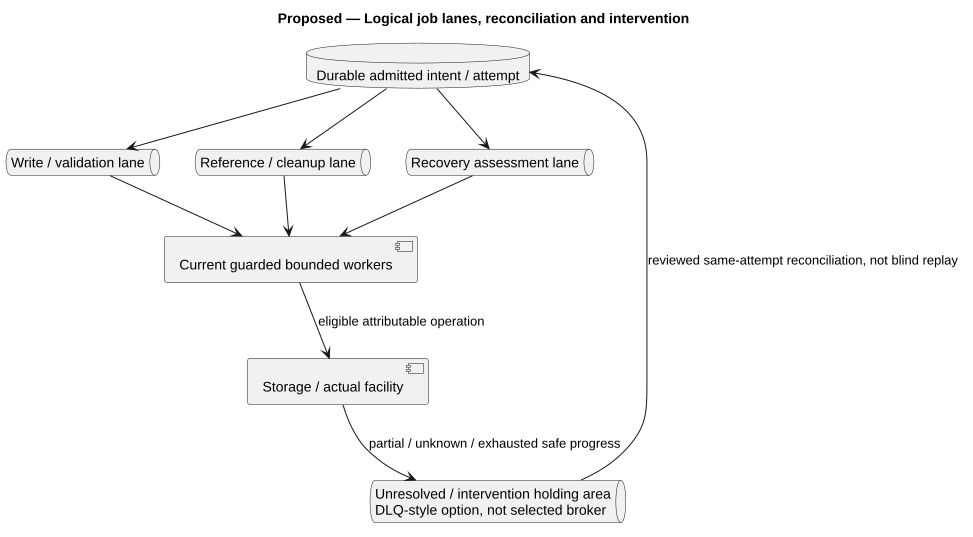

[Editable PlantUML](diagrams/files-queues.puml) · [PNG](diagrams/files-queues.png)

Logical lanes are not a selected queue product, worker count or automatic dead-letter retry policy. Retry only when the actual effect contract supports it; local lease expiry cannot prove a storage write/delete never occurred. Bounded resources and cleanup remain separately observed.

### 8.18 Storage and sync integration options

[Editable PlantUML](diagrams/files-context.puml) · [PNG](diagrams/files-context.png)

Requested integration names are alternatives, not supported features. Do not assume an “S3-compatible” label guarantees the needed atomicity/retention semantics or that external sync preserves product ownership/reference constraints.

### 8.19 Optional deployment mapping for Files capabilities

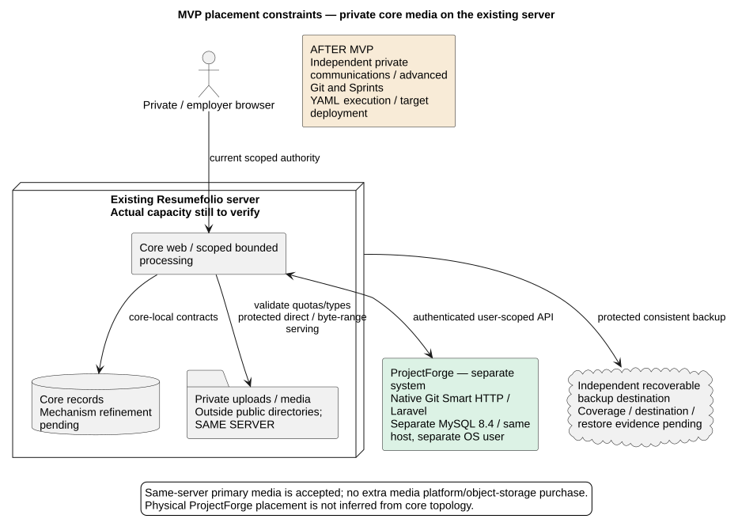

[Editable PlantUML](../../01-software-architecture/diagrams/drivers-uml-deployment.puml) · [PNG](../../01-software-architecture/diagrams/drivers-uml-deployment.png)

Proposed placement, not installed infrastructure or proof that existing guest allocation is sufficient. The earlier backup absence remains explicit. No object-store account, CDN, extra host or replication service is purchased or configured.

### 8.20 Interface catalog

| API / owner contract | Protocol / exposure | Consumer | Status / limit |
| --- | --- | --- | --- |
| ReserveGrowth / FinalizeArtifact | Proposed in-process command contract; transport TBD | Upload / PDF / output producer | Actual accounting guard and usable evidence needed |
| ResolveUsableArtifact | Guarded owner projection / delivery capability | Presentation / Sharing / Communication | Exact identity, current authority and actual presence; no raw private URL |
| Protect / Finalize / ReleaseReference | Evaluated public consumer/reference protocol | Applications / Presentation / other actual consumers | Joint commit/finalization/deletion ordering still to specify |
| ReplaceReference | Owner-coordinated expected-version operation | Exact owning association | Preserve old usable reference until switch established |
| CollectUnreferencedBytes | Restricted explicit reclamation contract | Eligible bounded operations worker | Exclusive claim, actual deletion evidence and accounting |
| UpdateEffectivePolicy / AssessRecovery | Scoped policy / isolated-assessment command | Actual permitted policy owner/operator | No automatic spending, restore, promotion or limit acceptance |
| S3-compatible / NFS / SMB / WebDAV / sync | Unselected alternatives; no endpoint allocated | No configured adapter/client | Assess exact supported semantics before adoption |

### 8.21 Permission and access-control matrix

Roles describe **scoped responsibilities**, not implemented RBAC grants. Actual administrative source-policy conflicts remain unresolved; there is no blanket private-content operator/admin bypass.

| Role / current context | Upload / finalize | Resolve private bytes | Share | Replace / protect | Reclaim / restore |
| --- | --- | --- | --- | --- | --- |
| Authorized resource owner | Only admitted own intended resource | Current exact permitted identity | Through Sharing-owned controls only | Exact owned association and policy | Source-defined lifecycle only; not arbitrary physical purge |
| Permitted shared viewer | No implicit write | Only currently eligible exact representation | No implicit re-share/admin right | None by viewing | None |
| Authorized consuming component | Public contract under actual operation context | Permitted projection only | No link authority inherited | Own attributable reference purpose only | Request release; cannot delete Files ledger/bytes directly |
| Eligible job worker | Current bounded claim/capability only | Only operation-required scope | No implicit privilege | Current claim and consumer evidence | Explicit permitted operation with actual guards; stop distinct from cleanup |
| Scoped operations/policy role | No universal business-content permission | Only actual source-authorized diagnostic/recovery scope | No bypass | Policy and recovery responsibilities only as authorized | Actual safe assessment/reclamation scope and evidence; no assumed production restore |

### 8.22 Audit and operations event template

This table specifies event categories to evaluate, not installed audit infrastructure or actual event records. Keep authoritative command/accounting/reference evidence coherent; ordinary telemetry cannot replace it. Store bounded permitted identities/categories, never private bytes, tokens or unrestricted paths.

| Event | Actor / provenance | Resource / operation identity | Timestamp meaning | Evidence / privacy requirement |
| --- | --- | --- | --- | --- |
| Policy version changed | Actual authorized policy context | Policy scope/version and bound command | Actual effective/recorded instant | Prior/new attributable rule; no fabricated capacity |
| Growth reserved/finalized/reconciled | User/producer + current claim | Reservation/category/attempt | Actual admission/result observations | Actual size/units and coherent ledger state |
| Artifact usability changed | Validating adapter / owner | Artifact/version + storage attempt | Actual validation observation | Actual outcome category; no file-content dump |
| Protection registered/finalized/released | Consumer owner + exact evidence | Artifact/reference/consumer version | Actual admission/finalization observation | Preserve unknown consumer commit; exact protected purpose |
| Reclamation attempted/observed | Eligible scoped operator/worker | Artifact/delete claim/attempt | Actual delete/result observation | Reclaimed only on actual evidence; unknown remains visible |
| Recovery assessment performed | Actual permitted assessment context | Source/candidate/isolated target/scope | Actual checks start/results | Usable records/bytes/keys checks and limitations; not copy-success alone |

### 8.23 Quotas, limits and retention

| Policy dimension | Proposed rule / rationale | Value / status | Required mechanism / evidence |
| --- | --- | --- | --- |
| Per-file / account / category / global growth | Evaluate committed usage plus outstanding reservations coherently | Q-D24 starting numbers remain proposals; no defaults adopted | Actual serialized admission and full operating envelope |
| Candidate / temporary / Git / logs / derivatives | Include real concurrent temporary and residual growth | Concrete budgets pending | Producer-specific evidence and bounded work; Git native semantics retained |
| Actual size differs from declared | Reject or extend only through reviewed admitted protocol | No unbounded unknown-size allocation | Actual measured size and no transient free-capacity window |
| Physical deduplication | Preserve independent consumer identity and source-defined charging | Charging policy pending | Cross-owner reference protection and actual byte accounting |
| Trash / archive / version retention | Follow reviewed owner/source policy | No retention duration or version count allocated | Protected submitted/publication evidence and applicable erasure decisions |
| Reservation cleanup | Release only with evidence of safe no-consumer/no-effect state | No age-only expiry for unknown commit | Same-identity reconciliation and compatible exclusive deletion guard |
| Backup expiry / RPO / RTO | Independent usable recovery design | Backups unconfigured in documented inventory; targets unselected | Actual consistent source, keys, isolated restore and current authority |

### 8.24 Failure handling

| Failure | Truthful response | Recovery / protected frame |
| --- | --- | --- |
| Partial / resumable upload interrupted | Candidate unavailable; actual residual bytes/reservation remain attributable | Same upload/attempt reconciliation; actual supported resume or bounded cleanup |
| Corrupt / invalid content | Do not finalize as usable | Preserve valid prior associations; apply actual validation/cleanup policy |
| Storage unavailable / full | Refuse/degrade affected admission/retrieval; no invented headroom | Reconcile unknown writes/deletes and actual residual usage; no unrelated purge |
| Duplicate same/different intent | Resolve same permitted result / reject identity mismatch | No double charging or history mutation; actual uniqueness/guard required |
| Reference registration races reclaim | Either protection admitted or exclusive deletion claim wins under actual protocol | Never admit a new consumer to uncertain/deleting bytes |
| Consumer commit/finalize acknowledgment lost | Retain provisional protection and uncertainty | Reconcile same consumer/command; age alone not abandonment proof |
| Replacement interrupted | Old association remains until actual switch established | Protect both where unknown; release only evidence-supported no-longer-needed reference |
| Delete response lost | Reclaimed capacity unknown, not credited as success | Observe actual backend state through supported safe mechanism |
| Restore lacks key/bytes/reference | Report incomplete/blocked recovery | No public promotion, old grant reactivation or external replay |

### 8.25 Data ownership and CRUD boundaries

`Owner C/R/U/D*` denotes controlled lifecycle under actual policy, not raw SQL grants or unconditional deletion. Cross-owner references use public contracts; shared physical database/storage does not merge ownership.

| Data family | Files / Operations | Other owner / consumer | Boundary |
| --- | --- | --- | --- |
| Artifact metadata / actual storage attempts | Owner C/R/U/D* | Permitted exact identity/projection | No raw path or foreign mutation |
| Quota/policy/reservation ledger | Owner-controlled updates under actual authority | Admitted producer requests only | No direct usage counter manipulation |
| Protected reference ledger | Owner-controlled protocol and reclamation coordination | Consumer supplies exact purpose/commit evidence through contracts | Unknown protection cannot be silently expired |
| Publication / selected representation / share link | Public Files support only | Presentation / Sharing own lifecycle | Bytes existing grants no share or publication authority |
| Actual submission event/material manifest | Public Files support only | Applications owns historical meaning/corrections | No cascade from source retirement or current-live changes |
| Native repositories/refs | Coordinated storage/accounting support | Git owner controls Git-native operations | No raw cleanup that bypasses ref/object semantics |
| Recovery source/keys/configuration | Actual scoped assessment and artifact evidence | Operations/security and respective record owners | No assumed blanket content access or restored permanent privilege |

### 8.26 Non-functional scenarios and targets

| Attribute | Required observation / scenario | Target / acceptance status |
| --- | --- | --- |
| Throughput / latency | Combined upload/download/processing plus Git/worker load; correct admission and exact delivery | No benchmark, concurrency or latency target adopted; workload and resource budgets pending |
| Durability / integrity | Actual usable bytes and consistent protected references through interruption/corruption/recovery | No vendor durability claim or replication guarantee selected |
| Availability | Truthful affected-capability degradation; preserve safe independent operations | No HA/CDN/availability target established |
| Consistency | Concurrent reservations, replacement, reference registration and exclusive deletion | Actual database/backend guard and race evidence required |
| Security / privacy | Current exact byte access; path/content controls; restricted metadata/diagnostics | Actual delivery/revocation ordering and controlled verification needed |
| Recoverability | Consistent records/artifacts/repositories/keys and current authority in isolated restore | No configured backup destination or accepted RPO/RTO; usable evidence pending |
| Operability | Attributable pending/unknown/cleanup state, bounded resource use and usable procedures | Actual tools/runbooks and intervention thresholds to select |

These records do not establish a general document-management product, backend capability, live upload/delete/share/backup, configured processing service, accepted quota or completed criterion verification. Keep source Q-D24 and quality/recovery proposals visible; synchronize Applications/Presentation/Files reference design before dependent implementation.

## MVP private-media flow

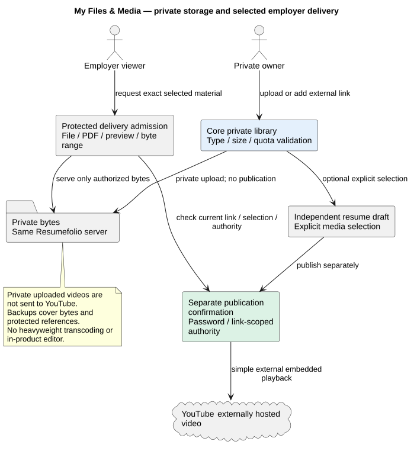

[Editable source](../../01-software-architecture/diagrams/mvp-private-media.puml) · [PNG](../../01-software-architecture/diagrams/mvp-private-media.png).

## MVP library admission and selected playback contract

1. Admit a supported upload to the owner's private library only after effective type, size and aggregate-quota validation. Persist private same-server artifact identity and truthful usable/pending/failed state; upload grants no publication or employer access.
2. An owner may deliberately select a library item for a resume draft. Reuse/selection does not remove independence of other resumes or rewrite an actual submitted set. Publish through the separate confirmation flow.
3. Resolve an employer request through current link/viewer and selected-publication authority. Apply the same check to direct files, PDFs, preview/thumbnail renditions and byte-range delivery. Never redirect to an unprotected public storage path.
4. Serve supported browser-playable uploaded media safely; unsupported formats follow explicit policy rather than silently invoking heavyweight transcoding. YouTube links refer to externally hosted playback; private uploads remain local/private.
5. Preserve protected publication/submission references during retirement/reclamation. Back up bytes, metadata and required keys consistently, and demonstrate recovery before release acceptance. Same-server primary storage does not imply same-disk-only backups.

Exact allowed MIME/extension/signature rules, numerical quotas, range/session admission behavior, playback support, backup destination and recovery targets remain to be refined and verified. No separate media infrastructure or editor is authorized by this contract.
