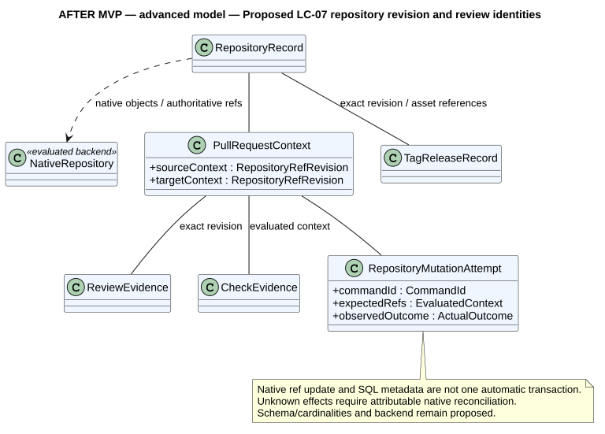
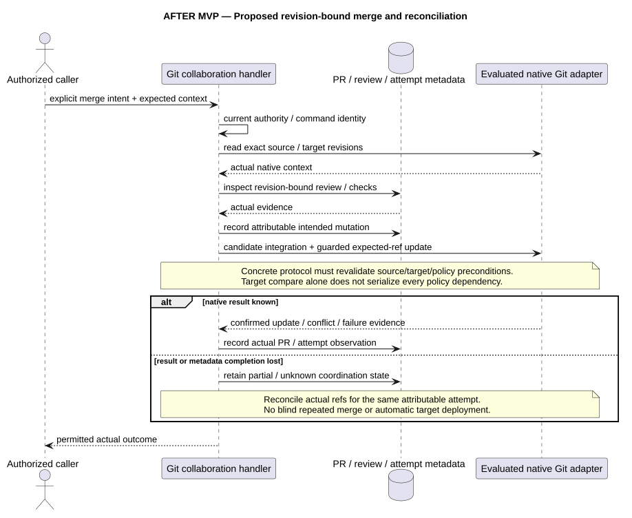
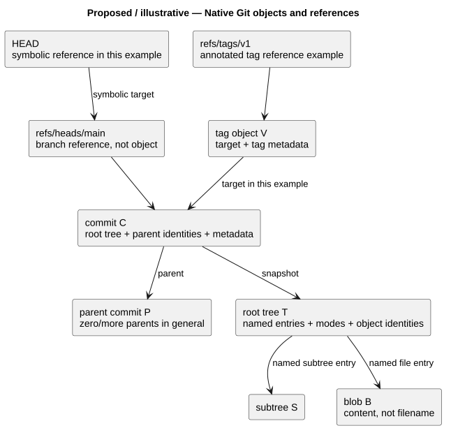
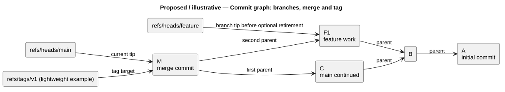
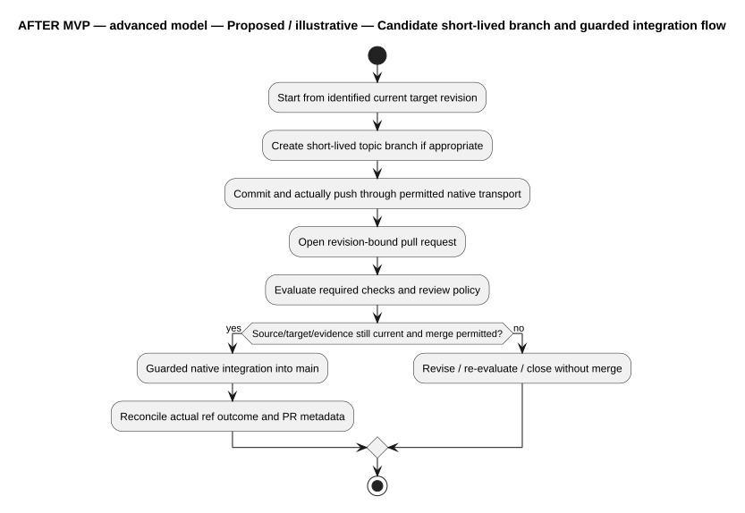
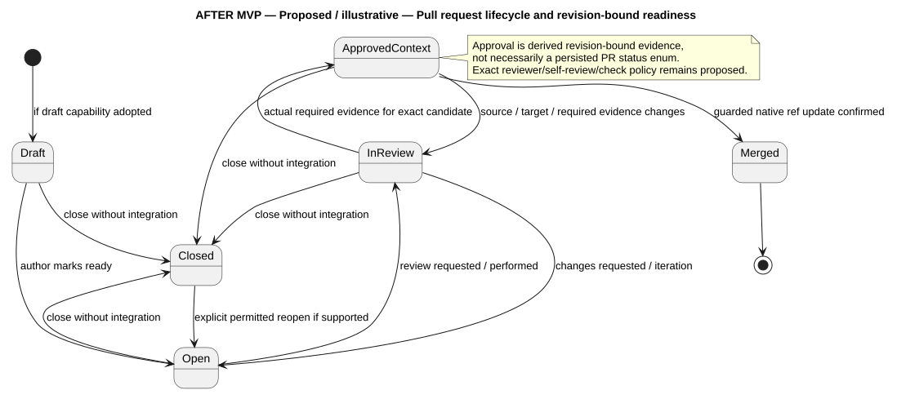
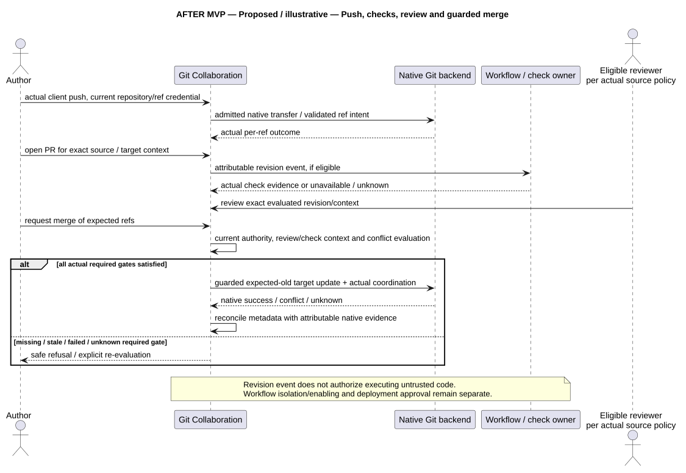
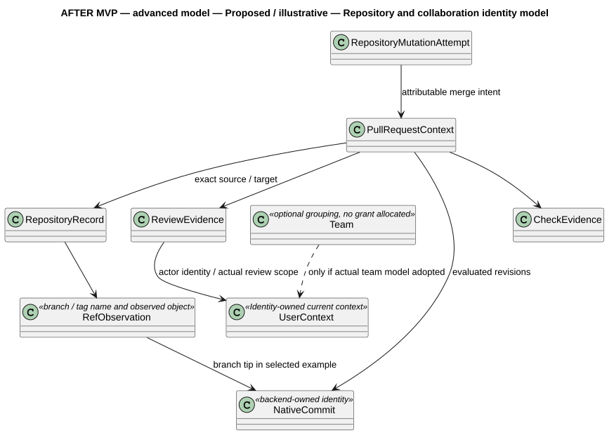
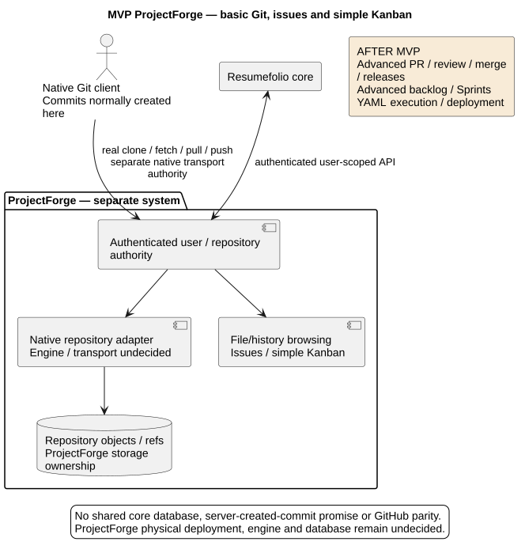

# Resumefolio — Git Collaboration Component Design

**Responsibility:** host actual Git repositories and coordinate repository-scoped collaboration against exact object/ref/review identities. A database row, GitHub development tool or repository web page is not evidence that product clone/fetch/push works.

**Status:** proposed LC-07 component design, November 2, 2026. Git engine, transport configuration and detailed Q-D21/Q-D22 rules remain pending evaluation/disposition. No repository, credential, live transfer, merge, workflow or deployment is created here.

[Authority](#1-source-authority-and-boundaries) · [Contracts](#2-public-operations) · [Data](#3-owned-model-and-storage-boundaries) · [Merge](#4-revision-bound-review-and-merge-protocol) · [Failure](#5-security-concurrency-and-recovery) · [Review](#6-verification-and-open-decisions) · [Essential views](#7-essential-git-and-collaboration-views)

## MVP system allocation and design status

ProjectForge is a separate system connected to the core through an authenticated user-scoped API. MVP includes real repositories, clone/fetch/pull/push, repository permissions, file/history browsing, issues and simple Kanban. Git commits normally occur in the client. Full advanced review/merge/releases, fork/review workflows, milestones, advanced backlog/Sprints and YAML execution/deployment are deferred. The engine, database, physical deployment and Git transport remain undecided. No shared core database/transaction or full GitHub parity is promised.

Authority: [OWNER-MVP-2026-11-04](../../../01-project-planning/owner-mvp-decision-2026-11-04.md).

## 1. Source authority and boundaries

Use [GIT-D01–GIT-D10](../../../02-requirements-engineering/03-requirements-specification/git-hosting-and-collaboration.md), [Q-D21](../../../02-requirements-engineering/03-requirements-specification/git-hosting-and-collaboration.md#resolution-q-d21), [Q-D22](../../../02-requirements-engineering/03-requirements-specification/git-hosting-and-collaboration.md#resolution-q-d22), [analysis operation contracts](../../../03-system-analysis/05-business-rules-and-operation-contracts/10-domain-constraints-and-operation-contracts.md) and [architecture boundaries](../../01-software-architecture/02-system-decomposition-and-boundaries.md).

Q-D21 SSH/HTTPS support, repository naming/private defaults and token lifetimes are proposals, not accepted operating settings. Q-D22 reviewer/self-review rules and initial merge strategy likewise remain proposed. Preserve real Git/collaboration scope without implementing every proposal as a settled requirement.

**Own:** repository namespace/identity, grants and ref policy evaluation within source authority, native-storage association, fork provenance, pull-request/review/check context, issues/milestones and tag/release identities.

**Do not own:** Work project completion, Applications/Presentation private data, arbitrary application-host execution, workflow enabling conditions or deployment-target authority. Associations and events carry explicit identifiers, not inherited permissions.

**Required capabilities:** current identity/resource authority; evaluated Git-native backend and client transport; quota/storage/headroom evidence from Files/Operations; protected release artifact contracts; durable mutation intent/observation and operating recovery. No engine/version or transport is selected simply because Git exists on the demo.

## 2. Public operations

Operation names are proposed contracts, not final language signatures. Mutations use current actor/repository/ref context, expected revisions where relevant and stable intent identity. Return evidence-supported confirmed/denied/invalid/conflict/pending/partial/unknown results, with safe permitted projections.

### CreateRepository / BrowseRepository

Validate actual namespace/name rules, ownership, initialization intent and actual capacity before creation. Coordinate native-store creation with metadata using an attributable lifecycle; a failed/unknown creation must not become a usable repository row. Browse files/history/branches only within current read authority and supported object/path handling. Treat repository content as untrusted data, never server-executable templates or arbitrary commands.

### TransferGit(context, repositoryId, transportOperation, refIntent)

The evaluated server transport must support actual standard-client operations required by the accepted contract. Clone/fetch/push are native exchanges; client pull includes client-side fetch/integration and cannot be certified by inventing a separate database action.

Authenticate the actual client credential, resolve canonical permitted repository and recheck read/write/ref policy for the requested exchange. Browser session and Git credential contracts remain distinct. Enforce evaluated transfer/repository/temporary-growth admission. Native receive validation and ref outcomes must be surfaced honestly, including per-ref/partial results where applicable. Do not claim whole-push atomicity unless actually supported, requested and verified.

### ForkRepository(context, sourceRepositoryId, intendedOwner, commandId)

Evaluate source visibility/read/fork authority, target namespace/grants and storage admission. Record upstream provenance and distinct target identity. A private fork cannot silently widen visibility. Upstream grant revocation and retained fork content require the actual source retention/access decision, not a generic assumption that copying grants perpetual rights. Reconcile partial native-copy/metadata effects before retry.

### OpenReview / ReviewRevision / MergeExpectedRefs

A pull request binds source/target repository/ref identities and evaluated object revisions. Reviews/comments/checks identify the actual revision/context they concern. A review of old code is not approval of new code. Source changes invalidate revision-bound approval under the proposed policy; target changes require reevaluation/conflict checks. Missing/unknown required checks are not passing checks.

Merge rechecks current authority, source/target revisions, conflicts and required review/check evidence before a guarded Git-native target update. Closing is not merging. Proposed merge-commit/solo self-review exceptions remain Q-D22 choices; no second reviewer or chosen merge strategy is invented here.

### ManageIssueMilestone / CreateTag / CreateRelease

Issues/milestones are repository-owned records, distinct from Work items with explicit associations only. Tags identify exact native revisions; release records bind evaluated tag/revision and protected assets. Mutation/replacement of published tag/asset requires explicit authorized action, history and reference-safe behavior under source policy. Release publication grants no production deployment permission.

### ReconcileRepositoryMutation / RetireRepository

Reconcile an attributable repository/ref/fork/release operation against actual native and local evidence after interrupted result persistence. Retirement/cleanup respects access/lifecycle, fork/review/release references, native repository integrity and backup coverage. A deleted metadata row is not proof of safe native reclamation.

## 3. Owned model and storage boundaries

[Editable PlantUML](diagrams/git-owned-model.puml) · [PNG](diagrams/git-owned-model.png)

**RepositoryRecord:** stable owner/namespace/repository identity, native-store locator, lifecycle/version and source-derived access policy. Canonical paths stay internal. **RefObservation:** repository/ref name plus exact object identity and actual observation context; it is not a second authoritative ref database.

**PullRequestContext:** source/target repository/ref/revision tuple, author, actual open/closed/merged observation and intended merge operation. **ReviewEvidence / CheckEvidence:** actor/provider, exact evaluated revision/context, observed outcome and provenance. **RepositoryMutationAttempt:** stable intent, expected/observed refs, current policy evaluation, known native/local effects and reconciliation state.

**ForkProvenance, Issue, Milestone, Tag/ReleaseRecord:** distinct owner-scoped identities and explicit associations. **ReleaseAssetReference:** Files-protected artifact/provenance under actual revision/access/lifecycle policy. Do not duplicate mutable foreign ORM entities or return a raw private storage path.

Native object/ref state belongs to the evaluated Git backend; relational metadata indexes private namespace/identity, associations, review/check/attempt context and permitted projections. Engine-specific types, object format handling, collation/name constraints and native/SQL coordination require physical refinement. Do not assume every object ID has a fixed hash length or that a generic SQL transaction controls Git refs.

## 4. Revision-bound review and merge protocol

**Release applicability:** future-domain design retained after MVP; core operating/deployment and recovery controls still apply to MVP where relevant.

[Editable PlantUML](diagrams/git-merge-sequence.puml) · [PNG](diagrams/git-merge-sequence.png)

1. Validate exact current repository/source/target identity, intended strategy and stable command identity. Authorize the actual merge action/ref and disclosure under current account/grant/lifecycle policy.
2. Resolve actual native ref/object context and required review/check evidence for that context. If source/target/evidence changed, reject or explicitly reevaluate; do not silently merge a different revision. Native fetch/object discovery is not permission to update a ref.
3. Record attributable intended mutation and evaluated policy/revision context. Compute the candidate integration through the evaluated backend in controlled resources without executing repository code/hooks supplied by users.
4. Revalidate all ref/policy preconditions at the mutation boundary under the concrete coordination protocol, and compare/update the native target against its expected old value. Source movement and grant changes also need defined serialization/validation; target compare alone is not proof that every other condition stayed valid.
5. Record native success/conflict/failure evidence and reconcile pull-request/attempt metadata. Git and SQL do not share an automatically atomic commit. If a ref changed but the metadata response/commit was lost, keep attributable uncertainty and reconcile actual refs/evidence before any repeat.
6. Publish only an attributable revision notification to eligible consumers after known outcome. Workflow Coordination independently evaluates trigger/isolation/authority; Deployment independently checks the exact artifact/target action. No merge event manufactures those permissions.

### Native primitive evidence and its limits

The official [git-update-ref documentation](https://git-scm.com/docs/git-update-ref.html) supports expected-old-object comparison and grouped ref update preparation/commit. It also warns that concurrent readers may observe a subset of grouped modifications. This supports a proposed native guard; it does not make SQL metadata, authorization, source-review evidence or all readers globally atomic.

The official [git-receive-pack documentation](https://git-scm.com/docs/git-receive-pack) describes quarantining incoming objects until pre-receive validation and forbids pre-receive refs pointing at quarantined objects. An evaluated integration should respect that lifecycle. Quarantine is not a complete isolation, quota or backup design. Actual backend/version behavior and hooks/transport policy still need controlled validation. Sources inspected November 2, 2026; installed-runtime compatibility was not verified.

## 5. Security concurrency and recovery

**Credential/ref policy:** use evaluated individually attributable/revocable client credentials and current repository/ref permissions. The source token lifetime and SSH/HTTPS proposals need actual disposition. Never put account passwords or real tokens in URLs/logs/examples. Revocation blocks subsequent admitted operations under the defined boundary; already emitted/copied bytes cannot be recalled.

**Untrusted inputs:** validate refs, object/path references and canonical namespace independently of shell/storage syntax. Do not concatenate user input into arbitrary shell commands or execute repository-supplied hooks on the trusted host. Native Git handling, pack processing and object inspection still consume resources and require evaluated limits.

**Concurrent updates:** serialize/compare the exact intended refs and context. Two simultaneous merges/pushes may produce one accepted update and a stale conflict; they must not silently overwrite. Review and check freshness must match the actual candidate. Multi-ref partial outcomes are reported, not collapsed into universal success.

**Interrupted transfer/mutation:** object receipt, ref update, request acknowledgment and relational observation are different facts. Native failure/unknown status needs authoritative reconciliation. Repeating a mutation command must not create duplicate merge commits or ref changes blindly.

**Storage/reference lifecycle:** account for packs/temp work, retained refs, forks, release artifacts and garbage-collection delays through actual evaluated envelope/owner contracts. SQL unlink is not safe object deletion or proof of freed bytes. Do not use a generic file collector to remove reachable native objects.

**Recovery:** restore native repositories and corresponding metadata/review/release references consistently, verify integrity/current authority and reconcile unresolved ref/runner/target effects. Do not automatically relaunch workflows or deploy restored revisions. Backups/fork retention/key coverage and actual usable restore remain evidence gates.

Ordinary diagnostics retain bounded operation/repository/ref/evaluated-revision/result references without credentials, private code dumps or unrelated content. Private existence/content exposure and administrative authority follow source policy, not a new global bypass.

## 6. Verification and open decisions

| Source | Primary responsibility |
|---|---|
| GIT-D01–D04 | Repository ownership, current ref authority, actual client transfer and browsing |
| GIT-D05–D07 | Fork provenance, revision-bound review/checks and guarded merge  **Advanced paths after MVP; any retained core/basic path follows the release register.** |
| GIT-D08–D09 | Repository issues/milestones, exact tags/releases and protected assets |
| GIT-D10 | Lifecycle, resource feasibility and consistent recovery |

This maps candidate intent, not exact closure of all acceptance criteria.

### Planned focused verification

- Controlled standard-client clone/fetch/pull/push over the actually selected transports, including private denial and credential/ref revocation.
- Canonical name/ref/path/argument rejection, sensitive diagnostic handling and nonexecution of untrusted code/hooks.
- Simultaneous push/merge, stale source/target, obsolete review/check, unknown checks and protected-ref force/delete denial.
- Interrupted native update before/after actual ref mutation and lost metadata observation, without duplicate consequential replay.
- Private fork provenance/access/retention and partial copy reconciliation.
- Issue/Work association without permission inheritance; tag/release revision binding and reference-safe asset replacement.
- Pack/storage pressure, actual admission/temporary usage, repository cleanup integrity and isolated consistent restoration.
- Merge/release notification without implicit workflow or deployment authorization.

Use real isolated native Git/client/transport checks alongside policy/handler tests and actual metadata concurrency/reconciliation verification. Mocks cannot establish standard-client behavior or native ref consistency. No transfer, credential creation, merge or restore is executed by this authoring task.

### Remaining decisions

Evaluate engine/library/service versus direct native integration, actual supported version/transport/client matrix, authentication/scope/rotation, hook/process isolation, source/target/grant coordination, native/SQL reconciliation, quotas/temp growth, fork retention and release lifecycle. Resolve detailed Q-D21/Q-D22 policy and physical signature/schema choices, record exact criterion mappings and actual candidate review before dependent implementation.

Follow [component template](../component-template/README.md), [runtime](../../01-software-architecture/03-process-view-concurrency-and-runtime-behavior.md), [Files reference coordination](files-and-operations.md), [API contracts](../../05-interface-and-api-design/README.md), [security](../../06-design-quality-and-security-analysis/README.md) and [review/handoff](../../06-design-quality-and-security-analysis/05-design-review-traceability-and-handoff.md). These component/class/interaction views adapt the FAU refinement approach without claiming a selected engine, accepted schema, actual security assurance or baseline approval.

[Component catalog](../README.md) · [Component diagram catalog](diagrams/README.md)

## 7. Essential Git and collaboration views

This compact package covers the seven requested diagram topics and one permission matrix only. Native Git facts are distinguished from proposed product policy; topology/example names are synthetic. Q-D21/22 transport, reviewer, self-review and merge-strategy choices remain unresolved/proposed. No engine, CI, webhook, team model or branching policy is adopted by drawing these views.

### 7.1 Native Git objects and references

[Editable PlantUML](diagrams/git-essential-objects.puml) · [PNG](diagrams/git-essential-objects.png)

Native object relationships, not relational ownership. Branch refs are mutable names; refs are not a fifth object type. A lightweight tag points directly to its target without a tag object; annotated tag targets are not limited to commits. HEAD can also be detached. Object-format handling must not assume one hash length; this selected view omits gitlinks and pack layout.

### 7.2 Commit graph: branches, merge and tag

[Editable PlantUML](diagrams/git-essential-graph.puml) · [PNG](diagrams/git-essential-graph.png)

Synthetic topology with arrows from commit to parent, not chronological message flow. M has two parents in this example; names are illustrative, not real object IDs or an adopted merge strategy. Tag mutation/branch retirement still requires actual policy.

### 7.3 Candidate short-lived branch and guarded integration flow

[Editable PlantUML](diagrams/git-essential-branching.puml) · [PNG](diagrams/git-essential-branching.png)

A minimal GitHub-Flow-like candidate for this design, not a mandated repository policy or a change to this project’s development process. No Git Flow release/develop branches, required second reviewer, merge strategy or CI execution is selected. Q-D22 disposition controls actual rules.

### 7.4 Pull request lifecycle and revision-bound readiness

**Release applicability:** future-domain design retained after MVP; core operating/deployment and recovery controls still apply to MVP where relevant.

[Editable PlantUML](diagrams/git-essential-pr-state.puml) · [PNG](diagrams/git-essential-pr-state.png)

Review/readiness is distinct from open/closed/merged lifecycle. Draft/reopen are conditional UI refinements, not newly accepted features. Unknown native mutation does not mark Merged until actual reconciliation; closing a PR cannot undo a merge.

### 7.5 Push, checks, review and guarded merge

[Editable PlantUML](diagrams/git-essential-pr-sequence.puml) · [PNG](diagrams/git-essential-pr-sequence.png)

No installed CI or webhook service is assumed. Checks must concern the actual merge candidate/context under the selected policy; source/target movement requires reevaluation. Native/SQL outcomes are not one atomic transaction; unknown ref mutation reconciles before repeat.

### 7.6 Repository and collaboration identity model

[Editable PlantUML](diagrams/git-essential-domain.puml) · [PNG](diagrams/git-essential-domain.png)

Selected class roles, not a final schema or copy of native objects into SQL. Branch names are ref observations rather than authoritative SQL branch records. Team is conditional; membership does not grant repository rights without accepted policy. No multiplicities or actual class signatures are newly allocated.

### 7.7 Git and collaboration capability boundaries

[Editable PlantUML](diagrams/git-essential-components.puml) · [PNG](diagrams/git-essential-components.png)

Logical component boundaries, not a new deployed Git/review/CI/notification service portfolio. Native backend/transport are still to evaluate. Product hosting remains distinct from GitHub tools used to develop Resumefolio.

Native object/ref explanations follow the official [Git data model](https://git-scm.com/docs/gitdatamodel) (inspected November 2, 2026). This source explains object relationships; it does not establish installed backend compatibility, product permissions or adopted collaboration policy.

### 7.8 Permission and branch-protection matrix

Rows describe proposed **operation scopes**, not accepted named roles or implemented RBAC grants. Current Identity context, repository/ref policy and source lifecycle must all permit the action. No administrator, team membership, browser session or CI identity automatically bypasses private access or protected-ref rules.

| Current scoped actor | Read / clone / fetch | Push source ref | Review | Merge protected target | Configure policy / destructive ref action |
| --- | --- | --- | --- | --- | --- |
| Read-authorized participant | Only permitted repository and actual client transport | No implicit write | Only if separately eligible under actual review policy | No implicit merge | None inferred |
| Write-authorized contributor | Current permitted read | Exact allowed refs; native validation, quota and expected-ref policy | Review authority separate from authorship | Separate current merge authority and all required gates | Force/delete never inferred from ordinary write |
| Eligible reviewer | Permitted exact candidate projection | No write inferred from review | Bind evidence to exact revision/context; self-review rule pending | Approval is not merge permission | Cannot waive required gates by comment alone |
| Merge-authorized actor | Current exact source/target access | Only separately granted refs | Required evidence must remain current | Guard actual expected refs, authority, conflicts and actual required checks/review | No silent bypass for stale/unknown gates |
| Repository policy owner | Current source-authorized scope | Not a universal bypass | Actual policy applies | Exact policy and current evidence still required unless a real sourced exception exists | Only explicit authorized attributable configuration/force/delete; protected references/lifecycle still apply |
| Check/workflow identity | Minimum actual scoped capability | No implicit push/merge authority | Check evidence only for actual evaluated context | A passing check grants no merge/deploy permission | No arbitrary trusted-host execution or credentials |

**Protection rules to specify before implementation:** actual protected refs, allowed update/delete/force operations, review/self-review exceptions, required check context and freshness, target/source movement handling, individually attributable client credentials, source/target/grant synchronization and native/SQL reconciliation. Missing or unknown required evidence is not passing. Native support and exact source disposition determine the actual rule set; this matrix selects no mandatory second reviewer, merge-commit strategy or transport.

The existing detailed merge protocol remains authoritative for mutation order and uncertainty. No clone/push, credential creation, CI run, PR, merge, tag or repository policy change is executed by this documentation update.
