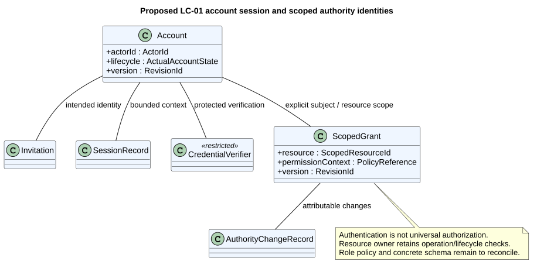
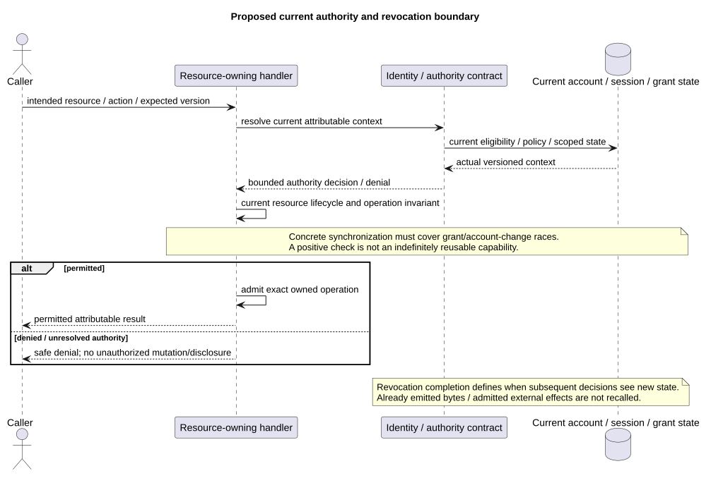
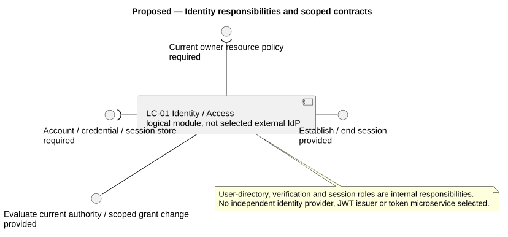
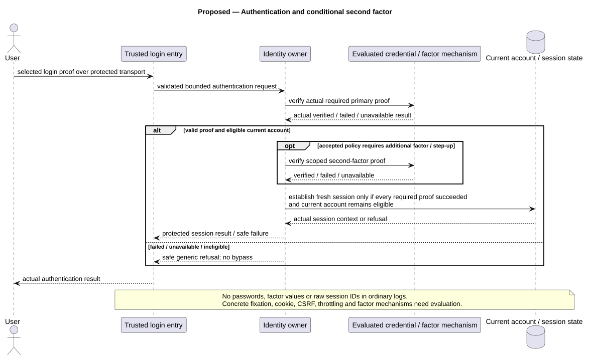
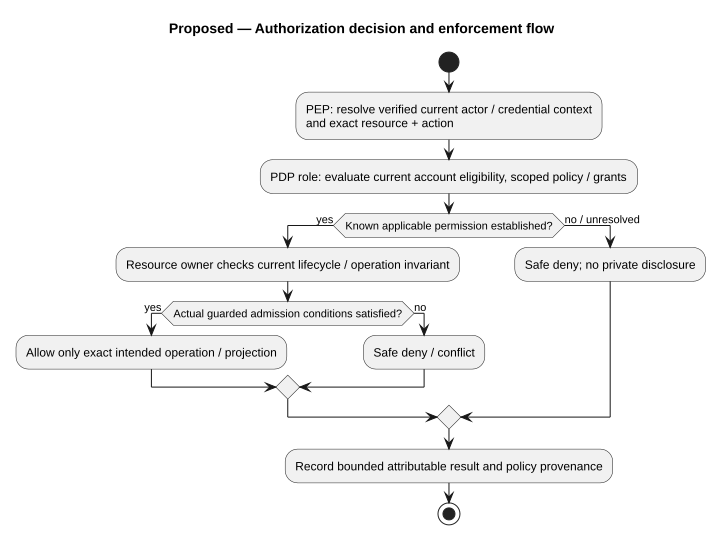
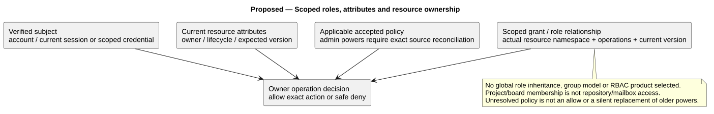
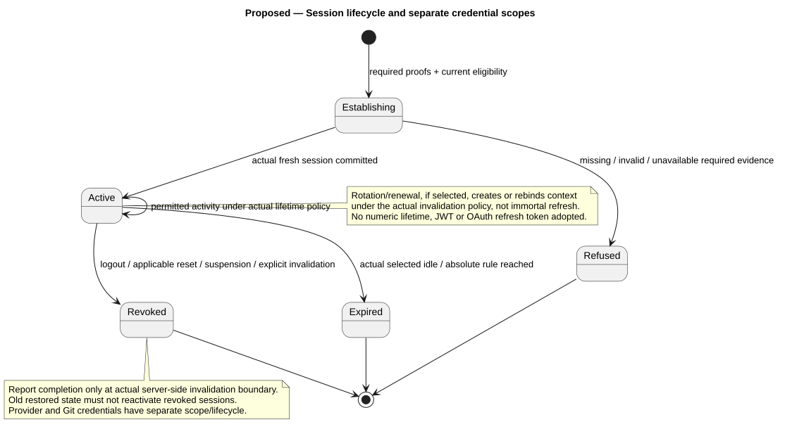
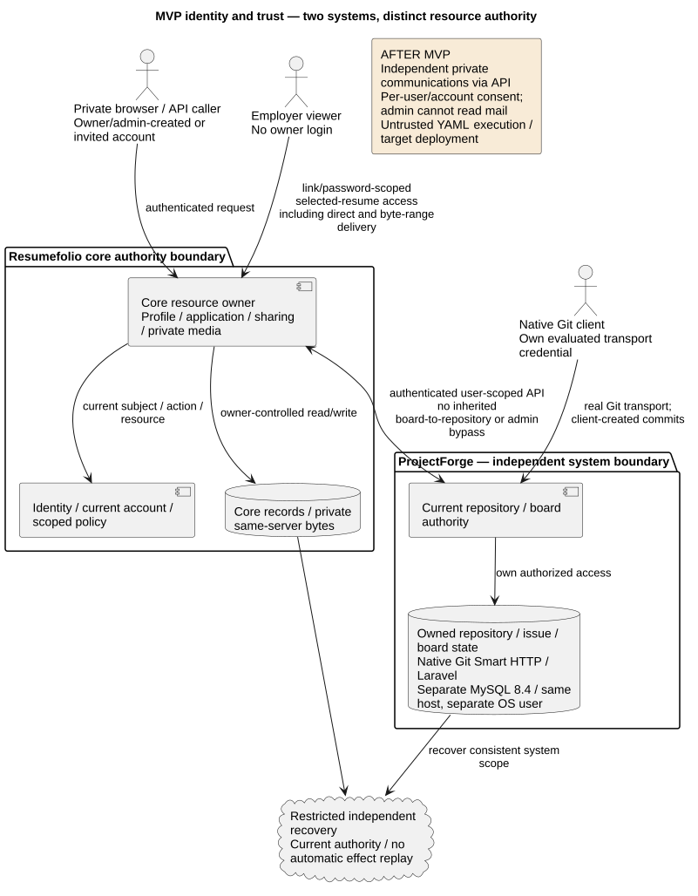

# Resumefolio — Identity and Access Component Design

**Responsibility:** establish attributable account/session context, manage explicitly scoped grants and credential lifecycle, and support current owner-side operation authorization. Unified sign-in never grants access to unrelated private resources.

**Status:** proposed LC-01 technical design, November 2, 2026. Q-D03–Q-D05 details remain subject to source disposition. No account, grant, factor, credential, timing value or accepted security baseline is created by this update.

[Authority](#1-source-authority-and-policy-boundaries) · [Contracts](#2-public-operations) · [Data](#3-owned-model-and-sensitive-state) · [Authorization](#4-current-authority-and-revocation-protocol) · [Failures](#5-recovery-and-failure-boundaries) · [Review](#6-verification-and-open-decisions) · [Essential views](#7-essential-identity-and-access-views)

## MVP system allocation and design status

Initial users are created or invited by the owner/admin. Open public self-registration is excluded. Authentication factors, session timing, recovery and the exact role matrix remain engineering details. Core/ProjectForge API requests carry authenticated user-scoped authority; board membership and administrator labels never imply access to unrelated private data. Future personal Gmail/Calendar connections require explicit per-user/per-account consent; owner/admin cannot read users' mail.

Authority: [OWNER-MVP-2026-11-04](../../../01-project-planning/owner-mvp-decision-2026-11-04.md).

## 1. Source authority and policy boundaries

Use [ACC-D01–ACC-D12](../../../02-requirements-engineering/03-requirements-specification/accounts-authentication-and-permissions.md), [Q-D03](../../../02-requirements-engineering/03-requirements-specification/accounts-authentication-and-permissions.md#resolution-q-d03), [Q-D04](../../../02-requirements-engineering/03-requirements-specification/accounts-authentication-and-permissions.md#resolution-q-d04), [Q-D05](../../../02-requirements-engineering/03-requirements-specification/accounts-authentication-and-permissions.md#resolution-q-d05) and [actual source decisions](../../../02-requirements-engineering/07-change-and-baseline/open-questions-and-decisions.md). Proposed onboarding, password/factor/session timing and role rules do not become accepted through design prose.

**Administrative-policy reconciliation:** earlier source history and later proposed administrative restrictions must be reconciled at exact authority/record scope. This component does not silently replace accepted owner/admin powers with the newer “no routine private read” proposal, or infer a universal bypass. Before accepting affected administrative operations, identify the authoritative actor/resource/action matrix and record the actual disposition. The enforcement mechanism below is policy-driven and preserves that pending decision.

**Own:** account/invitation identities, authenticating credential references/verifiers, sessions, factor/recovery state, scoped grant records and attributable authority changes. **Resource owners retain:** application/presentation/file/repository lifecycle and operation-specific invariants. Identity supplies current context and policy evaluation, not unrestricted domain mutation.

Employer link authorization is separately scoped by Sharing, provider capability by Communication and client repository credentials/ref authority by Git. Where common credential storage/evaluation is reused, scope and lifecycle remain explicit rather than turning all contexts into a product session.

## 2. Public operations

Signatures are proposed responsibility contracts. Actual types, framework/libraries, secret handling, factor mechanism and policy values require evaluated implementation design. Commands carry attributable identity and expected versions where conflict matters; results disclose only permitted information.

### InviteAccount / AcceptInvitation

Authorize actual account-management authority; bind invitation to intended recipient and reviewed onboarding policy. Validate current invitation/account state and single-use/expiry conditions once accepted. Accepting an invitation does not automatically grant project/repository membership. Pending invitations, active/suspended/deletion-pending states remain distinct; exact lifecycle/periods retain source status.

### EstablishContext / EndSession / EndAllSessions

Verify selected authentication factors and current account eligibility through evaluated mechanisms, then establish a fresh session context with protection against fixation and cross-user leakage. Store only required server-side session/credential metadata; protect cookies/transport and state-changing requests according to the actual selected web stack. Logout invalidates the relevant server-side scope, not merely a UI label or browser cookie.

Sign-out-all and password reset invalidate the source-defined account-session scope. They do not automatically revoke unrelated provider or Git credentials unless actual policy requires that separate change. Session idle/absolute values in Q-D05 are proposals, not implementation defaults. Shared sign-in across authorized areas does not imply federated OAuth or a selected SSO product.

### EvaluateAuthority(context, resourceReference, operation, currentResourceState)

Resolve current actor/account/session eligibility, current scoped grant/credential/link policy as applicable, and resource-owner operation/lifecycle constraints. Return a bounded decision/evaluation context with actual policy/version provenance. Missing or unresolved permission cannot become an allow. A decision is not an indefinitely reusable token independent of later state.

The owner applies the decision at the protected operation boundary. Every page/API/file/Git/background path needs the applicable check; middleware may enforce common admission, but cannot replace resource-specific checks or protect raw bypass routes by assertion alone.

### ChangeGrant / AcceptMembership / TransferOwnership

Validate actual grant-management authority, intended resource/recipient/scope and current lifecycle/version. Invitation is not effective membership until its source conditions hold. Ownership transfers preserve a valid responsible owner under the reviewed policy; do not silently orphan a resource or give a board invite repository/private-mail access. Record attributable prior/new context without credential values.

### RevokeAccess / SuspendAccount

Change the exact account/grant/session/credential scope under authority and version guards, invalidate relevant cached/effective contexts, and record completion only at the defined consistency boundary. Resource-specific revocation must not delete unrelated owned resources or claim previously delivered bytes were recalled. Account suspension preserves data according to source rules and does not invent deletion/restoration powers.

### EnrollFactor / RecoverAccess / ResetCredential

Use explicit identity/authority checks and evaluated verification/recovery mechanisms. Recovery cannot bypass suspension, owner protection or applicable administrative rules. Keep actual factor mechanism, owner emergency recovery, key storage and delivery prerequisites explicit. Failed/unavailable delivery or identity evidence leaves access unresolved/denied, not automatically verified. Never email plaintext passwords or log supplied secrets.

## 3. Owned model and sensitive state

[Editable PlantUML](diagrams/identity-owned-model.puml) · [PNG](diagrams/identity-owned-model.png)

**Account:** stable actor identity, actual lifecycle/version and source-defined platform role context. **Invitation:** intended recipient/account purpose, actual lifecycle and protected verifier reference. **SessionRecord:** account/context identity, actual creation/last-use/expiry/revocation state and relevant version; no unbounded privileged snapshot.

**CredentialVerifier / FactorRecoveryState:** evaluated password/factor/reset verification material and single-use/revocation semantics, restricted to the intended scope. Public projections exclude secrets, verifiers and recovery material. Exact algorithms/parameters/libraries must be selected against current authoritative guidance and actual compatibility rather than invented in this model.

**ScopedGrant:** subject, resource namespace/identity, permitted operations/role relationship, current state/version and attributable change provenance. **AuthorityChangeRecord:** actor, target, purpose and actual prior/new/result context, with source retention/audit protection. **OperationIdentity:** duplicate/expected-version coordination for consequential identity/grant commands where needed.

Persistence must isolate account/resource lookup, enforce scoped uniqueness and single-use/version conditions where required, and support current revocation evaluation. Final schema/types/normalization, factor/key lifecycle, session backend and cache coherence remain [data design](../../04-data-design/README.md) and security refinement. A database role column alone is not a complete authorization matrix.

## 4. Current authority and revocation protocol

[Editable PlantUML](diagrams/identity-authorization-sequence.puml) · [PNG](diagrams/identity-authorization-sequence.png)

1. A protected owner operation resolves the actor/session/credential context and intended resource/action without trusting a client-supplied owner/role claim.
2. Evaluate current account eligibility, exact scoped policy/grant and required factor/operation conditions. The resource owner validates its current lifecycle and invariant. Use policy/version context under the chosen synchronization protocol where a mutation races a grant/account change.
3. Admit only the explicit permitted operation, preserving unrelated state and safe denial disclosure. Do not reuse a positive decision forever in a controller, job or shared singleton.
4. Revocation commits the intended version/state and invalidation scope; subsequent decisions must observe it after the reported completion boundary. Concrete synchronization/cache/worker rules must prevent stale authorizations bypassing that promise. Long-running operations recheck at required consequential stages.
5. Record actual result and bounded evidence. Effects already admitted/in flight may require reconciliation; bytes already emitted/downloaded cannot be retracted. A later request/range fetch needs current authorization.

Use request/job-scoped authority context; persistent workers reconstruct it for each operation. A provider refresh token, Git client credential, employer viewer session and internal executor credential have different scopes and do not become interchangeable because they identify the same human.

### Supporting security references

The official [OWASP Authorization guidance](https://cheatsheetseries.owasp.org/cheatsheets/Authorization_Cheat_Sheet.html) supports default-deny policy and permission validation on every request. The [OWASP Session Management guidance](https://cheatsheetseries.owasp.org/cheatsheets/Session_Management_Cheat_Sheet.html) informs session lifecycle/invalidation and bounded lifecycle diagnostics. These inform mechanism evaluation; they do not choose Resumefolio’s administrative policy or certify implementation. Sources reviewed November 2, 2026; actual library/configuration compatibility remains unverified.

## 5. Recovery and failure boundaries

**Wrong/private identifier:** safe denial without unrelated content/existence disclosure; owner-specific constraints apply even to background/internal callers. No global administrator/service identity is inferred.

**Grant/account change during use:** resolve actual operation-admission and revocation ordering. Do not assume an obsolete cached role or serialized job session remains valid. Already known external effects are retained for reconciliation, not overwritten as no-effect failure.

**Duplicate invitation/reset/grant command:** use attributable intent and atomic single-use/version checks where applicable. Replay must not create duplicate memberships, grant different scope or reactivate an invalidated credential. Exact token expiry/attempt/rate limits remain source/engineering decisions.

**Notification/provider unavailable:** do not accept account/email/recovery verification without actual evidence. Generic outward responses, throttling and safe recovery details follow reviewed source policy. Delivery logging is not proof that a recipient received a recovery message.

**Lost response after identity change:** resolve the same permitted recorded operation outcome under current authority; do not repeat a suspension/ownership/reset action blindly or leak credential material through result lookup.

**Restore old identity state:** reassess current account/deletion/grant/session/credential decisions and key/verifier usability; do not resurrect revoked access or replay old reset/invitation notifications automatically. Define a reviewed recovery procedure, including exceptional owner access, without creating a hidden public bypass.

Diagnostics record bounded actor/operation/resource/result and applicable policy version, not passwords, raw session IDs, reset/factor values or private data dumps. Retention/editability follow the authoritative audit/source rules, not new periods in this component.

## 6. Verification and open decisions

| Source | Primary component responsibility |
|---|---|
| ACC-D01–D02 | Individual identity and shared sign-in across separately authorized areas |
| ACC-D03–D05 | Current resource/action authority, private isolation and bounded collaboration |
| ACC-D06–D08 | Integration with separate employer/link and protected-retrieval controls |
| ACC-D09–D10 | Exact administrative/grant powers and attributable authority changes |
| ACC-D11–D12 | No delivery/recovery bypass; session/grant/account lifecycle enforcement |

This maps responsibility, not semantic closure of every criterion. Administrative-policy reconciliation and source Q-D03–Q-D05 disposition remain explicit.

### Planned focused checks

- Wrong-owner private page/API/file/Git/background references and invitation without effective membership.
- Source-defined owner/admin/ordinary/collaborator/viewer actions, including prohibited owner/peer-admin mutations and explicitly permitted exceptional powers once reconciled.
- Current session after logout/all-session reset/suspension, revoked grants/credentials and later protected/range requests.
- Grant change racing mutation/read admission and stale worker/cache contexts.
- Single-use invitation/reset/factor recovery replay, changed intent and unavailable/failed delivery without bypass.
- Separate employer/provider/Git credential scopes and long-lived worker identity leakage.
- Isolated recovery of old sessions/grants/keys with current authority and no unintended notifications.

Use actual framework/session/persistence/cache/concurrency integration alongside deterministic policy checks. A mock allow/deny test cannot establish server-side invalidation, all-route coverage or recovery safety. No live authentication, grant change, recovery or security test is performed here.

### Remaining prescriptions

Reconcile actual administrative/owner authority and source policy; choose/evaluate password/factor/recovery mechanisms, session store/lifetimes, cookie/CSRF/security controls and notification facilities; specify concrete types/schema/uniqueness, version/invalidation protocol and safe key recovery; map exact criteria and review the actual candidate. No numeric timeout or password default, public-registration policy or new recovery privilege is silently accepted.

Follow [component templates](../component-template/README.md), [shared security](../../06-design-quality-and-security-analysis/02-security-threat-modeling-and-trust-boundaries.md), [runtime](../../01-software-architecture/03-process-view-concurrency-and-runtime-behavior.md), [interfaces](../../05-interface-and-api-design/README.md) and [review/handoff](../../06-design-quality-and-security-analysis/05-design-review-traceability-and-handoff.md). Class/interaction diagrams adapt FAU component refinement; they establish neither final schema nor production security assurance/baseline approval.

[Component catalog](../README.md) · [Component diagram catalog](diagrams/README.md)

## 7. Essential identity and access views

This compact package adds **six essential diagrams** and reuses the [existing domain class model](#3-owned-model-and-sensitive-state). It adds no speculative group hierarchy, token service, standalone identity provider or duplicate permission matrix. The authoritative actor/resource/action policy and administrative reconciliation remain in the source records and section 1. Q-D03–05 proposals retain their status.

### 7.1 Identity responsibilities and scoped contracts

[Editable PlantUML](diagrams/identity-essential-components.puml) · [PNG](diagrams/identity-essential-components.png)

Provided circles and required sockets describe logical contracts. Resource owners keep lifecycle/action invariants. Session establishment is not a blanket resource grant; exact bindings, backend and signatures remain proposed.

### 7.2 Authentication and conditional second factor

[Editable PlantUML](diagrams/identity-essential-authentication.puml) · [PNG](diagrams/identity-essential-authentication.png)

Conditional factor branch cannot be skipped when policy requires it. Diagram does not select a factor product, password algorithm, timeout or token format. A source-required delivery/recovery proof cannot be replaced by a log entry or unavailable-facility fallback.

### 7.3 Authorization decision and enforcement flow

[Editable PlantUML](diagrams/identity-essential-authorization.puml) · [PNG](diagrams/identity-essential-authorization.png)

PEP means policy enforcement point; PDP means policy decision point. These are responsibilities, not selected standalone products. Every protected web/API/file/Git/job boundary needs its applicable check. Actual synchronization must order revocation and admission; an early allow is not permanent authority.

### 7.4 Scoped roles, attributes and resource ownership

[Editable PlantUML](diagrams/identity-essential-access-model.puml) · [PNG](diagrams/identity-essential-access-model.png)

Candidate scoped role-plus-resource-context evaluation, not adoption of a pure RBAC/ABAC engine or a new role hierarchy. Group/Team and Permission types need not be separate tables/classes unless actual sourced requirements justify them. Exact role/action matrices remain in authoritative source disposition.

### 7.5 Session lifecycle and separate credential scopes

[Editable PlantUML](diagrams/identity-essential-session-state.puml) · [PNG](diagrams/identity-essential-session-state.png)

Proposed session observations, not final stored enums. Revocation affects subsequent protected admission under the actual synchronization promise; it cannot recall previously emitted bytes or stop every already admitted external effect. Provider-token refresh belongs to the evaluated Communication integration, not implicit product-session refresh.

### 7.6 Clients, trusted application and external scopes

[Editable PlantUML](diagrams/identity-essential-trust-boundaries.puml) · [PNG](diagrams/identity-essential-trust-boundaries.png)

User-supplied owner/role/token claims are not trusted merely because they cross an ingress. No external IdP or OAuth/OIDC login is selected; provider capability is a separate trust/credential scope. Actual TLS, credential verification, storage access and route coverage require implementation evidence.

### Scope and omitted optional views

Shared product sign-in does not establish federated OAuth/OIDC login. Therefore an authorization-code/PKCE/token-refresh login diagram is omitted until actual federation need, provider/client type and authoritative protocol selection exist. Communication's provider OAuth capability remains a separate owner/evidence gate; it must not be mistaken for LC-01 product authentication. This omission does not decide against a future evaluated federation mechanism.

The existing class model already covers Account (user identity), SessionRecord, CredentialVerifier, FactorRecoveryState and ScopedGrant. Roles/permissions/policy are described by the actual scoped-grant and owner-evaluation contracts; inventing separate Group/Token entities or an unsupported role hierarchy would add no essential clarity at this stage. A final permission matrix must follow exact source disposition, including unresolved administrative powers, rather than make pending policy appear accepted in a diagram.

Mechanism guidance follows the official [OWASP Authentication](https://cheatsheetseries.owasp.org/cheatsheets/Authentication_Cheat_Sheet.html) and [OWASP Authorization](https://cheatsheetseries.owasp.org/cheatsheets/Authorization_Cheat_Sheet.html) guidance, inspected November 2, 2026. These support evaluating authentication controls, default-deny decisions and per-request permission checks; they do not choose Resumefolio's owner/admin policy or certify actual security.

No account, session, factor, grant, token, configuration or live security test is created. Actual framework/session/credential selection, all-route enforcement, revocation ordering and recovery evidence remain required before acceptance.
