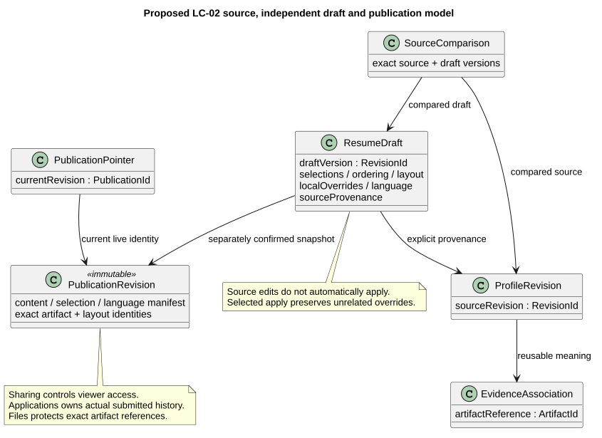
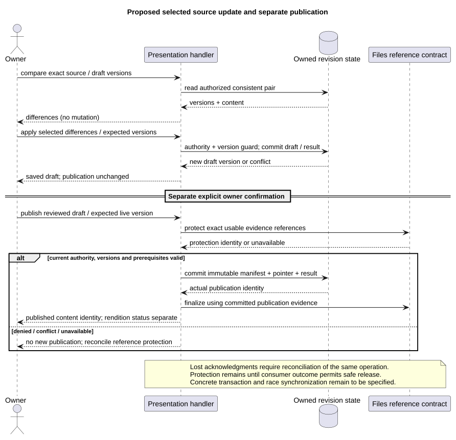
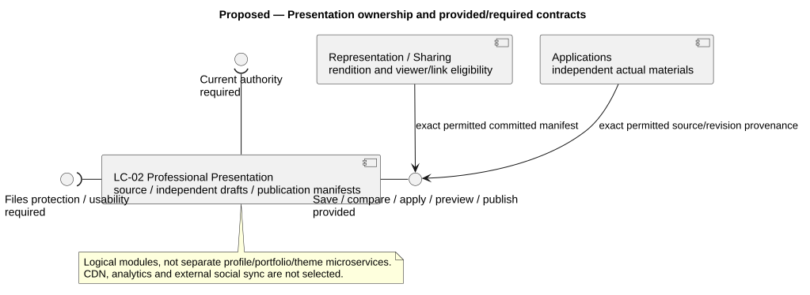
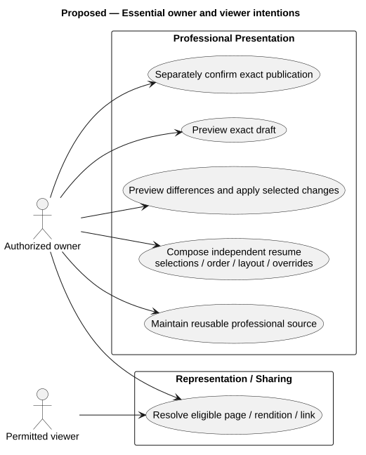
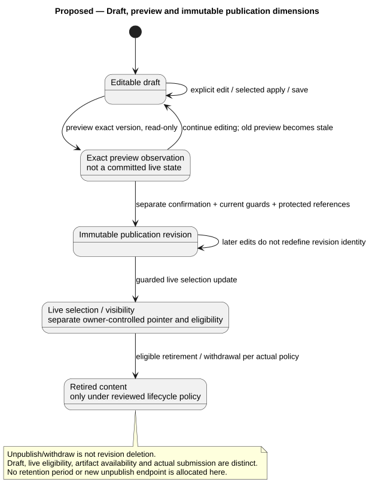
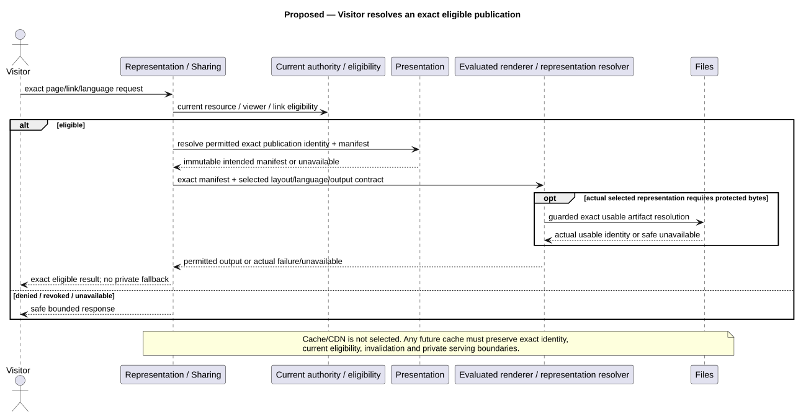
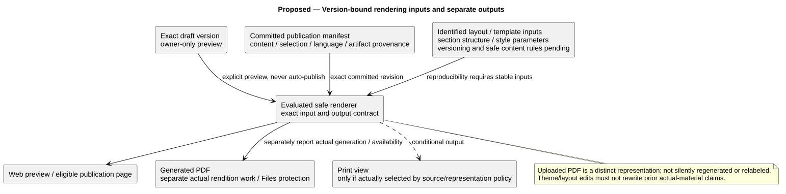
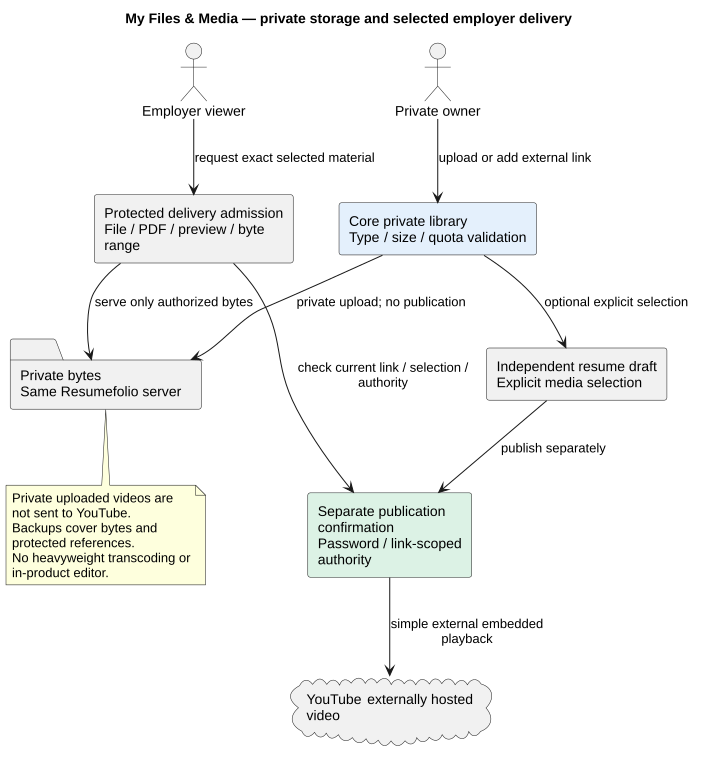

# Resumefolio — Professional Presentation Component Design

**Responsibility:** maintain reusable professional information and independently tailored resumes, review selected source changes, and create explicit publication revisions without rewriting previous submissions.

**Status:** proposed LC-02 technical design, November 2, 2026. The four-point source-update/publication policy is owner-accepted; concrete schemas, field rules, rendering mechanisms and remaining policy details are not accepted by this document.

[Scope](#1-source-authority-and-component-boundaries) · [Operations](#2-public-operations) · [Model](#3-owned-model-and-invariants) · [Consistency](#4-update-and-publication-protocol) · [Failures](#5-technical-scenarios-and-failure-handling) · [Review](#6-verification-and-remaining-decisions) · [Essential views](#7-essential-presentation-views)

Current MVP scope and selected mechanisms: [Baseline](../../../../baseline/README.md). Deferred provider, advanced collaboration and workflow-execution designs are not MVP prerequisites.

## 1. Source authority and component boundaries

Use [PRP-D01–PRP-D10](../../../02-requirements-engineering/03-requirements-specification/profiles-resumes-and-portfolio.md), the [owner-accepted update policy](../../../02-requirements-engineering/07-change-and-baseline/open-questions-and-decisions.md#owner-accepted-profile-update-policy), [Q-D07](../../../02-requirements-engineering/03-requirements-specification/profiles-resumes-and-portfolio.md#resolution-q-d07) and [analysis operation contracts](../../../03-system-analysis/05-business-rules-and-operation-contracts/10-domain-constraints-and-operation-contracts.md). The accepted core is:

1. Source changes do not automatically alter existing resumes or their published views.
2. The owner previews differences and selects/applies intended changes; resume-specific overrides and other resumes remain independent.
3. Applying/saving and publishing are separate actions, with separate owner confirmation for publication.
4. Previously submitted documents remain preserved independently of later source, resume or publication changes.

[Q-D06](../../../02-requirements-engineering/03-requirements-specification/profiles-resumes-and-portfolio.md#resolution-q-d06), [Q-D08](../../../02-requirements-engineering/03-requirements-specification/profiles-resumes-and-portfolio.md#resolution-q-d08) and [Q-D09](../../../02-requirements-engineering/03-requirements-specification/profiles-resumes-and-portfolio.md#resolution-q-d09) propose field/composition, evidence and language details. Their counts, mandatory fields, default selections, formats, fallback and source-deletion rules retain review status. English/German support does not imply automatic translation.

**Own:** reusable profile content, professional skills/projects and evidence associations, independently tailored selections/order/layout/overrides, source-comparison provenance, drafts and publication content revisions. Professional projects are distinct from Work Management projects and Git repositories.

**Collaborators:** [Identity](identity-and-access.md) supplies current attributable authority; [Files](files-and-operations.md) owns artifact admission, protected references and physical availability; [Representation and Sharing](representation-and-sharing.md) owns rendition/download/link/viewer eligibility; [Applications](applications.md) owns actual submitted-material history. Other modules consume explicit versioned contracts and do not mutate Presentation records directly.

## 2. Public operations

These are proposed application contracts, not final language signatures or API routes. Mutations include actor context, stable command identity, target identity and expected versions. Outputs contain only permitted data and actual outcome/provenance.

### SaveProfile / SaveEvidenceAssociation

Validate current authority and expected profile/evidence version; apply reviewed field, language and reference rules. Persist only admitted changes and attributable result. New reusable content does not update existing resumes, live publications or historical submissions. Files must establish artifact usability before content references advertise availability; private evidence does not gain public access through association alone.

### CreateResume / SaveDraft

Create an independent resume identity and explicit source selections. Save draft-owned ordering, display/layout choice, overrides and language context under an expected draft version. Draft completeness and publishability are separate states. Do not copy edits back into the shared profile or infer an active share link. Resume duplication details remain subject to Q-D06 review.

### CompareSource(resumeId, expectedDraftVersion, sourceRevision)

Read a consistent, authorized source/draft pair. Return a comparison identity containing exact versions and attributable proposed additions/changes/removals with affected selections/overrides. Comparison is read-only: it neither applies source changes nor publishes. Use stable entry/field identities where the evaluated model supports them; do not guess correspondence solely from visible text or array position.

### ApplySelectedChanges(comparisonId, selection, expectedDraftVersion)

Recheck current authority and the exact compared source/draft versions. Apply only the owner-selected differences under reviewed override/source-removal rules. Preserve unrelated overrides, omitted selections, other resumes and the current publication. A changed source/draft invalidates an obsolete comparison unless an explicitly reviewed merge protocol proves the selected change remains valid. Return conflict/recomparison rather than silently overwriting new work.

### PreviewDraft / PublishRevision

Preview resolves the explicitly selected draft revision, language, layout and permitted evidence without changing live state. Publish requires a separate explicit owner command tied to that reviewed candidate and expected draft/current-publication versions. Validate publication prerequisites and protect exact referenced artifacts before committing an immutable publication manifest and live revision pointer. Do not publish whichever draft happens to be latest when an older confirmation arrives.

Publication success establishes the selected content revision. PDF generation, delivery, download eligibility and live-link availability are separately reported by their responsible components; saving a publication record does not prove a PDF exists or an employer received it. A later draft edit cannot mutate an already published revision.

### ResolvePublication / RetireContent

Resolve an exact permitted publication revision and its manifest for the requesting contract. Public callers still require Sharing's current access checks. Retirement checks draft/publication/application references and reviewed lifecycle rules; it cannot physically delete protected historical bytes or silently invent replacement content. Source deletion and retention durations remain explicit decisions.

## 3. Owned model and invariants

[Editable PlantUML](diagrams/presentation-owned-model.puml) · [PNG](diagrams/presentation-owned-model.png)

**ProfileRevision:** reusable semantic content with stable entry identities and explicit language context. Exact shared versus language-specific fields follow reviewed policy. **EvidenceAssociation:** intended skill/professional-project meaning and exact artifact/link reference, not storage ownership or permission to fetch arbitrary remote URLs.

**ResumeDraft:** independent selections, ordering, layout choice, overrides, version and source provenance. **Comparison:** consistent source/draft identities and proposed difference identities; persistence/expiry strategy remains open. **PublicationRevision:** immutable content/selection/language/layout manifest plus exact referenced artifact identities and provenance. The concrete manifest must preserve sufficient content and renderer/layout identity for its stated reproducibility contract; a mutable profile foreign key alone cannot provide independence.

**PublicationPointer:** current live revision for the reviewed publication/language scope. **CommandResult:** attributable operation identity, intent/version and known outcome for safe duplicate handling. Do not store secrets or entire private content dumps in diagnostics.

Core invariants:

- Profile, draft, publication and actual submission are separate revision contexts.
- Selected application of source changes preserves unrelated resume-owned state.
- Publication requires a distinct confirmed command against the intended candidate.
- Referenced evidence remains protected against concurrent reclamation; existence alone grants no viewer authority.
- Historical submission capture resolves actual material through Applications/Files contracts, not a later reconstruction from the current live resume.

Final types, aggregate boundaries, schema/constraints and snapshot-versus-version-reference choices belong to [data design](../../04-data-design/README.md). Immutable publications do not establish indefinite retention or prohibit source-authorized retirement.

## 4. Update and publication protocol

[Editable PlantUML](diagrams/presentation-update-publication.puml) · [PNG](diagrams/presentation-update-publication.png)

1. Resolve current actor/resource authority and a consistent source/draft pair. Produce a preview with exact versions and no mutation.
2. Receive explicit selected changes. Revalidate authority, selection intent and source/draft versions; execute the guarded draft transaction and record its result. An empty/invalid selection must not broaden into “apply all.”
3. Return the saved draft and its version. The existing publication remains current. Publication confirmation is a later operation with its own command identity and reviewed candidate.
4. For publication, reserve/protect exact usable evidence references through Files so cleanup cannot win between validation and commit. Recheck draft/live-pointer versions and current authority at the chosen admission boundary; atomically record the immutable manifest, new pointer and attributable result within the evaluated persistence design.
5. Finalize protected references using actual committed publication evidence. If acknowledgment is lost, retain protection and reconcile the same operation; release only after proving the consumer did not commit or no longer requires it. Exact cross-owner transaction/locking protocol remains a joint design task.
6. Supply the committed publication identity to authorized rendition/sharing consumers. Any later asynchronous processing uses that exact manifest and fresh required authority, not a serialized privileged session or mutable “latest resume.”

Use application handlers for orchestration, domain policies/value types for composition and version invariants, repositories for owned state, and injected Files/Identity contracts. Rich text/link/media rendering needs evaluated safe rendering and input/output handling; this document selects no renderer or allowed markup. Shared layout changes must not silently rewrite historical rendition claims.

## 5. Technical scenarios and failure handling

**Concurrent edits or stale preview:** reject the stale expected version without partial overwrite; retain the owner's work for a clear recompare path. Exact automatic merge behavior is not accepted.

**Source removed or override exists:** show the actual relationship and reviewed conflict/removal choices. Do not delete selected resume content or replace local overrides merely because the source changed. Preserve the accepted independence boundary while unresolved deletion details are decided.

**Save fails or response is lost:** distinguish committed result, known no-change failure and unresolved outcome. Resolve a repeated command against its recorded intent/result under current authority; a reused identity with different payload is a conflict. A retry cannot publish as a side effect of resolving a draft save.

**Publication fails during reference coordination:** keep the prior live revision when no new pointer committed. Reconcile protected references using consumer evidence; do not treat a timeout as proof of rollback or prematurely reclaim artifacts. A committed publication with unavailable downstream rendition reports that distinct state truthfully.

**Evidence unavailable, replaced or unsafe:** block the affected availability claim under reviewed policy; preserve prior protected references and show the actual issue. Physical replacement, draft reference replacement and publication are separate actions. Do not fetch arbitrary evidence links server-side or execute uploaded content merely to preview it.

**Language/layout mismatch:** use explicit variant and candidate identities. No automatic translation, silent draft/publication substitution or relabeling of uploaded documents. Detailed fallback/completeness behavior remains Q-D09 review.

**Restore or retirement:** validate manifests, artifact availability, current account/grant/link authority and application-history dependencies. Restoring a database cannot prove bytes or rendering inputs are recoverable; do not automatically publish restored drafts or reactivate withdrawn sharing. Use the [operations/recovery procedure](../../06-design-quality-and-security-analysis/03-operations-backup-recovery-and-resilience.md).

## 6. Verification and remaining decisions

| Source group | Component responsibility |
| --- | --- |
| PRP-D01/D02 | Reusable professional information and independent opportunity-specific composition |
| PRP-D03/D04; accepted Q-D07 core | Independent overrides, preview/select/apply and separate publication |
| PRP-D05/D06 | Evidence meaning, associations and explicit per-resume disclosure selections |
| PRP-D07 | Manually maintained language context and independent variant editing |
| PRP-D08/D09 | Truthful preview/save/publication/rendition states and admitted content |
| PRP-D10 | Reference-aware retirement and preserved submitted-material independence |

This is responsibility mapping; exact criterion closure and remaining source dispositions are pending.

### Planned focused checks

- Two resumes with different selections/overrides: source edits change neither until selected apply; applying one preserves the other and its publication.
- Preview and save never publish; separate confirmation publishes only the intended version, including concurrent draft/live-pointer edits.
- Stale comparisons, empty selections, deleted source entries, conflicting overrides and duplicate command identities.
- Evidence ownership/availability and protected-reference registration racing cleanup, including lost commit/finalization responses.
- Actual submitted content remains unchanged after profile, draft, layout, publication and artifact replacement operations.
- Independent English/German edits; missing variant and distinct generated/uploaded representation behavior under reviewed policy.
- Invalid/unsafe content, wrong-owner direct access, stale worker authority, retirement and isolated restoration with missing bytes.

Use deterministic composition/handler checks plus actual persistence/version/concurrency and reference-coordination integration checks. Inspect the selected renderer with representative long content, media, languages and accessibility cases once chosen. No product save, publication, upload, recovery or acceptance test is executed by this documentation update.

### Remaining implementation prescriptions

Review Q-D06/Q-D08/Q-D09 and unresolved Q-D07 details; specify concrete field/entry identity and override granularity, source-deletion/reset semantics, language/publication-pointer scopes, manifest reproducibility, renderer/layout versioning and safe content policy. Evaluate actual persistence/locking, reference finalization, authorization and recovery mechanisms. Complete exact criterion mapping and candidate evidence before implementation handoff; no fixed counts, retention duration or numerical performance claim is introduced here.

Use [component templates](../README.md), [interface contracts](../../05-interface-and-api-design/README.md), [runtime design](../../01-software-architecture/03-process-view-concurrency-and-runtime-behavior.md) and [review/handoff](../../06-design-quality-and-security-analysis/05-design-review-traceability-and-handoff.md). These class and interaction views adapt the FAU component-refinement approach; they do not establish a final schema or whole-baseline acceptance.

[Component catalog](../README.md) · [Diagram catalog](diagrams/README.md)

## 7. Essential presentation views

This compact package adds **five complementary diagrams**, reusing the [existing domain model](#3-owned-model-and-invariants) and [selected apply / separate publication sequence](#4-update-and-publication-protocol). The component owns reusable content, independent drafts and explicit publication revisions; it does not own viewer-link eligibility, physical storage or actual submitted-material history. Accepted four-point policy remains authoritative; remaining Q-D06/08/09 and Q-D07 details retain their source status.

### 7.1 Presentation ownership and provided/required contracts

[Editable PlantUML](diagrams/presentation-essential-components.puml) · [PNG](diagrams/presentation-essential-components.png)

Circle marks a provided contract; sockets mark required capabilities. Consumers obtain bounded permitted projections, not write access to Presentation internals. Rendering inputs/layout identity belong in the publication reproducibility contract; actual renderer is unselected.

### 7.2 Essential owner and viewer intentions

[Editable PlantUML](diagrams/presentation-essential-use-cases.puml) · [PNG](diagrams/presentation-essential-use-cases.png)

Preserves the accepted four-point update/publication policy. Template/layout selection is part of sourced composition, not a newly selected theme marketplace. Shared links and download/export eligibility remain owned by Representation/Sharing.

### 7.3 Draft, preview and immutable publication dimensions

[Editable PlantUML](diagrams/presentation-essential-lifecycle.puml) · [PNG](diagrams/presentation-essential-lifecycle.png)

Conceptual lifecycle dimensions rather than one persisted status enum. Preview never mutates live state. Publication success does not establish PDF existence or link availability; submitted material remains independent after live selection/visibility changes. Concrete withdrawal/archival behavior requires source disposition.

### 7.4 Visitor resolves an exact eligible publication

[Editable PlantUML](diagrams/presentation-essential-visitor.puml) · [PNG](diagrams/presentation-essential-visitor.png)

No static/CDN bypass is introduced. A cached representation can never substitute for current authorization or an unavailable requested language/revision. Actual serving, rendering and revocation ordering require evaluated mechanisms; arrows do not certify them.

### 7.5 Version-bound rendering inputs and separate outputs

[Editable PlantUML](diagrams/presentation-essential-rendering.puml) · [PNG](diagrams/presentation-essential-rendering.png)

Minimal rendering pipeline includes the essential template/section/style relationship without inventing a theme engine, token schema or marketplace. PDF delivery/access belongs to Representation/Sharing and Files. HTML sanitization, media handling, long content, languages and renderer compatibility need actual evaluation.

### Scope of the essential package

The existing class model already captures professional source/entry identity, evidence associations, independent draft selections/overrides and publication manifests. The existing update/publication sequence already specifies validation, current version/authority checks, protected media references, coherent pointer/result commit and finalization/reconciliation; a second edit/publish sequence would duplicate that owner.

No speculative section-by-audience matrix is added: public/link-only/connection/private semantics must follow actual content selection and Sharing policy, not an invented social “connections” model. Likewise vCard, JSON Resume, LinkedIn/GitHub sync, CDN and analytics are not allocated as integrations. Required generated/uploaded PDF and web representation contracts remain distinct in the owning [Representation and Sharing design](representation-and-sharing.md). No automatic translation or external profile import is implied.

Before implementation, select actual content/layout/renderer versioning, safe input/output handling and exact manifestation/reference/authority mechanisms. Check representative long content, languages, media, availability and accessibility against an actual candidate; rendering these design diagrams does not establish product behavior. No profile edit, publication, export, share change or external synchronization is performed here.

## MVP private-media flow

[Editable source](../../01-software-architecture/diagrams/mvp-private-media.puml) · [PNG](../../01-software-architecture/diagrams/mvp-private-media.png).
