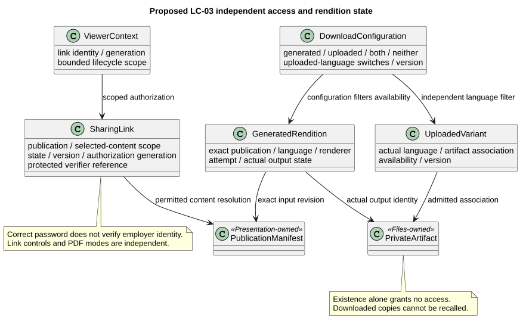
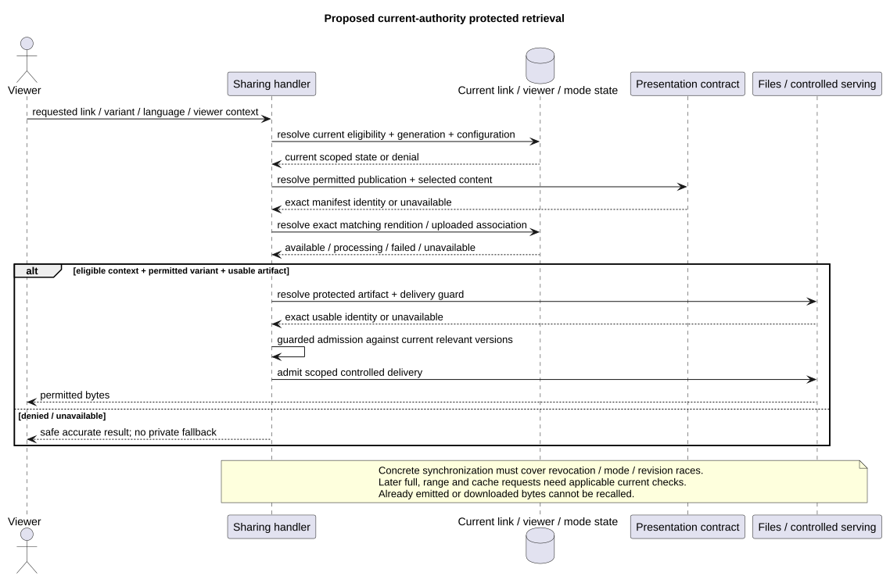
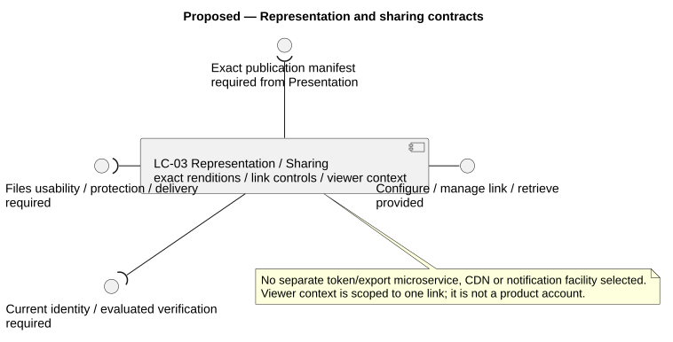
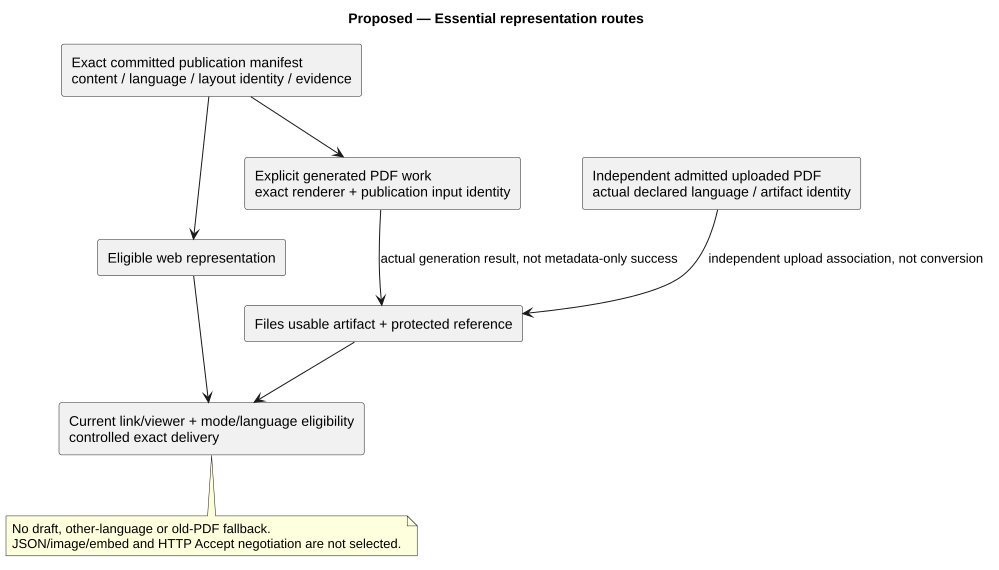
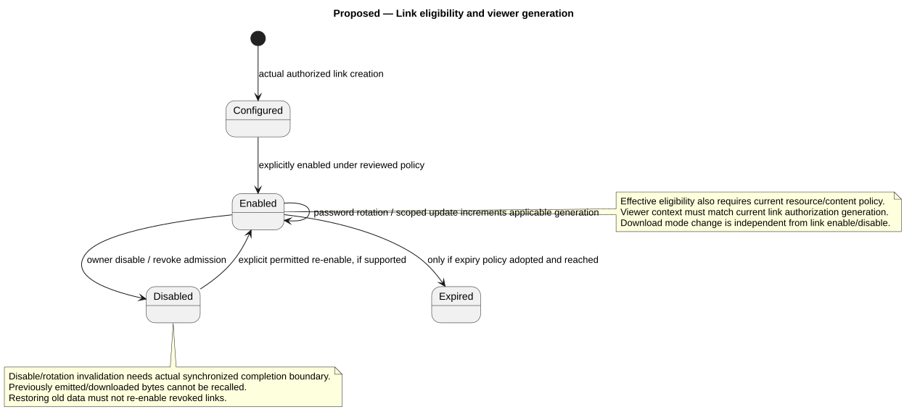
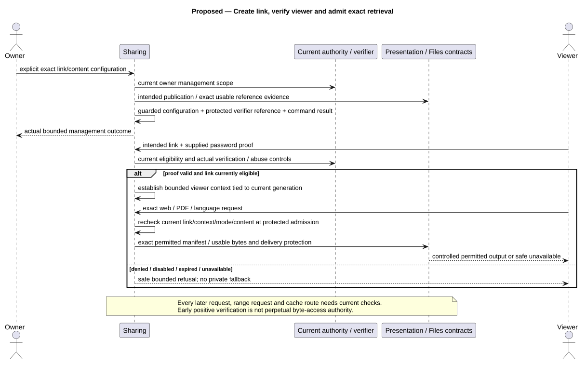
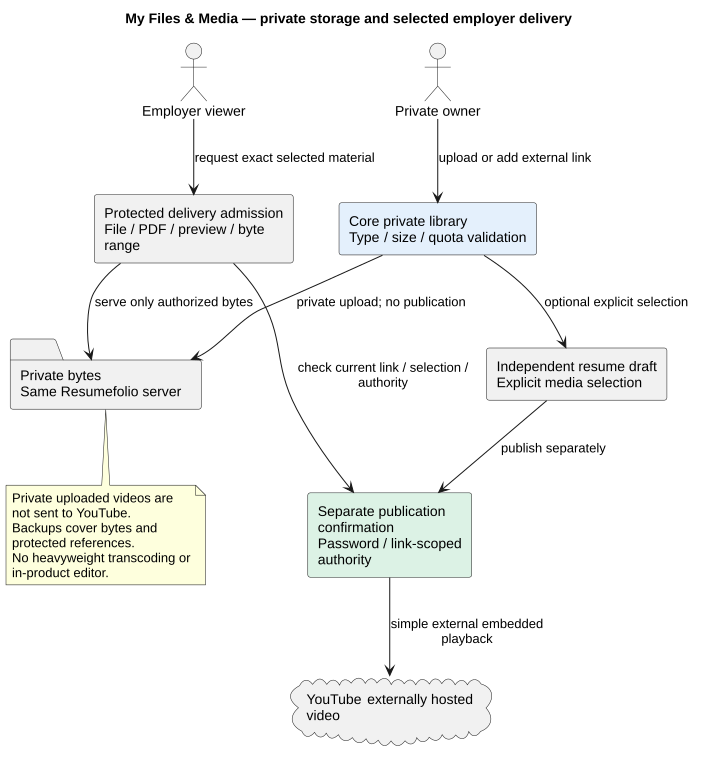

# Resumefolio — Representation and Sharing Component Design

**Responsibility:** resolve permitted published content and PDF variants, manage independent employer links and viewer contexts, and authorize protected retrieval against current policy and actual artifact availability.

**Status:** proposed LC-03 technical design, November 2, 2026. No live link, password, renderer, session mechanism or physical schema is created here. Detailed Q-D10/Q-D11 policies remain proposed; the accepted separation of source updates, draft saves, publication and submitted history remains binding.

[Boundaries](#1-source-authority-and-ownership) · [Operations](#2-public-operations) · [Model](#3-owned-model-and-state-dimensions) · [Retrieval](#4-protected-retrieval-and-revocation-protocol) · [Failures](#5-technical-scenarios-and-failure-handling) · [Review](#6-verification-and-remaining-decisions) · [Essential views](#7-essential-representation-and-sharing-views)

## MVP system allocation and design status

Retain generated/uploaded PDF availability and password-protected resume sharing without an employer account or owner login. Only explicitly selected material is visible. Apply current resume/viewer authorization to media playback, direct retrieval and byte ranges as well as PDFs; a storage path or cached rendition cannot bypass it. Uploading to My Files & Media alone grants no employer access. Revocation controls subsequent admissions; it cannot retract legitimately downloaded bytes.

Authority: [OWNER-MVP-2026-11-04](../../../01-project-planning/owner-mvp-decision-2026-11-04.md).

## 1. Source authority and ownership

Use [PDF-D01–PDF-D10](../../../02-requirements-engineering/03-requirements-specification/pdf-and-controlled-sharing.md), [Q-D10](../../../02-requirements-engineering/03-requirements-specification/pdf-and-controlled-sharing.md#resolution-q-d10), [Q-D11](../../../02-requirements-engineering/03-requirements-specification/pdf-and-controlled-sharing.md#resolution-q-d11), [account and access requirements](../../../02-requirements-engineering/03-requirements-specification/accounts-authentication-and-permissions.md) and the [accepted update/publication policy](../../../02-requirements-engineering/07-change-and-baseline/open-questions-and-decisions.md#owner-accepted-profile-update-policy). Accepted scope includes password-protected employer viewing without a viewer product account, selected content and protected file/PDF access, generated/uploaded download choices and owner link/password controls. Proposed numerical password/attempt/expiry rules, multiple-link details, rendition layout and session semantics do not become accepted through this design.

**Own:** per-resume download configuration, uploaded-variant associations, generated-rendition attempts and revision bindings, independent link configuration, password-verification references, scoped viewer contexts and attributable management outcomes.

**Collaborators:** [Presentation](professional-presentation.md) owns draft/publication content and exact revision manifests; [Identity](identity-and-access.md) supplies current account authority and evaluated authentication facilities; [Files](files-and-operations.md) owns artifact admission, protection and delivery/storage facilities; [Applications](applications.md) owns actual submitted material. A link is neither a product account nor proof of the viewer's real employer identity. A PDF-mode change is neither link revocation nor publication.

## 2. Public operations

Contracts below express proposed responsibilities, not final routes/types. Management commands carry attributable actor context, target, stable command identity and expected versions. Resolve current resource authority rather than trusting a supplied owner identity.

### ConfigureDownloads

Record generated/uploaded/both/neither choices and explicit uploaded-language enablement under reviewed policy. A configured option is not proof that its artifact exists. Preserve unrelated links, passwords, publication and actual submitted copies. Mode changes take effect at the defined subsequent-retrieval boundary without deleting protected bytes automatically.

### AssociateUploadedPDF / RequestGeneratedRendition

Bind an uploaded variant to its actual admitted artifact and declared language under reviewed validation policy; do not relabel another-language document. A replacement changes the usable association only after validation and availability are established, preserving the prior usable association on failure.

Generated output binds to an exact publication revision/language, renderer/layout identity and relevant inputs. Owner draft previews are separately labeled and cannot become employer publications. Record a durable attempt identity and bounded pending/processing/available/failed outcome. Repeated processing resolves the same intended work; a stale worker cannot attach an old artifact as the current revision. Concrete renderer, caching and PDF layout/accessibility criteria require evaluation.

### CreateOrChangeLink / ChangeLinkPassword / DisableLink

Authorize the actual owner/manager action and validate the intended publication/content scope and expected link version. Keep link identity, enabled state, password changes, optional expiry and download configuration as distinct dimensions. Store protected verifier material through an evaluated mechanism; never log or return stored plaintext secrets. Exact creation/default/expiry/attempt-limit rules retain Q-D11 status.

Password rotation and disabling update the applicable authorization generation/version and invalidate affected viewer contexts under the reviewed policy. Re-enabling is an explicit management operation where permitted, not a side effect of changing a PDF mode. Management must not silently broaden content selection or activate an unrelated link.

### EstablishViewerContext

Resolve current link eligibility and verify supplied evidence using the evaluated mechanism and abuse controls. Bind a successful viewer context to that link's current authorization generation and bounded content scope. A correct password does not authorize another link, private draft, unselected evidence or account administration. Safe failure responses avoid unnecessary private resource disclosure. Actual session lifetime, secret handling and throttling mechanisms remain implementation decisions.

### RetrieveRepresentation

Resolve the requested web/generated/uploaded representation, intended publication, language and exact artifact. Apply current link/viewer eligibility, selected content, current download mode/language and actual matching availability. Return a permitted projection/controlled delivery or an accurate unavailable/denied result. Never silently substitute a draft, another language or an older generated rendition as current.

Owner preview and Applications history access use their own current authority and explicit identities; they do not bypass employer restrictions by sharing an unprotected storage URL. Submitted-history capture uses actual material and protected references through Applications/Files rather than regenerating from the latest resume.

## 3. Owned model and state dimensions

[Editable PlantUML](diagrams/sharing-owned-model.puml) · [PNG](diagrams/sharing-owned-model.png)

**DownloadConfiguration:** resume scope, mode, uploaded-language switches and version. **UploadedVariant:** exact artifact association, actual language, admission/availability and association version. **GeneratedRendition:** exact publication/language/render-input identity, attempt and actual output state. Artifact bytes and physical cleanup remain Files responsibilities.

**SharingLink:** independent identity, intended publication-stream/content scope, state/version and protected password-verifier reference. **ViewerContext:** link identity, authorization generation and reviewed lifecycle scope; it is not a verified employer identity. **ManagementResult:** attributable command identity, expected version, actual outcome and bounded provenance.

Do not collapse these independent facts:

- Publication exists versus a particular rendition being available.
- Download is enabled versus exact-language bytes being usable.
- Link is enabled versus this viewer context being current.
- Artifact exists versus this request being permitted to retrieve it.
- Retrieval was admitted versus delivery completed or the recipient read it.
- Downloaded copy exists versus product control over that external copy.

Final types/schema, indexing, uniqueness, verifier/session storage and atomic version checks belong to [data design](../../04-data-design/README.md) and evaluated security design. Immutable rendition identity does not prescribe indefinite retention.

## 4. Protected retrieval and revocation protocol

[Editable PlantUML](diagrams/sharing-protected-retrieval.puml) · [PNG](diagrams/sharing-protected-retrieval.png)

1. Identify the intended link, viewer context, representation and language. Resolve current link eligibility and applicable authorization generation without trusting client-supplied role/scope claims.
2. Resolve the permitted current publication under the reviewed stream policy and selected content. A viewer cannot resolve owner drafts or unrelated artifacts through identifier manipulation.
3. For PDF retrieval, evaluate current mode/language switches and the exact generated/uploaded association. Distinguish processing, unavailable, failed and denied states without leaking protected metadata.
4. Resolve the exact usable artifact and retain any necessary delivery/reference protection through Files. Before admitting bytes, apply the chosen synchronization protocol covering link/password/mode/publication changes racing retrieval. Independent reads followed by an unguarded raw-file redirect cannot establish this guarantee.
5. Deliver through the evaluated protected serving path. Subsequent requests, including range requests, require current applicable authorization. Private artifact paths, thumbnails, generated exports, cache hits and alternate endpoints must not become bypass routes.
6. Record bounded actual outcome. Already emitted or downloaded bytes cannot be recalled. Define the admission/completion boundary for in-flight transfers explicitly; later checks must observe completed revocation under the selected consistency protocol.

Any signed delivery capability, proxy/internal redirect, browser/server cache or CDN facility needs an explicit scope, expiry, invalidation and in-flight evaluation before selection. The design does not claim immediate revocation merely because a token expires later. Cache keys and response handling must preserve viewer/link/publication/language separation and avoid private cross-context disclosure.

The official [OWASP Authorization guidance](https://cheatsheetseries.owasp.org/cheatsheets/Authorization_Cheat_Sheet.html), reviewed November 2, 2026, supports permission checks on every request and protected static resources. It informs enforcement evaluation without selecting the serving mechanism or certifying this design.

Generation uses request/job-scoped authority and exact input identities, not a serialized privileged session or mutable “latest resume.” Protect artifact references before consumer commit, finalize against actual committed association evidence, and reconcile uncertain outcomes before release. A local database rollback does not undo stored bytes or renderer side effects. Follow the joint [Files reference protocol](files-and-operations.md#5-protected-reference-replacement-and-reclamation).

## 5. Technical scenarios and failure handling

**Wrong password, disabled link or stale viewer:** safely deny; do not disclose unrelated resource details or allow a previously cached positive decision indefinitely. A different valid link/context cannot inherit this link's scope.

**Mode/password/publication change during retrieval:** use actual version/admission ordering; retry resolution or deny where appropriate. An admitted response may already have emitted bytes, so report the real boundary rather than claiming recall.

**Missing or old rendition:** expose the actual permitted state. The new web publication may be available while its generated PDF is processing under the Q-D10 proposal; do not present a previous artifact as matching the new revision. Downloading an older revision requires a separately permitted explicit context.

**Generation interruption or duplicate worker:** reconcile the same input/attempt and actual output identity. Bound temporary growth and failed cleanup through Files. A superseded result can remain protected for valid history/owner uses but cannot overwrite the current association without guarded intent.

**Upload replacement fails:** retain the prior usable association and actual failed candidate state; do not report success from upload transport alone or release references before proving they are no longer needed.

**Lost management response:** resolve the same command result under current authority. Reuse with changed intent is a conflict. Repeated password management must not create an untracked secret or falsely claim that an earlier revocation did not occur.

**Retirement or restored state:** link removal does not physically delete every artifact or historical submission. Restore manifests, bytes and verifier/key usability in isolation; reconcile current account/link/revocation decisions before promotion. Do not automatically re-enable previously disabled links. Use [operations/recovery](../../06-design-quality-and-security-analysis/03-operations-backup-recovery-and-resilience.md).

Diagnostics retain bounded link/operation/revision/outcome provenance under reviewed retention, excluding supplied passwords, raw viewer/session secrets, private content dumps and claims of verified employer identity or successful reading.

## 6. Verification and remaining decisions

| Source group | Component responsibility |
| --- | --- |
| PDF-D01/D02 | Exact generated and independently uploaded PDF/language associations |
| PDF-D03 | Mode and uploaded-language configuration distinct from availability |
| PDF-D04–D06 | Scoped employer contexts, direct retrieval protection and owner link/password controls |
| PDF-D07 | Explicit publication/rendition identity and truthful current availability |
| PDF-D08 | Downloaded-copy limits and separate actual submitted history |
| PDF-D09/D10 | Failure-safe processing, protected references, retirement and restored access |

This maps responsibilities, not closure of every criterion or acceptance of Q-D10/Q-D11 details.

### Planned focused checks

- Four download modes across generated/uploaded availability, English/German variants and permitted/denied contexts.
- Correct/wrong password, no viewer product account, link isolation, unselected evidence and direct/alternate artifact endpoints.
- Password rotation, disabling, expiry where adopted and stale viewer contexts on later full/range/cache requests.
- Mode/publication/revocation changes racing retrieval admission; actual in-flight delivery boundaries.
- Exact publication/render identity, missing/processing/failed PDF and stale generation completion without silent fallback.
- Upload replacement failure, duplicate generation and protected-reference finalization racing cleanup or lost responses.
- Independent submitted copies and restored artifacts/link generations without unintended reactivation.

Use deterministic policy/handler checks with actual persistence/concurrency, protected serving/cache and selected renderer integration. Inspect generated PDFs with representative long multilingual text, fonts, pagination, links and media treatment once the renderer is chosen. No live link, password change, generation, download, revocation or recovery test is performed by this documentation update.

### Remaining implementation prescriptions

Review Q-D10/Q-D11 and related session policies; choose/evaluate renderer, safe PDF processing, layout/font licensing and measurable accessibility expectations; define exact publication-stream/content selection and language behavior. Specify concrete verifier/session/abuse mechanisms, serving/cache invalidation and admission ordering, schema/types/version guards, artifact reference coordination and restoration procedure. Complete exact criterion mapping and actual candidate evidence before handoff. No numerical password/timeout/attempt default or automatic conformance claim is introduced here.

Use [component templates](../component-template/README.md), [interface contracts](../../05-interface-and-api-design/README.md), [runtime design](../../01-software-architecture/03-process-view-concurrency-and-runtime-behavior.md), [security design](../../06-design-quality-and-security-analysis/02-security-threat-modeling-and-trust-boundaries.md) and [review/handoff](../../06-design-quality-and-security-analysis/05-design-review-traceability-and-handoff.md). Class and interaction views adapt the FAU component-refinement approach and establish neither a final schema nor production security assurance.

[Component catalog](../README.md) · [Diagram catalog](diagrams/README.md)

## 7. Essential representation and sharing views

This focused package adds **four complementary diagrams and two essential control tables**. Reuse the [existing domain model](#3-owned-model-and-state-dimensions) and [protected retrieval sequence](#4-protected-retrieval-and-revocation-protocol), which already define the detailed representation/context checks. No additional generic sharing platform, organization audience, group-sharing model or notification subsystem is allocated. Q-D10/11 detailed policy remains proposed.

### 7.1 Representation and sharing contracts

[Editable PlantUML](diagrams/sharing-essential-components.puml) · [PNG](diagrams/sharing-essential-components.png)

Provided circle and required sockets show logical capabilities. Presentation owns content/publication; Files owns actual bytes/protection. Exact rendering and current access eligibility must agree; link possession is not proof of employer identity.

### 7.2 Essential representation routes

[Editable PlantUML](diagrams/sharing-essential-formats.puml) · [PNG](diagrams/sharing-essential-formats.png)

Generated and uploaded PDFs are different sources, not interchangeable conversion stages. New publication may exist while generation is pending; availability and current download configuration stay separate. No arbitrary-format export system or automatic translation is introduced.

### 7.3 Link eligibility and viewer generation

[Editable PlantUML](diagrams/sharing-essential-link-state.puml) · [PNG](diagrams/sharing-essential-link-state.png)

Proposed eligibility observations, not final persisted enum, default enablement or selected expiry period. Created/configured does not necessarily mean active. Password rotation and disabling have distinct intent but both require actual viewer-context invalidation semantics.

### 7.4 Create link, verify viewer and admit exact retrieval

[Editable PlantUML](diagrams/sharing-essential-link-sequence.puml) · [PNG](diagrams/sharing-essential-link-sequence.png)

Logical collaboration, not a selected session/token implementation, secret-generation policy or raw storage URL. Actual revocation and delivery ordering remains an implementation gate. Sharing does not send email or record actual submission automatically.

### 7.5 Essential audience and operation boundaries

These rows summarize scoped contexts, not newly accepted role/audience tiers. No “connections,” organization-wide access or named-recipient verification model is inferred.

| Current context | Permitted content / action | Boundary |
| --- | --- | --- |
| Authorized owner/manager | Exact source-authorized link/download management and owner preview | Management authority checked separately; preview is not employer publication |
| Password-verified employer viewer | Only currently selected published content and enabled exact representation/language | No product account required; no verified real-employer identity, private drafts or unrelated evidence |
| Anonymous/public request | Only content explicitly permitted by actual publication/Sharing policy | A public URL does not implicitly make protected PDF bytes public |
| Applications history consumer | Exact actual material under its own current authority | Not substituted with current live publication or an unprotected employer URL |
| Disabled/expired/stale/wrong-link context | Safe denied/unavailable projection | No cached positive decision, cross-link scope inheritance or private fallback |

### 7.6 Essential share security and delivery constraints

No entropy number, password length, expiry, session lifetime or rate-limit default is adopted here. Select actual mechanisms through security/source disposition and verify them against the actual serving path.

| Concern | Required design constraint | Selection / verification gate |
| --- | --- | --- |
| Link identifier / secret | Evaluate unpredictability and exposure; identifiers do not replace current scoped authorization | Concrete secure generation, storage, disclosure and lookup rules pending; no raw secrets in logs |
| Password | Verify protected material through evaluated mechanism; no stored plaintext secret disclosure | Actual verifier, rotation and recovery/source policy pending |
| Expiry | Apply only if adopted, with unambiguous time and current evaluation | No duration or automatic default selected |
| Revocation / password rotation | Invalidate applicable viewer generation and subsequent admitted retrieval under defined ordering | Actual persistence/cache/serving race checks; cannot recall emitted copies |
| Abuse / rate limiting | Bound attempts/resource consumption without inventing a permissive failure path | Actual policy, mechanism and threshold evaluation pending |
| Cache / CDN / signed delivery | Exact link/viewer/publication/language separation and current eligibility; no raw bypass route | No CDN, Accept-negotiation scheme, signed URL or cache implementation selected |
| Diagnostics | Bounded permitted operation/link/revision/result metadata | Exclude passwords, raw viewer/session secrets, private bodies and unproven “read” claims |

### Essential scope limits

Web and distinct generated/uploaded PDF routes explain the present component. HTTP Accept negotiation, JSON/image exports, embed/oEmbed, organization/group sharing, social previews, webhooks and external APIs are omitted because no actual selected need/capability is established here. A new integration must receive its own sourced scope, access and compatibility assessment. Email delivery remains a separate explicit Communication operation, not an automatic side effect of creating a link.

No link/password change, PDF generation, download, revocation, cache change or external send is executed by this documentation update. Actual component signatures, current access/delivery synchronization, verifier/session/abuse facilities and protected-reference mechanisms still require candidate-specific design and verification.

## MVP private-media flow

[Editable source](../../01-software-architecture/diagrams/mvp-private-media.puml) · [PNG](../../01-software-architecture/diagrams/mvp-private-media.png).
