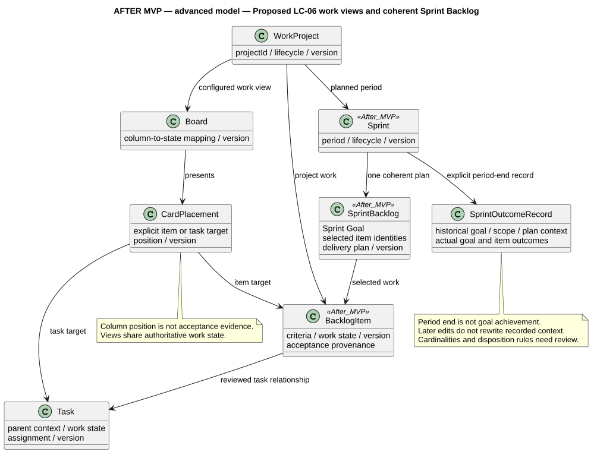
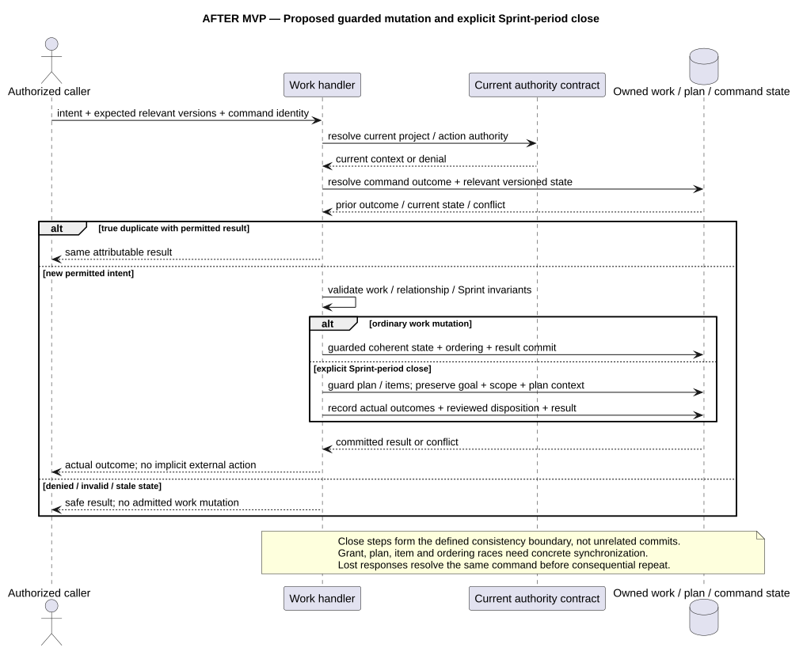
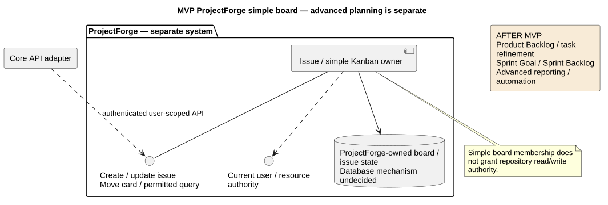
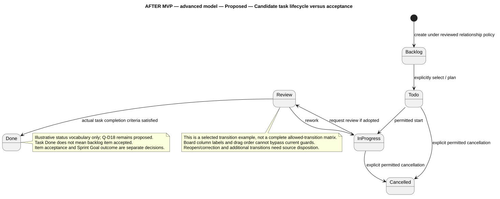
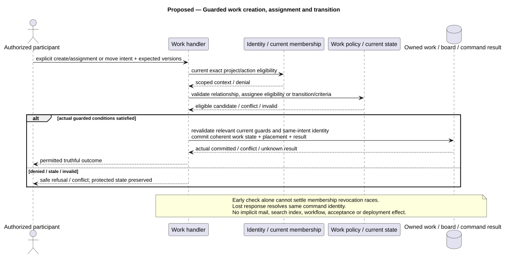
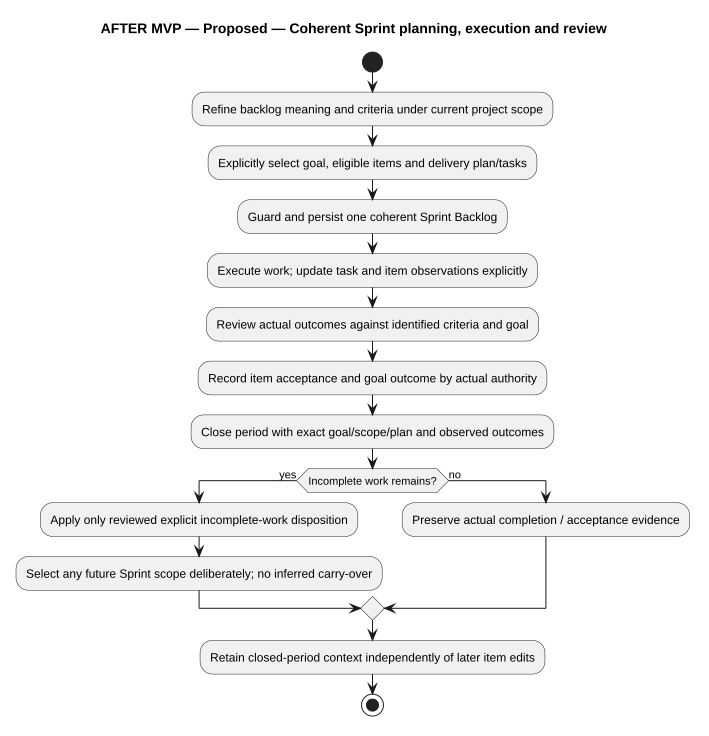

# Resumefolio — Work Management Component Design

**Responsibility:** manage work projects, boards, backlog items/tasks and coherent Sprint plans, with explicit completion decisions, scoped collaboration and truthful change history.

**Status:** proposed LC-06 technical design, November 2, 2026. Detailed Q-D18–Q-D20 workflow, cardinality, role and Sprint policies remain proposed. No live board, membership, task or Sprint is changed here; logical ownership does not mandate separate deployment.

[Scope](#1-source-authority-and-boundaries) · [Operations](#2-public-operations) · [Model](#3-owned-model-and-invariants) · [Consistency](#4-mutation-and-sprint-end-protocol) · [Failures](#5-technical-scenarios-and-failure-handling) · [Review](#6-verification-and-remaining-decisions) · [Essential views](#7-essential-work-management-views)

Current MVP scope and selected mechanisms: [Baseline](../../../../baseline/README.md). Deferred provider, advanced collaboration and workflow-execution designs are not MVP prerequisites.

## 1. Source authority and boundaries

Use [PKS-D01–PKS-D11](../../../02-requirements-engineering/03-requirements-specification/projects-kanban-and-sprints.md), [Q-D18](../../../02-requirements-engineering/03-requirements-specification/projects-kanban-and-sprints.md#resolution-q-d18), [Q-D19](../../../02-requirements-engineering/03-requirements-specification/projects-kanban-and-sprints.md#resolution-q-d19), [Q-D20](../../../02-requirements-engineering/03-requirements-specification/projects-kanban-and-sprints.md#resolution-q-d20) and [analysis operation contracts](../../../03-system-analysis/05-business-rules-and-operation-contracts/10-domain-constraints-and-operation-contracts.md). Preserve the agreed project/Kanban/backlog/task/Sprint capability while distinguishing source-derived meanings from proposed refinements.

Canonical state names, Ready criteria, item types, priority vocabulary, one-backlog/one-active-Sprint limits, owner/editor powers, incomplete-work handling and optional cadence retain their proposal status. They are not implementation defaults established by this document. The delivery project's current GitHub board and its working cadence are not product configuration or product-test evidence.

**Own:** work-project and board configuration, column/card mapping, backlog items, tasks, assignments, ordering, work-specific membership/assignment relationships, Sprint identity and coherent Sprint Backlog, and attributable work/period outcomes. Coordinate authoritative scoped grants with Identity; do not create a second contradictory permission source.

**Collaborators:** [Identity](identity-and-access.md) supplies current actor/grant authority; [Git](git-collaboration.md) owns repository issues/requests/commits and repository permissions; [Communication and Calendar](communication-and-calendar.md) owns calendar/provider effects and separately authorized reminders; [Applications](applications.md) owns application progress; [Files](files-and-operations.md) owns any admitted attachments and protected references.

Professional portfolio projects, work projects and Git repositories retain distinct identities. Cross-module association conveys neither access nor ownership. A work-item move, due date or commit does not by itself send mail, accept an item, alter application progress, start a workflow or deploy.

## 2. Public operations

These proposed application contracts require concrete signatures/types after policy and persistence evaluation. Mutations carry actor context, target identities, expected relevant versions and stable command identity. Results state actual confirmed/invalid/denied/conflict/pending/unknown outcomes and permitted projections.

### CreateProject / ConfigureBoard

Validate current project-management authority and reviewed structure. Create explicit project/backlog/board relationships without implicit portfolio or repository creation. Board configuration maps cards/columns to defined work semantics; presentation order or a column label alone cannot establish item acceptance.

Changing/removing an occupied column requires a reviewed target mapping and coherent updates for affected cards. Never silently discard cards or leave invalid column references. Define the transaction or explicit pending transition for large changes; report completion only after the promised invariant holds.

### RefineItem / SaveTask / ChangeAssignment

Maintain reviewed item/task fields, criteria, parent relationships, ordering and eligible assignment under current authority and expected versions. Validate target project and membership scope; do not assign foreign/ineligible users by accepting client identifiers alone. Task progress, item acceptance and Sprint Goal outcome are separate facts. Done tasks do not automatically prove an accepted item.

### MoveWork

Resolve the actual card target and current board/item/task versions. Validate source/destination mapping, transition and completion rules, ordering anchors and current actor scope. Apply canonical state and affected board position coherently under the chosen concurrency protocol. If one work record appears in multiple views, preserve a single authoritative state rather than diverging per-board status copies. Reordering cannot bypass completion checks.

### PlanSprint / ChangeSprintPlan

**Release applicability:** future-domain design retained after MVP; core operating/deployment and recovery controls still apply to MVP where relevant.

Maintain one coherent Sprint Backlog: Sprint Goal, selected backlog items and delivery plan/tasks. A board is a view of that plan, not a second Sprint Backlog. Validate current project/item eligibility, reviewed time/date rules and allowed concurrent Sprint relationships.

Apply goal/scope/plan changes as one guarded operation when their invariants depend on each other; preserve attributable prior/new context. Rules about active-Sprint changes, confirmation, role powers, cadence and cardinality retain Q-D19 status. No calendar event or provider notification is implied by planning a Sprint.

### RecordTaskCompletion / AcceptItem / RecordGoalOutcome

Validate the actual completion or acceptance authority and evidence required by reviewed policy. Record the decision against the exact item/criteria or goal context. Distinguish reported completion, authorized acceptance, unfinished work and unknown outcome. Moving a card, exhausting tasks or reaching the end date cannot fabricate acceptance or goal achievement.

### CloseSprintPeriod

**Release applicability:** future-domain design retained after MVP; core operating/deployment and recovery controls still apply to MVP where relevant.

Resolve current Sprint, plan and selected-item versions. Record period end/cancellation separately from goal outcome and item acceptance. Preserve the historical goal, selected scope, delivery plan and actual outcomes so later item changes cannot rewrite what was known at close.

Apply reviewed incomplete-work disposition explicitly. The Q-D19 return-to-backlog/no-automatic-carry-over rule remains proposed; the mechanism must support its reviewed disposition rather than silently select a next Sprint. Return a truthful outcome even when work remains incomplete. A scheduled date alone does not certify a successful Sprint.

### ChangeMembership / AssociateResource / QueryWorkSummary

Coordinate work-specific membership with Identity's authoritative scoped grant lifecycle. On removal, handle assignments using reviewed clear/reassign rules while preserving attributable history. Exact transaction/invalidation protocol is a joint design task; do not report completed revocation while new protected operations still rely on stale membership.

Associations store explicit resource identity and meaning; follow-through checks target-owner authority and returns safe unavailable results for deleted/inaccessible targets. Queries count distinct authorized records with explicit filters, time-zone meaning and completeness. Do not count tasks as accepted items or invent complete totals when a required dependency is unavailable. Reporting and automatic triggers remain bounded by Q-D20 review.

## 3. Owned model and invariants

[Editable PlantUML](diagrams/work-owned-model.puml) · [PNG](diagrams/work-owned-model.png)

**WorkProject:** stable work identity and lifecycle/version. **Board / ColumnMapping / CardPlacement:** configured view, explicit target identity, state mapping and ordering; no independent acceptance truth. **BacklogItem:** work meaning, criteria, state/version and acceptance provenance. **Task:** explicit parent or reviewed standalone relationship, work state and assignment context.

**Sprint / SprintBacklog:** period identity, goal, selected item identities and delivery plan as one coherent logical whole. **SprintOutcomeRecord:** attributable period-end context and actual goal/item outcomes with sufficient versioned meaning to preserve history. **WorkMembership / Assignment:** project-scoped relationship coordinated with actual Identity grants, not a universal user role.

**ResourceAssociation:** target namespace/identity and intended association, not copied private data or inherited authority. **WorkChange / CommandResult:** bounded actor, intent, expected versions, prior/new outcome and stable operation identity. History representation and retention remain explicit design decisions; event sourcing is not selected by the need for history.

Core invariants:

- Board movement, canonical work state and completion/acceptance stay coherent.
- Referenced work belongs to the intended project/plan under reviewed relationship rules.
- Goal, selected items and delivery plan describe one Sprint Backlog.
- Period end, task completion, item acceptance and goal achievement remain distinct.
- Later edits or new planning do not rewrite a closed period's recorded context.
- Associations and membership changes preserve unrelated module permissions and owned data.

Final aggregate/transaction boundaries, schema/cardinalities, ordering representation, indexes and uniqueness follow [data design](../../04-data-design/README.md). Do not put an entire project into one ever-growing in-memory aggregate by assumption, or rely on isolated row versions to enforce cross-item Sprint invariants.

## 4. Mutation and Sprint-end protocol

**Release applicability:** future-domain design retained after MVP; core operating/deployment and recovery controls still apply to MVP where relevant.

[Editable PlantUML](diagrams/work-mutation-sprint-close.puml) · [PNG](diagrams/work-mutation-sprint-close.png)

1. Resolve current actor/project authority and intended operation. Read the relevant project/board/item/plan state and exact expected versions; reject invalid relationships before mutation.
2. Check the same command identity against its recorded intent/outcome. Return a permitted prior result for a true duplicate; changed intent under the same identity is a conflict. An unresolved response is not proof that the first operation failed.
3. Evaluate transition, assignment, ordering and Sprint invariants. Use evaluated locking/conditional updates and consistent guard ordering for all affected records. Grant revocation and concurrent plan/item changes require a defined operation-admission ordering.
4. Commit the coherent local mutation, necessary version changes and attributable result. For closing a period, preserve the exact goal/scope/plan and actual outcomes and apply only the reviewed incomplete-work disposition in that boundary or an explicit recoverable workflow.
5. Return the actual committed result. Any explicitly configured external reminder/event intent is durable and separately dispatched/reconciled through its owning contract. Local commit is not proof of a provider effect; no remote effect is implied by a normal work mutation.
6. Subsequent reads use current permitted state; persistent workers reconstruct scoped authority for each protected operation rather than reusing a serialized session. Resolve history through recorded versions/context, not the current mutable item alone.

Application handlers orchestrate current authority and persistence contracts; domain policies/value types express work and Sprint invariants; injected adapters handle permitted cross-module operations. Keep policy rules out of board-drag UI callbacks and provider adapters. A reusable transition policy may be sufficient; no generic workflow engine, mandatory CQRS or event bus is selected here.

## 5. Technical scenarios and failure handling

**Concurrent movement/order/configuration:** stale source position, destination mapping or neighboring order anchors produce conflict/reload rather than overwriting another actor's change. Concurrent moves across views cannot create contradictory canonical states or duplicate active placement where forbidden.

**Member removed during edit:** enforce actual revocation/admission ordering. Preserve past attribution without leaving invalid active assignments under reviewed policy. Do not delete a user's unrelated projects or repository access as a side effect.

**Task/item/criteria change during Sprint close:** guard the relevant versions or capture a consistent reviewed outcome. A close cannot report accepted work based on obsolete criteria or silently replace a newly edited plan. Later correction uses an attributable reviewed procedure, not destructive history rewriting.

**Incomplete Sprint:** record real period/goal/item outcomes and explicit disposition. Calendar expiry is not success; a later Sprint does not inherit unfinished work without the reviewed selection action. Preserve unfinished state and history rather than resetting work as though it never began.

**Lost response, duplicate command or failed save:** resolve actual recorded outcome under current authority before repeating. A failed local transaction leaves no claimed successful mutation; an unknown outcome remains unresolved until evidence establishes it. UI optimism must reconcile to actual server state.

**Cross-module target unavailable:** retain safe association meaning without exposing private target metadata or claiming complete reports. A commit or provider event cannot grant repository/project access or mark work complete merely because its identifier matches.

**Retirement/restoration:** check referenced items, membership, Sprint history and any artifact dependencies under reviewed rules. Restore into isolation, reconcile current authority and retained history, and prevent replay of reminders/provider actions. No retention period, cascade deletion or restoration power is invented. Follow [operations/recovery](../../06-design-quality-and-security-analysis/03-operations-backup-recovery-and-resilience.md).

Diagnostics retain bounded operation/project/item/Sprint/version/outcome provenance under reviewed retention; exclude private content dumps and secrets. Distinguish partial/unavailable reports from complete authorized counts.

## 6. Verification and remaining decisions

| Source group | Component responsibility |
| --- | --- |
| PKS-D01/D02 | Project/board context, column mapping and coherent work movement |
| PKS-D03–D05 | Backlog refinement, task relationships, assignment, ordering and dates  **Advanced paths after MVP; any retained core/basic path follows the release register.** |
| PKS-D06 | Scoped collaboration and membership/assignment change handling |
| PKS-D07/D08 | Goal, selected items and delivery plan as one coherent Sprint Backlog  **Advanced paths after MVP; any retained core/basic path follows the release register.** |
| PKS-D09 | Explicit completion/acceptance and actual Sprint-end outcomes  **Advanced paths after MVP; any retained core/basic path follows the release register.** |
| PKS-D10/D11 | Bounded associations/reports, truthful changes, retirement and recovery  **Advanced paths after MVP; any retained core/basic path follows the release register.** |

This maps responsibility, not semantic closure of every criterion or acceptance of Q-D18–Q-D20 policies.

### Planned focused checks

- Cross-project references, wrong-owner/viewer mutations, revoked membership and eligible assignment under the reviewed matrix.
- Valid/invalid movements, completion checks, occupied-column remapping and coherent canonical state across multiple views.
- Simultaneous moves/reorders/refinements and board configuration changes with actual persistence/version guards.
- Goal/selected-item/plan coherence; active-Sprint edits and concurrent Sprint eligibility under reviewed rules.
- Completed tasks with unaccepted items, ended periods with unachieved goals and explicit incomplete-work disposition.
- Concurrent criteria/item/plan changes during close, repeated close requests and historical independence after later edits.
- Linked repository/calendar/application targets without inherited access, false automation or misleading report totals.
- Failed/unknown save results, duplicate identities with changed payload and isolated restore without notification replay.

Use deterministic policy/handler checks plus actual persistence/transaction/concurrency, grant invalidation and cross-module integration checks. A drag-and-drop UI test alone cannot prove canonical-state or Sprint consistency. No product mutation, notification, Sprint closure, recovery or acceptance test is executed by this documentation update.

### Remaining implementation prescriptions

Review Q-D18–Q-D20 and exact criterion dispositions; specify relationships, state/column mapping, ordering strategy, completion evidence/authority, date/time semantics, active-Sprint constraints and incomplete-work/correction rules. Define concrete signatures/schema, cross-record transaction guards, membership coordination, bounded queries, history capture and recovery. Evaluate any reminder/trigger facility separately. No mandatory cadence, product WIP/count limit or generic automation engine is introduced here.

Use [component templates](../README.md), [interface contracts](../../05-interface-and-api-design/README.md), [runtime design](../../01-software-architecture/03-process-view-concurrency-and-runtime-behavior.md) and [review/handoff](../../06-design-quality-and-security-analysis/05-design-review-traceability-and-handoff.md). Class and interaction views adapt the FAU component-refinement approach; they establish neither final physical design nor whole-baseline acceptance.

[Component catalog](../README.md) · [Diagram catalog](diagrams/README.md)

## 7. Essential work management views

This compact package adds **five complementary diagrams and two scoped reference tables**. Reuse the [existing domain model](#3-owned-model-and-invariants) and [mutation/Sprint-close protocol](#4-mutation-and-sprint-end-protocol). No extra task/project/search services, generic workflow engine, automatic notification/index pipeline, Epic/time-entry feature or critical-path algorithm is selected. Q-D18–20 state, role, relationship and Sprint details remain proposed.

### 7.1 Work ownership and scoped interfaces

[Editable PlantUML](diagrams/work-essential-views.puml) · [PNG](diagrams/work-essential-views.png)

Owner-side handlers coordinate board/work/Sprint invariants and current membership. Neighbor contracts expose only permitted Git/calendar/artifact associations; no inherited permissions, hidden automation or direct foreign-state writes.

### 7.2 Candidate task lifecycle versus acceptance

[Editable PlantUML](diagrams/work-essential-task-state.puml) · [PNG](diagrams/work-essential-task-state.png)

No fixed implementation enums or mandatory Review column are adopted. Actual status/column mapping and transition permissions must be refined from Q-D18–20. Work transition rules are distinct from execution workflows in LC-08.

### 7.3 Guarded work creation, assignment and transition

[Editable PlantUML](diagrams/work-essential-transition.puml) · [PNG](diagrams/work-essential-transition.png)

One compact sequence covers the essential mutation collaboration; the detailed existing Sprint-close protocol remains authoritative. Actual synchronization must protect cross-record invariants and current admission. Optional downstream facilities need separate explicit intent and evidence.

### 7.4 One authoritative work model, multiple permitted projections

[Editable PlantUML](diagrams/work-essential-views.puml) · [PNG](diagrams/work-essential-views.png)

Kanban/list/summary responsibilities share canonical work state; timeline/calendar is an unselected view option rather than provider synchronization. Query freshness, filters, pagination and unavailable-neighbor handling need concrete design.

### 7.5 Coherent Sprint planning, execution and review

**Release applicability:** future-domain design retained after MVP; core operating/deployment and recovery controls still apply to MVP where relevant.

[Editable PlantUML](diagrams/work-essential-sprint-planning.puml) · [PNG](diagrams/work-essential-sprint-planning.png)

Period end is not successful goal achievement. Return-to-backlog/no-auto-carry-over and Sprint cardinality/cadence remain Q-D19 proposals, not defaults. Actual cross-item/plan version guards and historical capture need persistence verification; no reminder/provider event is implicit.

### 7.6 Scoped permission summary

Rows describe capability scopes to reconcile with the actual source matrix, **not adopted RBAC roles or settled Q-D20 powers**. Account/platform role, work membership and exact resource/action policy must agree; administrative source reconciliation remains separate. Assignee status alone confers no management authority.

| Current scoped context | View | Create / refine | Assign | Transition / acceptance | Delete / lifecycle |
| --- | --- | --- | --- | --- | --- |
| Read-authorized participant | Permitted project records/projections | No implied mutation | None inferred | None inferred | None inferred |
| Edit-authorized participant | Current permitted projection | Only exact granted project/item scope | Only actual assignment power and eligible project member | Only allowed state transition; acceptance authority separate | Only actual reviewed lifecycle power |
| Project-management authority | Current actual project scope | Configure/plan only as source permits | Reviewed membership/assignment constraints | Sprint plan/close and acceptance remain explicit scoped decisions | No orphaned cards/history or unsupported cascade |
| Item-acceptance authority | Permitted exact criteria/version context | No unrelated management rights inferred | No implicit right | Accept only with actual criteria/evidence; task Done is insufficient | No implicit physical deletion |
| Background/internal caller | Actual operation-required projection | Current claim/authority only, never serialized permanent privilege | No blanket service role | Cannot infer goal success/acceptance from date or event | No automatic purge or restored permission replay |

### 7.7 Essential association and integration boundaries

| Neighbor / integration | Permitted relationship | Explicit limit |
| --- | --- | --- |
| Git / pull request / commit | Exact repository-owned identity association; follow-through uses current Git access | Merge/commit/check does not automatically complete/accept work or grant repository rights |
| Workflow / CI/CD | Separate eligible trigger only if actual source/configuration permits | Work movement is not permission to execute code or deploy; target approval separate |
| Calendar / reminders | Explicit permitted local/provider association or independently authorized reminder intent | Sprint planning/end date is not automatic invite, send or notification success |
| Files / attachments | Actual admitted usable reference through Files protocol if required | No raw private path; pin before consumer commit and reconcile unknown reference finalization |
| Applications | Explicit association only where sourced | Work progress does not change application progress or actual submitted materials |
| Chat / webhooks / import-export | No selected interface or new feature allocated here | Evaluate exact source need, privacy, identity and compatibility before adding |

### Why additional views are omitted

The existing domain model already explains project, board/card, backlog item/task, Sprint Backlog, assignment and association identities. Record actual parent-child rules there; block/blocked-by relationships, Epic/Subtask/Label/Comment/TimeEntry types and critical-path computation are not inferred from generic work-management examples. Likewise an actual custom-transition configuration requires source-backed allowed states/guards; the candidate task diagram is not permission to create a general automation engine.

Concrete current membership/transition checks, cross-record transaction ordering, assignment removal behavior, bounded reporting and closed-period history remain implementation prescriptions. No live task, member, board, Sprint, notification, index, CI or external integration is changed by this documentation update.
