# Resumefolio — Workflow and Deployment Coordination Component Design

**Responsibility:** validate supported workflow definitions, coordinate explicitly admitted execution attempts, preserve evidence-supported outcomes, and coordinate separately authorized deployment attempts against exact artifacts and targets.

**Status:** proposed LC-08 technical design, November 2, 2026. Real execution remains subject to unresolved isolation, capacity, cleanup and operating evidence gates. No runner, workflow, secret, target or deployment is enabled by this document.

[Scope](#1-source-authority-and-trust-boundaries) · [Operations](#2-public-operations) · [Model](#3-owned-model-and-state-dimensions) · [Execution](#4-admission-dispatch-and-reconciliation-protocol) · [Deployment](#5-separate-deployment-protocol) · [Failures](#6-technical-scenarios-and-failure-handling) · [Review](#7-verification-and-remaining-decisions) · [Workflow views](#8-workflow-executor-and-deployment-views)

Current MVP scope and selected mechanisms: [Baseline](../../../../baseline/README.md). Deferred provider, advanced collaboration and workflow-execution designs are not MVP prerequisites.

## 1. Source authority and trust boundaries

Use [YML-D01–YML-D12](../../../02-requirements-engineering/03-requirements-specification/yaml-workflows-and-cicd.md), [Q-D23](../../../02-requirements-engineering/03-requirements-specification/yaml-workflows-and-cicd.md#resolution-q-d23), [analysis operation contracts](../../../03-system-analysis/05-business-rules-and-operation-contracts/10-domain-constraints-and-operation-contracts.md) and [architecture execution boundaries](../../01-software-architecture/02-system-decomposition-and-boundaries.md). Agreed real YAML execution is conditional on demonstrated safe feasibility. Definition validation alone does not satisfy that capability; a blocker neither removes scope silently nor authorizes new infrastructure spending.

Q-D23's schema keys, trigger set, run-state vocabulary and numerical resource limits are evaluation proposals. No GitHub Actions compatibility, runner product, container engine or paid service is selected here. The dated small-server observation is not execution capacity or isolation evidence.

**Own:** supported-contract versions, validated-definition provenance, trigger/admission decisions, immutable run/attempt context, executor dispatch/observation, restricted log/artifact associations, cancellation/reconciliation/cleanup state, and separately authorized deployment intent/results.

**Collaborators:** [Git](git-collaboration.md) owns actual repository/ref/code identity and repository grants; [Identity](identity-and-access.md) supplies current scoped authority; [Files](files-and-operations.md) owns output admission/accounting/protected references; [Work](work-management.md) owns work acceptance. Run success is not work-item acceptance, publication or permission to deploy.

Keep three trust boundaries explicit: trusted application coordination; untrusted workflow/code execution; privileged deployment-target operations. Untrusted code must not receive production/admin credentials, application data, other-job state or authority to approve itself. Logical module separation inside Laravel does not itself isolate executed code. Actual process/filesystem/network/resource/credential containment needs an evaluated mechanism and denial/escape evidence before enabling.

The official [OWASP CI/CD Security guidance](https://cheatsheetseries.owasp.org/cheatsheets/CI_CD_Security_Cheat_Sheet.html), reviewed November 2, 2026, informs least-privilege evaluation for pipeline secrets, resource access and executor OS identity. It does not select a runner or establish Resumefolio's isolation evidence.

## 2. Public operations

Proposed contracts require concrete types/routes after evaluation. Commands include current actor context, exact resource/revision intent, stable identity and relevant expected versions. Return actual denied/invalid/blocked/pending/confirmed/partial/unknown outcomes; do not infer remote effects from local commits.

### ValidateSupportedDefinition

Read the exact repository/code/definition identities under authority; parse with an evaluated safe parser and validate the versioned supported schema. Reject unsupported executable semantics and report bounded diagnostics. Validation does not execute commands, resolve arbitrary external includes or grant access to private network services. Store validation provenance against exact inputs; a later ref update cannot inherit it automatically.

### AdmitAttempt

Validate current trigger provenance, repository/ref/actor authority, exact definition/code inputs, permitted credentials and resource policy. Confirm the current execution-enabling evidence applies to this environment/configuration. Reserve actual concurrent capacity/output/workspace headroom before accepting runnable work; otherwise return blocked/denied without launching it.

Bind the run and attempt to immutable inputs, initiator, policy/evidence version and permitted resource/secret scope. Record durable dispatch intent atomically with admission. An event delivery is not a new authorized run merely because it is repeated; preserve source event/command identity and reviewed trigger semantics.

### DispatchAttempt / ObserveAttempt / ReconcileAttempt

Dispatch through an authenticated, scoped executor contract using stable attempt identity and evaluated single-launch/fencing coordination. Require attributable launch acknowledgment and executor identity, not a database Running label alone. Record observations only from the authorized executor/attempt context with guarded ordering; stale callbacks cannot overwrite a newer reconciliation decision.

An uncertain launch is not permission to launch again. Reconcile the same attempt using durable executor/workspace/effect evidence before any consequential repeat. Fresh retries create explicitly authorized new attempts and retain prior provenance; retry eligibility depends on possible side effects, not simply a Failed/Unknown label.

### RequestCancel

Authorize the exact active attempt and record cancellation intent separately from confirmed stop. Send an attributable request to the executor and reconcile actual running/completed effects. A completed attempt can win the race; a cancellation request cannot retroactively erase success, effects or outputs. Confirm stop only from evidence covering the intended process tree and relevant descendants/resources under the evaluated mechanism.

### RetrieveOutput / FinalizeCleanup

Resolve current repository/run/output scope before log/artifact access. Treat logs and artifacts as untrusted private content; use safe display, bounded output and evaluated secret handling. Redaction cannot make unrestricted secret injection safe. Protect exact usable output references through Files and distinguish captured/truncated/unavailable output.

Cleanup independently records workspace/process/temporary-byte outcome. A terminal run is not proof of reclaimed capacity or removed credentials. Failed/unknown cleanup retains reservation/quarantine as required by actual evidence; do not make the workspace reusable by changing a status field.

### DeployApprovedArtifact

Require a separate current target-specific authorization and reviewed approval bound to exact artifact/revision, target/configuration version and compatible data/recovery plan. Neither YAML, run success, a mutable branch name nor an untrusted callback constitutes deployment approval. Use the separate protocol in Section 5.

## 3. Owned model and state dimensions

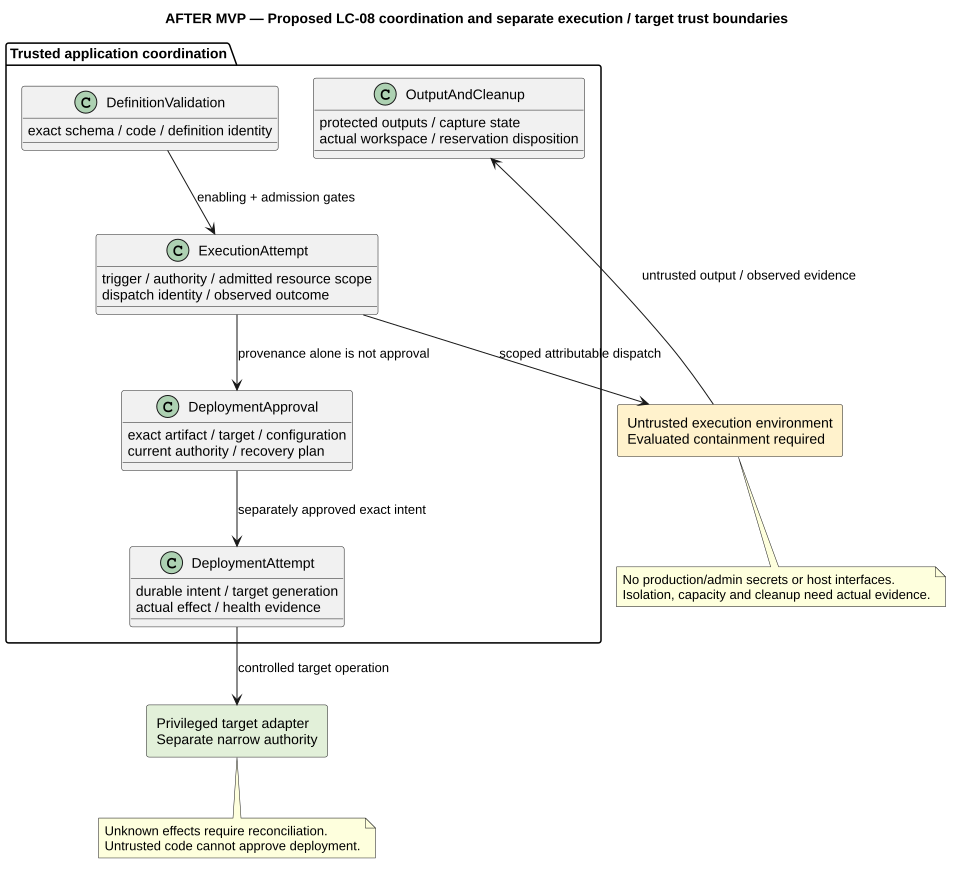

[Editable PlantUML](diagrams/workflow-trust-model.puml) · [PNG](diagrams/workflow-trust-model.png)

**SupportedContract / DefinitionValidation:** schema version, exact inputs, diagnostics and validation evidence. **RunIntent:** attributable trigger and requested immutable context. **ExecutionAttempt:** distinct identity, bound code/definition/policy/environment context, admitted resource scope and actual observed outcome. **DispatchRecord / ExecutorObservation:** stable launch identity and attributable evidence; a callback is untrusted until authenticated and scoped.

**CancellationRecord:** requested action and confirmed/unknown stop evidence. **OutputManifest:** exact admitted artifact/log identities and capture state. **CleanupRecord:** actual process/workspace/secret/reservation disposition. **DeploymentApproval / DeploymentAttempt:** separately authorized exact target/artifact/configuration intent, attempt identity and actual target observations.

Execution admission, dispatch acknowledgment, running observation, terminal outcome, cancellation intent, output availability, cleanup and deployment outcome remain separate dimensions. Q-D23's proposed Queued/Running/Succeeded/Failed/Cancelled/Unknown states cannot encode every one of these facts in one column. Preserve contradictory or late evidence for reconciliation rather than overwriting history.

Final schemas, state-transition rules, leases/fencing, callback sequencing and retention follow [data design](../../04-data-design/README.md). No distributed exactly-once execution or transaction spanning SQL, executor, artifact store and target is claimed.

## 4. Admission, dispatch and reconciliation protocol

1. Resolve exact repository/code/definition and current trigger/actor authority. Validate supported semantics without executing them.
2. Check applicable enabling evidence and atomically reserve bounded concurrent capacity under actual resource/accounting policy. Record immutable admitted context and durable dispatch intent in the evaluated local transaction.
3. Dispatch the same attempt through the evaluated executor identity/deduplication protocol. Recheck authority at consequential boundaries; do not serialize an evergreen privileged session into a worker.
4. Accept only attributable observations for the intended attempt/executor generation. Maintain real pending/running/terminal/unknown facts and actual step outcomes under reviewed aggregation rules. Connection loss or elapsed coordinator timeout alone does not prove termination.
5. Admit and protect bounded outputs through Files; preserve exact code/attempt provenance. Resolve terminal execution separately from output/cleanup state and any deployment eligibility.
6. Reconcile interrupted launches, cancellation races and cleanup from actual executor/effect evidence. Release reservations only when the corresponding resources are proven releasable. Fresh retries require explicit policy/authority and known effect boundaries.

Use application handlers and state policies for orchestration, durable repositories for intents/observations and injected executor/storage/target adapters. The executor cannot become a privileged in-process application service merely for convenience. Leases without fencing do not prove an old worker stopped; concrete stale-worker exclusion and capacity accounting remain implementation gates.

## 5. Separate deployment protocol

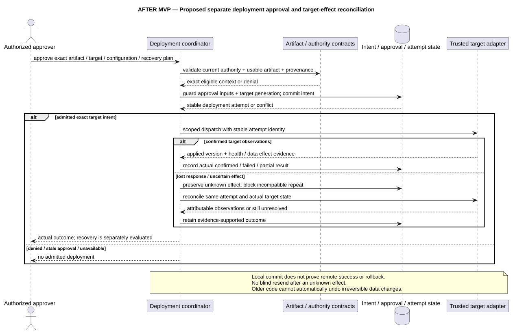

[Editable PlantUML](diagrams/workflow-deployment-sequence.puml) · [PNG](diagrams/workflow-deployment-sequence.png)

1. Resolve an exact usable artifact and trustworthy provenance under reviewed eligibility; do not deploy a mutable artifact name or branch alias as though it identifies fixed bytes.
2. Obtain separate attributable target approval and current target authority. Validate actual configuration, data migration compatibility, maintenance/availability impact, health checks and recovery procedure. Approval must not silently transfer to changed inputs.
3. Protect the artifact and record durable deployment intent/attempt. Serialize or otherwise guard incompatible target operations with an evaluated target-generation/fencing mechanism; a coordinator lock alone may not exclude an already running remote operation.
4. Dispatch through a narrowly scoped trusted target adapter. Untrusted job code cannot receive target secrets or approve its own stage. Local SQL completion cannot prove target changes succeeded or rolled back.
5. Observe actual applied version/configuration, health and data effects. Record confirmed, failed/partial or unknown outcome with attributable evidence. Health success alone may not establish data compatibility or completion of every required step.
6. On uncertainty, freeze incompatible consequential repeats and reconcile the same target attempt. Rollback or forward recovery is a separately evaluated/authorized action; an irreversible data migration cannot be undone merely by redeploying older code. Preserve current authority and the reviewed recovery plan.

Deployment evidence never implies successful backup/restore or general release approval. Use [deployment topology](../../01-software-architecture/04-deployment-topology-nodes-and-networks.md) and [operations/recovery](../../06-design-quality-and-security-analysis/03-operations-backup-recovery-and-resilience.md) for shared operating responsibilities.

## 6. Technical scenarios and failure handling

**Enabling evidence missing or changed:** keep real execution blocked, state the unresolved resource/isolation finding and route the scope/budget conflict through existing decisions. Validation-only functionality must be labeled honestly.

**Untrusted ref/fork/definition:** resolve actual provenance and scoped credentials. Deny attempts to reach production/admin services, host paths, other jobs or unauthorized destinations using the evaluated enforcement mechanism. A container label, log redaction or schema validation is not containment evidence.

**Runner loss / lost launch acknowledgment:** preserve Unknown/pending effect context until reconciled; do not silently dispatch a duplicate, free active capacity or mark cancellation confirmed. Quarantine unresolved reusable state where necessary.

**Cancel/complete race / stale callback:** retain actual event ordering and guarded attempt identity. Do not rewrite a completed effect as no-effect Cancelled or accept an observation from a superseded executor generation.

**Secret/output incident:** stop further exposure where possible, restrict output, revoke/rotate affected credentials through their responsible authority and preserve bounded incident evidence. Already disclosed credentials are not made safe by deleting a log or replacing matching text. Actual incident response needs a reviewed procedure.

**Resource exhaustion / cleanup failure:** enforce evaluated process/output/workspace bounds and account for residual usage. Reject new work when the promised headroom is unavailable. Terminal outcome and actual reclamation remain distinct.

**Unknown deployment effect:** inspect the intended target attempt and actual applied state before repeat/recovery. Do not blindly resend deployment or call an API timeout a rollback. Preserve partial data/target evidence and prevent conflicting actions under the chosen coordination protocol.

**Restored coordinator:** reconcile current grants, pending intents, executor generations, outputs and actual target state before dispatch. Do not replay old execution/deployment automatically from restored pending rows. Isolated restore and recovery-key usability need actual evidence.

Diagnostics retain bounded attempt/revision/target/policy/result provenance with reviewed retention and access; exclude secrets, production data dumps and executable log rendering. No cleanup, retry, incident or restoration permission is invented by this documentation.

## 7. Verification and remaining decisions

| Source group | Component responsibility |
| --- | --- |
| YML-D01–D03 | Supported semantics, authorized triggers and immutable run/attempt provenance  **After MVP.** |
| YML-D04–D06 | Demonstrated isolation, scoped secrets and bounded resource admission  **After MVP.** |
| YML-D07–D09 | Evidence-supported outcomes, private outputs, cancellation and reconciliation  **After MVP.** |
| YML-D10 | Separately authorized exact-artifact/target deployment and recovery  **After MVP.** |
| YML-D11/D12 | Actual cleanup, operating guidance and hard enabling-evidence gate  **After MVP.** |

This maps responsibility; exact criterion closure and Q-D23 feasibility/acceptance remain pending.

### Planned focused checks

- Unsupported/malformed definitions, immutable revision binding, duplicate triggers and changed authority/ref context.
- Actual process/filesystem/network/admin/credential isolation, cross-job leakage and evaluated escape/denial controls in an authorized isolated test environment.
- Concurrent capacity reservations, sustained/temporary growth, output caps, timeouts and actual cleanup before capacity reuse.
- Lost launch acknowledgment, stale worker/callback, runner loss and cancel/complete races without duplicate effects.
- Restricted safe log/artifact retrieval, secret leakage paths and exact output provenance/protection.
- Approval invalidated by artifact/target/configuration changes; untrusted code unable to approve/deploy or obtain target secrets.
- Partial/unknown target effects, concurrent deployments, incompatible data migration and reviewed forward/rollback recovery.
- Restored pending attempts without replay and reconciliation against actual executor/target state.

Use deterministic policy/state checks plus actual persistence/concurrency and authorized executor/target integration evidence. Mock success cannot establish containment, process termination, resource fit or target rollback. No workflow execution, secret injection, deployment, escape test or recovery test is performed by this update.

### Remaining implementation prescriptions

Resolve Q-D23's actual containment mechanism, budget-compatible capacity, supported schema/triggers and numerical policy candidates. Specify concrete types/schema, dispatch identity/deduplication/fencing, observation authentication, cancellation/termination evidence, secret lifecycle, output admission and cleanup accounting. Separately evaluate target adapters, approval scope, deployment ordering, data compatibility, health checks and recovery. Record exact criterion/evidence mapping before dependent implementation/enabling; these gates are not completed by a design document.

Use [component templates](../README.md), [interface contracts](../../05-interface-and-api-design/README.md), [runtime design](../../01-software-architecture/03-process-view-concurrency-and-runtime-behavior.md), [security design](../../06-design-quality-and-security-analysis/02-security-threat-modeling-and-trust-boundaries.md) and [review/handoff](../../06-design-quality-and-security-analysis/05-design-review-traceability-and-handoff.md). These views adapt the FAU component-refinement approach and establish neither final physical implementation nor phase acceptance.

[Component catalog](../README.md) · [Diagram catalog](diagrams/README.md)

## 8. Workflow, executor and deployment views

**Release applicability:** future-domain design retained after MVP; core operating/deployment and recovery controls still apply to MVP where relevant.

This package adds **nine complementary diagrams and one permission/approval matrix**, reusing the [existing domain/trust model](#3-owned-model-and-state-dimensions) and [exact-approval deployment sequence](#5-separate-deployment-protocol). It covers the requested topics without duplicating those views. Q-D23 supported schema, trigger/state vocabulary, numerical limits and executor feasibility remain proposed/evidence-gated. No artifact registry, secrets manager, environment service, notification product or traffic strategy is adopted.

### 8.1 Coordination, executor and target contracts

**Release applicability:** future-domain design retained after MVP; core operating/deployment and recovery controls still apply to MVP where relevant.

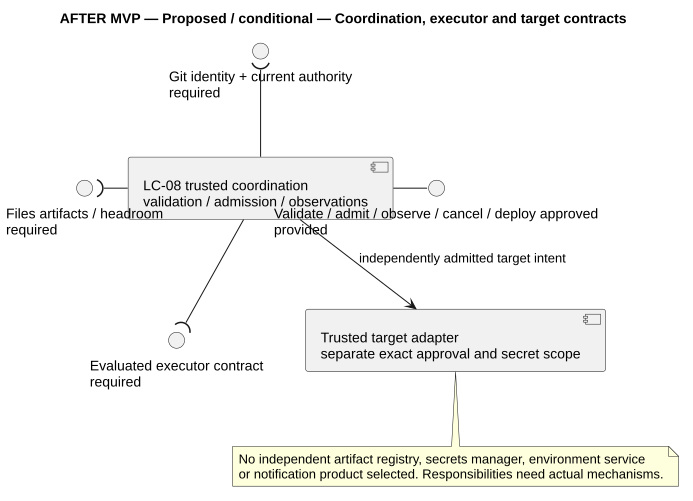

[Editable PlantUML](diagrams/workflow-essential-components.puml) · [PNG](diagrams/workflow-essential-components.png)

Logical provided/required contracts, not independently deployed services. Untrusted executor code cannot access privileged target credentials or authorize deployment; secrets and artifacts are scoped references, not public API payloads.

### 8.2 Candidate CI/CD path with distinct execution and deployment gates

**Release applicability:** future-domain design retained after MVP; core operating/deployment and recovery controls still apply to MVP where relevant.

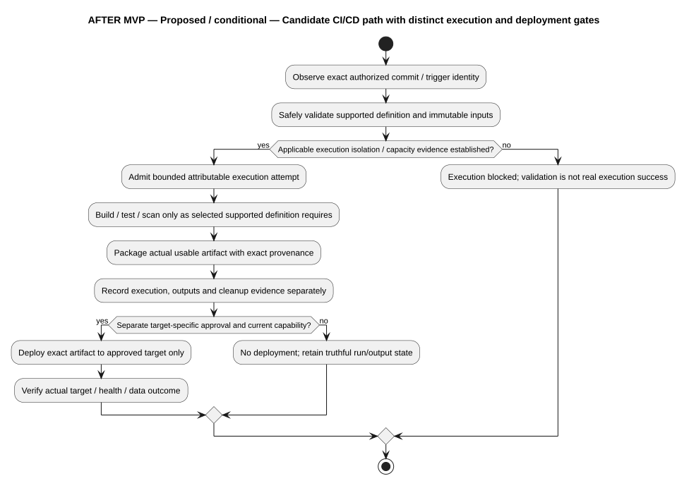

[Editable PlantUML](diagrams/workflow-essential-pipeline.puml) · [PNG](diagrams/workflow-essential-pipeline.png)

Build/test/scan/package are candidate pipeline responsibilities, not mandatory schema keys or installed scanners. No default dev→staging→prod automation, registry or GitHub Actions compatibility is selected. Every actual execution and target operation remains evidence-gated.

### 8.3 Run observation, cancellation and cleanup dimensions

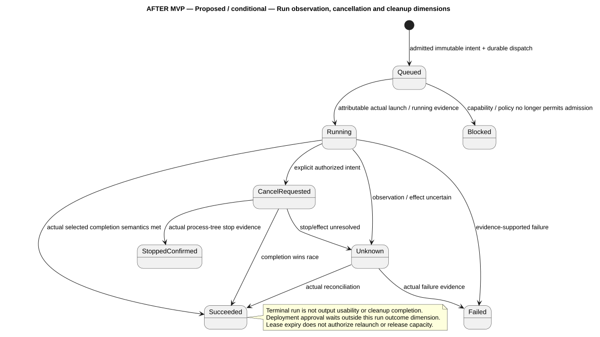

[Editable PlantUML](diagrams/workflow-essential-run-state.puml) · [PNG](diagrams/workflow-essential-run-state.png)

Proposed observation vocabulary, not final Q-D23 enums. Waiting-for-approval belongs to the separate deployment intent, not a claim that all pipelines contain an approval stage. Stop requested, stop confirmed, terminal effect and reclaimed resources stay distinct.

### 8.4 Deployment approval and actual target outcome

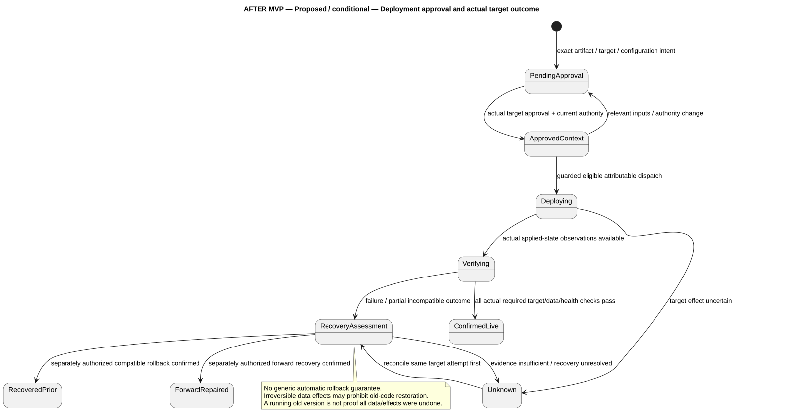

[Editable PlantUML](diagrams/workflow-essential-deployment-state.puml) · [PNG](diagrams/workflow-essential-deployment-state.png)

Separate approval/readiness/target knowledge dimensions summarized in one view, not persisted enums. “Live” requires the actual defined checks; rollback/forward repair is a new authorized operation with its own failure/unknown state. Health success alone may be insufficient.

### 8.5 Deployment strategy alternatives, not a selection

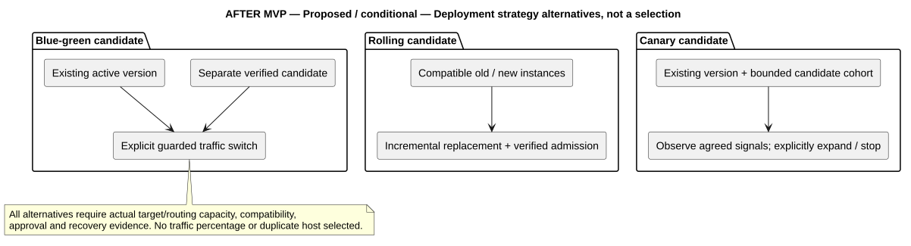

[Editable PlantUML](diagrams/workflow-essential-strategies.puml) · [PNG](diagrams/workflow-essential-strategies.png)

Comparison only. Existing small-host inventory does not establish multi-instance capacity, load balancers or data compatibility. No strategy, traffic-shifting mechanism, automatic expansion or paid facility is adopted; a simpler guarded replacement may be evaluated for the actual target.

### 8.6 Failed verification and safe recovery decision

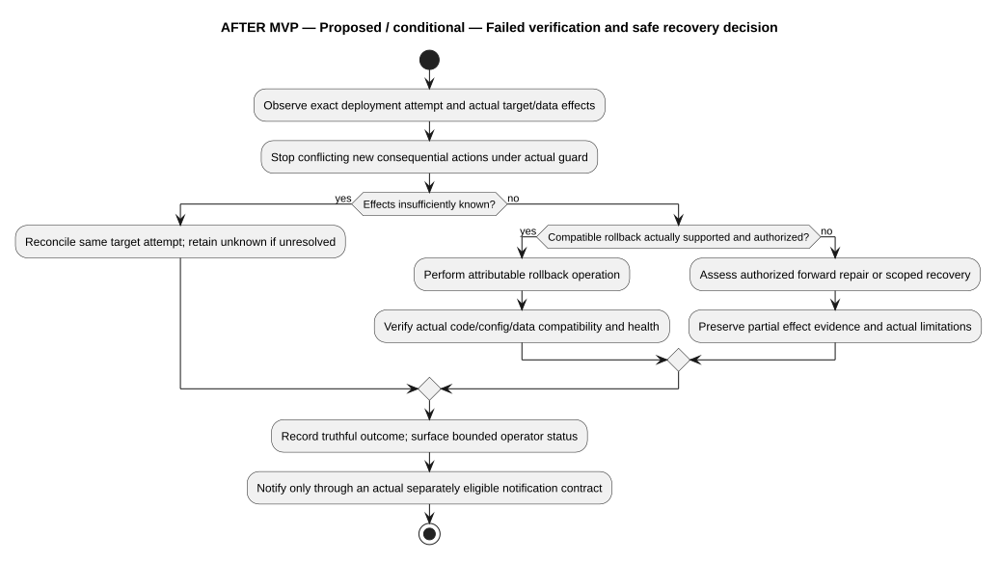

[Editable PlantUML](diagrams/workflow-essential-recovery.puml) · [PNG](diagrams/workflow-essential-recovery.png)

No automatic rollback/notification is selected. Reverting application files cannot unsend messages, reverse all target side effects or undo an irreversible migration. A failed health probe is evidence to assess, not universal permission to restore older code.

### 8.7 Conditional environment promotion and exact approval gates

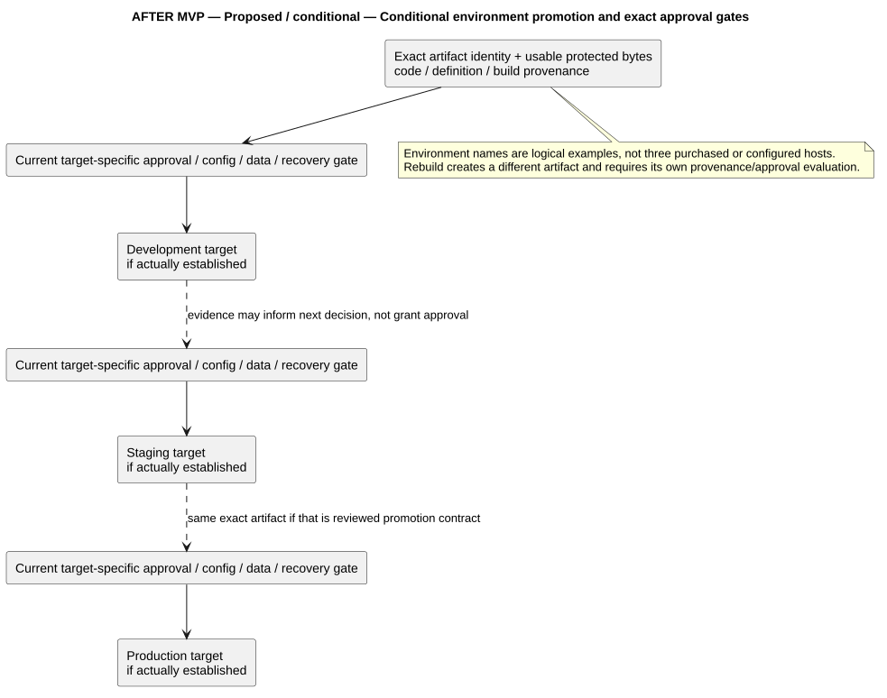

[Editable PlantUML](diagrams/workflow-essential-promotion.puml) · [PNG](diagrams/workflow-essential-promotion.png)

Promotion is conditional and target-scoped, not an automatic deployment chain. Successful dev/staging checks do not approve production or establish recovery readiness. Changed target/configuration/artifact invalidates approval according to actual policy.

### 8.8 Runner architecture and trust isolation

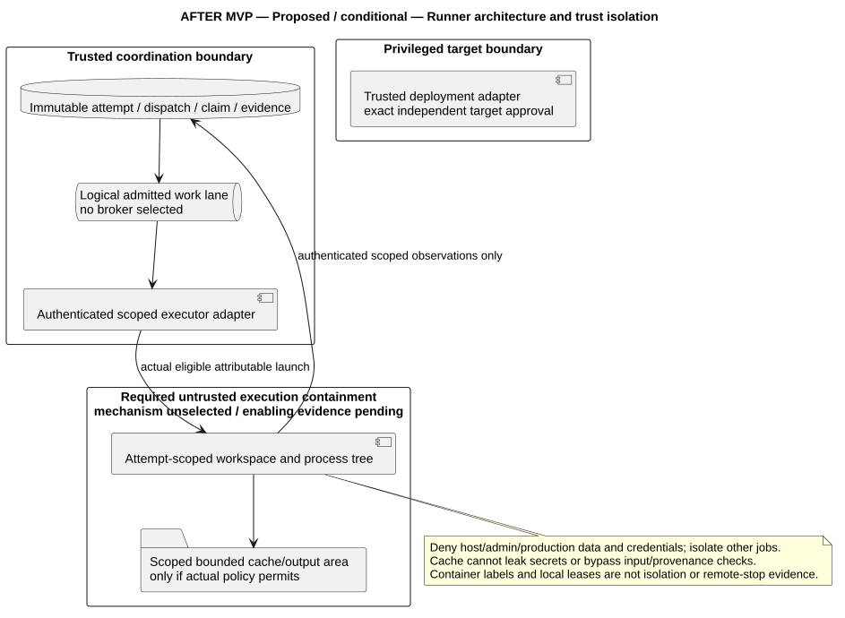

[Editable PlantUML](diagrams/workflow-essential-executor.puml) · [PNG](diagrams/workflow-essential-executor.png)

Logical queues/workers do not select a runner product, container engine or cache. Actual process/filesystem/network/secret/resource containment and cleanup must be demonstrated before real YAML execution. Untrusted code has no connector to privileged target operations.

### 8.9 Candidate executor and deployment placement

**Release applicability:** future-domain design retained after MVP; core operating/deployment and recovery controls still apply to MVP where relevant.

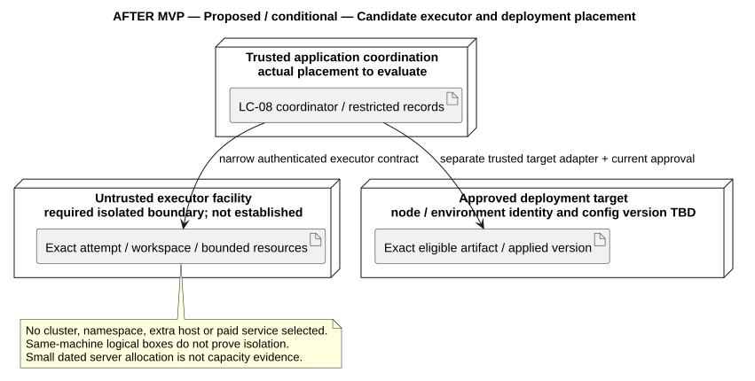

[Editable PlantUML](diagrams/workflow-essential-topology.puml) · [PNG](diagrams/workflow-essential-topology.png)

Optional node mapping, not an installed topology. Dev/staging/prod may be logical scopes; exact target identities, secrets, compatibility, resource headroom and recovery facilities require actual selection/evidence. Executor code cannot obtain target approval credentials.

### 8.10 Scoped permission and target-approval matrix

Rows describe operation scopes, not adopted global roles or a settled separation-of-duties rule. No second approver is invented for this solo-owned project. Actual policy must identify who can approve each exact environment/action; untrusted code can never approve itself or inherit production secrets from a successful run.

| Current actor / capability | Definition / run | Output / cancel | Development / staging target | Production / other protected target |
| --- | --- | --- | --- | --- |
| Repository-authorized contributor | Edit/read definitions only within Git grants; actual launch requires distinct current run admission and enabling evidence | Only permitted exact run/output scope; cancel is a request, not confirmed stop | No deployment authority inferred from write/run success | None inferred from branch, YAML, PR approval or check |
| Execution-admission authority | Exact trigger/code/definition, bounded resources and applicable evidence only | Current run scope and actual facility contract | Separate target authority/approval required even for development | Separate exact target/config/artifact approval required |
| Scoped executor identity | Only admitted attempt, workspace and actually allowed secrets | Authenticated attempt observations; no unrestricted data/output access | Cannot approve or reach privileged target by implication | No production/admin credentials, application data or approval power |
| Target-authorized approver | No additional repository/run grant implied | No extra private output scope implied | Actual established environment, exact artifact/configuration and recovery context | Actual protected-target scope, current approval and compatibility; changed inputs require reevaluation |
| Trusted deployment adapter | Only exact independently admitted target operation | Attributable actual target observations; no forged success | Narrow target credential and conflict/unknown-effect guard | Same constraint; coordinator lock alone cannot fence old remote work |
| Scoped operator / recovery authority | Only actual permitted intervention | Cleanup/resource release only from real evidence | Separately assessed compatible rollback / forward repair | No automatic rollback, old-grant restoration or replay from backups |

**Domain refinement:** the existing model uses SupportedContract/DefinitionValidation for a versioned supported pipeline definition, RunIntent/ExecutionAttempt for immutable work, OutputManifest for actual artifacts, and DeploymentApproval/DeploymentAttempt for exact target intent. Stage/Job/Step/Trigger, Environment/Release and Secret are concepts to map only where the supported contract/source requires them; do not create a generic pipeline framework or expose raw secret values merely to fill a class diagram. Supported secret handles and target configuration need separate scoped lifetime and provenance.

**Integration sequence coverage:** the existing section 5 sequence supplies exact artifact, approval, target dispatch, health/outcome observation and reconciliation. A webhook is only one possible trigger transport, not selected infrastructure or an authorization grant. Trigger provenance, duplicate delivery, current authority, real executor isolation and usable artifacts precede any separately authorized deployment.

These diagrams do not enable validation-only work as a substitute for agreed conditional real execution. Actual feasibility blockers remain visible and require scope/budget disposition without silent feature removal or infrastructure purchase. No pipeline, scan, cache, runner, secret, environment, deployment, traffic shift, rollback or notification is executed/configured by this documentation update.
