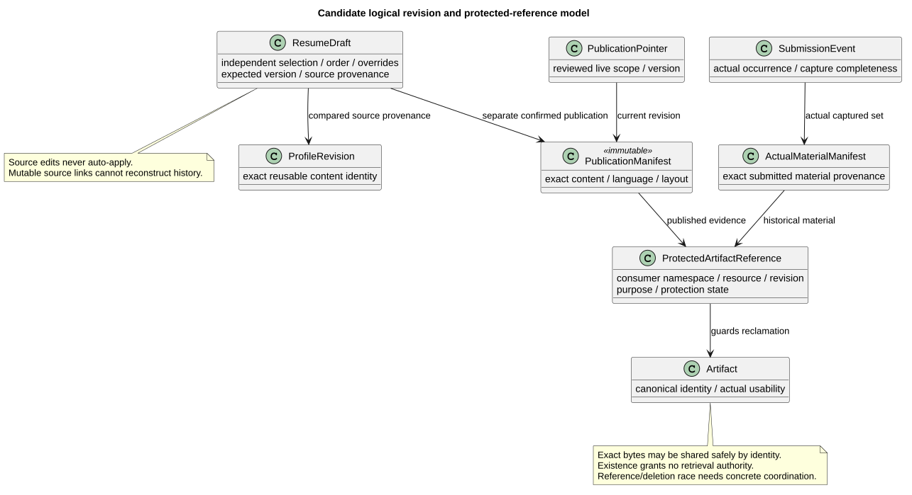
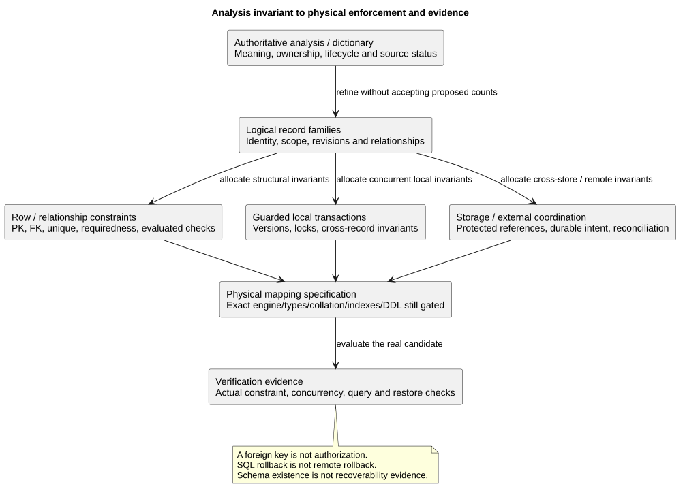
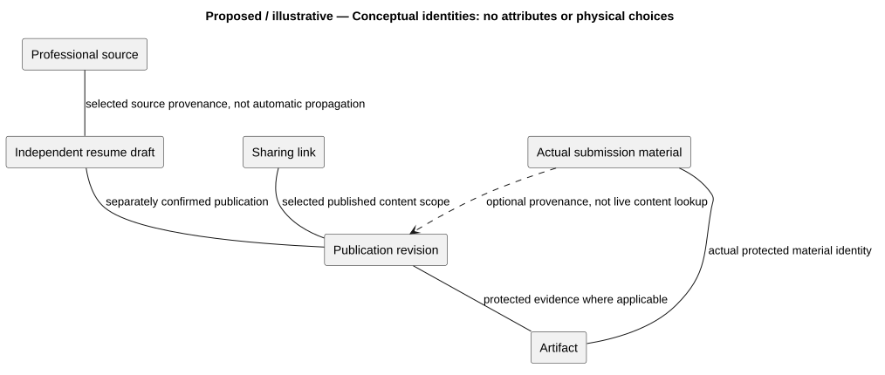
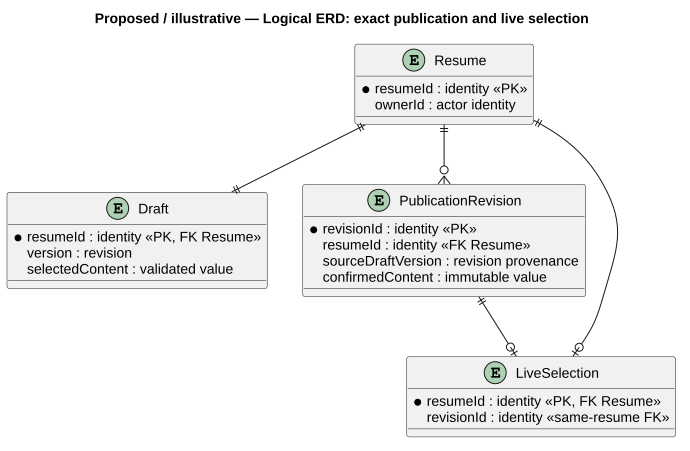
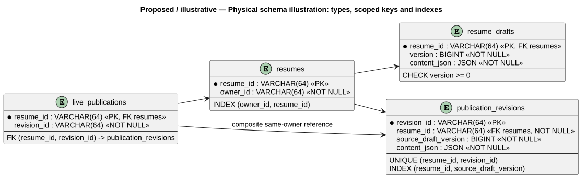
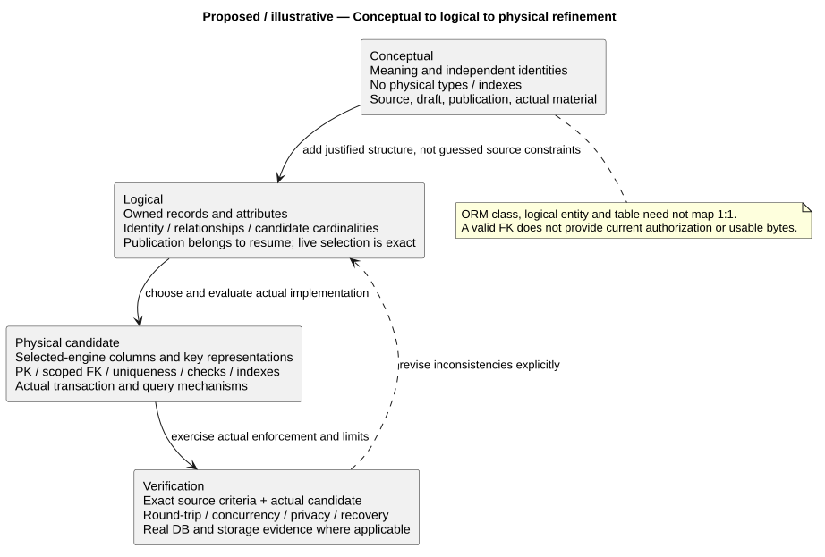
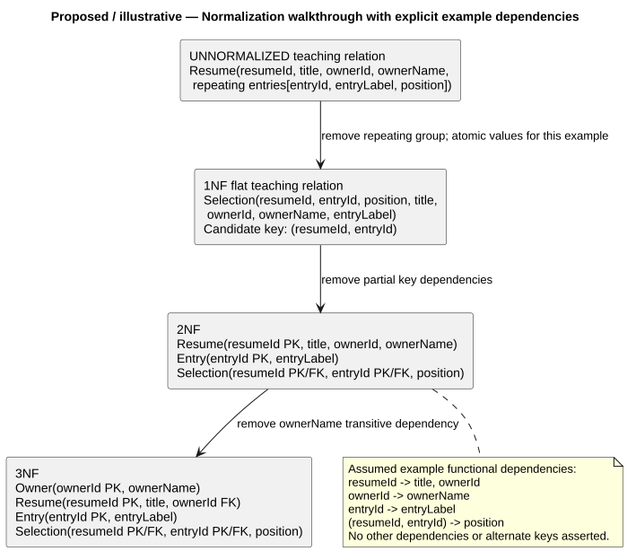

# Resumefolio — Analysis to Logical and Physical Data Models

Current implementation choices and scope: [Baseline](../../../baseline/README.md). Runtime verification remains subject to its gates.

**Purpose:** refine the conceptual information model into reviewable logical record families, integrity rules, access patterns and a physical-design specification for implementation.

**Status:** proposed technical design, November 2, 2026. This document defines a candidate relational model and physical mapping obligations, not an accepted engine, executable migration or verified schema. The accepted profile-update/publication/history behavior is preserved; unresolved source cardinalities and policies remain unresolved.

[Sources](#1-analysis-to-design-contract) · [Ownership](#2-logical-record-families-and-ownership) · [Revisions](#3-revision-and-reference-model) · [Integrity](#4-keys-relationships-and-integrity) · [Physical mapping](#5-physical-representation-and-access-paths) · [Transactions](#6-consistency-and-external-state) · [Handoff](#7-schema-evolution-verification-and-handoff)

## 1. Analysis-to-design contract

The [domain model](../../03-system-analysis/02-domain-and-information-analysis/03-domain-model-and-object-oriented-view.md) explains responsibilities; the [data-oriented view](../../03-system-analysis/02-domain-and-information-analysis/05-data-oriented-view.md) defines information meaning, conceptual ER relationships and integrity checks. Use the [dictionary](../../02-requirements-engineering/05-data-definitions/data-dictionary.md), [glossary](../../02-requirements-engineering/05-data-definitions/glossary.md), [operation contracts](../../03-system-analysis/05-business-rules-and-operation-contracts/10-domain-constraints-and-operation-contracts.md) and [source decisions](../../02-requirements-engineering/07-change-and-baseline/open-questions-and-decisions.md) as authorities. This file refines them rather than creating a competing conceptual specification.

For each implementation record, trace **source concept/criterion → owning component → logical identity/relationship → invariant → physical enforcement → verification evidence**. DA-S/DA-I analysis locators and provisional requirement IDs remain source locators, not mandatory table names or final accepted requirements.

Design levels are distinct:

| Level | Question answered | Current deliverable |
| --- | --- | --- |
| Conceptual analysis | What information and meaning must remain distinct? | Existing linked analysis and dictionary |
| Logical design | Which owned records, keys, relationships and rules preserve that meaning? | Candidate families, revision model and integrity allocation below |
| Physical design | Which exact types, constraints, indexes and storage operations implement those rules on a chosen engine? | Candidate representation/access-path specification; engine-specific DDL remains gated |

Do not interpret an analysis diagram's unspecified endpoint as one-to-one or convert a P-labeled proposed count into a database constraint without source disposition. One coherent Sprint Backlog is an established meaning; one profile per account, one active Sprint and other detailed limits retain their proposal status.

## 2. Logical record families and ownership

Prefer transactional relational persistence for local structured state as the current design candidate, consistent with [persistence/lifecycle guidance](03-persistence-caching-and-data-lifecycle.md). A logical family can map to several tables or a justified structured value. It is not a separate database or deployment mandate.

### Identity and Access — LC-01

Account, credential/factor verification references, session/invitation state, scoped grants and attributable authority changes. Keys preserve actor/resource/action context and current eligibility. Work/repository-specific relationships coordinate with this authority; a universal role column cannot encode every resource permission. See [component design](../03-component-and-module-design/components/identity-and-access.md).

### Professional Presentation — LC-02

Profile content/revisions, stable professional entry identities, language-specific values, resume drafts, independent selections/order/overrides, comparisons and immutable publication manifests. Profile provenance does not cause live lookup to overwrite a resume. See [component design](../03-component-and-module-design/components/professional-presentation.md).

### Representation and Sharing — LC-03

Download configuration, independent sharing links, protected verifier references, viewer authorization generations, uploaded associations and exact-input generated-rendition attempts. Link state, PDF mode, current publication and available bytes remain separate dimensions. See [component design](../03-component-and-module-design/components/representation-and-sharing.md).

### Manual Applications — LC-04

Company/opportunity/application context, authored cover letters, progress, submission events/corrections and independently preserved actual-material manifests. Actual submitted material never resolves solely through a mutable current-resume reference. See [component design](../03-component-and-module-design/components/applications.md).

### Communication and Calendar — LC-05

**Release applicability:** future-domain design retained after MVP; core operating/deployment and recovery controls still apply to MVP where relevant.

Provider connections and protected credential references, locally owned notes/associations, provider-scoped message/event identities, local activities, mappings and send/synchronization/reminder attempts. Provider truth and local desired state remain distinguishable; local-only events have no fabricated provider ID. See [component design](../03-component-and-module-design/components/communication-and-calendar.md).

### Work Management — LC-06

Work projects, boards/column mappings/card placements, items/tasks/assignments, scoped membership relationships, Sprints, coherent goal/selected-work/delivery-plan records and historical outcomes. A board is a view; card position and task completion are not item acceptance. See [component design](../03-component-and-module-design/components/work-management.md).

### Git Collaboration — LC-07

Repository namespace/ownership/storage association, grants/ref policies, forks, review requests and exact reviewed revisions, issues/milestones and releases. SQL metadata is not the authoritative Git object/ref store. See [component design](../03-component-and-module-design/components/git-collaboration.md).

### Workflow and Deployment — LC-08

**Release applicability:** future-domain design retained after MVP; core operating/deployment and recovery controls still apply to MVP where relevant.

Supported-definition validation, immutable run context, admitted execution attempts, dispatch/observations, output/cleanup associations, separate target approval and deployment attempts. Execution outcome, cancellation request, cleanup and target effect are separate facts. See [component design](../03-component-and-module-design/components/workflow-and-deployment.md).

### Files and Operations — LC-09

Artifact identity/provenance/usability, effective quota policies/reservations/accounting, protected consumer references, replacement/reclamation attempts and recovery assessments. Native Git and generated/temporary outputs need explicit evaluated accounting adapters. See [component design](../03-component-and-module-design/components/files-and-operations.md).

Cross-component reads use permitted contracts/projections; ownership does not prohibit evaluated foreign keys in a shared relational store. A foreign key provides referential integrity, not authorization or permission to mutate another component's records.

## 3. Revision and reference model

[Editable PlantUML](diagrams/data-logical-revisions-and-references.puml) · [PNG](diagrams/data-logical-revisions-and-references.png)

The diagram names candidate logical records; ordinary arrows express relationships, not accepted minimum/maximum cardinalities. Physical table decomposition remains a design choice.

**Stable identity versus version:** a resume/profile/item identity names the continuing resource; a revision/version names exact content or a concurrency state. Do not reuse a mutable resource ID as proof of immutable historical content. Revision numbering strategy and identifier format remain physical choices.

**Independent draft state:** represent selected entry identities, ordering and explicit override values separately from shared source values. Distinguish “no override” from an intentional empty value and omitted selection. Comparison records or issued comparison identities bind the exact source/draft versions; stale application must conflict or follow an explicitly reviewed merge rule.

**Publication manifest:** preserve sufficient exact content, selection, language, layout/render-input identity and artifact references for the promised publication behavior. A manifest may embed an immutable snapshot or reference immutable version records; it must not dereference mutable source text to reconstruct history. The accepted policy does not require retaining every intermediate keystroke forever.

**Actual material manifest:** submission events identify actual captured material with provenance and completeness state. The artifact may be safely shared by exact immutable identity if reference protection is sufficient; historical independence does not mandate duplicate physical bytes. Report incomplete capture honestly rather than synthesizing “actual submitted” material from today's publication.

**Protected reference:** consumer namespace/resource/revision/purpose identifies why an artifact cannot be reclaimed. Reserve/protect before consumer commit, finalize using actual committed consumer evidence and release only after proving it safe. An uncertain acknowledgment keeps protection pending. The concrete shared-database or cross-owner protocol must exclude the race between new reference registration and physical deletion.

**Historical work and external context:** Sprint closing preserves goal/scope/plan/outcome meaning independent of later item edits. Git reviews bind exact source/target repository revisions. Provider operations and execution/deployment attempts preserve intended versus observed external state. These cannot all be reduced to one generic “status/history” blob.

## 4. Keys, relationships and integrity

### Identity and scoping

- Use stable non-secret primary identities. Decide generated integer versus UUID/other representation after evaluating key size, exposed-ID handling and actual workloads; unguessable identity alone is not access control.
- Namespace external identifiers by provider connection/account/type or repository context. External IDs are opaque values with evaluated length and comparison semantics; do not impose numeric or case-insensitive interpretation by default.
- Scope command deduplication to the actual owner/actor/resource/operation contract. Store enough protected intent comparison to distinguish a true duplicate from reused identity with changed payload. Do not copy secrets into ordinary command/audit records for convenience.
- Use uniqueness for source-authorized identities and associations, not guessed business labels. A proposed single-profile or active-Sprint limit cannot be accepted through a unique index.

### Referential and domain constraints

Within an evaluated shared store, use foreign keys where they match lifecycle and ownership. Prevent cross-owner/project links using compatible scoped composite keys or guarded owner-side transactions, not merely a child-row FK to a globally valid ID. Use typed association tables or a resource registry with explicit lifecycle enforcement where heterogeneous grants/links are needed; a free-form `(type, id)` pair has no automatic database referential guarantee.

Define requiredness per claim: an incomplete draft can differ from a publishable revision; a queued attempt can lack a started timestamp; an unknown external outcome is not a known failure; a local event need not have a provider mapping. Represent absent/unknown/not-applicable distinctions explicitly where the domain needs them. Avoid sentinel IDs, empty timestamps and arbitrary zero values.

| Invariant | Candidate enforcement and limit |
| --- | --- |
| Required identity, valid references, source-approved uniqueness | PK/NOT NULL/FK/UNIQUE where evaluated and applicable; engine behavior must be verified |
| Valid ranges and row-local combinations | Evaluated CHECK/type constraints plus domain validation; exact engine/version support remains pending |
| Expected revision on mutation | Conditional update/lock and guarded result; no silent lost update |
| Cross-record Sprint/ordering/ownership rules | Owner-side consistent transaction and suitable lock/guard set; isolated row checks are insufficient |
| Current grants and revocation boundary | Resource-specific evaluation synchronized with admission; referential integrity alone does not authorize |
| Consumer reference versus reclamation | Shared reference/deletion guard or evaluated coordination protocol, including uncertain commit recovery |
| Remote send/Git ref/execution/target effect | Durable intent and attributable observation/reconciliation; SQL rollback cannot undo remote effects |

### Normalization and justified snapshots

Normalize reusable identities, ownership, grants and many-to-many selections/associations. Keep independent cardinality and ordering explicit. Do not store comma-separated foreign IDs or repeat mutable account/provider metadata across operational tables as competing truth.

Immutable publication/submission/Sprint snapshots are intentional preservation of historical meaning, not an accidental second mutable source. Cached projections/counters require an owner, provenance/version, rebuild path and stale-data behavior. Justify denormalization against measured access patterns and maintenance costs before selecting it. JSON is suitable only where its exact shape, versioning, validation, size and query/constraint limits are defined; it cannot hide core ownership and authorization relationships.

## 5. Physical representation and access paths

[Editable PlantUML](diagrams/data-physical-enforcement-map.puml) · [PNG](diagrams/data-physical-enforcement-map.png)

### Candidate representation specification

The following are type families and obligations, not final SQL column definitions. Evaluate actual database engine/version, transactional storage configuration, driver/ORM, collation and migration facilities before executable DDL. The observed demo MySQL installation is not engine selection or proof that the required features behave correctly.

| Logical value | Physical mapping obligation |
| --- | --- |
| Resource/revision identity | Exact PK/FK representation and compatible referenced types; no accidental coercion |
| Concurrency version | Non-null revision/counter or evaluated token with conditional-update semantics; overflow/regeneration rule |
| Language and opaque provider/Git identifier | Explicit validated domain and intentional case/comparison/length rules; no silent truncation |
| User text/structured manifest | Unicode-capable representation, reviewed size bounds and schema/version validation; safe rendering remains application work |
| Instant / local date / time zone | Distinct representations: normalized UTC instants for actual events, date-only where intended, named intended zone/local scheduling context where required |
| Size/quota/reservation | Non-negative exact integer units and evaluated range/overflow; atomic concurrent accounting |
| Credential/verifier/key reference | Evaluated protected storage and restricted projections; never plaintext secrets in diagnostics, migrations or seed data |
| Artifact/Git storage locator | Canonical private identity and metadata, not a publicly retrievable path or arbitrary user-supplied executable path |

Store private artifact bytes and native Git objects/refs through evaluated storage adapters. SQL records own their metadata, provenance, protection and known state; metadata existence is not proof that bytes, refs or keys are usable. Filesystem/object-store and SQL backup consistency needs an explicit recovery procedure.

### Query-driven candidate indexes

- **Private resource lists:** owner/context plus relevant lifecycle/filter/order and stable pagination tie-breaker. Confirm that the query applies current permitted scope.
- **Draft/publication lookup:** resource/revision identity; current publication pointer unique within the reviewed publication/language scope. Do not infer one pointer per language until that scope is decided.
- **Reference checks:** artifact plus active/protected consumer scope and operation identity, supporting both new protection and guarded reclamation.
- **Pending operations:** dispatch/reconciliation state plus due/lease timing and stable identity; avoid scanning large private payload columns to find work.
- **Provider mappings:** connection/account/type/external identity under actual provider comparison rules.
- **Work and reviews:** project/board/order or Sprint/item selection; repository/request/evaluated revision context. Exact composite ordering follows real queries.
- **Access lookup:** canonical link locator or evaluated token-lookup representation, and scoped grant/session eligibility lookup. Indexes are not revocation or secrecy mechanisms.

For every proposed index, record actual query shape, expected selectivity/ordering, ownership filter, write cost and measured plan once an engine/candidate exists. No fixed index count, performance result, capacity claim or blanket indexing of every foreign key is asserted here.

## 6. Consistency and external state

Align with [runtime design](../01-software-architecture/03-process-view-concurrency-and-runtime-behavior.md) and the owning component's operation contracts. Select isolation/locking from actual invariants rather than a universal transaction-level slogan. Specify which records are locked, guard ordering, conflict/deadlock handling and bounded retry rules after engine evaluation.

Local transaction boundaries must preserve draft apply, publication-pointer/manifest/result updates, Sprint-plan consistency and command outcome identity. Unique constraints and conditional writes handle races that “check then insert/update” cannot safely prevent alone. Cross-record predicates and quota totals need an evaluated synchronization mechanism; optimistic versioning on one row does not protect unrelated rows automatically.

For external effects, atomically record local intent with its owned state where required, then dispatch and reconcile outside the local transaction. Durable dispatch does not promise exactly-once remote execution. Track confirmed/pending/partial/unknown effects and prevent blind resend/relaunch/redeploy after ambiguity. See [ADR-003](../07-design-decisions/ADR-003-durable-external-attempts.md).

Physical cleanup requires both safe reference exclusion and actual deletion/reclamation evidence. Restoration must reconcile current authority and external state before consumers resume. Restoring old session/grant rows or pending attempts cannot silently resurrect access or replay remote actions. Retention, caching and cleanup policy remain owned by [persistence and lifecycle](03-persistence-caching-and-data-lifecycle.md) and [operations/recovery](../06-design-quality-and-security-analysis/03-operations-backup-recovery-and-resilience.md).

## 7. Schema evolution, verification and handoff

### Required schema record before implementation

For each owned table/structured record, supply: source criterion and component owner; purpose; exact columns/types/units; nullability by lifecycle; PK/FK/unique/check rules; deletion/update actions; authorization lookup; read/write queries and indexes; version/transaction guards; sensitive-field handling; migration/backfill/compatibility; retention/reference/recovery behavior; and focused verification evidence. Record unresolved items as gates rather than guessing SQL.

Use [ADR records](../07-design-decisions/README.md) for consequential engine/storage/schema trade-offs. [ADR-002](../07-design-decisions/ADR-002-explicit-publication-and-history.md) supplies the proposed technical direction for publication/history while the underlying owner-accepted behavior remains authoritative. No new ADR acceptance is implied here.

### Migration and compatibility

Version schema and manifest formats explicitly. Evaluate expand/backfill/validate/switch/retire steps when readers and writers overlap; specify exact compatibility and deployment ordering. Test conversions, collation/uniqueness changes and historical-reference preservation on representative controlled data. A down migration cannot guarantee reversal of lossy transforms, deleted bytes or external effects. Destructive changes require the source-authorized lifecycle and a proven compatible recovery path, not an assumed cascade.

### Planned focused checks

- Cross-owner/project FK/reference manipulation, scoped uniqueness, requiredness and actual engine constraint behavior.
- Two independent resumes, selected source apply, separate publication and immutable actual submission history.
- Simultaneous conditional writes, duplicate commands, publication-pointer races and coherent Sprint-close history.
- Protected-reference registration/finalization racing cleanup, including lost acknowledgment and restored state.
- Provider identity scoping, opaque identifier comparison, multilingual text, intentional empty overrides and date/time-zone meaning.
- Quota overflow/concurrent reservations, pending dispatch lookup and stale-worker observation guards.
- Migration/backfill compatibility, query plans and isolated restoration with missing bytes/keys and current authority.

Use actual engine/persistence/concurrency integration evidence alongside deterministic domain checks. In-memory tests cannot establish database collation, isolation, FK behavior or storage recovery. No migration, database mutation, schema test, restore or query benchmark is performed by this document update.

**Completion boundary:** shared logical/physical mapping guidance is populated. Final engine/DDL, policy-dependent cardinalities, reference/authority synchronization, field limits, query-plan evidence and exact criterion closure remain implementation prerequisites. Advisor consultation was unavailable because the required shell launcher was absent; this document has no independent Advisor endorsement.

The split from analysis concepts to technical persistence follows FAU's architecture/component refinement and persistence concern; this folder/table organization is a project adaptation. Use the [reference map](../01-reference-and-coverage-map.md) and [design review/handoff](../06-design-quality-and-security-analysis/05-design-review-traceability-and-handoff.md) for coverage and acceptance.

[Data Design](README.md) · [Diagram catalog](diagrams/README.md)

## Essential data-model diagrams

Only **five essential complementary diagrams** are added; no new tables. They use one selected revision/pointer example to show conceptual meaning, logical structure, physical obligations and refinement. The [existing revision/reference view](#3-revision-and-reference-model), [physical enforcement view](#5-physical-representation-and-access-paths) and linked analysis domain/data models remain their authoritative owners. This package does not pretend to be a complete selected schema for all nine components.

### Conceptual identities: no attributes or physical choices

[Editable PlantUML](diagrams/data-essential-conceptual.puml) · [PNG](diagrams/data-essential-conceptual.png)

Selected conceptual excerpt to anchor the accepted source/draft/publication/actual-history distinction. It omits attributes, keys and unaccepted cardinalities. The authoritative full conceptual model remains in analysis; this excerpt creates no additional domain entities or permission grants.

### Logical ERD: exact publication and live selection

[Editable PlantUML](diagrams/data-essential-logical.puml) · [PNG](diagrams/data-essential-logical.png)

Proposed selected cardinalities, not acceptance of one-profile/account or all lifecycle rules. The live selection must identify a revision belonging to the same resume. sourceDraftVersion is historical provenance, not a foreign key to a mutable current version. Command results, content-language scope and artifact reference protocol remain outside this excerpt and must be refined.

### Physical schema illustration: types, scoped keys and indexes

[Editable PlantUML](diagrams/data-essential-physical.puml) · [PNG](diagrams/data-essential-physical.png)

SQL-style illustration consistent with the component template, not selected engine/DDL. VARCHAR(64), BIGINT, JSON and indexes are example choices, not accepted limits or a recommendation for exposed-ID encoding. Full owner FK, collation, version overflow, content validation, command identity/result storage, current authorization, language scope and protected references need actual design. Composite FK prevents selecting another resume’s revision; no cascade action is adopted. Check actual engine support and access plans before selecting indexes.

### Conceptual to logical to physical refinement

[Editable PlantUML](diagrams/data-essential-levels.puml) · [PNG](diagrams/data-essential-levels.png)

The three levels add different information. Source proposals cannot become accepted uniqueness/cardinality rules by entering a physical diagram. Physical schema and SQL atomicity cannot govern provider effects, native Git refs or artifact bytes without their actual protocols.

### Normalization walkthrough with explicit example dependencies

[Editable PlantUML](diagrams/data-essential-normalization.puml) · [PNG](diagrams/data-essential-normalization.png)

Synthetic teaching relation, not a discovered schema defect or adopted selection multiplicity. It assumes at most one entry per resume/entry pair solely for the exercise. A real entry may require language/version/occurrence identity. Do not use mutable Entry/Owner lookups to reconstruct immutable publication or actual submission content. Historical snapshots intentionally preserve exact old meaning and are not redundant mutable source-of-truth tables.

### Scope and consistency limits

The existing physical mapping/access-path text and tables remain unchanged; no new indexing, type, naming, denormalization or partitioning policy is selected. A separate functional-dependency diagram is unnecessary because the normalization figure states its assumed dependencies. Component-specific ORM/classes and schema excerpts stay in the [component template](../03-component-and-module-design/README.md) and actual owner designs. Data lifecycle/retention remains in the [persistence owner](03-persistence-caching-and-data-lifecycle.md).

Actual physical selection requires identified engine/version, exact source cardinality/status, types/collation, integrity/ref actions, query plans, current authority/version guards, protected-reference coordination and usable recovery evidence. A publication pointer/result commit and independent historical artifacts must remain coherent under real concurrency; a diagram or JSON column cannot establish that. No migration, data rewrite, normalization refactor, index build or database test is executed here.
